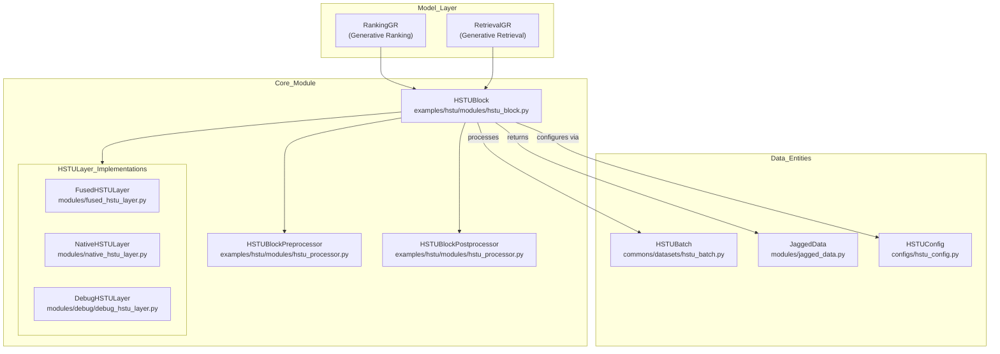
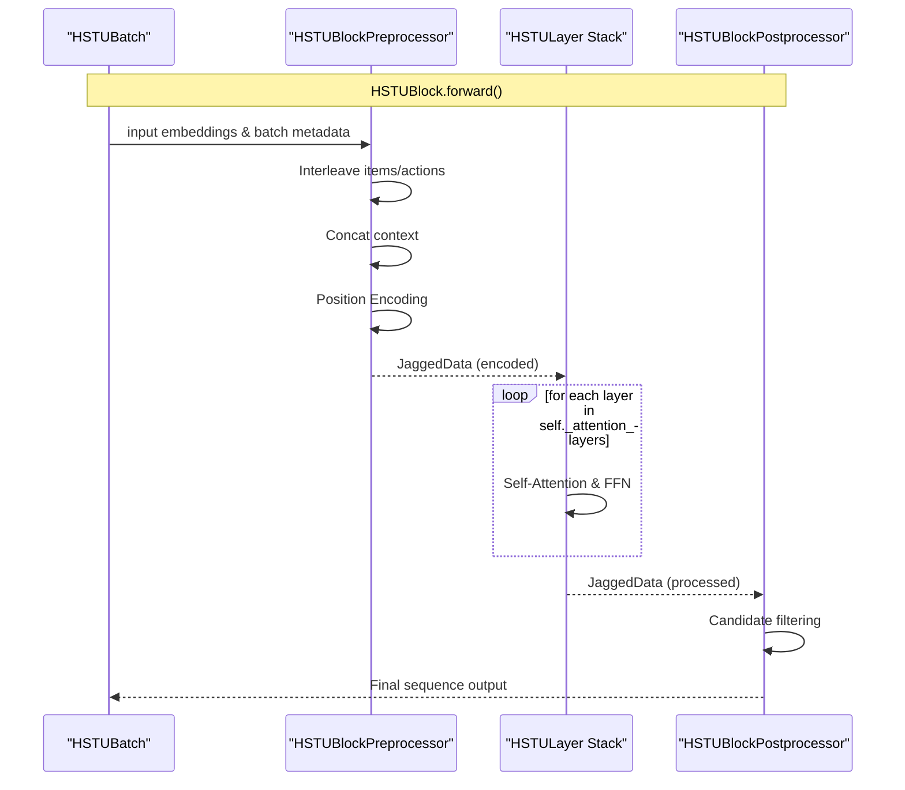

<!-- source: DeepWiki mcp.deepwiki.com · repo NVIDIA/recsys-examples · page 4 HSTU System · fetched 2026-10-26 -->

# HSTU System

Relevant source files

The following files were used as context for generating this wiki page:

- [examples/commons/utils/stringify.py](examples/commons/utils/stringify.py)
- [examples/hstu/README.md](examples/hstu/README.md)
- [examples/hstu/configs/hstu_config.py](examples/hstu/configs/hstu_config.py)
- [examples/hstu/figs/parallelism.png](examples/hstu/figs/parallelism.png)
- [examples/hstu/figs/ranking_model_structure.png](examples/hstu/figs/ranking_model_structure.png)
- [examples/hstu/inference/benchmark/hstu_inference_l20_batch1.png](examples/hstu/inference/benchmark/hstu_inference_l20_batch1.png)
- [examples/hstu/inference/benchmark/hstu_inference_l20_batch8.png](examples/hstu/inference/benchmark/hstu_inference_l20_batch8.png)
- [examples/hstu/modules/hstu_block.py](examples/hstu/modules/hstu_block.py)

## Purpose and Scope

This document provides a system-level overview of the Hierarchical Sequential Transduction Unit (HSTU) system implemented in this repository. HSTU is a specialized attention architecture designed for large-scale generative recommendation models that reformulate recommendation tasks (ranking and retrieval) as generative modeling problems.

This page covers:
- The Generative Recommenders paradigm and HSTU's role
- High-level system architecture and component relationships
- Core processing pipeline and data flow
- Integration with embedding layers and distributed training frameworks

For detailed information about:
- Model implementations and attention mechanisms, see [Architecture and Models](#4.1)
- Distributed training setup and parallelism strategies, see [Training and Distributed Support](#4.2)
- Performance optimizations and kernel implementations, see [Optimization and Performance](#4.3)
- Dynamic embedding integration, see [Dynamic Embeddings (DynamicEmb)](#3)

**Sources:** [examples/hstu/README.md:1-43]()

---

## Generative Recommenders Paradigm

The HSTU system implements the Generative Recommenders (GRs) paradigm introduced in Meta's paper "Actions Speak Louder Than Words". This approach treats recommendation as a generative modeling problem where the model autoregressively predicts the next item or action in a user's interaction sequence.

### Key Characteristics

| Aspect | Description |
|--------|-------------|
| **Input Format** | Pure categorical features only (no numerical features) [examples/hstu/README.md:13-13]() |
| **Task Support** | Both retrieval and ranking tasks using shared backbone [examples/hstu/README.md:4-4]() |
| **Scale** | Designed for trillion-parameter models with billions of users [examples/hstu/README.md:4-4]() |
| **Architecture** | Attention-based sequential transduction specialized for high-cardinality, non-stationary data [examples/hstu/README.md:4-4]() |

### Token Types

The system processes three types of categorical tokens [examples/hstu/README.md:13-16]():

1. **Contextual Tokens**: Represent user-side information.
2. **Item Tokens**: Represent the items being recommended.
3. **Action Tokens**: Optional. Represent user actions associated with items.

**Important Constraint:** The number of item tokens must match the number of action tokens. Multiple actions associated with a single item must be merged during preprocessing [examples/hstu/README.md:16-18]().

**Sources:** [examples/hstu/README.md:3-19]()

---

## System Architecture Overview

The following diagram shows the high-level component structure of the HSTU system, mapping system names to code entities:

**Diagram: HSTU System Component Hierarchy**

The architecture is centered around the `HSTUBlock` [examples/hstu/modules/hstu_block.py:18-24](), which orchestrates the transformation of input embeddings into processed sequence representations. It selects between different layer implementations (`Fused`, `Native`, or `Debug`) based on the `HSTUConfig` [examples/hstu/modules/hstu_block.py:45-51]().

**Sources:** [examples/hstu/modules/hstu_block.py:1-55](), [examples/hstu/configs/hstu_config.py:32-46]()

---

## Core Processing Pipeline

The HSTU processing pipeline transforms categorical input features into predictions through a multi-stage flow managed by `HSTUBlock.forward` [examples/hstu/modules/hstu_block.py:57-90]().

**Diagram: HSTU End-to-End Processing Flow**

### Pipeline Stages

| Stage | Component | Key Operations |
|-------|-----------|----------------|
| **Preprocessing** | `HSTUBlockPreprocessor` | Interleaving item/action vectors, concatenating contextual embeddings, and applying position encoding [examples/hstu/README.md:28-28](). |
| **Attention Stack** | `HSTULayer` | A stack of layers defined in `self._attention_layers` [examples/hstu/modules/hstu_block.py:52-54]() that process the sequence. |
| **Postprocessing** | `HSTUBlockPostprocessor` | Filtering candidate item embeddings for prediction [examples/hstu/README.md:30-30](). |

**Sources:** [examples/hstu/modules/hstu_block.py:72-86](), [examples/hstu/README.md:26-32]()

---

## Configuration and Implementation Variants

### HSTUConfig
The system is highly configurable via the `HSTUConfig` class [examples/hstu/configs/hstu_config.py:90-135](), which inherits from Megatron-Core's `TransformerConfig`. Key parameters include:
- `hstu_layer_type`: Choice between `FUSED`, `NATIVE`, and `DEBUG` [examples/hstu/configs/hstu_config.py:116-116]().
- `kernel_backend`: Choice of `TRITON`, `PYTORCH`, or `CUTLASS` [examples/hstu/configs/hstu_config.py:115-115]().
- `position_encoding_config`: Settings for position and time buckets [examples/hstu/configs/hstu_config.py:65-81]().

### Implementation Variants
The `HSTULayerType` enum defines how the attention layers are executed [examples/hstu/configs/hstu_config.py:33-46]():
- **FUSED**: Scheduleable and pipelineable; does not support Tensor Parallelism (TP).
- **NATIVE**: Supports Tensor Parallelism.
- **DEBUG**: Reference implementation for debugging; no TP support.

**Sources:** [examples/hstu/configs/hstu_config.py:32-135](), [examples/hstu/modules/hstu_block.py:45-51]()

---

## Framework Integration

The HSTU system is designed to integrate with high-performance NVIDIA libraries:

- **Megatron-Core**: `HSTUBlock` inherits from `MegatronModule` [examples/hstu/modules/hstu_block.py:18-18]() and utilizes `parallel_state` and `TransformerConfig` for distributed scaling [examples/hstu/configs/hstu_config.py:22-29]().
- **TorchRec**: Uses `JaggedTensor` for representing the sparse, variable-length input sequences common in recommendation datasets [examples/hstu/modules/hstu_block.py:15-15]().
- **NVTX**: Includes instrumentation for performance profiling via `output_nvtx_hook` [examples/hstu/modules/hstu_block.py:56-56]().

**Sources:** [examples/hstu/modules/hstu_block.py:9-18](), [examples/hstu/configs/hstu_config.py:22-29]()

---

## Performance and Optimization

The system includes several features for optimizing large-scale training and inference:
- **Kernel Fusion**: `fuse_norm_mul_dropout` and `fuse_norm_add_mul_dropout` flags in `HSTUConfig` [examples/hstu/configs/hstu_config.py:133-133]().
- **Recomputation**: Options to recompute input LayerNorm or SiLU activations to save memory [examples/hstu/configs/hstu_config.py:128-129]().
- **Async Operations**: Support for `async_wgrad` to overlap weight gradient computation with other operations [examples/hstu/configs/hstu_config.py:124-126]().

For detailed performance benchmarks and optimization deep-dives, see [Optimization and Performance](#4.3).

**Sources:** [examples/hstu/configs/hstu_config.py:124-133]()

---

