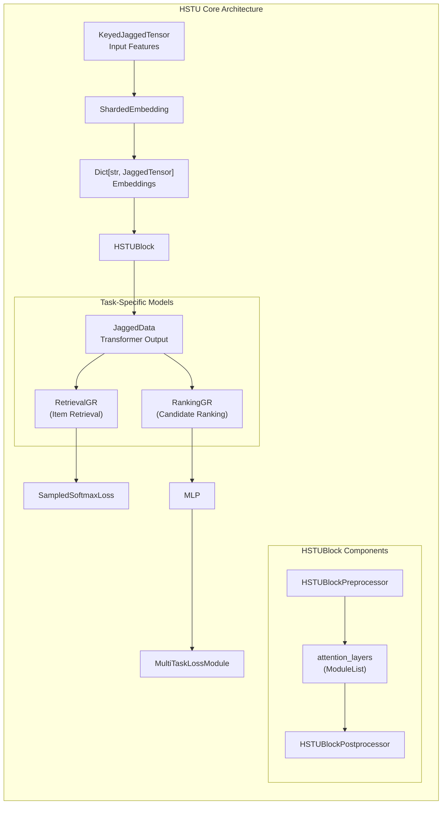
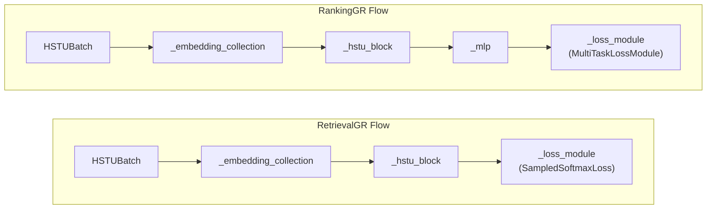

<!-- source: DeepWiki mcp.deepwiki.com · repo NVIDIA/recsys-examples · page 4.1 Architecture and Models · fetched 2026-10-26 -->

# Architecture and Models

Relevant source files

The following files were used as context for generating this wiki page:

- [examples/commons/datasets/hstu_batch.py](examples/commons/datasets/hstu_batch.py)
- [examples/commons/distributed/dmp_to_tp.py](examples/commons/distributed/dmp_to_tp.py)
- [examples/commons/ops/triton_ops/triton_jagged.py](examples/commons/ops/triton_ops/triton_jagged.py)
- [examples/hstu/configs/hstu_config.py](examples/hstu/configs/hstu_config.py)
- [examples/hstu/configs/task_config.py](examples/hstu/configs/task_config.py)
- [examples/hstu/model/base_model.py](examples/hstu/model/base_model.py)
- [examples/hstu/model/ranking_gr.py](examples/hstu/model/ranking_gr.py)
- [examples/hstu/model/retrieval_gr.py](examples/hstu/model/retrieval_gr.py)
- [examples/hstu/modules/hstu_block.py](examples/hstu/modules/hstu_block.py)
- [examples/hstu/modules/hstu_processor.py](examples/hstu/modules/hstu_processor.py)
- [examples/hstu/modules/metrics/metric_modules.py](examples/hstu/modules/metrics/metric_modules.py)
- [examples/hstu/modules/mlp.py](examples/hstu/modules/mlp.py)
- [examples/hstu/modules/position_encoder.py](examples/hstu/modules/position_encoder.py)
- [examples/hstu/ops/triton_ops/triton_jagged.py](examples/hstu/ops/triton_ops/triton_jagged.py)
- [examples/hstu/test/test_checkpointing.py](examples/hstu/test/test_checkpointing.py)
- [examples/hstu/test/test_dataset.py](examples/hstu/test/test_dataset.py)
- [examples/hstu/test/test_embedding.py](examples/hstu/test/test_embedding.py)
- [examples/hstu/test/test_metrics.py](examples/hstu/test/test_metrics.py)

## Purpose and Scope

This document details the core architecture and models within the HSTU (Hierarchical Sequential Transduction Unit) system. It covers the primary model implementations (`RetrievalGR`, `RankingGR`), the core transformer architecture (`HSTUBlock`), preprocessing/postprocessing logic, and task-specific heads.

## Overview

The HSTU system implements a hierarchical sequential transduction architecture specifically designed for generative recommendation tasks. The core consists of two main model types—retrieval and ranking models—both built on top of a shared transformer backbone (`HSTUBlock`) that processes variable-length sequences of user interactions and item features.

Sources: [examples/hstu/model/retrieval_gr.py:35-44](), [examples/hstu/model/ranking_gr.py:34-43]()

## High-Level Architecture

The HSTU system consists of task-specific models built on a shared transformer backbone, with embeddings feeding into stacked transformer layers.

### Overall System Architecture

Sources: [examples/hstu/model/retrieval_gr.py:35-81](), [examples/hstu/model/ranking_gr.py:34-78](), [examples/hstu/modules/hstu_block.py:18-55]()

### Model Data Flow

Sources: [examples/hstu/model/retrieval_gr.py:104-160](), [examples/hstu/model/ranking_gr.py:102-135]()

## Core Model Classes

### RetrievalGR Model

The `RetrievalGR` class implements item retrieval for recommendation systems using a two-tower architecture with sampled softmax loss.

| Component | Type | Purpose |
|-----------|------|---------|
| `_embedding_collection` | `ShardedEmbedding` | Handles sparse and dense feature embeddings [examples/hstu/model/retrieval_gr.py:65]() |
| `_hstu_block` | `HSTUBlock` | Transformer backbone for sequence modeling [examples/hstu/model/retrieval_gr.py:67]() |
| `_loss_module` | `SampledSoftmaxLoss` | Computes retrieval loss with negative sampling [examples/hstu/model/retrieval_gr.py:69]() |

Key methods:
- `get_logit_and_labels()`: Extracts predictions and supervision signals by splitting jagged item embeddings [examples/hstu/model/retrieval_gr.py:104-160]().
- `forward()`: Complete forward pass with loss computation [examples/hstu/model/retrieval_gr.py:163-175]().

### RankingGR Model

The `RankingGR` class implements candidate ranking with support for multi-task learning and various prediction heads.

| Component | Type | Purpose |
|-----------|------|---------|
| `_embedding_collection` | `ShardedEmbedding` | Handles sparse and dense feature embeddings [examples/hstu/model/ranking_gr.py:56]() |
| `_hstu_block` | `HSTUBlock` | Transformer backbone for sequence modeling [examples/hstu/model/ranking_gr.py:58]() |
| `_mlp` | `MLP` | Prediction head for ranking scores [examples/hstu/model/ranking_gr.py:59]() |
| `_loss_module` | `MultiTaskLossModule` | Supports multiple prediction tasks [examples/hstu/model/ranking_gr.py:68]() |

Key methods:
- `get_logit_and_labels()`: Performs gradient scaling for model-parallel embeddings and extracts logits [examples/hstu/model/ranking_gr.py:102-135]().
- `forward()`: Complete forward pass with multi-task loss computation [examples/hstu/model/ranking_gr.py:137-161]().

Sources: [examples/hstu/model/retrieval_gr.py:35-175](), [examples/hstu/model/ranking_gr.py:34-161]()

## Transformer Architecture Components

### HSTUBlock

The `HSTUBlock` serves as the main transformer component, implementing a stack of `HSTULayers` with preprocessing and postprocessing.

| Component | Type | Purpose |
|-----------|------|---------|
| `_preprocessor` | `HSTUBlockPreprocessor` | Converts embeddings to `JaggedData` [examples/hstu/modules/hstu_block.py:37]() |
| `_postprocessor` | `HSTUBlockPostprocessor` | Final processing of attention outputs [examples/hstu/modules/hstu_block.py:41]() |
| `_attention_layers` | `ModuleList` | Stack of transformer layers (`Fused`, `Native`, or `Debug`) [examples/hstu/modules/hstu_block.py:52]() |

Sources: [examples/hstu/modules/hstu_block.py:18-90]()

### HSTU Preprocessing and Postprocessing

The `HSTUBlockPreprocessor` handles the transformation of input embeddings into a unified format for the transformer layers.

1.  **Interleaving**: If action embeddings are present, they are interleaved with item embeddings [examples/hstu/modules/hstu_processor.py:56-156]().
2.  **Concatenation**: Contextual, item, and action embeddings are concatenated into a single sequence per sample [examples/hstu/modules/hstu_processor.py:60-66]().
3.  **Positional Encoding**: `HSTUPositionalEncoder` applies learnable position and/or timestamp-based embeddings to the sequence [examples/hstu/modules/position_encoder.py:66-173]().

The `HSTUBlockPostprocessor` handles output formatting, including unpadding values and sequence parallel gathering [examples/hstu/modules/hstu_processor.py:644-686]().

Sources: [examples/hstu/modules/hstu_processor.py:43-686](), [examples/hstu/modules/position_encoder.py:66-173]()

### HSTULayer Implementations

The system supports multiple layer types via `HSTULayerType`:

| Layer Type | Implementation | Description |
|------------|----------------|-------------|
| `FUSED` | `FusedHSTULayer` | Optimized fused implementation (pipelineable) [examples/hstu/configs/hstu_config.py:43]() |
| `NATIVE` | `NativeHSTULayer` | Non-fused implementation with Tensor Parallel (TP) support [examples/hstu/configs/hstu_config.py:44]() |
| `DEBUG` | `DebugHSTULayer` | Reference implementation for debugging [examples/hstu/configs/hstu_config.py:45]() |

Sources: [examples/hstu/configs/hstu_config.py:33-46](), [examples/hstu/modules/hstu_block.py:45-51]()

## Task-Specific Components

### MLP Prediction Head
The `MLP` module is used in `RankingGR` to map the transformer's hidden states to task-specific logits. It supports configurable architecture, activation types, and bias [examples/hstu/modules/mlp.py:21-44]().

### Loss Modules
- **SampledSoftmaxLoss**: Used in retrieval to handle large item vocabularies via negative sampling [examples/hstu/model/retrieval_gr.py:69-81]().
- **MultiTaskLossModule**: Used in ranking to compute losses across multiple classification or regression tasks simultaneously [examples/hstu/model/ranking_gr.py:68-72]().

### Metrics
The `RankingGR` model utilizes a `_metric_module` (from `get_multi_event_metric_module`) to compute evaluation metrics like AUC across data parallel groups [examples/hstu/model/ranking_gr.py:73-78]().

Sources: [examples/hstu/model/retrieval_gr.py:69-81](), [examples/hstu/model/ranking_gr.py:59-78]()

## Data Structures

### JaggedData
The `JaggedData` class is the primary internal data structure for the HSTU backbone. It encapsulates:
- `values`: The raw tensor values (often padded for performance) [examples/hstu/modules/jagged_data.py:26]().
- `seqlen`: Tensor containing the lengths of each sequence in the batch.
- `offsets`: Computed offsets for jagged operations.

### HSTUBatch
A specialized batch structure (`HSTUBatch`) derived from `BaseBatch` that manages item feature names, action features, contextual features, and labels [examples/commons/datasets/hstu_batch.py:245-312]().

Sources: [examples/hstu/modules/jagged_data.py:20-50](), [examples/commons/datasets/hstu_batch.py:245-312]()

---

