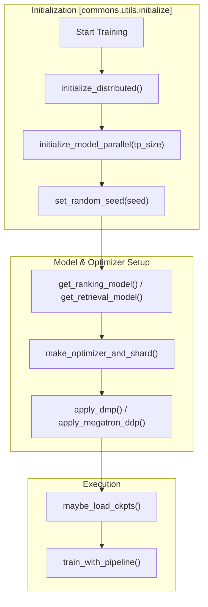
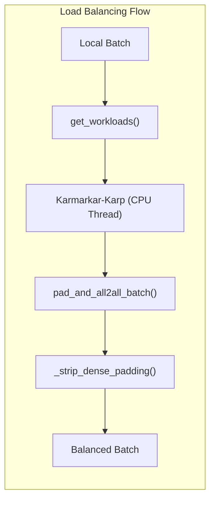
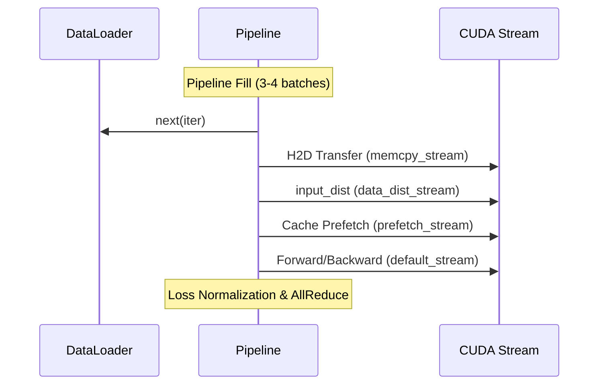

<!-- source: DeepWiki mcp.deepwiki.com · repo NVIDIA/recsys-examples · page 4.2 Training and Distributed Support · fetched 2026-10-26 -->

# Training and Distributed Support

Relevant source files

The following files were used as context for generating this wiki page:

- [examples/commons/distributed/batch_all2all.py](examples/commons/distributed/batch_all2all.py)
- [examples/commons/distributed/batch_allgather.py](examples/commons/distributed/batch_allgather.py)
- [examples/commons/distributed/batch_shuffler.py](examples/commons/distributed/batch_shuffler.py)
- [examples/commons/distributed/sharding.py](examples/commons/distributed/sharding.py)
- [examples/commons/pipeline/train_pipeline.py](examples/commons/pipeline/train_pipeline.py)
- [examples/commons/sequence_batch/batch.py](examples/commons/sequence_batch/batch.py)
- [examples/commons/utils/dynamicemb_cache_stats.py](examples/commons/utils/dynamicemb_cache_stats.py)
- [examples/commons/utils/logger.py](examples/commons/utils/logger.py)
- [examples/hstu/inference/configs/kuairand_1k_inference_ranking.gin](examples/hstu/inference/configs/kuairand_1k_inference_ranking.gin)
- [examples/hstu/test/tensor_parallel/test_tp_ranking_gr.py](examples/hstu/test/tensor_parallel/test_tp_ranking_gr.py)
- [examples/hstu/test/test_pipeline.py](examples/hstu/test/test_pipeline.py)
- [examples/hstu/training/configs/kuairand_1k_ranking.gin](examples/hstu/training/configs/kuairand_1k_ranking.gin)
- [examples/hstu/training/configs/kuairand_1k_ranking_tp2.gin](examples/hstu/training/configs/kuairand_1k_ranking_tp2.gin)
- [examples/hstu/training/configs/kuairand_27k_ranking.gin](examples/hstu/training/configs/kuairand_27k_ranking.gin)
- [examples/hstu/training/configs/kuairand_pure_ranking.gin](examples/hstu/training/configs/kuairand_pure_ranking.gin)
- [examples/hstu/training/configs/movielen_ranking.gin](examples/hstu/training/configs/movielen_ranking.gin)
- [examples/hstu/training/pretrain_gr_ranking.py](examples/hstu/training/pretrain_gr_ranking.py)
- [examples/hstu/training/trainer/training.py](examples/hstu/training/trainer/training.py)
- [examples/hstu/training/trainer/utils.py](examples/hstu/training/trainer/utils.py)
- [examples/hstu/utils/gin_config_args.py](examples/hstu/utils/gin_config_args.py)
- [examples/tests/commons/test_distributed.py](examples/tests/commons/test_distributed.py)

## Purpose and Scope

This document details the training utilities and distributed support mechanisms in the NVIDIA RecSys Examples repository. It focuses on the training pipeline architectures, distributed training flow, and integration with Megatron-Core for large-scale recommendation models like HSTU. The system is designed to overlap computation and communication, utilize multiple CUDA streams, and support advanced parallelism strategies (Tensor, Data, and Pipeline Parallelism).

---

## Distributed Training Flow

The training process follows a structured initialization and execution flow that integrates PyTorch Distributed, Megatron-Core, and specialized RecSys components like DynamicEmb.

### Initialization Sequence

The initialization flow ensures that the distributed environment is consistent across all ranks before model construction begins.

**Key Functions:**
- `initialize_distributed()`: Sets up the standard PyTorch distributed process group [examples/hstu/training/pretrain_gr_ranking.py:91]().
- `initialize_model_parallel()`: Initializes Megatron-Core parallel state, setting up Tensor Parallel (TP) and Data Parallel (DP) groups [examples/hstu/training/pretrain_gr_ranking.py:92-94]().
- `make_optimizer_and_shard()`: Integrates TorchRec's sharding capabilities with Megatron-Core's optimizer and DDP [examples/commons/distributed/sharding.py:120-146]().

**Sources:** [examples/hstu/training/pretrain_gr_ranking.py:76-108](), [examples/commons/distributed/sharding.py:62-146]()

---

## Parallelism Strategies

The codebase supports hybrid parallelism to scale recommendation models to massive embedding sizes and sequence lengths.

### 1. Data Parallelism (DP)
Utilizes Megatron-Core's `DistributedDataParallel` (DDP). For non-model-parallel embedding modules (like contextual features), parameters are broadcast across the DP group during initialization [examples/commons/distributed/sharding.py:106-118]().

### 2. Tensor Parallelism (TP)
Supported via Megatron-Core's `parallel_state`. Linear layers in HSTU blocks (UVQK projections) are typically sharded as `ColumnParallelLinear` or `RowParallelLinear`. Embedding tables can also be sharded across the TP group using TorchRec's sharding framework [examples/hstu/test/tensor_parallel/test_tp_ranking_gr.py:144-148]().

### 3. Load Balancing: TaskBalancedBatchShuffler
To handle jagged tensors and varying sequence lengths that cause computation imbalance, the `BaseTaskBalancedBatchShuffler` uses the Karmarkar-Karp (KK) partitioning algorithm. This redistributes workloads across ranks to minimize the max-min spread of math operations [examples/commons/distributed/batch_shuffler.py:145-162]().

**Sources:** [examples/commons/distributed/batch_shuffler.py:145-173](), [examples/commons/distributed/batch_all2all.py:13-30]()

---

## Training Pipelines

Pipelines are the core execution engine, managing the overlap of data movement and computation.

### Pipeline Classes and Stages

| Class Name | Stage Count | Description |
| :--- | :---: | :--- |
| `JaggedMegatronTrainNonePipeline` | 1 | Synchronous execution; no overlap [examples/hstu/test/test_pipeline.py:100-104](). |
| `JaggedMegatronTrainPipelineSparseDist` | 3 | Overlaps H2D transfer, `input_dist`, and Forward/Backward [examples/hstu/test/test_pipeline.py:105-110](). |
| `JaggedMegatronPrefetchTrainPipelineSparseDist` | 4 | Adds a cache prefetch stage for `DynamicEmb` [examples/hstu/test/test_pipeline.py:112-116](). |

### Jagged Batch Support
The pipelines specifically handle `BaseBatch` objects containing `KeyedJaggedTensor` (KJT) data. Loss normalization is performed by aggregating token counts across the Data Parallel group to ensure correct gradients for variable-sized sequences [examples/hstu/training/trainer/training.py:150-155]().

**Sources:** [examples/hstu/training/trainer/training.py:39-86](), [examples/commons/sequence_batch/batch.py:11-31]()

---

## Megatron-Core Integration

The integration leverages Megatron-Core for distributed optimization and gradient management.

### Optimizer and Gradient Management
The system uses `get_megatron_optimizer` to wrap the model and manage precision (FP16/BF16). Gradient reduction is handled via `finalize_model_grads`, which is registered as the `finalize_model_grads_func` in the `TransformerConfig` [examples/commons/distributed/sharding.py:119-146]().

### Distributed Checkpointing
Checkpoints are managed through a combination of standard PyTorch state dicts and specialized logic for `DynamicEmb` tables. The `maybe_load_ckpts` and `save_ckpts` utilities handle the distribution and restoration of model states across different world sizes [examples/hstu/training/trainer/training.py:89-123]().

**Key Code Entities:**
- `DistributedDataParallel` (DDP): Megatron-Core's DDP wrapper [examples/commons/distributed/sharding.py:38]().
- `Float16Module`: Wrapper for mixed-precision training [examples/commons/distributed/sharding.py:42]().
- `finalize_model_grads`: Custom function to finalize gradients across sharded parameters [examples/commons/distributed/finalize_model_grads.py:1-24]().

**Sources:** [examples/commons/distributed/sharding.py:62-146](), [examples/hstu/training/trainer/training.py:89-123]()

---

## Metrics and Evaluation

Evaluation is integrated into the training loop via `stateful_metric_module`.

- **Ranking Metrics**: Standard ranking metrics (e.g., NDCG, HR) are computed.
- **Retrieval Metrics**: For retrieval tasks, the `RetrievalTaskMetricWithSampling` is used. It supports exporting local embeddings from the `EmbeddingCollection` to perform large-scale similarity search for evaluation [examples/hstu/training/trainer/training.py:69-79]().
- **Distributed Aggregation**: Metrics are aggregated across the Data Parallel group using the provided communication process group [examples/hstu/training/pretrain_gr_ranking.py:129-136]().

**Sources:** [examples/hstu/training/trainer/training.py:39-86](), [examples/hstu/training/pretrain_gr_ranking.py:129-136]()

---

