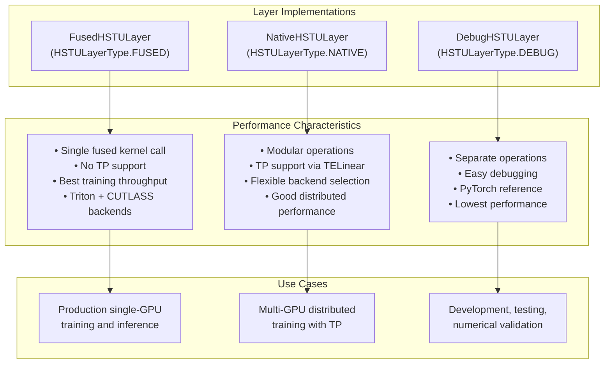
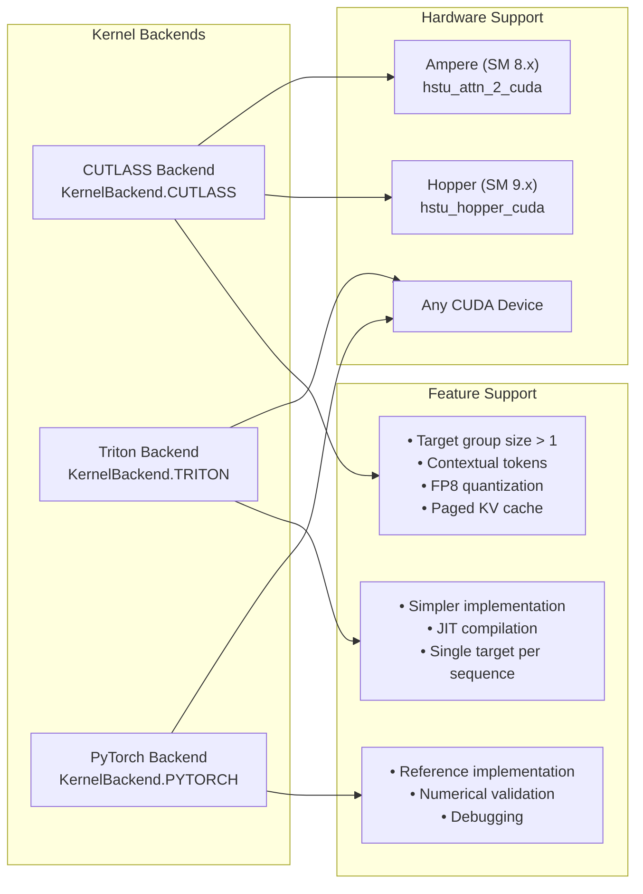
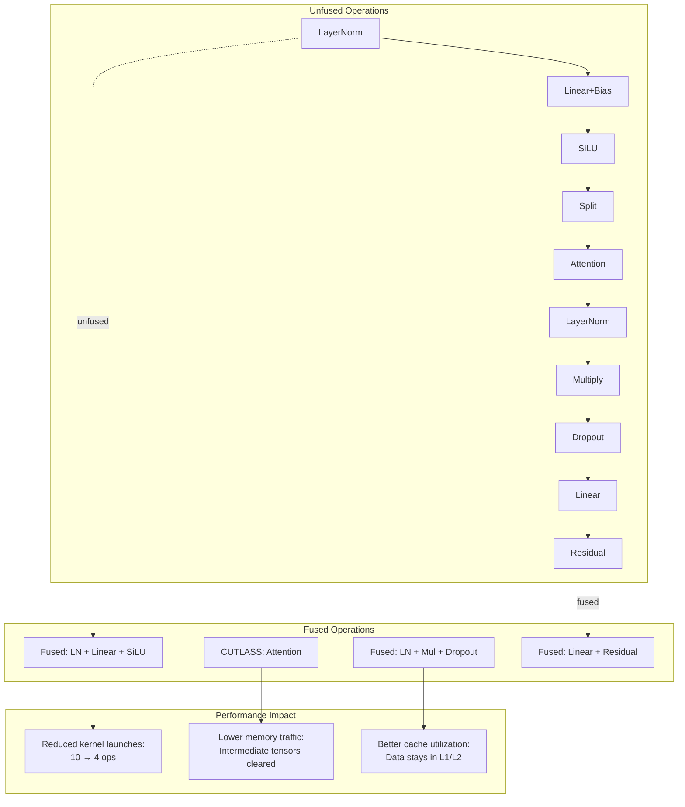

<!-- source: DeepWiki mcp.deepwiki.com · repo NVIDIA/recsys-examples · page 4.3 Optimization and Performance · fetched 2026-10-26 -->

# Optimization and Performance

<details>
<summary>Relevant source files</summary>

The following files were used as context for generating this wiki page:

- [.gitignore](.gitignore)
- [corelib/dynamicemb/README.md](corelib/dynamicemb/README.md)
- [examples/commons/utils/hstu_assert_close.py](examples/commons/utils/hstu_assert_close.py)
- [examples/hstu/modules/fused_hstu_layer.py](examples/hstu/modules/fused_hstu_layer.py)
- [examples/hstu/modules/hstu_attention.py](examples/hstu/modules/hstu_attention.py)
- [examples/hstu/modules/native_hstu_layer.py](examples/hstu/modules/native_hstu_layer.py)
- [examples/hstu/ops/fused_hstu_op.py](examples/hstu/ops/fused_hstu_op.py)
- [examples/hstu/ops/pt_ops/pt_norm_mul_dropout.py](examples/hstu/ops/pt_ops/pt_norm_mul_dropout.py)
- [examples/hstu/ops/triton_ops/triton_addmm.py](examples/hstu/ops/triton_ops/triton_addmm.py)
- [examples/hstu/ops/triton_ops/triton_hstu_attention.py](examples/hstu/ops/triton_ops/triton_hstu_attention.py)
- [examples/hstu/ops/triton_ops/triton_layer_norm.py](examples/hstu/ops/triton_ops/triton_layer_norm.py)
- [examples/hstu/ops/triton_ops/triton_norm_mul_dropout.py](examples/hstu/ops/triton_ops/triton_norm_mul_dropout.py)
- [examples/hstu/ops/triton_ops/triton_silu.py](examples/hstu/ops/triton_ops/triton_silu.py)
- [examples/hstu/test/hstu_attn/test_hstu_attn_smoke.py](examples/hstu/test/hstu_attn/test_hstu_attn_smoke.py)
- [examples/hstu/test/test_hstu_layer.py](examples/hstu/test/test_hstu_layer.py)
- [examples/hstu/test/test_hstu_op.py](examples/hstu/test/test_hstu_op.py)
- [examples/hstu/test/test_ln_mul_dropout.py](examples/hstu/test/test_ln_mul_dropout.py)
- [examples/hstu/training/benchmark/E2E_BENCHMARK.md](examples/hstu/training/benchmark/E2E_BENCHMARK.md)

</details>


## Purpose and Scope

This document details the optimization techniques and performance characteristics of the HSTU (Hierarchical Sequential Transduction Unit) system, focusing on kernel fusion, jagged tensor operations, quantization (FP8), activation recomputation, and other performance optimizations. It covers implementation strategies, backend selection, and practical optimization guidelines for both training and inference workloads.

For information about HSTU model architecture and layer implementations, see page 4.1. For distributed training and parallelism strategies, see page 4.2.

## Layer Implementation Variants

The HSTU system provides three distinct layer implementations, each with different performance characteristics and use cases:



**Sources:** [examples/hstu/modules/fused_hstu_layer.py:24-34](), [examples/hstu/modules/native_hstu_layer.py:41-53](), [examples/hstu/ops/fused_hstu_op.py:41-53]()

### FusedHSTULayer Performance

The `FusedHSTULayer` implementation fuses all operations into a single autograd function `FusedHSTULayerFunction`, providing optimal performance for single-GPU scenarios:

| Optimization | Implementation | Performance Benefit |
|-------------|----------------|---------------------|
| Kernel Fusion | All ops in single forward/backward pass | ~1.2x end-to-end speedup |
| Reduced Memory | Intermediate tensors cleared immediately | Lower peak memory usage |
| Async WGrad | Weight gradients computed on separate stream | Overlaps dgrad computation |
| Recomputation | Configurable layernorm/silu recompute | Reduces memory for large models |

The fused implementation executes the following sequence in a single logical block:
`input → layernorm → linear+bias → silu → split(u,v,q,k) → attention(q,k,v) → norm_mul_dropout(attn_out, u) → linear_proj → residual` [examples/hstu/ops/fused_hstu_op.py:45-51]().

**Sources:** [examples/hstu/ops/fused_hstu_op.py:41-91](), [examples/hstu/modules/fused_hstu_layer.py:124-160]()

### NativeHSTULayer Performance

The `NativeHSTULayer` provides modular operations with Tensor Parallelism support via Megatron-Core's `TEColumnParallelLinear` and `TERowParallelLinear`:

| Feature | Implementation | Trade-off |
|---------|----------------|-----------|
| TP Support | Split across `_num_heads_per_partition` | Enables multi-GPU training |
| Modular Ops | Separate forward calls | Easier debugging vs fused |
| Backend Flexibility | Configurable attention backend | Can switch CUTLASS/Triton/PyTorch |
| Optional Fusion | `fuse_norm_mul_dropout` flag | Selective optimization |

**Sources:** [examples/hstu/modules/native_hstu_layer.py:41-150](), [examples/hstu/modules/native_hstu_layer.py:101-108]()

## Kernel Backend Comparison

The HSTU attention operation supports three kernel backends, each optimized for different scenarios:



**Sources:** [examples/hstu/ops/fused_hstu_op.py:19-27](), [examples/hstu/modules/hstu_attention.py:24-180](), [examples/hstu/test/hstu_attn/test_hstu_attn_smoke.py:105-140]()

### Backend Characteristics

**1. CUTLASS Backend:**
The CUTLASS backend provides architecture-specific optimizations. For SM 8.0 (Ampere), it uses `hstu_attn_varlen_func` [examples/hstu/modules/hstu_attention.py:21](). For SM 9.0 (Hopper), it supports advanced features like FP8.

**2. Triton Backend:**
Implemented in `TritonHSTUAttention` [examples/hstu/modules/hstu_attention.py:141](). It offers JIT-compiled kernels for flexibility but has restrictions: `target_group_size=1` and limited support for contextual tokens [examples/hstu/ops/fused_hstu_op.py:143-147]().

**3. PyTorch Backend:**
Implemented in `TorchHSTUAttention` [examples/hstu/modules/hstu_attention.py:60](). This is a native implementation where all jagged inputs are padded to maximum length before computation [examples/hstu/modules/hstu_attention.py:62](). It serves as the numerical reference for validation [examples/hstu/test/hstu_attn/test_hstu_attn_smoke.py:126-140]().

**Sources:** [examples/hstu/modules/hstu_attention.py:60-180](), [examples/hstu/ops/fused_hstu_op.py:143-147]()

## Optimization Techniques

### Kernel Fusion Strategy

The `FusedHSTULayerFunction` fuses multiple operations to minimize memory traffic and kernel launch overhead:



**Sources:** [examples/hstu/ops/fused_hstu_op.py:45-51](), [examples/hstu/modules/fused_hstu_layer.py:24-34]()

### Recomputation Strategies

The system supports selective recomputation to trade compute for memory:

| Recomputation Flag | What is Recomputed | Memory Saved | Compute Cost |
|-------------------|-------------------|--------------|--------------|
| `recompute_input_layernorm` | Input layer norm in backward | `normed_input` tensor | ~5% overhead |
| `recompute_input_silu` | SiLU activation in backward | `u, v, q, k` tensors | ~10% overhead |

Implementation logic uses a `saved_tensor_map` to conditionally store or delete intermediate activations based on these flags [examples/hstu/ops/fused_hstu_op.py:142-160]().

**Sources:** [examples/hstu/ops/fused_hstu_op.py:89-91](), [examples/hstu/ops/fused_hstu_op.py:140-141]()

### Asynchronous Weight Gradient Computation

The fused layer supports overlapping weight gradient computation with data gradient computation using CUDA streams and events [examples/hstu/ops/fused_hstu_op.py:87-88](). This is shared across all layers via the `HSTUConfig` [examples/hstu/modules/fused_hstu_layer.py:64-65]().

**Sources:** [examples/hstu/modules/fused_hstu_layer.py:64-65](), [examples/hstu/ops/fused_hstu_op.py:138-139]()

### Memory Optimization with Tensor Clearing

The implementation aggressively clears intermediate tensors using `clear_tensor_data` to reduce peak memory usage [examples/hstu/ops/fused_hstu_op.py:23]().

**Sources:** [examples/hstu/ops/fused_hstu_op.py:23](), [examples/hstu/modules/native_hstu_layer.py:23]()

## Jagged Tensor Operations

HSTU models operate on `JaggedData`, which represents variable-length sequences without padding [examples/hstu/modules/jagged_data.py](). This is crucial for recommendation systems where user history lengths vary significantly.

| Operation | Implementation | Benefit |
|-----------|----------------|---------|
| **Attention** | `hstu_attn_varlen_func` | Skips computation on padding; uses `seq_offsets` [examples/hstu/test/hstu_attn/test_hstu_attn_smoke.py:105-121]() |
| **LayerNorm** | `triton_weighted_layer_norm` | Efficiently handles flattened jagged values [examples/hstu/ops/triton_ops/triton_layer_norm.py]() |
| **NormMulDropout**| `triton_norm_mul_dropout` | Fused gating and dropout for jagged inputs [examples/hstu/ops/triton_ops/triton_norm_mul_dropout.py:80-124]() |

**Sources:** [examples/hstu/modules/jagged_data.py](), [examples/hstu/modules/hstu_attention.py:62-63]()

## Numerical Precision and Validation

The codebase includes an extensive testing framework to ensure optimized Triton and CUTLASS kernels match PyTorch reference implementations.

### Precision Testing Utilities

The `assert_hstu_close` utility compares implementation outputs against a float32 reference [examples/commons/utils/hstu_assert_close.py:45-56]().

```python
def hstu_close(actual, out_ref, fp32_ref, try_allclose: bool = False, multiplier: int = 2) -> bool:
    # Compares maximum absolute error of actual vs fp32_ref 
    # against the error of a known-good reference vs fp32_ref.
    left_abs_max = (actual - fp32_ref).abs().max().item()
    right_abs_max = (out_ref - fp32_ref).abs().max().item()
    return (left_abs_max <= multiplier * right_abs_max) or (try_allclose)
```

**Sources:** [examples/commons/utils/hstu_assert_close.py:20-42](), [examples/hstu/test/hstu_attn/test_hstu_attn_smoke.py:161]()

### Test Parameterization

Optimization kernels are validated across various dimensions:
- **Batch Sizes**: e.g., 32 [examples/hstu/test/hstu_attn/test_hstu_attn_smoke.py:30]()
- **Sequence Lengths**: e.g., up to 1024 [examples/hstu/test/test_hstu_op.py:181]()
- **Head Dimensions**: 32, 64, 128 [examples/hstu/test/hstu_attn/test_hstu_attn_smoke.py:32]()
- **Target Group Sizes**: 1, 2, 16, 256 [examples/hstu/test/test_hstu_op.py:189]()

**Sources:** [examples/hstu/test/hstu_attn/test_hstu_attn_smoke.py:30-35](), [examples/hstu/test/test_hstu_op.py:169-198]()

---

