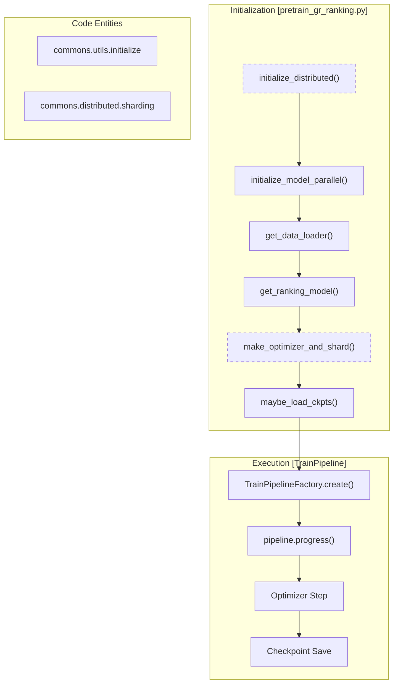
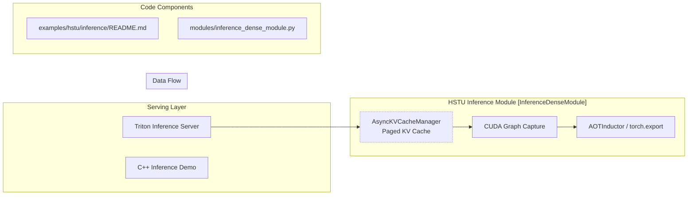

<!-- source: DeepWiki mcp.deepwiki.com · repo NVIDIA/recsys-examples · page 5 Training and Deployment · fetched 2026-10-26 -->

# Training and Deployment

Relevant source files

The following files were used as context for generating this wiki page:

- [examples/commons/pipeline/train_pipeline.py](examples/commons/pipeline/train_pipeline.py)
- [examples/commons/utils/dynamicemb_cache_stats.py](examples/commons/utils/dynamicemb_cache_stats.py)
- [examples/commons/utils/logger.py](examples/commons/utils/logger.py)
- [examples/hstu/inference/README.md](examples/hstu/inference/README.md)
- [examples/hstu/inference/benchmark/paged_hstu_with_kvcache_benchmark.py](examples/hstu/inference/benchmark/paged_hstu_with_kvcache_benchmark.py)
- [examples/hstu/inference/triton/hstu_model/model.py](examples/hstu/inference/triton/hstu_model/model.py)
- [examples/hstu/training/pretrain_gr_ranking.py](examples/hstu/training/pretrain_gr_ranking.py)
- [examples/hstu/training/trainer/utils.py](examples/hstu/training/trainer/utils.py)
- [examples/hstu/utils/gin_config_args.py](examples/hstu/utils/gin_config_args.py)

## Purpose and Scope

This document provides a high-level overview of the end-to-end training and deployment workflows for recommendation models within the NVIDIA RecSys Examples repository. It bridges the gap between model development and production serving, covering distributed training architectures, state management, and inference stacks.

**Scope:**
- High-level training orchestration and pipeline types.
- Distributed training setup and parallelism strategies.
- Checkpointing for both dense weights and dynamic embedding states.
- Inference serving via Triton Inference Server and C++ export.

**Child Pages:**
- For deep dives into parallelism and communication, see [Distributed Training Architecture](#5.1).
- For details on persistence and distributed loading, see [Model Checkpointing and State Management](#5.2).
- For the high-performance inference stack, see [HSTU Inference and Serving](#5.3).

---

## Training Workflow and Pipelines

The training workflow is designed to maximize GPU utilization by overlapping communication, I/O, and computation. The repository provides specialized pipelines to handle the unique requirements of recommendation models, such as large sparse features and variable-length sequences.

### Training Orchestration Logic

The training process typically follows a structured initialization sequence before entering the main loop:

**Sources:** [examples/hstu/training/pretrain_gr_ranking.py:91-1270](), [examples/hstu/training/trainer/training.py:34-85]()

### Pipeline Optimization Strategies

The system implements three primary pipeline types through the `TrainPipelineFactory` to manage concurrency:

| Pipeline Type | Code Identifier | Description |
| :--- | :--- | :--- |
| **None** | `jagged_none` | Sequential execution. Used primarily for debugging. |
| **Native** | `jagged_sparse_dist` | Overlaps H2D transfer and `input_dist` (all-to-all) with model forward/backward passes. |
| **Prefetch** | `jagged_prefetch_sparse_dist` | Adds an additional prefetch stage to overlap GPU cache updates for `DynamicEmb` tables. |

**Sources:** [examples/hstu/training/pretrain_gr_ranking.py:175-189](), [examples/commons/pipeline/train_pipeline.py:95-120]()

---

## Distributed Training Architecture

Large-scale recommendation models require sophisticated parallelism to fit massive embedding tables and transformer blocks into GPU memory. The repository leverages `TorchRec` for sparse sharding and `Megatron-Core` for dense parallelism.

### Parallelism Dimensions

1. **Data Parallelism (DP):** Distributes batches across ranks. Handled by `DistributedDataParallel` [examples/commons/pipeline/train_pipeline.py:66-66]().
2. **Tensor Parallelism (TP):** Shards the HSTU transformer layers across GPUs. Initialized via `initialize_model_parallel` [examples/hstu/training/pretrain_gr_ranking.py:92-94]().
3. **Sparse Sharding:** Distributes `DynamicEmb` tables using strategies like `model_parallel` or `data_parallel` defined in `EmbeddingArgs` [examples/hstu/utils/gin_config_args.py:119-121]().

**Sources:** [examples/hstu/training/pretrain_gr_ranking.py:89-94](), [examples/hstu/training/trainer/utils.py:74-79]()

---

## Model Checkpointing and State Management

Checkpointing in this system is non-trivial because it must synchronize standard PyTorch model parameters with the dynamic, high-capacity storage of the `DynamicEmb` system.

### State Components
- **Dense State:** Standard `OrderedDict` containing weights for HSTU blocks and prediction heads.
- **Sparse State:** Managed by `DynamicEmbDump` and `DynamicEmbLoad`, which handle the eviction and persistence of key-value pairs from GPU HBM or host storage [examples/hstu/training/pretrain_gr_ranking.py:162-168]().
- **Optimizer State:** Includes momentum and variance for both dense (e.g., Adam) and sparse (e.g., RowWiseAdaGrad) optimizers.

**Sources:** [examples/hstu/training/pretrain_gr_ranking.py:159-168](), [examples/hstu/training/trainer/training.py:34-45]()

---

## Inference and Serving

Deployment is supported through multiple paths, ranging from Python-based Triton backends to high-performance C++ binaries using `AOTInductor`.

### Inference Stack Overview

### Key Inference Features
- **Paged KV Cache:** Implemented in `AsyncKVCacheManager` to reduce recomputation of sequence history [examples/hstu/inference/README.md:5-9]().
- **CUDA Graphs:** Used to decrease kernel launch overhead for small batch sizes [examples/hstu/inference/README.md:18-20]().
- **AOTInductor Export:** Supports end-to-end C++ inference by compiling the model into a `.pt2` archive [examples/hstu/inference/README.md:30-34]().
- **Triton Integration:** Models can be served using the Triton Python backend, splitting the model into sparse (embedding) and dense (HSTU) instances [examples/hstu/inference/README.md:24-28]().

**Sources:** [examples/hstu/inference/README.md:1-41](), [examples/hstu/inference/triton/hstu_model/model.py:44-46]()

---

## Performance Monitoring

The repository provides utilities to monitor the health and performance of the training/deployment pipeline:
- **Cache Statistics:** `auto_install(model)` attaches hooks to track `DynamicEmb` hit rates [examples/commons/utils/dynamicemb_cache_stats.py:89-93]().
- **Memory Watchdog:** `log_mem(tag)` tracks physical GPU memory usage, including NCCL buffers [examples/commons/utils/logger.py:99-124]().

**Sources:** [examples/commons/utils/dynamicemb_cache_stats.py:1-17](), [examples/commons/utils/logger.py:92-125]()

---

