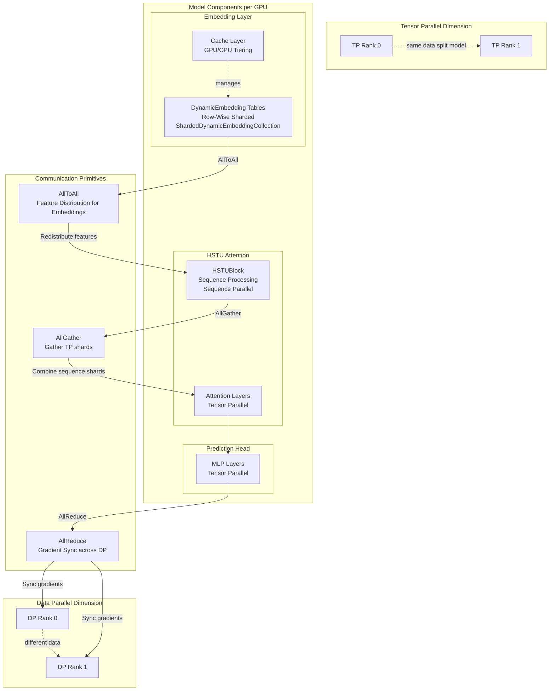
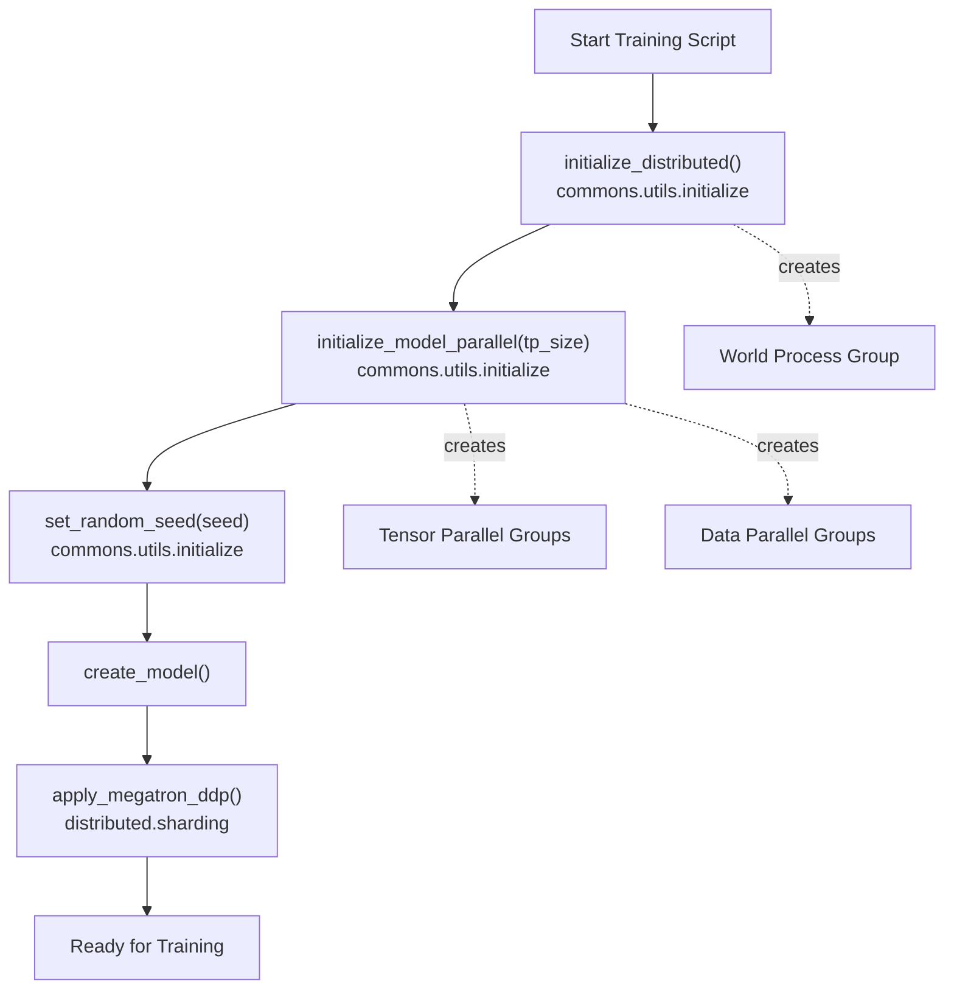
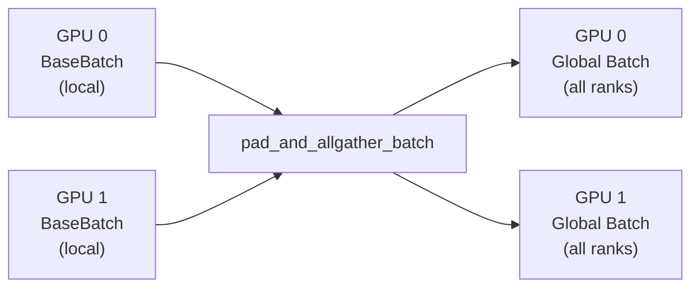
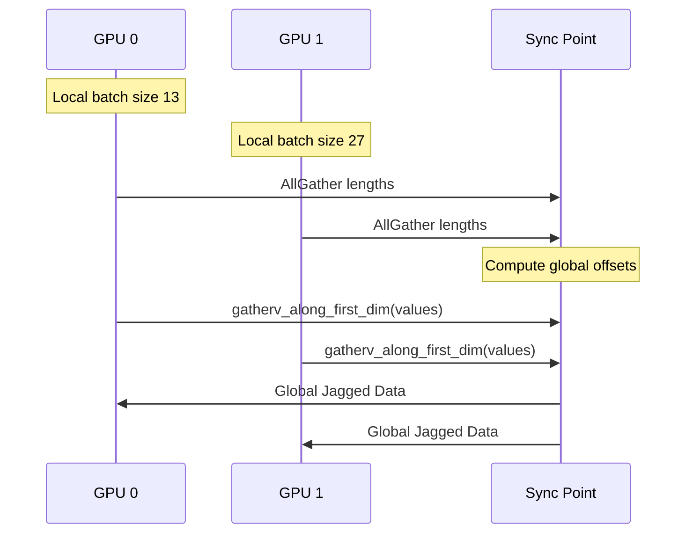
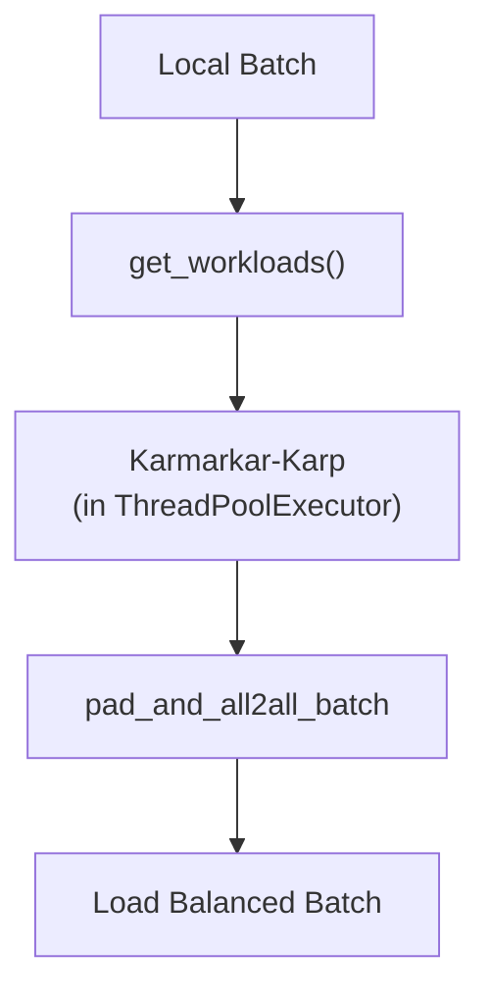

<!-- source: DeepWiki mcp.deepwiki.com · repo NVIDIA/recsys-examples · page 5.1 Distributed Training Architecture · fetched 2026-10-26 -->

# Distributed Training Architecture

Relevant source files

The following files were used as context for generating this wiki page:

- [examples/commons/datasets/hstu_random_dataset.py](examples/commons/datasets/hstu_random_dataset.py)
- [examples/commons/distributed/__init__.py](examples/commons/distributed/__init__.py)
- [examples/commons/distributed/batch_all2all.py](examples/commons/distributed/batch_all2all.py)
- [examples/commons/distributed/batch_allgather.py](examples/commons/distributed/batch_allgather.py)
- [examples/commons/distributed/batch_shuffler.py](examples/commons/distributed/batch_shuffler.py)
- [examples/commons/distributed/sharding.py](examples/commons/distributed/sharding.py)
- [examples/commons/perf_model/partitioner.py](examples/commons/perf_model/partitioner.py)
- [examples/commons/sequence_batch/batch.py](examples/commons/sequence_batch/batch.py)
- [examples/hstu/modules/tp_layer_norm.py](examples/hstu/modules/tp_layer_norm.py)
- [examples/hstu/test/tensor_parallel/test_tp_hstu_layer.py](examples/hstu/test/tensor_parallel/test_tp_hstu_layer.py)
- [examples/hstu/test/tensor_parallel/test_tp_ranking_gr.py](examples/hstu/test/tensor_parallel/test_tp_ranking_gr.py)
- [examples/hstu/test/test_collective.py](examples/hstu/test/test_collective.py)
- [examples/hstu/test/test_pipeline.py](examples/hstu/test/test_pipeline.py)
- [examples/tests/commons/test_distributed.py](examples/tests/commons/test_distributed.py)

## Purpose and Scope

This page explains the distributed training architecture used for training recommendation models across multiple GPUs. It covers the parallelism strategies (data, tensor, and pipeline), collective communication operations, `DynamicEmb` sharding, and communication patterns between GPUs. For checkpoint persistence in distributed settings, see page 5.2.

---

## Overview of Distributed Training Architecture

The NVIDIA RecSys Examples repository implements a hybrid parallelism strategy combining:
- **Data Parallelism (DP)**: Replicates the model and distributes different data batches across GPUs.
- **Tensor Parallelism (TP)**: Shards model weights across GPUs to reduce per-GPU memory.
- **Pipeline Parallelism**: Overlaps communication and computation using CUDA streams.
- **Megatron-Core Integration**: Provides process group management and distributed primitives.

### Distributed Training Architecture Diagram

**Sources:** [examples/commons/distributed/sharding.py:31-46](), [examples/hstu/test/test_collective.py:19-28]()

### Communication Pattern Overview

| Component | Parallelism Type | Communication Operation | Purpose |
|-----------|-----------------|------------------------|---------|
| `DynamicEmbedding` | Row-wise sharding | `AllToAll` | Redistribute features to owning ranks |
| `HSTUBlock` (sequence) | Sequence parallelism | `AllGather` | Gather distributed sequence segments |
| `HSTUBlock` (attention) | Tensor parallelism | `AllReduce` | Combine partial attention outputs |
| `MLP` layers | Tensor parallelism | `AllReduce` | Combine partial linear outputs |
| Gradients | Data parallelism | `AllReduce` | Synchronize gradients across DP ranks |

**Sources:** [examples/commons/distributed/sharding.py:156-181](), [examples/hstu/test/test_collective.py:19-28]()

---

## Distributed Initialization

### Initialization Flow

**Sources:** [examples/hstu/test/tensor_parallel/test_tp_ranking_gr.py:51-55](), [examples/commons/distributed/sharding.py:62-146]()

### Process Group Initialization Code Entities

The initialization sequence involves the following code entities:

| Function | Location | Purpose |
|----------|----------|---------|
| `initialize_distributed()` | `commons.utils.initialize` | Initialize PyTorch distributed backend |
| `initialize_model_parallel(tp_size)` | `commons.utils.initialize` | Setup TP and DP process groups via Megatron |
| `parallel_state.get_tensor_model_parallel_group()` | `megatron.core.parallel_state` | Get TP communication group |
| `parallel_state.get_data_parallel_group()` | `megatron.core.parallel_state` | Get DP communication group |
| `parallel_state.get_tensor_model_parallel_rank()` | `megatron.core.parallel_state` | Get rank within TP group |
| `parallel_state.get_tensor_model_parallel_world_size()` | `megatron.core.parallel_state` | Get TP group size |

**Sources:** [examples/hstu/test/tensor_parallel/test_tp_ranking_gr.py:51-117](), [examples/commons/distributed/sharding.py:59-60]()

---

## Collective Communication Operations

### Fundamental Collective Operations

The system relies on specialized collectives to handle both dense and sparse (jagged) data:

**AllGather Operation for Batches:**
`pad_and_allgather_batch` [examples/commons/distributed/batch_allgather.py:13-39]() performs a unified gather of a `BaseBatch`. It fuses all `KeyedJaggedTensor` (KJT) fields into a single AllGather pair for efficiency.

**AllToAll Operation for Shuffling:**
`pad_and_all2all_batch` redistributes samples across ranks based on a destination mapping, often used for load balancing. It uses `_all2all_kjt` [examples/commons/distributed/batch_all2all.py:117-154]() to reorder and communicate jagged features.

**Sources:** [examples/commons/distributed/batch_allgather.py:13-102](), [examples/commons/distributed/batch_all2all.py:117-154]()

### Variable-Size AllGatherV for Jagged Tensors

Jagged tensors require specialized collectives that handle varying sequence lengths per rank:

**Key Functions:**
- `gatherv_along_first_dim()` [examples/hstu/test/test_collective.py:21]() - Variable-size gather.
- `keyed_jagged_tensor_list_allgather()` [examples/commons/distributed/batch_allgather.py:62]() - Fused KJT gather.
- `length_to_complete_offsets()` [examples/hstu/test/test_collective.py:26]() - Offset calculation for jagged structures.

**Sources:** [examples/hstu/test/test_collective.py:19-26](), [examples/commons/distributed/batch_allgather.py:53-66]()

---

## Tensor Parallelism (TP)

### Tensor Parallel Sharding Strategy

Tensor parallelism splits model weights across GPUs. In HSTU, this is applied to linear projections and layer norms.

**Column-Parallel and Row-Parallel Linear:**
The system distinguishes between sharded and replicated parameters. Sharded layers like `_linear_uvqk` (Column-Parallel) and `_linear_proj` (Row-Parallel) are initialized differently on each rank [examples/hstu/test/tensor_parallel/test_tp_ranking_gr.py:141-151]().

**TP LayerNorm:**
`TPLayerNorm` [examples/hstu/modules/tp_layer_norm.py:22-73]() handles normalization in a distributed setting. It gathers activations across TP ranks using `gather_along_last_dim` to compute global mean and variance.

**Sources:** [examples/hstu/test/tensor_parallel/test_tp_ranking_gr.py:141-151](), [examples/hstu/modules/tp_layer_norm.py:22-73]()

### Weight Initialization Across TP Ranks

Correctness is ensured by verifying that non-model-parallel modules (like MLP or standard LayerNorm) are identical across the world, while sharded embedding slices are distinct [examples/hstu/test/tensor_parallel/test_tp_ranking_gr.py:84-110]().

| Layer Type | Verification Logic | Group |
|------------|-------------------|-------|
| Dense/MLP | `collective_assert_tensor(..., "equal")` | Data Parallel |
| TP Linear | `collective_assert_tensor(..., "not_equal")` | Tensor Parallel |
| LN Bias | `collective_assert_tensor(..., "equal")` | World |

**Sources:** [examples/hstu/test/tensor_parallel/test_tp_ranking_gr.py:84-110]()

---

## Data Parallelism (DP)

### Data Parallel Setup with Megatron DDP

Data parallelism is implemented via `apply_megatron_ddp` [examples/commons/distributed/sharding.py:62-146](). This function wraps the model in Megatron's `DistributedDataParallel` (DDP) and handles gradient synchronization.

**Broadcast Logic:**
Since Megatron DDP does not broadcast parameters implicitly, `broadcast_params_for_non_model_parallel_embedding_modules` [examples/commons/distributed/sharding.py:106-118]() is called during initialization to sync replicated weights (MLPs, LN) across the Data Parallel group.

**Sources:** [examples/commons/distributed/sharding.py:62-118]()

---

## Pipeline and Batch Shuffling

### Task Balanced Shuffling

To handle load imbalance in sequence models, the `BaseTaskBalancedBatchShuffler` [examples/commons/distributed/batch_shuffler.py:145-161]() uses the Karmarkar-Karp (KK) algorithm to partition samples across ranks based on computational "workloads".

**Key Components:**
- `ShuffleHandle` [examples/commons/distributed/batch_shuffler.py:22-56](): Opaque identifier for tracking async shuffle states.
- `_strip_dense_padding` [examples/commons/distributed/batch_shuffler.py:82-109](): Removes trailing padding rows after shuffling to optimize memory.

**Sources:** [examples/commons/distributed/batch_shuffler.py:22-161]()

### Training Pipelines

The system supports multiple pipeline modes to overlap communication and computation:
- `JaggedMegatronTrainNonePipeline` [examples/hstu/test/test_pipeline.py:100-104](): Sequential execution.
- `JaggedMegatronTrainPipelineSparseDist` [examples/hstu/test/test_pipeline.py:106-110](): 2-stage overlap.
- `JaggedMegatronPrefetchTrainPipelineSparseDist` [examples/hstu/test/test_pipeline.py:112-116](): 3-stage overlap with prefetching for `DynamicEmb`.

**Sources:** [examples/hstu/test/test_pipeline.py:100-116]()

---

## Distributed Checkpointing

Distributed checkpointing is managed by `commons.checkpoint`. It handles the separation of `DynamicEmb` sharded states and standard PyTorch module states.

**Key Operations:**
- `checkpoint.save()`: Aggregates state from all ranks, handling the unwrapping of DDP/TP layers [examples/hstu/test/test_pipeline.py:93]().
- `checkpoint.load()`: Restores state, ensuring that sharded embedding tables are correctly mapped to the current world size [examples/hstu/test/test_pipeline.py:94-96]().

**Sources:** [examples/hstu/test/test_pipeline.py:93-96]()

---

