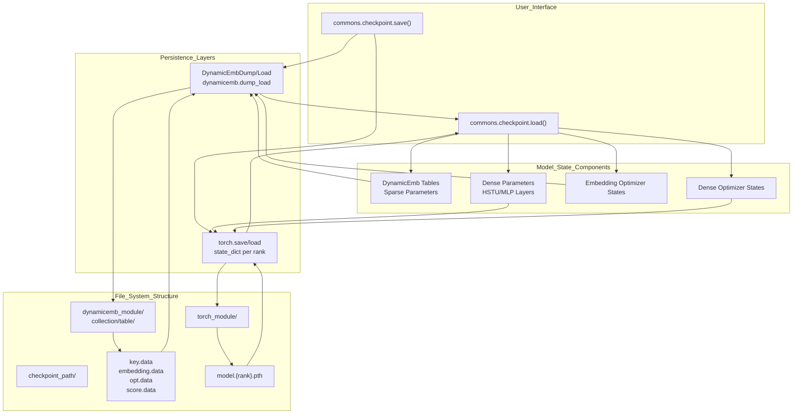
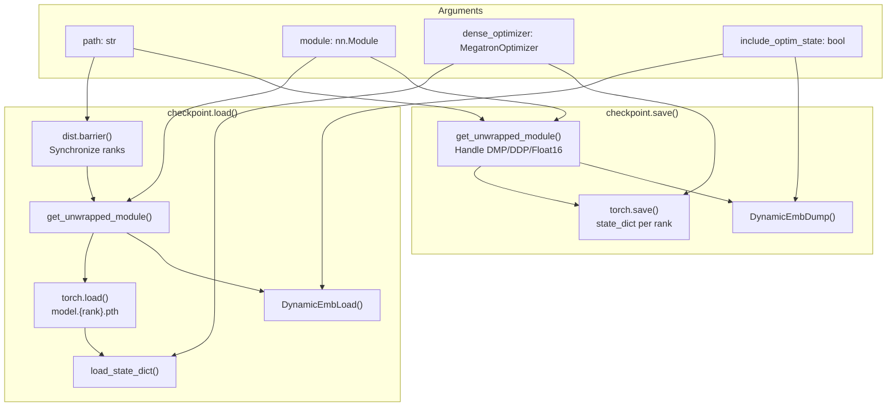
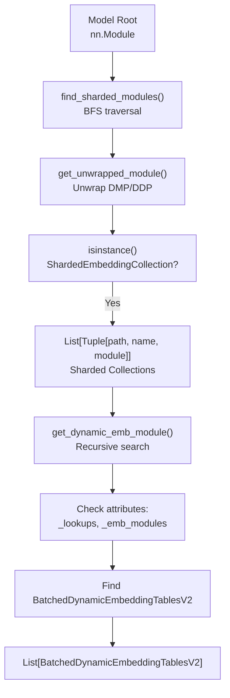
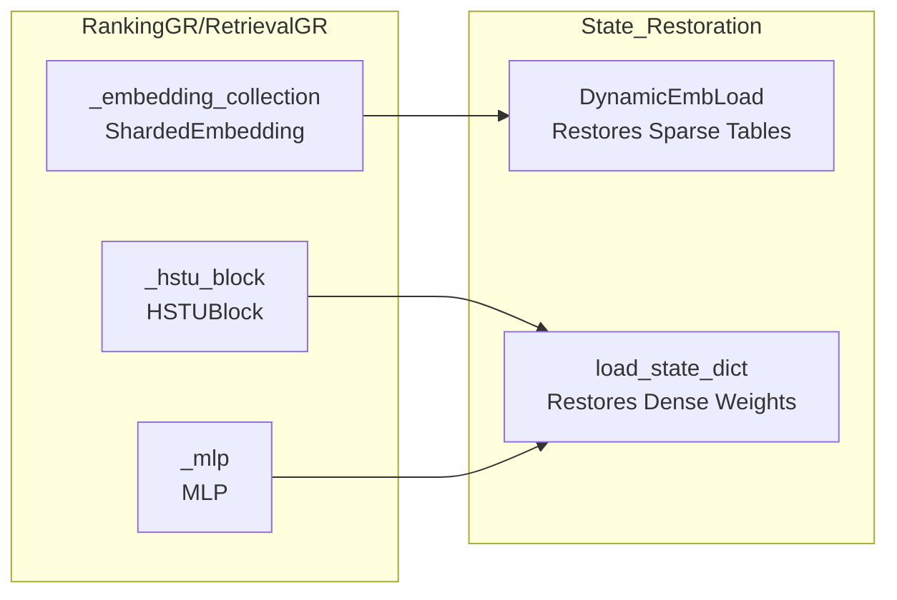

<!-- source: DeepWiki mcp.deepwiki.com · repo NVIDIA/recsys-examples · page 5.2 Model Checkpointing and State Management · fetched 2026-10-26 -->

# Model Checkpointing and State Management

Relevant source files

The following files were used as context for generating this wiki page:

- [corelib/dynamicemb/dynamicemb/dump_load.py](corelib/dynamicemb/dynamicemb/dump_load.py)
- [corelib/dynamicemb/example/example.py](corelib/dynamicemb/example/example.py)
- [corelib/dynamicemb/test/unit_tests/test_embedding_dump_load.py](corelib/dynamicemb/test/unit_tests/test_embedding_dump_load.py)
- [examples/commons/checkpoint/checkpoint.py](examples/commons/checkpoint/checkpoint.py)
- [examples/hstu/model/base_model.py](examples/hstu/model/base_model.py)
- [examples/hstu/model/ranking_gr.py](examples/hstu/model/ranking_gr.py)
- [examples/hstu/model/retrieval_gr.py](examples/hstu/model/retrieval_gr.py)
- [examples/hstu/test/test_checkpointing.py](examples/hstu/test/test_checkpointing.py)
- [examples/hstu/test/test_dataset.py](examples/hstu/test/test_dataset.py)

## Purpose and Scope

This document describes the checkpointing utilities and state management mechanisms in the NVIDIA RecSys Examples repository. The system provides unified interfaces for saving and restoring model state in distributed training environments, handling both DynamicEmb sparse parameters and standard PyTorch dense parameters.

The checkpointing system is designed to support:
- **Distributed saving and loading** across multiple GPUs.
- **Cross-world-size compatibility** (e.g., save with 4 GPUs, load with 1 GPU) [corelib/dynamicemb/test/unit_tests/test_embedding_dump_load.py:293-398]().
- **Selective state restoration** (embeddings-only vs. full optimizer state).
- **Dual persistence layers** (DynamicEmb tables + PyTorch state dicts) [examples/commons/checkpoint/checkpoint.py:47-86]().

## Checkpointing Architecture Overview

The repository implements a two-tier persistence system that separates sparse and dense parameters. Sparse embedding parameters are handled by the DynamicEmb persistence layer, while dense model parameters use standard PyTorch state dictionaries.

**Diagram: Checkpointing Architecture**

**Sources:** [examples/commons/checkpoint/checkpoint.py:47-117](), [corelib/dynamicemb/dynamicemb/dump_load.py:103-270]()

## Unified Checkpointing API

### commons.checkpoint Module

The `commons.checkpoint` module provides the primary interface for model checkpointing. It abstracts the complexity of unwrapping model wrappers and coordinating between different storage backends.

**Diagram: Unified Checkpoint Functions**

**Sources:** [examples/commons/checkpoint/checkpoint.py:31-117]()

### API Reference

#### save() Function
Saves the module and optimizer state to the given path. It unwraps modules wrapped by `DistributedModelParallel` (DMP), `DistributedDataParallel` (DDP), or `Float16Module` [examples/commons/checkpoint/checkpoint.py:31-44]().

| Parameter | Type | Description |
|-----------|------|-------------|
| `path` | `str` | Root checkpoint directory |
| `module` | `nn.Module` | The model to save |
| `dense_optimizer` | `Optional[MegatronOptimizer]` | The dense optimizer to save |
| `include_optim_state` | `bool` | Whether to include optimizer states |

**Sources:** [examples/commons/checkpoint/checkpoint.py:47-86]()

#### load() Function
Loads the module and optimizer state from the given path. It includes a `dist.barrier()` to ensure all ranks are synchronized before loading [examples/commons/checkpoint/checkpoint.py:104]().

| Parameter | Type | Description |
|-----------|------|-------------|
| `path` | `str` | Root checkpoint directory |
| `module` | `nn.Module` | Target module to load state into |
| `dense_optimizer` | `Optional[MegatronOptimizer]` | Target optimizer to load state into |
| `include_optim_state` | `bool` | Whether to include optimizer states |

**Sources:** [examples/commons/checkpoint/checkpoint.py:89-117]()

## DynamicEmb Persistence Layer

### Module Discovery Process

The DynamicEmb system uses specialized discovery functions to find embedding tables within complex model hierarchies, such as those wrapped by TorchRec or Megatron-Core.

**Diagram: Module Discovery Traversal**

**Sources:** [corelib/dynamicemb/dynamicemb/dump_load.py:31-94]()

- `find_sharded_modules`: Performs a BFS traversal to find `ShardedEmbeddingCollection` or `ShardedEmbeddingBagCollection` [corelib/dynamicemb/dynamicemb/dump_load.py:31-50]().
- `get_dynamic_emb_module`: Recursively searches for `BatchedDynamicEmbeddingTablesV2` instances, explicitly checking internal attributes like `_lookups` and `_emb_modules` [corelib/dynamicemb/dynamicemb/dump_load.py:53-94]().

### Distributed Persistence Functions

The core persistence logic is implemented in `DynamicEmbDump` and `DynamicEmbLoad`.

- **DynamicEmbDump**: Dumps distributed weights and optimizer states to the filesystem. Weights are stored as binary files (`key.data`, `embedding.data`) where keys are `int64_t` and values are `float` [corelib/dynamicemb/dynamicemb/dump_load.py:103-140]().
- **DynamicEmbLoad**: Restores the distributed weights and optimizer states. It handles directory creation and synchronization across the provided `ProcessGroup` [corelib/dynamicemb/dynamicemb/dump_load.py:198-270]().

### Optimizer State Persistence

The system supports persisting optimizer states for various embedding optimizers, including SGD, Adam, AdaGrad, and RowWiseAdaGrad [corelib/dynamicemb/test/unit_tests/test_embedding_dump_load.py:65-75](). When `optim=True` is passed to the dump/load functions, the optimizer states are treated as additional dynamic embedding tables and saved to `opt.data` [corelib/dynamicemb/dynamicemb/dump_load.py:118-120]().

## HSTU Model Checkpointing

HSTU models (RankingGR and RetrievalGR) integrate with this checkpointing system to manage their large embedding tables and dense transformer blocks.

**Diagram: HSTU Model State Management**

**Sources:** [examples/hstu/model/ranking_gr.py:56-59](), [examples/hstu/model/retrieval_gr.py:65-67](), [examples/commons/checkpoint/checkpoint.py:107-114]()

### Incremental Checkpointing

For large-scale dynamic embeddings, the system supports incremental dumping via `incremental_dump`. This allows for updating the checkpoint with only the modified entries (based on scores or timestamps) rather than rewriting the entire table [corelib/dynamicemb/example/example.py:28, 158]().

## Distributed Loading and Synchronization

The checkpointing process is highly coordinated to ensure data consistency across ranks:

1. **Synchronization**: `dist.barrier()` is called before loading to ensure all ranks are ready [examples/commons/checkpoint/checkpoint.py:104]().
2. **Path Creation**: `DynamicEmbDump` creates the main folder and subfolders for each embedding collection. If the path exists and is not empty, it requires `allow_overwrite=True` to proceed [corelib/dynamicemb/dynamicemb/dump_load.py:144-164]().
3. **Local Rank Mapping**: Standard PyTorch state is saved with the rank in the filename (`model.{rank}.pth`) to allow each rank to load its specific shard of dense parameters [examples/commons/checkpoint/checkpoint.py:85, 111]().

**Sources:** [examples/commons/checkpoint/checkpoint.py:104-117](), [corelib/dynamicemb/dynamicemb/dump_load.py:144-164]()

---

