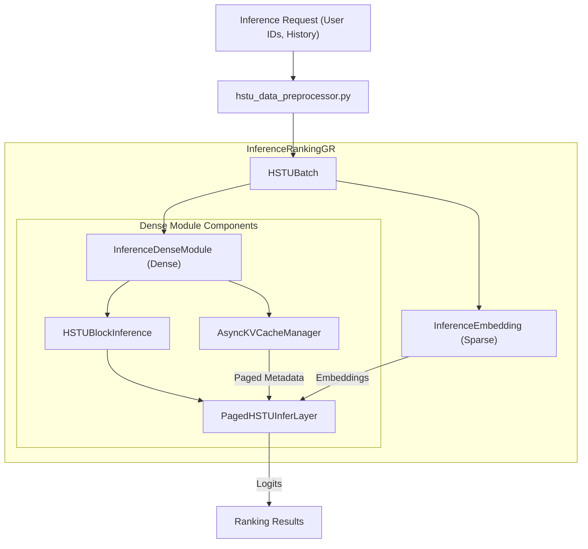

<!-- source: DeepWiki mcp.deepwiki.com · repo NVIDIA/recsys-examples · page 5.3 HSTU Inference and Serving · fetched 2026-10-26 -->

# HSTU Inference and Serving

Relevant source files

The following files were used as context for generating this wiki page:

- [.github/workflows/blossom-ci.yml](.github/workflows/blossom-ci.yml)
- [.gitmodules](.gitmodules)
- [corelib/hstu/README.md](corelib/hstu/README.md)
- [docker/Dockerfile](docker/Dockerfile)
- [docker/Dockerfile.nve](docker/Dockerfile.nve)
- [examples/hstu/configs/__init__.py](examples/hstu/configs/__init__.py)
- [examples/hstu/configs/inference_config.py](examples/hstu/configs/inference_config.py)
- [examples/hstu/inference/README.md](examples/hstu/inference/README.md)
- [examples/hstu/inference/benchmark/README.md](examples/hstu/inference/benchmark/README.md)
- [examples/hstu/inference/benchmark/hstu_inference_b200_batch1.png](examples/hstu/inference/benchmark/hstu_inference_b200_batch1.png)
- [examples/hstu/inference/benchmark/hstu_inference_b200_batch8.png](examples/hstu/inference/benchmark/hstu_inference_b200_batch8.png)
- [examples/hstu/inference/benchmark/inference_benchmark.py](examples/hstu/inference/benchmark/inference_benchmark.py)
- [examples/hstu/inference/benchmark/inference_benchmark_l20.png](examples/hstu/inference/benchmark/inference_benchmark_l20.png)
- [examples/hstu/inference/benchmark/paged_hstu_with_kvcache_benchmark.py](examples/hstu/inference/benchmark/paged_hstu_with_kvcache_benchmark.py)
- [examples/hstu/inference/cpp_inference/CMakeLists.txt](examples/hstu/inference/cpp_inference/CMakeLists.txt)
- [examples/hstu/inference/export_inference_gr_ranking.py](examples/hstu/inference/export_inference_gr_ranking.py)
- [examples/hstu/inference/inference_gr_ranking.py](examples/hstu/inference/inference_gr_ranking.py)
- [examples/hstu/inference/launch_triton_server.sh](examples/hstu/inference/launch_triton_server.sh)
- [examples/hstu/inference/triton/hstu_model/model.py](examples/hstu/inference/triton/hstu_model/model.py)
- [examples/hstu/model/inference_ranking_gr.py](examples/hstu/model/inference_ranking_gr.py)
- [examples/hstu/modules/exportable_embedding.py](examples/hstu/modules/exportable_embedding.py)
- [examples/hstu/modules/hstu_block_inference.py](examples/hstu/modules/hstu_block_inference.py)
- [examples/hstu/modules/inference_dense_module.py](examples/hstu/modules/inference_dense_module.py)
- [examples/hstu/modules/inference_embedding.py](examples/hstu/modules/inference_embedding.py)
- [examples/hstu/modules/paged_hstu_infer_layer.py](examples/hstu/modules/paged_hstu_infer_layer.py)
- [examples/hstu/ops/triton_ops/triton_position.py](examples/hstu/ops/triton_ops/triton_position.py)
- [examples/hstu/test/hstu_attn/test_fbgemm_hstu_smoke.py](examples/hstu/test/hstu_attn/test_fbgemm_hstu_smoke.py)
- [examples/hstu/test/test_hstu_block_inference.py](examples/hstu/test/test_hstu_block_inference.py)
- [examples/hstu/test/test_kvcache.py](examples/hstu/test/test_kvcache.py)
- [examples/hstu/test/test_paged_hstu_attn_kernel.py](examples/hstu/test/test_paged_hstu_attn_kernel.py)
- [examples/hstu/test/test_paged_hstu_layer.py](examples/hstu/test/test_paged_hstu_layer.py)
- [jenkins/L0_Test.groovy](jenkins/L0_Test.groovy)

This page documents the inference stack for the Hierarchical Sequential Transduction Unit (HSTU) system. The architecture is optimized for high-throughput, low-latency recommendation serving using paged KV caching, CUDA graph capture, and integration with NVIDIA Triton Inference Server.

## 1. Inference Architecture Overview

The HSTU inference stack is divided into a **Sparse Module** (embeddings) and a **Dense Module** (HSTU blocks and prediction heads). This separation allows for specialized optimizations: the sparse module leverages `DynamicEmb` for efficient embedding lookups, while the dense module utilizes custom CUDA kernels and KV caching to handle long sequence dependencies.

### System Data Flow

The following diagram illustrates the data flow from a raw inference request to the final ranking logits, highlighting the interaction between the `AsyncKVCacheManager` and the `PagedHSTUInferLayer`.

**HSTU Inference Data Flow**

**Sources:** [examples/hstu/model/inference_ranking_gr.py:24-147](), [examples/hstu/modules/inference_dense_module.py:117-188](), [examples/hstu/inference/README.md:24-29]()

---

## 2. Paged KV Cache and Async Management

To reduce redundant computation of historical tokens, the system implements a paged KV cache. This allows the model to only process new "delta" tokens while retrieving historical Key (K) and Value (V) tensors from memory.

### Key Components
*   **AsyncKVCacheManager**: Manages the lifecycle of KV data across GPU HBM and Host memory. It supports LRU eviction and asynchronous H2D/D2H transfers [examples/hstu/inference/README.md:5-15]().
*   **Paged Attention Kernel**: The `hstu_attn_varlen_func` accepts KV data from a paged table, allowing non-contiguous memory access during attention computation [examples/hstu/modules/paged_hstu_infer_layer.py:33](), [examples/hstu/test/test_paged_hstu_attn_kernel.py:179-199]().

### Cache Operations
The cache manager performs several asynchronous operations to hide latency:
1.  `prepare_kvcache_async`: Allocates pages and triggers host-to-device transfers [examples/hstu/inference/README.md:49]().
2.  `append_kvcache`: A CUDA kernel that copies new K/V values into the allocated pages [examples/hstu/inference/README.md:51]().
3.  `offload_kvcache`: Background eviction of stale user data to host storage [examples/hstu/inference/README.md:52]().

**Sources:** [examples/hstu/inference/README.md:5-58](), [examples/hstu/modules/paged_hstu_infer_layer.py:15-38]()

---

## 3. CUDA Graph Optimization

For small batch sizes, kernel launch overhead can become a bottleneck. The HSTU inference stack utilizes **CUDA Graph capture and replay** to minimize this overhead.

### Implementation Details
*   **Static Shapes**: To use CUDA graphs, input data (hidden states) are padded to pre-determined static batch sizes and sequence lengths [examples/hstu/inference/README.md:20-21]().
*   **Buffer Management**: `InferenceDenseModule` maintains static GPU buffers for metadata and hidden states to ensure stable memory addresses during graph replay [examples/hstu/modules/inference_dense_module.py:48-87]().
*   **Fusion**: Linear operations and activations (e.g., `uvqk_addmm_impl`) are fused using Triton or custom PTX kernels depending on the GPU architecture (Ampere vs. Blackwell) [examples/hstu/modules/paged_hstu_infer_layer.py:154-194]().

**Sources:** [examples/hstu/inference/README.md:18-21](), [examples/hstu/modules/inference_dense_module.py:185-188](), [examples/hstu/modules/paged_hstu_infer_layer.py:162-194]()

---

## 4. AOTInductor and C++ Export

The repository supports end-to-end C++ inference by exporting Python models via `torch.export` and compiling them with `AOTInductor`.

### Export Workflow
1.  **Sparse Export**: `ExportableEmbedding` uses `InferenceEmbeddingTable` from DynamicEmb. It generates a `.pt2` archive along with metadata and NVE (NVEmbedding) weight files [examples/hstu/modules/exportable_embedding.py:85-136](), [examples/hstu/inference/README.md:32-40]().
2.  **Dense Export**: The dense components are compiled using `torch._inductor.aoti_compile_and_package` to create a standalone shared library [examples/hstu/inference/README.md:32]().
3.  **C++ Runtime**: A dedicated C++ executable (`inference_hstu_gr_ranking_exported_model.cpp`) loads the compiled package using `AOTIModelPackageLoader` [examples/hstu/inference/cpp_inference/CMakeLists.txt:45-53](), [examples/hstu/inference/README.md:37]().

**Sources:** [examples/hstu/inference/README.md:30-41](), [examples/hstu/modules/exportable_embedding.py:28-67](), [examples/hstu/inference/cpp_inference/CMakeLists.txt:1-53]()

---

## 5. Triton Inference Server Integration

HSTU models can be served using the Triton Python backend.

### Deployment Structure
*   **Sparse Instance**: One instance per node, managing shared GPU embedding tables/caches [examples/hstu/inference/README.md:27]().
*   **Dense Instance**: One instance per GPU to handle the model logic [examples/hstu/inference/README.md:28]().
*   **Configuration**: Model configurations are defined in `config.pbtxt` files, specifying input/output tensors and environment variables like `HSTU_GIN_CONFIG_FILE` [examples/hstu/inference/README.md:151-153]().

**Sources:** [examples/hstu/inference/README.md:24-29](), [examples/hstu/inference/README.md:138-155]()

---

## 6. Inference Benchmarks

Benchmarks demonstrate significant speedups when combining KV caching and CUDA graphs.

| Optimization | Speedup (L20 GPU) |
| :--- | :--- |
| **End-to-End (KV Cache + CUDA Graph)** | 1.3x - 2.6x [examples/hstu/inference/benchmark/README.md:41]() |
| **HSTU Block (KV Cache Only, Batch 1)** | 3x - 20x [examples/hstu/inference/benchmark/README.md:61]() |
| **HSTU Block (KV Cache Only, Batch 8)** | 3x - 8x [examples/hstu/inference/benchmark/README.md:61]() |

### Hardware Support
*   **L20 (Ampere)**: Uses 32-token page sizes [examples/hstu/inference/benchmark/README.md:63]().
*   **B200 (Blackwell)**: Utilizes `CuteDSL` kernels with 128-token page sizes for enhanced performance [examples/hstu/inference/benchmark/README.md:65-72]().

**Sources:** [examples/hstu/inference/benchmark/README.md:1-72]()

---

