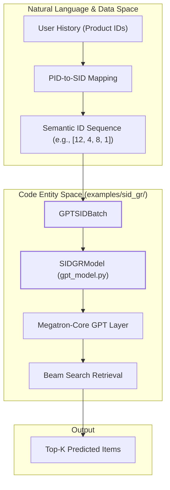
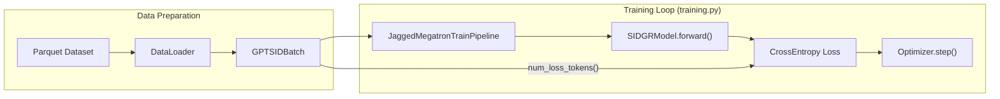

<!-- source: DeepWiki mcp.deepwiki.com · repo NVIDIA/recsys-examples · page 6 Semantic ID Generative Recommender (SID-GR) · fetched 2026-10-26 -->

# Semantic ID Generative Recommender (SID-GR)

Relevant source files

The following files were used as context for generating this wiki page:

- [examples/commons/datasets/gpt_sid_batch.py](examples/commons/datasets/gpt_sid_batch.py)
- [examples/sid_gr/training/trainer/training.py](examples/sid_gr/training/trainer/training.py)

The Semantic ID Generative Recommender (SID-GR) is a generative retrieval model that leverages a GPT-style decoder architecture to predict item sequences. Unlike traditional recommenders that treat item IDs as atomic categorical tokens, SID-GR uses **Semantic IDs (SIDs)**—hierarchical representations where items are decomposed into a sequence of tokens (e.g., clusters or categories). This allows the model to perform retrieval as a sequence generation task, effectively navigating a hierarchical search space to identify candidates.

## System Overview

SID-GR integrates several high-performance components from the NVIDIA RecSys ecosystem:
- **Generative Backbone**: A decoder-only transformer based on the GPT architecture, utilizing [Megatron-Core](https://github.com/NVIDIA/Megatron-LM) for scalable training.
- **Semantic Tokenization**: Items are represented as a fixed-length sequence of hierarchical tokens (e.g., 4 levels of hierarchy), enabling the model to "generate" an item ID token-by-token.
- **Distributed Training**: Supports Data Parallelism and Tensor Parallelism to handle large-scale item vocabularies and sequence lengths.

### SID-GR Logic Flow

The following diagram illustrates the transition from raw dataset features to the generative prediction process within the code.

Sources: [examples/commons/datasets/gpt_sid_batch.py:97-105](), [examples/sid_gr/training/trainer/training.py:34-34]()

## Model Architecture

The core of SID-GR is the `SIDGRModel`, which wraps a GPT-style decoder. It is designed to handle the specific requirements of hierarchical recommendation, such as causal masking across both sequence time-steps and SID hierarchies.

Key architectural features include:
- **Hierarchical Representation**: Each item is represented by `_num_hierarchies` tokens (defaulting to 4) [examples/commons/datasets/gpt_sid_batch.py:121-121]().
- **Generative Retrieval**: During inference, the model uses `model.generate(batch)` to perform beam search over the hierarchical SID space to retrieve the most likely next items [examples/sid_gr/training/trainer/training.py:64-65]().
- **Loss Calculation**: The model performs next-token prediction, where loss is calculated over the candidate item hierarchies [examples/commons/datasets/gpt_sid_batch.py:124-139]().

For a deep dive into the transformer blocks, attention mechanisms, and beam search implementation, see **[SID-GR Model Architecture](#6.1)**.

## Training and Data Pipeline

The training workflow is managed by a specialized trainer that supports distributed execution and efficient data streaming.

### Training Components
- **Data Structure**: The `GPTSIDBatch` class encapsulates history sequences, candidate sequences, and labels, providing methods to manipulate hierarchies during training [examples/commons/datasets/gpt_sid_batch.py:97-122]().
- **Pipeline**: Training uses `JaggedMegatronTrainPipelineSparseDist`, which handles the complexities of jagged tensors (varying sequence lengths) in a distributed Megatron-Core environment [examples/sid_gr/training/trainer/training.py:24-28]().
- **Checkpointing**: Supports saving and loading model states and optimizer states via `save_ckpts` and `maybe_load_ckpts` [examples/sid_gr/training/trainer/training.py:75-109]().

### Data Flow Diagram

This diagram maps the data transformation steps from the `GPTSIDBatch` to the training loop.

Sources: [examples/sid_gr/training/trainer/training.py:119-148](), [examples/commons/datasets/gpt_sid_batch.py:124-141]()

For details on the PID-to-SID tokenization workflow, Parquet preprocessing, and `gin-config` setup, see **[SID-GR Training and Data Pipeline](#6.2)**.

## Evaluation

Evaluation in SID-GR is performed using a stateful metric module. The `evaluate` function iterates through the evaluation dataset, generates SIDs using the current model state, and computes metrics (such as Recall or NDCG) based on the generated vs. ground-truth SID hierarchies [examples/sid_gr/training/trainer/training.py:42-72]().

Sources: [examples/sid_gr/training/trainer/training.py:42-72](), [examples/commons/datasets/gpt_sid_batch.py:146-173]()

---

