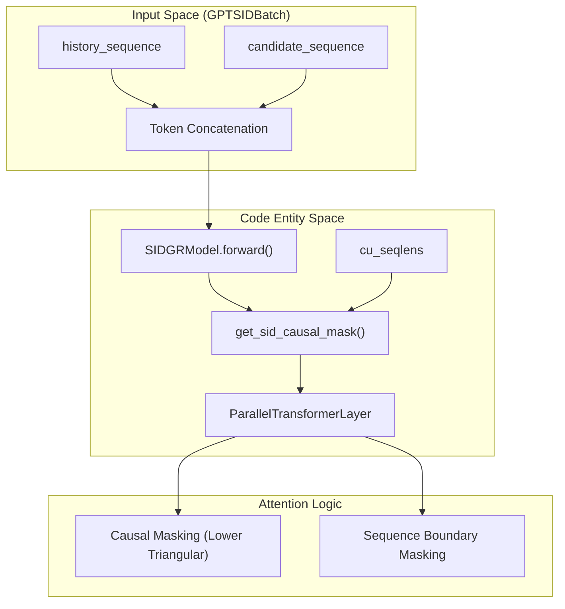
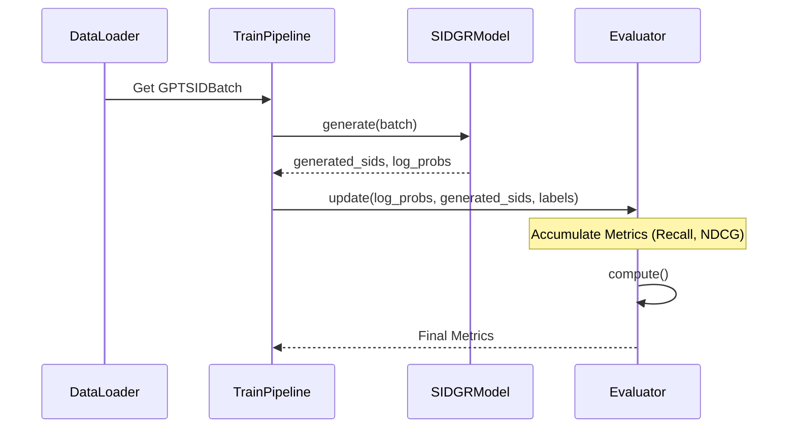

<!-- source: DeepWiki mcp.deepwiki.com · repo NVIDIA/recsys-examples · page 6.1 SID-GR Model Architecture · fetched 2026-10-26 -->

# SID-GR Model Architecture

Relevant source files

The following files were used as context for generating this wiki page:

- [examples/commons/datasets/gpt_sid_batch.py](examples/commons/datasets/gpt_sid_batch.py)
- [examples/sid_gr/training/trainer/training.py](examples/sid_gr/training/trainer/training.py)

The Semantic ID Generative Recommender (SID-GR) is a generative retrieval model that leverages a GPT-style decoder architecture to predict item sequences. Unlike traditional recommendation models that use flat item IDs, SID-GR represents items as sequences of hierarchical tokens (Semantic IDs), allowing the model to perform recommendation as a next-token prediction task.

## GPT-style Decoder and Megatron-Core Integration

The backbone of SID-GR is a decoder-only transformer implemented using **Megatron-Core (MCore)** components. The model is encapsulated in the `SIDGRModel` class, which integrates MCore's distributed training capabilities, including tensor and sequence parallelism.

### Model Structure
The architecture follows a standard transformer decoder flow:
1.  **Embedding Layer**: Maps SID tokens to a continuous vector space.
2.  **Transformer Blocks**: A stack of `ParallelTransformerLayer` from Megatron-Core.
3.  **Output Head**: A linear layer that projects the hidden state back to the SID vocabulary size for next-token prediction.

### Component Mapping: Natural Language to Code Entity

| Natural Language Concept | Code Entity (Class/Function) | File Path |
| :--- | :--- | :--- |
| **Model Container** | `SIDGRModel` | [examples/sid_gr/training/model/gpt_model.py:64-79]() |
| **Transformer Backbone** | `ParallelTransformer` | [examples/sid_gr/training/model/gpt_model.py:101-110]() |
| **Attention Masking** | `get_sid_causal_mask` | [examples/sid_gr/training/model/gpt_model.py:284-306]() |
| **SID Tokenizer** | `SIDTokenizer` | [examples/sid_gr/training/model/tokenizer.py:18-20]() |
| **Sequence Packing** | `to_packed_seq_params` | [examples/commons/datasets/gpt_sid_batch.py:44-58]() |

**Sources:** [examples/sid_gr/training/model/gpt_model.py:64-110](), [examples/commons/datasets/gpt_sid_batch.py:44-58]()

## Semantic ID (SID) Representation

Items in SID-GR are represented as a sequence of tokens derived from a hierarchical clustering or taxonomy. For example, an item might be represented by 4 hierarchies (e.g., `[cluster_L1, cluster_L2, cluster_L3, leaf_id]`).

### SID Data Flow
The `GPTSIDBatch` class manages the transformation and storage of these hierarchical tokens.

*   **Hierarchies**: Defined by `_num_hierarchies`, typically set to 4 [examples/commons/datasets/gpt_sid_batch.py:121]().
*   **Batch Structure**: The batch contains `history_sequence` (user behavior) and `candidate_sequence` (target items). Both are represented as contiguous SID tokens [examples/commons/datasets/gpt_sid_batch.py:115-120]().
*   **Token Count**: The number of loss tokens is calculated as `num_candidate_items * _num_hierarchies` [examples/commons/datasets/gpt_sid_batch.py:124-145]().

**Sources:** [examples/commons/datasets/gpt_sid_batch.py:97-145]()

## Attention Mask Construction

To ensure the generative model only attends to valid preceding context, SID-GR uses a specialized causal mask. In a recommendation context, the mask must account for the fact that items consist of multiple tokens.

The `get_sid_causal_mask` function in `gpt_model.py` generates this mask:
*   It creates a standard lower-triangular causal mask to prevent looking at future tokens.
*   It handles "packed" sequences where multiple users' histories are concatenated in a single batch, utilizing `cu_seqlens` to prevent cross-user attention [examples/sid_gr/training/model/gpt_model.py:284-306]().

### Data Flow Diagram: From Batch to Attention Mask

**Sources:** [examples/sid_gr/training/model/gpt_model.py:214-230](), [examples/sid_gr/training/model/gpt_model.py:284-306]()

## Beam Search for Retrieval

During inference, the model does not just predict the next token; it generates the most likely sequence of tokens to retrieve complete item SIDs. This is implemented via the `generate` method in `SIDGRModel`.

1.  **Initialization**: Starts from the user's history sequence.
2.  **Token Generation**: Iteratively predicts the next hierarchy token.
3.  **Beam Management**: Maintains the top-K sequences (candidate items) based on log-probabilities.
4.  **Constraint Satisfaction**: Ensures that the generated token sequences correspond to valid item SIDs in the catalog.

**Sources:** [examples/sid_gr/training/trainer/training.py:64-65](), [examples/sid_gr/training/model/gpt_model.py:250-280]()

## Evaluation Metrics

The evaluation process uses a stateful metric module to compute ranking performance. The primary metrics include:
*   **Recall@K**: Measures if the ground truth item is within the top-K generated candidates.
*   **NDCG@K**: Measures the quality of the ranking of the generated candidates.

The `evaluate` function in `training.py` orchestrates this by:
1.  Passing the batch through `model.generate(batch)` to get `generated_sids` and `log_probs` [examples/sid_gr/training/trainer/training.py:64]().
2.  Calling `model.evaluator(log_probs, generated_sids, labels)` to update metric states [examples/sid_gr/training/trainer/training.py:65]().
3.  Resetting the evaluator after each full evaluation pass [examples/sid_gr/training/trainer/training.py:68]().

### Evaluation Flow Diagram

**Sources:** [examples/sid_gr/training/trainer/training.py:42-72]()

---

