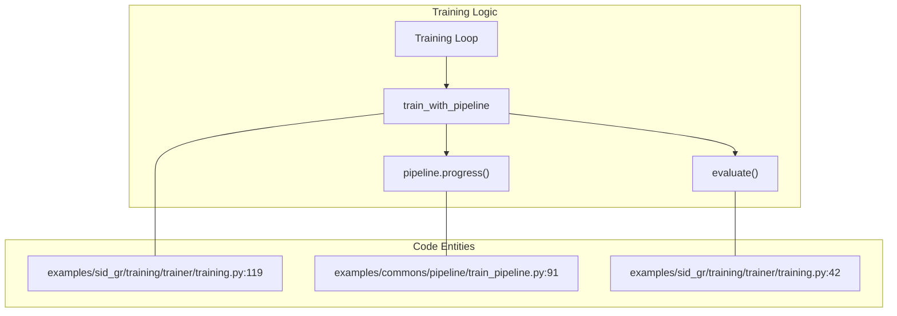
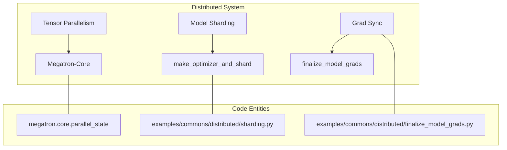

<!-- source: DeepWiki mcp.deepwiki.com · repo NVIDIA/recsys-examples · page 6.2 SID-GR Training and Data Pipeline · fetched 2026-10-26 -->

# SID-GR Training and Data Pipeline

Relevant source files

The following files were used as context for generating this wiki page:

- [examples/commons/datasets/gpt_sid_batch.py](examples/commons/datasets/gpt_sid_batch.py)
- [examples/commons/pipeline/train_pipeline.py](examples/commons/pipeline/train_pipeline.py)
- [examples/commons/utils/dynamicemb_cache_stats.py](examples/commons/utils/dynamicemb_cache_stats.py)
- [examples/commons/utils/logger.py](examples/commons/utils/logger.py)
- [examples/hstu/training/pretrain_gr_ranking.py](examples/hstu/training/pretrain_gr_ranking.py)
- [examples/hstu/training/trainer/utils.py](examples/hstu/training/trainer/utils.py)
- [examples/hstu/utils/gin_config_args.py](examples/hstu/utils/gin_config_args.py)
- [examples/sid_gr/training/trainer/training.py](examples/sid_gr/training/trainer/training.py)

The Semantic ID Generative Recommender (SID-GR) training and data pipeline provides a robust infrastructure for training GPT-style generative models on recommendation datasets. It leverages **Megatron-Core** for distributed training and **DynamicEmb** for large-scale item representations. The pipeline handles the transformation of Physical IDs (PIDs) into hierarchical Semantic IDs (SIDs), manages high-performance data loading via Parquet files, and implements a sophisticated training loop with overlapping communication and computation.

## 1. Data Pipeline and Tokenization

The SID-GR data pipeline is designed to handle sequences where items are represented as a hierarchy of tokens. Unlike standard ID-based models, SID-GR treats an item as a sequence of semantic tokens (e.g., a 4-level hierarchy).

### PID-to-SID Workflow
The dataset must be preprocessed into a format where each item is mapped to its semantic tokens. During training, the `GPTSIDBatch` structure manages these hierarchical representations.

| Component | Role |
| :--- | :--- |
| `GPTSIDBatch` | Data structure containing history SIDs, candidate SIDs, and labels [examples/commons/datasets/gpt_sid_batch.py:97-105](). |
| `FeatureConfig` | Defines max item IDs and sequence lengths for random data generation [examples/commons/datasets/gpt_sid_batch.py:61-80](). |
| `num_loss_tokens` | Calculates the total number of loss tokens based on candidate items and hierarchy depth [examples/commons/datasets/gpt_sid_batch.py:124-145](). |

### Dataset Preprocessing
The pipeline supports loading datasets in Parquet format via `hstu_sequence_dataset.get_dataset` [examples/hstu/training/trainer/utils.py:172-184](). The dataloader is initialized before the model to ensure proper state for random or distributed sampling [examples/hstu/training/pretrain_gr_ranking.py:102-107]().

**Sources:**
- [examples/commons/datasets/gpt_sid_batch.py]()
- [examples/hstu/training/pretrain_gr_ranking.py]()
- [examples/hstu/training/trainer/utils.py]()

## 2. Training Loop Implementation

The training loop is implemented in `train_with_pipeline`, which coordinates model updates, metric computation, and checkpointing.

### Execution Flow
1.  **Pipeline Initialization**: A `TrainPipeline` (e.g., `JaggedMegatronTrainPipelineSparseDist`) is created to manage the overlap of device transfer and computation [examples/sid_gr/training/trainer/training.py:119-130]().
2.  **Iteration Slicing**: The training loader is split into slices based on the `eval_interval` [examples/sid_gr/training/trainer/training.py:144-146]().
3.  **Forward/Backward Pass**: The `pipeline.progress()` method is called for each batch, returning the loss [examples/sid_gr/training/trainer/training.py:192]().
4.  **Metric Accumulation**: Loss and token counts are logged across ranks [examples/sid_gr/training/trainer/training.py:198-202]().

### Data-Code Association: Training Orchestration
The following diagram bridges the high-level training concepts to the specific code entities used in the SID-GR training script.

**Sources:**
- [examples/sid_gr/training/trainer/training.py]()
- [examples/commons/pipeline/train_pipeline.py]()

## 3. Configuration and Gin Parameters

The system uses `gin-config` for hyperparameter management and hardware-specific tuning.

### Key Trainer Parameters
The `TrainerArgs` class defines the primary settings for the training execution [examples/hstu/utils/gin_config_args.py:26-50]().

| Parameter | Description |
| :--- | :--- |
| `train_batch_size` | Batch size per GPU; total batch size is `train_batch_size * tp_size` [examples/hstu/utils/gin_config_args.py:54](). |
| `pipeline_type` | Options: `none`, `native` (overlap H2D/Dist), `prefetch` (adds prefetch overlap) [examples/hstu/utils/gin_config_args.py:73-76](). |
| `ckpt_save_interval` | Frequency of checkpointing in iterations [examples/hstu/utils/gin_config_args.py:68](). |
| `enable_balanced_shuffler` | Whether to use `HASTUBalancedBatchShuffler` for load balancing [examples/hstu/utils/gin_config_args.py:78-81](). |

### Dynamic Embedding Configuration
`DynamicEmbeddingArgs` extends base embedding configurations to support HBM-specific optimizations and eviction strategies [examples/hstu/utils/gin_config_args.py:140-163]().

**Sources:**
- [examples/hstu/utils/gin_config_args.py]()

## 4. Distributed Training with Megatron-Core

SID-GR utilizes Megatron-Core for Tensor Parallelism (TP) and Data Parallelism (DP).

### Initialization and Sharding
The initialization process involves setting up the distributed environment and sharding the model across available GPUs.

1.  **Distributed Init**: `initialize_distributed()` and `initialize_model_parallel()` set up the process groups [examples/hstu/training/pretrain_gr_ranking.py:91-94]().
2.  **Model Sharding**: `make_optimizer_and_shard` handles the distribution of both dense parameters and sparse dynamic embeddings [examples/hstu/training/pretrain_gr_ranking.py:120-127]().
3.  **Optimizer Setup**: Supports `sgd` and `adam`, with storage multipliers defined for dynamic embeddings (e.g., Adam requires 3x storage for states) [examples/hstu/training/trainer/utils.py:42-50]().

### Data-Code Association: Distributed Infrastructure
This diagram maps the distributed training components to their implementation files and classes.

**Sources:**
- [examples/hstu/training/pretrain_gr_ranking.py]()
- [examples/hstu/training/trainer/utils.py]()
- [examples/commons/distributed/finalize_model_grads.py]()

## 5. Performance Monitoring and Debugging

The pipeline includes utilities for monitoring memory usage and cache performance.

### Cache and Memory Tracking
*   **Cache Debugging**: The `auto_install` function attaches forward hooks to `BatchedDynamicEmbeddingTable` to log hit/miss statistics if `CACHE_DEBUG=1` is set [examples/commons/utils/dynamicemb_cache_stats.py:89-93]().
*   **Memory Logging**: `log_mem` tracks physical free memory, PyTorch allocated memory, and reserved memory to help identify leaks or OOM issues [examples/commons/utils/logger.py:99-124]().
*   **Profiling**: Integration with the PyTorch Profiler allows for exporting Chrome traces of training steps [examples/sid_gr/training/trainer/training.py:150-173]().

**Sources:**
- [examples/commons/utils/dynamicemb_cache_stats.py]()
- [examples/commons/utils/logger.py]()
- [examples/sid_gr/training/trainer/training.py]()

---

