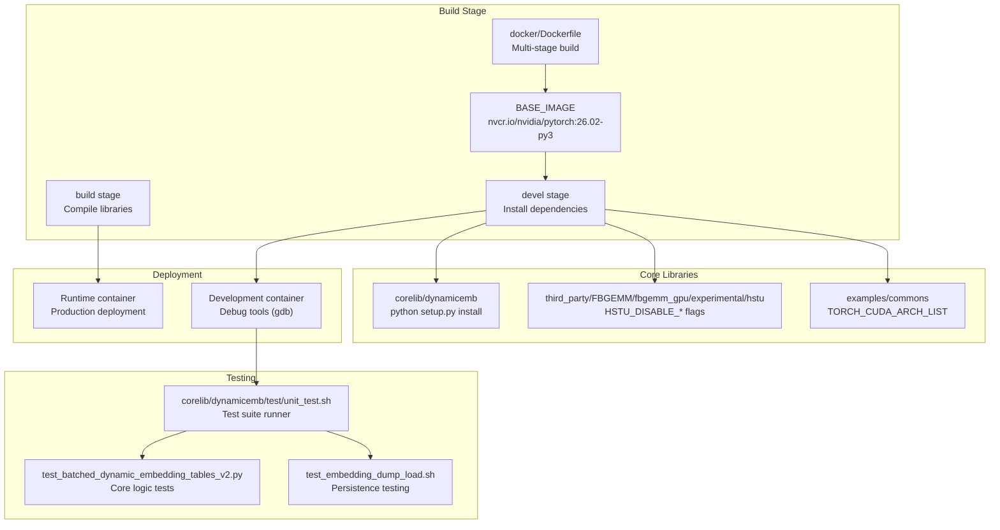
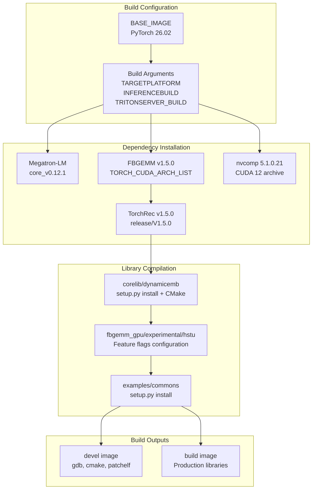
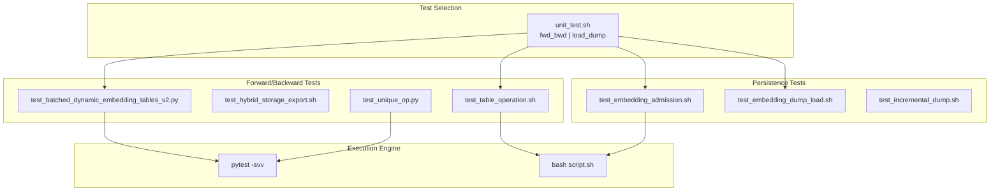

<!-- source: DeepWiki mcp.deepwiki.com · repo NVIDIA/recsys-examples · page 7 Development and Testing · fetched 2026-10-26 -->

# Development and Testing

<details>
<summary>Relevant source files</summary>

The following files were used as context for generating this wiki page:

- [.github/workflows/blossom-ci.yml](.github/workflows/blossom-ci.yml)
- [corelib/dynamicemb/test/unit_test.sh](corelib/dynamicemb/test/unit_test.sh)
- [docker/Dockerfile](docker/Dockerfile)
- [examples/hstu/modules/exportable_embedding.py](examples/hstu/modules/exportable_embedding.py)
- [jenkins/L0_Test.groovy](jenkins/L0_Test.groovy)

</details>


This document provides an overview of the development workflow, build system, and testing infrastructure for the NVIDIA RecSys Examples repository. The system uses a Docker-based development environment for reproducible builds and comprehensive testing across distributed configurations.

For detailed information about the Docker build system and dependency management, see **[Build System and Docker Environment](#7.1)**. For comprehensive testing framework documentation, see **[Testing Framework and Unit Tests](#7.2)**.

## Development Workflow Overview

The development workflow follows a container-based approach that ensures consistent environments across different hardware configurations and supports complex distributed training scenarios.

### Development Cycle



**Sources:** [docker/Dockerfile:1-91](), [corelib/dynamicemb/test/unit_test.sh:1-33]()

### Key Development Components

| Component | Purpose | Related Page |
|-----------|---------|--------------|
| Multi-stage Docker build | Separates build and runtime environments | [Build System and Docker Environment](#7.1) |
| Feature flag system | Controls compilation of HSTU variants (e.g., `HSTU_DISABLE_FP16`) | [Build System and Docker Environment](#7.1) |
| DynamicEmb Unit Tests | `unit_test.sh` categorizes tests into `fwd_bwd` and `load_dump` | [Testing Framework and Unit Tests](#7.2) |
| Checkpointing utilities | `DynamicEmbDump`/`Load` for state persistence | [5.2]() |
| Pytest framework | Parameterized execution for Python-based tests | [Testing Framework and Unit Tests](#7.2) |

## Docker-Based Development Environment

The repository uses a multi-stage Docker build system that manages complex dependencies and supports multiple build configurations, including specialized builds for inference and Triton Server.

### Build System Architecture



**Sources:** [docker/Dockerfile:1-91]()

### Build Configuration Options

The build system uses environment variables to control feature compilation and architecture support:

| Variable | Purpose | Example Value |
|----------|---------|---------------|
| `TRITONSERVER_BUILD` | Installs `cmake`, `patchelf`, and Triton-specific Python deps | `1` |
| `HSTU_ARCH_LIST` | Target GPU architectures for HSTU kernels | `"8.0 9.0"` |
| `HSTU_DISABLE_FP16` | Disables FP16 support in HSTU for faster builds | `TRUE` |
| `TORCH_CUDA_ARCH_LIST` | Target GPU architectures for FBGEMM and Commons | `"7.5 8.0 8.6 9.0"` |
| `DYNAMICEMB_OPS_LIB_DIR` | Path to `inference_emb_ops.so` for inference | `/usr/local/lib` |

**Sources:** [docker/Dockerfile:6-17](), [docker/Dockerfile:59-65](), [examples/hstu/modules/exportable_embedding.py:42-43]()

## Testing Infrastructure Overview

The testing framework validates functionality across core components using a combination of shell scripts and Python tests.

### Test Execution Flow



**Sources:** [corelib/dynamicemb/test/unit_test.sh:1-33]()

### Key Test Categories

| Category | Components Tested | Key Files |
|----------|-------------------|-----------|
| **Forward/Backward** | Table operations, unique ops, sequence/pooled embeddings | `test_table_operation.sh`, `test_unique_op.py` |
| **Persistence** | Admission control, full dump/load, incremental updates | `test_embedding_dump_load.sh`, `test_incremental_dump.sh` |
| **Inference** | Exportable ops, fake op registration for `torch.export` | `exportable_embedding.py` |

**Sources:** [corelib/dynamicemb/test/unit_test.sh:2-21](), [examples/hstu/modules/exportable_embedding.py:28-65]()

## CI/CD and Development Workflow

### Blossom CI Pipeline

The repository uses NVIDIA's Blossom CI system for hybrid infrastructure testing, combining GitHub Actions with self-hosted runners.

| Job | Description |
|-----|-------------|
| **Authorization** | Restricts build triggering to authorized contributors (e.g., `EmmaQiaoCh`, `JacoCheung`) |
| **Vulnerability Scan** | Runs Blossom actions to scan for security issues |
| **Job-trigger** | Starts the actual CI job on the CI server |
| **Upload-Log** | Handles post-processing and log uploads for manual triggers |

**Sources:** [.github/workflows/blossom-ci.yml:30-106]()

### Build and Test Integration

The build process automatically compiles the C++ extensions required for testing. For instance, the `dynamicemb` build includes a CMake step to build `torch_binding_build` when not in a Triton server build environment.

**Sources:** [docker/Dockerfile:87-90]()

## Inference Testing and Export

For inference development, the system supports exporting embeddings via `ExportableEmbedding`. This involves loading `inference_emb_ops.so` and registering fake implementations for `torch.export`.

```python
# From exportable_embedding.py
def _load_inference_emb_ops() -> bool:
    # Loads torch.ops.INFERENCE_EMB.*
    lib_path = os.path.join(_DYNAMICEMB_OPS_LIB_DIR, "inference_emb_ops.so")
    torch.ops.load_library(lib_path)

# Registers fake impls for torch.export
import dynamicemb.index_range_meta as _index_range_meta
import dynamicemb.lookup_meta as _lookup_meta
```

**Sources:** [examples/hstu/modules/exportable_embedding.py:32-62]()

## Related Documentation

- **[7.1] Build System and Docker Environment** — Detailed guide to Dockerfile, multi-stage builds, and feature flags.
- **[7.2] Testing Framework and Unit Tests** — Deep dive into the `unit_test.sh` suites and testing utilities.
- **[5.2] Model Checkpointing and State Management** — Documentation on how tests interact with persistence layers.

---

