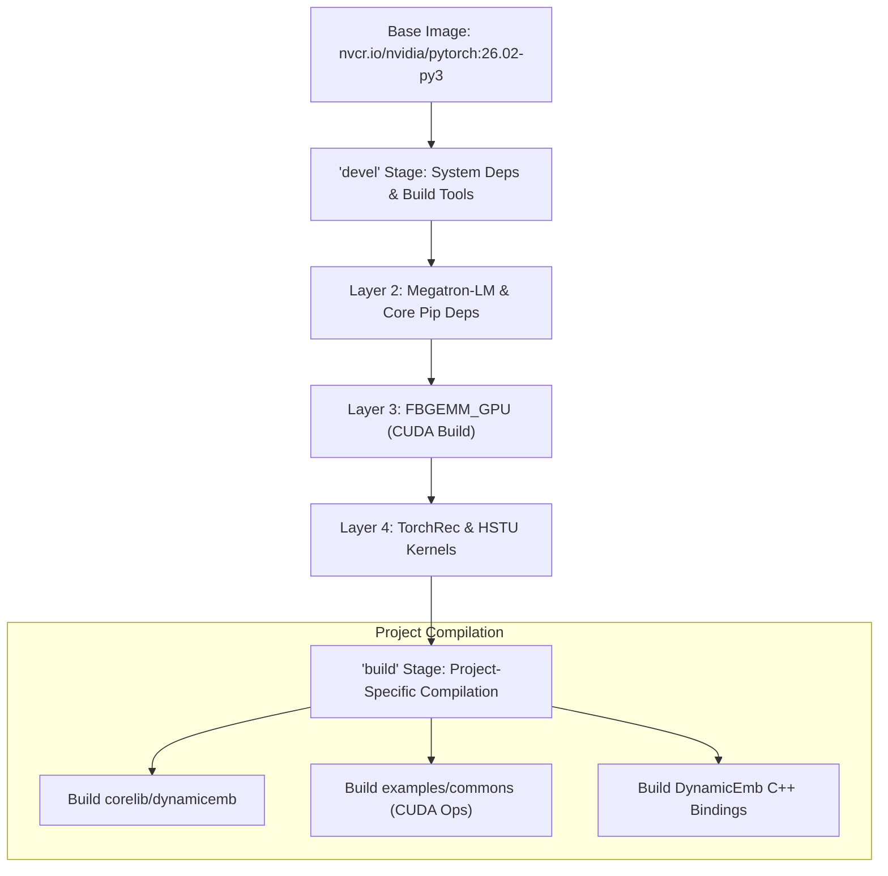
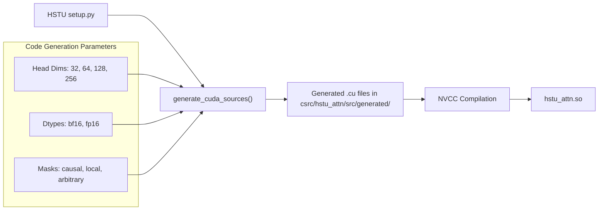
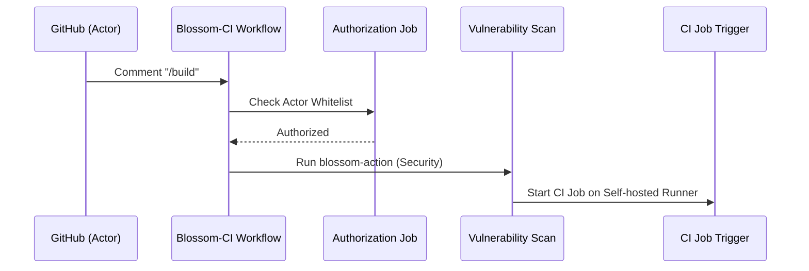

<!-- source: DeepWiki mcp.deepwiki.com · repo NVIDIA/recsys-examples · page 7.1 Build System and Docker Environment · fetched 2026-10-26 -->

# Build System and Docker Environment

Relevant source files

The following files were used as context for generating this wiki page:

- [.github/workflows/blossom-ci.yml](.github/workflows/blossom-ci.yml)
- [.pre-commit-config.yaml](.pre-commit-config.yaml)
- [corelib/dynamicemb/dynamicemb/planner/rw_sharding.py](corelib/dynamicemb/dynamicemb/planner/rw_sharding.py)
- [corelib/dynamicemb/setup.py](corelib/dynamicemb/setup.py)
- [corelib/dynamicemb/src/index_calculation.h](corelib/dynamicemb/src/index_calculation.h)
- [corelib/hstu/hopper/setup.py](corelib/hstu/hopper/setup.py)
- [corelib/hstu/setup.py](corelib/hstu/setup.py)
- [corelib/hstu/test.py](corelib/hstu/test.py)
- [docker/Dockerfile](docker/Dockerfile)
- [examples/commons/setup.py](examples/commons/setup.py)
- [examples/hstu/modules/exportable_embedding.py](examples/hstu/modules/exportable_embedding.py)
- [jenkins/L0_Test.groovy](jenkins/L0_Test.groovy)

## Purpose and Scope

This document provides a detailed guide to the build system and containerized environment of the NVIDIA RecSys Examples repository. It covers the multi-stage Dockerfile architecture, dependency management for complex libraries like `TorchRec` and `Megatron-LM`, CUDA architecture targeting, and the specialized build configurations for the Dynamic Embedding (`DynamicEmb`) and HSTU components.

## Docker Environment Architecture

The repository utilizes a multi-stage Docker build process to manage complex dependencies and provide optimized environments for both development and production (inference).

### Build Stage Overview

Sources: [docker/Dockerfile:1-91]()

### Key Build Arguments and Feature Flags

The build system uses several `ARG` variables to toggle features and target specific environments:

| Argument | Default | Purpose |
|----------|---------|---------|
| `BASE_IMAGE` | `nvcr.io/nvidia/pytorch:26.02-py3` | The foundation for the container. |
| `TRITONSERVER_BUILD` | N/A | If set to `1`, installs Triton Inference Server dependencies and skips certain training-only CUDA bindings. |
| `TARGETPLATFORM` | N/A | Detects `linux/arm64` vs `linux/amd64` to set appropriate CUDA stub symlinks and `CUDA_TARGET_ARCH`. |
| `TORCH_CUDA_ARCH_LIST` | `7.5 8.0 9.0` | Defines the target GPU architectures (Turing, Ampere, Hopper). |

Sources: [docker/Dockerfile:1-33](), [docker/Dockerfile:48-48](), [docker/Dockerfile:83-83]()

## Dependency Management

The project relies on several high-performance NVIDIA and PyTorch libraries that require specific versions and custom compilation flags.

### Core Libraries Integration

1.  **Megatron-LM**: Installed in editable mode from a specific core version `core_v0.12.1`. [docker/Dockerfile:39-40]()
2.  **FBGEMM & TorchRec**: Built from source to ensure compatibility with the CUDA toolkit version. `FBGEMM_GPU` is compiled with support for architectures `7.5`, `8.0`, and `9.0`. [docker/Dockerfile:45-54]()
3.  **HSTU Experimental Kernels**: Specialized kernels are installed from a submodule path `third_party/FBGEMM/fbgemm_gpu/experimental/hstu`. These kernels are highly optimized and use specific feature flags (e.g., `HSTU_DISABLE_FP16=TRUE`). [docker/Dockerfile:57-67]()
4.  **nvcomp**: The NVIDIA data compression library is downloaded and integrated into the `examples/commons` build for features like Paged KV Cache. [docker/Dockerfile:77-81]()

Sources: [docker/Dockerfile:38-67](), [docker/Dockerfile:77-81]()

## Component Build Systems

### Dynamic Embedding (DynamicEmb) Build

The `dynamicemb` library uses a custom `setup.py` that inherits from `torch.utils.cpp_extension.BuildExtension`.

#### Ninja and Resource Management
To prevent Out-Of-Memory (OOM) errors during heavy parallel compilation of CUDA kernels, the `NinjaBuildExtension` class dynamically calculates `MAX_JOBS` based on available CPU cores and free system memory (allocating ~12GB per job). [corelib/dynamicemb/setup.py:170-191]()

#### Compilation Flags
- **NVCC Flags**: Includes `--expt-relaxed-constexpr`, `--expt-extended-lambda`, and `--use_fast_math`. [corelib/dynamicemb/setup.py:113-117]()
- **Arch Support**: Explicitly targets `sm_75`, `sm_80`, and `sm_90`. [corelib/dynamicemb/setup.py:118-123]()

Sources: [corelib/dynamicemb/setup.py:106-160](), [corelib/dynamicemb/setup.py:170-199]()

### HSTU and CUDA Ops Build

The HSTU system utilizes a code generation strategy in its build process to optimize for different head dimensions and data types.

Sources: [corelib/hstu/setup.py:125-185]()

## Inference and Runtime Environment

For inference-specific builds (`TRITONSERVER_BUILD=1`), the system configures a specialized runtime:

- **Inference Ops**: A library `inference_emb_ops.so` is loaded at runtime via `torch.ops.load_library`. [examples/hstu/modules/exportable_embedding.py:32-55]()
- **Fake Ops Registration**: To support `torch.export` and AOTInductor, "fake" meta-kernels are registered for Dynamic Embedding and HSTU ops. [examples/hstu/modules/exportable_embedding.py:61-65]()
- **Shared Libraries**: The build process creates `hstu_cuda_ops` and `paged_kvcache_ops`, the latter of which links against `nvcomp_static`. [examples/commons/setup.py:27-69]()

Sources: [examples/hstu/modules/exportable_embedding.py:32-65](), [examples/commons/setup.py:43-66]()

## Continuous Integration (Blossom CI)

The repository uses NVIDIA's internal Blossom CI for automated testing and builds.

### Pipeline Flow

Sources: [.github/workflows/blossom-ci.yml:18-93]()

### Key CI Implementation Details
- **Authorization**: Access is restricted to a specific list of maintainers (`EmmaQiaoCh`, `JacoCheung`, etc.). [.github/workflows/blossom-ci.yml:38-39]()
- **Security**: A mandatory vulnerability scan is performed before any code is executed on internal runners. [.github/workflows/blossom-ci.yml:48-81]()
- **Logging**: Results and logs from the internal Jenkins/CI servers are posted back to the GitHub PR. [.github/workflows/blossom-ci.yml:95-105]()

Sources: [.github/workflows/blossom-ci.yml:30-106]()

---

