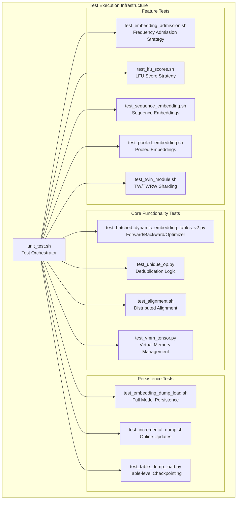
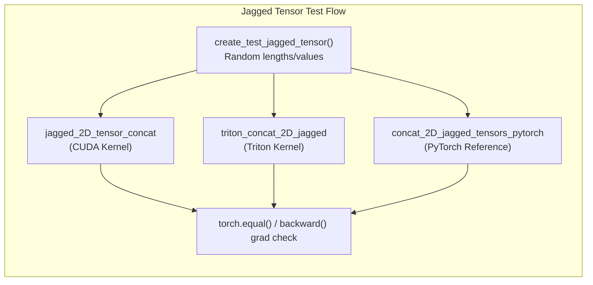

<!-- source: DeepWiki mcp.deepwiki.com · repo NVIDIA/recsys-examples · page 7.2 Testing Framework and Unit Tests · fetched 2026-10-26 -->

# Testing Framework and Unit Tests

Relevant source files

The following files were used as context for generating this wiki page:

- [corelib/dynamicemb/test/unit_test.sh](corelib/dynamicemb/test/unit_test.sh)
- [corelib/dynamicemb/test/unit_tests/incremental_dump/test_incremental_dump.sh](corelib/dynamicemb/test/unit_tests/incremental_dump/test_incremental_dump.sh)
- [corelib/dynamicemb/test/unit_tests/table_operation/test_table_operation.sh](corelib/dynamicemb/test/unit_tests/table_operation/test_table_operation.sh)
- [corelib/dynamicemb/test/unit_tests/test_alignment.sh](corelib/dynamicemb/test/unit_tests/test_alignment.sh)
- [corelib/dynamicemb/test/unit_tests/test_embedding_admission.sh](corelib/dynamicemb/test/unit_tests/test_embedding_admission.sh)
- [corelib/dynamicemb/test/unit_tests/test_lfu_scores.sh](corelib/dynamicemb/test/unit_tests/test_lfu_scores.sh)
- [corelib/dynamicemb/test/unit_tests/test_twin_module.sh](corelib/dynamicemb/test/unit_tests/test_twin_module.sh)
- [examples/commons/utils/distributed_utils.py](examples/commons/utils/distributed_utils.py)
- [examples/commons/utils/initialize.py](examples/commons/utils/initialize.py)
- [examples/hstu/test/test_addmm.py](examples/hstu/test/test_addmm.py)
- [examples/hstu/test/test_hstu_preprocess.py](examples/hstu/test/test_hstu_preprocess.py)
- [examples/hstu/test/test_jagged_tensor.py](examples/hstu/test/test_jagged_tensor.py)
- [examples/hstu/test/test_ln_silu.py](examples/hstu/test/test_ln_silu.py)
- [examples/hstu/test/test_triton_silu.py](examples/hstu/test/test_triton_silu.py)
- [examples/hstu/test_utils.py](examples/hstu/test_utils.py)

## Purpose and Scope

The testing framework provides comprehensive validation for both the **DynamicEmb** system and the **HSTU** system through unit tests, integration tests, and correctness validation against reference implementations. This page covers the test structure, test execution infrastructure, testing strategies, and utilities used across the codebase.

The test suite includes:
- **Core functionality tests**: Forward/backward passes, optimizer updates, and table operations.
- **Persistence tests**: Dump/load mechanisms, checkpointing, distributed state, and incremental updates.
- **Admission control tests**: Frequency-based admission strategies and LFU score validation.
- **Distributed tests**: Collective operations, sharding, alignment, and multi-GPU scenarios.
- **HSTU specific tests**: Jagged tensor operations, preprocessing/postprocessing, and fused kernels.

For information about the DynamicEmb system being tested, see [Dynamic Embeddings (DynamicEmb)](#3). For HSTU system details, see [HSTU System](#4).

---

## Testing Architecture Overview

The testing framework employs a **reference implementation strategy** where custom implementations are validated against established reference systems. Tests are organized into categories covering core functionality, persistence, distributed operations, and performance characteristics.

### Complete Test Suite Organization

The test suite is orchestrated by [corelib/dynamicemb/test/unit_test.sh:1-57](), which executes DynamicEmb unit tests in sequence. It supports two main modes: `fwd_bwd` and `load_dump` [corelib/dynamicemb/test/unit_test.sh:23-33]().

**Sources:** [corelib/dynamicemb/test/unit_test.sh:1-57](), [corelib/dynamicemb/test/unit_tests/table_operation/test_table_operation.sh:1-7](), [corelib/dynamicemb/test/unit_tests/test_alignment.sh:1-6]()

---

## DynamicEmb Testing Infrastructure

### Test Suite Execution

The [corelib/dynamicemb/test/unit_test.sh:1-57]() script provides centralized test execution. It distinguishes between Python tests (run via `pytest`) and shell scripts (run via `bash`) [corelib/dynamicemb/test/unit_test.sh:38-56]().

Distributed tests, such as alignment and twin module tests, are typically launched using `torchrun` with varying world sizes to ensure consistency across different GPU counts [corelib/dynamicemb/test/unit_tests/test_alignment.sh:4-6](), [corelib/dynamicemb/test/unit_tests/test_twin_module.sh:3-4]().

**Sources:** [corelib/dynamicemb/test/unit_test.sh:1-57](), [corelib/dynamicemb/test/unit_tests/test_alignment.sh:1-6]()

### Core Testing Strategy

The primary test file is `test_batched_dynamic_embedding_tables_v2.py`, which validates the `BatchedDynamicEmbeddingTablesV2` implementation against FBGEMM's `SplitTableBatchedEmbeddingBagsCodegen` reference implementation.

| Component | Code Entity Space (System Under Test) | Reference Implementation |
|-----------|---------------------------------------|--------------------------|
| **Table** | `BatchedDynamicEmbeddingTablesV2` | `SplitTableBatchedEmbeddingBagsCodegen` |
| **Storage** | `KeyValueTable` / `HybridStorage` | FBGEMM Managed Memory |
| **Ops** | `DynamicEmbeddingFunctionV2` | FBGEMM Autograd Kernels |

**Sources:** [corelib/dynamicemb/test/test_batched_dynamic_embedding_tables_v2.py:211-287]()

---

## HSTU Testing Infrastructure

HSTU tests focus on specialized kernels (Triton/CUDA), jagged tensor operations, and distributed training components.

### Jagged Tensor Validation

The [examples/hstu/test/test_jagged_tensor.py:1-170]() validates custom jagged operations like `jagged_2D_tensor_concat` [examples/hstu/test/test_jagged_tensor.py:128-132]() and `triton_concat_2D_jagged` [examples/hstu/test/test_jagged_tensor.py:120-126]() against a reference PyTorch implementation [examples/hstu/test/test_jagged_tensor.py:28-60]().

**Sources:** [examples/hstu/test/test_jagged_tensor.py:1-170]()

### HSTU Preprocessing Validation

The [examples/hstu/test/test_hstu_preprocess.py:29-167]() validates the `_preprocessor` and `_postprocessor` logic within `HSTUBlock`. It ensures that embeddings from `KeyedJaggedTensor` are correctly aligned into the `JaggedData` format used by HSTU layers.

**Sources:** [examples/hstu/test/test_hstu_preprocess.py:101-167]()

---

## Feature-Specific Testing

### Admission Control and LFU Scores

Admission control is validated by running multiple iterations and verifying that only keys meeting the frequency threshold are admitted to storage.

- **Test Script**: `test_embedding_admission.sh` [corelib/dynamicemb/test/unit_tests/test_embedding_admission.sh:1-166]()
- **Configurations**: Tests storage-only, hybrid storage (no cache), and cache+storage modes [corelib/dynamicemb/test/unit_tests/test_embedding_admission.sh:25-98]().
- **Scenarios**: Includes high-frequency tests and ultra-small cache scenarios to trigger frequent evictions [corelib/dynamicemb/test/unit_tests/test_embedding_admission.sh:104-166]().

LFU score validation [corelib/dynamicemb/test/unit_tests/test_lfu_scores.sh:1-162]() ensures that the `LFU` score strategy correctly accumulates frequencies and handles index deduplication via `--use-index-dedup` [corelib/dynamicemb/test/unit_tests/test_lfu_scores.sh:23-46]().

**Sources:** [corelib/dynamicemb/test/unit_tests/test_embedding_admission.sh:1-166](), [corelib/dynamicemb/test/unit_tests/test_lfu_scores.sh:1-162]()

### Persistence and Incremental Dumps

The [corelib/dynamicemb/test/unit_tests/incremental_dump/test_incremental_dump.sh:1-7]() orchestrates tests for the incremental dumping mechanism, ensuring that online updates to the embedding tables are correctly captured and can be reloaded in both single-node and distributed environments.

**Sources:** [corelib/dynamicemb/test/unit_tests/incremental_dump/test_incremental_dump.sh:1-7]()

---

## Test Utilities and Distributed Helpers

The codebase provides several utilities to simplify distributed testing and numerical validation.

### Distributed Initialization and Teardown

`commons.utils.initialize` provides standard methods for setting up the distributed environment:
- `initialize_distributed()`: Sets up the process group and local rank [examples/commons/utils/initialize.py:44-52]().
- `initialize_model_parallel()`: Initializes Megatron-Core model parallel state [examples/commons/utils/initialize.py:55-62]().
- `set_random_seed()`: Ensures reproducible results across DP/TP/CP/PP ranks [examples/commons/utils/initialize.py:91-121]().

### Collective Assertions

`commons.utils.distributed_utils` contains helpers for validating consistency across ranks:
- `collective_assert()`: Asserts that a condition is true across all ranks using `all_reduce` [examples/commons/utils/distributed_utils.py:20-31]().
- `collective_assert_tensor()`: Compares tensors across ranks (equal, close, etc.) by performing an `all_gather` [examples/commons/utils/distributed_utils.py:114-159]().
- `grad_collective_equal_assert_hook()`: A backward hook to ensure gradients are identical across ranks [examples/commons/utils/distributed_utils.py:161-168]().

### HSTU Specific Helpers

The [examples/hstu/test_utils.py]() file provides domain-specific helpers:
- `batch_slice()`: Slices an `HSTUBatch` for distributed rank processing [examples/hstu/test_utils.py:48-109]().
- `hstu_close()`: Specialized comparison for HSTU outputs [examples/hstu/test_utils.py:29]().
- `init_fused_weights_from_debug()`: Maps weights from a debug implementation to a fused production implementation [examples/hstu/test_utils.py:139-165]().

**Sources:** [examples/commons/utils/initialize.py:1-121](), [examples/commons/utils/distributed_utils.py:1-168](), [examples/hstu/test_utils.py:1-165]()

---

