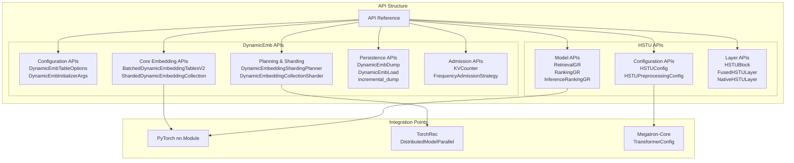
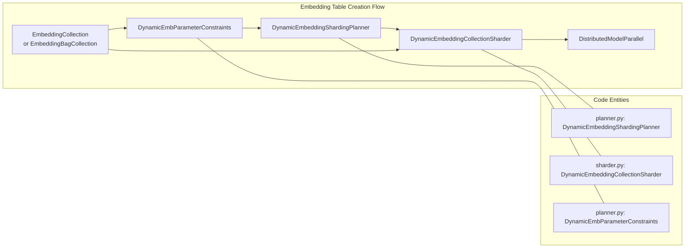
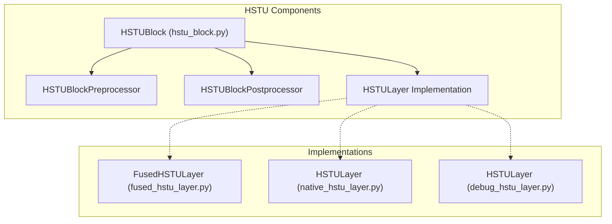

<!-- source: DeepWiki mcp.deepwiki.com · repo NVIDIA/recsys-examples · page 8 API Reference · fetched 2026-10-26 -->

# API Reference

Relevant source files

The following files were used as context for generating this wiki page:

- [corelib/dynamicemb/DynamicEmb_APIs.md](corelib/dynamicemb/DynamicEmb_APIs.md)
- [corelib/dynamicemb/dynamicemb/embedding_admission.py](corelib/dynamicemb/dynamicemb/embedding_admission.py)
- [examples/hstu/configs/hstu_config.py](examples/hstu/configs/hstu_config.py)
- [examples/hstu/modules/hstu_block.py](examples/hstu/modules/hstu_block.py)

## Purpose and Scope

This section provides comprehensive API documentation for the NVIDIA RecSys Examples repository, covering both the **DynamicEmb** and **HSTU** systems. The API reference is organized to help developers understand function signatures, parameters, return types, and usage patterns for building large-scale recommendation systems.

- For detailed DynamicEmb class and function documentation, see [DynamicEmb API Reference](#8.1)
- For detailed HSTU model and layer documentation, see [HSTU API Reference](#8.2)
- For end-to-end training setup guidance, see [Training and Deployment](#5)
- For development and testing information, see [Development and Testing](#7)

---

## API Organization

The repository provides two major API surfaces that can be used independently or together:

**Sources:** [corelib/dynamicemb/DynamicEmb_APIs.md:1-23](), [examples/hstu/configs/hstu_config.py:90-108](), [examples/hstu/modules/hstu_block.py:18-24]()

---

## API Categories

### Configuration APIs

Configuration classes control the behavior of both DynamicEmb and HSTU systems. These are typically dataclasses with validated parameters.

| Category | Key Classes | Purpose |
|----------|------------|---------|
| **DynamicEmb Config** | `DynamicEmbTableOptions`, `DynamicEmbInitializerArgs` | Configure dynamic embedding table behavior, caching, eviction [corelib/dynamicemb/DynamicEmb_APIs.md:213-337]() |
| **HSTU Config** | `HSTUConfig`, `HSTUPreprocessingConfig`, `PositionEncodingConfig` | Configure model architecture, attention backends, and encoding [examples/hstu/configs/hstu_config.py:64-108]() |
| **Mode Enums** | `DynamicEmbCheckMode`, `HSTULayerType`, `KernelBackend` | Enumeration types for backend and safety configurations [corelib/dynamicemb/DynamicEmb_APIs.md:158-166](), [examples/hstu/configs/hstu_config.py:32-62]() |

**Sources:** [corelib/dynamicemb/DynamicEmb_APIs.md:158-337](), [examples/hstu/configs/hstu_config.py:32-108]()

---

### Core Embedding APIs

The core APIs for creating and manipulating dynamic embedding tables integrate with TorchRec's distributed training infrastructure.

**Key Classes:**
- **`DynamicEmbParameterConstraints`**: The entry point for users to specify dynamic embedding tables [corelib/dynamicemb/DynamicEmb_APIs.md:25-50]().
- **`DynamicEmbeddingShardingPlanner`**: Wraps TorchRec's planner to derive per-rank capacities and bucket widths [corelib/dynamicemb/DynamicEmb_APIs.md:88-120]().
- **`DynamicEmbeddingCollectionSharder`**: Handles the actual sharding of the collection into dynamic components [corelib/dynamicemb/DynamicEmb_APIs.md:149-156]().

**Sources:** [corelib/dynamicemb/DynamicEmb_APIs.md:25-156]()

---

### Admission Control APIs

APIs for filtering which keys are admitted into the embedding tables based on frequency or other strategies.

- **`KVCounter`**: Configures per-table counters for frequency tracking [corelib/dynamicemb/embedding_admission.py:35-51]().
- **`MultiTableKVCounter`**: Fuses multiple table counters into a single `ScoredHashTable` [corelib/dynamicemb/embedding_admission.py:54-81]().
- **`FrequencyAdmissionStrategy`**: Implements threshold-based admission, only admitting keys that meet a specific frequency count [corelib/dynamicemb/embedding_admission.py:107-130]().

**Sources:** [corelib/dynamicemb/embedding_admission.py:35-181]()

---

### HSTU Model and Block APIs

High-level model blocks for building generative recommendation systems.

- **`HSTUBlock`**: A stack of HSTU layers that handles pre-processing (jagged data conversion) and post-processing [examples/hstu/modules/hstu_block.py:18-54]().
- **`HSTULayerType`**: Controls whether the block uses `FUSED` (optimized), `NATIVE` (TP support), or `DEBUG` implementations [examples/hstu/configs/hstu_config.py:32-46]().

**Sources:** [examples/hstu/modules/hstu_block.py:18-90](), [examples/hstu/configs/hstu_config.py:32-46]()

---

### Persistence APIs

APIs for saving and loading dynamic embedding table states, including incremental dump for online learning scenarios.

- **`DynamicEmbDump`**: Dumps distributed embedding weights and metadata to a specified path [corelib/dynamicemb/DynamicEmb_APIs.md:425-458]().
- **`DynamicEmbLoad`**: Restores embedding weights, supporting world-size changes and optimizer state restoration [corelib/dynamicemb/DynamicEmb_APIs.md:460-502]().
- **`incremental_dump`**: Exports embeddings whose scores (e.g., frequency) exceed a user-defined threshold [corelib/dynamicemb/DynamicEmb_APIs.md:527-565]().

**Sources:** [corelib/dynamicemb/DynamicEmb_APIs.md:425-565]()

---

## Next Steps

- For complete DynamicEmb class and function signatures, see [DynamicEmb API Reference](#8.1)
- For complete HSTU model and layer signatures, see [HSTU API Reference](#8.2)
- For training examples and end-to-end workflows, see [Training and Deployment](#5)
- For definitions of specific terms, see [Glossary](#9)

---

