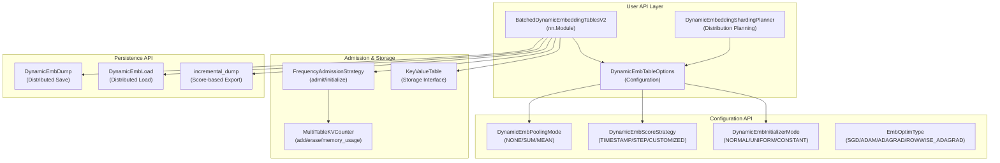

<!-- source: DeepWiki mcp.deepwiki.com · repo NVIDIA/recsys-examples · page 8.1 DynamicEmb API Reference · fetched 2026-10-26 -->

# DynamicEmb API Reference

<details>
<summary>Relevant source files</summary>

The following files were used as context for generating this wiki page:

- [corelib/dynamicemb/DynamicEmb_APIs.md](corelib/dynamicemb/DynamicEmb_APIs.md)
- [corelib/dynamicemb/dynamicemb/dynamicemb_config.py](corelib/dynamicemb/dynamicemb/dynamicemb_config.py)
- [corelib/dynamicemb/dynamicemb/embedding_admission.py](corelib/dynamicemb/dynamicemb/embedding_admission.py)
- [corelib/dynamicemb/dynamicemb/exportable_tables.py](corelib/dynamicemb/dynamicemb/exportable_tables.py)
- [corelib/dynamicemb/dynamicemb/get_planner.py](corelib/dynamicemb/dynamicemb/get_planner.py)
- [corelib/dynamicemb/dynamicemb/index_range_meta.py](corelib/dynamicemb/dynamicemb/index_range_meta.py)
- [corelib/dynamicemb/dynamicemb/lookup_meta.py](corelib/dynamicemb/dynamicemb/lookup_meta.py)
- [corelib/dynamicemb/dynamicemb/planner/planner.py](corelib/dynamicemb/dynamicemb/planner/planner.py)
- [corelib/dynamicemb/dynamicemb/utils.py](corelib/dynamicemb/dynamicemb/utils.py)
- [examples/commons/ops/cuda_ops/fake_hstu_cuda_ops.py](examples/commons/ops/cuda_ops/fake_hstu_cuda_ops.py)

</details>


This document provides a comprehensive API reference for the DynamicEmb system, covering all classes, functions, configuration options, and usage patterns. For conceptual overviews of the DynamicEmb architecture and design, see [Core Architecture](3.1). For integration examples and training workflows, see [Training and Deployment](5).

## Overview

The DynamicEmb API provides dynamic embedding tables with GPU-accelerated hash table backends. The API is organized into several layers:

- **Core Interface**: `BatchedDynamicEmbeddingTablesV2` - main module for embedding lookups.
- **Configuration**: `DynamicEmbTableOptions` and related enums for table setup.
- **Storage Layer**: `KeyValueTable`, `Cache`, `Storage` abstractions.
- **Admission Control**: `FrequencyAdmissionStrategy` and `Counter` for filtering new keys.
- **Persistence Layer**: Dump/load operations for distributed checkpointing.
- **TorchRec Integration**: Planner, sharder, and enumerator for distributed training.

---

## API Architecture Diagram



**Sources:** [corelib/dynamicemb/dynamicemb/batched_dynamicemb_tables.py:412-1495](), [corelib/dynamicemb/dynamicemb/embedding_admission.py:54-106](), [corelib/dynamicemb/dynamicemb/dynamicemb_config.py:149-300]()

---

## Core Classes

### BatchedDynamicEmbeddingTablesV2

The main interface for dynamic embedding tables, inheriting from `torch.nn.Module`.

**Location:** [corelib/dynamicemb/dynamicemb/batched_dynamicemb_tables.py:412-1495]()

#### Constructor

```python
class BatchedDynamicEmbeddingTablesV2(nn.Module):
    def __init__(
        self,
        table_options: List[DynamicEmbTableOptions],
        table_names: Optional[List[str]] = None,
        feature_table_map: Optional[List[int]] = None,
        use_index_dedup: bool = False,
        prefetch_pipeline: bool = False,
        pooling_mode: DynamicEmbPoolingMode = DynamicEmbPoolingMode.SUM,
        output_dtype: torch.dtype = torch.float32,
        device: torch.device = None,
        enforce_hbm: bool = False,
        bounds_check_mode: BoundsCheckMode = BoundsCheckMode.WARNING,
        optimizer: EmbOptimType = EmbOptimType.SGD,
        # Optimizer arguments...
    ) -> None
```

**Sources:** [corelib/dynamicemb/dynamicemb/batched_dynamicemb_tables.py:422-465]()

#### Forward Method

```python
def forward(
    self,
    indices: Tensor,
    offsets: Tensor,
    per_sample_weights: Optional[Tensor] = None,
    feature_requires_grad: Optional[Tensor] = None,
    batch_size_per_feature_per_rank: Optional[List[List[int]]] = None,
    total_unique_indices: Optional[int] = None,
) -> List[Tensor]
```

**Sources:** [corelib/dynamicemb/dynamicemb/batched_dynamicemb_tables.py:930-1016]()

#### Prefetch Method

```python
def prefetch(
    self,
    indices: Tensor,
    offsets: Tensor,
    forward_stream: Optional[torch.cuda.Stream] = None,
) -> None
```

**Sources:** [corelib/dynamicemb/dynamicemb/batched_dynamicemb_tables.py:1018-1054]()

---

## Configuration API

### DynamicEmbTableOptions

Encapsulates the configuration options for dynamic embedding tables.

**Location:** [corelib/dynamicemb/dynamicemb/dynamicemb_config.py:149-300]()

| Parameter | Type | Description |
|-----------|------|-------------|
| `dim` | `Optional[int]` | Embedding dimension. [corelib/dynamicemb/dynamicemb/dynamicemb_config.py:163-164]() |
| `max_capacity` | `int` | Maximum rows in the table (rounded to bucket width). [corelib/dynamicemb/dynamicemb/dynamicemb_config.py:165-166]() |
| `init_capacity` | `Optional[int]` | Initial capacity for the hash table. [corelib/dynamicemb/dynamicemb/dynamicemb_config.py:167-168]() |
| `caching` | `bool` | Enable GPU cache + host storage split. [corelib/dynamicemb/dynamicemb/dynamicemb_config.py:183-184]() |
| `score_strategy` | `DynamicEmbScoreStrategy` | Strategy for eviction scores (TIMESTAMP/STEP/LFU/etc). [corelib/dynamicemb/dynamicemb/dynamicemb_config.py:195-196]() |
| `admission_strategy` | `Optional[AdmissionStrategy]` | Strategy to filter keys before insertion. [corelib/dynamicemb/dynamicemb/dynamicemb_config.py:214-215]() |

### DynamicEmbScoreStrategy

Defines how index-embedding pairs are scored for eviction.

**Location:** [corelib/dynamicemb/dynamicemb/dynamicemb_config.py:113-146]()

- `TIMESTAMP`: Scores set to device nanosecond timer. [corelib/dynamicemb/dynamicemb/dynamicemb_config.py:123-126]()
- `STEP`: Scores incremented per forward pass via internal `step` counter. [corelib/dynamicemb/dynamicemb/dynamicemb_config.py:127-130]()
- `CUSTOMIZED`: Users manage scores manually via `set_score`. [corelib/dynamicemb/dynamicemb/dynamicemb_config.py:131-133]()
- `LFU`: Evicts the least frequently used key in a bucket. [corelib/dynamicemb/dynamicemb/dynamicemb_config.py:134-135]()
- `NO_EVICTION`: Table capacity doubles until memory exhaustion. [corelib/dynamicemb/dynamicemb/dynamicemb_config.py:136-139]()

---

## Admission Control API

### FrequencyAdmissionStrategy

Filters keys based on their cumulative access frequency.

**Location:** [corelib/dynamicemb/dynamicemb/embedding_admission.py:107-181]()

```python
class FrequencyAdmissionStrategy(AdmissionStrategy):
    def __init__(
        self,
        threshold: int,
        initializer_args: Optional[DynamicEmbInitializerArgs] = None,
    ):
        """
        threshold: Minimum frequency count required for admission.
        initializer_args: Initialization for keys not yet admitted.
        """
```

**Sources:** [corelib/dynamicemb/dynamicemb/embedding_admission.py:121-130]()

### MultiTableKVCounter

A fused multi-table counter backed by a `ScoredHashTable`.

**Location:** [corelib/dynamicemb/dynamicemb/embedding_admission.py:54-106]()

```python
class MultiTableKVCounter(Counter):
    def add(
        self,
        keys: torch.Tensor,
        table_ids: torch.Tensor,
        frequencies: torch.Tensor,
    ) -> torch.Tensor:
        """Accumulates frequencies for keys and returns current totals."""
```

**Sources:** [corelib/dynamicemb/dynamicemb/embedding_admission.py:83-92]()

---

## TorchRec Integration API

### DynamicEmbeddingShardingPlanner

Wraps TorchRec's `EmbeddingShardingPlanner` to adjust `DynamicEmbTableOptions` based on world size and topology.

**Location:** [corelib/dynamicemb/dynamicemb/planner/planner.py:107-120]()

**Key behavior in `_prepare_dynemb_table_options`:**
1. Derives per-rank `max_capacity` and `bucket_capacity` using `_sharded_table_bucket_layout`. [corelib/dynamicemb/dynamicemb/planner/planner.py:174-181]()
2. Calculates `local_hbm_for_values` by dividing global HBM by world size. [corelib/dynamicemb/dynamicemb/planner/planner.py:182]()
3. Aligns `init_capacity` to effective bucket width. [corelib/dynamicemb/dynamicemb/planner/planner.py:185-187]()

### DynamicEmbParameterConstraints

Extends TorchRec `ParameterConstraints` to include DynamicEmb-specific toggles.

**Location:** [corelib/dynamicemb/dynamicemb/planner/planner.py:61-79]()

```python
@dataclass
class DynamicEmbParameterConstraints(ParameterConstraints):
    use_dynamicemb: Optional[bool] = False
    dynamicemb_options: Optional[DynamicEmbTableOptions] = field(
        default_factory=DynamicEmbTableOptions
    )
```

**Sources:** [corelib/dynamicemb/dynamicemb/planner/planner.py:75-78]()

---

## Persistence API

### DynamicEmbDump / DynamicEmbLoad

Distributed checkpointing utilities.

- `DynamicEmbDump`: Saves keys, values, scores, and optimizer states to disk. [corelib/dynamicemb/dynamicemb/batched_dynamicemb_tables.py:1089-1158]()
- `DynamicEmbLoad`: Loads and redistributes embeddings. Handles world-size changes by re-sharding keys via `key % world_size`. [corelib/dynamicemb/dynamicemb/batched_dynamicemb_tables.py:1161-1272]()

### incremental_dump

Exports a subset of the table based on a score threshold.

**Location:** [corelib/dynamicemb/dynamicemb/batched_dynamicemb_tables.py:1274-1344]()

```python
def incremental_dump(
    table: KeyValueTable,
    threshold: int,
    pg: Optional[dist.ProcessGroup] = None,
    batch_size: int = BATCH_SIZE_PER_DUMP,
) -> Tuple[torch.Tensor, torch.Tensor]:
    """Returns (keys, values) where score >= threshold."""
```

---

## Utility Functions

### torch_to_dyn_emb

Converts PyTorch dtypes to internal `DynamicEmbDataType` enums.

**Location:** [corelib/dynamicemb/dynamicemb/utils.py:41-57]()

### tabulate

Utility for formatting diagnostic tables (e.g., sharding plans) as strings.

**Location:** [corelib/dynamicemb/dynamicemb/utils.py:60-98]()

---

## Performance and Limits

| Constant | Value | Description |
|----------|-------|-------------|
| `BUCKET_ALIGNMENT` | 128 | Required alignment for bucket capacities. [corelib/dynamicemb/dynamicemb/dynamicemb_config.py:27]() |
| `DEFAULT_BUCKET_CAPACITY` | 128 | Default width for hash table buckets. [corelib/dynamicemb/dynamicemb/dynamicemb_config.py:48]() |
| `BATCH_SIZE_PER_DUMP` | 65536 | Iteration granularity for disk persistence. [corelib/dynamicemb/dynamicemb/dynamicemb_config.py:42]() |

**Sources:** [corelib/dynamicemb/dynamicemb/dynamicemb_config.py:25-49]()

---

