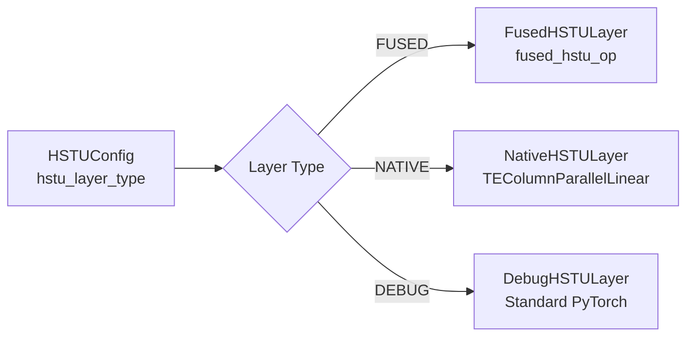
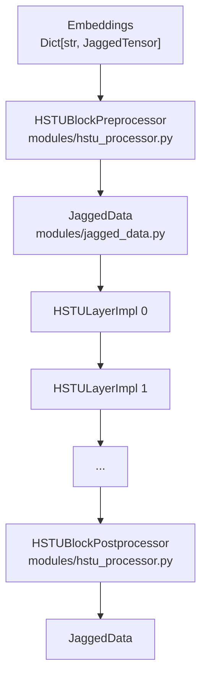

<!-- source: DeepWiki mcp.deepwiki.com · repo NVIDIA/recsys-examples · page 8.2 HSTU API Reference · fetched 2026-10-26 -->

# HSTU API Reference

<details>
<summary>Relevant source files</summary>

The following files were used as context for generating this wiki page:

- [examples/commons/utils/hstu_assert_close.py](examples/commons/utils/hstu_assert_close.py)
- [examples/hstu/configs/hstu_config.py](examples/hstu/configs/hstu_config.py)
- [examples/hstu/modules/fused_hstu_layer.py](examples/hstu/modules/fused_hstu_layer.py)
- [examples/hstu/modules/hstu_attention.py](examples/hstu/modules/hstu_attention.py)
- [examples/hstu/modules/hstu_block.py](examples/hstu/modules/hstu_block.py)
- [examples/hstu/modules/native_hstu_layer.py](examples/hstu/modules/native_hstu_layer.py)
- [examples/hstu/ops/pt_ops/pt_norm_mul_dropout.py](examples/hstu/ops/pt_ops/pt_norm_mul_dropout.py)
- [examples/hstu/ops/triton_ops/triton_hstu_attention.py](examples/hstu/ops/triton_ops/triton_hstu_attention.py)
- [examples/hstu/test/hstu_attn/test_hstu_attn_smoke.py](examples/hstu/test/hstu_attn/test_hstu_attn_smoke.py)
- [examples/hstu/test/test_hstu_op.py](examples/hstu/test/test_hstu_op.py)
- [examples/hstu/test/test_ln_mul_dropout.py](examples/hstu/test/test_ln_mul_dropout.py)

</details>


## Purpose and Scope

This page provides a comprehensive API reference for the HSTU (Hierarchical Sequential Transduction Unit) system. It documents the main classes, methods, and configuration objects used for building, training, and deploying HSTU-based recommendation models.

For architectural concepts and design principles, see [HSTU System](). For training pipeline configuration, see [Training and Distributed Support](). For inference optimization details, see [HSTU Inference and Serving]().

---

## Model Classes

### RetrievalGR

The `RetrievalGR` class implements a retrieval model for candidate generation using sampled softmax loss.

**Location**: [examples/hstu/model/retrieval_gr.py:35-202]()

**Class Definition**:
```python
class RetrievalGR(BaseModel):
    def __init__(
        self,
        hstu_config: HSTUConfig,
        task_config: RetrievalConfig,
    )
```

**Purpose**: Generates candidate embeddings for retrieval tasks. Uses HSTU layers to encode user interaction sequences and produces item embeddings that can be matched against a candidate corpus.

**Key Components**:
- `_embedding_collection`: `ShardedEmbedding` instance for sparse feature lookup.
- `_hstu_block`: `HSTUBlock` instance for sequence encoding.
- `_loss_module`: `SampledSoftmaxLoss` with in-batch negative sampling.

**Key Methods**:

| Method | Parameters | Returns | Description |
|--------|-----------|---------|-------------|
| `forward` | `batch: RetrievalBatch` | `Tuple[torch.Tensor, Tuple]` | Forward pass returning loss and metrics. |
| `get_logit_and_labels` | `batch: RetrievalBatch` | `Tuple[torch.Tensor, ...]` | Computes embeddings and extracts supervision signals. |
| `bfloat16` | None | `RetrievalGR` | Converts dense modules to bfloat16 precision. |
| `half` | None | `RetrievalGR` | Converts dense modules to float16 precision. |

**Constraints**:
- Does not support tensor model parallelism (`tp_size == 1`) due to sampled softmax loss requirements [examples/hstu/model/retrieval_gr.py:52-55]().
- Requires `max_num_candidates == 0` in batch [examples/hstu/model/retrieval_gr.py:116-118]().

**Sources**: [examples/hstu/model/retrieval_gr.py:1-202]()

---

### RankingGR

The `RankingGR` class implements a ranking model for candidate scoring with multi-task learning support.

**Location**: [examples/hstu/model/ranking_gr.py:31-159]()

**Class Definition**:
```python
class RankingGR(BaseModel):
    def __init__(
        self,
        hstu_config: HSTUConfig,
        task_config: RankingConfig,
    )
```

**Purpose**: Scores candidate items for ranking tasks. Supports multiple prediction tasks (e.g., click, conversion) with independent loss functions.

**Key Components**:
- `_embedding_collection`: `ShardedEmbedding` for distributed embedding lookup.
- `_hstu_block`: `HSTUBlock` for sequence encoding.
- `_mlp`: `MLP` prediction head for multi-task outputs.
- `_loss_module`: `MultiTaskLossModule` for handling multiple objectives.

**Distributed Training Features**:
- Supports tensor model parallelism for embedding tables [examples/hstu/model/ranking_gr.py:119-124]().
- Gradient scaling and all-gather operations for DMP embeddings [examples/hstu/model/ranking_gr.py:116-123]().

**Sources**: [examples/hstu/model/ranking_gr.py:1-159]()

---

## Core Architecture Components

### HSTUBlock

The `HSTUBlock` class represents a stack of HSTU attention layers with preprocessing and postprocessing.

**Location**: [examples/hstu/modules/hstu_block.py:18-91]()

**Class Definition**:
```python
class HSTUBlock(MegatronModule):
    def __init__(
        self,
        config: HSTUConfig,
    )
```

**Purpose**: Processes jagged embedding sequences through multiple HSTU layers, handling sequence length variations and contextual/target separation.

**Layer Implementation Selection**:
The block automatically selects the layer implementation based on `config.hstu_layer_type` [examples/hstu/modules/hstu_block.py:45-51]():



**Data Flow**:



**Sources**: [examples/hstu/modules/hstu_block.py:1-91](), [examples/hstu/configs/hstu_config.py:32-46]()

---

### FusedHSTULayer

Optimized HSTU layer implementation using fused CUDA kernels.

**Location**: [examples/hstu/modules/fused_hstu_layer.py:24-161]()

**Purpose**: High-performance execution path that fuses Linear, SiLU, and Attention operations.

**Key Method**:
- `forward(jd: JaggedData)`: Calls `fused_hstu_op` which orchestrates the fused execution [examples/hstu/modules/fused_hstu_layer.py:126-159]().

**Sources**: [examples/hstu/modules/fused_hstu_layer.py:1-161](), [examples/hstu/ops/fused_hstu_op.py:21-21]()

---

### NativeHSTULayer

HSTU layer implementation supporting Tensor Model Parallelism (TP).

**Location**: [examples/hstu/modules/native_hstu_layer.py:41-154]()

**Purpose**: Standard implementation using Megatron-Core extensions for distributed training across multiple GPUs.

**Key Components**:
- `_linear_uvqk`: `TEColumnParallelLinear` for projecting input to U, V, Q, K [examples/hstu/modules/native_hstu_layer.py:110-119]().
- `_linear_proj`: `TERowParallelLinear` for output projection [examples/hstu/modules/native_hstu_layer.py:131-140]().
- `_attn_func`: Created via `create_hstu_attention` based on `kernel_backend` [examples/hstu/modules/native_hstu_layer.py:144-150]().

**Sources**: [examples/hstu/modules/native_hstu_layer.py:1-154]()

---

## Attention Implementations

The system supports multiple backends for the core HSTU attention mechanism.

### HSTUAttention Interface

**Location**: [examples/hstu/modules/hstu_attention.py:24-57]()

| Backend | Class | Description |
|---------|-------|-------------|
| **Triton** | `TritonHSTUAttention` | High-performance Triton-based implementation [examples/hstu/modules/hstu_attention.py:141-158](). |
| **PyTorch** | `TorchHSTUAttention` | Native PyTorch implementation using `pytorch_hstu_mha` [examples/hstu/modules/hstu_attention.py:60-139](). |

**Forward Signature**:
```python
def forward(
    self,
    tq: torch.Tensor, # Query (T, d)
    tk: torch.Tensor, # Key (T, d)
    tv: torch.Tensor, # Value (T, d)
    offsets: torch.Tensor, # (batch_size + 1,)
    max_seqlen: int,
    scaling_seqlen: int,
    target_group_size: int = 1,
    num_candidates: Optional[torch.Tensor] = None,
    num_contextuals: Optional[Union[int, torch.Tensor]] = None,
) -> torch.Tensor:
```

**Sources**: [examples/hstu/modules/hstu_attention.py:1-158](), [examples/hstu/ops/pt_ops/pt_hstu_attention.py:112-112](), [examples/hstu/ops/triton_ops/triton_hstu_attention.py:9-9]()

---

## Configuration API

### HSTUConfig

Inherits from `megatron.core.transformer.TransformerConfig`.

**Location**: [examples/hstu/configs/hstu_config.py:90-138]()

| Parameter | Type | Default | Description |
|-----------|------|---------|-------------|
| `hstu_layer_type` | `HSTULayerType` | `FUSED` | Selection of layer implementation [examples/hstu/configs/hstu_config.py:116](). |
| `kernel_backend` | `KernelBackend` | `CUTLASS` | Backend for attention kernels [examples/hstu/configs/hstu_config.py:115](). |
| `is_causal` | `bool` | `True` | Enable causal masking [examples/hstu/configs/hstu_config.py:112](). |
| `target_group_size` | `int` | `1` | Size of sub-candidate group for causal attention [examples/hstu/configs/hstu_config.py:118](). |
| `residual` | `bool` | `True` | Enable residual connections [examples/hstu/configs/hstu_config.py:122](). |
| `async_wgrad` | `bool` | `False` | Enable asynchronous weight gradient computation [examples/hstu/configs/hstu_config.py:124](). |

**Sources**: [examples/hstu/configs/hstu_config.py:1-165]()

---

## Utilities and Assertions

### assert_hstu_close

Utility for verifying kernel numerical accuracy against a float32 reference.

**Location**: [examples/commons/utils/hstu_assert_close.py:45-56]()

```python
def assert_hstu_close(
    actual, 
    out_ref, 
    fp32_ref, 
    try_allclose: bool = False, 
    fwd: bool = True
):
```
- **Multiplier**: Uses a 2x multiplier for forward pass and 5x for backward pass to account for accumulation differences in half-precision [examples/commons/utils/hstu_assert_close.py:53-53]().

**Sources**: [examples/commons/utils/hstu_assert_close.py:1-101]()

---

