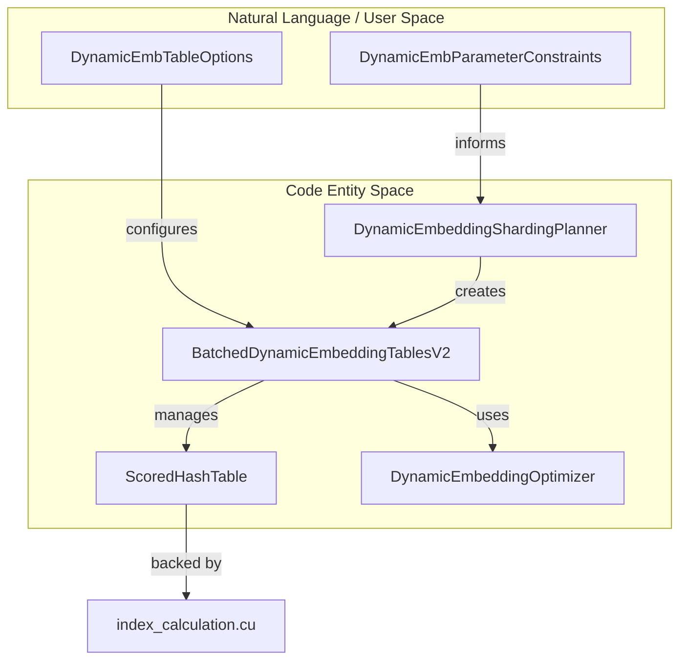
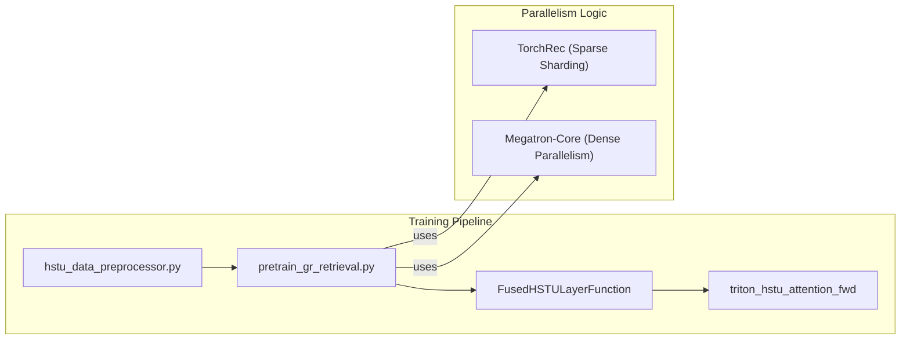

<!-- source: DeepWiki mcp.deepwiki.com · repo NVIDIA/recsys-examples · page 9 Glossary · fetched 2026-10-26 -->

# Glossary

Relevant source files

The following files were used as context for generating this wiki page:

- [.gitignore](.gitignore)
- [README.md](README.md)
- [corelib/dynamicemb/DynamicEmb_APIs.md](corelib/dynamicemb/DynamicEmb_APIs.md)
- [corelib/dynamicemb/README.md](corelib/dynamicemb/README.md)
- [corelib/dynamicemb/dynamicemb/dynamicemb_config.py](corelib/dynamicemb/dynamicemb/dynamicemb_config.py)
- [corelib/dynamicemb/dynamicemb/embedding_admission.py](corelib/dynamicemb/dynamicemb/embedding_admission.py)
- [corelib/dynamicemb/dynamicemb/planner/planner.py](corelib/dynamicemb/dynamicemb/planner/planner.py)
- [corelib/dynamicemb/version.txt](corelib/dynamicemb/version.txt)
- [docker/Dockerfile.pyt_build](docker/Dockerfile.pyt_build)
- [examples/hstu/ops/fused_hstu_op.py](examples/hstu/ops/fused_hstu_op.py)
- [examples/hstu/training/README.md](examples/hstu/training/README.md)

This glossary provides definitions and implementation details for codebase-specific terms, domain concepts, and technical jargon used within the NVIDIA RecSys Examples repository. It covers the core components of the **Dynamic Embedding (DynamicEmb)** system, the **Hierarchical Sequential Transduction Unit (HSTU)** architecture, and integrations with **TorchRec** and **Megatron-Core**.

## Core Systems and Backends

### DynamicEmb (Dynamic Embedding)
A Python package providing model-parallel dynamic embedding tables. Unlike static embedding tables that require a fixed vocabulary size, DynamicEmb uses a GPU-optimized scored hash table to store feature-embedding pairs. This allows for zero-collision hashing, eviction of old entries, and admission control to manage memory effectively [corelib/dynamicemb/README.md:3-10]().

### HSTU (Hierarchical Sequential Transduction Unit)
A generative recommender backbone designed for large-scale ranking and retrieval tasks. It utilizes a non-causal or causal attention mechanism optimized for recommendation sequences [README.md:7-8](). The implementation features fused CUDA kernels for performance and integrates with Megatron-Core for dense parallelism [examples/hstu/training/README.md:5-9]().

### TorchRec
A PyTorch domain library for recommendation systems. This codebase extends TorchRec's sharding and collection modules (e.g., `EmbeddingBagCollection`) to support dynamic embedding backends [corelib/dynamicemb/README.md:25-30]().

### Megatron-Core (Mcore)
A library for training large-scale transformer models. In this repository, Mcore is used to provide dense parallelism (Tensor, Pipeline, and Sequence parallelism) for the HSTU blocks [examples/hstu/training/README.md:5-9]().

---

## DynamicEmb Terminology

### ScoredHashTable
The primary backend storage for DynamicEmb. It maps `int64` keys to embedding vectors and associates each entry with a "score" used for eviction policies [corelib/dynamicemb/dynamicemb/embedding_admission.py:75-81]().

### Admission Strategy
A mechanism to decide if a new feature ID should be allowed to create an entry in the embedding table.
*   **FrequencyAdmissionStrategy**: Only admits keys whose frequency (tracked by a counter) meets a specific threshold [corelib/dynamicemb/dynamicemb/embedding_admission.py:107-111]().
*   **KVCounter**: A multi-table counter backed by a fused `ScoredHashTable` used to track feature frequencies [corelib/dynamicemb/dynamicemb/embedding_admission.py:54-60]().

### Eviction Strategy
Determines which entries are removed when a table reaches its capacity.
*   **LRU/LFU**: Least Recently Used and Least Frequently Used [corelib/dynamicemb/dynamicemb/dynamicemb_config.py:105-110]().
*   **Score Strategy**: Defines how scores are updated (e.g., `TIMESTAMP`, `STEP`, or `CUSTOMIZED`) [corelib/dynamicemb/dynamicemb/dynamicemb_config.py:113-140]().

### Insertion Check Mode (`DynamicEmbCheckMode`)
A configuration that defines behavior when hash table bucket collisions prevent insertion:
*   **ERROR**: Crashes the program.
*   **WARNING**: Logs the failure and sets embeddings to 0.0.
*   **IGNORE**: Silently sets embeddings to 0.0 [corelib/dynamicemb/dynamicemb/dynamicemb_config.py:61-91]().

### System Mapping: Configuration to Implementation
The following diagram bridges high-level configuration classes to the internal implementation entities.

**Configuration to Implementation Bridge**

Sources: [corelib/dynamicemb/dynamicemb/dynamicemb_config.py:149-160](), [corelib/dynamicemb/DynamicEmb_APIs.md:25-50](), [corelib/dynamicemb/dynamicemb/planner/planner.py:88-100]()

---

## HSTU and Training Terminology

### Fused HSTU Layer
A high-performance implementation of the HSTU block that fuses operations like LayerNorm, Silu, UVQK linear projections, and attention into a single autograd function to reduce memory bandwidth and improve precision [examples/hstu/ops/fused_hstu_op.py:41-53]().

### Jagged Tensor
A specialized tensor format used in recommendation systems to handle variable-length sequences (e.g., user history) without inefficient padding. The repository uses `seqlen_offsets` to manage these structures in CUDA kernels [examples/hstu/ops/fused_hstu_op.py:58-61]().

### Parallelism Types
*   **Data Parallelism (DP)**: Distributes data batches across GPUs.
*   **Tensor Parallelism (TP)**: Shards large weight matrices (like HSTU projections) across GPUs.
*   **Sequence Parallelism (SP)**: Shards the sequence dimension to handle very long contexts [README.md:33-35]().
*   **Pipeline Parallelism (PP)**: Distributes model layers across different GPUs [examples/hstu/training/README.md:5-9]().

### Training Components Diagram
This diagram maps the training pipeline components to their specific code identifiers.

**Training Workflow Entities**

Sources: [examples/hstu/training/README.md:80-106](), [examples/hstu/ops/fused_hstu_op.py:27-30](), [examples/hstu/training/README.md:5-9]()

---

## Technical Abbreviations

| Abbreviation | Full Term | Context |
| :--- | :--- | :--- |
| **HBM** | High Bandwidth Memory | GPU VRAM where embedding tables are stored [corelib/dynamicemb/dynamicemb/planner/planner.py:56-58](). |
| **UVQK** | U, V, Query, Key | The four projections used in the HSTU attention mechanism [examples/hstu/ops/fused_hstu_op.py:46-49](). |
| **KVCache** | Key-Value Cache | Optimization for inference to store previous keys/values in generative models [README.md:19-21](). |
| **AOTInductor** | Ahead-of-Time Inductor | PyTorch tool used for compiling models into C++ for deployment [README.md:13-17](). |
| **SID-GR** | Semantic ID Generative Recommender | A model using semantic item representations for retrieval [README.md:23-25](). |

---

## Code References and Pointers

*   **Optimizer States**: Managed in `DynamicEmbeddingOptimizer` with support for `EXACT_SGD`, `ADAM`, `ADAGRAD`, and `ROWWISE_ADAGRAD` [corelib/dynamicemb/README.md:93-94]().
*   **Sharding Planner**: `DynamicEmbeddingShardingPlanner` handles the distribution of dynamic tables across a process group [corelib/dynamicemb/DynamicEmb_APIs.md:88-100]().
*   **Persistence**: `DynamicEmbDump` and `DynamicEmbLoad` provide utilities for saving and restoring hash table states [corelib/dynamicemb/DynamicEmb_APIs.md:17-18]().
*   **Memory Alignment**: Tables are aligned to `DEMB_TABLE_ALIGN_SIZE` (16) and `bucket_capacity` [corelib/dynamicemb/README.md:95-96](), [corelib/dynamicemb/dynamicemb/dynamicemb_config.py:27-29]().

Sources: [corelib/dynamicemb/dynamicemb/dynamicemb_config.py:1-50](), [corelib/dynamicemb/README.md:1-100](), [corelib/dynamicemb/DynamicEmb_APIs.md:1-100](), [examples/hstu/training/README.md:1-50](), [examples/hstu/ops/fused_hstu_op.py:41-91]()