# Page: Overview

# Overview

<details>
<summary>Relevant source files</summary>

The following files were used as context for generating this wiki page:

- [.gitignore](.gitignore)
- [README.md](README.md)
- [corelib/dynamicemb/README.md](corelib/dynamicemb/README.md)
- [corelib/dynamicemb/version.txt](corelib/dynamicemb/version.txt)
- [docker/Dockerfile.pyt_build](docker/Dockerfile.pyt_build)
- [examples/commons/utils/stringify.py](examples/commons/utils/stringify.py)
- [examples/hstu/README.md](examples/hstu/README.md)
- [examples/hstu/figs/parallelism.png](examples/hstu/figs/parallelism.png)
- [examples/hstu/figs/ranking_model_structure.png](examples/hstu/figs/ranking_model_structure.png)
- [examples/hstu/inference/benchmark/hstu_inference_l20_batch1.png](examples/hstu/inference/benchmark/hstu_inference_l20_batch1.png)
- [examples/hstu/inference/benchmark/hstu_inference_l20_batch8.png](examples/hstu/inference/benchmark/hstu_inference_l20_batch8.png)
- [examples/hstu/ops/fused_hstu_op.py](examples/hstu/ops/fused_hstu_op.py)
- [examples/hstu/training/README.md](examples/hstu/training/README.md)

</details>


## Purpose and Scope

This document provides a high-level introduction to the **NVIDIA RecSys Examples** repository, a collection of optimized components and example implementations for large-scale recommendation systems. The repository focuses on three core innovations: **DynamicEmb** for GPU-accelerated dynamic embedding management, **HSTU** (Hierarchical Sequential Transduction Unit) for attention-based sequence processing, and **SID-GR** (Semantic ID Generative Recommender) for generative retrieval. [README.md:4-10]().

The repository demonstrates how to build production-scale recommendation systems by extending established frameworks (**TorchRec** and **Megatron-Core**) with novel capabilities for handling sparse features and sequential user behavior. [README.md:7-10]().

- For environment setup and running examples, see **Getting Started**.
- For DynamicEmb internals and APIs, see **Dynamic Embeddings (DynamicEmb)**.
- For HSTU models and training, see **HSTU System**.
- For generative retrieval, see **Semantic ID Generative Recommender (SID-GR)**.

**Sources:** [README.md:1-28](), [examples/hstu/README.md:1-43]()

---

## Repository Architecture

The repository follows a **two-tier architecture** separating foundational libraries from application examples:

### System Integration Map
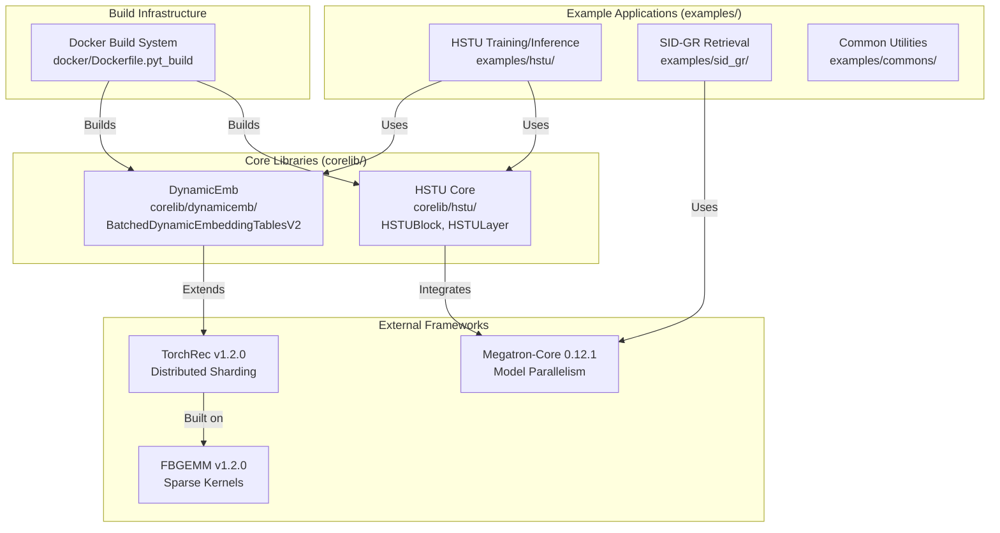
**Diagram: Repository Structure and Framework Integration**

### Component Tiers

| Component | Location | Purpose |
|-----------|----------|---------|
| **DynamicEmb** | [corelib/dynamicemb/]() | GPU-accelerated dynamic embedding tables with zero-collision hashing, eviction, and admission control. [README.md:10]() |
| **HSTU** | [corelib/hstu/]() | Hierarchical Sequential Transduction Units optimized for generative recommenders. [README.md:7-8]() |
| **SID-GR** | [examples/sid_gr/]() | Semantic-ID based retrieval model utilizing a GPT-style decoder backbone. [README.md:9]() |

**Sources:** [README.md:3-10](), [docker/Dockerfile.pyt_build:58-67]()

---

## DynamicEmb System

**DynamicEmb** provides model-parallel dynamic embedding tables that manage features with unbounded cardinality (e.g., user/item IDs). Unlike static tables, DynamicEmb creates entries on-demand and applies eviction policies. [corelib/dynamicemb/README.md:3-5]().

### Core Architecture and Data Flow
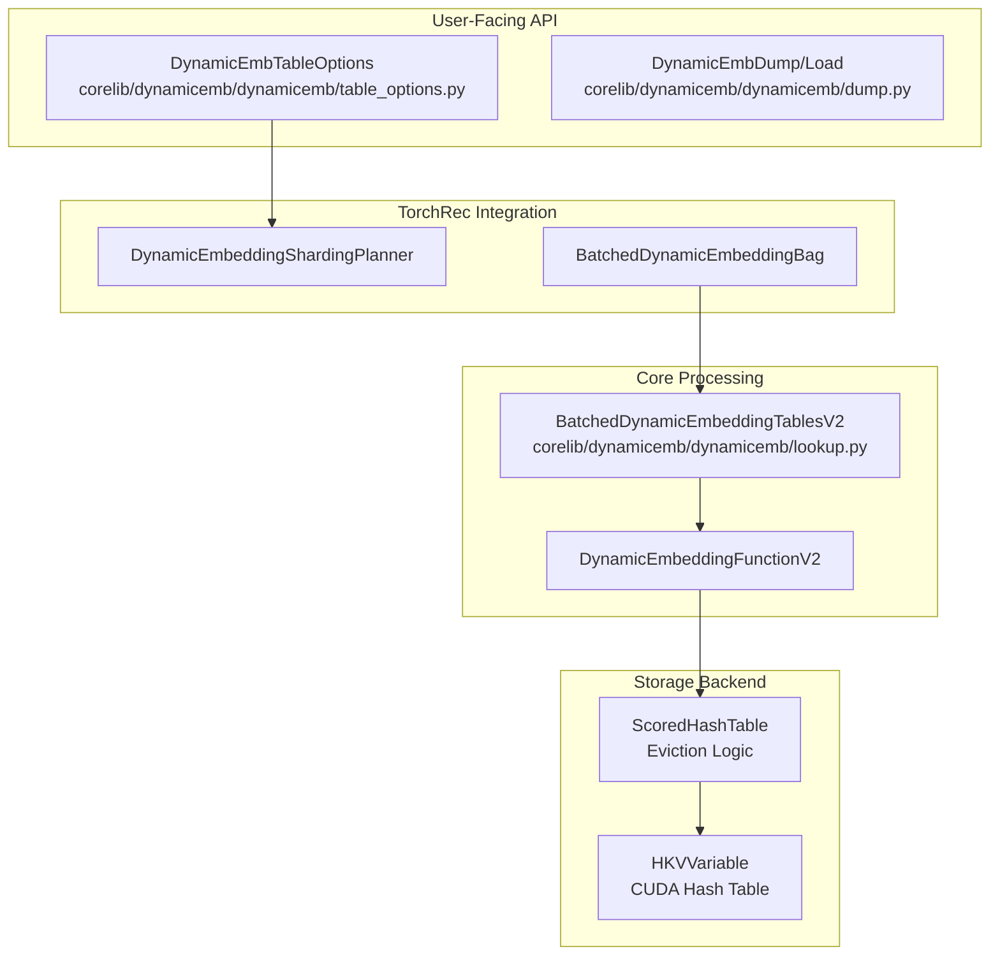
**Diagram: DynamicEmb Component Architecture**

### Key Features
- **Dynamic Capacity**: Embeddings are created on-demand, aligning capacity to `DEMB_TABLE_ALIGN_SIZE` (= 16). [corelib/dynamicemb/README.md:95]().
- **Eviction Policies**: Supports `LRU` (Least Recently Used) and `LFU` (Least Frequently Used). [README.md:34](), [corelib/dynamicemb/README.md:53]().
- **Admission Control**: Prevents rare or noisy IDs from consuming memory. [README.md:27]().
- **Optimizers**: Supports `EXACT_SGD`, `ADAM`, `EXACT_ADAGRAD`, and `EXACT_ROWWISE_ADAGRAD`. [corelib/dynamicemb/README.md:34]().

**Sources:** [corelib/dynamicemb/README.md:1-103](), [README.md:10-27]()

---

## HSTU System

**HSTU** (Hierarchical Sequential Transduction Unit) reformulates recommendation as a generative modeling problem, handling high-cardinality, non-stationary data streams. [examples/hstu/README.md:4]().

### Model Architecture
The HSTU block modifies traditional attention mechanisms to handle large vocabularies effectively. It supports:
- **Preprocessing**: Interleaving item and action embeddings with contextual tokens and position encoding. [examples/hstu/README.md:28]().
- **Postprocessing**: Candidate filtering and prediction head selection. [examples/hstu/README.md:30]().

### Optimization Stack
- **Fused Operators**: `FusedHSTULayerFunction` combines LayerNorm, Linear UVQK, SiLU, and Attention for improved performance. [examples/hstu/ops/fused_hstu_op.py:41-53]().
- **Jagged Tensor Handling**: Optimized CUDA operators for variable-length sequences to minimize device-to-host syncs. [README.md:18]().
- **Parallelism**: Integrated with **Megatron-Core** for Data, Tensor, Sequence, and Pipeline parallelism. [examples/hstu/training/README.md:6-8]().

### Inference Stack
The inference implementation includes:
- **Paged KV Cache**: Optimized C++ implementation for efficient memory management. [README.md:20]().
- **CUDA Graphs**: Reduces CPU overhead during model execution. [README.md:8]().
- **Triton Server**: Support for serving HSTU models via Triton Inference Server. [README.md:24]().

**Sources:** [examples/hstu/README.md:1-34](), [examples/hstu/ops/fused_hstu_op.py:41-91](), [README.md:14-25]()

---

## Technology Stack and Build System

The repository leverages a multi-stage Docker build system to manage complex dependencies. [docker/Dockerfile.pyt_build:1-73]().

| Layer | Component | Version Requirement |
|-------|-----------|---------------------|
| **Base** | PyTorch | 2.6.0 (CUDA 12.6) [docker/Dockerfile.pyt_build:1]() |
| **Dense Parallelism**| Megatron-Core | 0.12.1 [docker/Dockerfile.pyt_build:24]() |
| **Sparse Framework** | TorchRec | v1.2.0 [docker/Dockerfile.pyt_build:37]() |
| **Sparse Kernels** | FBGEMM | v1.2.0 [docker/Dockerfile.pyt_build:30]() |
| **RecSys Core** | DynamicEmb | 0.1.0 [corelib/dynamicemb/version.txt:1]() |

### Build Instructions
Users can build the environment using the provided Dockerfile:
```bash
# Clone with submodules for HSTU attention kernels
git clone --recursive https://github.com/NVIDIA/recsys-examples.git
docker build -f docker/Dockerfile -t recsys-examples:latest .
```
**Sources:** [examples/hstu/training/README.md:13-24](), [docker/Dockerfile.pyt_build:1-73]()

---

# Page: Getting Started

# Getting Started

<details>
<summary>Relevant source files</summary>

The following files were used as context for generating this wiki page:

- [.github/workflows/blossom-ci.yml](.github/workflows/blossom-ci.yml)
- [CONTRIBUTING.md](CONTRIBUTING.md)
- [HOW_TO_BUILD_AND_RUN_DEMO.md](HOW_TO_BUILD_AND_RUN_DEMO.md)
- [corelib/dynamicemb/CMakeLists.txt](corelib/dynamicemb/CMakeLists.txt)
- [corelib/dynamicemb/dynamicemb/incremental_dump.py](corelib/dynamicemb/dynamicemb/incremental_dump.py)
- [corelib/dynamicemb/dynamicemb/planner/__init__.py](corelib/dynamicemb/dynamicemb/planner/__init__.py)
- [corelib/dynamicemb/example/run_example.sh](corelib/dynamicemb/example/run_example.sh)
- [corelib/dynamicemb/src/table_operation/expand_table_ids_torch_binding.cu](corelib/dynamicemb/src/table_operation/expand_table_ids_torch_binding.cu)
- [docker/Dockerfile](docker/Dockerfile)
- [examples/hstu/modules/exportable_embedding.py](examples/hstu/modules/exportable_embedding.py)
- [examples/hstu/training/benchmark/README.md](examples/hstu/training/benchmark/README.md)
- [jenkins/L0_Test.groovy](jenkins/L0_Test.groovy)
- [pyproject.toml](pyproject.toml)

</details>


This document provides instructions for building and installing the NVIDIA RecSys Examples repository, which contains two core libraries (`dynamicemb` and `hstu`) and example applications. The system supports both Docker-based and source-based installation, optimized for NVIDIA GPUs (SM 7.5 to SM 9.0).

For component documentation, see Dynamic Embeddings (DynamicEmb) [page 3] and HSTU System [page 4]. For training workflows, see Training and Deployment [page 5].

## Prerequisites

The system requires specific versions of CUDA, PyTorch, and supporting frameworks:

| Component | Version | Notes |
|-----------|---------|-------|
| CUDA | 12.x | 12.6 or 13.x depending on base image ([docker/Dockerfile:1-33]()) |
| PyTorch | 2.6.0+ | Base container version `nvcr.io/nvidia/pytorch:26.02-py3` ([docker/Dockerfile:1]()) |
| GPU Architecture | SM 7.5+ | T4 (SM75), A100 (SM80), H100 (SM90) ([docker/Dockerfile:48](), [docker/Dockerfile:83]()) |
| Python | 3.x | From base container |
| Git | Recent | With `--recursive` support for submodules |
| Docker | 20.10+ | For containerized builds |

Sources: [docker/Dockerfile:1-36](), [docker/Dockerfile:48](), [docker/Dockerfile:83]()

## Installation Methods

Two installation methods are supported:

| Method | Use Case | Base Image | Build Time |
|--------|----------|------------|------------|
| Docker (Recommended) | Production, quick start | `nvcr.io/nvidia/pytorch:26.02-py3` | ~30-45 minutes |
| Source Build | Development, custom configs | User-provided PyTorch 2.6.0+ | ~15-30 minutes |

**Installation Decision Flow**

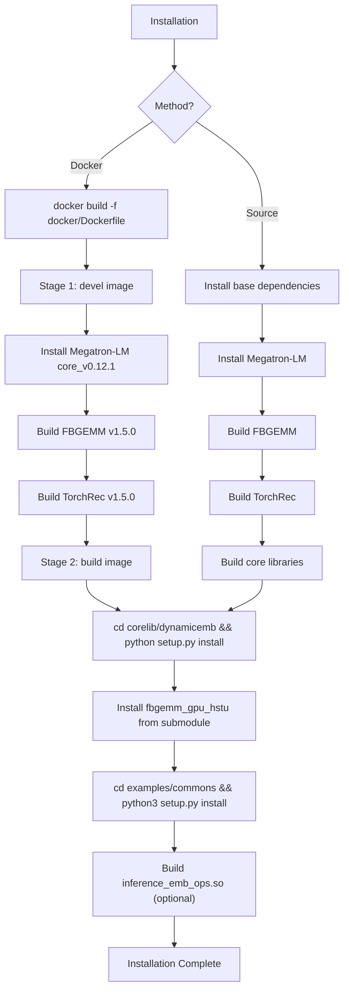

Sources: [docker/Dockerfile:1-91](), [HOW_TO_BUILD_AND_RUN_DEMO.md:1-13]()

## Docker-based Setup (Recommended)

The Docker build uses a multi-stage process defined in [docker/Dockerfile:1-91]().

### Standard Build

```bash
# Build for x86_64
docker build -f docker/Dockerfile --platform linux/amd64 -t recsys-examples:latest .

# Build for ARM64 (NVIDIA Grace)
docker build -f docker/Dockerfile --platform linux/arm64 -t recsys-examples:latest .
```

### Build Arguments

The Dockerfile supports several build-time arguments:

| Argument | Default | Purpose |
|----------|---------|---------|
| `BASE_IMAGE` | `nvcr.io/nvidia/pytorch:26.02-py3` | Base container image ([docker/Dockerfile:1]()) |
| `TARGETPLATFORM` | Auto-detected | `linux/amd64` or `linux/arm64` ([docker/Dockerfile:5]()) |
| `TRITONSERVER_BUILD` | `0` | Set to `1` for Triton integration ([docker/Dockerfile:7]()) |

Sources: [docker/Dockerfile:1-12]()

### Docker Build Stages

**Stage 1: Development Image (`devel`)**

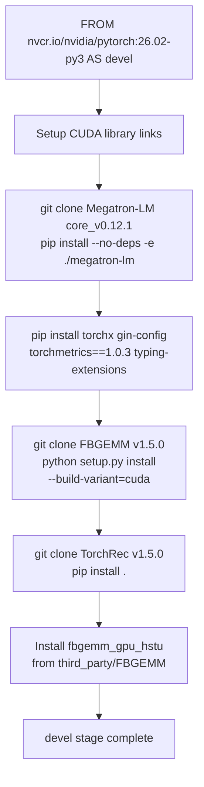

Sources: [docker/Dockerfile:4-67]()

**Stage 2: Build Image (`build`)**

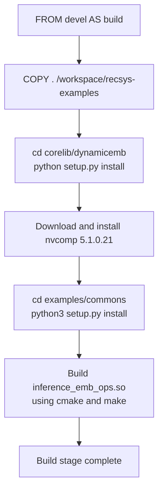

Sources: [docker/Dockerfile:69-91]()

### CUDA Architecture Selection

The build process compiles CUDA kernels for specific GPU architectures. Architecture support is configured via `TORCH_CUDA_ARCH_LIST` in [docker/Dockerfile:48]() and [docker/Dockerfile:83]():

| CUDA Arch | GPU Family | Support |
|-----------|------------|---------|
| 7.5 | T4 | Training + Inference |
| 8.0 | A100 | Training + Inference |
| 8.6 | A10, A30 | Training + Inference |
| 9.0 | H100 | Training + Inference |

Sources: [docker/Dockerfile:48](), [docker/Dockerfile:65](), [docker/Dockerfile:83]()

## Source-based Setup

For development or custom configurations, build components individually.

### Step 1: Install Framework Dependencies

Install Megatron-LM for core model parallelism:

```bash
git clone -b core_v0.12.1 https://github.com/NVIDIA/Megatron-LM.git megatron-lm
pip install --no-deps -e ./megatron-lm
```

Install standard Python packages:
```bash
pip install torchx gin-config torchmetrics==1.0.3 typing-extensions iopath pyvers cloudpickle triton==3.6.0 nvidia-cutlass-dsl==4.3.0
```

Sources: [docker/Dockerfile:39-42]()

### Step 2: Build FBGEMM and TorchRec

```bash
# Build FBGEMM with CUDA support
git clone --recursive -b v1.5.0 https://github.com/pytorch/FBGEMM.git fbgemm
cd fbgemm/fbgemm_gpu
python setup.py install --build-target=default --build-variant=cuda -DTORCH_CUDA_ARCH_LIST="7.5 8.0 9.0"
cd ../..

# Install TorchRec
pip install --no-deps tensordict orjson
git clone --recursive -b release/V1.5.0 https://github.com/pytorch/torchrec.git torchrec
cd torchrec && pip install --no-deps .
```

Sources: [docker/Dockerfile:44-54]()

### Step 3: Build Core Libraries

**DynamicEmb:**
The `dynamicemb` library provides GPU-accelerated dynamic embedding tables.

```bash
cd corelib/dynamicemb
python setup.py install
```

**HSTU Kernels:**
Install the specialized HSTU kernels from the provided submodule:

```bash
cd third_party/FBGEMM/fbgemm_gpu/experimental/hstu
HSTU_ARCH_LIST="8.0 9.0" pip install --no-build-isolation .
```

Sources: [docker/Dockerfile:57-66](), [docker/Dockerfile:75-76]()

### Step 4: Build Inference Operators

For inference workloads, build the `inference_emb_ops.so` library:

```bash
cd corelib/dynamicemb
mkdir -p torch_binding_build && cd torch_binding_build
cmake ..
make -j
```

This generates `corelib/dynamicemb/torch_binding_build/inference_emb_ops.so` which is required by `ExportableEmbedding` ([examples/hstu/modules/exportable_embedding.py:43-53]()).

Sources: [HOW_TO_BUILD_AND_RUN_DEMO.md:3-17](), [docker/Dockerfile:87-89]()

## Running First Examples

### DynamicEmb Example

Run the integrated example for `dynamicemb` which covers training, caching, and persistence:

```bash
cd corelib/dynamicemb/example
NGPU=1 ./run_example.sh
```

The script `run_example.sh` executes several phases:
1. **Training**: `example.py --train` ([corelib/dynamicemb/example/run_example.sh:3]())
2. **Caching**: `example.py --train --caching --prefetch_pipeline` ([corelib/dynamicemb/example/run_example.sh:4]())
3. **Persistence**: `example.py --load --dump` ([corelib/dynamicemb/example/run_example.sh:5]())
4. **Incremental Dump**: `example.py --incremental_dump` ([corelib/dynamicemb/example/run_example.sh:6]())

### HSTU Inference Demo

Verify the inference stack by running the export demo:

```bash
export PYTHONPATH=$PWD/corelib/dynamicemb:$PYTHONPATH
python examples/hstu/inference/test_export_demo.py
```

This demo loads the custom operators, builds an inference module, and runs a `torch.export` smoke test ([HOW_TO_BUILD_AND_RUN_DEMO.md:27-44]()).

## Development and Testing

### Unit Testing
Run linting and tests before contributing:

```bash
# Run linting
pre-commit run -a

# Run tests
# (Refer to Jenkins/Blossom CI configurations for full test suites)
```

Sources: [CONTRIBUTING.md:88-92](), [.github/workflows/blossom-ci.yml:1-29]()

### Environment Verification
If you encounter issues, run the environment reporting script:

```bash
bash recsys-examples/print_env.sh
```

Sources: [CONTRIBUTING.md:8-9]()

---

# Page: Dynamic Embeddings (DynamicEmb)

# Dynamic Embeddings (DynamicEmb)

<details>
<summary>Relevant source files</summary>

The following files were used as context for generating this wiki page:

- [.gitignore](.gitignore)
- [corelib/dynamicemb/DynamicEmb_APIs.md](corelib/dynamicemb/DynamicEmb_APIs.md)
- [corelib/dynamicemb/README.md](corelib/dynamicemb/README.md)
- [corelib/dynamicemb/dynamicemb/embedding_admission.py](corelib/dynamicemb/dynamicemb/embedding_admission.py)
- [examples/hstu/ops/fused_hstu_op.py](examples/hstu/ops/fused_hstu_op.py)

</details>


## Purpose and Scope

This document provides an overview of the **DynamicEmb** system, a GPU-accelerated embedding table implementation that extends TorchRec with dynamic capacity management, eviction policies, and hierarchical storage. DynamicEmb addresses the challenge of handling sparse features with unbounded or very large cardinality by maintaining only active embeddings in memory and automatically evicting stale entries.

**Scope:** This page covers the high-level architecture, core concepts, and integration patterns. For detailed information on specific components, see:
- Core implementation and lifecycle: [Core Architecture and BatchedDynamicEmbeddingTablesV2](#3.1)
- Configuration options: [Configuration System](#3.2)
- Storage backends: [Storage Backends: Hash Tables and HKV](#3.3)
- CUDA kernels: [CUDA Kernels and Index Operations](#3.4)
- Optimizer implementations: [Optimizers and Gradient Updates](#3.5)
- Checkpointing: [State Persistence: Dump and Load](#3.6)
- Distributed sharding: [TorchRec Integration and Sharding](#3.7)
- Performance: [Benchmarks and Performance](#3.8)

---

## Overview and Problem Statement

**Problem:** Traditional embedding tables allocate memory for a fixed number of embeddings (e.g., `num_embeddings × embedding_dim`). For sparse features with large or unbounded vocabulary (user IDs, item IDs, session tokens), this leads to:
1. **Memory waste** for cold/inactive keys that never appear during training.
2. **Capacity constraints** requiring users to estimate vocabulary size in advance.
3. **No built-in eviction** for stale embeddings that occupy memory indefinitely.

**Solution:** DynamicEmb implements a hash table-based storage system where:
- Embeddings are allocated **on-demand** when keys are first encountered [corelib/dynamicemb/README.md:23-23]().
- **Eviction policies** remove low-score embeddings when capacity is reached [corelib/dynamicemb/DynamicEmb_APIs.md:273-280]().
- **Caching layers** optimize hot embeddings in GPU memory with cold storage in CPU memory [corelib/dynamicemb/README.md:3-5]().
- **TorchRec integration** enables distributed sharding and training [corelib/dynamicemb/README.md:25-26]().

**Key Features:**
- **Dynamic capacity:** Tables grow up to `max_capacity` with automatic alignment to `DEMB_TABLE_ALIGN_SIZE` [corelib/dynamicemb/README.md:95-95]().
- **Score-based eviction:** LFU, timestamp, or custom scoring strategies [corelib/dynamicemb/DynamicEmb_APIs.md:273-312]().
- **Two-tier caching:** GPU cache for hot keys + CPU overflow storage [corelib/dynamicemb/DynamicEmb_APIs.md:346-360]().
- **Admission control:** Filter rare keys before inserting into tables [corelib/dynamicemb/dynamicemb/embedding_admission.py:107-119]().
- **Fused optimizers:** SGD, Adam, AdaGrad with fused updates to reduce memory traffic [corelib/dynamicemb/README.md:34-34]().
- **Incremental dumps:** Export only recently-active embeddings for online serving [corelib/dynamicemb/DynamicEmb_APIs.md:477-513]().

Sources: [corelib/dynamicemb/README.md:1-38](), [corelib/dynamicemb/DynamicEmb_APIs.md:1-25]()

---

## System Architecture

DynamicEmb implements a layered architecture that separates concerns from user-facing APIs down to GPU kernels.

### High-Level System Map

The following diagram maps high-level concepts to the specific code entities that implement them.

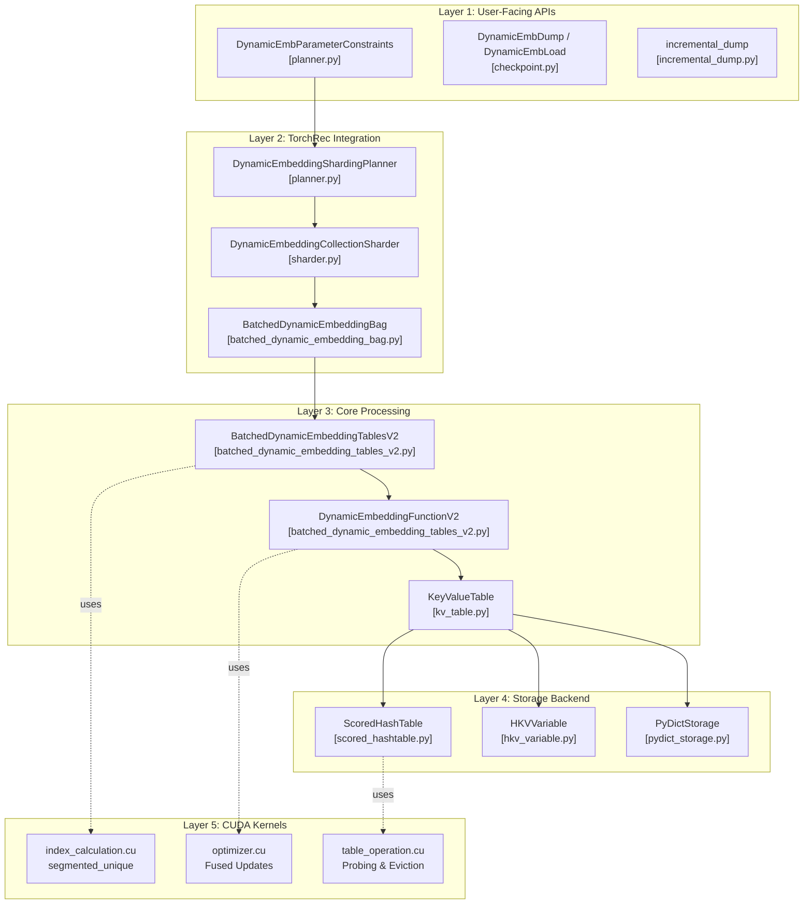

**Layer Responsibilities:**

| Layer | Components | Purpose |
|-------|------------|---------|
| **User APIs** | `DynamicEmbParameterConstraints`, `DynamicEmbDump/Load` | Configuration and checkpointing [corelib/dynamicemb/DynamicEmb_APIs.md:25-50]() |
| **TorchRec** | `DynamicEmbeddingShardingPlanner`, `DynamicEmbeddingCollectionSharder` | Distributed training integration [corelib/dynamicemb/DynamicEmb_APIs.md:88-149]() |
| **Core** | `BatchedDynamicEmbeddingTablesV2`, `DynamicEmbeddingFunctionV2` | Batched operations and autograd integration [corelib/dynamicemb/README.md:96-98]() |
| **Storage** | `ScoredHashTable`, `HKVVariable`, `PyDictStorage` | Hash table backends with eviction policies [corelib/dynamicemb/dynamicemb/embedding_admission.py:21-26]() |
| **Kernels** | `index_calculation.cu`, `optimizer.cu` | High-performance GPU operations [corelib/dynamicemb/README.md:96-96]() |

Sources: [corelib/dynamicemb/DynamicEmb_APIs.md:23-158](), [corelib/dynamicemb/README.md:1-103]()

---

## Core Concepts

### Score Strategies and Eviction

Each key-embedding pair has a **score** representing its importance. When a bucket is full, the lowest-score entry is evicted. DynamicEmb supports several strategies defined in `DynamicEmbScoreStrategy` [corelib/dynamicemb/DynamicEmb_APIs.md:273-280]().

| Strategy | Description | Score Value | Usage |
|----------|-------------|-------------|-------|
| `TIMESTAMP` | Device nanosecond timer | `uint64_t` timestamp | Default, automatic recency tracking |
| `STEP` | Forward pass counter | `int64_t` step | Consistent scores per batch |
| `CUSTOMIZED` | User-managed | User-provided `uint64_t` | Custom eviction logic |

Sources: [corelib/dynamicemb/DynamicEmb_APIs.md:273-312]()

### Admission Control

**Purpose:** Prevent rare keys from consuming memory by filtering them before insertion. This is managed by the `AdmissionStrategy` interface [corelib/dynamicemb/dynamicemb/embedding_admission.py:107-109]().

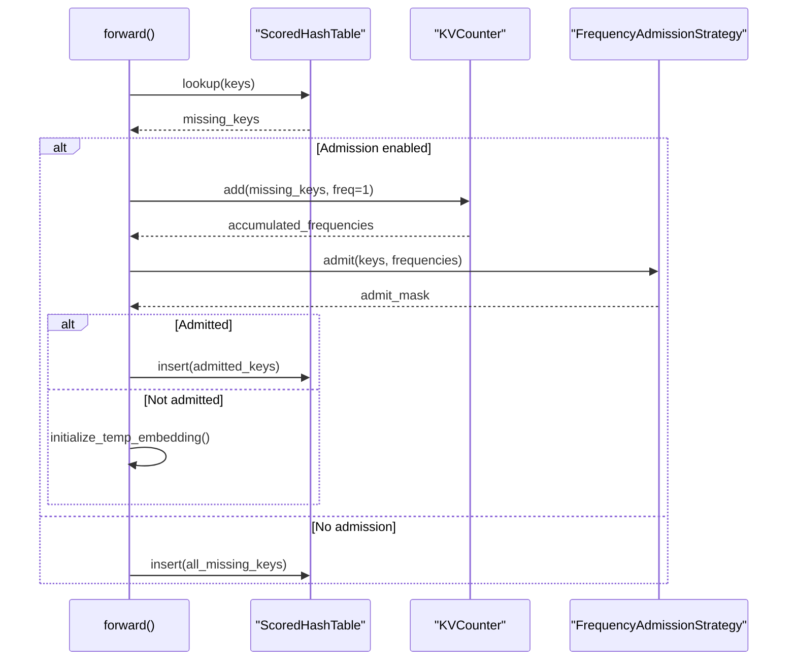

**Built-in Implementation:**
- `KVCounter`: Per-table counter configuration [corelib/dynamicemb/dynamicemb/embedding_admission.py:35-51]().
- `MultiTableKVCounter`: Fused multi-table counter backed by a single `ScoredHashTable` [corelib/dynamicemb/dynamicemb/embedding_admission.py:54-81]().
- `FrequencyAdmissionStrategy`: Admits keys whose frequency meets or exceeds a threshold [corelib/dynamicemb/dynamicemb/embedding_admission.py:107-130]().

Sources: [corelib/dynamicemb/dynamicemb/embedding_admission.py:35-181]()

---

## Checkpointing and Online Updates

### Full Checkpoint: DynamicEmbDump/Load

Save/restore complete tables including optimizer states across the process group [corelib/dynamicemb/DynamicEmb_APIs.md:438-475]().

### Incremental Dump: Export Active Embeddings

The `incremental_dump` function allows exporting only recently-used embeddings based on a score threshold, which is critical for online serving updates [corelib/dynamicemb/DynamicEmb_APIs.md:477-513]().

| Function | Purpose |
|----------|---------|
| `get_score` | Returns the current global score (timestamp/step) for all tables [corelib/dynamicemb/DynamicEmb_APIs.md:523-538](). |
| `set_score` | Manually sets the global score for specific tables [corelib/dynamicemb/DynamicEmb_APIs.md:540-553](). |
| `incremental_dump` | Exports keys/values whose score is greater than a given threshold [corelib/dynamicemb/DynamicEmb_APIs.md:477-490](). |

Sources: [corelib/dynamicemb/DynamicEmb_APIs.md:438-562]()

---

## Related Pages

For detailed information on specific aspects of DynamicEmb:

- **[Core Architecture and BatchedDynamicEmbeddingTablesV2](#3.1):** Lifecycle and data flow.
- **[Configuration System](#3.2):** Guide to `DynamicEmbTableOptions`.
- **[Storage Backends: Hash Tables and HKV](#3.3):** CUDA-optimized storage layers.
- **[CUDA Kernels and Index Operations](#3.4):** Deduplication and index calculation.
- **[Optimizers and Gradient Updates](#3.5):** Fused SGD, Adam, and AdaGrad.
- **[State Persistence: Dump and Load](#3.6):** Checkpointing and incremental updates.
- **[TorchRec Integration and Sharding](#3.7):** Sharding planners and sharder implementations.
- **[Benchmarks and Performance](#3.8):** Performance analysis.

---

# Page: Core Architecture and BatchedDynamicEmbeddingTablesV2

# Core Architecture and BatchedDynamicEmbeddingTablesV2

<details>
<summary>Relevant source files</summary>

The following files were used as context for generating this wiki page:

- [corelib/dynamicemb/dynamicemb/__init__.py](corelib/dynamicemb/dynamicemb/__init__.py)
- [corelib/dynamicemb/dynamicemb/batched_dynamicemb_compute_kernel.py](corelib/dynamicemb/dynamicemb/batched_dynamicemb_compute_kernel.py)
- [corelib/dynamicemb/dynamicemb/batched_dynamicemb_tables.py](corelib/dynamicemb/dynamicemb/batched_dynamicemb_tables.py)
- [corelib/dynamicemb/dynamicemb/key_value_table.py](corelib/dynamicemb/dynamicemb/key_value_table.py)
- [corelib/dynamicemb/dynamicemb/types.py](corelib/dynamicemb/dynamicemb/types.py)
- [corelib/dynamicemb/test/test_batched_dynamic_embedding_tables_v2.py](corelib/dynamicemb/test/test_batched_dynamic_embedding_tables_v2.py)
- [corelib/dynamicemb/test/unit_tests/test_alignment.py](corelib/dynamicemb/test/unit_tests/test_alignment.py)

</details>


## Purpose and Scope

This document provides a comprehensive guide to the core architecture of the DynamicEmb system, focusing on the `BatchedDynamicEmbeddingTablesV2` class and its role in managing dynamic embedding tables. This class serves as the central orchestrator for batch operations, storage management, and gradient computation in the DynamicEmb system.

**Scope:**
- Architecture and lifecycle of `BatchedDynamicEmbeddingTablesV2`
- Storage layer design (cache and storage backends)
- Data flow during forward/backward passes
- Score management and eviction strategies
- Integration with optimizer and autograd systems

**Related Pages:**
- For configuration options and parameter constraints, see [Configuration System](3.2)
- For detailed storage backend implementations, see [Storage Backends: Hash Tables and HKV](3.3)
- For CUDA kernel operations and deduplication, see [CUDA Kernels and Index Operations](3.4)
- For optimizer integration details, see [Optimizers and Gradient Updates](3.5)
- For checkpointing and state persistence, see [State Persistence: Dump and Load](3.6)

---

## System Position and Role

`BatchedDynamicEmbeddingTablesV2` occupies a central position in the DynamicEmb architecture, serving as the primary interface between user code and the underlying storage systems.

### Natural Language to Code Entity Space: System Overview

The following diagram maps high-level system components to their specific class and function implementations within the repository.

Title: RecSys Examples Dynamic Embedding System Map
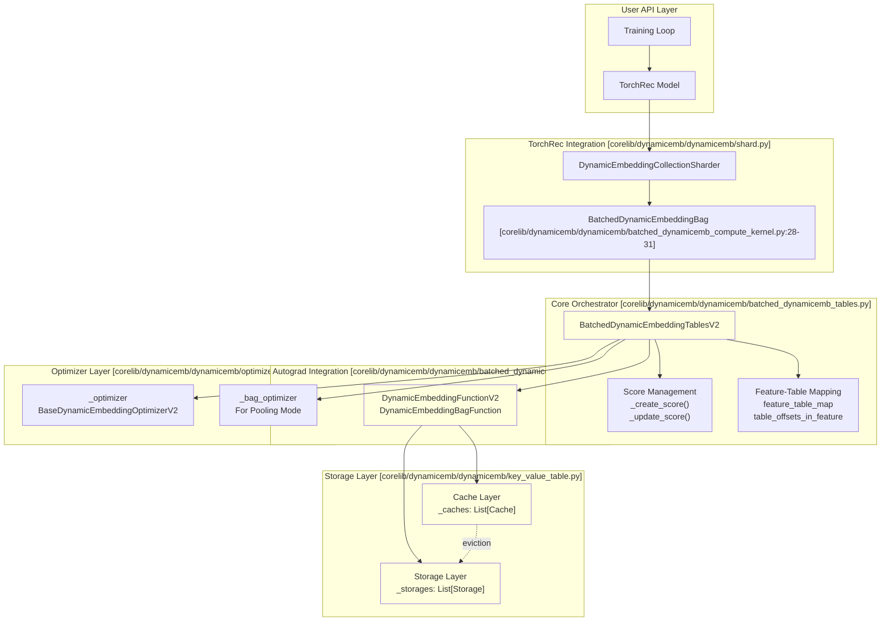
**Sources:** [corelib/dynamicemb/dynamicemb/batched_dynamicemb_tables.py:351-405](), [corelib/dynamicemb/dynamicemb/batched_dynamicemb_compute_kernel.py:28-31]()

---

## Class Architecture Overview

### Core Class Structure

The `BatchedDynamicEmbeddingTablesV2` class is a `torch.nn.Module` that manages multiple dynamic embedding tables as a batched operation. It supports both sequence embeddings (`pooling_mode=NONE`) and pooled embeddings (`pooling_mode=SUM/MEAN`).

Title: BatchedDynamicEmbeddingTablesV2 Component Map
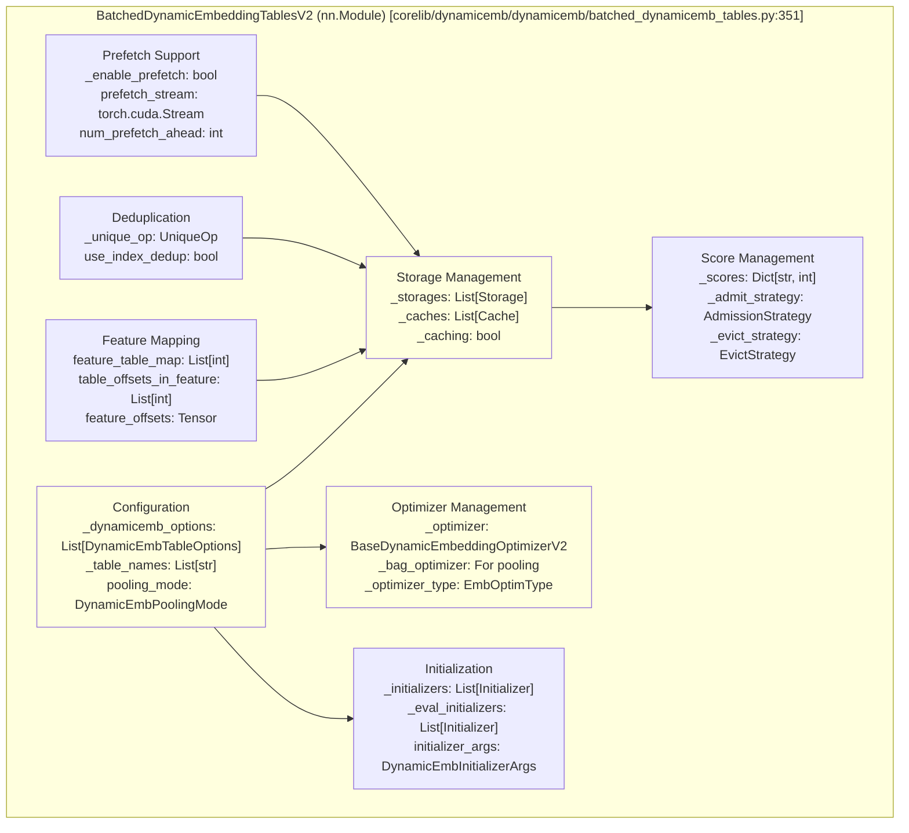

**Key Components:**

| Component | Purpose | Key Attributes |
|-----------|---------|----------------|
| Configuration | Stores table options and pooling mode | `_dynamicemb_options` [corelib/dynamicemb/dynamicemb/batched_dynamicemb_tables.py:364](), `pooling_mode` [corelib/dynamicemb/dynamicemb/batched_dynamicemb_tables.py:372]() |
| Storage Management | Manages cache and storage backends | `_storages` [corelib/dynamicemb/dynamicemb/batched_dynamicemb_tables.py:533](), `_caches` [corelib/dynamicemb/dynamicemb/batched_dynamicemb_tables.py:532]() |
| Optimizer Management | Handles gradient updates | `_optimizer` [corelib/dynamicemb/dynamicemb/batched_dynamicemb_tables.py:530](), `_bag_optimizer` [corelib/dynamicemb/dynamicemb/batched_dynamicemb_tables.py:531]() |
| Score Management | Tracks scores for eviction | `_scores` [corelib/dynamicemb/dynamicemb/batched_dynamicemb_tables.py:527](), `_admit_strategy` [corelib/dynamicemb/dynamicemb/batched_dynamicemb_tables.py:528]() |
| Feature Mapping | Maps logical features to physical tables | `feature_table_map` [corelib/dynamicemb/dynamicemb/batched_dynamicemb_tables.py:370](), `feature_offsets` [corelib/dynamicemb/dynamicemb/batched_dynamicemb_tables.py:483]() |
| Deduplication | Reduces redundant lookups | `_unique_op` [corelib/dynamicemb/dynamicemb/batched_dynamicemb_tables.py:553](), `use_index_dedup` [corelib/dynamicemb/dynamicemb/batched_dynamicemb_tables.py:382]() |

**Sources:** [corelib/dynamicemb/dynamicemb/batched_dynamicemb_tables.py:351-557]()

---

## Initialization Lifecycle

### Initialization Sequence

Title: BDETV2 Initialization Flow
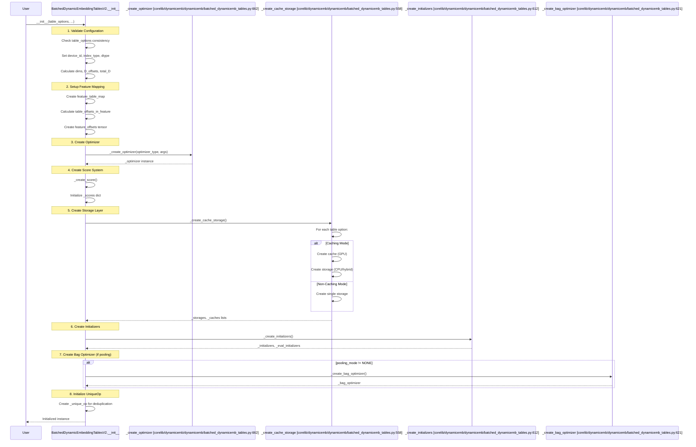

**Sources:** [corelib/dynamicemb/dynamicemb/batched_dynamicemb_tables.py:361-557](), [corelib/dynamicemb/dynamicemb/batched_dynamicemb_tables.py:558-611](), [corelib/dynamicemb/dynamicemb/batched_dynamicemb_tables.py:662-788]()

### Key Initialization Steps

**1. Configuration Validation** [corelib/dynamicemb/dynamicemb/batched_dynamicemb_tables.py:406-451]()
- All tables must match in grouped keys (training mode, caching, etc.).
- Verifies `stochastic_rounding`, `gradient_clipping`, and `optimizer_type` consistency across the batch.

**2. Dimension and Offset Calculation** [corelib/dynamicemb/dynamicemb/batched_dynamicemb_tables.py:440-485]()
- `dims`: List of embedding dimensions per table.
- `feature_dims`: Dimensions mapped by `feature_table_map`.
- `D_offsets`: Cumulative offsets for concatenated embeddings.
- `total_D`: Total embedding dimension across all features.

**3. Feature-to-Table Mapping** [corelib/dynamicemb/dynamicemb/batched_dynamicemb_tables.py:456-485]()
- `feature_table_map`: Maps logical features to physical tables.
- `table_offsets_in_feature`: Indices where each table's features begin.
- `feature_offsets`: GPU tensor for fast lookup during forward/backward.

**Sources:** [corelib/dynamicemb/dynamicemb/batched_dynamicemb_tables.py:361-557]()

---

## Storage Layer Architecture

### Cache and Storage Design

The DynamicEmb system implements a two-tier storage architecture when caching is enabled: a fast GPU-based cache and a larger CPU/hybrid storage backend.

Title: Storage Tiering and Cache Relationship
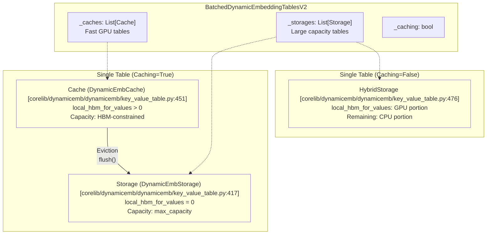

**Sources:** [corelib/dynamicemb/dynamicemb/batched_dynamicemb_tables.py:558-611](), [corelib/dynamicemb/dynamicemb/key_value_table.py:417-511]()

### Cache Creation Logic

**Caching Mode** [corelib/dynamicemb/dynamicemb/batched_dynamicemb_tables.py:577-606]()

When `caching=True` and `training=True`:
1. **Cache (GPU)**: Created as a `DynamicEmbCache` [corelib/dynamicemb/dynamicemb/key_value_table.py:451](), size constrained by `local_hbm_for_values`.
2. **Storage (CPU/Hybrid)**: Created as a `DynamicEmbStorage` [corelib/dynamicemb/dynamicemb/key_value_table.py:417]() with `local_hbm_for_values=0`.

**Non-Caching Mode** [corelib/dynamicemb/dynamicemb/batched_dynamicemb_tables.py:604-606]()

When `caching=False` or `training=False`:
- Single `HybridStorage` [corelib/dynamicemb/dynamicemb/key_value_table.py:476]() using both GPU and CPU memory.
- Memory split determined by `local_hbm_for_values`.

**Sources:** [corelib/dynamicemb/dynamicemb/batched_dynamicemb_tables.py:558-611]()

---

## Forward Pass Data Flow

### Complete Forward Pass Pipeline

Title: BDETV2 Forward Pass Pipeline
```mermaid
graph TB
    subgraph "Input Processing"
        Input["forward(<br/>indices: Tensor,<br/>offsets: Tensor,<br/>per_sample_weights: Tensor)"]
        TypeCheck["Type Conversion<br/>indices.to(index_type)"]
        ScoreSetup["Score Setup<br/>set_score() for each table"]
    end
    
    subgraph "Mode Selection"
        ModeCheck{pooling_mode<br/>== NONE?}
    end
    
    subgraph "Sequence Embedding Path (pooling_mode=NONE)"
        SeqAutograd["DynamicEmbeddingFunction.apply() [corelib/dynamicemb/dynamicemb/batched_dynamicemb_function.py]"]
        
        SeqForward["Forward:<br/>1. Deduplication<br/>2. Cache lookup<br/>3. Storage lookup<br/>4. Initialize missing keys"]
    end
    
    subgraph "Pooled Embedding Path (pooling_mode=SUM/MEAN)"
        BagAutograd["DynamicEmbeddingBagFunction.apply()"]
        
        BagForward["Forward:<br/>1. Lookup embeddings<br/>2. Pool per sample<br/>3. Apply pooling mode"]
    end
    
    subgraph "Score Update"
        UpdateScore["_update_score()<br/>if training or caching"]
    end
    
    subgraph "Output"
        Output["Return: List[Tensor]<br/>Embeddings per feature"]
    end
    
    Input --> TypeCheck
    TypeCheck --> ScoreSetup
    ScoreSetup --> ModeCheck
    
    ModeCheck -->|Yes| SeqAutograd
    ModeCheck -->|No| BagAutograd
    
    SeqAutograd --> SeqForward
    BagAutograd --> BagForward
    
    SeqForward --> UpdateScore
    BagForward --> UpdateScore
    
    UpdateScore --> Output
    
    style SeqAutograd fill:none
    style BagAutograd fill:none
    style UpdateScore fill:none
```

**Sources:** [corelib/dynamicemb/dynamicemb/batched_dynamicemb_tables.py:861-958]()

### Forward Method Implementation

**Sequence Embedding Path** [corelib/dynamicemb/dynamicemb/batched_dynamicemb_tables.py:892-930]()

For `pooling_mode=NONE`, the module invokes `DynamicEmbeddingFunction.apply` [corelib/dynamicemb/dynamicemb/batched_dynamicemb_function.py:27](). This function handles the complex logic of cache-storage coordination, key initialization, and insertion.

**Pooled Embedding Path** [corelib/dynamicemb/dynamicemb/batched_dynamicemb_tables.py:931-952]()

For `pooling_mode=SUM` or `MEAN`, uses `DynamicEmbeddingBagFunction` which integrates pooling into the forward pass and uses the `_bag_optimizer` for gradient updates.

**Sources:** [corelib/dynamicemb/dynamicemb/batched_dynamicemb_tables.py:861-958]()

---

## Score Management System

### Score Lifecycle

Scores determine which embeddings are evicted when tables reach capacity. Lower scores indicate higher eviction priority.

Title: Score Strategy and Update Cycle
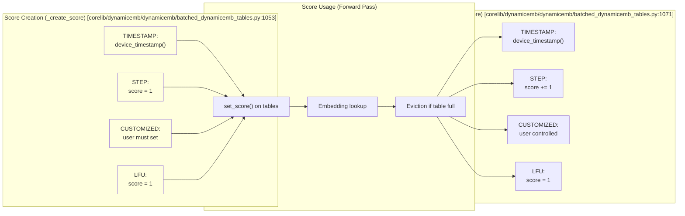

**Score Strategy Implementations** [corelib/dynamicemb/dynamicemb/batched_dynamicemb_tables.py:1053-1115]()

| Strategy | Creation | Update | Use Case |
|----------|----------|--------|----------|
| TIMESTAMP | `device_timestamp()` | `device_timestamp()` | LRU eviction with nanosecond precision |
| STEP | `score = 1` | `score += 1` | LRU with step-based monotonic scores |
| CUSTOMIZED | User must call `set_score()` | User controlled | Custom eviction policies |
| LFU | `score = 1` | `score = 1` | Least frequently used eviction |

**Sources:** [corelib/dynamicemb/dynamicemb/batched_dynamicemb_tables.py:1023-1092]()

---

## Optimizer Integration

### Optimizer Architecture

DynamicEmb supports two separate optimizer paths depending on whether pooling is used.

Title: Optimizer Dispatch Logic
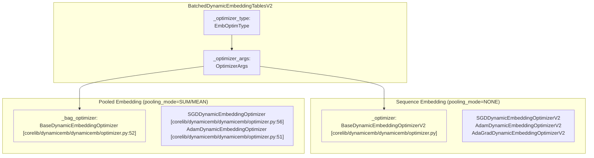

**Optimizer State Dimensions** [corelib/dynamicemb/dynamicemb/optimizer.py:57]()

The optimizer states are stored alongside embeddings in the value dimension. The total dimension is calculated via `get_optimizer_state_dim`.

| Optimizer | State Dimension Calculation |
|-----------|----------------------------|
| SGD | 0 (no additional state) |
| AdaGrad | `embedding_dim` (one state per parameter) |
| Adam | `embedding_dim * 2` (momentum + velocity) |
| RowWiseAdaGrad | `16 // dtype_bytes` (row-wise accumulator) |

**Sources:** [corelib/dynamicemb/dynamicemb/batched_dynamicemb_tables.py:621-788](), [corelib/dynamicemb/dynamicemb/optimizer.py:51-58]()

---

## State Management and Persistence

### Persistence Operations

Title: Checkpoint and Persistence Flow
```mermaid
graph TB
    subgraph "Dump Process [corelib/dynamicemb/dynamicemb/batched_dynamicemb_tables.py:1117]"
        DumpCall["dump(save_dir, optim=True)"]
        Flush["flush()<br/>Move cache to storage"]
        DumpLoop["For each table:<br/>storage.dump()"]
        DumpFiles["Keys, Values, Scores,<br/>Opt States"]
    end
    
    subgraph "Load Process [corelib/dynamicemb/dynamicemb/batched_dynamicemb_tables.py:1210]"
        LoadCall["load(save_dir, optim=True)"]
        FindFiles["get_loading_files()<br/>Discover checkpoint files"]
        LoadLoop["For each table:<br/>storage.load()"]
        LoadData["Restore embeddings,<br/>opt states, scores"]
    end
    
    subgraph "Incremental Dump [corelib/dynamicemb/dynamicemb/batched_dynamicemb_tables.py:1268]"
        IncrCall["incremental_dump(<br/>named_thresholds)"]
        FlushCache["Flush cache if present"]
        ExportMatched["storage.incremental_dump()"]
    end
    
    DumpCall --> Flush
    Flush --> DumpLoop
    
    LoadCall --> FindFiles
    FindFiles --> LoadLoop
    
    IncrCall --> FlushCache
    FlushCache --> ExportMatched
    
    style Flush fill:none
    style FlushCache fill:none
```

**File Naming Convention** [corelib/dynamicemb/dynamicemb/batched_dynamicemb_tables.py:74-89]()

- **Keys**: `{table_name}_emb_keys.rank_{rank}.world_size_{world_size}`
- **Values**: `{table_name}_emb_values.rank_{rank}.world_size_{world_size}`
- **Scores**: `{table_name}_emb_scores.rank_{rank}.world_size_{world_size}`
- **Opt States**: `{table_name}_opt_values.rank_{rank}.world_size_{world_size}`

**Sources:** [corelib/dynamicemb/dynamicemb/batched_dynamicemb_tables.py:74-141](), [corelib/dynamicemb/dynamicemb/batched_dynamicemb_tables.py:1117-1305]()

---

## Memory Management and Capacity

The system calculates and prints memory consumption during initialization in `_print_memory_consume` [corelib/dynamicemb/dynamicemb/batched_dynamicemb_tables.py:260]().

**Capacity Planning Logic:**
1. **Max Capacity**: Total capacity per rank (power of 2) [corelib/dynamicemb/dynamicemb/dynamicemb_config.py:533]().
2. **Local HBM**: GPU memory allocation for values.
3. **Bucket Capacity**: Keys per bucket (affects eviction granularity).

**Formula:**
```python
total_memory_per_table = max_capacity * (emb_dim + opt_state_dim) * dtype_bytes
hbm_memory = min(local_hbm_for_values, total_memory_per_table)
dram_memory = total_memory_per_table - hbm_memory
```

**Sources:** [corelib/dynamicemb/dynamicemb/batched_dynamicemb_tables.py:260-349](), [corelib/dynamicemb/dynamicemb/dynamicemb_config.py:533-551]()

---

# Page: Configuration System

# Configuration System

<details>
<summary>Relevant source files</summary>

The following files were used as context for generating this wiki page:

- [corelib/dynamicemb/DynamicEmb_APIs.md](corelib/dynamicemb/DynamicEmb_APIs.md)
- [corelib/dynamicemb/dynamicemb/dynamicemb_config.py](corelib/dynamicemb/dynamicemb/dynamicemb_config.py)
- [corelib/dynamicemb/dynamicemb/embedding_admission.py](corelib/dynamicemb/dynamicemb/embedding_admission.py)
- [corelib/dynamicemb/dynamicemb/initializer.py](corelib/dynamicemb/dynamicemb/initializer.py)
- [corelib/dynamicemb/dynamicemb/planner/planner.py](corelib/dynamicemb/dynamicemb/planner/planner.py)

</details>


## Purpose and Scope

This document describes the configuration system for Dynamic Embeddings (DynamicEmb), which controls how embedding tables are created, initialized, and managed at runtime. The configuration system encompasses table capacity settings, initialization strategies, eviction policies, admission control, and various operational modes.

For information about how these configurations are used during the table lifecycle, see [Core Architecture and BatchedDynamicEmbeddingTablesV2](3.1). For TorchRec integration details, see [TorchRec Integration and Sharding](3.7).

---

## Configuration Architecture Overview

The configuration system is organized into a hierarchy of dataclasses and enumerations that control different aspects of dynamic embedding behavior.

```mermaid
graph TB
    subgraph "User-Facing Configuration"
        PC["DynamicEmbParameterConstraints<br/>(TorchRec Integration)"]
        DETO["DynamicEmbTableOptions<br/>(Main Configuration)"]
    end
    
    subgraph "Initialization Configuration"
        InitMode["DynamicEmbInitializerMode<br/>UNIFORM/NORMAL/CONSTANT/etc"]
        InitArgs["DynamicEmbInitializerArgs<br/>mean, std_dev, lower, upper, value"]
    end
    
    subgraph "Score and Eviction"
        ScoreStrat["DynamicEmbScoreStrategy<br/>TIMESTAMP/STEP/CUSTOMIZED/LFU"]
        EvictStrat["DynamicEmbEvictStrategy<br/>LRU/LFU/EPOCH_LRU/etc"]
    end
    
    subgraph "Admission Control"
        AdmitStrat["AdmissionStrategy Interface<br/>admit(), initialize_non_admitted_embeddings()"]
        Counter["Counter Interface<br/>add(), erase(), dump(), load()"]
        FreqAdmit["FrequencyAdmissionStrategy<br/>threshold-based admission"]
        KVCounter["KVCounter<br/>key-frequency storage"]
    end
    
    subgraph "Mode Enumerations"
        CheckMode["DynamicEmbCheckMode<br/>ERROR/WARNING/IGNORE"]
        PoolMode["DynamicEmbPoolingMode<br/>SUM/MEAN/NONE"]
    end
    
    subgraph "Context Options"
        CtxOpts["_ContextOptions<br/>Inferred Parameters"]
    end
    
    PC -->|"contains"| DETO
    DETO -->|"inherits"| CtxOpts
    DETO -->|"uses"| InitArgs
    DETO -->|"uses"| ScoreStrat
    DETO -->|"uses"| EvictStrat
    DETO -->|"uses"| CheckMode
    DETO -->|"uses"| AdmitStrat
    DETO -->|"uses"| Counter
    
    InitArgs -->|"specifies"| InitMode
    AdmitStrat <-.implements.- FreqAdmit
    Counter <-.implements.- KVCounter
    
    FreqAdmit -->|"uses for non-admitted"| InitArgs
```

**Configuration Hierarchy**: The system centers around `DynamicEmbTableOptions`, which inherits runtime-inferred parameters from `_ContextOptions` and composes initialization, scoring, eviction, and admission control configurations. `DynamicEmbParameterConstraints` wraps this for TorchRec integration [corelib/dynamicemb/dynamicemb/planner/planner.py:62-79]().

**Sources**: [corelib/dynamicemb/dynamicemb/dynamicemb_config.py:207-358](), [corelib/dynamicemb/DynamicEmb_APIs.md:23-46](), [corelib/dynamicemb/dynamicemb/planner/planner.py:62-79]()

---

## DynamicEmbTableOptions

`DynamicEmbTableOptions` is the primary configuration class that controls all aspects of a dynamic embedding table's behavior. It is defined as a dataclass in [corelib/dynamicemb/dynamicemb/dynamicemb_config.py:149-358]().

### Key Configuration Parameters

| Parameter | Type | Default | Description |
|-----------|------|---------|-------------|
| `training` | `bool` | `True` | Enables optimizer state storage alongside embeddings |
| `caching` | `bool` | `False` | Creates separate GPU/CPU tables with GPU as cache |
| `init_capacity` | `Optional[int]` | `None` | Initial table capacity (rounded to power of 2) |
| `max_capacity` | `Optional[int]` | `None` | Maximum table capacity after sharding |
| `max_load_factor` | `float` | `0.5` | Load factor threshold before rehashing |
| `bucket_capacity` | `int` | `128` | Number of slots per hash bucket |
| `score_strategy` | `DynamicEmbScoreStrategy` | `TIMESTAMP` | How scores are assigned to key-value pairs |
| `evict_strategy` | `DynamicEmbEvictStrategy` | `LRU` | Policy for evicting entries when full |
| `safe_check_mode` | `DynamicEmbCheckMode` | `IGNORE` | Level of insertion failure checking |
| `global_hbm_for_values` | `int` | `0` | Total GPU memory (bytes) for embeddings + optimizer states |
| `local_hbm_for_values` | `int` | `0` | GPU memory per rank (bytes) |
| `admit_strategy` | `Optional[AdmissionStrategy]` | `None` | Controls which keys enter the table |
| `admission_counter` | `Optional[Counter]` | `None` | Tracks admission statistics |
| `external_storage` | `Optional[Storage]` | `None` | Custom parameter server implementation |
| `index_type` | `Optional[torch.dtype]` | `None` | Data type for sparse feature indices |
| `embedding_dtype` | `Optional[torch.dtype]` | `None` | Data type for embedding values |
| `dim` | `Optional[int]` | `None` | Embedding dimension |

### Configuration Grouping

Tables with identical configuration keys are grouped together for efficient batched operations. The grouping key is computed by `get_grouped_key()` at [corelib/dynamicemb/dynamicemb/dynamicemb_config.py:345-353]():

```python
def get_grouped_key(self):
    grouped_key = {}
    grouped_key["training"] = self.training
    grouped_key["caching"] = self.caching
    grouped_key["external_storage"] = self.external_storage
    grouped_key["index_type"] = self.index_type
    grouped_key["score_strategy"] = self.score_strategy
    grouped_key["admit_strategy"] = self.admit_strategy
    return grouped_key
```

**Sources**: [corelib/dynamicemb/dynamicemb/dynamicemb_config.py:149-358](), [corelib/dynamicemb/DynamicEmb_APIs.md:314-422]()

---

## Initialization System

The initialization system controls how embedding vectors are populated when new keys are encountered.

### DynamicEmbInitializerMode

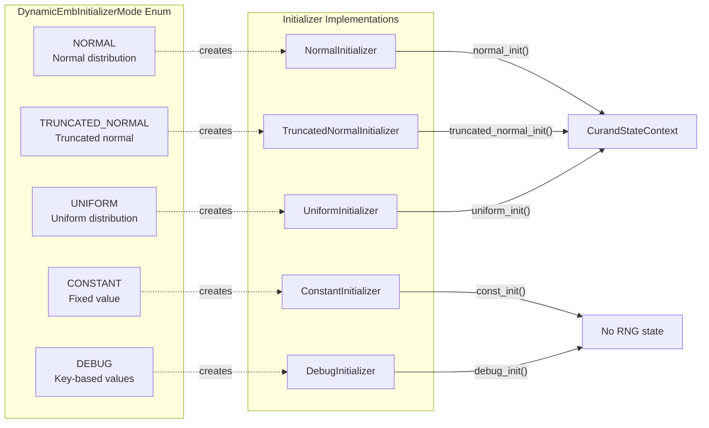

**Initialization Flow**: Factory function `create_initializer_from_args()` at [corelib/dynamicemb/dynamicemb/initializer.py:112-131]() creates the appropriate initializer based on mode. Random initializers maintain `CurandStateContext` for GPU random number generation [corelib/dynamicemb/dynamicemb/initializer.py:35]().

### DynamicEmbInitializerArgs

The `DynamicEmbInitializerArgs` dataclass specifies parameters for each initialization mode [corelib/dynamicemb/dynamicemb/types.py]():

| Field | Type | Default | Used By |
|-------|------|---------|---------|
| `mode` | `DynamicEmbInitializerMode` | (required) | All modes |
| `mean` | `float` | `0.0` | NORMAL, TRUNCATED_NORMAL |
| `std_dev` | `float` | `1.0` | NORMAL, TRUNCATED_NORMAL |
| `lower` | `float` | `None` | UNIFORM, TRUNCATED_NORMAL |
| `upper` | `float` | `None` | UNIFORM, TRUNCATED_NORMAL |
| `value` | `float` | `0.0` | CONSTANT |

**Sources**: [corelib/dynamicemb/dynamicemb/initializer.py:1-131](), [corelib/dynamicemb/dynamicemb/dynamicemb_config.py:295-305](), [corelib/dynamicemb/DynamicEmb_APIs.md:205-271]()

---

## Score Strategies

Scores determine which key-value pairs are evicted when the table reaches capacity. The `DynamicEmbScoreStrategy` enum at [corelib/dynamicemb/dynamicemb/dynamicemb_config.py:113-146]() defines how scores are assigned.

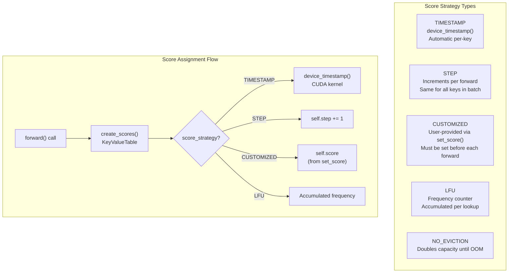

**Score Management**:
- **TIMESTAMP**: Set to device global nanosecond timer [corelib/dynamicemb/dynamicemb/dynamicemb_config.py:123-126]().
- **STEP**: Incremented for every forward pass [corelib/dynamicemb/dynamicemb/dynamicemb_config.py:127-130]().
- **CUSTOMIZED**: Users must provide scores via `set_score` [corelib/dynamicemb/dynamicemb/dynamicemb_config.py:131-133]().
- **LFU**: Least used key in the bucket is evicted [corelib/dynamicemb/dynamicemb/dynamicemb_config.py:134-135]().

**Sources**: [corelib/dynamicemb/dynamicemb/dynamicemb_config.py:113-146](), [corelib/dynamicemb/DynamicEmb_APIs.md:273-311]()

---

## Admission Control

Admission control filters which keys are stored in the embedding table, reducing memory usage for rare features.

```mermaid
graph TB
    subgraph "Admission Strategy Interface"
        AS["AdmissionStrategy<br/>(Abstract Base)"]
        AdmitMethod["admit(keys, frequencies)<br/>returns: mask tensor"]
        InitMethod["initialize_non_admitted_embeddings()<br/>returns: bool"]
    end
    
    subgraph "Frequency-Based Admission"
        FreqAdmit["FrequencyAdmissionStrategy"]
        Threshold["threshold: int<br/>Min frequency for admission"]
        NonAdmitInit["initializer_args: Optional<br/>For non-admitted keys"]
        
        FreqAdmit --> Threshold
        FreqAdmit --> NonAdmitInit
    end
    
    subgraph "Counter Interface"
        Counter["Counter<br/>(Abstract Base)"]
        AddMethod["add(keys, table_ids, frequencies)<br/>returns: accumulated_frequencies"]
    end
    
    subgraph "MultiTableKVCounter Implementation"
        MTKVC["MultiTableKVCounter"]
        ScoreTable["ScoredHashTable<br/>with ACCUMULATE policy"]
        
        MTKVC --> ScoreTable
    end
    
    AS <-.implements.- FreqAdmit
    Counter <-.implements.- MTKVC
```

### FrequencyAdmissionStrategy

Defined at [corelib/dynamicemb/dynamicemb/embedding_admission.py:107-181](), this strategy admits keys only when their accumulated frequency meets or exceeds a threshold. It also allows initializing embeddings for non-admitted keys via `initialize_non_admitted_embeddings()` [corelib/dynamicemb/dynamicemb/embedding_admission.py:161-180]().

### MultiTableKVCounter

Implemented at [corelib/dynamicemb/dynamicemb/embedding_admission.py:54-105](), it manages a fused multi-table `ScoredHashTable` with an `ACCUMULATE` policy [corelib/dynamicemb/dynamicemb/embedding_admission.py:72]().

**Sources**: [corelib/dynamicemb/dynamicemb/embedding_admission.py:35-181](), [corelib/dynamicemb/dynamicemb/dynamicemb_config.py:30-34]()

---

## Mode Enumerations

### DynamicEmbCheckMode

Controls behavior when hash table bucket overflow occurs [corelib/dynamicemb/dynamicemb/dynamicemb_config.py:61-95]():

| Mode | Value | Behavior |
|------|-------|----------|
| `ERROR` | `0` | Throw runtime error and crash [corelib/dynamicemb/dynamicemb/dynamicemb_config.py:80-83]() |
| `WARNING` | `1` | Warning and set embedding to 0.0 [corelib/dynamicemb/dynamicemb/dynamicemb_config.py:84-87]() |
| `IGNORE` | `2` | Silently set embedding to 0.0 [corelib/dynamicemb/dynamicemb/dynamicemb_config.py:88-90]() |

### DynamicEmbPoolingMode

Controls aggregation of multiple embeddings per feature [corelib/dynamicemb/dynamicemb/dynamicemb_config.py:98-101]():
- `SUM`: Sum embeddings.
- `MEAN`: Average embeddings.
- `NONE`: Sequence embeddings (no pooling).

**Sources**: [corelib/dynamicemb/dynamicemb/dynamicemb_config.py:61-101](), [corelib/dynamicemb/DynamicEmb_APIs.md:12-15]()

---

## Configuration and Planning

`DynamicEmbeddingShardingPlanner` wraps TorchRec's planner and uses `_prepare_dynemb_table_options` to fill per-rank options [corelib/dynamicemb/dynamicemb/planner/planner.py:88-120]().

### Capacity and Bucket Alignment
The planner adjusts `bucket_capacity` and `max_capacity` to ensure alignment with world size and hash table bucket layouts [corelib/dynamicemb/dynamicemb/planner/planner.py:174-181]().

### Sharding Routing
Supported `dist_type` values for row-wise sharding [corelib/dynamicemb/DynamicEmb_APIs.md:94-101]():
- `continuous`
- `roundrobin`
- `hash_roundrobin`: Hashes raw keys before rank assignment to mitigate hot-key skew.

**Sources**: [corelib/dynamicemb/dynamicemb/planner/planner.py:1-200](), [corelib/dynamicemb/DynamicEmb_APIs.md:88-120]()

---

# Page: Storage Backends: Hash Tables and HKV

# Storage Backends: Hash Tables and HKV

<details>
<summary>Relevant source files</summary>

The following files were used as context for generating this wiki page:

- [corelib/dynamicemb/benchmark/benchmark_embedding_collection.py](corelib/dynamicemb/benchmark/benchmark_embedding_collection.py)
- [corelib/dynamicemb/dynamicemb/scored_hashtable.py](corelib/dynamicemb/dynamicemb/scored_hashtable.py)
- [corelib/dynamicemb/src/table_operation/bucketize.cu](corelib/dynamicemb/src/table_operation/bucketize.cu)
- [corelib/dynamicemb/src/table_operation/count_matched.cu](corelib/dynamicemb/src/table_operation/count_matched.cu)
- [corelib/dynamicemb/src/table_operation/export_batch.cu](corelib/dynamicemb/src/table_operation/export_batch.cu)
- [corelib/dynamicemb/src/table_operation/kernels.cuh](corelib/dynamicemb/src/table_operation/kernels.cuh)
- [corelib/dynamicemb/src/table_operation/table.cu](corelib/dynamicemb/src/table_operation/table.cu)
- [corelib/dynamicemb/src/table_operation/table.cuh](corelib/dynamicemb/src/table_operation/table.cuh)
- [corelib/dynamicemb/src/table_operation/types.cuh](corelib/dynamicemb/src/table_operation/types.cuh)
- [corelib/dynamicemb/src/torch_utils.cu](corelib/dynamicemb/src/torch_utils.cu)
- [corelib/dynamicemb/src/torch_utils.h](corelib/dynamicemb/src/torch_utils.h)
- [corelib/dynamicemb/test/unit_tests/table_operation/test_table_dump_load.py](corelib/dynamicemb/test/unit_tests/table_operation/test_table_dump_load.py)
- [corelib/dynamicemb/test/unit_tests/table_operation/test_table_operation.py](corelib/dynamicemb/test/unit_tests/table_operation/test_table_operation.py)
- [corelib/dynamicemb/test/unit_tests/test_hybrid_storage_export.py](corelib/dynamicemb/test/unit_tests/test_hybrid_storage_export.py)

</details>


## Purpose and Scope

This document describes the storage backend layer of the DynamicEmb system, which provides GPU-accelerated hash table implementations for storing dynamic embedding vectors. The storage backend abstracts key-value storage with support for scoring, eviction policies, and distributed operations. Two implementations are provided: `LinearBucketTable` (Python-level with CUDA kernels) and `HKVVariable` (using NVIDIA Merlin's HierarchicalKV library).

For information about the core `BatchedDynamicEmbeddingTablesV2` class that uses these storage backends, see [Core Architecture and BatchedDynamicEmbeddingTablesV2](3.1). For configuration of eviction strategies and admission control, see [Configuration System](3.2). For CUDA index processing kernels, see [CUDA Kernels and Index Operations](3.4).

---

## Storage Backend Architecture

### Storage Backend Interface Hierarchy

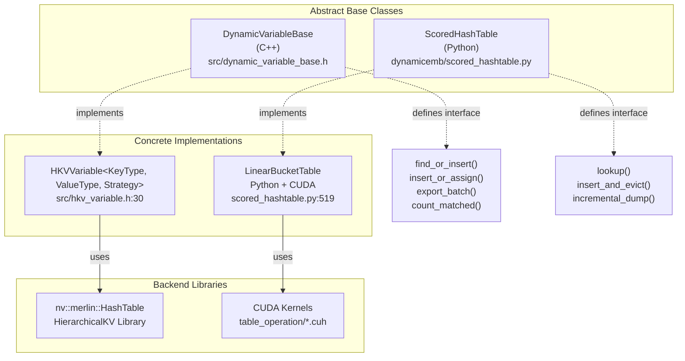

**Sources:** [corelib/dynamicemb/dynamicemb/scored_hashtable.py:73-233](), [corelib/dynamicemb/src/table_operation/table.cuh:67-139]()

The storage backend provides two parallel interface hierarchies:
- **C++ Interface**: `DynamicVariableBase` defines the core storage operations used by the C++ autograd layer.
- **Python Interface**: `ScoredHashTable` defines higher-level operations including scoring, eviction, and persistence [corelib/dynamicemb/dynamicemb/scored_hashtable.py:73-233]().

Both interfaces support:
- **Key-value storage** with integer keys and floating-point value vectors.
- **Score management** for eviction policies (LRU, LFU, custom) [corelib/dynamicemb/dynamicemb/scored_hashtable.py:44-60]().
- **Atomic operations** for concurrent access [corelib/dynamicemb/src/table_operation/types.cuh:159-169]().
- **Batch operations** for GPU efficiency [corelib/dynamicemb/src/table_operation/kernels.cuh:83-89]().
- **Eviction strategies** when capacity is exceeded [corelib/dynamicemb/src/table_operation/kernels.cuh:273-285]().

---

## LinearBucketTable Implementation

### Architecture Overview

`LinearBucketTable` is a Python-managed hash table with custom CUDA kernels for all operations. It uses **linear probing** within fixed-size buckets to handle hash collisions.

```mermaid
graph TB
    subgraph "Python Layer"
        LBT["LinearBucketTable<br/>scored_hashtable.py:519"]
        Config["Configuration<br/>capacity<br/>bucket_capacity<br/>score_specs"]
    end
    
    subgraph "Storage Layout"
        TableStorage["table_storage_<br/>torch.Tensor (uint8)"]
        Keys["keys_<br/>(num_buckets, bucket_capacity)<br/>torch.int64"]
        Digests["digests_<br/>(num_buckets, bucket_capacity)<br/>torch.uint8"]
        Scores["scores_list<br/>(num_buckets, bucket_capacity)<br/>torch.uint64"]
    end
    
    subgraph "CUDA Kernels"
        Lookup["table_lookup_kernel<br/>table_operation/kernels.cuh:83"]
        Insert["table_insert_kernel<br/>kernels.cuh:141"]
        InsertEvict["table_insert_and_evict_kernel<br/>kernels.cuh:273"]
        Export["table_export_batch_kernel<br/>kernels.cuh:510"]
    end
    
    LBT -->|initializes| Config
    Config -->|allocates| TableStorage
    TableStorage -->|partitions via<br/>table_partition()| Keys
    TableStorage -->|partitions via<br/>table_partition()| Digests
    TableStorage -->|partitions via<br/>table_partition()| Scores
    
    LBT -->|lookup()| Lookup
    LBT -->|insert()| Insert
    LBT -->|insert_and_evict()| InsertEvict
    LBT -->|dump()/incremental_dump()| Export
```

**Sources:** [corelib/dynamicemb/dynamicemb/scored_hashtable.py:519-611](), [corelib/dynamicemb/src/table_operation/table.cu:22-65](), [corelib/dynamicemb/src/table_operation/kernels.cuh:83-559]()

### Bucket Structure

The `LinearBucketTable` stores data in a single contiguous tensor partitioned into fields using `table_partition` [corelib/dynamicemb/src/table_operation/table.cu:22-65]().

| Field | Type | Size per Slot | Purpose |
|-------|------|---------------|---------|
| **Keys** | `torch.int64` or `torch.uint64` | 8 bytes | Embedding keys (with reserved values for empty/locked/reclaimed) |
| **Digests** | `torch.uint8` | 1 byte | 8-bit hash digest for fast comparison |
| **Scores** | `torch.uint64` | 8 bytes | Eviction score (timestamp, frequency, etc.) |

**Memory Layout** (per bucket):
The memory is laid out such that keys, digests, and scores for a bucket are contiguous, allowing for vectorized access [corelib/dynamicemb/src/table_operation/table.cu:51-63]().

**Sources:** [corelib/dynamicemb/src/table_operation/types.cuh:38-40](), [corelib/dynamicemb/src/table_operation/table.cu:51-63]()

### Reserved Key Values

The system uses specific bit patterns for atomic state management in `LinearBucket` [corelib/dynamicemb/src/table_operation/types.cuh:116-120]():

| Constant | Value | Description |
|----------|-------|-------------|
| `EmptyKey` | `0xFFFFFFFFFFFFFFFF` | Slot has never been used |
| `LockedKey` | `0xFFFFFFFFFFFFFFFD` | Slot being modified |
| `ReclaimKey` | `0xFFFFFFFFFFFFFFFE` | Slot was deleted |

**Sources:** [corelib/dynamicemb/src/table_operation/types.cuh:116-120]()

---

### Core Operations

#### Lookup Operation

The `table_lookup_kernel` performs a parallel search across the table. It calculates the bucket ID using `hashcode % table_cap` and then invokes `bucket.probe` [corelib/dynamicemb/src/table_operation/kernels.cuh:108-127]().

**Probe Algorithm** (Linear Probing with Digest Filtering):
1. Compute hash and extract 8-bit digest [corelib/dynamicemb/src/table_operation/types.cuh:122-130]().
2. Use `VectorComparator` to perform vectorized comparison of digests (16 bytes at a time) using `__vcmpeq4` [corelib/dynamicemb/src/table_operation/types.cuh:183-204]().
3. If digests match, perform an atomic load of the key to verify [corelib/dynamicemb/src/table_operation/types.cuh:147-150]().

**Sources:** [corelib/dynamicemb/src/table_operation/kernels.cuh:83-171](), [corelib/dynamicemb/src/table_operation/types.cuh:183-204]()

#### Insert and Evict Operation

The `table_insert_and_evict_kernel` handles collision resolution by evicting the entry with the lowest score in the bucket [corelib/dynamicemb/src/table_operation/kernels.cuh:273-434]().

**Eviction Workflow:**
1. Probes for the key; if found, it updates the score (`InsertResult::Assign`) [corelib/dynamicemb/src/table_operation/kernels.cuh:185-189]().
2. If not found and an empty slot exists, it locks and inserts (`InsertResult::Insert`) [corelib/dynamicemb/src/table_operation/kernels.cuh:192-198]().
3. If the bucket is full, it performs a reduction to find the minimum score in the bucket [corelib/dynamicemb/src/table_operation/kernels.cuh:357-366]().
4. It locks the minimum-score slot and replaces it (`InsertResult::Evict`) [corelib/dynamicemb/src/table_operation/kernels.cuh:385-400]().

**Sources:** [corelib/dynamicemb/src/table_operation/kernels.cuh:173-200](), [corelib/dynamicemb/src/table_operation/kernels.cuh:357-400]()

#### Export and Incremental Dump

The `table_export_batch` function allows exporting table contents, filtered by an optional `ScoreType` threshold [corelib/dynamicemb/src/table_operation/export_batch.cu:87-111]().

**Algorithm:**
1. `table_count_matched` is called first to determine how many entries satisfy the threshold [corelib/dynamicemb/src/table_operation/table.cu:135-140]().
2. `table_export_batch_kernel` iterates through buckets, using `ExportPredFunctor` to filter keys [corelib/dynamicemb/src/table_operation/export_batch.cu:62-82]().
3. It uses a warp-level ballot to compact the results into the output buffers [corelib/dynamicemb/src/table_operation/kernels.cuh:538-550]().

**Sources:** [corelib/dynamicemb/src/table_operation/export_batch.cu:23-111](), [corelib/dynamicemb/src/table_operation/kernels.cuh:45-56]()

---

## HKVVariable Implementation

### Architecture Overview

`HKVVariable` provides an interface to NVIDIA Merlin's HierarchicalKV. It supports hierarchical storage (HBM + SSD/DDR) and advanced eviction strategies like LRU and LFU.

**Key Features:**
- **Hierarchical Storage**: Moves cold data to host memory or SSD to support embedding tables larger than GPU HBM.
- **Generator Integration**: When a key is inserted, it can be initialized using `NormalEmbeddingGenerator`, `UniformEmbeddingGenerator`, or `ConstEmbeddingGenerator` [corelib/dynamicemb/src/table_operation/kernels.cuh:2300-2340]().
- **Safety Checks**: Includes a `check_safe_pointers` mechanism to ensure all insertions succeeded within memory limits.

**Sources:** [corelib/dynamicemb/benchmark/benchmark_embedding_collection.py:128-141](), [corelib/dynamicemb/test/unit_tests/test_hybrid_storage_export.py:155-189]()

---

## Score Management and Policies

Scores are used to determine which entries to evict or export. The `ScorePolicy` defines how scores are updated during access [corelib/dynamicemb/src/table_operation/table.cuh:55-63]().

### Score Policy Types

| Policy | Enum Value | Description |
|--------|------------|-------------|
| `CONST` | `ScorePolicyType::Const` | Score is read-only during lookup [corelib/dynamicemb/src/table_operation/kernels.cuh:131-132](). |
| `ASSIGN` | `ScorePolicyType::Assign` | Overwrites the score with a new input value [corelib/dynamicemb/src/table_operation/table.cuh:58](). |
| `ACCUMULATE` | `ScorePolicyType::Accumulate` | Adds the input value to the existing score [corelib/dynamicemb/src/table_operation/table.cuh:59](). |
| `GLOBAL_TIMER` | `ScorePolicyType::GlobalTimer` | Updates score with the current device timestamp [corelib/dynamicemb/src/table_operation/table.cuh:60](). |

**Sources:** [corelib/dynamicemb/src/table_operation/table.cuh:55-63](), [corelib/dynamicemb/src/table_operation/kernels.cuh:131-142]()

### Global Timer Implementation

The `device_timestamp` function uses a CUDA kernel to read the `%globaltimer` register [corelib/dynamicemb/src/torch_utils.cu:22-26](). This provides a high-resolution timestamp used for LRU (Least Recently Used) eviction strategies.

**Sources:** [corelib/dynamicemb/src/torch_utils.cu:22-48](), [corelib/dynamicemb/src/torch_utils.h:86]()

---

## Comparison: LinearBucketTable vs HKVVariable

| Feature | LinearBucketTable | HKVVariable |
|---------|-------------------|-------------|
| **Implementation** | Custom CUDA kernels | NVIDIA Merlin HKV |
| **Collision Policy** | Linear Probing in Buckets | Hierarchical Hashing |
| **Eviction** | Lowest score in bucket | Global LRU/LFU/Custom |
| **Storage Tiers** | GPU HBM Only | HBM, DDR, SSD |
| **Persistence** | `dump`/`load` [dynamicemb/scored_hashtable.py:179-207]() | HKV Native |

**Sources:** [corelib/dynamicemb/dynamicemb/scored_hashtable.py:519-611](), [corelib/dynamicemb/benchmark/benchmark_embedding_collection.py:128-141]()

---

# Page: CUDA Kernels and Index Operations

# CUDA Kernels and Index Operations

<details>
<summary>Relevant source files</summary>

The following files were used as context for generating this wiki page:

- [corelib/dynamicemb/dynamicemb/batched_dynamicemb_function.py](corelib/dynamicemb/dynamicemb/batched_dynamicemb_function.py)
- [corelib/dynamicemb/dynamicemb/shard/embedding.py](corelib/dynamicemb/dynamicemb/shard/embedding.py)
- [corelib/dynamicemb/src/dynamic_emb_op.cu](corelib/dynamicemb/src/dynamic_emb_op.cu)
- [corelib/dynamicemb/src/index_calculation.cu](corelib/dynamicemb/src/index_calculation.cu)
- [corelib/dynamicemb/src/initializer.cu](corelib/dynamicemb/src/initializer.cu)
- [corelib/dynamicemb/src/initializer.cuh](corelib/dynamicemb/src/initializer.cuh)
- [corelib/dynamicemb/src/lookup_backward.cu](corelib/dynamicemb/src/lookup_backward.cu)
- [corelib/dynamicemb/src/lookup_backward.h](corelib/dynamicemb/src/lookup_backward.h)
- [corelib/dynamicemb/src/lookup_forward.cu](corelib/dynamicemb/src/lookup_forward.cu)
- [corelib/dynamicemb/src/lookup_forward.h](corelib/dynamicemb/src/lookup_forward.h)
- [corelib/dynamicemb/src/unique_op.cu](corelib/dynamicemb/src/unique_op.cu)
- [corelib/dynamicemb/src/unique_op.h](corelib/dynamicemb/src/unique_op.h)
- [corelib/dynamicemb/test/test_unique_op.py](corelib/dynamicemb/test/test_unique_op.py)
- [corelib/dynamicemb/test/unit_tests/test_sequence_embedding_fw.py](corelib/dynamicemb/test/unit_tests/test_sequence_embedding_fw.py)

</details>


## Purpose and Scope

This page documents the CUDA kernel implementations and index manipulation operations that enable efficient embedding lookups and gradient updates in the DynamicEmb system. These operations form the computational core of the forward and backward passes, handling deduplication, index mapping, and data movement between unique and full index spaces.

For information about the storage backends that these kernels interact with, see [Storage Backends: Hash Tables and HKV](3.3). For details on how these operations integrate with TorchRec's distributed sharding, see [TorchRec Integration and Sharding](3.7).

**Key Topics Covered:**
- `segmented_unique` operation for per-table deduplication.
- `DynamicEmbeddingFunctionV2` autograd function.
- CUDA kernels for sorting, flagging, and index transformation.
- `gather_embedding` and `reduce_grads` operations.
- Integration with distributed training workflows.

---

## Overview: Index Operations in the Training Pipeline

The DynamicEmb system performs several critical index transformations during each training iteration to minimize redundant storage lookups and optimize memory bandwidth.

### Index Transformation Flow

```mermaid
graph TB
    Input["Input Indices<br/>(may contain duplicates)"]
    GetRange["get_table_range()<br/>Split by table"]
    SegUnique["segmented_unique()<br/>Per-table deduplication"]
    Lookup["Storage Lookup<br/>(unique keys only)"]
    Gather["gather_embedding()<br/>Map unique→full"]
    Forward["Forward Output<br/>(full embedding tensor)"]
    Backward["Backward Input<br/>(gradients per index)"]
    Reduce["reduce_grads()<br/>Aggregate by unique key"]
    Update["Optimizer Update<br/>(unique keys only)"]
    
    Input --> GetRange
    GetRange --> SegUnique
    SegUnique --> |"unique_keys<br/>reverse_indices"| Lookup
    Lookup --> |"unique_embeddings"| Gather
    Gather --> Forward
    Forward -.backward.-> Backward
    Backward --> Reduce
    Reduce --> |"unique_grads"| Update
    
    style SegUnique fill:#e8f4f8
    style Gather fill:#e8f4f8
    style Reduce fill:#e8f4f8
```
**Sources:** [corelib/dynamicemb/dynamicemb/batched_dynamicemb_function.py:48-141](), [corelib/dynamicemb/src/index_calculation.cu:93-127]()

---

## Segmented Unique Operation

The `segmented_unique` function [corelib/dynamicemb/dynamicemb/batched_dynamicemb_function.py:48-141]() is the cornerstone of DynamicEmb's deduplication strategy. Unlike standard `torch.unique`, it performs **per-table** deduplication, preserving table boundaries while eliminating duplicate indices within each table's segment.

### Algorithm and Kernel Pipeline

The underlying implementation uses a compound hashing approach on `(key, table_id)` pairs with a single shared hash table for memory efficiency [corelib/dynamicemb/src/unique_op.h:28-34]().

| Stage | Operation | Output |
|-------|-----------|--------|
| **1. Table ID Expansion** | `expand_table_ids_cuda` generates table IDs for every input key | `table_ids` tensor |
| **2. Hash Table Init** | `segmented_init_kernel` clears the hash table and per-table counters | Empty hash table |
| **3. Insert and Count** | `segmented_insert_kernel` uses atomic operations to find/insert unique keys | `reverse_indices`, `table_counters` |
| **4. Offset Scan** | `cub::DeviceScan::ExclusiveSum` converts counts to global offsets | `table_offsets` |
| **5. Compact Results** | `segmented_compact_kernel` moves unique keys to a contiguous output buffer | `unique_keys` |

**Sources:** [corelib/dynamicemb/src/unique_op.cu:158-205](), [corelib/dynamicemb/src/unique_op.h:63-65]()

### CUDA Implementation Details

#### expand_table_ids_cuda
[corelib/dynamicemb/src/unique_op.h:90-92]()
Generates a `table_id` for each element based on the jagged tensor offsets. This prepares the input for the segmented unique kernel by associating every raw key with its specific embedding table.

#### segmented_unique_cuda
[corelib/dynamicemb/src/unique_op.cu:260-310]()
The core C++ entry point. It calculates the necessary hash table capacity (typically $2 \times \text{num\_keys}$) and launches the initialization, insertion, and compaction kernels. It supports frequency counting for LFU eviction strategies by passing an `input_frequencies` tensor [corelib/dynamicemb/src/unique_op.h:63-65]().

---

## Autograd Integration: DynamicEmbeddingFunctionV2

The `DynamicEmbeddingFunctionV2` (integrated via `BatchedDynamicEmbeddingFunctionV2` in practice) bridges PyTorch's autograd system with high-level embedding operations.

### Forward Pass Logic
1. **Deduplication**: Calls `segmented_unique` to get unique keys and `reverse_indices` [corelib/dynamicemb/dynamicemb/batched_dynamicemb_function.py:48-73]().
2. **Lookup**: Executes storage or cache lookups for unique keys.
3. **Gather**: Uses `gather_embedding` to map unique embeddings back to the full input space [corelib/dynamicemb/src/dynamic_emb_op.cu:79-104]().

### Backward Pass Logic
1. **Reduce**: Uses `reduce_grads` to aggregate gradients from the full index space back to the unique key space [corelib/dynamicemb/src/dynamic_emb_op.cu:159-170]().
2. **Update**: Applies unique gradients to the storage via the optimizer.

**Sources:** [corelib/dynamicemb/dynamicemb/batched_dynamicemb_function.py:33-45](), [corelib/dynamicemb/src/dynamic_emb_op.cu:79-104]()

---

## Index Manipulation Kernels

### Batched Operations

#### gather_embedding
[corelib/dynamicemb/src/dynamic_emb_op.cu:79-104]()
Performs a fused scatter operation. It takes a source embedding buffer (unique space) and an index tensor (inverse mapping) to populate a destination buffer (full space). It uses `dyn_emb::scatter_fused` to handle the data movement efficiently across GPU SMs.

#### gather_embedding_pooled
[corelib/dynamicemb/src/dynamic_emb_op.cu:106-133]()
Extends the gather operation to support pooling (e.g., SUM, MEAN). It utilizes `dyn_emb::scatter_combine` and supports multi-dimensional pooling via `D_offsets`.

#### reduce_grads
[corelib/dynamicemb/src/dynamic_emb_op.cu:159-170]()
A complex kernel that aggregates gradients. It handles:
- **Uniform-dim pooling**: Gradients are reduced using `reverse_indices`.
- **Multi-dim pooling**: Uses `D_offsets` to handle varying embedding dimensions per feature.
- **Scaling**: Fuses MEAN scaling directly into the reduction kernel to avoid extra passes.

**Sources:** [corelib/dynamicemb/src/dynamic_emb_op.cu:79-170](), [corelib/dynamicemb/src/lookup_forward.cu:77-105]()

### Index Calculation Utilities

#### get_table_range
[corelib/dynamicemb/src/index_calculation.cu:93-127]()
Computes per-table index boundaries from feature-level offsets. It converts the jagged structure of feature-batch offsets into a coarse-grained table range used for segmenting operations.

#### flagged_compact
[corelib/dynamicemb/src/index_calculation.cu:129-181]()
A utility using `cub::DeviceSelect::Flagged` to filter multiple input tensors simultaneously based on a boolean flag array. This is used extensively during eviction and admission to separate admitted/evicted keys and values.

#### compute_dedup_lengths_cuda
[corelib/dynamicemb/src/unique_op.h:111-113]()
Generates new lengths and offsets for `KeyedJaggedTensor` structures after deduplication. It ensures that unique keys are distributed evenly across buckets to maintain compatibility with TorchRec's jagged data structures.

---

## Integration with Distributed Training

In distributed scenarios, the `ShardedDynamicEmbeddingCollection` utilizes these kernels to handle input before communication.

### Distributed Deduplication Flow

```mermaid
graph LR
    subgraph "Local Rank"
        InputKJT["KeyedJaggedTensor"]
        Dedup["_dedup_indices()"]
        UniqueKJT["Deduplicated KJT"]
    end
    
    subgraph "Communication"
        A2A["AllToAll<br/>(Indices + Weights)"]
    end
    
    subgraph "Remote Storage"
        Lookup["Storage/Cache Lookup"]
    end

    InputKJT --> Dedup
    Dedup --> UniqueKJT
    UniqueKJT --> A2A
    A2A --> Lookup
```

The `_dedup_indices` method [corelib/dynamicemb/dynamicemb/shard/embedding.py:174-210]() leverages `segmented_unique_cuda` to minimize the volume of indices sent over the network during `AllToAll` operations. When LFU is enabled, it also propagates frequency counts as KJT weights to inform the remote storage's admission and eviction logic [corelib/dynamicemb/dynamicemb/shard/embedding.py:56-70]().

**Sources:** [corelib/dynamicemb/dynamicemb/shard/embedding.py:56-210](), [corelib/dynamicemb/src/unique_op.h:111-113]()

---

## Initializer Kernels

The system provides CUDA-accelerated initialization for new keys inserted into the dynamic embedding table.

| Initializer | Function | Logic |
|-------------|----------|-------|
| **Normal** | `normal_init` | Uses `curand_normal_double` with specified mean/std [corelib/dynamicemb/src/initializer.cu:133-143](). |
| **Uniform** | `uniform_init` | Uses `curand_uniform_double` within `[lower, upper]` [corelib/dynamicemb/src/initializer.cu:156-165](). |
| **Truncated Normal** | `truncated_normal_init` | Fused kernel using `normcdf` and `erfinv` for truncation [corelib/dynamicemb/src/initializer.cu:145-154](). |
| **Constant** | `const_init` | Sets all values to a specific float [corelib/dynamicemb/src/initializer.cu:167-171](). |

These initializers use a `CurandStateContext` [corelib/dynamicemb/src/initializer.cu:30-61]() to manage GPU random states across multiple workers, ensuring high-throughput initialization during high-miss-rate training phases.

**Sources:** [corelib/dynamicemb/src/initializer.cu:30-171](), [corelib/dynamicemb/src/initializer.cuh:40-156]()

---

# Page: Optimizers and Gradient Updates

# Optimizers and Gradient Updates

<details>
<summary>Relevant source files</summary>

The following files were used as context for generating this wiki page:

- [corelib/dynamicemb/dynamicemb/batched_dynamicemb_function.py](corelib/dynamicemb/dynamicemb/batched_dynamicemb_function.py)
- [corelib/dynamicemb/dynamicemb/optimizer.py](corelib/dynamicemb/dynamicemb/optimizer.py)
- [corelib/dynamicemb/src/dynamic_emb_op.cu](corelib/dynamicemb/src/dynamic_emb_op.cu)
- [corelib/dynamicemb/src/optimizer.cu](corelib/dynamicemb/src/optimizer.cu)
- [corelib/dynamicemb/src/optimizer.h](corelib/dynamicemb/src/optimizer.h)
- [corelib/dynamicemb/src/optimizer_kernel.cuh](corelib/dynamicemb/src/optimizer_kernel.cuh)

</details>


This page documents the optimizer implementations for Dynamic Embeddings, including SGD, Adam, AdaGrad, and RowWiseAdaGrad. The system provides optimized update mechanisms for large-scale recommendation models, featuring fused CUDA kernels and memory-efficient optimizer state management.

## Architecture Overview

The optimizer system is designed to handle sparse updates for dynamic embedding tables. It supports both a standard interface for standalone tables and a fused interface for batched operations. All optimizers are CUDA-accelerated with vectorized operations for high performance.

**Diagram: Optimizer System Architecture**

```mermaid
graph TB
    subgraph "Python Layer [optimizer.py]"
        BaseOpt["BaseDynamicEmbeddingOptimizer"]
        SGDOpt["SGDDynamicEmbeddingOptimizer"]
        AdamOpt["AdamDynamicEmbeddingOptimizer"]
        AdaGradOpt["AdaGradDynamicEmbeddingOptimizer"]
        RowWiseOpt["RowWiseAdaGradDynamicEmbeddingOptimizer"]
    end
    
    subgraph "Update Mechanisms"
        PaddedUpdate["update_for_padded_buffer<br/>(Standard tensor update)"]
        FlatUpdate["fused_update_for_flat_table<br/>(Batched sparse update)"]
    end
    
    subgraph "CUDA Kernels [optimizer.cu]"
        LaunchKernel["launch_update_kernel_for_flat_table"]
        OptKernel["SgdVecOptimizer<br/>AdamVecOptimizer<br/>AdaGradVecOptimizer<br/>RowWiseAdaGradVecOptimizer"]
    end

    BaseOpt --> SGDOpt
    BaseOpt --> AdamOpt
    BaseOpt --> AdaGradOpt
    BaseOpt --> RowWiseOpt
    
    SGDOpt --> PaddedUpdate
    SGDOpt --> FlatUpdate
    AdamOpt --> PaddedUpdate
    AdamOpt --> FlatUpdate
    
    PaddedUpdate --> OptKernel
    FlatUpdate --> LaunchKernel
    LaunchKernel --> OptKernel
```

**Sources:** [corelib/dynamicemb/dynamicemb/optimizer.py:119-125](), [corelib/dynamicemb/src/optimizer.cu:34-39](), [corelib/dynamicemb/src/optimizer_kernel.cuh:28-32]()

## Configuration

All optimizers are configured via the `OptimizerArgs` dataclass, which contains hyperparameters and training settings.

**Table: OptimizerArgs Fields**

| Field | Type | Default | Description |
|-------|------|---------|-------------|
| `learning_rate` | float | 0.01 | Learning rate for gradient updates |
| `stochastic_rounding` | bool | True | Enable stochastic rounding |
| `gradient_clipping` | bool | False | Enable gradient clipping |
| `max_gradient` | float | 1.0 | Maximum gradient value (if clipping enabled) |
| `eps` | float | 1.0e-8 | Epsilon for numerical stability (Adam, AdaGrad) |
| `beta1` | float | 0.9 | Adam first moment decay rate |
| `beta2` | float | 0.999 | Adam second moment decay rate |
| `weight_decay` | float | 0.0 | L2 regularization weight |
| `initial_accumulator_value` | float | 0.0 | Initial value for AdaGrad accumulators |

**Sources:** [corelib/dynamicemb/dynamicemb/optimizer.py:77-102]()

## Optimizer Algorithms

The system implements four primary optimizer algorithms. Each implementation provides specialized CUDA templates in `optimizer_kernel.cuh`.

### SGD (Stochastic Gradient Descent)
Performs basic gradient descent: `weight = weight - learning_rate * gradient`.
*   **Python Class:** `SGDDynamicEmbeddingOptimizer` [corelib/dynamicemb/dynamicemb/optimizer.py:192-198]()
*   **CUDA Template:** `SgdVecOptimizer` [corelib/dynamicemb/src/optimizer_kernel.cuh:35-72]()

### Adam
Maintains exponential moving averages of gradients (`m`) and squared gradients (`v`) with bias correction.
*   **Python Class:** `AdamDynamicEmbeddingOptimizer` [corelib/dynamicemb/dynamicemb/optimizer.py:244-250]()
*   **CUDA Template:** `AdamVecOptimizer` [corelib/dynamicemb/src/optimizer_kernel.cuh:75-198]()
*   **State Layout:** `[weight (dim) | m (dim) | v (dim)]`

### AdaGrad
Accumulates squared gradients to provide element-wise adaptive learning rates.
*   **Python Class:** `AdaGradDynamicEmbeddingOptimizer` [corelib/dynamicemb/dynamicemb/optimizer.py:321-327]()
*   **CUDA Template:** `AdaGradVecOptimizer` [corelib/dynamicemb/src/optimizer_kernel.cuh:200-272]()
*   **State Layout:** `[weight (dim) | G (dim)]`

### RowWise AdaGrad
Computes a single accumulator per embedding row (averaged across dimensions), significantly reducing memory overhead.
*   **Python Class:** `RowWiseAdaGradDynamicEmbeddingOptimizer` [corelib/dynamicemb/dynamicemb/optimizer.py:382-388]()
*   **CUDA Template:** `RowWiseAdaGradVecOptimizer` [corelib/dynamicemb/src/optimizer_kernel.cuh:296-401]()
*   **State Layout:** `[weight (dim) | G (aligned_scalar)]`

## Memory Layout and State Dimensions

Optimizer states are stored inline with embedding values in the hash table. The total width of a table entry is determined by the embedding dimension and the optimizer type.

**Table: Optimizer State Widths**

| Optimizer | State Elements per Row | Function |
|-----------|------------------------|----------|
| SGD | 0 | `get_optimizer_state_dim` |
| Adam | `dim * 2` | `get_optimizer_state_dim` |
| AdaGrad | `dim` | `get_optimizer_state_dim` |
| RowWise AdaGrad | `16 / sizeof(dtype)` | `get_optimizer_state_dim` |

**Sources:** [corelib/dynamicemb/dynamicemb/optimizer.py:36-58](), [corelib/dynamicemb/dynamicemb/optimizer.py:60-73]()

## CUDA Kernel Implementation

The CUDA backend uses vectorized operations (`Vec4T`) to maximize memory throughput. The system selects between a vectorized kernel and a scalar fallback based on the `all_dims_vec4` flag.

**Diagram: CUDA Update Flow**

```mermaid
graph LR
    subgraph "Host Launch [optimizer.cu]"
        LaunchFunc["launch_update_kernel_for_flat_table"]
    end
    
    subgraph "Device Kernels [optimizer_kernel.cuh]"
        VecKernel["update4_with_index_flat_table_kernel<br/>(Vectorized 4x)"]
        ScalarKernel["update_with_index_flat_table_kernel<br/>(Scalar fallback)"]
    end
    
    subgraph "Vector Operations"
        VecLoad["Vec4T.load()"]
        VecAccum["Vec4T.accumulate_multiply()"]
        VecStore["Vec4T.store()"]
    end

    LaunchFunc -- "all_dims_vec4 == true" --> VecKernel
    LaunchFunc -- "all_dims_vec4 == false" --> ScalarKernel
    
    VecKernel --> VecLoad
    VecLoad --> VecAccum
    VecAccum --> VecStore
```

**Key Implementation Details:**
*   **Vectorization:** `update4` methods use `Vec4T<T>` to process 4 elements per thread, improving instruction-level parallelism [corelib/dynamicemb/src/optimizer_kernel.cuh:38-55]().
*   **Grid Sizing:** The grid size is dynamically calculated based on the number of streaming multiprocessors (SMs) and the number of embeddings being updated (`ev_nums`) [corelib/dynamicemb/src/optimizer.cu:42-55]().
*   **RowWise Reduction:** RowWise AdaGrad uses warp-level primitives (`__shfl_xor_sync`) to compute the sum of squared gradients across a row efficiently [corelib/dynamicemb/src/optimizer_kernel.cuh:274-281]().

**Sources:** [corelib/dynamicemb/src/optimizer.cu:40-75](), [corelib/dynamicemb/src/optimizer_kernel.cuh:38-55](), [corelib/dynamicemb/src/optimizer_kernel.cuh:274-281]()

## Gradient Reduction and Updates

In the autograd backward pass, gradients are first reduced (deduplicated) before the optimizer update is applied.

1.  **Segmented Unique:** `segmented_unique` deduplicates input keys within each table segment [corelib/dynamicemb/dynamicemb/batched_dynamicemb_function.py:48-73]().
2.  **Gradient Reduction:** `reduce_grads` aggregates gradients for duplicate keys using the `reverse_indices` generated during lookup [corelib/dynamicemb/src/dynamic_emb_op.cu:159-165]().
3.  **Optimizer Step:** The `BaseDynamicEmbeddingOptimizer` subclasses call into CUDA extensions (e.g., `adam_update_for_flat_table`) to apply the reduced gradients to the embedding storage [corelib/dynamicemb/dynamicemb/optimizer.py:272-284]().

**Sources:** [corelib/dynamicemb/dynamicemb/batched_dynamicemb_function.py:48-141](), [corelib/dynamicemb/src/dynamic_emb_op.cu:159-170](), [corelib/dynamicemb/dynamicemb/optimizer.py:272-284]()

---

# Page: State Persistence: Dump and Load

# State Persistence: Dump and Load

<details>
<summary>Relevant source files</summary>

The following files were used as context for generating this wiki page:

- [CONTRIBUTING.md](CONTRIBUTING.md)
- [corelib/dynamicemb/dynamicemb/construct_twin_module.py](corelib/dynamicemb/dynamicemb/construct_twin_module.py)
- [corelib/dynamicemb/dynamicemb/dump_load.py](corelib/dynamicemb/dynamicemb/dump_load.py)
- [corelib/dynamicemb/dynamicemb/incremental_dump.py](corelib/dynamicemb/dynamicemb/incremental_dump.py)
- [corelib/dynamicemb/dynamicemb/input_dist.py](corelib/dynamicemb/dynamicemb/input_dist.py)
- [corelib/dynamicemb/dynamicemb/planner/__init__.py](corelib/dynamicemb/dynamicemb/planner/__init__.py)
- [corelib/dynamicemb/dynamicemb/shard/__init__.py](corelib/dynamicemb/dynamicemb/shard/__init__.py)
- [corelib/dynamicemb/example/README.md](corelib/dynamicemb/example/README.md)
- [corelib/dynamicemb/example/example.py](corelib/dynamicemb/example/example.py)
- [corelib/dynamicemb/example/run_example.sh](corelib/dynamicemb/example/run_example.sh)
- [corelib/dynamicemb/src/sparse_block_bucketize_features.cu](corelib/dynamicemb/src/sparse_block_bucketize_features.cu)
- [corelib/dynamicemb/test/unit_tests/incremental_dump/test_distributed_dynamicemb.py](corelib/dynamicemb/test/unit_tests/incremental_dump/test_distributed_dynamicemb.py)
- [corelib/dynamicemb/test/unit_tests/test_embedding_dump_load.py](corelib/dynamicemb/test/unit_tests/test_embedding_dump_load.py)
- [corelib/dynamicemb/test/unit_tests/test_embedding_dump_load.sh](corelib/dynamicemb/test/unit_tests/test_embedding_dump_load.sh)
- [corelib/dynamicemb/test/unit_tests/test_pooled_embedding_bw.py](corelib/dynamicemb/test/unit_tests/test_pooled_embedding_bw.py)
- [corelib/dynamicemb/test/unit_tests/test_pooled_embedding_fw.py](corelib/dynamicemb/test/unit_tests/test_pooled_embedding_fw.py)
- [corelib/dynamicemb/test/unit_tests/test_twin_module.py](corelib/dynamicemb/test/unit_tests/test_twin_module.py)

</details>


## Purpose and Scope

This document covers the state persistence system in DynamicEmb, which enables checkpointing and restoration of dynamic embedding tables. The system supports:

- Full checkpointing of embedding weights, scores, and optimizer states.
- Distributed persistence across multiple GPUs with row-wise sharding.
- World size changes (dump with $N$ GPUs, load with $M$ GPUs).
- Incremental updates for online model synchronization.
- Selective persistence of optimizer states and admission counters.
- Integration with TorchRec's sharding infrastructure.

For distributed training architecture and process groups, see [5.1](). For optimizer state management, see [3.5](). For overall checkpointing strategies including non-embedding model components, see [5.2]().

---

## Overview

The DynamicEmb persistence system operates at two levels:

1.  **High-Level API** (`DynamicEmbDump` / `DynamicEmbLoad`): Traverses PyTorch models to find `ShardedEmbeddingCollection` and `ShardedEmbeddingBagCollection` modules, then persists all dynamic embedding tables within them [corelib/dynamicemb/dynamicemb/dump_load.py:112-139]().
2.  **Incremental API** (`incremental_dump`): Provides a mechanism to dump specific keys and their associated values/scores, primarily for online serving or synchronization [corelib/dynamicemb/example/example.py:28-28]().
3.  **Low-Level API** (`BatchedDynamicEmbeddingTablesV2.dump()` / `.load()`): Handles the actual serialization of hash table contents to binary files.

The system stores embeddings as binary key-value pairs, with separate files for keys, values (embeddings), scores (for eviction), and optimizer states. Each rank dumps its local shard of the distributed hash table, enabling parallel I/O.

**Key Characteristics:**

| Feature | Support |
| :--- | :--- |
| Distributed Sharding | Row-wise sharding only (TW/TWRW planned) [corelib/dynamicemb/dynamicemb/dump_load.py:97-97]() |
| World Size Changes | Supported via modulo redistribution [corelib/dynamicemb/test/unit_tests/test_embedding_dump_load.sh:72-98]() |
| Optimizer States | Optional (SGD, Adam, AdaGrad, RowWiseAdaGrad) [corelib/dynamicemb/test/unit_tests/test_embedding_dump_load.py:65-76]() |
| Admission Counters | Optional (`KVCounter` persistence) [corelib/dynamicemb/dynamicemb/dump_load.py:131-132]() |
| Score Strategies | TIMESTAMP, STEP, LFU [corelib/dynamicemb/test/unit_tests/test_embedding_dump_load.py:78-87]() |
| File Format | Binary (keys: int64, values: float) [corelib/dynamicemb/dynamicemb/dump_load.py:117-119]() |

Sources: [corelib/dynamicemb/dynamicemb/dump_load.py:97-139](), [corelib/dynamicemb/test/unit_tests/test_embedding_dump_load.py:65-87]()

---

## System Architecture

### Persistence Data Flow
This diagram bridges the natural language concepts of "Checkpointing" to the code entities responsible for the data flow.

```mermaid
graph TB
    subgraph "User_Entry_Points"
        [DumpAPI] --> "DynamicEmbDump"
        [LoadAPI] --> "DynamicEmbLoad"
        [IncAPI] --> "incremental_dump"
    end
    
    subgraph "Discovery_Logic"
        "DynamicEmbDump" --> "find_sharded_modules"
        "DynamicEmbDump" --> "get_dynamic_emb_module"
    end
    
    subgraph "TorchRec_Entities"
        "find_sharded_modules" -- "Locates" --> "ShardedEmbeddingCollection"
        "find_sharded_modules" -- "Locates" --> "ShardedEmbeddingBagCollection"
    end
    
    subgraph "Core_Persistence_Implementation"
        "get_dynamic_emb_module" -- "Extracts" --> "BatchedDynamicEmbeddingTablesV2"
        "BatchedDynamicEmbeddingTablesV2" -- "Executes" --> "BDET_dump[dump]"
        "BatchedDynamicEmbeddingTablesV2" -- "Executes" --> "BDET_load[load]"
    end
    
    subgraph "Storage_Backend"
        "BDET_dump" --> "DynamicEmbStorage"
        "BDET_dump" --> "HybridStorage"
    end

    subgraph "Filesystem_Output"
        "DynamicEmbStorage" -- ".key" --> "KeyBinary"
        "DynamicEmbStorage" -- ".emb" --> "ValueBinary"
        "DynamicEmbStorage" -- ".score" --> "ScoreBinary"
        "DynamicEmbStorage" -- ".opt" --> "OptimizerBinary"
    end
```
Sources: [corelib/dynamicemb/dynamicemb/dump_load.py:31-94](), [corelib/dynamicemb/test/unit_tests/test_embedding_dump_load.py:95-106]()

---

## High-Level API

### DynamicEmbDump
The `DynamicEmbDump` function orchestrates the distributed dumping of embedding weights and optimizer states to the filesystem [corelib/dynamicemb/dynamicemb/dump_load.py:103-111]().

**Behavior:**
1.  **Synchronization**: Calls `torch.cuda.synchronize()` and `dist.barrier()` to ensure all ranks are ready [corelib/dynamicemb/dynamicemb/dump_load.py:141-164]().
2.  **Discovery**: Uses `find_sharded_modules` to locate `ShardedEmbeddingCollection` or `ShardedEmbeddingBagCollection` [corelib/dynamicemb/dynamicemb/dump_load.py:167-167]().
3.  **Module Extraction**: For each collection, it calls `get_dynamic_emb_module` to find the underlying `BatchedDynamicEmbeddingTablesV2` [corelib/dynamicemb/dynamicemb/dump_load.py:185-185]().
4.  **Serialization**: Triggers the `dump` method on the discovered modules, creating subdirectories for each collection path [corelib/dynamicemb/dynamicemb/dump_load.py:188-191]().

Sources: [corelib/dynamicemb/dynamicemb/dump_load.py:103-191]()

### DynamicEmbLoad
The `DynamicEmbLoad` function restores the state from a previously dumped directory [corelib/dynamicemb/dynamicemb/dump_load.py:199-224]().

**World Size Changes:**
A critical feature is the ability to load a checkpoint with a different number of GPUs than used during the dump.
- **Modulo Redistribution**: The system reads keys and redistributes them to ranks based on the new world size [corelib/dynamicemb/test/unit_tests/test_embedding_dump_load.sh:72-98]().
- **Automatic Filtering**: Each rank filters the loaded data to only include keys it owns under the current sharding plan.

Sources: [corelib/dynamicemb/dynamicemb/dump_load.py:199-276](), [corelib/dynamicemb/test/unit_tests/test_embedding_dump_load.sh:72-98]()

---

## Incremental Updates

For online training and serving scenarios, `incremental_dump` allows for partial state updates without a full checkpoint [corelib/dynamicemb/example/example.py:28-28]().

### Online Update Flow
This diagram shows how specific keys are extracted for external synchronization.

```mermaid
sequenceDiagram
    participant App as "Application Code"
    participant Inc as "incremental_dump.py"
    participant BDET as "BatchedDynamicEmbeddingTablesV2"
    participant Score as "get_score / set_score"

    App->>Inc: incremental_dump(model, keys, table_name)
    Inc->>BDET: fetch_keys_values(keys)
    BDET-->>Inc: (values, optimizer_states)
    Inc->>Score: get_score(model)
    Score-->>Inc: current_scores
    Inc-->>App: (keys, values, scores)
```
Sources: [corelib/dynamicemb/dynamicemb/incremental_dump.py:153-168](), [corelib/dynamicemb/example/example.py:28-28]()

**Key Functions:**
- `get_score(model)`: Retrieves the current scores (e.g., TIMESTAMP, STEP) for all dynamic tables in the model [corelib/dynamicemb/dynamicemb/incremental_dump.py:153-168]().
- `set_score(model, table_score)`: Manually updates scores for specific tables or the entire model [corelib/dynamicemb/dynamicemb/incremental_dump.py:47-60]().

---

## Storage Layout

Each dynamic embedding table is persisted as a set of binary files within a directory structure that mirrors the model's module hierarchy [corelib/dynamicemb/dynamicemb/dump_load.py:113-116]().

| File Extension | Content Description | Data Type |
| :--- | :--- | :--- |
| `.key` | Global indices for the embeddings | `int64` |
| `.emb` | Flattened embedding vectors | `float` (variable precision) |
| `.score` | Eviction/Admission scores | `uint64` |
| `.opt` | Optimizer states (e.g., momentum, variance) | `float` |
| `.counter` | Admission strategy frequency counts | `int64` (keys) + `int32` (counts) |

Sources: [corelib/dynamicemb/dynamicemb/dump_load.py:117-132]()

---

## Distributed Persistence Implementation

The persistence logic must handle `DistributedModelParallel` (DMP) wrappers and various storage configurations.

### Storage Type Verification
The system distinguishes between `DynamicEmbStorage` (single-tier) and `HybridStorage` (two-tier HBM/DDR) during persistence [corelib/dynamicemb/test/unit_tests/test_embedding_dump_load.py:89-102]().

```python
# From test_embedding_dump_load.py:95-102
# With caching: expect DynamicEmbStorage (backing store under cache).
# No cache and global_hbm_budget_scale < 1: expect HybridStorage.
for _, _, sharded_module in find_sharded_modules(model, ""):
    for emb in get_dynamic_emb_module(sharded_module):
        storage = emb.tables
        assert isinstance(storage, (DynamicEmbStorage, HybridStorage))
```

### Module Traversal
The `check_emb_collection_modules` function performs a recursive search to find `BatchedDynamicEmbeddingTablesV2` instances, even when wrapped in private TorchRec attributes like `_lookups`, `_emb_modules`, or `_emb_module` [corelib/dynamicemb/dynamicemb/dump_load.py:53-88]().

Sources: [corelib/dynamicemb/dynamicemb/dump_load.py:53-88](), [corelib/dynamicemb/test/unit_tests/test_embedding_dump_load.py:89-124]()

---

## Summary Table: Persistence Capabilities

| Capability | Implementation Detail |
| :--- | :--- |
| **Atomic Checkpoints** | Handled by `DynamicEmbDump` with global barriers [corelib/dynamicemb/dynamicemb/dump_load.py:164-164]() |
| **Optimizer Support** | Adam, SGD, AdaGrad, RowWiseAdaGrad [corelib/dynamicemb/test/unit_tests/test_embedding_dump_load.py:65-73]() |
| **Admission Control** | Persists `KVCounter` state if `counter=True` [corelib/dynamicemb/dynamicemb/dump_load.py:131-132]() |
| **Input Distribution** | Supports `roundrobin`, `hash_roundrobin`, and `continuous` [corelib/dynamicemb/example/example.py:201-207]() |
| **Storage Modes** | Full HBM or Two-tier Hybrid (HBM + DDR) [corelib/dynamicemb/test/unit_tests/test_embedding_dump_load.py:114-124]() |

Sources: [corelib/dynamicemb/dynamicemb/dump_load.py:103-164](), [corelib/dynamicemb/test/unit_tests/test_embedding_dump_load.py:65-124](), [corelib/dynamicemb/example/example.py:201-207]()

---

# Page: TorchRec Integration and Sharding

# TorchRec Integration and Sharding

<details>
<summary>Relevant source files</summary>

The following files were used as context for generating this wiki page:

- [corelib/dynamicemb/dynamicemb/dump_load.py](corelib/dynamicemb/dynamicemb/dump_load.py)
- [corelib/dynamicemb/dynamicemb/planner/rw_sharding.py](corelib/dynamicemb/dynamicemb/planner/rw_sharding.py)
- [corelib/dynamicemb/dynamicemb/shard/embedding.py](corelib/dynamicemb/dynamicemb/shard/embedding.py)
- [corelib/dynamicemb/example/example.py](corelib/dynamicemb/example/example.py)
- [corelib/dynamicemb/setup.py](corelib/dynamicemb/setup.py)
- [corelib/dynamicemb/src/index_calculation.cu](corelib/dynamicemb/src/index_calculation.cu)
- [corelib/dynamicemb/src/index_calculation.h](corelib/dynamicemb/src/index_calculation.h)
- [corelib/dynamicemb/src/unique_op.cu](corelib/dynamicemb/src/unique_op.cu)
- [corelib/dynamicemb/src/unique_op.h](corelib/dynamicemb/src/unique_op.h)
- [corelib/dynamicemb/test/test_unique_op.py](corelib/dynamicemb/test/test_unique_op.py)
- [corelib/dynamicemb/test/unit_tests/test_embedding_dump_load.py](corelib/dynamicemb/test/unit_tests/test_embedding_dump_load.py)
- [corelib/dynamicemb/test/unit_tests/test_hash_roundrobin_kuairand.py](corelib/dynamicemb/test/unit_tests/test_hash_roundrobin_kuairand.py)
- [corelib/dynamicemb/test/unit_tests/test_sequence_embedding_fw.py](corelib/dynamicemb/test/unit_tests/test_sequence_embedding_fw.py)

</details>


## Purpose and Scope

This document explains how DynamicEmb integrates with TorchRec's distributed embedding framework. It covers the implementation of custom compute kernels, sharding planners, and input distribution logic required to support dynamic capacity management and GPU-accelerated storage.

Key integration points include:
- **Compute Kernels**: Implementation of TorchRec's `BaseBatchedEmbeddingBag` and `BaseBatchedEmbedding` interfaces.
- **Sharding Planning**: Extension of TorchRec's `EmbeddingShardingPlanner` for capacity alignment and power-of-2 constraints.
- **Input Distribution**: Row-wise feature distribution and bucketization for AllToAll communication.
- **Index Deduplication**: CUDA-accelerated unique operations for reducing embedding lookups and tracking frequencies for admission strategies.

---

## Integration Architecture Overview

DynamicEmb extends TorchRec's sharding framework by implementing custom compute kernels, planners, and sharders that support dynamic capacity management and GPU-accelerated storage.

### Component Hierarchy

```mermaid
graph TB
    subgraph "TorchRec Framework"
        EBC["EmbeddingBagCollection<br/>EmbeddingCollection<br/>(User Model)"]
        Planner["EmbeddingShardingPlanner<br/>(Base Planner)"]
        Sharder["EmbeddingCollectionSharder<br/>(Base Sharder)"]
        ComputeKernel["BaseBatchedEmbeddingBag<br/>BaseBatchedEmbedding<br/>(Kernel Interface)"]
    end
    
    subgraph "DynamicEmb Extensions"
        DynPlanner["DynamicEmbeddingShardingPlanner<br/>Power-of-2 Alignment<br/>Capacity Planning"]
        DynSharder["DynamicEmbeddingCollectionSharder<br/>Custom Input Distribution<br/>Index Deduplication"]
        DynComputeKernel["BatchedDynamicEmbeddingBag<br/>BatchedDynamicEmbedding<br/>Compute Implementation"]
        BDET["BatchedDynamicEmbeddingTablesV2<br/>Core Embedding Logic"]
    end
    
    subgraph "Distribution Layer"
        InputDist["RwSparseFeaturesDist<br/>Row-Wise Distribution"]
        Bucketize["block_bucketize_sparse_features<br/>Feature Bucketization"]
        AllToAll["KJTAllToAll<br/>Communication"]
    end
    
    subgraph "Deduplication Layer"
        SegUnique["segmented_unique_cuda<br/>CUDA Kernel"]
        ExpandTable["expand_table_ids_cuda<br/>ID Generation"]
    end
    
    EBC -->|"plan with"| Planner
    Planner -->|"extended by"| DynPlanner
    
    EBC -->|"shard with"| Sharder
    Sharder -->|"extended by"| DynSharder
    
    ComputeKernel -->|"implemented by"| DynComputeKernel
    DynComputeKernel -->|"uses"| BDET
    
    DynSharder -->|"creates"| InputDist
    InputDist -->|"uses"| Bucketize
    Bucketize -->|"feeds"| AllToAll
    
    DynSharder -->|"enables"| SegUnique
    SegUnique -->|"uses"| ExpandTable
```

**Sources:**
- [corelib/dynamicemb/dynamicemb/shard/embedding.py:73-122]()
- [corelib/dynamicemb/dynamicemb/planner/rw_sharding.py:83-105]()
- [corelib/dynamicemb/dynamicemb/batched_dynamicemb_compute_kernel.py:288-300]()

---

## Compute Kernels

### BatchedDynamicEmbeddingBag and BatchedDynamicEmbedding

DynamicEmb provides compute kernel implementations that integrate with TorchRec's distributed embedding interface. These kernels are selected via the `CUSTOMIZED_KERNEL` compute kernel type.

| Compute Kernel | Base Class | Pooling | Implementation File |
|----------------|-----------|---------|---------------------|
| `BatchedDynamicEmbeddingBag` | `BaseBatchedEmbeddingBag` | Yes (SUM/MEAN) | [corelib/dynamicemb/dynamicemb/batched_dynamicemb_compute_kernel.py:288-288]() |
| `BatchedDynamicEmbedding` | `BaseBatchedEmbedding` | No | [corelib/dynamicemb/dynamicemb/batched_dynamicemb_compute_kernel.py:412-412]() |

### Initialization and Configuration Mapping

The compute kernel constructor performs critical transformations to map TorchRec configurations to DynamicEmb options.

1. **Capacity Alignment**: Aligns `num_embeddings` per rank to power-of-2 using `_get_dynamicemb_options_per_table` [corelib/dynamicemb/dynamicemb/batched_dynamicemb_compute_kernel.py:240-285]().
2. **Optimizer Mapping**: Converts TorchRec `EmbOptimType` to DynamicEmb `OptimizerType` [corelib/dynamicemb/dynamicemb/batched_dynamicemb_compute_kernel.py:63-100]().
3. **Core Initialization**: Creates the underlying `BatchedDynamicEmbeddingTablesV2` instance [corelib/dynamicemb/dynamicemb/batched_dynamicemb_compute_kernel.py:321-334]().

```mermaid
graph LR
    subgraph "BatchedDynamicEmbeddingBag Implementation"
        InitImpl["Parse config<br/>Create DynamicEmbTableOptions<br/>Align capacity to power-of-2"]
        EmbModule["_emb_module:<br/>BatchedDynamicEmbeddingTablesV2"]
        OptModule["_optim:<br/>DynamicEmbeddingFusedOptimizer"]
    end
    
    InitImpl -->|"creates"| EmbModule
    InitImpl -->|"creates"| OptModule
```

**Sources:**
- [corelib/dynamicemb/dynamicemb/batched_dynamicemb_compute_kernel.py:302-335]()
- [corelib/dynamicemb/dynamicemb/batched_dynamicemb_compute_kernel.py:240-285]()

---

## Sharding Planning

### DynamicEmbeddingShardingPlanner

`DynamicEmbeddingShardingPlanner` extends TorchRec's planner to support DynamicEmb-specific constraints, specifically handling memory reservation and capacity alignment.

- **Power-of-2 Alignment**: Ensures each rank's hash table capacity is a power-of-2 to optimize CUDA kernel indexing [corelib/dynamicemb/dynamicemb/planner/planner.py:145-163]().
- **HBM Reservation**: Uses `_reserve_storage_for_dyn_emb` to allocate a portion of the GPU memory budget specifically for dynamic embedding values [corelib/dynamicemb/dynamicemb/planner/planner.py:166-177]().

### Planning Datastructures

| Class | Purpose | Source |
|-------|---------|--------|
| `DynamicEmbParameterConstraints` | Extends `ParameterConstraints` with `use_dynamicemb` flag and `dynamicemb_options`. | [corelib/dynamicemb/dynamicemb/planner/planner.py:64-81]() |
| `DynamicEmbParameterSharding` | Extends `ParameterSharding` to include DynamicEmb-specific options in the final plan. | [corelib/dynamicemb/dynamicemb/planner/planner.py:84-106]() |

**Sources:**
- [corelib/dynamicemb/dynamicemb/planner/planner.py:109-135]()
- [corelib/dynamicemb/dynamicemb/planner/planner.py:210-250]()

---

## Sharding Execution

### DynamicEmbeddingCollectionSharder

The `DynamicEmbeddingCollectionSharder` is responsible for instantiating `ShardedDynamicEmbeddingCollection`. It checks the sharding plan to determine if a table should use the dynamic embedding backend.

- **Deduplication Control**: Controlled via `use_index_dedup` parameter [corelib/dynamicemb/dynamicemb/shard/embedding.py:132-132]().
- **Score Strategy Propagation**: Propagates the `score_strategy` (e.g., LFU, LRU) from the plan to the sharded module [corelib/dynamicemb/dynamicemb/shard/embedding.py:86-91]().

### Input Distribution Flow

The `input_dist` method in `ShardedDynamicEmbeddingCollection` orchestrates feature distribution. If deduplication is enabled, it calls `_dedup_indices` before performing communication.

```mermaid
sequenceDiagram
    participant User as Training Loop
    participant ShardedEC as ShardedDynamicEmbeddingCollection
    participant Dedup as _dedup_indices
    participant DedupKernel as segmented_unique_cuda
    participant InputDist as RwSparseFeaturesDist
    
    User->>ShardedEC: forward(KeyedJaggedTensor)
    ShardedEC->>Dedup: _dedup_indices(input_features)
    Dedup->>DedupKernel: Deduplicate indices per table
    DedupKernel-->>Dedup: unique_indices, frequency_counters
    Dedup-->>ShardedEC: Deduplicated KJT
    ShardedEC->>InputDist: Distribute features (AllToAll)
```

**Sources:**
- [corelib/dynamicemb/dynamicemb/shard/embedding.py:174-248]()
- [corelib/dynamicemb/dynamicemb/shard/embedding.py:348-399]()

---

## CUDA Kernels for Sharding

### Segmented Unique and Table ID Expansion

Deduplication relies on two primary CUDA kernels to handle multi-table inputs efficiently.

- **`expand_table_ids_cuda`**: Generates table IDs for every element in a jagged tensor based on feature offsets and table mapping [corelib/dynamicemb/src/unique_op.h:90-92]().
- **`segmented_unique_cuda`**: Performs the actual deduplication. It supports compound hashing on `(key, table_id)` pairs, allowing a single shared hash table to process multiple embedding tables simultaneously [corelib/dynamicemb/src/unique_op.h:63-65]().

### Index Bucketization

`RwSparseFeaturesDist` uses specialized bucketization logic to prepare data for `AllToAll` communication.

- **`dist_type`**: Supports `continuous`, `roundrobin`, and `hash_roundrobin` distribution types [corelib/dynamicemb/dynamicemb/input_dist.py:126-135]().
- **Bucketization Kernel**: `block_bucketize_sparse_features` reorders values and lengths into buckets corresponding to target ranks [corelib/dynamicemb/dynamicemb/input_dist.py:165-185]().

**Sources:**
- [corelib/dynamicemb/src/unique_op.cu:187-210]()
- [corelib/dynamicemb/src/index_calculation.cu:78-91]()
- [corelib/dynamicemb/dynamicemb/input_dist.py:197-283]()

---

## Integration Summary Table

| Feature | DynamicEmb Entity | TorchRec Integration Point |
|---------|-------------------|----------------------------|
| Compute | `BatchedDynamicEmbeddingBag` | `BaseBatchedEmbeddingBag` |
| Planning | `DynamicEmbeddingShardingPlanner` | `EmbeddingShardingPlanner` |
| Distribution | `RwSparseFeaturesDist` | `BaseSparseFeaturesDist` |
| Sharding | `RwSequenceDynamicEmbeddingSharding` | `RwSequenceEmbeddingSharding` |
| Deduplication | `segmented_unique_cuda` | `_dedup_indices` in Sharded Module |

**Sources:**
- [corelib/dynamicemb/dynamicemb/planner/rw_sharding.py:55-81]()
- [corelib/dynamicemb/dynamicemb/shard/embedding.py:107-121]()
- [corelib/dynamicemb/dynamicemb/input_dist.py:81-110]()

---

# Page: Benchmarks and Performance

# Benchmarks and Performance

<details>
<summary>Relevant source files</summary>

The following files were used as context for generating this wiki page:

- [corelib/dynamicemb/benchmark/README.md](corelib/dynamicemb/benchmark/README.md)
- [corelib/dynamicemb/benchmark/benchmark_batched_dynamicemb_tables.py](corelib/dynamicemb/benchmark/benchmark_batched_dynamicemb_tables.py)
- [corelib/dynamicemb/benchmark/benchmark_batched_dynamicemb_tables.sh](corelib/dynamicemb/benchmark/benchmark_batched_dynamicemb_tables.sh)
- [corelib/dynamicemb/benchmark/benchmark_bdet_results.png](corelib/dynamicemb/benchmark/benchmark_bdet_results.png)
- [corelib/dynamicemb/benchmark/benchmark_utils.py](corelib/dynamicemb/benchmark/benchmark_utils.py)
- [corelib/dynamicemb/benchmark/dataset_generator.py](corelib/dynamicemb/benchmark/dataset_generator.py)

</details>


This page documents the performance benchmarking framework for DynamicEmb, comparing it against TorchRec's native embedding tables. The benchmarks measure forward/backward pass latency, cache efficiency, and optimizer overhead under various workload configurations. For details on the core DynamicEmb architecture being benchmarked, see [Core Architecture and BatchedDynamicEmbeddingTablesV2](3.1). For information on distributed training performance, see [Distributed Training Architecture](5.1).

---

## Benchmark Overview

DynamicEmb provides two main benchmark suites to evaluate performance characteristics:

1. **EmbeddingCollection Benchmark**: Multi-GPU (8 GPU) test measuring distributed embedding lookup with deduplication overhead.
2. **BatchedDynamicEmbeddingTables Benchmark**: Single-GPU test comparing DynamicEmb against TorchRec baseline for forward/backward/evaluation operations.

The primary benchmark implementation is located in [corelib/dynamicemb/benchmark/benchmark_batched_dynamicemb_tables.py:1-847]() and provides comprehensive comparisons between `BatchedDynamicEmbeddingTablesV2` and TorchRec's `SplitTableBatchedEmbeddingBagsCodegen`.

Sources: [corelib/dynamicemb/benchmark/README.md:1-68](), [corelib/dynamicemb/benchmark/benchmark_batched_dynamicemb_tables.py:1-847]()

---

## Benchmark Architecture

The benchmark framework bridges the high-level configuration parameters to the low-level execution of both DynamicEmb and TorchRec backends.

```mermaid
graph TB
    subgraph "Benchmark Framework"
        BenchScript["benchmark_batched_dynamicemb_tables.py"]
        BenchUtils["GPUTimer [benchmark_utils.py]"]
        DataGen["generate_sequence_sparse_feature()"]
    end
    
    subgraph "DynamicEmb System Under Test"
        CreateDynEmb["create_dynamic_embedding_tables()"]
        DynEmbTable["BatchedDynamicEmbeddingTablesV2"]
        DynEmbConfig["DynamicEmbTableOptions"]
    end
    
    subgraph "TorchRec Baseline"
        CreateTorchRec["create_split_table_batched_embeddings()"]
        TorchRecTable["SplitTableBatchedEmbeddingBagsCodegen"]
        TorchRecConfig["EmbeddingLocation / CacheAlgorithm"]
    end
    
    subgraph "Benchmark Execution"
        Warmup["warmup_tables()"]
        BenchIteration["benchmark_one_iteration()"]
        BenchTrainEval["benchmark_train_eval()"]
    end
    
    BenchScript --> DataGen
    BenchScript --> CreateDynEmb
    BenchScript --> CreateTorchRec
    
    CreateDynEmb --> DynEmbTable
    CreateDynEmb --> DynEmbConfig
    
    CreateTorchRec --> TorchRecTable
    CreateTorchRec --> TorchRecConfig
    
    DataGen --> Warmup
    Warmup --> DynEmbTable
    Warmup --> TorchRecTable
    
    DynEmbTable --> BenchIteration
    TorchRecTable --> BenchIteration
    
    BenchUtils -. "timing" .-> BenchIteration
```

Sources: [corelib/dynamicemb/benchmark/benchmark_batched_dynamicemb_tables.py:90-189](), [corelib/dynamicemb/benchmark/benchmark_batched_dynamicemb_tables.py:345-425](), [corelib/dynamicemb/benchmark/benchmark_batched_dynamicemb_tables.py:428-491](), [corelib/dynamicemb/benchmark/benchmark_utils.py:19-40]()

---

## Benchmark Configuration Parameters

The benchmark framework supports comprehensive configuration to test different workload scenarios via command-line arguments:

| Parameter Category | Configuration Options | Description |
|-------------------|----------------------|-------------|
| **Batch Size** | `--batch_size` (e.g., 65536) | Number of samples per iteration [corelib/dynamicemb/benchmark/benchmark_batched_dynamicemb_tables.py:91-96]() |
| **Table Capacity** | `--num_embeddings_per_feature` | Max unique embeddings in MB [corelib/dynamicemb/benchmark/benchmark_batched_dynamicemb_tables.py:98-102]() |
| **Optimizer Types** | `sgd`, `adam`, `exact_adagrad` | Optimizer for updates [corelib/dynamicemb/benchmark/benchmark_batched_dynamicemb_tables.py:116-121]() |
| **Feature Distribution** | `random`, `pow-law` | Access pattern distribution [corelib/dynamicemb/benchmark/benchmark_batched_dynamicemb_tables.py:124-128]() |
| **Cache Config** | `--gpu_ratio`, `--cache_algorithm` | LRU/LFU and GPU HBM ratio [corelib/dynamicemb/benchmark/benchmark_batched_dynamicemb_tables.py:158-168]() |
| **Index Deduplication** | `--use_index_dedup` | Unique index extraction flag [corelib/dynamicemb/benchmark/benchmark_batched_dynamicemb_tables.py:136-139]() |

Sources: [corelib/dynamicemb/benchmark/benchmark_batched_dynamicemb_tables.py:86-185](), [corelib/dynamicemb/benchmark/benchmark_batched_dynamicemb_tables.sh:1-90]()

---

## Benchmark Methodology

### Test Data Generation

The benchmark generates sparse features using distribution strategies implemented in `dataset_generator.py` and wrapped in `generate_sequence_sparse_feature()`:

```mermaid
graph LR
    subgraph "Data Generation Strategies [dataset_generator.py]"
        Random["Random Distribution<br/>torch.randint"]
        PowerLaw["PowerLaw(alpha)<br/>translateToPowerLaw"]
        Zipf["zipf(exponent)"]
    end
    
    subgraph "Output Format"
        KJT["torchrec.KeyedJaggedTensor"]
    end
    
    Random --> KJT
    PowerLaw --> KJT
    Zipf --> KJT
```

**Power-law Distribution**: Models realistic access patterns where a small fraction of embeddings receive most lookups (parameter `alpha=1.05`), simulating "hot" embeddings [corelib/dynamicemb/benchmark/dataset_generator.py:16-23]().

Sources: [corelib/dynamicemb/benchmark/benchmark_batched_dynamicemb_tables.py:230-307](), [corelib/dynamicemb/benchmark/dataset_generator.py:1-77]()

### Timing and Measurement

The benchmark uses `GPUTimer` (built on `torch.cuda.Event`) for precise GPU timing, measuring three phases per iteration:

```mermaid
sequenceDiagram
    participant Bench as benchmark_one_iteration()
    participant Model as DynamicEmb / TorchRec
    participant Timer as GPUTimer
    
    Bench->>Timer: start()
    Bench->>Model: forward(indices, offsets)
    Bench->>Timer: stop()
    Note over Bench,Timer: Record Forward Latency
    
    Bench->>Timer: start()
    Bench->>Model: backward(grad)
    Bench->>Timer: stop()
    Note over Bench,Timer: Record Backward Latency
```

Sources: [corelib/dynamicemb/benchmark/benchmark_utils.py:19-40](), [corelib/dynamicemb/benchmark/benchmark_batched_dynamicemb_tables.py:514-530]()

---

## Performance Comparison: DynamicEmb vs TorchRec

### Baseline Comparison (No Caching)

The benchmark compares `BatchedDynamicEmbeddingTablesV2` against `SplitTableBatchedEmbeddingBagsCodegen` with full GPU memory allocation (`gpu_ratio=1.0`).

| Metric | Context | Observation |
|--------------|----------|------------|
| **Overhead** | Full GPU (24M capacity) | DynamicEmb typically incurs ~10-15% overhead compared to static TorchRec tables. |
| **Source of Latency** | Hash Operations | Overhead is due to index deduplication and hash table probing instead of direct array indexing. |

Sources: [corelib/dynamicemb/benchmark/README.md:36-44](), [corelib/dynamicemb/benchmark/README.md:56-67]()

### Caching Performance

When embeddings exceed GPU memory capacity, caching becomes critical. The benchmark tests cache efficiency with `gpu_ratio=0.1` (10% of embeddings cached in GPU HBM).

**Cache Hit Rate Calculation**:
The benchmark reports cache metrics via `RecordCacheMetrics` from the underlying storage layer:
- `cache_hit_rate = cache_hit / unique_num` [corelib/dynamicemb/benchmark/benchmark_batched_dynamicemb_tables.py:760-770]()
- `cache_miss = unique_num - cache_hit` [corelib/dynamicemb/benchmark/benchmark_batched_dynamicemb_tables.py:779-798]()

Sources: [corelib/dynamicemb/benchmark/benchmark_batched_dynamicemb_tables.py:760-798]()

---

## EmbeddingCollection Benchmark (Multi-GPU)

The distributed benchmark tests the overhead of `DynamicEmbeddingCollectionSharder` compared to TorchRec's native sharding on 8 H100 GPUs connected via NVSwitch.

### Deduplication Impact (Batch Size 65536)

| Configuration | TorchRec Raw Table (ms) | Dynamic Embedding Table (ms) |
|---------------|------------------------|------------------------------|
| **Open Dedup** | 14.88 | 21.56 |
| **Close Dedup** | 23.99 | 28.47 |

**Key Observations**:
1. **Deduplication Benefit**: Both systems benefit significantly from deduplication, reducing communication volume [corelib/dynamicemb/benchmark/README.md:34-41]().
2. **Context**: While DynamicEmb has higher raw lookup latency, these overheads diminish when considered within the context of the entire end-to-end model [corelib/dynamicemb/benchmark/README.md:43-44]().

Sources: [corelib/dynamicemb/benchmark/README.md:34-44]()

---

## Optimization Strategies

### Memory Management Optimizations

The benchmark allows testing different memory allocation strategies:

```mermaid
graph TB
    subgraph "Memory Config"
        HBM["--hbm_for_embeddings"]
        Cap["--num_embeddings_per_feature"]
        Ratio["--gpu_ratio"]
    end
    
    subgraph "Performance Impact"
        FullGPU["gpu_ratio=1.0<br/>Highest Throughput"]
        Cached["gpu_ratio < 1.0<br/>Enables massive tables"]
    end
    
    HBM --> FullGPU
    Cap --> Cached
    Ratio --> Cached
```

Sources: [corelib/dynamicemb/benchmark/benchmark_batched_dynamicemb_tables.py:345-491](), [corelib/dynamicemb/benchmark/benchmark_batched_dynamicemb_tables.sh:1-90]()

### Deduplication Optimization

Index deduplication reduces lookup overhead by eliminating redundant lookups within a batch. The benchmark controls this via the `--use_index_dedup` flag [corelib/dynamicemb/benchmark/benchmark_batched_dynamicemb_tables.py:136-139]().

- **Enabled**: Lower lookup count but adds the cost of the `segmented_unique` kernel.
- **Disabled**: Direct lookup for every index in the batch.

Sources: [corelib/dynamicemb/benchmark/benchmark_batched_dynamicemb_tables.py:136-143](), [corelib/dynamicemb/benchmark/README.md:18-22]()

---

## Running the Benchmarks

### BatchedDynamicEmbeddingTables Benchmark

Execute the single-GPU benchmark across multiple configurations:

```bash
bash ./benchmark/benchmark_batched_dynamicemb_tables.sh
```

Sources: [corelib/dynamicemb/benchmark/benchmark_batched_dynamicemb_tables.sh:1-90]()

### EmbeddingCollection Benchmark

Execute the multi-GPU distributed benchmark:

```bash
bash ./benchmark/benchmark_embedding_collection.sh <use_index_dedup> <use_dynamic_embedding> <batch_size>
```

Sources: [corelib/dynamicemb/benchmark/README.md:13-31]()

---

## Benchmark Results Format

Results are written to `benchmark_results.json` [corelib/dynamicemb/benchmark/benchmark_batched_dynamicemb_tables.py:820-840](). Key metrics include:
- `forward`: Forward pass latency during training.
- `backward`: Backward pass + optimizer update latency.
- `eval`: Forward-only latency (inference mode).
- `train`: Total training iteration latency (forward + backward).

Sources: [corelib/dynamicemb/benchmark/benchmark_batched_dynamicemb_tables.py:565-579](), [corelib/dynamicemb/benchmark/benchmark_batched_dynamicemb_tables.py:820-840]()

---

# Page: HSTU System

# HSTU System

<details>
<summary>Relevant source files</summary>

The following files were used as context for generating this wiki page:

- [examples/commons/utils/stringify.py](examples/commons/utils/stringify.py)
- [examples/hstu/README.md](examples/hstu/README.md)
- [examples/hstu/configs/hstu_config.py](examples/hstu/configs/hstu_config.py)
- [examples/hstu/figs/parallelism.png](examples/hstu/figs/parallelism.png)
- [examples/hstu/figs/ranking_model_structure.png](examples/hstu/figs/ranking_model_structure.png)
- [examples/hstu/inference/benchmark/hstu_inference_l20_batch1.png](examples/hstu/inference/benchmark/hstu_inference_l20_batch1.png)
- [examples/hstu/inference/benchmark/hstu_inference_l20_batch8.png](examples/hstu/inference/benchmark/hstu_inference_l20_batch8.png)
- [examples/hstu/modules/hstu_block.py](examples/hstu/modules/hstu_block.py)

</details>


## Purpose and Scope

This document provides a system-level overview of the Hierarchical Sequential Transduction Unit (HSTU) system implemented in this repository. HSTU is a specialized attention architecture designed for large-scale generative recommendation models that reformulate recommendation tasks (ranking and retrieval) as generative modeling problems.

This page covers:
- The Generative Recommenders paradigm and HSTU's role
- High-level system architecture and component relationships
- Core processing pipeline and data flow
- Integration with embedding layers and distributed training frameworks

For detailed information about:
- Model implementations and attention mechanisms, see [Architecture and Models](#4.1)
- Distributed training setup and parallelism strategies, see [Training and Distributed Support](#4.2)
- Performance optimizations and kernel implementations, see [Optimization and Performance](#4.3)
- Dynamic embedding integration, see [Dynamic Embeddings (DynamicEmb)](#3)

**Sources:** [examples/hstu/README.md:1-43]()

---

## Generative Recommenders Paradigm

The HSTU system implements the Generative Recommenders (GRs) paradigm introduced in Meta's paper "Actions Speak Louder Than Words". This approach treats recommendation as a generative modeling problem where the model autoregressively predicts the next item or action in a user's interaction sequence.

### Key Characteristics

| Aspect | Description |
|--------|-------------|
| **Input Format** | Pure categorical features only (no numerical features) [examples/hstu/README.md:13-13]() |
| **Task Support** | Both retrieval and ranking tasks using shared backbone [examples/hstu/README.md:4-4]() |
| **Scale** | Designed for trillion-parameter models with billions of users [examples/hstu/README.md:4-4]() |
| **Architecture** | Attention-based sequential transduction specialized for high-cardinality, non-stationary data [examples/hstu/README.md:4-4]() |

### Token Types

The system processes three types of categorical tokens [examples/hstu/README.md:13-16]():

1. **Contextual Tokens**: Represent user-side information.
2. **Item Tokens**: Represent the items being recommended.
3. **Action Tokens**: Optional. Represent user actions associated with items.

**Important Constraint:** The number of item tokens must match the number of action tokens. Multiple actions associated with a single item must be merged during preprocessing [examples/hstu/README.md:16-18]().

**Sources:** [examples/hstu/README.md:3-19]()

---

## System Architecture Overview

The following diagram shows the high-level component structure of the HSTU system, mapping system names to code entities:

```mermaid
graph TB
    subgraph "Model_Layer"
        RankingGR["RankingGR<br/>(Generative Ranking)"]
        RetrievalGR["RetrievalGR<br/>(Generative Retrieval)"]
    end
    
    subgraph "Core_Module"
        HSTUBlock["HSTUBlock<br/>examples/hstu/modules/hstu_block.py"]
        Preprocessor["HSTUBlockPreprocessor<br/>examples/hstu/modules/hstu_processor.py"]
        Postprocessor["HSTUBlockPostprocessor<br/>examples/hstu/modules/hstu_processor.py"]
        
        subgraph "HSTULayer_Implementations"
            FusedHSTULayer["FusedHSTULayer<br/>modules/fused_hstu_layer.py"]
            NativeHSTULayer["NativeHSTULayer<br/>modules/native_hstu_layer.py"]
            DebugHSTULayer["DebugHSTULayer<br/>modules/debug/debug_hstu_layer.py"]
        end
    end
    
    subgraph "Data_Entities"
        HSTUBatch["HSTUBatch<br/>commons/datasets/hstu_batch.py"]
        JaggedData["JaggedData<br/>modules/jagged_data.py"]
        HSTUConfig["HSTUConfig<br/>configs/hstu_config.py"]
    end

    RankingGR --> HSTUBlock
    RetrievalGR --> HSTUBlock
    
    HSTUBlock --> Preprocessor
    HSTUBlock --> HSTULayer_Implementations
    HSTUBlock --> Postprocessor
    
    HSTUBlock -- processes --> HSTUBatch
    HSTUBlock -- configures via --> HSTUConfig
    HSTUBlock -- returns --> JaggedData
```

**Diagram: HSTU System Component Hierarchy**

The architecture is centered around the `HSTUBlock` [examples/hstu/modules/hstu_block.py:18-24](), which orchestrates the transformation of input embeddings into processed sequence representations. It selects between different layer implementations (`Fused`, `Native`, or `Debug`) based on the `HSTUConfig` [examples/hstu/modules/hstu_block.py:45-51]().

**Sources:** [examples/hstu/modules/hstu_block.py:1-55](), [examples/hstu/configs/hstu_config.py:32-46]()

---

## Core Processing Pipeline

The HSTU processing pipeline transforms categorical input features into predictions through a multi-stage flow managed by `HSTUBlock.forward` [examples/hstu/modules/hstu_block.py:57-90]().

```mermaid
sequenceDiagram
    participant Batch as "HSTUBatch"
    participant Pre as "HSTUBlockPreprocessor"
    participant Layers as "HSTULayer Stack"
    participant Post as "HSTUBlockPostprocessor"
    
    Note over Batch,Post: HSTUBlock.forward()
    
    Batch->>Pre: input embeddings & batch metadata
    Pre->>Pre: Interleave items/actions
    Pre->>Pre: Concat context
    Pre->>Pre: Position Encoding
    Pre-->>Layers: JaggedData (encoded)
    
    loop for each layer in self._attention_layers
        Layers->>Layers: Self-Attention & FFN
    end
    
    Layers-->>Post: JaggedData (processed)
    Post->>Post: Candidate filtering
    Post-->>Batch: Final sequence output
```

**Diagram: HSTU End-to-End Processing Flow**

### Pipeline Stages

| Stage | Component | Key Operations |
|-------|-----------|----------------|
| **Preprocessing** | `HSTUBlockPreprocessor` | Interleaving item/action vectors, concatenating contextual embeddings, and applying position encoding [examples/hstu/README.md:28-28](). |
| **Attention Stack** | `HSTULayer` | A stack of layers defined in `self._attention_layers` [examples/hstu/modules/hstu_block.py:52-54]() that process the sequence. |
| **Postprocessing** | `HSTUBlockPostprocessor` | Filtering candidate item embeddings for prediction [examples/hstu/README.md:30-30](). |

**Sources:** [examples/hstu/modules/hstu_block.py:72-86](), [examples/hstu/README.md:26-32]()

---

## Configuration and Implementation Variants

### HSTUConfig
The system is highly configurable via the `HSTUConfig` class [examples/hstu/configs/hstu_config.py:90-135](), which inherits from Megatron-Core's `TransformerConfig`. Key parameters include:
- `hstu_layer_type`: Choice between `FUSED`, `NATIVE`, and `DEBUG` [examples/hstu/configs/hstu_config.py:116-116]().
- `kernel_backend`: Choice of `TRITON`, `PYTORCH`, or `CUTLASS` [examples/hstu/configs/hstu_config.py:115-115]().
- `position_encoding_config`: Settings for position and time buckets [examples/hstu/configs/hstu_config.py:65-81]().

### Implementation Variants
The `HSTULayerType` enum defines how the attention layers are executed [examples/hstu/configs/hstu_config.py:33-46]():
- **FUSED**: Scheduleable and pipelineable; does not support Tensor Parallelism (TP).
- **NATIVE**: Supports Tensor Parallelism.
- **DEBUG**: Reference implementation for debugging; no TP support.

**Sources:** [examples/hstu/configs/hstu_config.py:32-135](), [examples/hstu/modules/hstu_block.py:45-51]()

---

## Framework Integration

The HSTU system is designed to integrate with high-performance NVIDIA libraries:

- **Megatron-Core**: `HSTUBlock` inherits from `MegatronModule` [examples/hstu/modules/hstu_block.py:18-18]() and utilizes `parallel_state` and `TransformerConfig` for distributed scaling [examples/hstu/configs/hstu_config.py:22-29]().
- **TorchRec**: Uses `JaggedTensor` for representing the sparse, variable-length input sequences common in recommendation datasets [examples/hstu/modules/hstu_block.py:15-15]().
- **NVTX**: Includes instrumentation for performance profiling via `output_nvtx_hook` [examples/hstu/modules/hstu_block.py:56-56]().

**Sources:** [examples/hstu/modules/hstu_block.py:9-18](), [examples/hstu/configs/hstu_config.py:22-29]()

---

## Performance and Optimization

The system includes several features for optimizing large-scale training and inference:
- **Kernel Fusion**: `fuse_norm_mul_dropout` and `fuse_norm_add_mul_dropout` flags in `HSTUConfig` [examples/hstu/configs/hstu_config.py:133-133]().
- **Recomputation**: Options to recompute input LayerNorm or SiLU activations to save memory [examples/hstu/configs/hstu_config.py:128-129]().
- **Async Operations**: Support for `async_wgrad` to overlap weight gradient computation with other operations [examples/hstu/configs/hstu_config.py:124-126]().

For detailed performance benchmarks and optimization deep-dives, see [Optimization and Performance](#4.3).

**Sources:** [examples/hstu/configs/hstu_config.py:124-133]()

---

# Page: Architecture and Models

# Architecture and Models

<details>
<summary>Relevant source files</summary>

The following files were used as context for generating this wiki page:

- [examples/commons/datasets/hstu_batch.py](examples/commons/datasets/hstu_batch.py)
- [examples/commons/distributed/dmp_to_tp.py](examples/commons/distributed/dmp_to_tp.py)
- [examples/commons/ops/triton_ops/triton_jagged.py](examples/commons/ops/triton_ops/triton_jagged.py)
- [examples/hstu/configs/hstu_config.py](examples/hstu/configs/hstu_config.py)
- [examples/hstu/configs/task_config.py](examples/hstu/configs/task_config.py)
- [examples/hstu/model/base_model.py](examples/hstu/model/base_model.py)
- [examples/hstu/model/ranking_gr.py](examples/hstu/model/ranking_gr.py)
- [examples/hstu/model/retrieval_gr.py](examples/hstu/model/retrieval_gr.py)
- [examples/hstu/modules/hstu_block.py](examples/hstu/modules/hstu_block.py)
- [examples/hstu/modules/hstu_processor.py](examples/hstu/modules/hstu_processor.py)
- [examples/hstu/modules/metrics/metric_modules.py](examples/hstu/modules/metrics/metric_modules.py)
- [examples/hstu/modules/mlp.py](examples/hstu/modules/mlp.py)
- [examples/hstu/modules/position_encoder.py](examples/hstu/modules/position_encoder.py)
- [examples/hstu/ops/triton_ops/triton_jagged.py](examples/hstu/ops/triton_ops/triton_jagged.py)
- [examples/hstu/test/test_checkpointing.py](examples/hstu/test/test_checkpointing.py)
- [examples/hstu/test/test_dataset.py](examples/hstu/test/test_dataset.py)
- [examples/hstu/test/test_embedding.py](examples/hstu/test/test_embedding.py)
- [examples/hstu/test/test_metrics.py](examples/hstu/test/test_metrics.py)

</details>


## Purpose and Scope

This document details the core architecture and models within the HSTU (Hierarchical Sequential Transduction Unit) system. It covers the primary model implementations (`RetrievalGR`, `RankingGR`), the core transformer architecture (`HSTUBlock`), preprocessing/postprocessing logic, and task-specific heads.

## Overview

The HSTU system implements a hierarchical sequential transduction architecture specifically designed for generative recommendation tasks. The core consists of two main model types—retrieval and ranking models—both built on top of a shared transformer backbone (`HSTUBlock`) that processes variable-length sequences of user interactions and item features.

Sources: [examples/hstu/model/retrieval_gr.py:35-44](), [examples/hstu/model/ranking_gr.py:34-43]()

## High-Level Architecture

The HSTU system consists of task-specific models built on a shared transformer backbone, with embeddings feeding into stacked transformer layers.

### Overall System Architecture

```mermaid
flowchart TB
    subgraph "HSTU Core Architecture"
        direction TB
        Input["KeyedJaggedTensor\nInput Features"] --> ShardedEmbedding["ShardedEmbedding"]
        ShardedEmbedding --> EmbDict["Dict[str, JaggedTensor]\nEmbeddings"]
        EmbDict --> HSTUBlock["HSTUBlock"]
        
        subgraph "HSTUBlock Components"
            direction TB
            Preprocessor["HSTUBlockPreprocessor"] --> Layers["attention_layers\n(ModuleList)"]
            Layers --> Postprocessor["HSTUBlockPostprocessor"]
        end
        
        HSTUBlock --> JaggedOutput["JaggedData\nTransformer Output"]
        
        subgraph "Task-Specific Models"
            JaggedOutput --> RetrievalGR["RetrievalGR\n(Item Retrieval)"]
            JaggedOutput --> RankingGR["RankingGR\n(Candidate Ranking)"]
        end
        
        RetrievalGR --> SampledLoss["SampledSoftmaxLoss"]
        RankingGR --> MLP["MLP"] --> MultiTaskLoss["MultiTaskLossModule"]
    end
```

Sources: [examples/hstu/model/retrieval_gr.py:35-81](), [examples/hstu/model/ranking_gr.py:34-78](), [examples/hstu/modules/hstu_block.py:18-55]()

### Model Data Flow

```mermaid
flowchart LR
    subgraph "RetrievalGR Flow"
        direction LR
        Batch1["HSTUBatch"] --> Emb1["_embedding_collection"]
        Emb1 --> HSTU1["_hstu_block"]
        HSTU1 --> Loss1["_loss_module\n(SampledSoftmaxLoss)"]
    end
    
    subgraph "RankingGR Flow"
        direction LR
        Batch2["HSTUBatch"] --> Emb2["_embedding_collection"]
        Emb2 --> HSTU2["_hstu_block"]
        HSTU2 --> MLP2["_mlp"]
        MLP2 --> Loss2["_loss_module\n(MultiTaskLossModule)"]
    end
```

Sources: [examples/hstu/model/retrieval_gr.py:104-160](), [examples/hstu/model/ranking_gr.py:102-135]()

## Core Model Classes

### RetrievalGR Model

The `RetrievalGR` class implements item retrieval for recommendation systems using a two-tower architecture with sampled softmax loss.

| Component | Type | Purpose |
|-----------|------|---------|
| `_embedding_collection` | `ShardedEmbedding` | Handles sparse and dense feature embeddings [examples/hstu/model/retrieval_gr.py:65]() |
| `_hstu_block` | `HSTUBlock` | Transformer backbone for sequence modeling [examples/hstu/model/retrieval_gr.py:67]() |
| `_loss_module` | `SampledSoftmaxLoss` | Computes retrieval loss with negative sampling [examples/hstu/model/retrieval_gr.py:69]() |

Key methods:
- `get_logit_and_labels()`: Extracts predictions and supervision signals by splitting jagged item embeddings [examples/hstu/model/retrieval_gr.py:104-160]().
- `forward()`: Complete forward pass with loss computation [examples/hstu/model/retrieval_gr.py:163-175]().

### RankingGR Model

The `RankingGR` class implements candidate ranking with support for multi-task learning and various prediction heads.

| Component | Type | Purpose |
|-----------|------|---------|
| `_embedding_collection` | `ShardedEmbedding` | Handles sparse and dense feature embeddings [examples/hstu/model/ranking_gr.py:56]() |
| `_hstu_block` | `HSTUBlock` | Transformer backbone for sequence modeling [examples/hstu/model/ranking_gr.py:58]() |
| `_mlp` | `MLP` | Prediction head for ranking scores [examples/hstu/model/ranking_gr.py:59]() |
| `_loss_module` | `MultiTaskLossModule` | Supports multiple prediction tasks [examples/hstu/model/ranking_gr.py:68]() |

Key methods:
- `get_logit_and_labels()`: Performs gradient scaling for model-parallel embeddings and extracts logits [examples/hstu/model/ranking_gr.py:102-135]().
- `forward()`: Complete forward pass with multi-task loss computation [examples/hstu/model/ranking_gr.py:137-161]().

Sources: [examples/hstu/model/retrieval_gr.py:35-175](), [examples/hstu/model/ranking_gr.py:34-161]()

## Transformer Architecture Components

### HSTUBlock

The `HSTUBlock` serves as the main transformer component, implementing a stack of `HSTULayers` with preprocessing and postprocessing.

| Component | Type | Purpose |
|-----------|------|---------|
| `_preprocessor` | `HSTUBlockPreprocessor` | Converts embeddings to `JaggedData` [examples/hstu/modules/hstu_block.py:37]() |
| `_postprocessor` | `HSTUBlockPostprocessor` | Final processing of attention outputs [examples/hstu/modules/hstu_block.py:41]() |
| `_attention_layers` | `ModuleList` | Stack of transformer layers (`Fused`, `Native`, or `Debug`) [examples/hstu/modules/hstu_block.py:52]() |

Sources: [examples/hstu/modules/hstu_block.py:18-90]()

### HSTU Preprocessing and Postprocessing

The `HSTUBlockPreprocessor` handles the transformation of input embeddings into a unified format for the transformer layers.

1.  **Interleaving**: If action embeddings are present, they are interleaved with item embeddings [examples/hstu/modules/hstu_processor.py:56-156]().
2.  **Concatenation**: Contextual, item, and action embeddings are concatenated into a single sequence per sample [examples/hstu/modules/hstu_processor.py:60-66]().
3.  **Positional Encoding**: `HSTUPositionalEncoder` applies learnable position and/or timestamp-based embeddings to the sequence [examples/hstu/modules/position_encoder.py:66-173]().

The `HSTUBlockPostprocessor` handles output formatting, including unpadding values and sequence parallel gathering [examples/hstu/modules/hstu_processor.py:644-686]().

Sources: [examples/hstu/modules/hstu_processor.py:43-686](), [examples/hstu/modules/position_encoder.py:66-173]()

### HSTULayer Implementations

The system supports multiple layer types via `HSTULayerType`:

| Layer Type | Implementation | Description |
|------------|----------------|-------------|
| `FUSED` | `FusedHSTULayer` | Optimized fused implementation (pipelineable) [examples/hstu/configs/hstu_config.py:43]() |
| `NATIVE` | `NativeHSTULayer` | Non-fused implementation with Tensor Parallel (TP) support [examples/hstu/configs/hstu_config.py:44]() |
| `DEBUG` | `DebugHSTULayer` | Reference implementation for debugging [examples/hstu/configs/hstu_config.py:45]() |

Sources: [examples/hstu/configs/hstu_config.py:33-46](), [examples/hstu/modules/hstu_block.py:45-51]()

## Task-Specific Components

### MLP Prediction Head
The `MLP` module is used in `RankingGR` to map the transformer's hidden states to task-specific logits. It supports configurable architecture, activation types, and bias [examples/hstu/modules/mlp.py:21-44]().

### Loss Modules
- **SampledSoftmaxLoss**: Used in retrieval to handle large item vocabularies via negative sampling [examples/hstu/model/retrieval_gr.py:69-81]().
- **MultiTaskLossModule**: Used in ranking to compute losses across multiple classification or regression tasks simultaneously [examples/hstu/model/ranking_gr.py:68-72]().

### Metrics
The `RankingGR` model utilizes a `_metric_module` (from `get_multi_event_metric_module`) to compute evaluation metrics like AUC across data parallel groups [examples/hstu/model/ranking_gr.py:73-78]().

Sources: [examples/hstu/model/retrieval_gr.py:69-81](), [examples/hstu/model/ranking_gr.py:59-78]()

## Data Structures

### JaggedData
The `JaggedData` class is the primary internal data structure for the HSTU backbone. It encapsulates:
- `values`: The raw tensor values (often padded for performance) [examples/hstu/modules/jagged_data.py:26]().
- `seqlen`: Tensor containing the lengths of each sequence in the batch.
- `offsets`: Computed offsets for jagged operations.

### HSTUBatch
A specialized batch structure (`HSTUBatch`) derived from `BaseBatch` that manages item feature names, action features, contextual features, and labels [examples/commons/datasets/hstu_batch.py:245-312]().

Sources: [examples/hstu/modules/jagged_data.py:20-50](), [examples/commons/datasets/hstu_batch.py:245-312]()

---

# Page: Training and Distributed Support

# Training and Distributed Support

<details>
<summary>Relevant source files</summary>

The following files were used as context for generating this wiki page:

- [examples/commons/distributed/batch_all2all.py](examples/commons/distributed/batch_all2all.py)
- [examples/commons/distributed/batch_allgather.py](examples/commons/distributed/batch_allgather.py)
- [examples/commons/distributed/batch_shuffler.py](examples/commons/distributed/batch_shuffler.py)
- [examples/commons/distributed/sharding.py](examples/commons/distributed/sharding.py)
- [examples/commons/pipeline/train_pipeline.py](examples/commons/pipeline/train_pipeline.py)
- [examples/commons/sequence_batch/batch.py](examples/commons/sequence_batch/batch.py)
- [examples/commons/utils/dynamicemb_cache_stats.py](examples/commons/utils/dynamicemb_cache_stats.py)
- [examples/commons/utils/logger.py](examples/commons/utils/logger.py)
- [examples/hstu/inference/configs/kuairand_1k_inference_ranking.gin](examples/hstu/inference/configs/kuairand_1k_inference_ranking.gin)
- [examples/hstu/test/tensor_parallel/test_tp_ranking_gr.py](examples/hstu/test/tensor_parallel/test_tp_ranking_gr.py)
- [examples/hstu/test/test_pipeline.py](examples/hstu/test/test_pipeline.py)
- [examples/hstu/training/configs/kuairand_1k_ranking.gin](examples/hstu/training/configs/kuairand_1k_ranking.gin)
- [examples/hstu/training/configs/kuairand_1k_ranking_tp2.gin](examples/hstu/training/configs/kuairand_1k_ranking_tp2.gin)
- [examples/hstu/training/configs/kuairand_27k_ranking.gin](examples/hstu/training/configs/kuairand_27k_ranking.gin)
- [examples/hstu/training/configs/kuairand_pure_ranking.gin](examples/hstu/training/configs/kuairand_pure_ranking.gin)
- [examples/hstu/training/configs/movielen_ranking.gin](examples/hstu/training/configs/movielen_ranking.gin)
- [examples/hstu/training/pretrain_gr_ranking.py](examples/hstu/training/pretrain_gr_ranking.py)
- [examples/hstu/training/trainer/training.py](examples/hstu/training/trainer/training.py)
- [examples/hstu/training/trainer/utils.py](examples/hstu/training/trainer/utils.py)
- [examples/hstu/utils/gin_config_args.py](examples/hstu/utils/gin_config_args.py)
- [examples/tests/commons/test_distributed.py](examples/tests/commons/test_distributed.py)

</details>


## Purpose and Scope

This document details the training utilities and distributed support mechanisms in the NVIDIA RecSys Examples repository. It focuses on the training pipeline architectures, distributed training flow, and integration with Megatron-Core for large-scale recommendation models like HSTU. The system is designed to overlap computation and communication, utilize multiple CUDA streams, and support advanced parallelism strategies (Tensor, Data, and Pipeline Parallelism).

---

## Distributed Training Flow

The training process follows a structured initialization and execution flow that integrates PyTorch Distributed, Megatron-Core, and specialized RecSys components like DynamicEmb.

### Initialization Sequence

The initialization flow ensures that the distributed environment is consistent across all ranks before model construction begins.

```mermaid
graph TD
    subgraph "Initialization [commons.utils.initialize]"
        START["Start Training"] --> INIT_DIST["initialize_distributed()"]
        INIT_DIST --> INIT_MP["initialize_model_parallel(tp_size)"]
        INIT_MP --> SEED["set_random_seed(seed)"]
    end

    subgraph "Model & Optimizer Setup"
        SEED --> CREATE_MODEL["get_ranking_model() / get_retrieval_model()"]
        CREATE_MODEL --> SHARD["make_optimizer_and_shard()"]
        SHARD --> APPLY_DMP["apply_dmp() / apply_megatron_ddp()"]
    end

    subgraph "Execution"
        APPLY_DMP --> LOAD_CKPT["maybe_load_ckpts()"]
        LOAD_CKPT --> TRAIN_LOOP["train_with_pipeline()"]
    end
```

**Key Functions:**
- `initialize_distributed()`: Sets up the standard PyTorch distributed process group [examples/hstu/training/pretrain_gr_ranking.py:91]().
- `initialize_model_parallel()`: Initializes Megatron-Core parallel state, setting up Tensor Parallel (TP) and Data Parallel (DP) groups [examples/hstu/training/pretrain_gr_ranking.py:92-94]().
- `make_optimizer_and_shard()`: Integrates TorchRec's sharding capabilities with Megatron-Core's optimizer and DDP [examples/commons/distributed/sharding.py:120-146]().

**Sources:** [examples/hstu/training/pretrain_gr_ranking.py:76-108](), [examples/commons/distributed/sharding.py:62-146]()

---

## Parallelism Strategies

The codebase supports hybrid parallelism to scale recommendation models to massive embedding sizes and sequence lengths.

### 1. Data Parallelism (DP)
Utilizes Megatron-Core's `DistributedDataParallel` (DDP). For non-model-parallel embedding modules (like contextual features), parameters are broadcast across the DP group during initialization [examples/commons/distributed/sharding.py:106-118]().

### 2. Tensor Parallelism (TP)
Supported via Megatron-Core's `parallel_state`. Linear layers in HSTU blocks (UVQK projections) are typically sharded as `ColumnParallelLinear` or `RowParallelLinear`. Embedding tables can also be sharded across the TP group using TorchRec's sharding framework [examples/hstu/test/tensor_parallel/test_tp_ranking_gr.py:144-148]().

### 3. Load Balancing: TaskBalancedBatchShuffler
To handle jagged tensors and varying sequence lengths that cause computation imbalance, the `BaseTaskBalancedBatchShuffler` uses the Karmarkar-Karp (KK) partitioning algorithm. This redistributes workloads across ranks to minimize the max-min spread of math operations [examples/commons/distributed/batch_shuffler.py:145-162]().

```mermaid
graph LR
    subgraph "Load Balancing Flow"
        INPUT["Local Batch"] --> WORKLOAD["get_workloads()"]
        WORKLOAD --> KK_ALG["Karmarkar-Karp (CPU Thread)"]
        KK_ALG --> ALL2ALL["pad_and_all2all_batch()"]
        ALL2ALL --> STRIP["_strip_dense_padding()"]
        STRIP --> OUTPUT["Balanced Batch"]
    end
```

**Sources:** [examples/commons/distributed/batch_shuffler.py:145-173](), [examples/commons/distributed/batch_all2all.py:13-30]()

---

## Training Pipelines

Pipelines are the core execution engine, managing the overlap of data movement and computation.

### Pipeline Classes and Stages

| Class Name | Stage Count | Description |
| :--- | :---: | :--- |
| `JaggedMegatronTrainNonePipeline` | 1 | Synchronous execution; no overlap [examples/hstu/test/test_pipeline.py:100-104](). |
| `JaggedMegatronTrainPipelineSparseDist` | 3 | Overlaps H2D transfer, `input_dist`, and Forward/Backward [examples/hstu/test/test_pipeline.py:105-110](). |
| `JaggedMegatronPrefetchTrainPipelineSparseDist` | 4 | Adds a cache prefetch stage for `DynamicEmb` [examples/hstu/test/test_pipeline.py:112-116](). |

### Jagged Batch Support
The pipelines specifically handle `BaseBatch` objects containing `KeyedJaggedTensor` (KJT) data. Loss normalization is performed by aggregating token counts across the Data Parallel group to ensure correct gradients for variable-sized sequences [examples/hstu/training/trainer/training.py:150-155]().

```mermaid
sequenceDiagram
    participant DL as DataLoader
    participant P as Pipeline
    participant GPU as CUDA Stream
    
    Note over P: Pipeline Fill (3-4 batches)
    P->>DL: next(iter)
    P->>GPU: H2D Transfer (memcpy_stream)
    P->>GPU: input_dist (data_dist_stream)
    P->>GPU: Cache Prefetch (prefetch_stream)
    P->>GPU: Forward/Backward (default_stream)
    Note over P: Loss Normalization & AllReduce
```

**Sources:** [examples/hstu/training/trainer/training.py:39-86](), [examples/commons/sequence_batch/batch.py:11-31]()

---

## Megatron-Core Integration

The integration leverages Megatron-Core for distributed optimization and gradient management.

### Optimizer and Gradient Management
The system uses `get_megatron_optimizer` to wrap the model and manage precision (FP16/BF16). Gradient reduction is handled via `finalize_model_grads`, which is registered as the `finalize_model_grads_func` in the `TransformerConfig` [examples/commons/distributed/sharding.py:119-146]().

### Distributed Checkpointing
Checkpoints are managed through a combination of standard PyTorch state dicts and specialized logic for `DynamicEmb` tables. The `maybe_load_ckpts` and `save_ckpts` utilities handle the distribution and restoration of model states across different world sizes [examples/hstu/training/trainer/training.py:89-123]().

**Key Code Entities:**
- `DistributedDataParallel` (DDP): Megatron-Core's DDP wrapper [examples/commons/distributed/sharding.py:38]().
- `Float16Module`: Wrapper for mixed-precision training [examples/commons/distributed/sharding.py:42]().
- `finalize_model_grads`: Custom function to finalize gradients across sharded parameters [examples/commons/distributed/finalize_model_grads.py:1-24]().

**Sources:** [examples/commons/distributed/sharding.py:62-146](), [examples/hstu/training/trainer/training.py:89-123]()

---

## Metrics and Evaluation

Evaluation is integrated into the training loop via `stateful_metric_module`.

- **Ranking Metrics**: Standard ranking metrics (e.g., NDCG, HR) are computed.
- **Retrieval Metrics**: For retrieval tasks, the `RetrievalTaskMetricWithSampling` is used. It supports exporting local embeddings from the `EmbeddingCollection` to perform large-scale similarity search for evaluation [examples/hstu/training/trainer/training.py:69-79]().
- **Distributed Aggregation**: Metrics are aggregated across the Data Parallel group using the provided communication process group [examples/hstu/training/pretrain_gr_ranking.py:129-136]().

**Sources:** [examples/hstu/training/trainer/training.py:39-86](), [examples/hstu/training/pretrain_gr_ranking.py:129-136]()

---

# Page: Optimization and Performance

# Optimization and Performance

<details>
<summary>Relevant source files</summary>

The following files were used as context for generating this wiki page:

- [.gitignore](.gitignore)
- [corelib/dynamicemb/README.md](corelib/dynamicemb/README.md)
- [examples/commons/utils/hstu_assert_close.py](examples/commons/utils/hstu_assert_close.py)
- [examples/hstu/modules/fused_hstu_layer.py](examples/hstu/modules/fused_hstu_layer.py)
- [examples/hstu/modules/hstu_attention.py](examples/hstu/modules/hstu_attention.py)
- [examples/hstu/modules/native_hstu_layer.py](examples/hstu/modules/native_hstu_layer.py)
- [examples/hstu/ops/fused_hstu_op.py](examples/hstu/ops/fused_hstu_op.py)
- [examples/hstu/ops/pt_ops/pt_norm_mul_dropout.py](examples/hstu/ops/pt_ops/pt_norm_mul_dropout.py)
- [examples/hstu/ops/triton_ops/triton_addmm.py](examples/hstu/ops/triton_ops/triton_addmm.py)
- [examples/hstu/ops/triton_ops/triton_hstu_attention.py](examples/hstu/ops/triton_ops/triton_hstu_attention.py)
- [examples/hstu/ops/triton_ops/triton_layer_norm.py](examples/hstu/ops/triton_ops/triton_layer_norm.py)
- [examples/hstu/ops/triton_ops/triton_norm_mul_dropout.py](examples/hstu/ops/triton_ops/triton_norm_mul_dropout.py)
- [examples/hstu/ops/triton_ops/triton_silu.py](examples/hstu/ops/triton_ops/triton_silu.py)
- [examples/hstu/test/hstu_attn/test_hstu_attn_smoke.py](examples/hstu/test/hstu_attn/test_hstu_attn_smoke.py)
- [examples/hstu/test/test_hstu_layer.py](examples/hstu/test/test_hstu_layer.py)
- [examples/hstu/test/test_hstu_op.py](examples/hstu/test/test_hstu_op.py)
- [examples/hstu/test/test_ln_mul_dropout.py](examples/hstu/test/test_ln_mul_dropout.py)
- [examples/hstu/training/benchmark/E2E_BENCHMARK.md](examples/hstu/training/benchmark/E2E_BENCHMARK.md)

</details>


## Purpose and Scope

This document details the optimization techniques and performance characteristics of the HSTU (Hierarchical Sequential Transduction Unit) system, focusing on kernel fusion, jagged tensor operations, quantization (FP8), activation recomputation, and other performance optimizations. It covers implementation strategies, backend selection, and practical optimization guidelines for both training and inference workloads.

For information about HSTU model architecture and layer implementations, see page 4.1. For distributed training and parallelism strategies, see page 4.2.

## Layer Implementation Variants

The HSTU system provides three distinct layer implementations, each with different performance characteristics and use cases:

```mermaid
graph TB
    subgraph "Layer Implementations"
        FUSED["FusedHSTULayer<br/>(HSTULayerType.FUSED)"]
        NATIVE["NativeHSTULayer<br/>(HSTULayerType.NATIVE)"]
        DEBUG["DebugHSTULayer<br/>(HSTULayerType.DEBUG)"]
    end
    
    subgraph "Performance Characteristics"
        FUSED_PERF["• Single fused kernel call<br/>• No TP support<br/>• Best training throughput<br/>• Triton + CUTLASS backends"]
        NATIVE_PERF["• Modular operations<br/>• TP support via TELinear<br/>• Flexible backend selection<br/>• Good distributed performance"]
        DEBUG_PERF["• Separate operations<br/>• Easy debugging<br/>• PyTorch reference<br/>• Lowest performance"]
    end
    
    subgraph "Use Cases"
        FUSED_USE["Production single-GPU<br/>training and inference"]
        NATIVE_USE["Multi-GPU distributed<br/>training with TP"]
        DEBUG_USE["Development, testing,<br/>numerical validation"]
    end
    
    FUSED --> FUSED_PERF
    NATIVE --> NATIVE_PERF
    DEBUG --> DEBUG_PERF
    
    FUSED_PERF --> FUSED_USE
    NATIVE_PERF --> NATIVE_USE
    DEBUG_PERF --> DEBUG_USE
```

**Sources:** [examples/hstu/modules/fused_hstu_layer.py:24-34](), [examples/hstu/modules/native_hstu_layer.py:41-53](), [examples/hstu/ops/fused_hstu_op.py:41-53]()

### FusedHSTULayer Performance

The `FusedHSTULayer` implementation fuses all operations into a single autograd function `FusedHSTULayerFunction`, providing optimal performance for single-GPU scenarios:

| Optimization | Implementation | Performance Benefit |
|-------------|----------------|---------------------|
| Kernel Fusion | All ops in single forward/backward pass | ~1.2x end-to-end speedup |
| Reduced Memory | Intermediate tensors cleared immediately | Lower peak memory usage |
| Async WGrad | Weight gradients computed on separate stream | Overlaps dgrad computation |
| Recomputation | Configurable layernorm/silu recompute | Reduces memory for large models |

The fused implementation executes the following sequence in a single logical block:
`input → layernorm → linear+bias → silu → split(u,v,q,k) → attention(q,k,v) → norm_mul_dropout(attn_out, u) → linear_proj → residual` [examples/hstu/ops/fused_hstu_op.py:45-51]().

**Sources:** [examples/hstu/ops/fused_hstu_op.py:41-91](), [examples/hstu/modules/fused_hstu_layer.py:124-160]()

### NativeHSTULayer Performance

The `NativeHSTULayer` provides modular operations with Tensor Parallelism support via Megatron-Core's `TEColumnParallelLinear` and `TERowParallelLinear`:

| Feature | Implementation | Trade-off |
|---------|----------------|-----------|
| TP Support | Split across `_num_heads_per_partition` | Enables multi-GPU training |
| Modular Ops | Separate forward calls | Easier debugging vs fused |
| Backend Flexibility | Configurable attention backend | Can switch CUTLASS/Triton/PyTorch |
| Optional Fusion | `fuse_norm_mul_dropout` flag | Selective optimization |

**Sources:** [examples/hstu/modules/native_hstu_layer.py:41-150](), [examples/hstu/modules/native_hstu_layer.py:101-108]()

## Kernel Backend Comparison

The HSTU attention operation supports three kernel backends, each optimized for different scenarios:

```mermaid
graph LR
    subgraph "Kernel Backends"
        CUTLASS["CUTLASS Backend<br/>KernelBackend.CUTLASS"]
        TRITON["Triton Backend<br/>KernelBackend.TRITON"]
        PYTORCH["PyTorch Backend<br/>KernelBackend.PYTORCH"]
    end
    
    subgraph "Hardware Support"
        AMPERE["Ampere (SM 8.x)<br/>hstu_attn_2_cuda"]
        HOPPER["Hopper (SM 9.x)<br/>hstu_hopper_cuda"]
        GENERIC["Any CUDA Device"]
    end
    
    subgraph "Feature Support"
        CUTLASS_FEAT["• Target group size > 1<br/>• Contextual tokens<br/>• FP8 quantization<br/>• Paged KV cache"]
        TRITON_FEAT["• Simpler implementation<br/>• JIT compilation<br/>• Single target per sequence"]
        PYTORCH_FEAT["• Reference implementation<br/>• Numerical validation<br/>• Debugging"]
    end
    
    CUTLASS --> AMPERE
    CUTLASS --> HOPPER
    TRITON --> GENERIC
    PYTORCH --> GENERIC
    
    CUTLASS --> CUTLASS_FEAT
    TRITON --> TRITON_FEAT
    PYTORCH --> PYTORCH_FEAT
```

**Sources:** [examples/hstu/ops/fused_hstu_op.py:19-27](), [examples/hstu/modules/hstu_attention.py:24-180](), [examples/hstu/test/hstu_attn/test_hstu_attn_smoke.py:105-140]()

### Backend Characteristics

**1. CUTLASS Backend:**
The CUTLASS backend provides architecture-specific optimizations. For SM 8.0 (Ampere), it uses `hstu_attn_varlen_func` [examples/hstu/modules/hstu_attention.py:21](). For SM 9.0 (Hopper), it supports advanced features like FP8.

**2. Triton Backend:**
Implemented in `TritonHSTUAttention` [examples/hstu/modules/hstu_attention.py:141](). It offers JIT-compiled kernels for flexibility but has restrictions: `target_group_size=1` and limited support for contextual tokens [examples/hstu/ops/fused_hstu_op.py:143-147]().

**3. PyTorch Backend:**
Implemented in `TorchHSTUAttention` [examples/hstu/modules/hstu_attention.py:60](). This is a native implementation where all jagged inputs are padded to maximum length before computation [examples/hstu/modules/hstu_attention.py:62](). It serves as the numerical reference for validation [examples/hstu/test/hstu_attn/test_hstu_attn_smoke.py:126-140]().

**Sources:** [examples/hstu/modules/hstu_attention.py:60-180](), [examples/hstu/ops/fused_hstu_op.py:143-147]()

## Optimization Techniques

### Kernel Fusion Strategy

The `FusedHSTULayerFunction` fuses multiple operations to minimize memory traffic and kernel launch overhead:

```mermaid
graph TB
    subgraph "Unfused Operations"
        U1["LayerNorm"] --> U2["Linear+Bias"]
        U2 --> U3["SiLU"]
        U3 --> U4["Split"]
        U4 --> U5["Attention"]
        U5 --> U6["LayerNorm"]
        U6 --> U7["Multiply"]
        U7 --> U8["Dropout"]
        U8 --> U9["Linear"]
        U9 --> U10["Residual"]
    end
    
    subgraph "Fused Operations"
        F1["Fused: LN + Linear + SiLU"]
        F2["CUTLASS: Attention"]
        F3["Fused: LN + Mul + Dropout"]
        F4["Fused: Linear + Residual"]
    end
    
    subgraph "Performance Impact"
        P1["Reduced kernel launches:<br/>10 → 4 ops"]
        P2["Lower memory traffic:<br/>Intermediate tensors cleared"]
        P3["Better cache utilization:<br/>Data stays in L1/L2"]
    end
    
    U1 -.unfused.-> F1
    U10 -.fused.-> F4
    
    F1 --> P1
    F2 --> P2
    F3 --> P3
```

**Sources:** [examples/hstu/ops/fused_hstu_op.py:45-51](), [examples/hstu/modules/fused_hstu_layer.py:24-34]()

### Recomputation Strategies

The system supports selective recomputation to trade compute for memory:

| Recomputation Flag | What is Recomputed | Memory Saved | Compute Cost |
|-------------------|-------------------|--------------|--------------|
| `recompute_input_layernorm` | Input layer norm in backward | `normed_input` tensor | ~5% overhead |
| `recompute_input_silu` | SiLU activation in backward | `u, v, q, k` tensors | ~10% overhead |

Implementation logic uses a `saved_tensor_map` to conditionally store or delete intermediate activations based on these flags [examples/hstu/ops/fused_hstu_op.py:142-160]().

**Sources:** [examples/hstu/ops/fused_hstu_op.py:89-91](), [examples/hstu/ops/fused_hstu_op.py:140-141]()

### Asynchronous Weight Gradient Computation

The fused layer supports overlapping weight gradient computation with data gradient computation using CUDA streams and events [examples/hstu/ops/fused_hstu_op.py:87-88](). This is shared across all layers via the `HSTUConfig` [examples/hstu/modules/fused_hstu_layer.py:64-65]().

**Sources:** [examples/hstu/modules/fused_hstu_layer.py:64-65](), [examples/hstu/ops/fused_hstu_op.py:138-139]()

### Memory Optimization with Tensor Clearing

The implementation aggressively clears intermediate tensors using `clear_tensor_data` to reduce peak memory usage [examples/hstu/ops/fused_hstu_op.py:23]().

**Sources:** [examples/hstu/ops/fused_hstu_op.py:23](), [examples/hstu/modules/native_hstu_layer.py:23]()

## Jagged Tensor Operations

HSTU models operate on `JaggedData`, which represents variable-length sequences without padding [examples/hstu/modules/jagged_data.py](). This is crucial for recommendation systems where user history lengths vary significantly.

| Operation | Implementation | Benefit |
|-----------|----------------|---------|
| **Attention** | `hstu_attn_varlen_func` | Skips computation on padding; uses `seq_offsets` [examples/hstu/test/hstu_attn/test_hstu_attn_smoke.py:105-121]() |
| **LayerNorm** | `triton_weighted_layer_norm` | Efficiently handles flattened jagged values [examples/hstu/ops/triton_ops/triton_layer_norm.py]() |
| **NormMulDropout**| `triton_norm_mul_dropout` | Fused gating and dropout for jagged inputs [examples/hstu/ops/triton_ops/triton_norm_mul_dropout.py:80-124]() |

**Sources:** [examples/hstu/modules/jagged_data.py](), [examples/hstu/modules/hstu_attention.py:62-63]()

## Numerical Precision and Validation

The codebase includes an extensive testing framework to ensure optimized Triton and CUTLASS kernels match PyTorch reference implementations.

### Precision Testing Utilities

The `assert_hstu_close` utility compares implementation outputs against a float32 reference [examples/commons/utils/hstu_assert_close.py:45-56]().

```python
def hstu_close(actual, out_ref, fp32_ref, try_allclose: bool = False, multiplier: int = 2) -> bool:
    # Compares maximum absolute error of actual vs fp32_ref 
    # against the error of a known-good reference vs fp32_ref.
    left_abs_max = (actual - fp32_ref).abs().max().item()
    right_abs_max = (out_ref - fp32_ref).abs().max().item()
    return (left_abs_max <= multiplier * right_abs_max) or (try_allclose)
```

**Sources:** [examples/commons/utils/hstu_assert_close.py:20-42](), [examples/hstu/test/hstu_attn/test_hstu_attn_smoke.py:161]()

### Test Parameterization

Optimization kernels are validated across various dimensions:
- **Batch Sizes**: e.g., 32 [examples/hstu/test/hstu_attn/test_hstu_attn_smoke.py:30]()
- **Sequence Lengths**: e.g., up to 1024 [examples/hstu/test/test_hstu_op.py:181]()
- **Head Dimensions**: 32, 64, 128 [examples/hstu/test/hstu_attn/test_hstu_attn_smoke.py:32]()
- **Target Group Sizes**: 1, 2, 16, 256 [examples/hstu/test/test_hstu_op.py:189]()

**Sources:** [examples/hstu/test/hstu_attn/test_hstu_attn_smoke.py:30-35](), [examples/hstu/test/test_hstu_op.py:169-198]()

---

# Page: Training and Deployment

# Training and Deployment

<details>
<summary>Relevant source files</summary>

The following files were used as context for generating this wiki page:

- [examples/commons/pipeline/train_pipeline.py](examples/commons/pipeline/train_pipeline.py)
- [examples/commons/utils/dynamicemb_cache_stats.py](examples/commons/utils/dynamicemb_cache_stats.py)
- [examples/commons/utils/logger.py](examples/commons/utils/logger.py)
- [examples/hstu/inference/README.md](examples/hstu/inference/README.md)
- [examples/hstu/inference/benchmark/paged_hstu_with_kvcache_benchmark.py](examples/hstu/inference/benchmark/paged_hstu_with_kvcache_benchmark.py)
- [examples/hstu/inference/triton/hstu_model/model.py](examples/hstu/inference/triton/hstu_model/model.py)
- [examples/hstu/training/pretrain_gr_ranking.py](examples/hstu/training/pretrain_gr_ranking.py)
- [examples/hstu/training/trainer/utils.py](examples/hstu/training/trainer/utils.py)
- [examples/hstu/utils/gin_config_args.py](examples/hstu/utils/gin_config_args.py)

</details>


## Purpose and Scope

This document provides a high-level overview of the end-to-end training and deployment workflows for recommendation models within the NVIDIA RecSys Examples repository. It bridges the gap between model development and production serving, covering distributed training architectures, state management, and inference stacks.

**Scope:**
- High-level training orchestration and pipeline types.
- Distributed training setup and parallelism strategies.
- Checkpointing for both dense weights and dynamic embedding states.
- Inference serving via Triton Inference Server and C++ export.

**Child Pages:**
- For deep dives into parallelism and communication, see [Distributed Training Architecture](#5.1).
- For details on persistence and distributed loading, see [Model Checkpointing and State Management](#5.2).
- For the high-performance inference stack, see [HSTU Inference and Serving](#5.3).

---

## Training Workflow and Pipelines

The training workflow is designed to maximize GPU utilization by overlapping communication, I/O, and computation. The repository provides specialized pipelines to handle the unique requirements of recommendation models, such as large sparse features and variable-length sequences.

### Training Orchestration Logic

The training process typically follows a structured initialization sequence before entering the main loop:

```mermaid
graph TD
    subgraph "Initialization [pretrain_gr_ranking.py]"
        A["initialize_distributed()"] --> B["initialize_model_parallel()"]
        B --> C["get_data_loader()"]
        C --> D["get_ranking_model()"]
        D --> E["make_optimizer_and_shard()"]
        E --> F["maybe_load_ckpts()"]
    end

    subgraph "Execution [TrainPipeline]"
        F --> G["TrainPipelineFactory.create()"]
        G --> H["pipeline.progress()"]
        H --> I["Optimizer Step"]
        I --> J["Checkpoint Save"]
    end

    subgraph "Code Entities"
        style A stroke-dasharray: 5 5
        style E stroke-dasharray: 5 5
        A_code["commons.utils.initialize"]
        E_code["commons.distributed.sharding"]
    end
```
**Sources:** [examples/hstu/training/pretrain_gr_ranking.py:91-1270](), [examples/hstu/training/trainer/training.py:34-85]()

### Pipeline Optimization Strategies

The system implements three primary pipeline types through the `TrainPipelineFactory` to manage concurrency:

| Pipeline Type | Code Identifier | Description |
| :--- | :--- | :--- |
| **None** | `jagged_none` | Sequential execution. Used primarily for debugging. |
| **Native** | `jagged_sparse_dist` | Overlaps H2D transfer and `input_dist` (all-to-all) with model forward/backward passes. |
| **Prefetch** | `jagged_prefetch_sparse_dist` | Adds an additional prefetch stage to overlap GPU cache updates for `DynamicEmb` tables. |

**Sources:** [examples/hstu/training/pretrain_gr_ranking.py:175-189](), [examples/commons/pipeline/train_pipeline.py:95-120]()

---

## Distributed Training Architecture

Large-scale recommendation models require sophisticated parallelism to fit massive embedding tables and transformer blocks into GPU memory. The repository leverages `TorchRec` for sparse sharding and `Megatron-Core` for dense parallelism.

### Parallelism Dimensions

1. **Data Parallelism (DP):** Distributes batches across ranks. Handled by `DistributedDataParallel` [examples/commons/pipeline/train_pipeline.py:66-66]().
2. **Tensor Parallelism (TP):** Shards the HSTU transformer layers across GPUs. Initialized via `initialize_model_parallel` [examples/hstu/training/pretrain_gr_ranking.py:92-94]().
3. **Sparse Sharding:** Distributes `DynamicEmb` tables using strategies like `model_parallel` or `data_parallel` defined in `EmbeddingArgs` [examples/hstu/utils/gin_config_args.py:119-121]().

**Sources:** [examples/hstu/training/pretrain_gr_ranking.py:89-94](), [examples/hstu/training/trainer/utils.py:74-79]()

---

## Model Checkpointing and State Management

Checkpointing in this system is non-trivial because it must synchronize standard PyTorch model parameters with the dynamic, high-capacity storage of the `DynamicEmb` system.

### State Components
- **Dense State:** Standard `OrderedDict` containing weights for HSTU blocks and prediction heads.
- **Sparse State:** Managed by `DynamicEmbDump` and `DynamicEmbLoad`, which handle the eviction and persistence of key-value pairs from GPU HBM or host storage [examples/hstu/training/pretrain_gr_ranking.py:162-168]().
- **Optimizer State:** Includes momentum and variance for both dense (e.g., Adam) and sparse (e.g., RowWiseAdaGrad) optimizers.

**Sources:** [examples/hstu/training/pretrain_gr_ranking.py:159-168](), [examples/hstu/training/trainer/training.py:34-45]()

---

## Inference and Serving

Deployment is supported through multiple paths, ranging from Python-based Triton backends to high-performance C++ binaries using `AOTInductor`.

### Inference Stack Overview

```mermaid
graph LR
    subgraph "Serving Layer"
        T["Triton Inference Server"]
        CPP["C++ Inference Demo"]
    end

    subgraph "HSTU Inference Module [InferenceDenseModule]"
        KV["AsyncKVCacheManager<br/>Paged KV Cache"]
        CG["CUDA Graph Capture"]
        AOT["AOTInductor / torch.export"]
    end

    subgraph "Data Flow"
        T --> KV
        KV --> CG
        CG --> AOT
    end

    subgraph "Code Components"
        style KV stroke-dasharray: 2 2
        KV_file["examples/hstu/inference/README.md"]
        IDM_file["modules/inference_dense_module.py"]
    end
```

### Key Inference Features
- **Paged KV Cache:** Implemented in `AsyncKVCacheManager` to reduce recomputation of sequence history [examples/hstu/inference/README.md:5-9]().
- **CUDA Graphs:** Used to decrease kernel launch overhead for small batch sizes [examples/hstu/inference/README.md:18-20]().
- **AOTInductor Export:** Supports end-to-end C++ inference by compiling the model into a `.pt2` archive [examples/hstu/inference/README.md:30-34]().
- **Triton Integration:** Models can be served using the Triton Python backend, splitting the model into sparse (embedding) and dense (HSTU) instances [examples/hstu/inference/README.md:24-28]().

**Sources:** [examples/hstu/inference/README.md:1-41](), [examples/hstu/inference/triton/hstu_model/model.py:44-46]()

---

## Performance Monitoring

The repository provides utilities to monitor the health and performance of the training/deployment pipeline:
- **Cache Statistics:** `auto_install(model)` attaches hooks to track `DynamicEmb` hit rates [examples/commons/utils/dynamicemb_cache_stats.py:89-93]().
- **Memory Watchdog:** `log_mem(tag)` tracks physical GPU memory usage, including NCCL buffers [examples/commons/utils/logger.py:99-124]().

**Sources:** [examples/commons/utils/dynamicemb_cache_stats.py:1-17](), [examples/commons/utils/logger.py:92-125]()

---

# Page: Distributed Training Architecture

# Distributed Training Architecture

<details>
<summary>Relevant source files</summary>

The following files were used as context for generating this wiki page:

- [examples/commons/datasets/hstu_random_dataset.py](examples/commons/datasets/hstu_random_dataset.py)
- [examples/commons/distributed/__init__.py](examples/commons/distributed/__init__.py)
- [examples/commons/distributed/batch_all2all.py](examples/commons/distributed/batch_all2all.py)
- [examples/commons/distributed/batch_allgather.py](examples/commons/distributed/batch_allgather.py)
- [examples/commons/distributed/batch_shuffler.py](examples/commons/distributed/batch_shuffler.py)
- [examples/commons/distributed/sharding.py](examples/commons/distributed/sharding.py)
- [examples/commons/perf_model/partitioner.py](examples/commons/perf_model/partitioner.py)
- [examples/commons/sequence_batch/batch.py](examples/commons/sequence_batch/batch.py)
- [examples/hstu/modules/tp_layer_norm.py](examples/hstu/modules/tp_layer_norm.py)
- [examples/hstu/test/tensor_parallel/test_tp_hstu_layer.py](examples/hstu/test/tensor_parallel/test_tp_hstu_layer.py)
- [examples/hstu/test/tensor_parallel/test_tp_ranking_gr.py](examples/hstu/test/tensor_parallel/test_tp_ranking_gr.py)
- [examples/hstu/test/test_collective.py](examples/hstu/test/test_collective.py)
- [examples/hstu/test/test_pipeline.py](examples/hstu/test/test_pipeline.py)
- [examples/tests/commons/test_distributed.py](examples/tests/commons/test_distributed.py)

</details>


## Purpose and Scope

This page explains the distributed training architecture used for training recommendation models across multiple GPUs. It covers the parallelism strategies (data, tensor, and pipeline), collective communication operations, `DynamicEmb` sharding, and communication patterns between GPUs. For checkpoint persistence in distributed settings, see page 5.2.

---

## Overview of Distributed Training Architecture

The NVIDIA RecSys Examples repository implements a hybrid parallelism strategy combining:
- **Data Parallelism (DP)**: Replicates the model and distributes different data batches across GPUs.
- **Tensor Parallelism (TP)**: Shards model weights across GPUs to reduce per-GPU memory.
- **Pipeline Parallelism**: Overlaps communication and computation using CUDA streams.
- **Megatron-Core Integration**: Provides process group management and distributed primitives.

### Distributed Training Architecture Diagram

```mermaid
graph TB
    subgraph "Data Parallel Dimension"
        DP0["DP Rank 0"]
        DP1["DP Rank 1"]
    end
    
    subgraph "Tensor Parallel Dimension"
        TP0["TP Rank 0"]
        TP1["TP Rank 1"]
    end
    
    subgraph "Model Components per GPU"
        subgraph "Embedding Layer"
            DynEmb["DynamicEmbedding Tables<br/>Row-Wise Sharded<br/>ShardedDynamicEmbeddingCollection"]
            EmbCache["Cache Layer<br/>GPU/CPU Tiering"]
        end
        
        subgraph "HSTU Attention"
            HSTUSeq["HSTUBlock<br/>Sequence Processing<br/>Sequence Parallel"]
            HSTUAttn["Attention Layers<br/>Tensor Parallel"]
        end
        
        subgraph "Prediction Head"
            MLP["MLP Layers<br/>Tensor Parallel"]
        end
    end
    
    subgraph "Communication Primitives"
        AllReduce["AllReduce<br/>Gradient Sync across DP"]
        AllGather["AllGather<br/>Gather TP shards"]
        AllToAll["AllToAll<br/>Feature Distribution for Embeddings"]
    end
    
    DP0 -.different data.-> DP1
    TP0 -.same data split model.-> TP1
    
    DynEmb -->|"AllToAll"| AllToAll
    AllToAll -->|"Redistribute features"| HSTUSeq
    
    HSTUSeq -->|"AllGather"| AllGather
    AllGather -->|"Combine sequence shards"| HSTUAttn
    
    HSTUAttn --> MLP
    
    MLP -->|"AllReduce"| AllReduce
    AllReduce -->|"Sync gradients"| DP0
    AllReduce -->|"Sync gradients"| DP1
    
    EmbCache -.manages.-> DynEmb
```

**Sources:** [examples/commons/distributed/sharding.py:31-46](), [examples/hstu/test/test_collective.py:19-28]()

### Communication Pattern Overview

| Component | Parallelism Type | Communication Operation | Purpose |
|-----------|-----------------|------------------------|---------|
| `DynamicEmbedding` | Row-wise sharding | `AllToAll` | Redistribute features to owning ranks |
| `HSTUBlock` (sequence) | Sequence parallelism | `AllGather` | Gather distributed sequence segments |
| `HSTUBlock` (attention) | Tensor parallelism | `AllReduce` | Combine partial attention outputs |
| `MLP` layers | Tensor parallelism | `AllReduce` | Combine partial linear outputs |
| Gradients | Data parallelism | `AllReduce` | Synchronize gradients across DP ranks |

**Sources:** [examples/commons/distributed/sharding.py:156-181](), [examples/hstu/test/test_collective.py:19-28]()

---

## Distributed Initialization

### Initialization Flow

```mermaid
graph TD
    START["Start Training Script"] --> INIT_DIST["initialize_distributed()<br/>commons.utils.initialize"]
    INIT_DIST --> INIT_MP["initialize_model_parallel(tp_size)<br/>commons.utils.initialize"]
    INIT_MP --> SET_SEED["set_random_seed(seed)<br/>commons.utils.initialize"]
    SET_SEED --> CREATE_MODEL["create_model()"]
    CREATE_MODEL --> SHARD["apply_megatron_ddp()<br/>distributed.sharding"]
    SHARD --> READY["Ready for Training"]
    
    INIT_DIST -.creates.-> PG_WORLD["World Process Group"]
    INIT_MP -.creates.-> PG_TP["Tensor Parallel Groups"]
    INIT_MP -.creates.-> PG_DP["Data Parallel Groups"]
```

**Sources:** [examples/hstu/test/tensor_parallel/test_tp_ranking_gr.py:51-55](), [examples/commons/distributed/sharding.py:62-146]()

### Process Group Initialization Code Entities

The initialization sequence involves the following code entities:

| Function | Location | Purpose |
|----------|----------|---------|
| `initialize_distributed()` | `commons.utils.initialize` | Initialize PyTorch distributed backend |
| `initialize_model_parallel(tp_size)` | `commons.utils.initialize` | Setup TP and DP process groups via Megatron |
| `parallel_state.get_tensor_model_parallel_group()` | `megatron.core.parallel_state` | Get TP communication group |
| `parallel_state.get_data_parallel_group()` | `megatron.core.parallel_state` | Get DP communication group |
| `parallel_state.get_tensor_model_parallel_rank()` | `megatron.core.parallel_state` | Get rank within TP group |
| `parallel_state.get_tensor_model_parallel_world_size()` | `megatron.core.parallel_state` | Get TP group size |

**Sources:** [examples/hstu/test/tensor_parallel/test_tp_ranking_gr.py:51-117](), [examples/commons/distributed/sharding.py:59-60]()

---

## Collective Communication Operations

### Fundamental Collective Operations

The system relies on specialized collectives to handle both dense and sparse (jagged) data:

**AllGather Operation for Batches:**
`pad_and_allgather_batch` [examples/commons/distributed/batch_allgather.py:13-39]() performs a unified gather of a `BaseBatch`. It fuses all `KeyedJaggedTensor` (KJT) fields into a single AllGather pair for efficiency.

```mermaid
graph LR
    GPU0["GPU 0<br/>BaseBatch<br/>(local)"] --> AG["pad_and_allgather_batch"]
    GPU1["GPU 1<br/>BaseBatch<br/>(local)"] --> AG
    
    AG --> OUT0["GPU 0<br/>Global Batch<br/>(all ranks)"]
    AG --> OUT1["GPU 1<br/>Global Batch<br/>(all ranks)"]
```

**AllToAll Operation for Shuffling:**
`pad_and_all2all_batch` redistributes samples across ranks based on a destination mapping, often used for load balancing. It uses `_all2all_kjt` [examples/commons/distributed/batch_all2all.py:117-154]() to reorder and communicate jagged features.

**Sources:** [examples/commons/distributed/batch_allgather.py:13-102](), [examples/commons/distributed/batch_all2all.py:117-154]()

### Variable-Size AllGatherV for Jagged Tensors

Jagged tensors require specialized collectives that handle varying sequence lengths per rank:

```mermaid
sequenceDiagram
    participant GPU0 as GPU 0
    participant GPU1 as GPU 1
    participant Sync as Sync Point
    
    Note over GPU0: Local batch size 13
    Note over GPU1: Local batch size 27
    
    GPU0->>Sync: AllGather lengths
    GPU1->>Sync: AllGather lengths
    
    Note over Sync: Compute global offsets
    
    GPU0->>Sync: gatherv_along_first_dim(values)
    GPU1->>Sync: gatherv_along_first_dim(values)
    
    Sync->>GPU0: Global Jagged Data
    Sync->>GPU1: Global Jagged Data
```

**Key Functions:**
- `gatherv_along_first_dim()` [examples/hstu/test/test_collective.py:21]() - Variable-size gather.
- `keyed_jagged_tensor_list_allgather()` [examples/commons/distributed/batch_allgather.py:62]() - Fused KJT gather.
- `length_to_complete_offsets()` [examples/hstu/test/test_collective.py:26]() - Offset calculation for jagged structures.

**Sources:** [examples/hstu/test/test_collective.py:19-26](), [examples/commons/distributed/batch_allgather.py:53-66]()

---

## Tensor Parallelism (TP)

### Tensor Parallel Sharding Strategy

Tensor parallelism splits model weights across GPUs. In HSTU, this is applied to linear projections and layer norms.

**Column-Parallel and Row-Parallel Linear:**
The system distinguishes between sharded and replicated parameters. Sharded layers like `_linear_uvqk` (Column-Parallel) and `_linear_proj` (Row-Parallel) are initialized differently on each rank [examples/hstu/test/tensor_parallel/test_tp_ranking_gr.py:141-151]().

**TP LayerNorm:**
`TPLayerNorm` [examples/hstu/modules/tp_layer_norm.py:22-73]() handles normalization in a distributed setting. It gathers activations across TP ranks using `gather_along_last_dim` to compute global mean and variance.

**Sources:** [examples/hstu/test/tensor_parallel/test_tp_ranking_gr.py:141-151](), [examples/hstu/modules/tp_layer_norm.py:22-73]()

### Weight Initialization Across TP Ranks

Correctness is ensured by verifying that non-model-parallel modules (like MLP or standard LayerNorm) are identical across the world, while sharded embedding slices are distinct [examples/hstu/test/tensor_parallel/test_tp_ranking_gr.py:84-110]().

| Layer Type | Verification Logic | Group |
|------------|-------------------|-------|
| Dense/MLP | `collective_assert_tensor(..., "equal")` | Data Parallel |
| TP Linear | `collective_assert_tensor(..., "not_equal")` | Tensor Parallel |
| LN Bias | `collective_assert_tensor(..., "equal")` | World |

**Sources:** [examples/hstu/test/tensor_parallel/test_tp_ranking_gr.py:84-110]()

---

## Data Parallelism (DP)

### Data Parallel Setup with Megatron DDP

Data parallelism is implemented via `apply_megatron_ddp` [examples/commons/distributed/sharding.py:62-146](). This function wraps the model in Megatron's `DistributedDataParallel` (DDP) and handles gradient synchronization.

**Broadcast Logic:**
Since Megatron DDP does not broadcast parameters implicitly, `broadcast_params_for_non_model_parallel_embedding_modules` [examples/commons/distributed/sharding.py:106-118]() is called during initialization to sync replicated weights (MLPs, LN) across the Data Parallel group.

**Sources:** [examples/commons/distributed/sharding.py:62-118]()

---

## Pipeline and Batch Shuffling

### Task Balanced Shuffling

To handle load imbalance in sequence models, the `BaseTaskBalancedBatchShuffler` [examples/commons/distributed/batch_shuffler.py:145-161]() uses the Karmarkar-Karp (KK) algorithm to partition samples across ranks based on computational "workloads".

```mermaid
graph TD
    BATCH["Local Batch"] --> WORK["get_workloads()"]
    WORK --> KK["Karmarkar-Karp<br/>(in ThreadPoolExecutor)"]
    KK --> SHUFFLE["pad_and_all2all_batch"]
    SHUFFLE --> BALANCED["Load Balanced Batch"]
```

**Key Components:**
- `ShuffleHandle` [examples/commons/distributed/batch_shuffler.py:22-56](): Opaque identifier for tracking async shuffle states.
- `_strip_dense_padding` [examples/commons/distributed/batch_shuffler.py:82-109](): Removes trailing padding rows after shuffling to optimize memory.

**Sources:** [examples/commons/distributed/batch_shuffler.py:22-161]()

### Training Pipelines

The system supports multiple pipeline modes to overlap communication and computation:
- `JaggedMegatronTrainNonePipeline` [examples/hstu/test/test_pipeline.py:100-104](): Sequential execution.
- `JaggedMegatronTrainPipelineSparseDist` [examples/hstu/test/test_pipeline.py:106-110](): 2-stage overlap.
- `JaggedMegatronPrefetchTrainPipelineSparseDist` [examples/hstu/test/test_pipeline.py:112-116](): 3-stage overlap with prefetching for `DynamicEmb`.

**Sources:** [examples/hstu/test/test_pipeline.py:100-116]()

---

## Distributed Checkpointing

Distributed checkpointing is managed by `commons.checkpoint`. It handles the separation of `DynamicEmb` sharded states and standard PyTorch module states.

**Key Operations:**
- `checkpoint.save()`: Aggregates state from all ranks, handling the unwrapping of DDP/TP layers [examples/hstu/test/test_pipeline.py:93]().
- `checkpoint.load()`: Restores state, ensuring that sharded embedding tables are correctly mapped to the current world size [examples/hstu/test/test_pipeline.py:94-96]().

**Sources:** [examples/hstu/test/test_pipeline.py:93-96]()

---

# Page: Model Checkpointing and State Management

# Model Checkpointing and State Management

<details>
<summary>Relevant source files</summary>

The following files were used as context for generating this wiki page:

- [corelib/dynamicemb/dynamicemb/dump_load.py](corelib/dynamicemb/dynamicemb/dump_load.py)
- [corelib/dynamicemb/example/example.py](corelib/dynamicemb/example/example.py)
- [corelib/dynamicemb/test/unit_tests/test_embedding_dump_load.py](corelib/dynamicemb/test/unit_tests/test_embedding_dump_load.py)
- [examples/commons/checkpoint/checkpoint.py](examples/commons/checkpoint/checkpoint.py)
- [examples/hstu/model/base_model.py](examples/hstu/model/base_model.py)
- [examples/hstu/model/ranking_gr.py](examples/hstu/model/ranking_gr.py)
- [examples/hstu/model/retrieval_gr.py](examples/hstu/model/retrieval_gr.py)
- [examples/hstu/test/test_checkpointing.py](examples/hstu/test/test_checkpointing.py)
- [examples/hstu/test/test_dataset.py](examples/hstu/test/test_dataset.py)

</details>


## Purpose and Scope

This document describes the checkpointing utilities and state management mechanisms in the NVIDIA RecSys Examples repository. The system provides unified interfaces for saving and restoring model state in distributed training environments, handling both DynamicEmb sparse parameters and standard PyTorch dense parameters.

The checkpointing system is designed to support:
- **Distributed saving and loading** across multiple GPUs.
- **Cross-world-size compatibility** (e.g., save with 4 GPUs, load with 1 GPU) [corelib/dynamicemb/test/unit_tests/test_embedding_dump_load.py:293-398]().
- **Selective state restoration** (embeddings-only vs. full optimizer state).
- **Dual persistence layers** (DynamicEmb tables + PyTorch state dicts) [examples/commons/checkpoint/checkpoint.py:47-86]().

## Checkpointing Architecture Overview

The repository implements a two-tier persistence system that separates sparse and dense parameters. Sparse embedding parameters are handled by the DynamicEmb persistence layer, while dense model parameters use standard PyTorch state dictionaries.

**Diagram: Checkpointing Architecture**

```mermaid
graph TB
    subgraph "User_Interface"
        SAVE["commons.checkpoint.save()"]
        LOAD["commons.checkpoint.load()"]
    end
    
    subgraph "Model_State_Components"
        EMB["DynamicEmb Tables<br/>Sparse Parameters"]
        DENSE["Dense Parameters<br/>HSTU/MLP Layers"]
        EMBOPT["Embedding Optimizer States"]
        DENSEOPT["Dense Optimizer States"]
    end
    
    subgraph "Persistence_Layers"
        DYNAPI["DynamicEmbDump/Load<br/>dynamicemb.dump_load"]
        TORCHS["torch.save/load<br/>state_dict per rank"]
    end
    
    subgraph "File_System_Structure"
        ROOT["checkpoint_path/"]
        EMBDIR["dynamicemb_module/<br/>collection/table/"]
        EMBFILES["key.data<br/>embedding.data<br/>opt.data<br/>score.data"]
        TORCHDIR["torch_module/"]
        TORCHFILES["model.{rank}.pth"]
    end
    
    SAVE --> DYNAPI
    SAVE --> TORCHS
    
    EMB --> DYNAPI
    EMBOPT --> DYNAPI
    DENSE --> TORCHS
    DENSEOPT --> TORCHS
    
    DYNAPI --> EMBDIR
    EMBDIR --> EMBFILES
    TORCHS --> TORCHDIR
    TORCHDIR --> TORCHFILES
    
    EMBFILES --> DYNAPI
    TORCHFILES --> TORCHS
    
    TORCHS --> LOAD
    DYNAPI --> LOAD
    
    LOAD --> EMB
    LOAD --> DENSE
    LOAD --> EMBOPT
    LOAD --> DENSEOPT
```

**Sources:** [examples/commons/checkpoint/checkpoint.py:47-117](), [corelib/dynamicemb/dynamicemb/dump_load.py:103-270]()

## Unified Checkpointing API

### commons.checkpoint Module

The `commons.checkpoint` module provides the primary interface for model checkpointing. It abstracts the complexity of unwrapping model wrappers and coordinating between different storage backends.

**Diagram: Unified Checkpoint Functions**

```mermaid
graph TB
    subgraph "checkpoint.save()"
        UNWRAP1["get_unwrapped_module()<br/>Handle DMP/DDP/Float16"]
        DYNSAVE["DynamicEmbDump()"]
        TORCHSAVE["torch.save()<br/>state_dict per rank"]
    end
    
    subgraph "checkpoint.load()"
        BARRIER["dist.barrier()<br/>Synchronize ranks"]
        UNWRAP2["get_unwrapped_module()"]
        DYNLOAD["DynamicEmbLoad()"]
        TORCHLOAD["torch.load()<br/>model.{rank}.pth"]
        STATELOAD["load_state_dict()"]
    end
    
    subgraph "Arguments"
        PATH["path: str"]
        MODULE["module: nn.Module"]
        OPT["dense_optimizer: MegatronOptimizer"]
        INCOPT["include_optim_state: bool"]
    end
    
    PATH --> UNWRAP1
    MODULE --> UNWRAP1
    OPT --> TORCHSAVE
    INCOPT --> DYNSAVE
    
    UNWRAP1 --> DYNSAVE
    UNWRAP1 --> TORCHSAVE
    
    PATH --> BARRIER
    MODULE --> UNWRAP2
    OPT --> STATELOAD
    INCOPT --> DYNLOAD
    
    BARRIER --> UNWRAP2
    UNWRAP2 --> DYNLOAD
    UNWRAP2 --> TORCHLOAD
    TORCHLOAD --> STATELOAD
```

**Sources:** [examples/commons/checkpoint/checkpoint.py:31-117]()

### API Reference

#### save() Function
Saves the module and optimizer state to the given path. It unwraps modules wrapped by `DistributedModelParallel` (DMP), `DistributedDataParallel` (DDP), or `Float16Module` [examples/commons/checkpoint/checkpoint.py:31-44]().

| Parameter | Type | Description |
|-----------|------|-------------|
| `path` | `str` | Root checkpoint directory |
| `module` | `nn.Module` | The model to save |
| `dense_optimizer` | `Optional[MegatronOptimizer]` | The dense optimizer to save |
| `include_optim_state` | `bool` | Whether to include optimizer states |

**Sources:** [examples/commons/checkpoint/checkpoint.py:47-86]()

#### load() Function
Loads the module and optimizer state from the given path. It includes a `dist.barrier()` to ensure all ranks are synchronized before loading [examples/commons/checkpoint/checkpoint.py:104]().

| Parameter | Type | Description |
|-----------|------|-------------|
| `path` | `str` | Root checkpoint directory |
| `module` | `nn.Module` | Target module to load state into |
| `dense_optimizer` | `Optional[MegatronOptimizer]` | Target optimizer to load state into |
| `include_optim_state` | `bool` | Whether to include optimizer states |

**Sources:** [examples/commons/checkpoint/checkpoint.py:89-117]()

## DynamicEmb Persistence Layer

### Module Discovery Process

The DynamicEmb system uses specialized discovery functions to find embedding tables within complex model hierarchies, such as those wrapped by TorchRec or Megatron-Core.

**Diagram: Module Discovery Traversal**

```mermaid
graph TB
    START["Model Root<br/>nn.Module"]
    
    FIND["find_sharded_modules()<br/>BFS traversal"]
    UNWRAP["get_unwrapped_module()<br/>Unwrap DMP/DDP"]
    CHECK["isinstance()<br/>ShardedEmbeddingCollection?"]
    
    FOUND["List[Tuple[path, name, module]]<br/>Sharded Collections"]
    
    TRAVERSE["get_dynamic_emb_module()<br/>Recursive search"]
    ATTRS["Check attributes:<br/>_lookups, _emb_modules"]
    BATCH["Find BatchedDynamicEmbeddingTablesV2"]
    
    RESULT["List[BatchedDynamicEmbeddingTablesV2]"]
    
    START --> FIND
    FIND --> UNWRAP
    UNWRAP --> CHECK
    CHECK -->|Yes| FOUND
    
    FOUND --> TRAVERSE
    TRAVERSE --> ATTRS
    ATTRS --> BATCH
    BATCH --> RESULT
```

**Sources:** [corelib/dynamicemb/dynamicemb/dump_load.py:31-94]()

- `find_sharded_modules`: Performs a BFS traversal to find `ShardedEmbeddingCollection` or `ShardedEmbeddingBagCollection` [corelib/dynamicemb/dynamicemb/dump_load.py:31-50]().
- `get_dynamic_emb_module`: Recursively searches for `BatchedDynamicEmbeddingTablesV2` instances, explicitly checking internal attributes like `_lookups` and `_emb_modules` [corelib/dynamicemb/dynamicemb/dump_load.py:53-94]().

### Distributed Persistence Functions

The core persistence logic is implemented in `DynamicEmbDump` and `DynamicEmbLoad`.

- **DynamicEmbDump**: Dumps distributed weights and optimizer states to the filesystem. Weights are stored as binary files (`key.data`, `embedding.data`) where keys are `int64_t` and values are `float` [corelib/dynamicemb/dynamicemb/dump_load.py:103-140]().
- **DynamicEmbLoad**: Restores the distributed weights and optimizer states. It handles directory creation and synchronization across the provided `ProcessGroup` [corelib/dynamicemb/dynamicemb/dump_load.py:198-270]().

### Optimizer State Persistence

The system supports persisting optimizer states for various embedding optimizers, including SGD, Adam, AdaGrad, and RowWiseAdaGrad [corelib/dynamicemb/test/unit_tests/test_embedding_dump_load.py:65-75](). When `optim=True` is passed to the dump/load functions, the optimizer states are treated as additional dynamic embedding tables and saved to `opt.data` [corelib/dynamicemb/dynamicemb/dump_load.py:118-120]().

## HSTU Model Checkpointing

HSTU models (RankingGR and RetrievalGR) integrate with this checkpointing system to manage their large embedding tables and dense transformer blocks.

**Diagram: HSTU Model State Management**

```mermaid
graph LR
    subgraph "RankingGR/RetrievalGR"
        EC["_embedding_collection<br/>ShardedEmbedding"]
        BLOCK["_hstu_block<br/>HSTUBlock"]
        MLP["_mlp<br/>MLP"]
    end
    
    subgraph "State_Restoration"
        LD_EC["DynamicEmbLoad<br/>Restores Sparse Tables"]
        LD_TORCH["load_state_dict<br/>Restores Dense Weights"]
    end
    
    EC --> LD_EC
    BLOCK --> LD_TORCH
    MLP --> LD_TORCH
```

**Sources:** [examples/hstu/model/ranking_gr.py:56-59](), [examples/hstu/model/retrieval_gr.py:65-67](), [examples/commons/checkpoint/checkpoint.py:107-114]()

### Incremental Checkpointing

For large-scale dynamic embeddings, the system supports incremental dumping via `incremental_dump`. This allows for updating the checkpoint with only the modified entries (based on scores or timestamps) rather than rewriting the entire table [corelib/dynamicemb/example/example.py:28, 158]().

## Distributed Loading and Synchronization

The checkpointing process is highly coordinated to ensure data consistency across ranks:

1. **Synchronization**: `dist.barrier()` is called before loading to ensure all ranks are ready [examples/commons/checkpoint/checkpoint.py:104]().
2. **Path Creation**: `DynamicEmbDump` creates the main folder and subfolders for each embedding collection. If the path exists and is not empty, it requires `allow_overwrite=True` to proceed [corelib/dynamicemb/dynamicemb/dump_load.py:144-164]().
3. **Local Rank Mapping**: Standard PyTorch state is saved with the rank in the filename (`model.{rank}.pth`) to allow each rank to load its specific shard of dense parameters [examples/commons/checkpoint/checkpoint.py:85, 111]().

**Sources:** [examples/commons/checkpoint/checkpoint.py:104-117](), [corelib/dynamicemb/dynamicemb/dump_load.py:144-164]()

---

# Page: HSTU Inference and Serving

# HSTU Inference and Serving

<details>
<summary>Relevant source files</summary>

The following files were used as context for generating this wiki page:

- [.github/workflows/blossom-ci.yml](.github/workflows/blossom-ci.yml)
- [.gitmodules](.gitmodules)
- [corelib/hstu/README.md](corelib/hstu/README.md)
- [docker/Dockerfile](docker/Dockerfile)
- [docker/Dockerfile.nve](docker/Dockerfile.nve)
- [examples/hstu/configs/__init__.py](examples/hstu/configs/__init__.py)
- [examples/hstu/configs/inference_config.py](examples/hstu/configs/inference_config.py)
- [examples/hstu/inference/README.md](examples/hstu/inference/README.md)
- [examples/hstu/inference/benchmark/README.md](examples/hstu/inference/benchmark/README.md)
- [examples/hstu/inference/benchmark/hstu_inference_b200_batch1.png](examples/hstu/inference/benchmark/hstu_inference_b200_batch1.png)
- [examples/hstu/inference/benchmark/hstu_inference_b200_batch8.png](examples/hstu/inference/benchmark/hstu_inference_b200_batch8.png)
- [examples/hstu/inference/benchmark/inference_benchmark.py](examples/hstu/inference/benchmark/inference_benchmark.py)
- [examples/hstu/inference/benchmark/inference_benchmark_l20.png](examples/hstu/inference/benchmark/inference_benchmark_l20.png)
- [examples/hstu/inference/benchmark/paged_hstu_with_kvcache_benchmark.py](examples/hstu/inference/benchmark/paged_hstu_with_kvcache_benchmark.py)
- [examples/hstu/inference/cpp_inference/CMakeLists.txt](examples/hstu/inference/cpp_inference/CMakeLists.txt)
- [examples/hstu/inference/export_inference_gr_ranking.py](examples/hstu/inference/export_inference_gr_ranking.py)
- [examples/hstu/inference/inference_gr_ranking.py](examples/hstu/inference/inference_gr_ranking.py)
- [examples/hstu/inference/launch_triton_server.sh](examples/hstu/inference/launch_triton_server.sh)
- [examples/hstu/inference/triton/hstu_model/model.py](examples/hstu/inference/triton/hstu_model/model.py)
- [examples/hstu/model/inference_ranking_gr.py](examples/hstu/model/inference_ranking_gr.py)
- [examples/hstu/modules/exportable_embedding.py](examples/hstu/modules/exportable_embedding.py)
- [examples/hstu/modules/hstu_block_inference.py](examples/hstu/modules/hstu_block_inference.py)
- [examples/hstu/modules/inference_dense_module.py](examples/hstu/modules/inference_dense_module.py)
- [examples/hstu/modules/inference_embedding.py](examples/hstu/modules/inference_embedding.py)
- [examples/hstu/modules/paged_hstu_infer_layer.py](examples/hstu/modules/paged_hstu_infer_layer.py)
- [examples/hstu/ops/triton_ops/triton_position.py](examples/hstu/ops/triton_ops/triton_position.py)
- [examples/hstu/test/hstu_attn/test_fbgemm_hstu_smoke.py](examples/hstu/test/hstu_attn/test_fbgemm_hstu_smoke.py)
- [examples/hstu/test/test_hstu_block_inference.py](examples/hstu/test/test_hstu_block_inference.py)
- [examples/hstu/test/test_kvcache.py](examples/hstu/test/test_kvcache.py)
- [examples/hstu/test/test_paged_hstu_attn_kernel.py](examples/hstu/test/test_paged_hstu_attn_kernel.py)
- [examples/hstu/test/test_paged_hstu_layer.py](examples/hstu/test/test_paged_hstu_layer.py)
- [jenkins/L0_Test.groovy](jenkins/L0_Test.groovy)

</details>


This page documents the inference stack for the Hierarchical Sequential Transduction Unit (HSTU) system. The architecture is optimized for high-throughput, low-latency recommendation serving using paged KV caching, CUDA graph capture, and integration with NVIDIA Triton Inference Server.

## 1. Inference Architecture Overview

The HSTU inference stack is divided into a **Sparse Module** (embeddings) and a **Dense Module** (HSTU blocks and prediction heads). This separation allows for specialized optimizations: the sparse module leverages `DynamicEmb` for efficient embedding lookups, while the dense module utilizes custom CUDA kernels and KV caching to handle long sequence dependencies.

### System Data Flow

The following diagram illustrates the data flow from a raw inference request to the final ranking logits, highlighting the interaction between the `AsyncKVCacheManager` and the `PagedHSTUInferLayer`.

**HSTU Inference Data Flow**
```mermaid
graph TD
    Request["Inference Request (User IDs, History)"] --> PreProc["hstu_data_preprocessor.py"]
    PreProc --> Batch["HSTUBatch"]
    
    subgraph "InferenceRankingGR"
        Batch --> SparseMod["InferenceEmbedding (Sparse)"]
        Batch --> DenseMod["InferenceDenseModule (Dense)"]
        
        subgraph "Dense Module Components"
            DenseMod --> KVCache["AsyncKVCacheManager"]
            DenseMod --> Blocks["HSTUBlockInference"]
            Blocks --> Layer["PagedHSTUInferLayer"]
        end
    end
    
    KVCache -- "Paged Metadata" --> Layer
    SparseMod -- "Embeddings" --> Layer
    Layer -- "Logits" --> Output["Ranking Results"]

```
**Sources:** [examples/hstu/model/inference_ranking_gr.py:24-147](), [examples/hstu/modules/inference_dense_module.py:117-188](), [examples/hstu/inference/README.md:24-29]()

---

## 2. Paged KV Cache and Async Management

To reduce redundant computation of historical tokens, the system implements a paged KV cache. This allows the model to only process new "delta" tokens while retrieving historical Key (K) and Value (V) tensors from memory.

### Key Components
*   **AsyncKVCacheManager**: Manages the lifecycle of KV data across GPU HBM and Host memory. It supports LRU eviction and asynchronous H2D/D2H transfers [examples/hstu/inference/README.md:5-15]().
*   **Paged Attention Kernel**: The `hstu_attn_varlen_func` accepts KV data from a paged table, allowing non-contiguous memory access during attention computation [examples/hstu/modules/paged_hstu_infer_layer.py:33](), [examples/hstu/test/test_paged_hstu_attn_kernel.py:179-199]().

### Cache Operations
The cache manager performs several asynchronous operations to hide latency:
1.  `prepare_kvcache_async`: Allocates pages and triggers host-to-device transfers [examples/hstu/inference/README.md:49]().
2.  `append_kvcache`: A CUDA kernel that copies new K/V values into the allocated pages [examples/hstu/inference/README.md:51]().
3.  `offload_kvcache`: Background eviction of stale user data to host storage [examples/hstu/inference/README.md:52]().

**Sources:** [examples/hstu/inference/README.md:5-58](), [examples/hstu/modules/paged_hstu_infer_layer.py:15-38]()

---

## 3. CUDA Graph Optimization

For small batch sizes, kernel launch overhead can become a bottleneck. The HSTU inference stack utilizes **CUDA Graph capture and replay** to minimize this overhead.

### Implementation Details
*   **Static Shapes**: To use CUDA graphs, input data (hidden states) are padded to pre-determined static batch sizes and sequence lengths [examples/hstu/inference/README.md:20-21]().
*   **Buffer Management**: `InferenceDenseModule` maintains static GPU buffers for metadata and hidden states to ensure stable memory addresses during graph replay [examples/hstu/modules/inference_dense_module.py:48-87]().
*   **Fusion**: Linear operations and activations (e.g., `uvqk_addmm_impl`) are fused using Triton or custom PTX kernels depending on the GPU architecture (Ampere vs. Blackwell) [examples/hstu/modules/paged_hstu_infer_layer.py:154-194]().

**Sources:** [examples/hstu/inference/README.md:18-21](), [examples/hstu/modules/inference_dense_module.py:185-188](), [examples/hstu/modules/paged_hstu_infer_layer.py:162-194]()

---

## 4. AOTInductor and C++ Export

The repository supports end-to-end C++ inference by exporting Python models via `torch.export` and compiling them with `AOTInductor`.

### Export Workflow
1.  **Sparse Export**: `ExportableEmbedding` uses `InferenceEmbeddingTable` from DynamicEmb. It generates a `.pt2` archive along with metadata and NVE (NVEmbedding) weight files [examples/hstu/modules/exportable_embedding.py:85-136](), [examples/hstu/inference/README.md:32-40]().
2.  **Dense Export**: The dense components are compiled using `torch._inductor.aoti_compile_and_package` to create a standalone shared library [examples/hstu/inference/README.md:32]().
3.  **C++ Runtime**: A dedicated C++ executable (`inference_hstu_gr_ranking_exported_model.cpp`) loads the compiled package using `AOTIModelPackageLoader` [examples/hstu/inference/cpp_inference/CMakeLists.txt:45-53](), [examples/hstu/inference/README.md:37]().

**Sources:** [examples/hstu/inference/README.md:30-41](), [examples/hstu/modules/exportable_embedding.py:28-67](), [examples/hstu/inference/cpp_inference/CMakeLists.txt:1-53]()

---

## 5. Triton Inference Server Integration

HSTU models can be served using the Triton Python backend.

### Deployment Structure
*   **Sparse Instance**: One instance per node, managing shared GPU embedding tables/caches [examples/hstu/inference/README.md:27]().
*   **Dense Instance**: One instance per GPU to handle the model logic [examples/hstu/inference/README.md:28]().
*   **Configuration**: Model configurations are defined in `config.pbtxt` files, specifying input/output tensors and environment variables like `HSTU_GIN_CONFIG_FILE` [examples/hstu/inference/README.md:151-153]().

**Sources:** [examples/hstu/inference/README.md:24-29](), [examples/hstu/inference/README.md:138-155]()

---

## 6. Inference Benchmarks

Benchmarks demonstrate significant speedups when combining KV caching and CUDA graphs.

| Optimization | Speedup (L20 GPU) |
| :--- | :--- |
| **End-to-End (KV Cache + CUDA Graph)** | 1.3x - 2.6x [examples/hstu/inference/benchmark/README.md:41]() |
| **HSTU Block (KV Cache Only, Batch 1)** | 3x - 20x [examples/hstu/inference/benchmark/README.md:61]() |
| **HSTU Block (KV Cache Only, Batch 8)** | 3x - 8x [examples/hstu/inference/benchmark/README.md:61]() |

### Hardware Support
*   **L20 (Ampere)**: Uses 32-token page sizes [examples/hstu/inference/benchmark/README.md:63]().
*   **B200 (Blackwell)**: Utilizes `CuteDSL` kernels with 128-token page sizes for enhanced performance [examples/hstu/inference/benchmark/README.md:65-72]().

**Sources:** [examples/hstu/inference/benchmark/README.md:1-72]()

---

# Page: Semantic ID Generative Recommender (SID-GR)

# Semantic ID Generative Recommender (SID-GR)

<details>
<summary>Relevant source files</summary>

The following files were used as context for generating this wiki page:

- [examples/commons/datasets/gpt_sid_batch.py](examples/commons/datasets/gpt_sid_batch.py)
- [examples/sid_gr/training/trainer/training.py](examples/sid_gr/training/trainer/training.py)

</details>


The Semantic ID Generative Recommender (SID-GR) is a generative retrieval model that leverages a GPT-style decoder architecture to predict item sequences. Unlike traditional recommenders that treat item IDs as atomic categorical tokens, SID-GR uses **Semantic IDs (SIDs)**—hierarchical representations where items are decomposed into a sequence of tokens (e.g., clusters or categories). This allows the model to perform retrieval as a sequence generation task, effectively navigating a hierarchical search space to identify candidates.

## System Overview

SID-GR integrates several high-performance components from the NVIDIA RecSys ecosystem:
- **Generative Backbone**: A decoder-only transformer based on the GPT architecture, utilizing [Megatron-Core](https://github.com/NVIDIA/Megatron-LM) for scalable training.
- **Semantic Tokenization**: Items are represented as a fixed-length sequence of hierarchical tokens (e.g., 4 levels of hierarchy), enabling the model to "generate" an item ID token-by-token.
- **Distributed Training**: Supports Data Parallelism and Tensor Parallelism to handle large-scale item vocabularies and sequence lengths.

### SID-GR Logic Flow

The following diagram illustrates the transition from raw dataset features to the generative prediction process within the code.

```mermaid
graph TD
    subgraph "Natural Language & Data Space"
        A["User History (Product IDs)"] --> B["PID-to-SID Mapping"]
        B --> C["Semantic ID Sequence (e.g., [12, 4, 8, 1])"]
    end

    subgraph "Code Entity Space (examples/sid_gr/)"
        C --> D["GPTSIDBatch"]
        D --> E["SIDGRModel (gpt_model.py)"]
        E --> F["Megatron-Core GPT Layer"]
        F --> G["Beam Search Retrieval"]
    end

    subgraph "Output"
        G --> H["Top-K Predicted Items"]
    end

    style D stroke-width:2px
    style E stroke-width:2px
```
Sources: [examples/commons/datasets/gpt_sid_batch.py:97-105](), [examples/sid_gr/training/trainer/training.py:34-34]()

## Model Architecture

The core of SID-GR is the `SIDGRModel`, which wraps a GPT-style decoder. It is designed to handle the specific requirements of hierarchical recommendation, such as causal masking across both sequence time-steps and SID hierarchies.

Key architectural features include:
- **Hierarchical Representation**: Each item is represented by `_num_hierarchies` tokens (defaulting to 4) [examples/commons/datasets/gpt_sid_batch.py:121-121]().
- **Generative Retrieval**: During inference, the model uses `model.generate(batch)` to perform beam search over the hierarchical SID space to retrieve the most likely next items [examples/sid_gr/training/trainer/training.py:64-65]().
- **Loss Calculation**: The model performs next-token prediction, where loss is calculated over the candidate item hierarchies [examples/commons/datasets/gpt_sid_batch.py:124-139]().

For a deep dive into the transformer blocks, attention mechanisms, and beam search implementation, see **[SID-GR Model Architecture](#6.1)**.

## Training and Data Pipeline

The training workflow is managed by a specialized trainer that supports distributed execution and efficient data streaming.

### Training Components
- **Data Structure**: The `GPTSIDBatch` class encapsulates history sequences, candidate sequences, and labels, providing methods to manipulate hierarchies during training [examples/commons/datasets/gpt_sid_batch.py:97-122]().
- **Pipeline**: Training uses `JaggedMegatronTrainPipelineSparseDist`, which handles the complexities of jagged tensors (varying sequence lengths) in a distributed Megatron-Core environment [examples/sid_gr/training/trainer/training.py:24-28]().
- **Checkpointing**: Supports saving and loading model states and optimizer states via `save_ckpts` and `maybe_load_ckpts` [examples/sid_gr/training/trainer/training.py:75-109]().

### Data Flow Diagram

This diagram maps the data transformation steps from the `GPTSIDBatch` to the training loop.

```mermaid
graph LR
    subgraph "Data Preparation"
        DS["Parquet Dataset"] --> DL["DataLoader"]
        DL --> B["GPTSIDBatch"]
    end

    subgraph "Training Loop (training.py)"
        B --> P["JaggedMegatronTrainPipeline"]
        P --> M["SIDGRModel.forward()"]
        M --> L["CrossEntropy Loss"]
        L --> O["Optimizer.step()"]
    end

    B -- "num_loss_tokens()" --> L
```
Sources: [examples/sid_gr/training/trainer/training.py:119-148](), [examples/commons/datasets/gpt_sid_batch.py:124-141]()

For details on the PID-to-SID tokenization workflow, Parquet preprocessing, and `gin-config` setup, see **[SID-GR Training and Data Pipeline](#6.2)**.

## Evaluation

Evaluation in SID-GR is performed using a stateful metric module. The `evaluate` function iterates through the evaluation dataset, generates SIDs using the current model state, and computes metrics (such as Recall or NDCG) based on the generated vs. ground-truth SID hierarchies [examples/sid_gr/training/trainer/training.py:42-72]().

Sources: [examples/sid_gr/training/trainer/training.py:42-72](), [examples/commons/datasets/gpt_sid_batch.py:146-173]()

---

# Page: SID-GR Model Architecture

# SID-GR Model Architecture

<details>
<summary>Relevant source files</summary>

The following files were used as context for generating this wiki page:

- [examples/commons/datasets/gpt_sid_batch.py](examples/commons/datasets/gpt_sid_batch.py)
- [examples/sid_gr/training/trainer/training.py](examples/sid_gr/training/trainer/training.py)

</details>


The Semantic ID Generative Recommender (SID-GR) is a generative retrieval model that leverages a GPT-style decoder architecture to predict item sequences. Unlike traditional recommendation models that use flat item IDs, SID-GR represents items as sequences of hierarchical tokens (Semantic IDs), allowing the model to perform recommendation as a next-token prediction task.

## GPT-style Decoder and Megatron-Core Integration

The backbone of SID-GR is a decoder-only transformer implemented using **Megatron-Core (MCore)** components. The model is encapsulated in the `SIDGRModel` class, which integrates MCore's distributed training capabilities, including tensor and sequence parallelism.

### Model Structure
The architecture follows a standard transformer decoder flow:
1.  **Embedding Layer**: Maps SID tokens to a continuous vector space.
2.  **Transformer Blocks**: A stack of `ParallelTransformerLayer` from Megatron-Core.
3.  **Output Head**: A linear layer that projects the hidden state back to the SID vocabulary size for next-token prediction.

### Component Mapping: Natural Language to Code Entity

| Natural Language Concept | Code Entity (Class/Function) | File Path |
| :--- | :--- | :--- |
| **Model Container** | `SIDGRModel` | [examples/sid_gr/training/model/gpt_model.py:64-79]() |
| **Transformer Backbone** | `ParallelTransformer` | [examples/sid_gr/training/model/gpt_model.py:101-110]() |
| **Attention Masking** | `get_sid_causal_mask` | [examples/sid_gr/training/model/gpt_model.py:284-306]() |
| **SID Tokenizer** | `SIDTokenizer` | [examples/sid_gr/training/model/tokenizer.py:18-20]() |
| **Sequence Packing** | `to_packed_seq_params` | [examples/commons/datasets/gpt_sid_batch.py:44-58]() |

**Sources:** [examples/sid_gr/training/model/gpt_model.py:64-110](), [examples/commons/datasets/gpt_sid_batch.py:44-58]()

## Semantic ID (SID) Representation

Items in SID-GR are represented as a sequence of tokens derived from a hierarchical clustering or taxonomy. For example, an item might be represented by 4 hierarchies (e.g., `[cluster_L1, cluster_L2, cluster_L3, leaf_id]`).

### SID Data Flow
The `GPTSIDBatch` class manages the transformation and storage of these hierarchical tokens.

*   **Hierarchies**: Defined by `_num_hierarchies`, typically set to 4 [examples/commons/datasets/gpt_sid_batch.py:121]().
*   **Batch Structure**: The batch contains `history_sequence` (user behavior) and `candidate_sequence` (target items). Both are represented as contiguous SID tokens [examples/commons/datasets/gpt_sid_batch.py:115-120]().
*   **Token Count**: The number of loss tokens is calculated as `num_candidate_items * _num_hierarchies` [examples/commons/datasets/gpt_sid_batch.py:124-145]().

**Sources:** [examples/commons/datasets/gpt_sid_batch.py:97-145]()

## Attention Mask Construction

To ensure the generative model only attends to valid preceding context, SID-GR uses a specialized causal mask. In a recommendation context, the mask must account for the fact that items consist of multiple tokens.

The `get_sid_causal_mask` function in `gpt_model.py` generates this mask:
*   It creates a standard lower-triangular causal mask to prevent looking at future tokens.
*   It handles "packed" sequences where multiple users' histories are concatenated in a single batch, utilizing `cu_seqlens` to prevent cross-user attention [examples/sid_gr/training/model/gpt_model.py:284-306]().

### Data Flow Diagram: From Batch to Attention Mask

```mermaid
graph TD
    subgraph "Input Space (GPTSIDBatch)"
        A["history_sequence"] --> B["Token Concatenation"]
        C["candidate_sequence"] --> B
    end

    subgraph "Code Entity Space"
        B --> D["SIDGRModel.forward()"]
        D --> E["get_sid_causal_mask()"]
        F["cu_seqlens"] --> E
        E --> G["ParallelTransformerLayer"]
    end

    subgraph "Attention Logic"
        G --> H["Causal Masking (Lower Triangular)"]
        G --> I["Sequence Boundary Masking"]
    end
```
**Sources:** [examples/sid_gr/training/model/gpt_model.py:214-230](), [examples/sid_gr/training/model/gpt_model.py:284-306]()

## Beam Search for Retrieval

During inference, the model does not just predict the next token; it generates the most likely sequence of tokens to retrieve complete item SIDs. This is implemented via the `generate` method in `SIDGRModel`.

1.  **Initialization**: Starts from the user's history sequence.
2.  **Token Generation**: Iteratively predicts the next hierarchy token.
3.  **Beam Management**: Maintains the top-K sequences (candidate items) based on log-probabilities.
4.  **Constraint Satisfaction**: Ensures that the generated token sequences correspond to valid item SIDs in the catalog.

**Sources:** [examples/sid_gr/training/trainer/training.py:64-65](), [examples/sid_gr/training/model/gpt_model.py:250-280]()

## Evaluation Metrics

The evaluation process uses a stateful metric module to compute ranking performance. The primary metrics include:
*   **Recall@K**: Measures if the ground truth item is within the top-K generated candidates.
*   **NDCG@K**: Measures the quality of the ranking of the generated candidates.

The `evaluate` function in `training.py` orchestrates this by:
1.  Passing the batch through `model.generate(batch)` to get `generated_sids` and `log_probs` [examples/sid_gr/training/trainer/training.py:64]().
2.  Calling `model.evaluator(log_probs, generated_sids, labels)` to update metric states [examples/sid_gr/training/trainer/training.py:65]().
3.  Resetting the evaluator after each full evaluation pass [examples/sid_gr/training/trainer/training.py:68]().

### Evaluation Flow Diagram

```mermaid
sequenceDiagram
    participant DL as DataLoader
    participant PL as TrainPipeline
    participant MOD as SIDGRModel
    participant EV as Evaluator

    DL->>PL: Get GPTSIDBatch
    PL->>MOD: generate(batch)
    MOD-->>PL: generated_sids, log_probs
    PL->>EV: update(log_probs, generated_sids, labels)
    Note over EV: Accumulate Metrics (Recall, NDCG)
    EV->>EV: compute()
    EV-->>PL: Final Metrics
```
**Sources:** [examples/sid_gr/training/trainer/training.py:42-72]()

---

# Page: SID-GR Training and Data Pipeline

# SID-GR Training and Data Pipeline

<details>
<summary>Relevant source files</summary>

The following files were used as context for generating this wiki page:

- [examples/commons/datasets/gpt_sid_batch.py](examples/commons/datasets/gpt_sid_batch.py)
- [examples/commons/pipeline/train_pipeline.py](examples/commons/pipeline/train_pipeline.py)
- [examples/commons/utils/dynamicemb_cache_stats.py](examples/commons/utils/dynamicemb_cache_stats.py)
- [examples/commons/utils/logger.py](examples/commons/utils/logger.py)
- [examples/hstu/training/pretrain_gr_ranking.py](examples/hstu/training/pretrain_gr_ranking.py)
- [examples/hstu/training/trainer/utils.py](examples/hstu/training/trainer/utils.py)
- [examples/hstu/utils/gin_config_args.py](examples/hstu/utils/gin_config_args.py)
- [examples/sid_gr/training/trainer/training.py](examples/sid_gr/training/trainer/training.py)

</details>


The Semantic ID Generative Recommender (SID-GR) training and data pipeline provides a robust infrastructure for training GPT-style generative models on recommendation datasets. It leverages **Megatron-Core** for distributed training and **DynamicEmb** for large-scale item representations. The pipeline handles the transformation of Physical IDs (PIDs) into hierarchical Semantic IDs (SIDs), manages high-performance data loading via Parquet files, and implements a sophisticated training loop with overlapping communication and computation.

## 1. Data Pipeline and Tokenization

The SID-GR data pipeline is designed to handle sequences where items are represented as a hierarchy of tokens. Unlike standard ID-based models, SID-GR treats an item as a sequence of semantic tokens (e.g., a 4-level hierarchy).

### PID-to-SID Workflow
The dataset must be preprocessed into a format where each item is mapped to its semantic tokens. During training, the `GPTSIDBatch` structure manages these hierarchical representations.

| Component | Role |
| :--- | :--- |
| `GPTSIDBatch` | Data structure containing history SIDs, candidate SIDs, and labels [examples/commons/datasets/gpt_sid_batch.py:97-105](). |
| `FeatureConfig` | Defines max item IDs and sequence lengths for random data generation [examples/commons/datasets/gpt_sid_batch.py:61-80](). |
| `num_loss_tokens` | Calculates the total number of loss tokens based on candidate items and hierarchy depth [examples/commons/datasets/gpt_sid_batch.py:124-145](). |

### Dataset Preprocessing
The pipeline supports loading datasets in Parquet format via `hstu_sequence_dataset.get_dataset` [examples/hstu/training/trainer/utils.py:172-184](). The dataloader is initialized before the model to ensure proper state for random or distributed sampling [examples/hstu/training/pretrain_gr_ranking.py:102-107]().

**Sources:**
- [examples/commons/datasets/gpt_sid_batch.py]()
- [examples/hstu/training/pretrain_gr_ranking.py]()
- [examples/hstu/training/trainer/utils.py]()

## 2. Training Loop Implementation

The training loop is implemented in `train_with_pipeline`, which coordinates model updates, metric computation, and checkpointing.

### Execution Flow
1.  **Pipeline Initialization**: A `TrainPipeline` (e.g., `JaggedMegatronTrainPipelineSparseDist`) is created to manage the overlap of device transfer and computation [examples/sid_gr/training/trainer/training.py:119-130]().
2.  **Iteration Slicing**: The training loader is split into slices based on the `eval_interval` [examples/sid_gr/training/trainer/training.py:144-146]().
3.  **Forward/Backward Pass**: The `pipeline.progress()` method is called for each batch, returning the loss [examples/sid_gr/training/trainer/training.py:192]().
4.  **Metric Accumulation**: Loss and token counts are logged across ranks [examples/sid_gr/training/trainer/training.py:198-202]().

### Data-Code Association: Training Orchestration
The following diagram bridges the high-level training concepts to the specific code entities used in the SID-GR training script.

```mermaid
graph TD
    subgraph "Training Logic"
        A["Training Loop"] --> B["train_with_pipeline"]
        B --> C["pipeline.progress()"]
        B --> D["evaluate()"]
    end

    subgraph "Code Entities"
        B_CODE["examples/sid_gr/training/trainer/training.py:119"]
        C_CODE["examples/commons/pipeline/train_pipeline.py:91"]
        D_CODE["examples/sid_gr/training/trainer/training.py:42"]
    end

    B --- B_CODE
    C --- C_CODE
    D --- D_CODE
```

**Sources:**
- [examples/sid_gr/training/trainer/training.py]()
- [examples/commons/pipeline/train_pipeline.py]()

## 3. Configuration and Gin Parameters

The system uses `gin-config` for hyperparameter management and hardware-specific tuning.

### Key Trainer Parameters
The `TrainerArgs` class defines the primary settings for the training execution [examples/hstu/utils/gin_config_args.py:26-50]().

| Parameter | Description |
| :--- | :--- |
| `train_batch_size` | Batch size per GPU; total batch size is `train_batch_size * tp_size` [examples/hstu/utils/gin_config_args.py:54](). |
| `pipeline_type` | Options: `none`, `native` (overlap H2D/Dist), `prefetch` (adds prefetch overlap) [examples/hstu/utils/gin_config_args.py:73-76](). |
| `ckpt_save_interval` | Frequency of checkpointing in iterations [examples/hstu/utils/gin_config_args.py:68](). |
| `enable_balanced_shuffler` | Whether to use `HASTUBalancedBatchShuffler` for load balancing [examples/hstu/utils/gin_config_args.py:78-81](). |

### Dynamic Embedding Configuration
`DynamicEmbeddingArgs` extends base embedding configurations to support HBM-specific optimizations and eviction strategies [examples/hstu/utils/gin_config_args.py:140-163]().

**Sources:**
- [examples/hstu/utils/gin_config_args.py]()

## 4. Distributed Training with Megatron-Core

SID-GR utilizes Megatron-Core for Tensor Parallelism (TP) and Data Parallelism (DP).

### Initialization and Sharding
The initialization process involves setting up the distributed environment and sharding the model across available GPUs.

1.  **Distributed Init**: `initialize_distributed()` and `initialize_model_parallel()` set up the process groups [examples/hstu/training/pretrain_gr_ranking.py:91-94]().
2.  **Model Sharding**: `make_optimizer_and_shard` handles the distribution of both dense parameters and sparse dynamic embeddings [examples/hstu/training/pretrain_gr_ranking.py:120-127]().
3.  **Optimizer Setup**: Supports `sgd` and `adam`, with storage multipliers defined for dynamic embeddings (e.g., Adam requires 3x storage for states) [examples/hstu/training/trainer/utils.py:42-50]().

### Data-Code Association: Distributed Infrastructure
This diagram maps the distributed training components to their implementation files and classes.

```mermaid
graph TD
    subgraph "Distributed System"
        TP["Tensor Parallelism"] --> MCORE["Megatron-Core"]
        SHARD["Model Sharding"] --> MOAS["make_optimizer_and_shard"]
        SYNC["Grad Sync"] --> FMG["finalize_model_grads"]
    end

    subgraph "Code Entities"
        MCORE_LIB["megatron.core.parallel_state"]
        MOAS_FUNC["examples/commons/distributed/sharding.py"]
        FMG_FUNC["examples/commons/distributed/finalize_model_grads.py"]
    end

    MCORE --- MCORE_LIB
    MOAS --- MOAS_FUNC
    SYNC --- FMG_FUNC
```

**Sources:**
- [examples/hstu/training/pretrain_gr_ranking.py]()
- [examples/hstu/training/trainer/utils.py]()
- [examples/commons/distributed/finalize_model_grads.py]()

## 5. Performance Monitoring and Debugging

The pipeline includes utilities for monitoring memory usage and cache performance.

### Cache and Memory Tracking
*   **Cache Debugging**: The `auto_install` function attaches forward hooks to `BatchedDynamicEmbeddingTable` to log hit/miss statistics if `CACHE_DEBUG=1` is set [examples/commons/utils/dynamicemb_cache_stats.py:89-93]().
*   **Memory Logging**: `log_mem` tracks physical free memory, PyTorch allocated memory, and reserved memory to help identify leaks or OOM issues [examples/commons/utils/logger.py:99-124]().
*   **Profiling**: Integration with the PyTorch Profiler allows for exporting Chrome traces of training steps [examples/sid_gr/training/trainer/training.py:150-173]().

**Sources:**
- [examples/commons/utils/dynamicemb_cache_stats.py]()
- [examples/commons/utils/logger.py]()
- [examples/sid_gr/training/trainer/training.py]()

---

# Page: Development and Testing

# Development and Testing

<details>
<summary>Relevant source files</summary>

The following files were used as context for generating this wiki page:

- [.github/workflows/blossom-ci.yml](.github/workflows/blossom-ci.yml)
- [corelib/dynamicemb/test/unit_test.sh](corelib/dynamicemb/test/unit_test.sh)
- [docker/Dockerfile](docker/Dockerfile)
- [examples/hstu/modules/exportable_embedding.py](examples/hstu/modules/exportable_embedding.py)
- [jenkins/L0_Test.groovy](jenkins/L0_Test.groovy)

</details>


This document provides an overview of the development workflow, build system, and testing infrastructure for the NVIDIA RecSys Examples repository. The system uses a Docker-based development environment for reproducible builds and comprehensive testing across distributed configurations.

For detailed information about the Docker build system and dependency management, see **[Build System and Docker Environment](#7.1)**. For comprehensive testing framework documentation, see **[Testing Framework and Unit Tests](#7.2)**.

## Development Workflow Overview

The development workflow follows a container-based approach that ensures consistent environments across different hardware configurations and supports complex distributed training scenarios.

### Development Cycle

```mermaid
graph TB
    subgraph "Build Stage"
        Dockerfile["docker/Dockerfile<br/>Multi-stage build"]
        BaseImage["BASE_IMAGE<br/>nvcr.io/nvidia/pytorch:26.02-py3"]
        DevelStage["devel stage<br/>Install dependencies"]
        BuildStage["build stage<br/>Compile libraries"]
    end
    
    subgraph "Core Libraries"
        DynamicEmbBuild["corelib/dynamicemb<br/>python setup.py install"]
        HSTUBuild["third_party/FBGEMM/fbgemm_gpu/experimental/hstu<br/>HSTU_DISABLE_* flags"]
        CommonsBuild["examples/commons<br/>TORCH_CUDA_ARCH_LIST"]
    end
    
    subgraph "Testing"
        UnitTestScript["corelib/dynamicemb/test/unit_test.sh<br/>Test suite runner"]
        DynamicEmbTests["test_batched_dynamic_embedding_tables_v2.py<br/>Core logic tests"]
        LoadDumpTests["test_embedding_dump_load.sh<br/>Persistence testing"]
    end
    
    subgraph "Deployment"
        RuntimeImage["Runtime container<br/>Production deployment"]
        DevImage["Development container<br/>Debug tools (gdb)"]
    end
    
    Dockerfile --> BaseImage
    BaseImage --> DevelStage
    DevelStage --> DynamicEmbBuild
    DevelStage --> HSTUBuild
    DevelStage --> CommonsBuild
    
    BuildStage --> RuntimeImage
    DevelStage --> DevImage
    
    DevImage --> UnitTestScript
    UnitTestScript --> DynamicEmbTests
    UnitTestScript --> LoadDumpTests
```

**Sources:** [docker/Dockerfile:1-91](), [corelib/dynamicemb/test/unit_test.sh:1-33]()

### Key Development Components

| Component | Purpose | Related Page |
|-----------|---------|--------------|
| Multi-stage Docker build | Separates build and runtime environments | [Build System and Docker Environment](#7.1) |
| Feature flag system | Controls compilation of HSTU variants (e.g., `HSTU_DISABLE_FP16`) | [Build System and Docker Environment](#7.1) |
| DynamicEmb Unit Tests | `unit_test.sh` categorizes tests into `fwd_bwd` and `load_dump` | [Testing Framework and Unit Tests](#7.2) |
| Checkpointing utilities | `DynamicEmbDump`/`Load` for state persistence | [5.2]() |
| Pytest framework | Parameterized execution for Python-based tests | [Testing Framework and Unit Tests](#7.2) |

## Docker-Based Development Environment

The repository uses a multi-stage Docker build system that manages complex dependencies and supports multiple build configurations, including specialized builds for inference and Triton Server.

### Build System Architecture

```mermaid
graph TB
    subgraph "Build Configuration"
        BaseImage["BASE_IMAGE<br/>PyTorch 26.02"]
        BuildArgs["Build Arguments<br/>TARGETPLATFORM<br/>INFERENCEBUILD<br/>TRITONSERVER_BUILD"]
    end
    
    subgraph "Dependency Installation"
        MegatronDep["Megatron-LM<br/>core_v0.12.1"]
        FBGEMMDep["FBGEMM v1.5.0<br/>TORCH_CUDA_ARCH_LIST"]
        TorchRecDep["TorchRec v1.5.0<br/>release/V1.5.0"]
        NVCompDep["nvcomp 5.1.0.21<br/>CUDA 12 archive"]
    end
    
    subgraph "Library Compilation"
        DynamicEmbSetup["corelib/dynamicemb<br/>setup.py install + CMake"]
        HSTUSetup["fbgemm_gpu/experimental/hstu<br/>Feature flags configuration"]
        CommonsSetup["examples/commons<br/>setup.py install"]
    end
    
    subgraph "Build Outputs"
        DevelImage["devel image<br/>gdb, cmake, patchelf"]
        RuntimeImage["build image<br/>Production libraries"]
    end
    
    BaseImage --> BuildArgs
    BuildArgs --> MegatronDep
    BuildArgs --> FBGEMMDep
    FBGEMMDep --> TorchRecDep
    BuildArgs --> NVCompDep
    
    TorchRecDep --> DynamicEmbSetup
    DynamicEmbSetup --> HSTUSetup
    HSTUSetup --> CommonsSetup
    
    CommonsSetup --> DevelImage
    CommonsSetup --> RuntimeImage
```

**Sources:** [docker/Dockerfile:1-91]()

### Build Configuration Options

The build system uses environment variables to control feature compilation and architecture support:

| Variable | Purpose | Example Value |
|----------|---------|---------------|
| `TRITONSERVER_BUILD` | Installs `cmake`, `patchelf`, and Triton-specific Python deps | `1` |
| `HSTU_ARCH_LIST` | Target GPU architectures for HSTU kernels | `"8.0 9.0"` |
| `HSTU_DISABLE_FP16` | Disables FP16 support in HSTU for faster builds | `TRUE` |
| `TORCH_CUDA_ARCH_LIST` | Target GPU architectures for FBGEMM and Commons | `"7.5 8.0 8.6 9.0"` |
| `DYNAMICEMB_OPS_LIB_DIR` | Path to `inference_emb_ops.so` for inference | `/usr/local/lib` |

**Sources:** [docker/Dockerfile:6-17](), [docker/Dockerfile:59-65](), [examples/hstu/modules/exportable_embedding.py:42-43]()

## Testing Infrastructure Overview

The testing framework validates functionality across core components using a combination of shell scripts and Python tests.

### Test Execution Flow

```mermaid
graph TB
    subgraph "Test Selection"
        UnitTestSH["unit_test.sh<br/>fwd_bwd | load_dump"]
    end
    
    subgraph "Forward/Backward Tests"
        TableOp["test_table_operation.sh"]
        HybridExport["test_hybrid_storage_export.sh"]
        BatchedV2["test_batched_dynamic_embedding_tables_v2.py"]
        UniqueOp["test_unique_op.py"]
    end
    
    subgraph "Persistence Tests"
        Admission["test_embedding_admission.sh"]
        DumpLoad["test_embedding_dump_load.sh"]
        IncrDump["test_incremental_dump.sh"]
    end
    
    subgraph "Execution Engine"
        PyTest["pytest -svv"]
        Bash["bash script.sh"]
    end
    
    UnitTestSH --> TableOp
    UnitTestSH --> BatchedV2
    UnitTestSH --> Admission
    UnitTestSH --> DumpLoad
    
    TableOp --> Bash
    Admission --> Bash
    BatchedV2 --> PyTest
    UniqueOp --> PyTest
```

**Sources:** [corelib/dynamicemb/test/unit_test.sh:1-33]()

### Key Test Categories

| Category | Components Tested | Key Files |
|----------|-------------------|-----------|
| **Forward/Backward** | Table operations, unique ops, sequence/pooled embeddings | `test_table_operation.sh`, `test_unique_op.py` |
| **Persistence** | Admission control, full dump/load, incremental updates | `test_embedding_dump_load.sh`, `test_incremental_dump.sh` |
| **Inference** | Exportable ops, fake op registration for `torch.export` | `exportable_embedding.py` |

**Sources:** [corelib/dynamicemb/test/unit_test.sh:2-21](), [examples/hstu/modules/exportable_embedding.py:28-65]()

## CI/CD and Development Workflow

### Blossom CI Pipeline

The repository uses NVIDIA's Blossom CI system for hybrid infrastructure testing, combining GitHub Actions with self-hosted runners.

| Job | Description |
|-----|-------------|
| **Authorization** | Restricts build triggering to authorized contributors (e.g., `EmmaQiaoCh`, `JacoCheung`) |
| **Vulnerability Scan** | Runs Blossom actions to scan for security issues |
| **Job-trigger** | Starts the actual CI job on the CI server |
| **Upload-Log** | Handles post-processing and log uploads for manual triggers |

**Sources:** [.github/workflows/blossom-ci.yml:30-106]()

### Build and Test Integration

The build process automatically compiles the C++ extensions required for testing. For instance, the `dynamicemb` build includes a CMake step to build `torch_binding_build` when not in a Triton server build environment.

**Sources:** [docker/Dockerfile:87-90]()

## Inference Testing and Export

For inference development, the system supports exporting embeddings via `ExportableEmbedding`. This involves loading `inference_emb_ops.so` and registering fake implementations for `torch.export`.

```python
# From exportable_embedding.py
def _load_inference_emb_ops() -> bool:
    # Loads torch.ops.INFERENCE_EMB.*
    lib_path = os.path.join(_DYNAMICEMB_OPS_LIB_DIR, "inference_emb_ops.so")
    torch.ops.load_library(lib_path)

# Registers fake impls for torch.export
import dynamicemb.index_range_meta as _index_range_meta
import dynamicemb.lookup_meta as _lookup_meta
```

**Sources:** [examples/hstu/modules/exportable_embedding.py:32-62]()

## Related Documentation

- **[7.1] Build System and Docker Environment** — Detailed guide to Dockerfile, multi-stage builds, and feature flags.
- **[7.2] Testing Framework and Unit Tests** — Deep dive into the `unit_test.sh` suites and testing utilities.
- **[5.2] Model Checkpointing and State Management** — Documentation on how tests interact with persistence layers.

---

# Page: Build System and Docker Environment

# Build System and Docker Environment

<details>
<summary>Relevant source files</summary>

The following files were used as context for generating this wiki page:

- [.github/workflows/blossom-ci.yml](.github/workflows/blossom-ci.yml)
- [.pre-commit-config.yaml](.pre-commit-config.yaml)
- [corelib/dynamicemb/dynamicemb/planner/rw_sharding.py](corelib/dynamicemb/dynamicemb/planner/rw_sharding.py)
- [corelib/dynamicemb/setup.py](corelib/dynamicemb/setup.py)
- [corelib/dynamicemb/src/index_calculation.h](corelib/dynamicemb/src/index_calculation.h)
- [corelib/hstu/hopper/setup.py](corelib/hstu/hopper/setup.py)
- [corelib/hstu/setup.py](corelib/hstu/setup.py)
- [corelib/hstu/test.py](corelib/hstu/test.py)
- [docker/Dockerfile](docker/Dockerfile)
- [examples/commons/setup.py](examples/commons/setup.py)
- [examples/hstu/modules/exportable_embedding.py](examples/hstu/modules/exportable_embedding.py)
- [jenkins/L0_Test.groovy](jenkins/L0_Test.groovy)

</details>


## Purpose and Scope

This document provides a detailed guide to the build system and containerized environment of the NVIDIA RecSys Examples repository. It covers the multi-stage Dockerfile architecture, dependency management for complex libraries like `TorchRec` and `Megatron-LM`, CUDA architecture targeting, and the specialized build configurations for the Dynamic Embedding (`DynamicEmb`) and HSTU components.

## Docker Environment Architecture

The repository utilizes a multi-stage Docker build process to manage complex dependencies and provide optimized environments for both development and production (inference).

### Build Stage Overview

```mermaid
graph TD
    Base["Base Image: nvcr.io/nvidia/pytorch:26.02-py3"] --> Devel["'devel' Stage: System Deps & Build Tools"]
    Devel --> Layer2["Layer 2: Megatron-LM & Core Pip Deps"]
    Layer2 --> Layer3["Layer 3: FBGEMM_GPU (CUDA Build)"]
    Layer3 --> Layer4["Layer 4: TorchRec & HSTU Kernels"]
    Layer4 --> Build["'build' Stage: Project-Specific Compilation"]
    
    subgraph "Project Compilation"
        Build --> DynEmb["Build corelib/dynamicemb"]
        Build --> Commons["Build examples/commons (CUDA Ops)"]
        Build --> DynEmbTorch["Build DynamicEmb C++ Bindings"]
    end
```

Sources: [docker/Dockerfile:1-91]()

### Key Build Arguments and Feature Flags

The build system uses several `ARG` variables to toggle features and target specific environments:

| Argument | Default | Purpose |
|----------|---------|---------|
| `BASE_IMAGE` | `nvcr.io/nvidia/pytorch:26.02-py3` | The foundation for the container. |
| `TRITONSERVER_BUILD` | N/A | If set to `1`, installs Triton Inference Server dependencies and skips certain training-only CUDA bindings. |
| `TARGETPLATFORM` | N/A | Detects `linux/arm64` vs `linux/amd64` to set appropriate CUDA stub symlinks and `CUDA_TARGET_ARCH`. |
| `TORCH_CUDA_ARCH_LIST` | `7.5 8.0 9.0` | Defines the target GPU architectures (Turing, Ampere, Hopper). |

Sources: [docker/Dockerfile:1-33](), [docker/Dockerfile:48-48](), [docker/Dockerfile:83-83]()

## Dependency Management

The project relies on several high-performance NVIDIA and PyTorch libraries that require specific versions and custom compilation flags.

### Core Libraries Integration

1.  **Megatron-LM**: Installed in editable mode from a specific core version `core_v0.12.1`. [docker/Dockerfile:39-40]()
2.  **FBGEMM & TorchRec**: Built from source to ensure compatibility with the CUDA toolkit version. `FBGEMM_GPU` is compiled with support for architectures `7.5`, `8.0`, and `9.0`. [docker/Dockerfile:45-54]()
3.  **HSTU Experimental Kernels**: Specialized kernels are installed from a submodule path `third_party/FBGEMM/fbgemm_gpu/experimental/hstu`. These kernels are highly optimized and use specific feature flags (e.g., `HSTU_DISABLE_FP16=TRUE`). [docker/Dockerfile:57-67]()
4.  **nvcomp**: The NVIDIA data compression library is downloaded and integrated into the `examples/commons` build for features like Paged KV Cache. [docker/Dockerfile:77-81]()

Sources: [docker/Dockerfile:38-67](), [docker/Dockerfile:77-81]()

## Component Build Systems

### Dynamic Embedding (DynamicEmb) Build

The `dynamicemb` library uses a custom `setup.py` that inherits from `torch.utils.cpp_extension.BuildExtension`.

#### Ninja and Resource Management
To prevent Out-Of-Memory (OOM) errors during heavy parallel compilation of CUDA kernels, the `NinjaBuildExtension` class dynamically calculates `MAX_JOBS` based on available CPU cores and free system memory (allocating ~12GB per job). [corelib/dynamicemb/setup.py:170-191]()

#### Compilation Flags
- **NVCC Flags**: Includes `--expt-relaxed-constexpr`, `--expt-extended-lambda`, and `--use_fast_math`. [corelib/dynamicemb/setup.py:113-117]()
- **Arch Support**: Explicitly targets `sm_75`, `sm_80`, and `sm_90`. [corelib/dynamicemb/setup.py:118-123]()

Sources: [corelib/dynamicemb/setup.py:106-160](), [corelib/dynamicemb/setup.py:170-199]()

### HSTU and CUDA Ops Build

The HSTU system utilizes a code generation strategy in its build process to optimize for different head dimensions and data types.

```mermaid
flowchart LR
    Setup["HSTU setup.py"] --> Gen["generate_cuda_sources()"]
    Gen --> Files["Generated .cu files in csrc/hstu_attn/src/generated/"]
    Files --> NVCC["NVCC Compilation"]
    NVCC --> Lib["hstu_attn.so"]
    
    subgraph "Code Generation Parameters"
        H["Head Dims: 32, 64, 128, 256"]
        D["Dtypes: bf16, fp16"]
        M["Masks: causal, local, arbitrary"]
    end
    H & D & M --> Gen
```

Sources: [corelib/hstu/setup.py:125-185]()

## Inference and Runtime Environment

For inference-specific builds (`TRITONSERVER_BUILD=1`), the system configures a specialized runtime:

- **Inference Ops**: A library `inference_emb_ops.so` is loaded at runtime via `torch.ops.load_library`. [examples/hstu/modules/exportable_embedding.py:32-55]()
- **Fake Ops Registration**: To support `torch.export` and AOTInductor, "fake" meta-kernels are registered for Dynamic Embedding and HSTU ops. [examples/hstu/modules/exportable_embedding.py:61-65]()
- **Shared Libraries**: The build process creates `hstu_cuda_ops` and `paged_kvcache_ops`, the latter of which links against `nvcomp_static`. [examples/commons/setup.py:27-69]()

Sources: [examples/hstu/modules/exportable_embedding.py:32-65](), [examples/commons/setup.py:43-66]()

## Continuous Integration (Blossom CI)

The repository uses NVIDIA's internal Blossom CI for automated testing and builds.

### Pipeline Flow

```mermaid
sequenceDiagram
    participant GH as GitHub (Actor)
    participant BCI as Blossom-CI Workflow
    participant Auth as Authorization Job
    participant Scan as Vulnerability Scan
    participant Run as CI Job Trigger

    GH->>BCI: Comment "/build"
    BCI->>Auth: Check Actor Whitelist
    Auth-->>BCI: Authorized
    BCI->>Scan: Run blossom-action (Security)
    Scan->>Run: Start CI Job on Self-hosted Runner
```

Sources: [.github/workflows/blossom-ci.yml:18-93]()

### Key CI Implementation Details
- **Authorization**: Access is restricted to a specific list of maintainers (`EmmaQiaoCh`, `JacoCheung`, etc.). [.github/workflows/blossom-ci.yml:38-39]()
- **Security**: A mandatory vulnerability scan is performed before any code is executed on internal runners. [.github/workflows/blossom-ci.yml:48-81]()
- **Logging**: Results and logs from the internal Jenkins/CI servers are posted back to the GitHub PR. [.github/workflows/blossom-ci.yml:95-105]()

Sources: [.github/workflows/blossom-ci.yml:30-106]()

---

# Page: Testing Framework and Unit Tests

# Testing Framework and Unit Tests

<details>
<summary>Relevant source files</summary>

The following files were used as context for generating this wiki page:

- [corelib/dynamicemb/test/unit_test.sh](corelib/dynamicemb/test/unit_test.sh)
- [corelib/dynamicemb/test/unit_tests/incremental_dump/test_incremental_dump.sh](corelib/dynamicemb/test/unit_tests/incremental_dump/test_incremental_dump.sh)
- [corelib/dynamicemb/test/unit_tests/table_operation/test_table_operation.sh](corelib/dynamicemb/test/unit_tests/table_operation/test_table_operation.sh)
- [corelib/dynamicemb/test/unit_tests/test_alignment.sh](corelib/dynamicemb/test/unit_tests/test_alignment.sh)
- [corelib/dynamicemb/test/unit_tests/test_embedding_admission.sh](corelib/dynamicemb/test/unit_tests/test_embedding_admission.sh)
- [corelib/dynamicemb/test/unit_tests/test_lfu_scores.sh](corelib/dynamicemb/test/unit_tests/test_lfu_scores.sh)
- [corelib/dynamicemb/test/unit_tests/test_twin_module.sh](corelib/dynamicemb/test/unit_tests/test_twin_module.sh)
- [examples/commons/utils/distributed_utils.py](examples/commons/utils/distributed_utils.py)
- [examples/commons/utils/initialize.py](examples/commons/utils/initialize.py)
- [examples/hstu/test/test_addmm.py](examples/hstu/test/test_addmm.py)
- [examples/hstu/test/test_hstu_preprocess.py](examples/hstu/test/test_hstu_preprocess.py)
- [examples/hstu/test/test_jagged_tensor.py](examples/hstu/test/test_jagged_tensor.py)
- [examples/hstu/test/test_ln_silu.py](examples/hstu/test/test_ln_silu.py)
- [examples/hstu/test/test_triton_silu.py](examples/hstu/test/test_triton_silu.py)
- [examples/hstu/test_utils.py](examples/hstu/test_utils.py)

</details>


## Purpose and Scope

The testing framework provides comprehensive validation for both the **DynamicEmb** system and the **HSTU** system through unit tests, integration tests, and correctness validation against reference implementations. This page covers the test structure, test execution infrastructure, testing strategies, and utilities used across the codebase.

The test suite includes:
- **Core functionality tests**: Forward/backward passes, optimizer updates, and table operations.
- **Persistence tests**: Dump/load mechanisms, checkpointing, distributed state, and incremental updates.
- **Admission control tests**: Frequency-based admission strategies and LFU score validation.
- **Distributed tests**: Collective operations, sharding, alignment, and multi-GPU scenarios.
- **HSTU specific tests**: Jagged tensor operations, preprocessing/postprocessing, and fused kernels.

For information about the DynamicEmb system being tested, see [Dynamic Embeddings (DynamicEmb)](#3). For HSTU system details, see [HSTU System](#4).

---

## Testing Architecture Overview

The testing framework employs a **reference implementation strategy** where custom implementations are validated against established reference systems. Tests are organized into categories covering core functionality, persistence, distributed operations, and performance characteristics.

### Complete Test Suite Organization

The test suite is orchestrated by [corelib/dynamicemb/test/unit_test.sh:1-57](), which executes DynamicEmb unit tests in sequence. It supports two main modes: `fwd_bwd` and `load_dump` [corelib/dynamicemb/test/unit_test.sh:23-33]().

```mermaid
graph TB
    subgraph "Test Execution Infrastructure"
        SCRIPT["unit_test.sh<br/>Test Orchestrator"]
        
        subgraph "Core Functionality Tests"
            BDET["test_batched_dynamic_embedding_tables_v2.py<br/>Forward/Backward/Optimizer"]
            UNIQUE["test_unique_op.py<br/>Deduplication Logic"]
            ALIGN["test_alignment.sh<br/>Distributed Alignment"]
            VMM["test_vmm_tensor.py<br/>Virtual Memory Management"]
        end
        
        subgraph "Persistence Tests"
            DUMPMODEL["test_embedding_dump_load.sh<br/>Full Model Persistence"]
            INCREMENTAL["test_incremental_dump.sh<br/>Online Updates"]
            TABLEOP_DL["test_table_dump_load.py<br/>Table-level Checkpointing"]
        end
        
        subgraph "Feature Tests"
            ADMISSION["test_embedding_admission.sh<br/>Frequency Admission Strategy"]
            LFU["test_lfu_scores.sh<br/>LFU Score Strategy"]
            SEQUENCE["test_sequence_embedding.sh<br/>Sequence Embeddings"]
            POOLED["test_pooled_embedding.sh<br/>Pooled Embeddings"]
            TWIN["test_twin_module.sh<br/>TW/TWRW Sharding"]
        end
    end
    
    SCRIPT --> BDET
    SCRIPT --> UNIQUE
    SCRIPT --> ALIGN
    SCRIPT --> VMM
    SCRIPT --> DUMPMODEL
    SCRIPT --> INCREMENTAL
    SCRIPT --> TABLEOP_DL
    SCRIPT --> ADMISSION
    SCRIPT --> LFU
    SCRIPT --> SEQUENCE
    SCRIPT --> POOLED
    SCRIPT --> TWIN
```

**Sources:** [corelib/dynamicemb/test/unit_test.sh:1-57](), [corelib/dynamicemb/test/unit_tests/table_operation/test_table_operation.sh:1-7](), [corelib/dynamicemb/test/unit_tests/test_alignment.sh:1-6]()

---

## DynamicEmb Testing Infrastructure

### Test Suite Execution

The [corelib/dynamicemb/test/unit_test.sh:1-57]() script provides centralized test execution. It distinguishes between Python tests (run via `pytest`) and shell scripts (run via `bash`) [corelib/dynamicemb/test/unit_test.sh:38-56]().

Distributed tests, such as alignment and twin module tests, are typically launched using `torchrun` with varying world sizes to ensure consistency across different GPU counts [corelib/dynamicemb/test/unit_tests/test_alignment.sh:4-6](), [corelib/dynamicemb/test/unit_tests/test_twin_module.sh:3-4]().

**Sources:** [corelib/dynamicemb/test/unit_test.sh:1-57](), [corelib/dynamicemb/test/unit_tests/test_alignment.sh:1-6]()

### Core Testing Strategy

The primary test file is `test_batched_dynamic_embedding_tables_v2.py`, which validates the `BatchedDynamicEmbeddingTablesV2` implementation against FBGEMM's `SplitTableBatchedEmbeddingBagsCodegen` reference implementation.

| Component | Code Entity Space (System Under Test) | Reference Implementation |
|-----------|---------------------------------------|--------------------------|
| **Table** | `BatchedDynamicEmbeddingTablesV2` | `SplitTableBatchedEmbeddingBagsCodegen` |
| **Storage** | `KeyValueTable` / `HybridStorage` | FBGEMM Managed Memory |
| **Ops** | `DynamicEmbeddingFunctionV2` | FBGEMM Autograd Kernels |

**Sources:** [corelib/dynamicemb/test/test_batched_dynamic_embedding_tables_v2.py:211-287]()

---

## HSTU Testing Infrastructure

HSTU tests focus on specialized kernels (Triton/CUDA), jagged tensor operations, and distributed training components.

### Jagged Tensor Validation

The [examples/hstu/test/test_jagged_tensor.py:1-170]() validates custom jagged operations like `jagged_2D_tensor_concat` [examples/hstu/test/test_jagged_tensor.py:128-132]() and `triton_concat_2D_jagged` [examples/hstu/test/test_jagged_tensor.py:120-126]() against a reference PyTorch implementation [examples/hstu/test/test_jagged_tensor.py:28-60]().

```mermaid
graph LR
    subgraph "Jagged Tensor Test Flow"
        GEN["create_test_jagged_tensor()<br/>Random lengths/values"]
        OP_CUDA["jagged_2D_tensor_concat<br/>(CUDA Kernel)"]
        OP_TRITON["triton_concat_2D_jagged<br/>(Triton Kernel)"]
        REF["concat_2D_jagged_tensors_pytorch<br/>(PyTorch Reference)"]
        COMPARE["torch.equal() / backward() grad check"]
    end
    
    GEN --> OP_CUDA
    GEN --> OP_TRITON
    GEN --> REF
    OP_CUDA --> COMPARE
    OP_TRITON --> COMPARE
    REF --> COMPARE
```

**Sources:** [examples/hstu/test/test_jagged_tensor.py:1-170]()

### HSTU Preprocessing Validation

The [examples/hstu/test/test_hstu_preprocess.py:29-167]() validates the `_preprocessor` and `_postprocessor` logic within `HSTUBlock`. It ensures that embeddings from `KeyedJaggedTensor` are correctly aligned into the `JaggedData` format used by HSTU layers.

**Sources:** [examples/hstu/test/test_hstu_preprocess.py:101-167]()

---

## Feature-Specific Testing

### Admission Control and LFU Scores

Admission control is validated by running multiple iterations and verifying that only keys meeting the frequency threshold are admitted to storage.

- **Test Script**: `test_embedding_admission.sh` [corelib/dynamicemb/test/unit_tests/test_embedding_admission.sh:1-166]()
- **Configurations**: Tests storage-only, hybrid storage (no cache), and cache+storage modes [corelib/dynamicemb/test/unit_tests/test_embedding_admission.sh:25-98]().
- **Scenarios**: Includes high-frequency tests and ultra-small cache scenarios to trigger frequent evictions [corelib/dynamicemb/test/unit_tests/test_embedding_admission.sh:104-166]().

LFU score validation [corelib/dynamicemb/test/unit_tests/test_lfu_scores.sh:1-162]() ensures that the `LFU` score strategy correctly accumulates frequencies and handles index deduplication via `--use-index-dedup` [corelib/dynamicemb/test/unit_tests/test_lfu_scores.sh:23-46]().

**Sources:** [corelib/dynamicemb/test/unit_tests/test_embedding_admission.sh:1-166](), [corelib/dynamicemb/test/unit_tests/test_lfu_scores.sh:1-162]()

### Persistence and Incremental Dumps

The [corelib/dynamicemb/test/unit_tests/incremental_dump/test_incremental_dump.sh:1-7]() orchestrates tests for the incremental dumping mechanism, ensuring that online updates to the embedding tables are correctly captured and can be reloaded in both single-node and distributed environments.

**Sources:** [corelib/dynamicemb/test/unit_tests/incremental_dump/test_incremental_dump.sh:1-7]()

---

## Test Utilities and Distributed Helpers

The codebase provides several utilities to simplify distributed testing and numerical validation.

### Distributed Initialization and Teardown

`commons.utils.initialize` provides standard methods for setting up the distributed environment:
- `initialize_distributed()`: Sets up the process group and local rank [examples/commons/utils/initialize.py:44-52]().
- `initialize_model_parallel()`: Initializes Megatron-Core model parallel state [examples/commons/utils/initialize.py:55-62]().
- `set_random_seed()`: Ensures reproducible results across DP/TP/CP/PP ranks [examples/commons/utils/initialize.py:91-121]().

### Collective Assertions

`commons.utils.distributed_utils` contains helpers for validating consistency across ranks:
- `collective_assert()`: Asserts that a condition is true across all ranks using `all_reduce` [examples/commons/utils/distributed_utils.py:20-31]().
- `collective_assert_tensor()`: Compares tensors across ranks (equal, close, etc.) by performing an `all_gather` [examples/commons/utils/distributed_utils.py:114-159]().
- `grad_collective_equal_assert_hook()`: A backward hook to ensure gradients are identical across ranks [examples/commons/utils/distributed_utils.py:161-168]().

### HSTU Specific Helpers

The [examples/hstu/test_utils.py]() file provides domain-specific helpers:
- `batch_slice()`: Slices an `HSTUBatch` for distributed rank processing [examples/hstu/test_utils.py:48-109]().
- `hstu_close()`: Specialized comparison for HSTU outputs [examples/hstu/test_utils.py:29]().
- `init_fused_weights_from_debug()`: Maps weights from a debug implementation to a fused production implementation [examples/hstu/test_utils.py:139-165]().

**Sources:** [examples/commons/utils/initialize.py:1-121](), [examples/commons/utils/distributed_utils.py:1-168](), [examples/hstu/test_utils.py:1-165]()

---

# Page: API Reference

# API Reference

<details>
<summary>Relevant source files</summary>

The following files were used as context for generating this wiki page:

- [corelib/dynamicemb/DynamicEmb_APIs.md](corelib/dynamicemb/DynamicEmb_APIs.md)
- [corelib/dynamicemb/dynamicemb/embedding_admission.py](corelib/dynamicemb/dynamicemb/embedding_admission.py)
- [examples/hstu/configs/hstu_config.py](examples/hstu/configs/hstu_config.py)
- [examples/hstu/modules/hstu_block.py](examples/hstu/modules/hstu_block.py)

</details>


## Purpose and Scope

This section provides comprehensive API documentation for the NVIDIA RecSys Examples repository, covering both the **DynamicEmb** and **HSTU** systems. The API reference is organized to help developers understand function signatures, parameters, return types, and usage patterns for building large-scale recommendation systems.

- For detailed DynamicEmb class and function documentation, see [DynamicEmb API Reference](#8.1)
- For detailed HSTU model and layer documentation, see [HSTU API Reference](#8.2)
- For end-to-end training setup guidance, see [Training and Deployment](#5)
- For development and testing information, see [Development and Testing](#7)

---

## API Organization

The repository provides two major API surfaces that can be used independently or together:

```mermaid
graph TB
    subgraph "API Structure"
        API["API Reference"]
        
        subgraph "DynamicEmb APIs"
            DCONFIG["Configuration APIs<br/>DynamicEmbTableOptions<br/>DynamicEmbInitializerArgs"]
            DCORE["Core Embedding APIs<br/>BatchedDynamicEmbeddingTablesV2<br/>ShardedDynamicEmbeddingCollection"]
            DPLAN["Planning & Sharding<br/>DynamicEmbeddingShardingPlanner<br/>DynamicEmbeddingCollectionSharder"]
            DPERSIST["Persistence APIs<br/>DynamicEmbDump<br/>DynamicEmbLoad<br/>incremental_dump"]
            DADMISS["Admission APIs<br/>KVCounter<br/>FrequencyAdmissionStrategy"]
        end
        
        subgraph "HSTU APIs"
            HMODEL["Model APIs<br/>RetrievalGR<br/>RankingGR<br/>InferenceRankingGR"]
            HCONFIG["Configuration APIs<br/>HSTUConfig<br/>HSTUPreprocessingConfig"]
            HBLOCK["Layer APIs<br/>HSTUBlock<br/>FusedHSTULayer<br/>NativeHSTULayer"]
        end
        
        API --> DCONFIG
        API --> DCORE
        API --> DPLAN
        API --> DPERSIST
        API --> DADMISS
        API --> HMODEL
        API --> HCONFIG
        API --> HBLOCK
    end
    
    subgraph "Integration Points"
        TORCH["PyTorch nn.Module"]
        TORCHREC["TorchRec<br/>DistributedModelParallel"]
        MEGATRON["Megatron-Core<br/>TransformerConfig"]
    end
    
    DCORE --> TORCH
    DPLAN --> TORCHREC
    HMODEL --> TORCH
    HCONFIG --> MEGATRON
```

**Sources:** [corelib/dynamicemb/DynamicEmb_APIs.md:1-23](), [examples/hstu/configs/hstu_config.py:90-108](), [examples/hstu/modules/hstu_block.py:18-24]()

---

## API Categories

### Configuration APIs

Configuration classes control the behavior of both DynamicEmb and HSTU systems. These are typically dataclasses with validated parameters.

| Category | Key Classes | Purpose |
|----------|------------|---------|
| **DynamicEmb Config** | `DynamicEmbTableOptions`, `DynamicEmbInitializerArgs` | Configure dynamic embedding table behavior, caching, eviction [corelib/dynamicemb/DynamicEmb_APIs.md:213-337]() |
| **HSTU Config** | `HSTUConfig`, `HSTUPreprocessingConfig`, `PositionEncodingConfig` | Configure model architecture, attention backends, and encoding [examples/hstu/configs/hstu_config.py:64-108]() |
| **Mode Enums** | `DynamicEmbCheckMode`, `HSTULayerType`, `KernelBackend` | Enumeration types for backend and safety configurations [corelib/dynamicemb/DynamicEmb_APIs.md:158-166](), [examples/hstu/configs/hstu_config.py:32-62]() |

**Sources:** [corelib/dynamicemb/DynamicEmb_APIs.md:158-337](), [examples/hstu/configs/hstu_config.py:32-108]()

---

### Core Embedding APIs

The core APIs for creating and manipulating dynamic embedding tables integrate with TorchRec's distributed training infrastructure.

```mermaid
graph LR
    subgraph "Embedding Table Creation Flow"
        EC["EmbeddingCollection<br/>or EmbeddingBagCollection"]
        CONSTRAINTS["DynamicEmbParameterConstraints"]
        PLANNER["DynamicEmbeddingShardingPlanner"]
        SHARDER["DynamicEmbeddingCollectionSharder"]
        DMP["DistributedModelParallel"]
        
        EC --> CONSTRAINTS
        CONSTRAINTS --> PLANNER
        PLANNER --> SHARDER
        EC --> SHARDER
        SHARDER --> DMP
    end
    
    subgraph "Code Entities"
        PLANNER_C["planner.py: DynamicEmbeddingShardingPlanner"]
        SHARDER_C["sharder.py: DynamicEmbeddingCollectionSharder"]
        CONSTR_C["planner.py: DynamicEmbParameterConstraints"]
    end
    
    PLANNER --- PLANNER_C
    SHARDER --- SHARDER_C
    CONSTRAINTS --- CONSTR_C
```

**Key Classes:**
- **`DynamicEmbParameterConstraints`**: The entry point for users to specify dynamic embedding tables [corelib/dynamicemb/DynamicEmb_APIs.md:25-50]().
- **`DynamicEmbeddingShardingPlanner`**: Wraps TorchRec's planner to derive per-rank capacities and bucket widths [corelib/dynamicemb/DynamicEmb_APIs.md:88-120]().
- **`DynamicEmbeddingCollectionSharder`**: Handles the actual sharding of the collection into dynamic components [corelib/dynamicemb/DynamicEmb_APIs.md:149-156]().

**Sources:** [corelib/dynamicemb/DynamicEmb_APIs.md:25-156]()

---

### Admission Control APIs

APIs for filtering which keys are admitted into the embedding tables based on frequency or other strategies.

- **`KVCounter`**: Configures per-table counters for frequency tracking [corelib/dynamicemb/embedding_admission.py:35-51]().
- **`MultiTableKVCounter`**: Fuses multiple table counters into a single `ScoredHashTable` [corelib/dynamicemb/embedding_admission.py:54-81]().
- **`FrequencyAdmissionStrategy`**: Implements threshold-based admission, only admitting keys that meet a specific frequency count [corelib/dynamicemb/embedding_admission.py:107-130]().

**Sources:** [corelib/dynamicemb/embedding_admission.py:35-181]()

---

### HSTU Model and Block APIs

High-level model blocks for building generative recommendation systems.

```mermaid
graph TB
    subgraph "HSTU Components"
        BLOCK["HSTUBlock (hstu_block.py)"]
        PRE["HSTUBlockPreprocessor"]
        POST["HSTUBlockPostprocessor"]
        LAYER["HSTULayer Implementation"]
        
        BLOCK --> PRE
        BLOCK --> LAYER
        BLOCK --> POST
    end
    
    subgraph "Implementations"
        FUSED["FusedHSTULayer (fused_hstu_layer.py)"]
        NATIVE["HSTULayer (native_hstu_layer.py)"]
        DEBUG["HSTULayer (debug_hstu_layer.py)"]
        
        LAYER -.-> FUSED
        LAYER -.-> NATIVE
        LAYER -.-> DEBUG
    end
```

- **`HSTUBlock`**: A stack of HSTU layers that handles pre-processing (jagged data conversion) and post-processing [examples/hstu/modules/hstu_block.py:18-54]().
- **`HSTULayerType`**: Controls whether the block uses `FUSED` (optimized), `NATIVE` (TP support), or `DEBUG` implementations [examples/hstu/configs/hstu_config.py:32-46]().

**Sources:** [examples/hstu/modules/hstu_block.py:18-90](), [examples/hstu/configs/hstu_config.py:32-46]()

---

### Persistence APIs

APIs for saving and loading dynamic embedding table states, including incremental dump for online learning scenarios.

- **`DynamicEmbDump`**: Dumps distributed embedding weights and metadata to a specified path [corelib/dynamicemb/DynamicEmb_APIs.md:425-458]().
- **`DynamicEmbLoad`**: Restores embedding weights, supporting world-size changes and optimizer state restoration [corelib/dynamicemb/DynamicEmb_APIs.md:460-502]().
- **`incremental_dump`**: Exports embeddings whose scores (e.g., frequency) exceed a user-defined threshold [corelib/dynamicemb/DynamicEmb_APIs.md:527-565]().

**Sources:** [corelib/dynamicemb/DynamicEmb_APIs.md:425-565]()

---

## Next Steps

- For complete DynamicEmb class and function signatures, see [DynamicEmb API Reference](#8.1)
- For complete HSTU model and layer signatures, see [HSTU API Reference](#8.2)
- For training examples and end-to-end workflows, see [Training and Deployment](#5)
- For definitions of specific terms, see [Glossary](#9)

---

# Page: DynamicEmb API Reference

# DynamicEmb API Reference

<details>
<summary>Relevant source files</summary>

The following files were used as context for generating this wiki page:

- [corelib/dynamicemb/DynamicEmb_APIs.md](corelib/dynamicemb/DynamicEmb_APIs.md)
- [corelib/dynamicemb/dynamicemb/dynamicemb_config.py](corelib/dynamicemb/dynamicemb/dynamicemb_config.py)
- [corelib/dynamicemb/dynamicemb/embedding_admission.py](corelib/dynamicemb/dynamicemb/embedding_admission.py)
- [corelib/dynamicemb/dynamicemb/exportable_tables.py](corelib/dynamicemb/dynamicemb/exportable_tables.py)
- [corelib/dynamicemb/dynamicemb/get_planner.py](corelib/dynamicemb/dynamicemb/get_planner.py)
- [corelib/dynamicemb/dynamicemb/index_range_meta.py](corelib/dynamicemb/dynamicemb/index_range_meta.py)
- [corelib/dynamicemb/dynamicemb/lookup_meta.py](corelib/dynamicemb/dynamicemb/lookup_meta.py)
- [corelib/dynamicemb/dynamicemb/planner/planner.py](corelib/dynamicemb/dynamicemb/planner/planner.py)
- [corelib/dynamicemb/dynamicemb/utils.py](corelib/dynamicemb/dynamicemb/utils.py)
- [examples/commons/ops/cuda_ops/fake_hstu_cuda_ops.py](examples/commons/ops/cuda_ops/fake_hstu_cuda_ops.py)

</details>


This document provides a comprehensive API reference for the DynamicEmb system, covering all classes, functions, configuration options, and usage patterns. For conceptual overviews of the DynamicEmb architecture and design, see [Core Architecture](3.1). For integration examples and training workflows, see [Training and Deployment](5).

## Overview

The DynamicEmb API provides dynamic embedding tables with GPU-accelerated hash table backends. The API is organized into several layers:

- **Core Interface**: `BatchedDynamicEmbeddingTablesV2` - main module for embedding lookups.
- **Configuration**: `DynamicEmbTableOptions` and related enums for table setup.
- **Storage Layer**: `KeyValueTable`, `Cache`, `Storage` abstractions.
- **Admission Control**: `FrequencyAdmissionStrategy` and `Counter` for filtering new keys.
- **Persistence Layer**: Dump/load operations for distributed checkpointing.
- **TorchRec Integration**: Planner, sharder, and enumerator for distributed training.

---

## API Architecture Diagram

```mermaid
graph TB
    subgraph "User API Layer"
        BDET["BatchedDynamicEmbeddingTablesV2<br/>(nn.Module)"]
        CONFIG["DynamicEmbTableOptions<br/>(Configuration)"]
        PLANNER["DynamicEmbeddingShardingPlanner<br/>(Distribution Planning)"]
    end
    
    subgraph "Configuration API"
        POOLMODE["DynamicEmbPoolingMode<br/>(NONE/SUM/MEAN)"]
        SCOREMODE["DynamicEmbScoreStrategy<br/>(TIMESTAMP/STEP/CUSTOMIZED)"]
        INITMODE["DynamicEmbInitializerMode<br/>(NORMAL/UNIFORM/CONSTANT)"]
        OPTIMTYPE["EmbOptimType<br/>(SGD/ADAM/ADAGRAD/ROWWISE_ADAGRAD)"]
    end
    
    subgraph "Admission & Storage"
        ADMISS["FrequencyAdmissionStrategy<br/>(admit/initialize)"]
        COUNTER["MultiTableKVCounter<br/>(add/erase/memory_usage)"]
        KVT["KeyValueTable<br/>(Storage Interface)"]
    end
    
    subgraph "Persistence API"
        DUMP["DynamicEmbDump<br/>(Distributed Save)"]
        LOAD["DynamicEmbLoad<br/>(Distributed Load)"]
        INCDUMP["incremental_dump<br/>(Score-based Export)"]
    end
    
    BDET --> CONFIG
    BDET --> ADMISS
    BDET --> KVT
    
    CONFIG --> POOLMODE
    CONFIG --> SCOREMODE
    CONFIG --> INITMODE
    
    ADMISS --> COUNTER
    
    BDET --> DUMP
    BDET --> LOAD
    BDET --> INCDUMP
    
    PLANNER --> CONFIG
```

**Sources:** [corelib/dynamicemb/dynamicemb/batched_dynamicemb_tables.py:412-1495](), [corelib/dynamicemb/dynamicemb/embedding_admission.py:54-106](), [corelib/dynamicemb/dynamicemb/dynamicemb_config.py:149-300]()

---

## Core Classes

### BatchedDynamicEmbeddingTablesV2

The main interface for dynamic embedding tables, inheriting from `torch.nn.Module`.

**Location:** [corelib/dynamicemb/dynamicemb/batched_dynamicemb_tables.py:412-1495]()

#### Constructor

```python
class BatchedDynamicEmbeddingTablesV2(nn.Module):
    def __init__(
        self,
        table_options: List[DynamicEmbTableOptions],
        table_names: Optional[List[str]] = None,
        feature_table_map: Optional[List[int]] = None,
        use_index_dedup: bool = False,
        prefetch_pipeline: bool = False,
        pooling_mode: DynamicEmbPoolingMode = DynamicEmbPoolingMode.SUM,
        output_dtype: torch.dtype = torch.float32,
        device: torch.device = None,
        enforce_hbm: bool = False,
        bounds_check_mode: BoundsCheckMode = BoundsCheckMode.WARNING,
        optimizer: EmbOptimType = EmbOptimType.SGD,
        # Optimizer arguments...
    ) -> None
```

**Sources:** [corelib/dynamicemb/dynamicemb/batched_dynamicemb_tables.py:422-465]()

#### Forward Method

```python
def forward(
    self,
    indices: Tensor,
    offsets: Tensor,
    per_sample_weights: Optional[Tensor] = None,
    feature_requires_grad: Optional[Tensor] = None,
    batch_size_per_feature_per_rank: Optional[List[List[int]]] = None,
    total_unique_indices: Optional[int] = None,
) -> List[Tensor]
```

**Sources:** [corelib/dynamicemb/dynamicemb/batched_dynamicemb_tables.py:930-1016]()

#### Prefetch Method

```python
def prefetch(
    self,
    indices: Tensor,
    offsets: Tensor,
    forward_stream: Optional[torch.cuda.Stream] = None,
) -> None
```

**Sources:** [corelib/dynamicemb/dynamicemb/batched_dynamicemb_tables.py:1018-1054]()

---

## Configuration API

### DynamicEmbTableOptions

Encapsulates the configuration options for dynamic embedding tables.

**Location:** [corelib/dynamicemb/dynamicemb/dynamicemb_config.py:149-300]()

| Parameter | Type | Description |
|-----------|------|-------------|
| `dim` | `Optional[int]` | Embedding dimension. [corelib/dynamicemb/dynamicemb/dynamicemb_config.py:163-164]() |
| `max_capacity` | `int` | Maximum rows in the table (rounded to bucket width). [corelib/dynamicemb/dynamicemb/dynamicemb_config.py:165-166]() |
| `init_capacity` | `Optional[int]` | Initial capacity for the hash table. [corelib/dynamicemb/dynamicemb/dynamicemb_config.py:167-168]() |
| `caching` | `bool` | Enable GPU cache + host storage split. [corelib/dynamicemb/dynamicemb/dynamicemb_config.py:183-184]() |
| `score_strategy` | `DynamicEmbScoreStrategy` | Strategy for eviction scores (TIMESTAMP/STEP/LFU/etc). [corelib/dynamicemb/dynamicemb/dynamicemb_config.py:195-196]() |
| `admission_strategy` | `Optional[AdmissionStrategy]` | Strategy to filter keys before insertion. [corelib/dynamicemb/dynamicemb/dynamicemb_config.py:214-215]() |

### DynamicEmbScoreStrategy

Defines how index-embedding pairs are scored for eviction.

**Location:** [corelib/dynamicemb/dynamicemb/dynamicemb_config.py:113-146]()

- `TIMESTAMP`: Scores set to device nanosecond timer. [corelib/dynamicemb/dynamicemb/dynamicemb_config.py:123-126]()
- `STEP`: Scores incremented per forward pass via internal `step` counter. [corelib/dynamicemb/dynamicemb/dynamicemb_config.py:127-130]()
- `CUSTOMIZED`: Users manage scores manually via `set_score`. [corelib/dynamicemb/dynamicemb/dynamicemb_config.py:131-133]()
- `LFU`: Evicts the least frequently used key in a bucket. [corelib/dynamicemb/dynamicemb/dynamicemb_config.py:134-135]()
- `NO_EVICTION`: Table capacity doubles until memory exhaustion. [corelib/dynamicemb/dynamicemb/dynamicemb_config.py:136-139]()

---

## Admission Control API

### FrequencyAdmissionStrategy

Filters keys based on their cumulative access frequency.

**Location:** [corelib/dynamicemb/dynamicemb/embedding_admission.py:107-181]()

```python
class FrequencyAdmissionStrategy(AdmissionStrategy):
    def __init__(
        self,
        threshold: int,
        initializer_args: Optional[DynamicEmbInitializerArgs] = None,
    ):
        """
        threshold: Minimum frequency count required for admission.
        initializer_args: Initialization for keys not yet admitted.
        """
```

**Sources:** [corelib/dynamicemb/dynamicemb/embedding_admission.py:121-130]()

### MultiTableKVCounter

A fused multi-table counter backed by a `ScoredHashTable`.

**Location:** [corelib/dynamicemb/dynamicemb/embedding_admission.py:54-106]()

```python
class MultiTableKVCounter(Counter):
    def add(
        self,
        keys: torch.Tensor,
        table_ids: torch.Tensor,
        frequencies: torch.Tensor,
    ) -> torch.Tensor:
        """Accumulates frequencies for keys and returns current totals."""
```

**Sources:** [corelib/dynamicemb/dynamicemb/embedding_admission.py:83-92]()

---

## TorchRec Integration API

### DynamicEmbeddingShardingPlanner

Wraps TorchRec's `EmbeddingShardingPlanner` to adjust `DynamicEmbTableOptions` based on world size and topology.

**Location:** [corelib/dynamicemb/dynamicemb/planner/planner.py:107-120]()

**Key behavior in `_prepare_dynemb_table_options`:**
1. Derives per-rank `max_capacity` and `bucket_capacity` using `_sharded_table_bucket_layout`. [corelib/dynamicemb/dynamicemb/planner/planner.py:174-181]()
2. Calculates `local_hbm_for_values` by dividing global HBM by world size. [corelib/dynamicemb/dynamicemb/planner/planner.py:182]()
3. Aligns `init_capacity` to effective bucket width. [corelib/dynamicemb/dynamicemb/planner/planner.py:185-187]()

### DynamicEmbParameterConstraints

Extends TorchRec `ParameterConstraints` to include DynamicEmb-specific toggles.

**Location:** [corelib/dynamicemb/dynamicemb/planner/planner.py:61-79]()

```python
@dataclass
class DynamicEmbParameterConstraints(ParameterConstraints):
    use_dynamicemb: Optional[bool] = False
    dynamicemb_options: Optional[DynamicEmbTableOptions] = field(
        default_factory=DynamicEmbTableOptions
    )
```

**Sources:** [corelib/dynamicemb/dynamicemb/planner/planner.py:75-78]()

---

## Persistence API

### DynamicEmbDump / DynamicEmbLoad

Distributed checkpointing utilities.

- `DynamicEmbDump`: Saves keys, values, scores, and optimizer states to disk. [corelib/dynamicemb/dynamicemb/batched_dynamicemb_tables.py:1089-1158]()
- `DynamicEmbLoad`: Loads and redistributes embeddings. Handles world-size changes by re-sharding keys via `key % world_size`. [corelib/dynamicemb/dynamicemb/batched_dynamicemb_tables.py:1161-1272]()

### incremental_dump

Exports a subset of the table based on a score threshold.

**Location:** [corelib/dynamicemb/dynamicemb/batched_dynamicemb_tables.py:1274-1344]()

```python
def incremental_dump(
    table: KeyValueTable,
    threshold: int,
    pg: Optional[dist.ProcessGroup] = None,
    batch_size: int = BATCH_SIZE_PER_DUMP,
) -> Tuple[torch.Tensor, torch.Tensor]:
    """Returns (keys, values) where score >= threshold."""
```

---

## Utility Functions

### torch_to_dyn_emb

Converts PyTorch dtypes to internal `DynamicEmbDataType` enums.

**Location:** [corelib/dynamicemb/dynamicemb/utils.py:41-57]()

### tabulate

Utility for formatting diagnostic tables (e.g., sharding plans) as strings.

**Location:** [corelib/dynamicemb/dynamicemb/utils.py:60-98]()

---

## Performance and Limits

| Constant | Value | Description |
|----------|-------|-------------|
| `BUCKET_ALIGNMENT` | 128 | Required alignment for bucket capacities. [corelib/dynamicemb/dynamicemb/dynamicemb_config.py:27]() |
| `DEFAULT_BUCKET_CAPACITY` | 128 | Default width for hash table buckets. [corelib/dynamicemb/dynamicemb/dynamicemb_config.py:48]() |
| `BATCH_SIZE_PER_DUMP` | 65536 | Iteration granularity for disk persistence. [corelib/dynamicemb/dynamicemb/dynamicemb_config.py:42]() |

**Sources:** [corelib/dynamicemb/dynamicemb/dynamicemb_config.py:25-49]()

---

# Page: HSTU API Reference

# HSTU API Reference

<details>
<summary>Relevant source files</summary>

The following files were used as context for generating this wiki page:

- [examples/commons/utils/hstu_assert_close.py](examples/commons/utils/hstu_assert_close.py)
- [examples/hstu/configs/hstu_config.py](examples/hstu/configs/hstu_config.py)
- [examples/hstu/modules/fused_hstu_layer.py](examples/hstu/modules/fused_hstu_layer.py)
- [examples/hstu/modules/hstu_attention.py](examples/hstu/modules/hstu_attention.py)
- [examples/hstu/modules/hstu_block.py](examples/hstu/modules/hstu_block.py)
- [examples/hstu/modules/native_hstu_layer.py](examples/hstu/modules/native_hstu_layer.py)
- [examples/hstu/ops/pt_ops/pt_norm_mul_dropout.py](examples/hstu/ops/pt_ops/pt_norm_mul_dropout.py)
- [examples/hstu/ops/triton_ops/triton_hstu_attention.py](examples/hstu/ops/triton_ops/triton_hstu_attention.py)
- [examples/hstu/test/hstu_attn/test_hstu_attn_smoke.py](examples/hstu/test/hstu_attn/test_hstu_attn_smoke.py)
- [examples/hstu/test/test_hstu_op.py](examples/hstu/test/test_hstu_op.py)
- [examples/hstu/test/test_ln_mul_dropout.py](examples/hstu/test/test_ln_mul_dropout.py)

</details>


## Purpose and Scope

This page provides a comprehensive API reference for the HSTU (Hierarchical Sequential Transduction Unit) system. It documents the main classes, methods, and configuration objects used for building, training, and deploying HSTU-based recommendation models.

For architectural concepts and design principles, see [HSTU System](). For training pipeline configuration, see [Training and Distributed Support](). For inference optimization details, see [HSTU Inference and Serving]().

---

## Model Classes

### RetrievalGR

The `RetrievalGR` class implements a retrieval model for candidate generation using sampled softmax loss.

**Location**: [examples/hstu/model/retrieval_gr.py:35-202]()

**Class Definition**:
```python
class RetrievalGR(BaseModel):
    def __init__(
        self,
        hstu_config: HSTUConfig,
        task_config: RetrievalConfig,
    )
```

**Purpose**: Generates candidate embeddings for retrieval tasks. Uses HSTU layers to encode user interaction sequences and produces item embeddings that can be matched against a candidate corpus.

**Key Components**:
- `_embedding_collection`: `ShardedEmbedding` instance for sparse feature lookup.
- `_hstu_block`: `HSTUBlock` instance for sequence encoding.
- `_loss_module`: `SampledSoftmaxLoss` with in-batch negative sampling.

**Key Methods**:

| Method | Parameters | Returns | Description |
|--------|-----------|---------|-------------|
| `forward` | `batch: RetrievalBatch` | `Tuple[torch.Tensor, Tuple]` | Forward pass returning loss and metrics. |
| `get_logit_and_labels` | `batch: RetrievalBatch` | `Tuple[torch.Tensor, ...]` | Computes embeddings and extracts supervision signals. |
| `bfloat16` | None | `RetrievalGR` | Converts dense modules to bfloat16 precision. |
| `half` | None | `RetrievalGR` | Converts dense modules to float16 precision. |

**Constraints**:
- Does not support tensor model parallelism (`tp_size == 1`) due to sampled softmax loss requirements [examples/hstu/model/retrieval_gr.py:52-55]().
- Requires `max_num_candidates == 0` in batch [examples/hstu/model/retrieval_gr.py:116-118]().

**Sources**: [examples/hstu/model/retrieval_gr.py:1-202]()

---

### RankingGR

The `RankingGR` class implements a ranking model for candidate scoring with multi-task learning support.

**Location**: [examples/hstu/model/ranking_gr.py:31-159]()

**Class Definition**:
```python
class RankingGR(BaseModel):
    def __init__(
        self,
        hstu_config: HSTUConfig,
        task_config: RankingConfig,
    )
```

**Purpose**: Scores candidate items for ranking tasks. Supports multiple prediction tasks (e.g., click, conversion) with independent loss functions.

**Key Components**:
- `_embedding_collection`: `ShardedEmbedding` for distributed embedding lookup.
- `_hstu_block`: `HSTUBlock` for sequence encoding.
- `_mlp`: `MLP` prediction head for multi-task outputs.
- `_loss_module`: `MultiTaskLossModule` for handling multiple objectives.

**Distributed Training Features**:
- Supports tensor model parallelism for embedding tables [examples/hstu/model/ranking_gr.py:119-124]().
- Gradient scaling and all-gather operations for DMP embeddings [examples/hstu/model/ranking_gr.py:116-123]().

**Sources**: [examples/hstu/model/ranking_gr.py:1-159]()

---

## Core Architecture Components

### HSTUBlock

The `HSTUBlock` class represents a stack of HSTU attention layers with preprocessing and postprocessing.

**Location**: [examples/hstu/modules/hstu_block.py:18-91]()

**Class Definition**:
```python
class HSTUBlock(MegatronModule):
    def __init__(
        self,
        config: HSTUConfig,
    )
```

**Purpose**: Processes jagged embedding sequences through multiple HSTU layers, handling sequence length variations and contextual/target separation.

**Layer Implementation Selection**:
The block automatically selects the layer implementation based on `config.hstu_layer_type` [examples/hstu/modules/hstu_block.py:45-51]():

```mermaid
graph LR
    Config["HSTUConfig<br/>hstu_layer_type"] --> Decision{Layer Type}
    Decision -->|"FUSED"| Fused["FusedHSTULayer<br/>fused_hstu_op"]
    Decision -->|"NATIVE"| Native["NativeHSTULayer<br/>TEColumnParallelLinear"]
    Decision -->|"DEBUG"| Debug["DebugHSTULayer<br/>Standard PyTorch"]
```

**Data Flow**:

```mermaid
graph TB
    Input["Embeddings<br/>Dict[str, JaggedTensor]"] --> Preproc["HSTUBlockPreprocessor<br/>modules/hstu_processor.py"]
    Preproc --> JD1["JaggedData<br/>modules/jagged_data.py"]
    JD1 --> Layer1["HSTULayerImpl 0"]
    Layer1 --> Layer2["HSTULayerImpl 1"]
    Layer2 --> LayerN["..."]
    LayerN --> Postproc["HSTUBlockPostprocessor<br/>modules/hstu_processor.py"]
    Postproc --> Output["JaggedData"]
```

**Sources**: [examples/hstu/modules/hstu_block.py:1-91](), [examples/hstu/configs/hstu_config.py:32-46]()

---

### FusedHSTULayer

Optimized HSTU layer implementation using fused CUDA kernels.

**Location**: [examples/hstu/modules/fused_hstu_layer.py:24-161]()

**Purpose**: High-performance execution path that fuses Linear, SiLU, and Attention operations.

**Key Method**:
- `forward(jd: JaggedData)`: Calls `fused_hstu_op` which orchestrates the fused execution [examples/hstu/modules/fused_hstu_layer.py:126-159]().

**Sources**: [examples/hstu/modules/fused_hstu_layer.py:1-161](), [examples/hstu/ops/fused_hstu_op.py:21-21]()

---

### NativeHSTULayer

HSTU layer implementation supporting Tensor Model Parallelism (TP).

**Location**: [examples/hstu/modules/native_hstu_layer.py:41-154]()

**Purpose**: Standard implementation using Megatron-Core extensions for distributed training across multiple GPUs.

**Key Components**:
- `_linear_uvqk`: `TEColumnParallelLinear` for projecting input to U, V, Q, K [examples/hstu/modules/native_hstu_layer.py:110-119]().
- `_linear_proj`: `TERowParallelLinear` for output projection [examples/hstu/modules/native_hstu_layer.py:131-140]().
- `_attn_func`: Created via `create_hstu_attention` based on `kernel_backend` [examples/hstu/modules/native_hstu_layer.py:144-150]().

**Sources**: [examples/hstu/modules/native_hstu_layer.py:1-154]()

---

## Attention Implementations

The system supports multiple backends for the core HSTU attention mechanism.

### HSTUAttention Interface

**Location**: [examples/hstu/modules/hstu_attention.py:24-57]()

| Backend | Class | Description |
|---------|-------|-------------|
| **Triton** | `TritonHSTUAttention` | High-performance Triton-based implementation [examples/hstu/modules/hstu_attention.py:141-158](). |
| **PyTorch** | `TorchHSTUAttention` | Native PyTorch implementation using `pytorch_hstu_mha` [examples/hstu/modules/hstu_attention.py:60-139](). |

**Forward Signature**:
```python
def forward(
    self,
    tq: torch.Tensor, # Query (T, d)
    tk: torch.Tensor, # Key (T, d)
    tv: torch.Tensor, # Value (T, d)
    offsets: torch.Tensor, # (batch_size + 1,)
    max_seqlen: int,
    scaling_seqlen: int,
    target_group_size: int = 1,
    num_candidates: Optional[torch.Tensor] = None,
    num_contextuals: Optional[Union[int, torch.Tensor]] = None,
) -> torch.Tensor:
```

**Sources**: [examples/hstu/modules/hstu_attention.py:1-158](), [examples/hstu/ops/pt_ops/pt_hstu_attention.py:112-112](), [examples/hstu/ops/triton_ops/triton_hstu_attention.py:9-9]()

---

## Configuration API

### HSTUConfig

Inherits from `megatron.core.transformer.TransformerConfig`.

**Location**: [examples/hstu/configs/hstu_config.py:90-138]()

| Parameter | Type | Default | Description |
|-----------|------|---------|-------------|
| `hstu_layer_type` | `HSTULayerType` | `FUSED` | Selection of layer implementation [examples/hstu/configs/hstu_config.py:116](). |
| `kernel_backend` | `KernelBackend` | `CUTLASS` | Backend for attention kernels [examples/hstu/configs/hstu_config.py:115](). |
| `is_causal` | `bool` | `True` | Enable causal masking [examples/hstu/configs/hstu_config.py:112](). |
| `target_group_size` | `int` | `1` | Size of sub-candidate group for causal attention [examples/hstu/configs/hstu_config.py:118](). |
| `residual` | `bool` | `True` | Enable residual connections [examples/hstu/configs/hstu_config.py:122](). |
| `async_wgrad` | `bool` | `False` | Enable asynchronous weight gradient computation [examples/hstu/configs/hstu_config.py:124](). |

**Sources**: [examples/hstu/configs/hstu_config.py:1-165]()

---

## Utilities and Assertions

### assert_hstu_close

Utility for verifying kernel numerical accuracy against a float32 reference.

**Location**: [examples/commons/utils/hstu_assert_close.py:45-56]()

```python
def assert_hstu_close(
    actual, 
    out_ref, 
    fp32_ref, 
    try_allclose: bool = False, 
    fwd: bool = True
):
```
- **Multiplier**: Uses a 2x multiplier for forward pass and 5x for backward pass to account for accumulation differences in half-precision [examples/commons/utils/hstu_assert_close.py:53-53]().

**Sources**: [examples/commons/utils/hstu_assert_close.py:1-101]()

---

# Page: Glossary

# Glossary

<details>
<summary>Relevant source files</summary>

The following files were used as context for generating this wiki page:

- [.gitignore](.gitignore)
- [README.md](README.md)
- [corelib/dynamicemb/DynamicEmb_APIs.md](corelib/dynamicemb/DynamicEmb_APIs.md)
- [corelib/dynamicemb/README.md](corelib/dynamicemb/README.md)
- [corelib/dynamicemb/dynamicemb/dynamicemb_config.py](corelib/dynamicemb/dynamicemb/dynamicemb_config.py)
- [corelib/dynamicemb/dynamicemb/embedding_admission.py](corelib/dynamicemb/dynamicemb/embedding_admission.py)
- [corelib/dynamicemb/dynamicemb/planner/planner.py](corelib/dynamicemb/dynamicemb/planner/planner.py)
- [corelib/dynamicemb/version.txt](corelib/dynamicemb/version.txt)
- [docker/Dockerfile.pyt_build](docker/Dockerfile.pyt_build)
- [examples/hstu/ops/fused_hstu_op.py](examples/hstu/ops/fused_hstu_op.py)
- [examples/hstu/training/README.md](examples/hstu/training/README.md)

</details>


This glossary provides definitions and implementation details for codebase-specific terms, domain concepts, and technical jargon used within the NVIDIA RecSys Examples repository. It covers the core components of the **Dynamic Embedding (DynamicEmb)** system, the **Hierarchical Sequential Transduction Unit (HSTU)** architecture, and integrations with **TorchRec** and **Megatron-Core**.

## Core Systems and Backends

### DynamicEmb (Dynamic Embedding)
A Python package providing model-parallel dynamic embedding tables. Unlike static embedding tables that require a fixed vocabulary size, DynamicEmb uses a GPU-optimized scored hash table to store feature-embedding pairs. This allows for zero-collision hashing, eviction of old entries, and admission control to manage memory effectively [corelib/dynamicemb/README.md:3-10]().

### HSTU (Hierarchical Sequential Transduction Unit)
A generative recommender backbone designed for large-scale ranking and retrieval tasks. It utilizes a non-causal or causal attention mechanism optimized for recommendation sequences [README.md:7-8](). The implementation features fused CUDA kernels for performance and integrates with Megatron-Core for dense parallelism [examples/hstu/training/README.md:5-9]().

### TorchRec
A PyTorch domain library for recommendation systems. This codebase extends TorchRec's sharding and collection modules (e.g., `EmbeddingBagCollection`) to support dynamic embedding backends [corelib/dynamicemb/README.md:25-30]().

### Megatron-Core (Mcore)
A library for training large-scale transformer models. In this repository, Mcore is used to provide dense parallelism (Tensor, Pipeline, and Sequence parallelism) for the HSTU blocks [examples/hstu/training/README.md:5-9]().

---

## DynamicEmb Terminology

### ScoredHashTable
The primary backend storage for DynamicEmb. It maps `int64` keys to embedding vectors and associates each entry with a "score" used for eviction policies [corelib/dynamicemb/dynamicemb/embedding_admission.py:75-81]().

### Admission Strategy
A mechanism to decide if a new feature ID should be allowed to create an entry in the embedding table.
*   **FrequencyAdmissionStrategy**: Only admits keys whose frequency (tracked by a counter) meets a specific threshold [corelib/dynamicemb/dynamicemb/embedding_admission.py:107-111]().
*   **KVCounter**: A multi-table counter backed by a fused `ScoredHashTable` used to track feature frequencies [corelib/dynamicemb/dynamicemb/embedding_admission.py:54-60]().

### Eviction Strategy
Determines which entries are removed when a table reaches its capacity.
*   **LRU/LFU**: Least Recently Used and Least Frequently Used [corelib/dynamicemb/dynamicemb/dynamicemb_config.py:105-110]().
*   **Score Strategy**: Defines how scores are updated (e.g., `TIMESTAMP`, `STEP`, or `CUSTOMIZED`) [corelib/dynamicemb/dynamicemb/dynamicemb_config.py:113-140]().

### Insertion Check Mode (`DynamicEmbCheckMode`)
A configuration that defines behavior when hash table bucket collisions prevent insertion:
*   **ERROR**: Crashes the program.
*   **WARNING**: Logs the failure and sets embeddings to 0.0.
*   **IGNORE**: Silently sets embeddings to 0.0 [corelib/dynamicemb/dynamicemb/dynamicemb_config.py:61-91]().

### System Mapping: Configuration to Implementation
The following diagram bridges high-level configuration classes to the internal implementation entities.

**Configuration to Implementation Bridge**
```mermaid
graph TD
    subgraph "Natural Language / User Space"
        UserConfig["DynamicEmbTableOptions"]
        Constraints["DynamicEmbParameterConstraints"]
    end

    subgraph "Code Entity Space"
        UserConfig -->|configures| BT["BatchedDynamicEmbeddingTablesV2"]
        Constraints -->|informs| Planner["DynamicEmbeddingShardingPlanner"]
        BT -->|manages| SHT["ScoredHashTable"]
        BT -->|uses| Opt["DynamicEmbeddingOptimizer"]
    end

    Planner -->|creates| BT
    SHT -->|backed by| Kernels["index_calculation.cu"]
```
Sources: [corelib/dynamicemb/dynamicemb/dynamicemb_config.py:149-160](), [corelib/dynamicemb/DynamicEmb_APIs.md:25-50](), [corelib/dynamicemb/dynamicemb/planner/planner.py:88-100]()

---

## HSTU and Training Terminology

### Fused HSTU Layer
A high-performance implementation of the HSTU block that fuses operations like LayerNorm, Silu, UVQK linear projections, and attention into a single autograd function to reduce memory bandwidth and improve precision [examples/hstu/ops/fused_hstu_op.py:41-53]().

### Jagged Tensor
A specialized tensor format used in recommendation systems to handle variable-length sequences (e.g., user history) without inefficient padding. The repository uses `seqlen_offsets` to manage these structures in CUDA kernels [examples/hstu/ops/fused_hstu_op.py:58-61]().

### Parallelism Types
*   **Data Parallelism (DP)**: Distributes data batches across GPUs.
*   **Tensor Parallelism (TP)**: Shards large weight matrices (like HSTU projections) across GPUs.
*   **Sequence Parallelism (SP)**: Shards the sequence dimension to handle very long contexts [README.md:33-35]().
*   **Pipeline Parallelism (PP)**: Distributes model layers across different GPUs [examples/hstu/training/README.md:5-9]().

### Training Components Diagram
This diagram maps the training pipeline components to their specific code identifiers.

**Training Workflow Entities**
```mermaid
graph LR
    subgraph "Training Pipeline"
        Data["hstu_data_preprocessor.py"] --> Train["pretrain_gr_retrieval.py"]
        Train --> Model["FusedHSTULayerFunction"]
        Model --> Attn["triton_hstu_attention_fwd"]
    end

    subgraph "Parallelism Logic"
        Train -->|uses| TRec["TorchRec (Sparse Sharding)"]
        Train -->|uses| Mcore["Megatron-Core (Dense Parallelism)"]
    end
```
Sources: [examples/hstu/training/README.md:80-106](), [examples/hstu/ops/fused_hstu_op.py:27-30](), [examples/hstu/training/README.md:5-9]()

---

## Technical Abbreviations

| Abbreviation | Full Term | Context |
| :--- | :--- | :--- |
| **HBM** | High Bandwidth Memory | GPU VRAM where embedding tables are stored [corelib/dynamicemb/dynamicemb/planner/planner.py:56-58](). |
| **UVQK** | U, V, Query, Key | The four projections used in the HSTU attention mechanism [examples/hstu/ops/fused_hstu_op.py:46-49](). |
| **KVCache** | Key-Value Cache | Optimization for inference to store previous keys/values in generative models [README.md:19-21](). |
| **AOTInductor** | Ahead-of-Time Inductor | PyTorch tool used for compiling models into C++ for deployment [README.md:13-17](). |
| **SID-GR** | Semantic ID Generative Recommender | A model using semantic item representations for retrieval [README.md:23-25](). |

---

## Code References and Pointers

*   **Optimizer States**: Managed in `DynamicEmbeddingOptimizer` with support for `EXACT_SGD`, `ADAM`, `ADAGRAD`, and `ROWWISE_ADAGRAD` [corelib/dynamicemb/README.md:93-94]().
*   **Sharding Planner**: `DynamicEmbeddingShardingPlanner` handles the distribution of dynamic tables across a process group [corelib/dynamicemb/DynamicEmb_APIs.md:88-100]().
*   **Persistence**: `DynamicEmbDump` and `DynamicEmbLoad` provide utilities for saving and restoring hash table states [corelib/dynamicemb/DynamicEmb_APIs.md:17-18]().
*   **Memory Alignment**: Tables are aligned to `DEMB_TABLE_ALIGN_SIZE` (16) and `bucket_capacity` [corelib/dynamicemb/README.md:95-96](), [corelib/dynamicemb/dynamicemb/dynamicemb_config.py:27-29]().

Sources: [corelib/dynamicemb/dynamicemb/dynamicemb_config.py:1-50](), [corelib/dynamicemb/README.md:1-100](), [corelib/dynamicemb/DynamicEmb_APIs.md:1-100](), [examples/hstu/training/README.md:1-50](), [examples/hstu/ops/fused_hstu_op.py:41-91]()