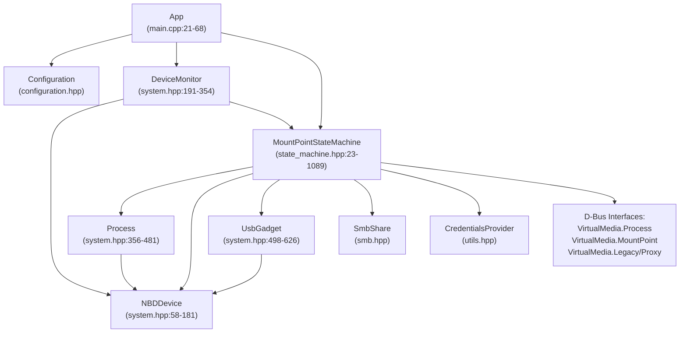
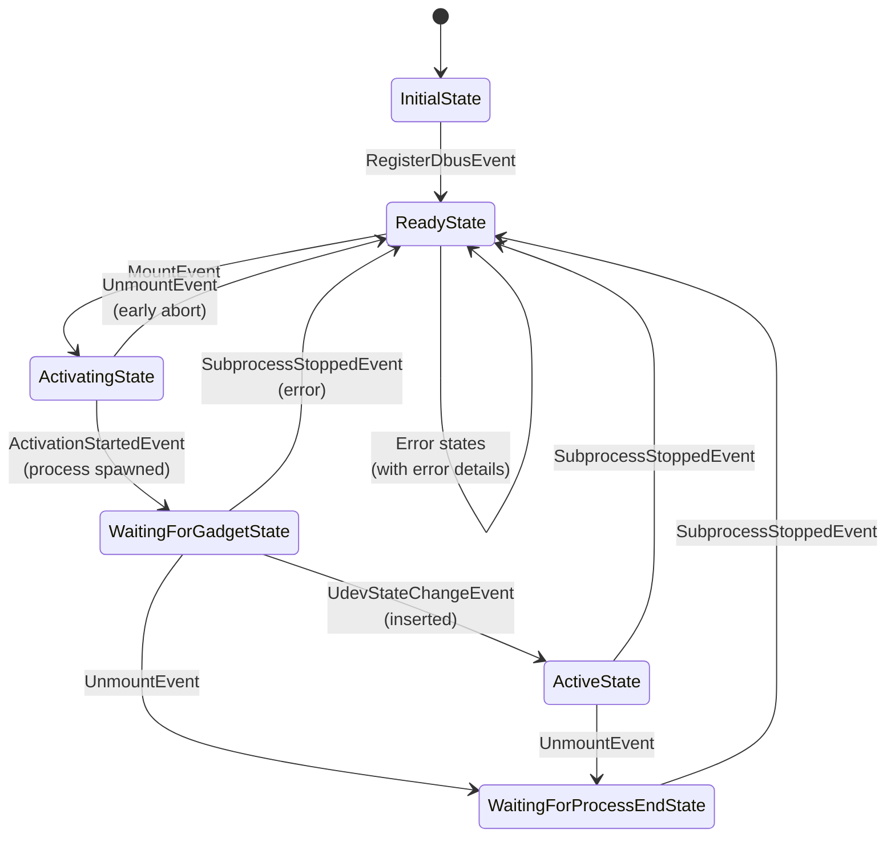
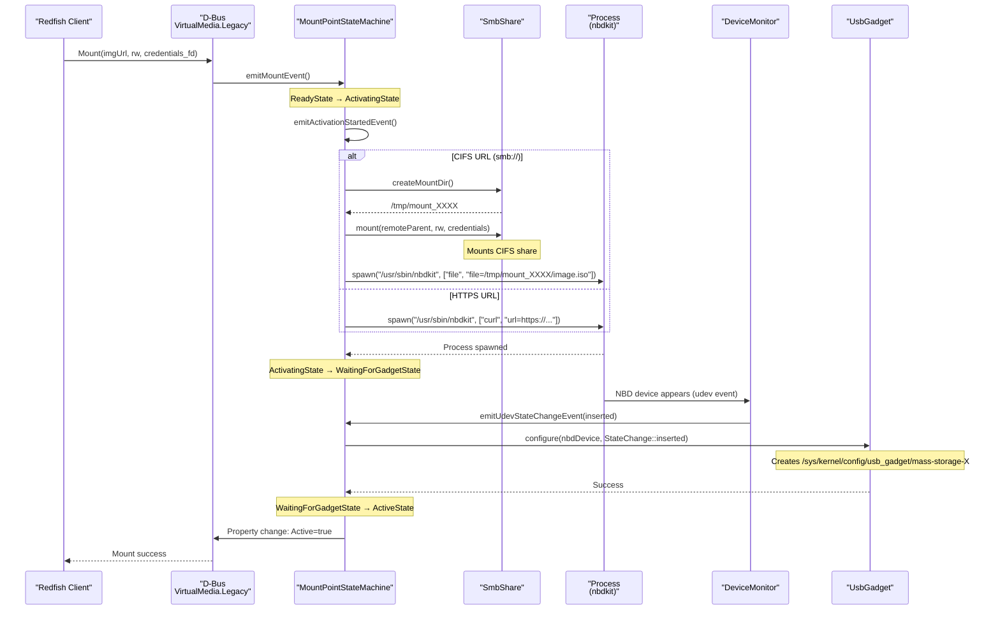
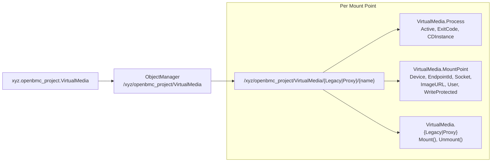

<!-- source: DeepWiki mcp.deepwiki.com · repo NVIDIA/remote-media · page 1 Overview · fetched 2026-10-26 -->

# Overview

<details>
<summary>Relevant source files</summary>

The following files were used as context for generating this wiki page:

- [README.md](README.md)
- [src/main.cpp](src/main.cpp)
- [src/state_machine.hpp](src/state_machine.hpp)
- [src/system.hpp](src/system.hpp)

</details>


This document provides an overview of the **remote-media** repository, an OpenBMC Virtual Media service that enables remote storage resources to be presented as local USB mass storage devices to a host system. For detailed information about specific components, see the corresponding pages in sections 3 (Core Components), 4 (Operational Modes), and 5 (Security).

## Purpose and Scope

The remote-media service allows a Baseboard Management Controller (BMC) to mount remote disk images (from CIFS/SMB shares or HTTPS URLs) and present them to a managed host system as USB mass storage devices. This functionality is commonly used for:

- Remote OS installation via ISO images
- System recovery and diagnostics
- Firmware updates delivered through virtual media
- Testing and validation workflows

The service integrates with the OpenBMC D-Bus infrastructure and exposes Redfish-compatible VirtualMedia interfaces.

**Sources:** [README.md:1-93](), [src/main.cpp:1-96](), [src/state_machine.hpp:1-1089]()

## What the Service Does

At a high level, the remote-media service performs the following workflow:

1. **Receives mount requests** via D-Bus interfaces (`VirtualMedia.Legacy` or `VirtualMedia.Proxy`)
2. **Establishes access** to remote storage (mounting SMB shares or connecting to HTTPS endpoints)
3. **Creates NBD devices** using either `nbdkit` (legacy mode) or `nbd-client` (proxy mode)
4. **Configures USB gadgets** in the Linux kernel to expose NBD devices as USB mass storage
5. **Monitors device lifecycle** through udev events and process management
6. **Cleans up resources** on unmount, ensuring secure credential disposal

**Sources:** [src/state_machine.hpp:520-908](), [src/system.hpp:183-354]()

## Key Technologies

The service integrates several Linux subsystems and technologies:

| Technology | Purpose | Key Files |
|------------|---------|-----------|
| **NBD (Network Block Device)** | Presents remote block devices as local `/dev/nbdX` devices | [src/system.hpp:55-181]() |
| **USB Gadget** | Configures BMC USB ports to present mass storage to host | [src/system.hpp:498-626]() |
| **nbdkit** | Serves files/URLs as NBD devices (legacy mode) | [src/state_machine.hpp:722-836]() |
| **nbd-client** | Connects to remote NBD servers (proxy mode) | [src/state_machine.hpp:619-643]() |
| **udev** | Monitors NBD device insertion/removal events | [src/system.hpp:191-354]() |
| **D-Bus** | Exposes management interfaces to clients | [src/state_machine.hpp:210-518]() |

**Sources:** [src/system.hpp:1-656](), [src/state_machine.hpp:1-1089]()

## System Architecture

The following diagram shows the primary code entities and their relationships:



### Component Descriptions

- **`App`**: Application orchestrator that creates `MountPointStateMachine` instances for each configured mount point and manages the D-Bus service lifecycle
- **`MountPointStateMachine`**: State machine managing the complete lifecycle of a virtual media device (ready → activating → active → unmounting)
- **`DeviceMonitor`**: Watches for udev events on NBD devices and notifies state machines of insertion/removal
- **`Process`**: Manages child processes (`nbdkit` or `nbd-client`) with asynchronous output capture and graceful termination
- **`NBDDevice`**: Represents `/dev/nbdX` devices with operations like `isReady()` and `disconnect()`
- **`UsbGadget`**: Configures `/sys/kernel/config/usb_gadget` to present NBD devices as USB mass storage
- **`SmbShare`**: Handles CIFS/SMB mounting with credential management
- **`CredentialsProvider`**: Securely stores and manages authentication credentials with automatic cleanup

**Sources:** [src/main.cpp:21-68](), [src/state_machine.hpp:23-1089](), [src/system.hpp:58-626]()

## State Machine Lifecycle

The `MountPointStateMachine` progresses through the following states:



### State Definitions

| State | Description | Source |
|-------|-------------|--------|
| `InitialState` | Initial state before D-Bus registration | [src/state_machine.hpp:75-81]() |
| `ReadyState` | Idle state, ready to accept mount requests | [src/state_machine.hpp:83-111]() |
| `ActivatingState` | Processing mount request, spawning processes | [src/state_machine.hpp:113-126]() |
| `WaitingForGadgetState` | Waiting for NBD device to appear in udev | [src/state_machine.hpp:128-135]() |
| `ActiveState` | Device mounted and presented to host | [src/state_machine.hpp:137-145]() |
| `WaitingForProcessEndState` | Waiting for process termination during unmount | [src/state_machine.hpp:147-160]() |

**Sources:** [src/state_machine.hpp:75-164]()

## Mount Operation Flow

The following sequence diagram shows a typical legacy mode mount operation:



**Sources:** [src/state_machine.hpp:520-908](), [src/system.hpp:191-354](), [src/system.hpp:498-626]()

## Operational Modes

The service supports two distinct operational modes configured per mount point:

### Mode Comparison

| Aspect | Legacy Mode (Mode 1) | Proxy Mode (Mode 0) |
|--------|---------------------|---------------------|
| **Trigger** | Redfish API calls with image URL | Browser-initiated via bmcweb WebSocket |
| **Process** | `nbdkit` (file or curl plugin) | `nbd-client` |
| **Image Sources** | CIFS/SMB shares, HTTPS URLs | External NBD server via bmcweb |
| **Mount Method** | `Mount(imgUrl, rw, credentials_fd)` | `Mount()` (parameterless) |
| **D-Bus Interface** | `VirtualMedia.Legacy` | `VirtualMedia.Proxy` |
| **Credentials** | Passed via Unix file descriptor | Pre-configured or browser session |

**Sources:** [src/state_machine.hpp:352-513](), [src/state_machine.hpp:612-643](), [src/state_machine.hpp:645-836]()

## Core Components Quick Reference

### Process Management

The `Process` class ([src/system.hpp:356-481]()) manages child processes:

- **`spawn(args, onExit)`**: Spawns process with asynchronous stdout/stderr capture
- **`stop()`**: Gracefully terminates process (NBD disconnect → wait → force terminate)
- **Exit callback**: Invoked when process terminates with exit code and device readiness status

### NBD Device Operations

The `NBDDevice` class ([src/system.hpp:58-181]()) encapsulates NBD device operations:

- **Enumeration**: `nbd0` through `nbd10` represented as enum values
- **`isReady()`**: Checks if device is available for use (attempts exclusive open)
- **`disconnect()`**: Issues `NBD_DISCONNECT` and `NBD_CLEAR_SOCK` ioctls
- **`to_path()`**: Returns `/dev/nbdX` path for the device

### Device Monitoring

The `DeviceMonitor` class ([src/system.hpp:191-354]()) tracks NBD device state changes:

- Uses `libudev` to monitor kernel block device events
- Filters for `"block"` subsystem and `"disk"` device type
- Tracks `StateChange` enum: `unknown`, `inserted`, `removed`
- Invokes callbacks when monitored devices change state
- Runs in Boost.Asio coroutine for async event handling

### USB Gadget Configuration

The `UsbGadget::configure()` function ([src/system.hpp:501-625]()) sets up USB mass storage:

1. Creates `/sys/kernel/config/usb_gadget/mass-storage-{name}` directory structure
2. Sets USB descriptors (vendor ID `0x1d6b`, product ID `0x0104`)
3. Configures mass storage function with LUN pointing to NBD device
4. Binds to available USB port (searches `/sys/bus/platform/devices/1e6a0000.usb-vhub`)
5. Cleanup involves removing symlinks and directories in reverse order

**Sources:** [src/system.hpp:356-626]()

## D-Bus Service Structure

The service registers under `xyz.openbmc_project.VirtualMedia` with the following interface hierarchy:



Each `MountPointStateMachine` instance registers three interfaces:

1. **`VirtualMedia.Process`** ([src/state_machine.hpp:254-289]()): Runtime status
   - `Active` (bool): Read-only, true when in `ActiveState`
   - `ExitCode` (int32): Last process exit code
   - `CDInstance` (int32): CD-ROM instance identifier

2. **`VirtualMedia.MountPoint`** ([src/state_machine.hpp:291-351]()): Configuration and state
   - `Device` (string): NBD device path (e.g., `/dev/nbd0`)
   - `EndpointId` (string): Mount point identifier
   - `Socket` (string): Unix socket path for nbdkit
   - `ImageURL` (string): Currently mounted image URL (empty when inactive)
   - `User` (string): Authentication user (constant "USER")
   - `WriteProtected` (bool): Read-only vs read-write mode

3. **`VirtualMedia.Legacy`** or **`VirtualMedia.Proxy`** ([src/state_machine.hpp:353-513]()): Mount/unmount methods
   - Legacy: `Mount(imgUrl, rw, credentials_fd)` - accepts image URL and credentials
   - Proxy: `Mount()` - parameterless, relies on pre-configured endpoint
   - Both: `Unmount()` - initiates unmount sequence

**Sources:** [src/state_machine.hpp:210-518](), [src/main.cpp:38-47]()

## Configuration Overview

The service is configured via `/etc/virtual-media.json` (see [Configuration](#2.2) for details):

```json
{
  "InactivityTimeout": 1800,
  "MountPoints": {
    "Slot_0": {
      "EndpointId": "Slot_0",
      "Mode": 1,
      "NBDDevice": 0,
      "UnixSocket": "/tmp/nbd0.sock",
      "Timeout": 30,
      "BlockSize": 512
    }
  }
}
```

The `Configuration` class parses this file and provides `MountPoint` structures to the `App` constructor, which creates corresponding `MountPointStateMachine` instances.

**Sources:** [src/main.cpp:72-74](), [src/main.cpp:43-48]()

## Security Highlights

The service implements defense-in-depth for credential handling:

- **Unix file descriptors**: Credentials passed via `unix_fd` D-Bus type, not in-band strings
- **`CredentialsProvider`**: Stores credentials in secure buffers with custom deleters
- **`secureCleanup()`**: Uses `explicit_bzero()` to zero memory before deallocation
- **`VolatileFile`**: Temporary files purged with asterisks before deletion
- **Process isolation**: Child processes spawned with restricted arguments

For detailed security architecture, see [Security](#5).

**Sources:** [src/state_machine.hpp:448-484](), [src/state_machine.hpp:817-833]()

---

This overview provides the foundation for understanding the remote-media service. For detailed information about specific aspects, refer to the subsequent sections of this documentation.

---

