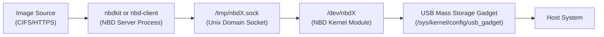
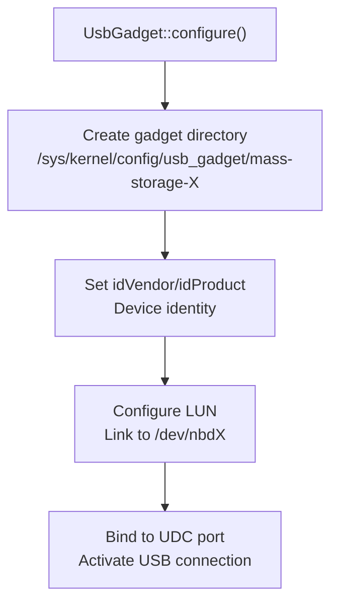
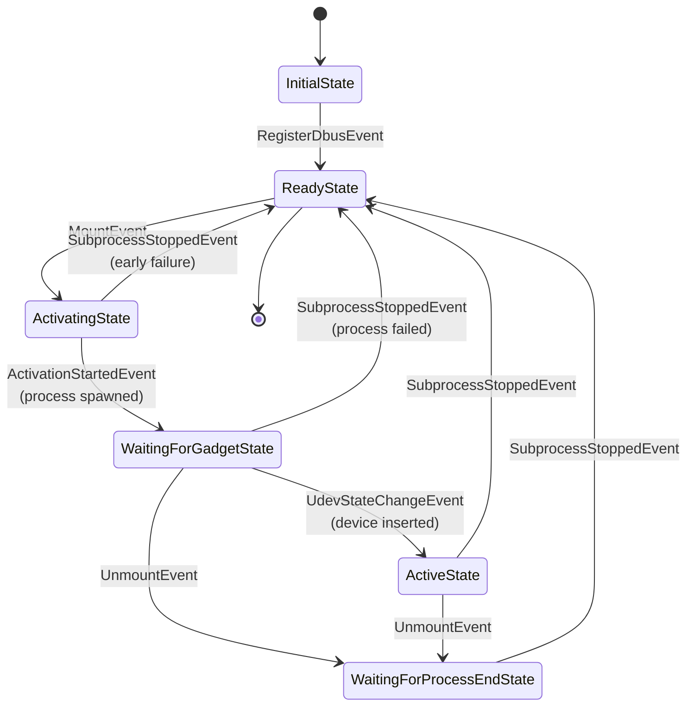
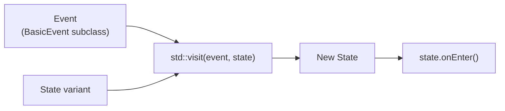
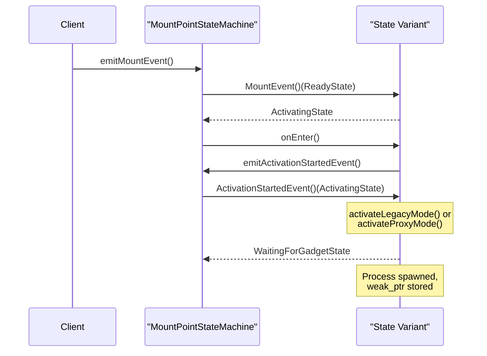
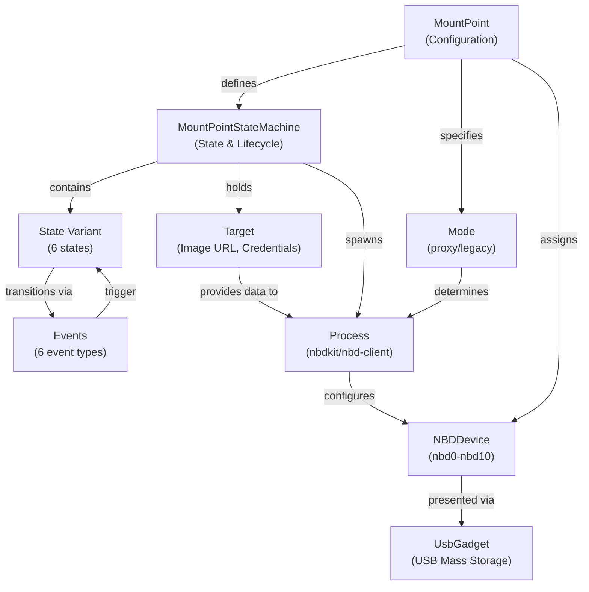

<!-- source: DeepWiki mcp.deepwiki.com · repo NVIDIA/remote-media · page 1.1 Key Concepts · fetched 2026-10-26 -->

# Key Concepts

<details>
<summary>Relevant source files</summary>

The following files were used as context for generating this wiki page:

- [src/configuration.hpp](src/configuration.hpp)
- [src/state_machine.hpp](src/state_machine.hpp)
- [virtual-media.json](virtual-media.json)

</details>


## Purpose and Scope

This page defines the fundamental concepts required to understand the remote-media virtual media service. It covers the core technologies (Virtual Media, NBD, USB Gadget), architectural patterns (mount points, state machines), and operational modes that form the foundation of the system.

For detailed architecture diagrams showing component interactions, see [Architecture Overview](#1.2). For configuration details, see [Configuration](#2.2). For state machine implementation details, see [MountPointStateMachine](#3.1).

---

## Virtual Media

**Virtual Media** is a technology that allows a remote system (BMC) to present storage devices to a host computer over a management interface. The host sees these devices as if they were physically connected USB storage devices, even though the actual storage is located elsewhere.

In the remote-media service, virtual media enables:
- Mounting remote ISO images or disk images to a host system
- Providing installation media for OS deployment
- Troubleshooting and recovery operations
- Remote system maintenance without physical access

The service acts as a bridge between remote storage sources (CIFS shares, HTTPS URLs) and the host's USB bus, making remote content appear as local USB mass storage devices.

**Sources:** [src/state_machine.hpp:1-1090](), [src/configuration.hpp:1-235]()

---

## Network Block Device (NBD)

**Network Block Device (NBD)** is a Linux kernel module that allows a block device on one machine to be accessed over the network from another machine. In this service, NBD serves as the core transport mechanism between the image source and the USB gadget presentation.

### NBD Architecture in remote-media



### NBDDevice Class

The `NBDDevice` class [src/system.hpp]() encapsulates NBD device management:

| Method | Purpose | File Reference |
|--------|---------|----------------|
| Constructor | Creates device from string like "nbd0", "nbd1", etc. | [src/system.hpp]() |
| `to_path()` | Returns full device path `/dev/nbdX` | [src/system.hpp]() |
| `to_string()` | Returns device name `nbdX` | [src/system.hpp]() |
| `isReady()` | Checks if device is available for use | [src/system.hpp]() |
| `disconnect()` | Disconnects NBD device using ioctl | [src/system.hpp]() |

### NBD Device Assignment

The configuration file defines which NBD device each mount point uses:

```json
"Slot_0": {
    "NBDDevice": "nbd0",
    "UnixSocket": "/tmp/nbd0.sock"
}
```

Each `MountPointStateMachine` instance is assigned a specific NBD device (`nbd0`-`nbd10`) via the `Configuration::MountPoint::nbdDevice` field [src/configuration.hpp:32]().

**Sources:** [src/configuration.hpp:104-127](), [virtual-media.json:1-29]()

---

## USB Gadget

**USB Gadget** is a Linux kernel framework that allows a device to act as a USB peripheral. In this service, the BMC uses USB Gadget to present itself as a USB mass storage device to the host computer.

### USB Gadget Configuration Path

The USB gadget is configured through the Linux ConfigFS filesystem at `/sys/kernel/config/usb_gadget/`. The service creates a mass storage gadget that exposes the NBD block device to the host.

### Key USB Gadget Operations



The `UsbGadget::configure()` function [src/system.hpp]() performs these operations based on the `StateChange` event (`inserted` or `removed`).

### USB Gadget Integration

When an NBD device becomes ready, the state machine calls:
```cpp
int32_t ret = UsbGadget::configure(
    state.machine.name,              // Mount point name
    state.machine.config.nbdDevice,  // NBD device to expose
    devState,                        // inserted/removed
    state.machine.target->rw         // read-write flag
);
```
[src/state_machine.hpp:919-922]()

**Sources:** [src/state_machine.hpp:915-937](), [src/system.hpp]()

---

## Mount Points

A **Mount Point** represents a configurable virtual media slot that can present storage to the host. Each mount point is an independent instance with its own configuration and state machine.

### MountPoint Configuration Structure

The `Configuration::MountPoint` struct [src/configuration.hpp:30-45]() defines:

| Field | Type | Purpose |
|-------|------|---------|
| `nbdDevice` | `NBDDevice` | Assigned NBD device (e.g., `nbd0`) |
| `unixSocket` | `std::string` | Unix socket path for NBD communication |
| `endPointId` | `std::string` | Identifier for the endpoint |
| `timeout` | `std::optional<int>` | Operation timeout in seconds |
| `blocksize` | `std::optional<int>` | Block size for I/O operations |
| `mode` | `Mode` | Operational mode (proxy or legacy) |

### Mount Point Naming

Configuration defines named mount points:

```json
{
    "MountPoints": {
        "Slot_0": { "Mode": 0, "NBDDevice": "nbd0" },
        "USB1": { "Mode": 1, "NBDDevice": "nbd2" },
        "USB2": { "Mode": 1, "NBDDevice": "nbd3" }
    }
}
```
[virtual-media.json:3-27]()

Each named mount point (e.g., `"Slot_0"`) gets its own `MountPointStateMachine` instance [src/state_machine.hpp:987-995]().

### D-Bus Object Paths

Mount points are exposed via D-Bus at paths determined by their mode:
- **Proxy mode**: `/xyz/openbmc_project/VirtualMedia/Proxy/{name}`
- **Legacy mode**: `/xyz/openbmc_project/VirtualMedia/Legacy/{name}`

[src/state_machine.hpp:1075-1088]()

**Sources:** [src/configuration.hpp:30-45](), [virtual-media.json:1-29](), [src/state_machine.hpp:987-995]()

---

## Operational Modes

The service supports two distinct operational modes, each optimized for different use cases and controlled by the `Configuration::Mode` enum [src/configuration.hpp:17-28]().

### Mode Comparison

```mermaid
graph TB
    subgraph "Mode 0: Proxy"
        ProxyInit["Browser-initiated<br/>JavaScript/HTML5"]
        ProxyTransport["Secure WebSockets<br/>to bmcweb HTTPS"]
        ProxyProcess["nbd-client<br/>connects to external NBD"]
        ProxyMount["Mount() - no parameters<br/>pre-configured"]
    end
    
    subgraph "Mode 1: Legacy"
        LegacyInit["Redfish API-initiated<br/>VirtualMedia schemas"]
        LegacyTransport["Direct image fetch<br/>CIFS/HTTPS"]
        LegacyProcess["nbdkit<br/>file or curl plugin"]
        LegacyMount["Mount(url, rw, credentials)<br/>runtime configuration"]
    end
    
    ProxyInit --> ProxyTransport
    ProxyTransport --> ProxyProcess
    ProxyProcess --> ProxyMount
    
    LegacyInit --> LegacyTransport
    LegacyTransport --> LegacyProcess
    LegacyProcess --> LegacyMount
```



### Mode Enumeration

```cpp
enum class Mode
{
    // Proxy mode - works directly from browser and uses JavaScript/HTML5
    // to communicate over Secure WebSockets directly to HTTPS endpoint
    // hosted by bmcweb on BMC
    proxy = 0,

    // Legacy mode - is initiated from browser using Redfish defined
    // VirtualMedia schemas, then BMC process connects to external
    // CIFS/HTTPS image pointed during initialization.
    legacy = 1,
};
```
[src/configuration.hpp:17-28]()

### Proxy Mode (Mode 0)

**Characteristics:**
- Browser-initiated via JavaScript/HTML5 client
- Uses `nbd-client` process to connect to external NBD server
- Communication via Secure WebSockets to bmcweb HTTPS endpoint
- Parameterless `Mount()` method—configuration is pre-set
- Activated in `activateProxyMode()` [src/state_machine.hpp:619-643]()

**Process Spawning:**
```cpp
auto process = std::make_shared<Process>(
    state.machine.ioc.get(), state.machine.name,
    "/usr/sbin/nbd-client", state.machine.config.nbdDevice);
```
[src/state_machine.hpp:621-623]()

### Legacy Mode (Mode 1)

**Characteristics:**
- Redfish API-initiated using VirtualMedia schemas
- Uses `nbdkit` process with file or curl plugins
- Supports CIFS (`smb://`) and HTTPS (`https://`) image URLs
- `Mount(imgUrl, rw, credentials)` method with runtime parameters
- Credential handling via Unix file descriptors
- Activated in `activateLegacyMode()` [src/state_machine.hpp:645-663]()

**Mount Interface:**
```cpp
iface->register_method(
    "Mount", [&machine = state.machine, this, handleMount](
                 boost::asio::yield_context yield,
                 std::string imgUrl, bool rw, optional_fd fd) {
        // Handle mount with credentials...
    });
```
[src/state_machine.hpp:439-498]()

### URL Scheme Detection

Legacy mode determines the activation path by URL scheme:

| URL Scheme | Detection Function | Activation Function | NBDKit Plugin |
|------------|-------------------|---------------------|---------------|
| `smb://` | `isCifsUrl()` [src/state_machine.hpp:879-882]() | `mountSmbShare()` [src/state_machine.hpp:665-704]() | `file` |
| `https://` | `isHttpsUrl()` [src/state_machine.hpp:868-871]() | `mountHttpsShare()` [src/state_machine.hpp:706-720]() | `curl` |

**Sources:** [src/configuration.hpp:17-28](), [src/state_machine.hpp:612-720](), [src/state_machine.hpp:434-513]()

---

## State Machine Lifecycle

The `MountPointStateMachine` [src/state_machine.hpp:23-1089]() manages the complete lifecycle of a virtual media device through a hierarchical state pattern.

### State Hierarchy



### State Definitions

| State Class | File Reference | Purpose |
|-------------|----------------|---------|
| `InitialState` | [src/state_machine.hpp:75-81]() | Initial state before D-Bus registration |
| `ReadyState` | [src/state_machine.hpp:83-111]() | Ready to accept mount requests; cleans up previous mounts |
| `ActivatingState` | [src/state_machine.hpp:113-126]() | Processing mount request; spawning processes |
| `WaitingForGadgetState` | [src/state_machine.hpp:128-135]() | Waiting for NBD device to appear and USB gadget configuration |
| `ActiveState` | [src/state_machine.hpp:137-145]() | Virtual media active and presented to host |
| `WaitingForProcessEndState` | [src/state_machine.hpp:147-160]() | Waiting for subprocess cleanup after unmount |

### State Variant Type

All states are stored in a `std::variant`:
```cpp
using State = std::variant<InitialState, ReadyState, ActivatingState,
                           WaitingForGadgetState, ActiveState,
                           WaitingForProcessEndState>;
```
[src/state_machine.hpp:162-164]()

### Event Processing

Events drive state transitions through the visitor pattern:



The `emitEvent()` method [src/state_machine.hpp:1010-1020]() orchestrates:
1. Log current state and event
2. Visit event with current state (`std::visit(event, state)`)
3. Call `onEnter()` on new state for initialization

### Event Types

| Event Class | File Reference | Trigger |
|-------------|----------------|---------|
| `RegisterDbusEvent` | [src/state_machine.hpp:210-518]() | Initial D-Bus interface registration |
| `MountEvent` | [src/state_machine.hpp:520-534]() | Mount operation requested |
| `UnmountEvent` | [src/state_machine.hpp:536-575]() | Unmount operation requested |
| `SubprocessStoppedEvent` | [src/state_machine.hpp:577-604]() | nbdkit or nbd-client process terminated |
| `ActivationStartedEvent` | [src/state_machine.hpp:606-908]() | Begin activation (spawn processes) |
| `UdevStateChangeEvent` | [src/state_machine.hpp:910-961]() | NBD device inserted or removed |

### State Transition Example: Mount Flow



### State Machine Construction

Each mount point gets its own state machine instance:
```cpp
MountPointStateMachine(boost::asio::io_context& ioc,
                       DeviceMonitor& devMonitor, 
                       const std::string& name,
                       const Configuration::MountPoint& config,
                       std::shared_ptr<sdbusplus::asio::connection>& bus) :
    ioc{ioc}, name{name}, config{config}, 
    state{InitialState(*this)}, exitCode{-1}, bus(bus)
{
    devMonitor.addDevice(config.nbdDevice);
}
```
[src/state_machine.hpp:987-995]()

**Sources:** [src/state_machine.hpp:23-1089](), [src/state_machine.hpp:162-164](), [src/state_machine.hpp:1010-1020]()

---

## Key Relationships

The following diagram illustrates how these concepts integrate:



Each `MountPoint` configuration instantiates a `MountPointStateMachine` that manages a `State` variant through `Events`. The `Mode` determines which `Process` type to spawn (nbdkit or nbd-client), which configures an `NBDDevice` that is ultimately presented to the host via `UsbGadget`.

**Sources:** [src/state_machine.hpp:1-1090](), [src/configuration.hpp:30-45](), [virtual-media.json:1-29]()

---

