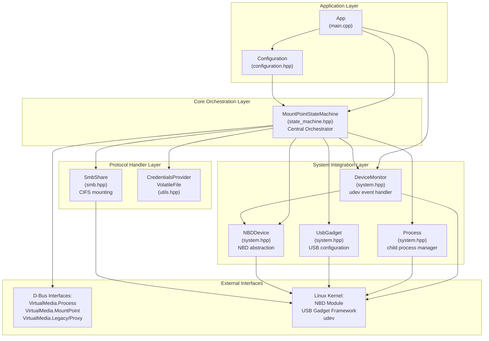
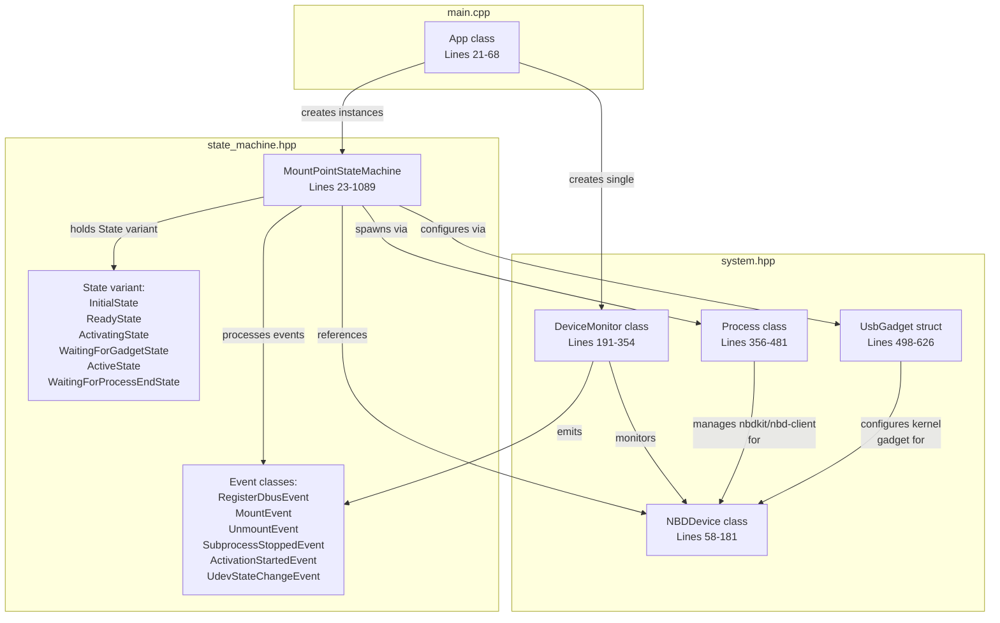
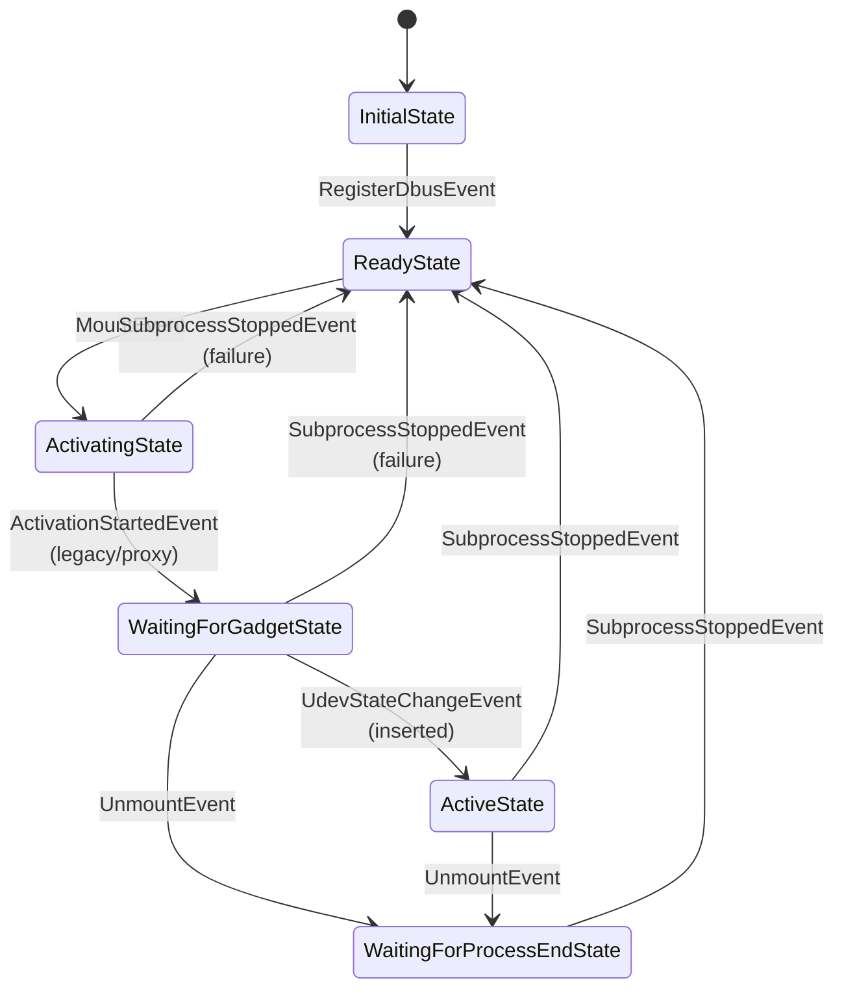
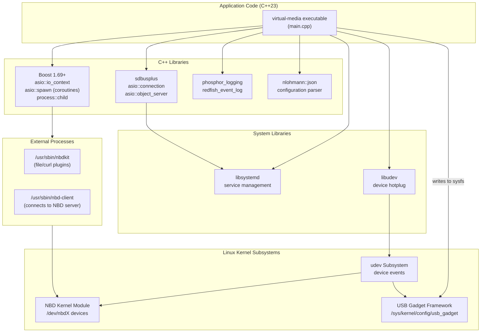
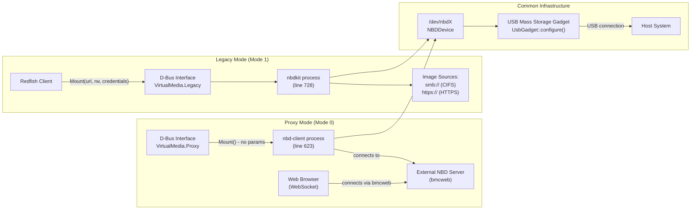
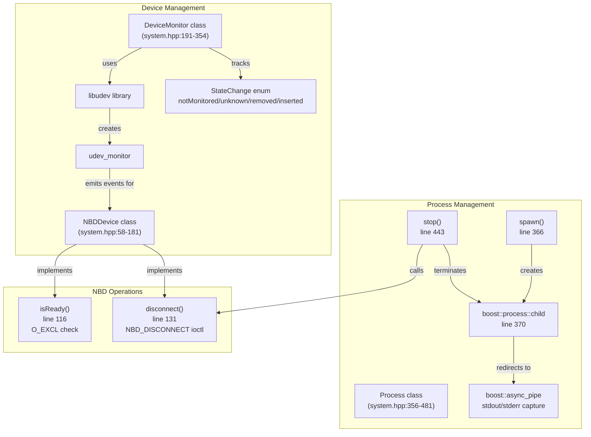
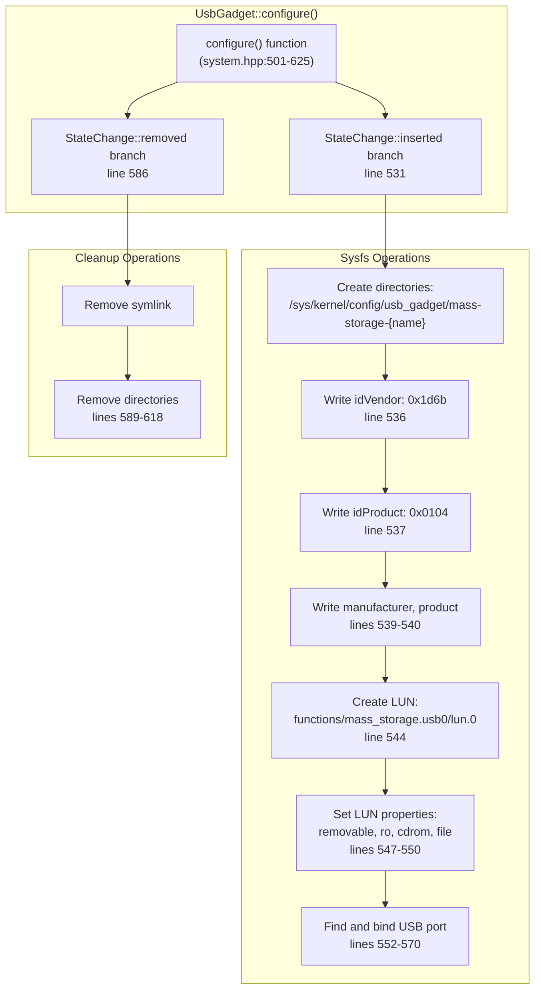
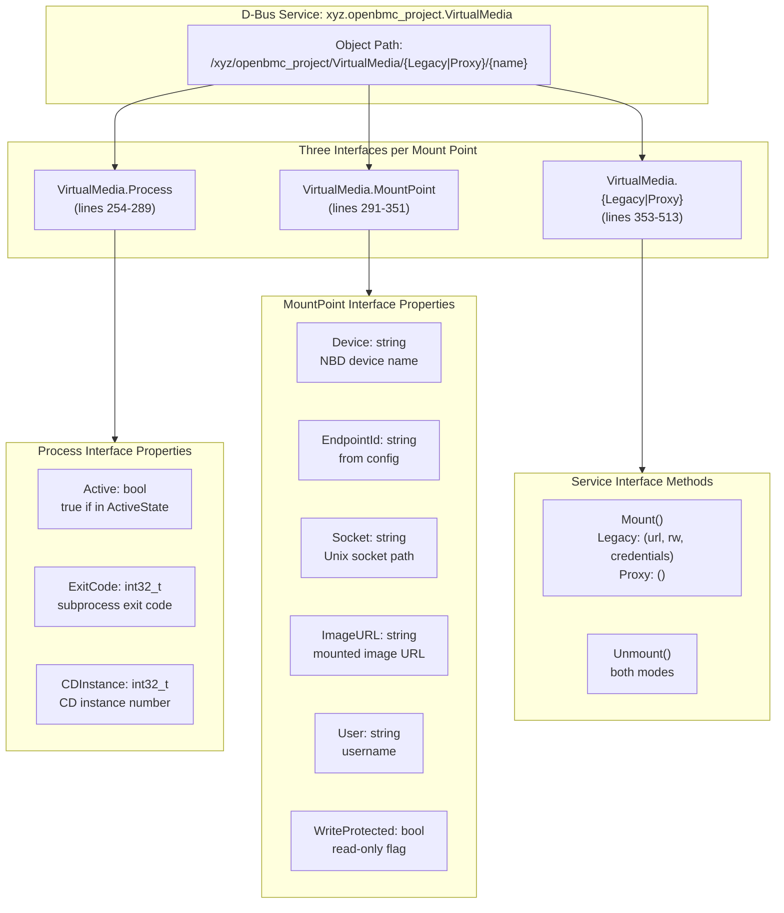

<!-- source: DeepWiki mcp.deepwiki.com · repo NVIDIA/remote-media · page 1.2 Architecture Overview · fetched 2026-10-26 -->

# Architecture Overview

Relevant source files

The following files were used as context for generating this wiki page:

- [CMakeLists.txt](CMakeLists.txt)
- [src/main.cpp](src/main.cpp)
- [src/state_machine.hpp](src/state_machine.hpp)
- [src/system.hpp](src/system.hpp)

## Purpose and Scope

This page presents the high-level architecture of the remote-media service, showing how the major subsystems interact to provide virtual media functionality. The focus is on structural relationships between components and their roles in the system, rather than detailed implementation specifics.

For information about building and configuring the service, see [Building and Installation](#2.1) and [Configuration](#2.2). For detailed component behavior and state transitions, see [Core Components](#3).

---

## System Component Hierarchy

The remote-media service is organized into distinct architectural layers, each with specific responsibilities:

**Figure 1: Component Hierarchy**

The architecture follows a strict layering principle where:
- The **Application Layer** initializes the system and manages multiple mount point instances
- The **Core Orchestration Layer** contains the state machine that coordinates all operations
- The **System Integration Layer** provides abstractions over Linux kernel subsystems
- The **Protocol Handler Layer** implements specific image source protocols
- The **External Interfaces** expose D-Bus APIs and interact with kernel subsystems

Sources: [src/main.cpp:21-68](), [src/state_machine.hpp:23-1089](), [src/system.hpp:58-626]()

---

## Core Component Relationships

The following diagram shows the actual C++ classes and their relationships in code entity space:

**Figure 2: Class Relationships**

Key class interactions:
- **`App`** creates one `MountPointStateMachine` instance per mount point defined in configuration
- **`MountPointStateMachine`** is the central orchestrator, holding a `State` variant and processing `Event` objects
- **`DeviceMonitor`** watches `NBDDevice` instances via udev and generates `UdevStateChangeEvent` objects
- **`Process`** spawns and manages nbdkit or nbd-client child processes
- **`UsbGadget`** writes to `/sys/kernel/config/usb_gadget` to configure USB mass storage

Sources: [src/main.cpp:21-68](), [src/state_machine.hpp:23-1089](), [src/system.hpp:58-626]()

---

## State Machine Architecture

The `MountPointStateMachine` class implements the core lifecycle management:

**Figure 3: MountPointStateMachine State Transitions**

Each state is a C++ class derived from `BasicState`:
- **`InitialState`** (lines 75-81): Startup state before D-Bus registration
- **`ReadyState`** (lines 83-111): Idle state, ready to accept mount requests
- **`ActivatingState`** (lines 113-126): Processing mount request, spawning subprocess
- **`WaitingForGadgetState`** (lines 128-135): Waiting for NBD device insertion event
- **`ActiveState`** (lines 137-145): Device mounted and USB gadget configured
- **`WaitingForProcessEndState`** (lines 147-160): Waiting for subprocess cleanup after unmount

Sources: [src/state_machine.hpp:75-164]()

---

## Technology Stack Layers

The service depends on multiple technology layers:

**Figure 4: Technology Stack**

| Layer | Components | Purpose |
|-------|------------|---------|
| **Application** | `virtual-media` (C++23) | Main service logic |
| **C++ Libraries** | Boost, sdbusplus, phosphor_logging, nlohmann::json | Async I/O, D-Bus bindings, logging, JSON parsing |
| **System Libraries** | libsystemd, libudev | Service integration, device monitoring |
| **Kernel Subsystems** | NBD module, USB Gadget, udev | Block device serving, USB device emulation, hotplug |
| **External Processes** | nbdkit, nbd-client | Image serving and NBD client connection |

Compiler and build options defined in [CMakeLists.txt:8-14]():
- C++23 standard required
- `-fno-rtti`: No runtime type information
- `-Wall`: All warnings enabled
- `-Os -flto`: Optimized for size with link-time optimization (release builds)

Sources: [CMakeLists.txt:1-87](), [src/main.cpp:1-19]()

---

## Dual Operational Modes

The service supports two distinct operational modes, configured per mount point:

**Figure 5: Operational Modes**

**Proxy Mode** (`Configuration::Mode::proxy`):
- Mount point defined in [src/state_machine.hpp:619-642]()
- Uses `/usr/sbin/nbd-client` to connect to external NBD server
- Activated via `ActivationStartedEvent::activateProxyMode()` at line 619
- No credentials or URL needed (pre-configured via `EndpointId` and `UnixSocket`)

**Legacy Mode** (`Configuration::Mode::legacy`):
- Mount point defined in [src/state_machine.hpp:645-720]()
- Uses `/usr/sbin/nbdkit` with `file` or `curl` plugin
- Activated via `ActivationStartedEvent::activateLegacyMode()` at line 645
- Supports CIFS (`smb://`) and HTTPS (`https://`) URLs
- Credential handling via Unix file descriptors (lines 448-484)

Sources: [src/state_machine.hpp:612-720]()

---

## Process and Device Management

The service manages child processes and monitors NBD devices:

**Figure 6: Process and Device Management**

**Process Management** (`Process` class):
- Spawns nbdkit or nbd-client as child processes
- Captures stdout/stderr via boost::asio::async_pipe
- Implements graceful termination with timeout (20 iterations × 100ms)
- Calls `NBDDevice::disconnect()` before terminating processes

**Device Monitoring** (`DeviceMonitor` class):
- Initializes udev monitor with `"block"` subsystem and `"disk"` devtype filter (lines 211-212)
- Runs async event loop via `boost::asio::spawn` (line 237)
- Detects NBD device insertion/removal by checking `size` sysattr (lines 284-323)
- Notifies callbacks with `NBDDevice` and `StateChange` parameters

**NBD Device Operations** (`NBDDevice` class):
- Enumerates nbd0 through nbd10 (lines 63-75)
- `isReady()`: Opens device with `O_EXCL` flag to check availability (lines 116-129)
- `disconnect()`: Issues `NBD_DISCONNECT` and `NBD_CLEAR_SOCK` ioctls (lines 131-154)

Sources: [src/system.hpp:58-481]()

---

## USB Gadget Configuration

The service configures USB mass storage gadgets via sysfs:

**Figure 7: USB Gadget Configuration Flow**

The `UsbGadget::configure()` function manipulates the Linux USB Gadget configfs:

**Insertion Path** (when NBD device becomes available):
1. Creates gadget directory: `/sys/kernel/config/usb_gadget/mass-storage-{name}`
2. Configures USB descriptors (vendor 0x1d6b, product 0x0104)
3. Sets strings (manufacturer: "OpenBMC", product: "Virtual Media Device")
4. Creates mass storage function with LUN 0
5. Sets LUN properties: `removable=1`, `ro` based on read-write flag, `cdrom=0`
6. Writes NBD device path to `lun.0/file`
7. Searches `/sys/bus/platform/devices/1e6a0000.usb-vhub` for available USB port
8. Binds gadget to port by writing port ID to `UDC` file

**Removal Path** (when unmounting):
1. Executes system commands to remove symlinks and directories
2. Follows strict order: mass_storage.usb0 link, function dir, config strings, config dir, strings dir, gadget dir

Sources: [src/system.hpp:498-626]()

---

## D-Bus Interface Structure

Each `MountPointStateMachine` instance exposes three D-Bus interfaces:

**Figure 8: D-Bus Interface Structure**

Interface registration occurs in `RegisterDbusEvent::operator()(const InitialState&)`:
- **`VirtualMedia.Process`** (lines 254-289): Runtime status properties
  - `Active`: Returns `true` if current state is `ActiveState`
  - `ExitCode`: Returns last subprocess exit code
  - `CDInstance`: Configurable CD instance number

- **`VirtualMedia.MountPoint`** (lines 291-351): Configuration and state properties
  - `Device`, `EndpointId`, `Socket`: Static configuration values
  - `ImageURL`, `User`: Dynamic values populated when in `ActiveState`
  - `WriteProtected`: Reflects read-only flag of mounted image

- **`VirtualMedia.Legacy`** or **`VirtualMedia.Proxy`** (lines 353-513): Service methods
  - Legacy mode: `Mount(string imgUrl, bool rw, variant<int, unix_fd> fd)`
    - Reads credentials from Unix file descriptor if provided (lines 448-484)
  - Proxy mode: `Mount()` with no parameters
    - Uses pre-configured `EndpointId` and `UnixSocket`
  - Both: `Unmount()` method (lines 363-392)

Sources: [src/state_machine.hpp:210-518]()

---

## Summary

The remote-media architecture is characterized by:

1. **Centralized State Management**: `MountPointStateMachine` coordinates all mount operations through a well-defined state machine pattern

2. **Clean Abstraction Layers**: System integration components (`DeviceMonitor`, `Process`, `NBDDevice`, `UsbGadget`) provide clean interfaces to Linux kernel subsystems

3. **Dual-Mode Operation**: Support for both legacy Redfish workflows (CIFS/HTTPS) and modern proxy mode (WebSocket NBD)

4. **Asynchronous Design**: Extensive use of Boost.Asio coroutines for non-blocking I/O and event handling

5. **D-Bus Integration**: Full OpenBMC integration via sdbusplus with comprehensive property and method exposure

For detailed information about state transitions and event processing, see [MountPointStateMachine](#3.1). For protocol-specific details, see [Protocol Handlers](#3.3) and [Operational Modes](#4).

Sources: [src/state_machine.hpp:1-1089](), [src/system.hpp:1-656](), [src/main.cpp:1-96]()

---

