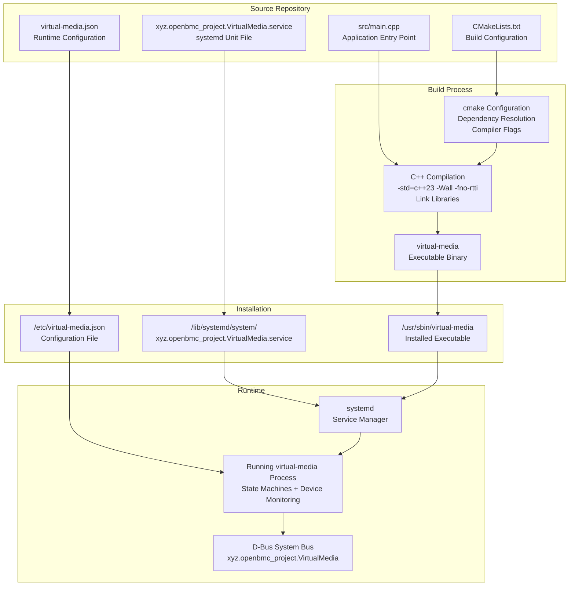
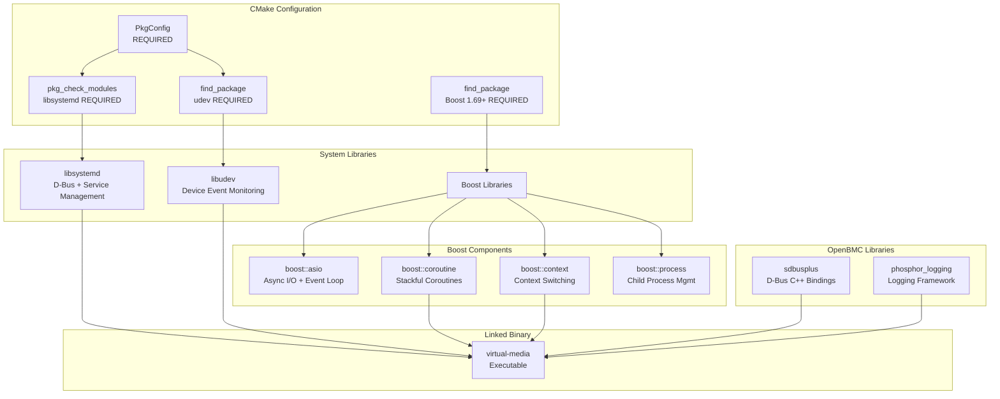
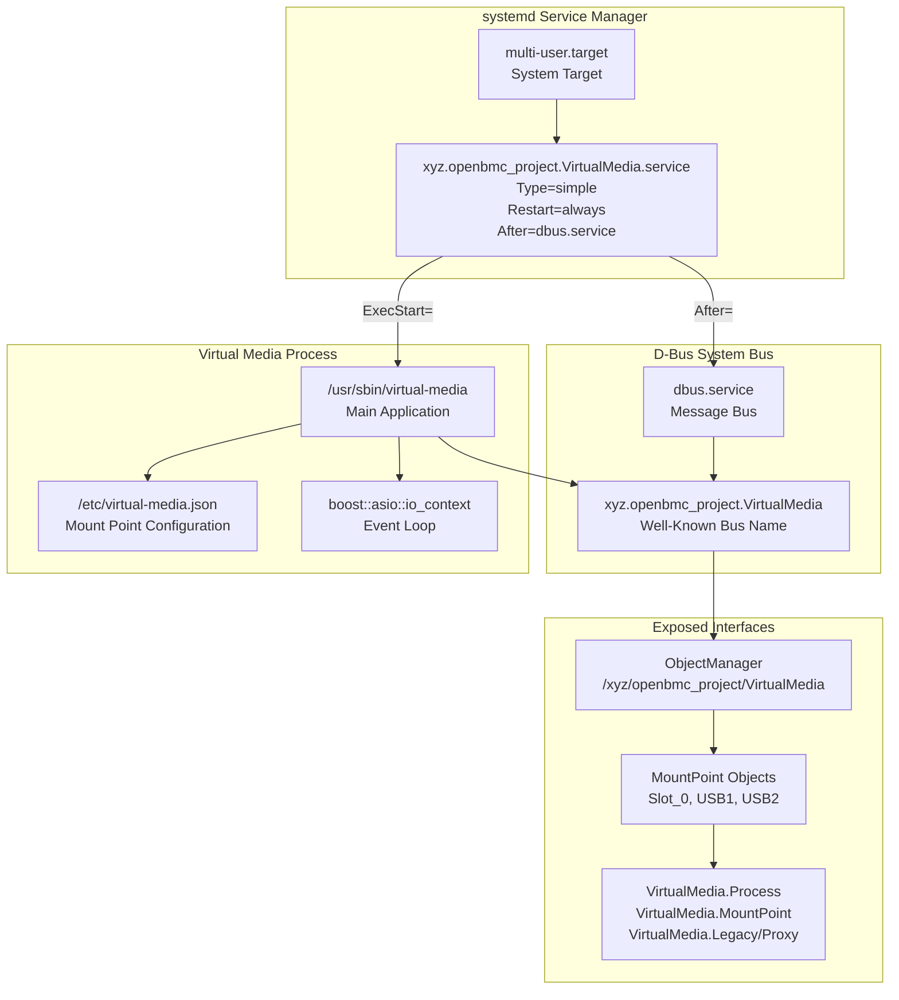
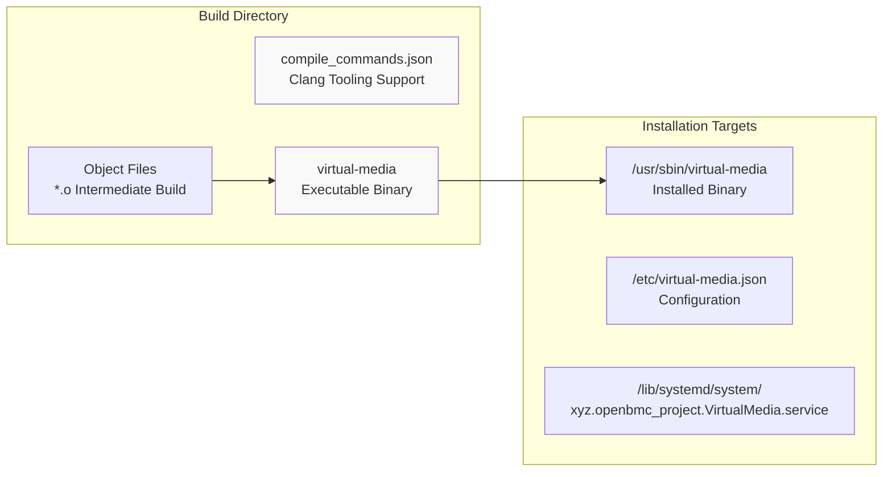

<!-- source: DeepWiki mcp.deepwiki.com · repo NVIDIA/remote-media · page 2 Getting Started · fetched 2026-10-26 -->

# Getting Started

<details>
<summary>Relevant source files</summary>

The following files were used as context for generating this wiki page:

- [CMakeLists.txt](CMakeLists.txt)
- [README.md](README.md)
- [xyz.openbmc_project.VirtualMedia.service](xyz.openbmc_project.VirtualMedia.service)

</details>


This page provides practical guidance for building, configuring, and deploying the virtual-media service on an OpenBMC system. It covers the complete workflow from satisfying build dependencies through initial service startup and verification.

For architectural background and system concepts, see [Overview](#1). For detailed API documentation and D-Bus interface specifications, see [API Reference](#6). For development practices and debugging tools, see [Development](#7).

The following subsections provide detailed instructions:
- [Building and Installation](#2.1) - CMake build process and dependency resolution
- [Configuration](#2.2) - JSON configuration file structure and mount point definitions
- [Running the Service](#2.3) - systemd service management and operational verification

## Prerequisites and System Requirements

The virtual-media service requires a Linux system with specific kernel features and user-space libraries. The following table summarizes the core requirements:

| Component | Requirement | Purpose |
|-----------|------------|---------|
| Compiler | C++23 compliant (GCC 11+ or Clang 13+) | Modern C++ features and coroutines |
| CMake | Version 3.5 or higher | Build system orchestration |
| Linux Kernel | NBD module and USB Gadget support | Block device and USB presentation |
| systemd | libsystemd development files | Service management and D-Bus integration |
| Boost | Version 1.69+ | Asynchronous I/O and coroutines |
| sdbusplus | OpenBMC library | D-Bus C++ bindings |
| udev | libudev development files | Device event monitoring |
| phosphor_logging | OpenBMC library | Logging infrastructure |

**Sources:** [CMakeLists.txt:1-66]()

## Build and Deployment Workflow

The following diagram illustrates the complete workflow from source code to a running service, mapping each step to specific files and build artifacts:



**Sources:** [CMakeLists.txt:1-87](), [xyz.openbmc_project.VirtualMedia.service:1-12]()

## Quick Start Summary

This section provides a condensed overview of the build and deployment process. Detailed instructions for each step are provided in the subsections.

### 1. Install Dependencies

Ensure all required development libraries are installed on your build system. The exact package names vary by distribution:

```bash
# Example for Debian/Ubuntu-based systems
apt-get install libsystemd-dev libudev-dev libboost-dev \
                libsdbusplus-dev phosphor-logging-dev cmake g++

# Example for Yocto/OpenBMC builds
# Dependencies are typically satisfied by the layer configuration
```

**Sources:** [CMakeLists.txt:22-42]()

### 2. Configure Build

Create a build directory and run CMake with appropriate options:

```bash
mkdir build && cd build
cmake .. \
  -DCMAKE_BUILD_TYPE=Release \
  -DVM_VERBOSE_NBDKIT_LOGS=OFF \
  -DVM_USE_VALGRIND=OFF
```

Available build options:
- `VM_VERBOSE_NBDKIT_LOGS`: Enable detailed nbdkit logging (default: OFF)
- `VM_USE_VALGRIND`: Build with valgrind instrumentation (default: OFF)
- `YOCTO_DEPENDENCIES`: Use Yocto dependency system (default: OFF)

**Sources:** [CMakeLists.txt:16-20](), [CMakeLists.txt:68-76]()

### 3. Build and Install

Compile the source and install binaries and configuration files:

```bash
make -j$(nproc)
sudo make install
```

This installs:
- Binary: `/usr/sbin/virtual-media` [CMakeLists.txt:66]()
- Configuration: `/etc/virtual-media.json` [CMakeLists.txt:78-81]()
- systemd Unit: `/lib/systemd/system/xyz.openbmc_project.VirtualMedia.service` [CMakeLists.txt:85-86]()

**Sources:** [CMakeLists.txt:66](), [CMakeLists.txt:78-86]()

### 4. Configure Mount Points

Edit `/etc/virtual-media.json` to define your mount points. The configuration specifies operational modes, NBD device assignments, and timeout parameters. See [Configuration](#2.2) for detailed schema documentation.

### 5. Enable and Start Service

Use systemd to manage the service lifecycle:

```bash
# Reload systemd to recognize the new service
sudo systemctl daemon-reload

# Enable service to start on boot
sudo systemctl enable xyz.openbmc_project.VirtualMedia.service

# Start the service immediately
sudo systemctl start xyz.openbmc_project.VirtualMedia.service

# Verify service is running
sudo systemctl status xyz.openbmc_project.VirtualMedia.service
```

**Sources:** [xyz.openbmc_project.VirtualMedia.service:1-12]()

### 6. Verify Operation

Confirm the service is operational and D-Bus interfaces are registered:

```bash
# Check service status and logs
journalctl -u xyz.openbmc_project.VirtualMedia.service -f

# Verify D-Bus object registration
busctl tree xyz.openbmc_project.VirtualMedia

# List available mount points
busctl introspect xyz.openbmc_project.VirtualMedia \
  /xyz/openbmc_project/VirtualMedia/Slot_0
```

See [Running the Service](#2.3) for detailed operational procedures and troubleshooting.

**Sources:** [xyz.openbmc_project.VirtualMedia.service:1-12]()

## Dependency Resolution Detail

The following diagram maps CMake dependency declarations to their purposes and required components:



**Sources:** [CMakeLists.txt:22-42](), [CMakeLists.txt:59-66]()

## Compiler Flags and Definitions

The build system applies specific compiler flags and preprocessor definitions that affect binary behavior:

| Flag/Definition | Purpose | Configuration |
|----------------|---------|---------------|
| `-std=c++23` | Enable C++23 standard features | [CMakeLists.txt:8-9]() |
| `-Wall` | Enable all compiler warnings | [CMakeLists.txt:12]() |
| `-fno-rtti` | Disable runtime type information | [CMakeLists.txt:12]() |
| `-Os -flto` | Optimize for size with LTO (Release) | [CMakeLists.txt:13]() |
| `BOOST_ASIO_DISABLE_THREADS` | Single-threaded Boost.Asio | [CMakeLists.txt:51]() |
| `BOOST_NO_RTTI` | Disable RTTI in Boost | [CMakeLists.txt:49]() |
| `BOOST_COROUTINES_NO_DEPRECATION_WARNING` | Suppress coroutine warnings | [CMakeLists.txt:45]() |
| `VM_VERBOSE_NBDKIT_LOGS` | Enable detailed nbdkit output | [CMakeLists.txt:73-74]() |
| `BOOST_USE_VALGRIND` | Valgrind instrumentation | [CMakeLists.txt:71-72]() |

**Sources:** [CMakeLists.txt:8-14](), [CMakeLists.txt:44-51](), [CMakeLists.txt:68-76]()

## Service Integration Architecture

The following diagram shows how the installed service integrates with systemd and the D-Bus system:



**Sources:** [xyz.openbmc_project.VirtualMedia.service:1-12](), [CMakeLists.txt:66](), [CMakeLists.txt:78-86]()

## Configuration File Location

The `virtual-media.json` configuration file location is determined during the CMake installation phase. By default, it installs to the system configuration directory:

```cmake
if(CMAKE_INSTALL_SYSCONFDIR)
  install(FILES ${PROJECT_SOURCE_DIR}/virtual-media.json DESTINATION
                ${CMAKE_INSTALL_SYSCONFDIR})
endif()
```

Typical installation paths:
- `/etc/virtual-media.json` (standard Linux systems)
- `/usr/local/etc/virtual-media.json` (custom prefix installations)
- Configured via `CMAKE_INSTALL_SYSCONFDIR` during CMake configuration

**Sources:** [CMakeLists.txt:78-81]()

## Build System Artifacts

The build process generates the following key artifacts:



The `compile_commands.json` file is generated by setting `CMAKE_EXPORT_COMPILE_COMMANDS ON` [CMakeLists.txt:7]() and enables integration with language servers and static analysis tools.

**Sources:** [CMakeLists.txt:7](), [CMakeLists.txt:57](), [CMakeLists.txt:66](), [CMakeLists.txt:78-86]()

## Next Steps

After completing the basic setup described on this page:

1. **Review Configuration** - Examine [Configuration](#2.2) to understand mount point definitions, operational modes, and timeout parameters
2. **Start the Service** - Follow [Running the Service](#2.3) for systemd management, log monitoring, and operational verification
3. **Understand Architecture** - Read [Core Components](#3) to learn about the MountPointStateMachine, DeviceMonitor, and system integration layer
4. **Explore Operational Modes** - Study [Operational Modes](#4) to understand the differences between Legacy Mode and Proxy Mode
5. **Review Security** - See [Security](#5) for credential management and secure file handling practices

**Sources:** [CMakeLists.txt:1-87](), [xyz.openbmc_project.VirtualMedia.service:1-12]()

---

