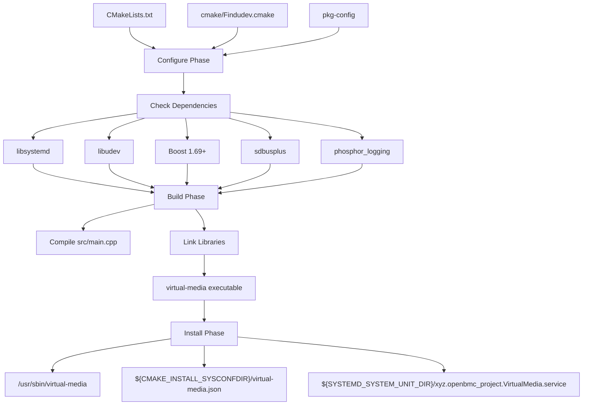
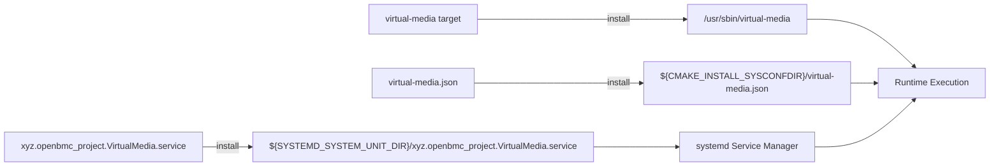
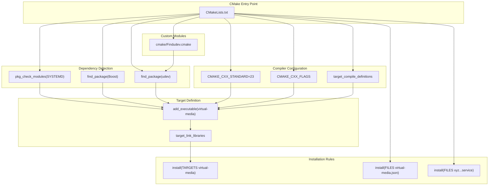

<!-- source: DeepWiki mcp.deepwiki.com · repo NVIDIA/remote-media · page 2.1 Building and Installation · fetched 2026-10-26 -->

# Building and Installation

<details>
<summary>Relevant source files</summary>

The following files were used as context for generating this wiki page:

- [CMakeLists.txt](CMakeLists.txt)
- [cmake/Findudev.cmake](cmake/Findudev.cmake)
- [xyz.openbmc_project.VirtualMedia.service](xyz.openbmc_project.VirtualMedia.service)

</details>


This document covers the build process, dependency requirements, compiler configuration, and installation procedures for the virtual-media service. For runtime configuration of the service, see [Configuration](#2.2). For information on starting and managing the service after installation, see [Running the Service](#2.3). For detailed CMake internals and advanced build system topics, see [Build System Details](#7.1).

---

## Prerequisites

The virtual-media service is designed for OpenBMC environments and requires specific system libraries and a modern C++ toolchain.

### System Requirements

- **Operating System**: Linux-based system with kernel support for:
  - NBD (Network Block Device) kernel module
  - USB Gadget framework via configfs
  - udev device manager
- **CMake**: Version 3.5 or higher
- **Compiler**: C++23-compliant compiler (GCC 11+ or Clang 14+)

### Required Build Dependencies

The following table lists all required dependencies that must be present at build time:

| Dependency | Minimum Version | Purpose | CMake Detection |
|------------|----------------|---------|-----------------|
| **systemd** | N/A | Service management and libsystemd | `pkg_check_modules(SYSTEMD libsystemd REQUIRED)` |
| **libudev** | N/A | Device hotplug event monitoring | Custom `find_package(udev REQUIRED)` |
| **Boost** | 1.69 | Asynchronous I/O, coroutines, process management | `find_package(Boost)` |
| **sdbusplus** | N/A | D-Bus C++ bindings for OpenBMC | Linked as `-lsdbusplus` |
| **phosphor_logging** | N/A | OpenBMC logging framework | Linked as `-lphosphor_logging` |

The build system uses `pkg-config` to locate most dependencies. Boost is located using CMake's `find_package` mechanism, and udev uses a custom CMake module.

**Sources:** [CMakeLists.txt:22-42]()

### Required Runtime Dependencies

The following external executables must be available in the system PATH at runtime:

| Executable | Purpose | Mode |
|-----------|---------|------|
| `nbdkit` | NBD server for serving image files (CIFS/HTTPS) | Legacy Mode (Mode 1) |
| `nbd-client` | NBD client for connecting to external NBD servers | Proxy Mode (Mode 0) |
| `mount.cifs` | CIFS/SMB filesystem mounting | Legacy Mode with CIFS URLs |

These are not checked at build time but must be installed for the service to function properly.

**Sources:** Referenced from architecture documentation and state machine implementation

---

## Compiler Requirements

The virtual-media service requires **C++23** language features and is built with specific compiler flags to optimize for embedded systems.

### Language Standard

```cmake
set(CMAKE_CXX_STANDARD 23)
set(CMAKE_CXX_STANDARD_REQUIRED ON)
```

The C++23 requirement enables use of:
- Concepts and ranges
- Coroutine improvements
- Standard library enhancements

**Sources:** [CMakeLists.txt:8-9]()

### Compiler Flags

The build system applies the following flags to all compilation units:

#### Common Flags
- **`-Wall`**: Enable all common compiler warnings
- **`-fno-rtti`**: Disable C++ runtime type information (reduces binary size)

#### Release Build Flags
- **`-Os`**: Optimize for size
- **`-flto`**: Enable link-time optimization

#### Debug Build Flags
- **`-O0`**: Disable optimizations for easier debugging

These flags are set in [CMakeLists.txt:12-14]().

### Boost Configuration

The build system disables several Boost features to reduce binary size and improve compatibility with the embedded environment:

```cmake
add_definitions(-DBOOST_NO_RTTI)
add_definitions(-DBOOST_NO_TYPEID)
add_definitions(-DBOOST_ASIO_DISABLE_THREADS)
add_definitions(-DBOOST_COROUTINES_NO_DEPRECATION_WARNING)
```

These definitions are critical for the service's single-threaded asynchronous architecture and RTTI-free design.

**Sources:** [CMakeLists.txt:44-51]()

---

## Build Options

The build system provides several CMake options to customize the build for different environments and debugging scenarios.

### Available Options

| Option | Type | Default | Description |
|--------|------|---------|-------------|
| `YOCTO_DEPENDENCIES` | BOOL | OFF | Use Yocto/OpenEmbedded dependency resolution |
| `VM_USE_VALGRIND` | BOOL | OFF | Enable Valgrind compatibility (adds `-DBOOST_USE_VALGRIND`) |
| `VM_VERBOSE_NBDKIT_LOGS` | BOOL | OFF | Include detailed nbdkit process output in logs |
| `CUSTOM_DBUS_PATH` | STRING | (unset) | Override default D-Bus object path |
| `BOOST_VERSION` | STRING | (unset) | Force specific Boost version |

### Option Details

#### `VM_USE_VALGRIND`
When enabled, adds the `BOOST_USE_VALGRIND` preprocessor definition to work around Boost.Coroutine issues when running under Valgrind. This is useful for memory leak detection during development.

```cmake
target_compile_definitions(virtual-media
                           PRIVATE
                           $<$<BOOL:${VM_USE_VALGRIND}>:
                           -DBOOST_USE_VALGRIND>)
```

#### `VM_VERBOSE_NBDKIT_LOGS`
Enables verbose logging from nbdkit subprocess output. Without this option, nbdkit logs are filtered to reduce noise. This is useful for debugging image serving issues.

#### `BOOST_VERSION`
Allows pinning to an exact Boost version. This is particularly important when using Valgrind, as you may need a Boost build compiled with Valgrind support:

```cmake
if(${BOOST_VERSION})
  find_package(Boost ${BOOST_VERSION} EXACT)
else()
  find_package(Boost 1.69 REQUIRED)
endif()
```

**Sources:** [CMakeLists.txt:16-20, 34-39, 69-76]()

---

## Building from Source

### Build Process Overview

The following diagram illustrates the CMake build and installation flow:



**Diagram: CMake Build Flow**

**Sources:** [CMakeLists.txt:1-87]()

### Step-by-Step Build Instructions

#### 1. Clone the Repository

```bash
git clone https://github.com/NVIDIA/remote-media.git
cd remote-media
```

#### 2. Create Build Directory

```bash
mkdir build
cd build
```

#### 3. Configure with CMake

Basic configuration:
```bash
cmake ..
```

Configuration with options:
```bash
cmake .. \
  -DCMAKE_BUILD_TYPE=Release \
  -DVM_VERBOSE_NBDKIT_LOGS=ON \
  -DCMAKE_INSTALL_PREFIX=/usr
```

Configuration for Valgrind debugging:
```bash
cmake .. \
  -DCMAKE_BUILD_TYPE=Debug \
  -DVM_USE_VALGRIND=ON \
  -DBOOST_VERSION=1.74.0
```

#### 4. Build

```bash
make -j$(nproc)
```

This compiles the `virtual-media` executable and links it against all required libraries.

#### 5. Install

```bash
sudo make install
```

This installs:
- Binary to `/usr/sbin/virtual-media` (or `${CMAKE_INSTALL_PREFIX}/sbin`)
- Configuration to system config directory
- Systemd service unit file

**Sources:** [CMakeLists.txt:54-86]()

---

## Installation Paths

The build system installs files to standard locations that can be customized via CMake variables.

### Installation Targets

The following diagram shows the relationship between CMake targets and installation paths:



**Diagram: Installation Targets and Paths**

**Sources:** [CMakeLists.txt:66, 78-86]()

### Path Details

| File | CMake Variable | Default Path | Description |
|------|---------------|--------------|-------------|
| `virtual-media` | `CMAKE_INSTALL_PREFIX` | `/usr/sbin` | Main executable |
| `virtual-media.json` | `CMAKE_INSTALL_SYSCONFDIR` | `/etc` | Configuration file (see [Configuration](#2.2)) |
| `xyz.openbmc_project.VirtualMedia.service` | `SYSTEMD_SYSTEM_UNIT_DIR` | `/lib/systemd/system` or `/usr/lib/systemd/system` | Systemd unit file |

The systemd unit directory is automatically detected using `pkg-config`:

```cmake
if (NOT DEFINED SYSTEMD_SYSTEM_UNIT_DIR)
    pkg_get_variable(SYSTEMD_SYSTEM_UNIT_DIR systemd systemdsystemunitdir)
endif()
```

**Sources:** [CMakeLists.txt:78-86]()

---

## Linked Libraries

The virtual-media executable is linked against the following libraries at build time:

### Library Linkage Table

| Library | Link Flag | Purpose | Source |
|---------|-----------|---------|--------|
| **systemd** | `systemd` | D-Bus integration, service management | pkg-config |
| **sdbusplus** | `-lsdbusplus` | D-Bus C++ wrapper | OpenBMC project |
| **udev** | `-ludev` | Device monitoring | System library |
| **boost_coroutine** | `-lboost_coroutine` | Coroutine support for async operations | Boost |
| **boost_context** | `-lboost_context` | Low-level context switching | Boost |
| **phosphor_logging** | `-lphosphor_logging` | OpenBMC logging | OpenBMC project |

The linkage commands are specified in [CMakeLists.txt:60-65]():

```cmake
target_link_libraries(virtual-media systemd)
target_link_libraries(virtual-media -lsdbusplus)
target_link_libraries(virtual-media -ludev)
target_link_libraries(virtual-media -lboost_coroutine)
target_link_libraries(virtual-media -lboost_context)
target_link_libraries(virtual-media -lphosphor_logging)
```

**Sources:** [CMakeLists.txt:60-65]()

---

## Verification

After installation, verify that all components are correctly installed:

### Verify Binary Installation

```bash
which virtual-media
# Expected: /usr/sbin/virtual-media

virtual-media --version  # If supported
```

### Verify Configuration File

```bash
ls -l /etc/virtual-media.json
# Should exist and be readable
```

### Verify Systemd Service Unit

```bash
systemctl cat xyz.openbmc_project.VirtualMedia.service
# Should display the service unit file
```

### Check Service Dependencies

The service unit file defines dependencies that must be satisfied:

```ini
[Unit]
Description=Virtual Media Service
After=dbus.service

[Service]
ExecStart=/usr/sbin/virtual-media
Restart=always
Type=simple

[Install]
WantedBy=multi-user.target
```

The service requires `dbus.service` to be running before it starts, ensuring D-Bus is available for interface registration.

**Sources:** [xyz.openbmc_project.VirtualMedia.service:1-12]()

### Test Build Dependencies

To verify all dependencies are correctly resolved, you can perform a clean build:

```bash
rm -rf build
mkdir build
cd build
cmake .. 2>&1 | grep -E "(FOUND|REQUIRED)"
```

This will show which dependencies were found or are missing.

**Sources:** [CMakeLists.txt:22-65]()

---

## Troubleshooting Build Issues

### Common Build Errors

#### Missing systemd

```
CMake Error: pkg_check_modules(SYSTEMD libsystemd REQUIRED) failed
```

**Solution**: Install systemd development package:
- Debian/Ubuntu: `sudo apt install libsystemd-dev`
- Fedora/RHEL: `sudo dnf install systemd-devel`

#### Missing udev

```
CMake Error: Could not find udev
```

**Solution**: Install udev development package:
- Debian/Ubuntu: `sudo apt install libudev-dev`
- Fedora/RHEL: `sudo dnf install libudev-devel`

#### Boost Version Too Old

```
CMake Error: Could not find Boost (missing: ...) (Required is at least version "1.69")
```

**Solution**: Install Boost 1.69 or higher, or use `BOOST_VERSION` to point to a specific installation:
```bash
cmake .. -DBOOST_VERSION=1.74.0 -DBoost_ROOT=/path/to/boost
```

#### C++23 Not Supported

```
error: invalid value 'c++23' in '-std=c++23'
```

**Solution**: Upgrade compiler to GCC 11+ or Clang 14+, or modify [CMakeLists.txt:8]() to use C++20 if your codebase supports it.

#### Missing sdbusplus

```
/usr/bin/ld: cannot find -lsdbusplus
```

**Solution**: This is an OpenBMC-specific library. You need to build and install sdbusplus from the OpenBMC project, or use a Yocto/OpenEmbedded environment with the appropriate layers.

**Sources:** [CMakeLists.txt:16-65]()

---

## Build System Architecture

The following diagram illustrates how the CMake build system components interact:



**Diagram: CMake Build System Architecture**

This diagram shows:
- Entry point at `CMakeLists.txt`
- Custom module `Findudev.cmake` for udev detection
- Three parallel dependency detection mechanisms (pkg-config for systemd, find_package for Boost, custom for udev)
- Compiler configuration applied to the target
- Target definition linking all dependencies
- Installation rules for binary, configuration, and service files

**Sources:** [CMakeLists.txt:1-87](), [cmake/Findudev.cmake:1-78]()

---

## Summary

To build and install the virtual-media service:

1. **Ensure prerequisites**: CMake 3.5+, C++23 compiler, all required dependencies
2. **Configure**: `cmake .. [options]`
3. **Build**: `make -j$(nproc)`
4. **Install**: `sudo make install`
5. **Verify**: Check installed binary, configuration, and service unit

For runtime dependencies (`nbdkit`, `nbd-client`, `mount.cifs`), ensure these are installed in the system PATH before starting the service.

For configuration after installation, proceed to [Configuration](#2.2). To start and manage the service, see [Running the Service](#2.3).

**Sources:** [CMakeLists.txt:1-87](), [xyz.openbmc_project.VirtualMedia.service:1-12](), [cmake/Findudev.cmake:1-78]()

---

