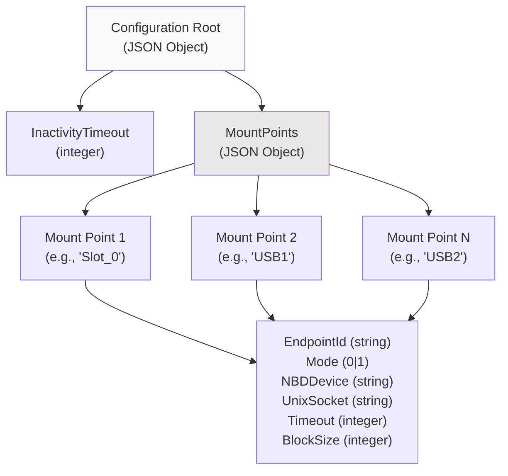
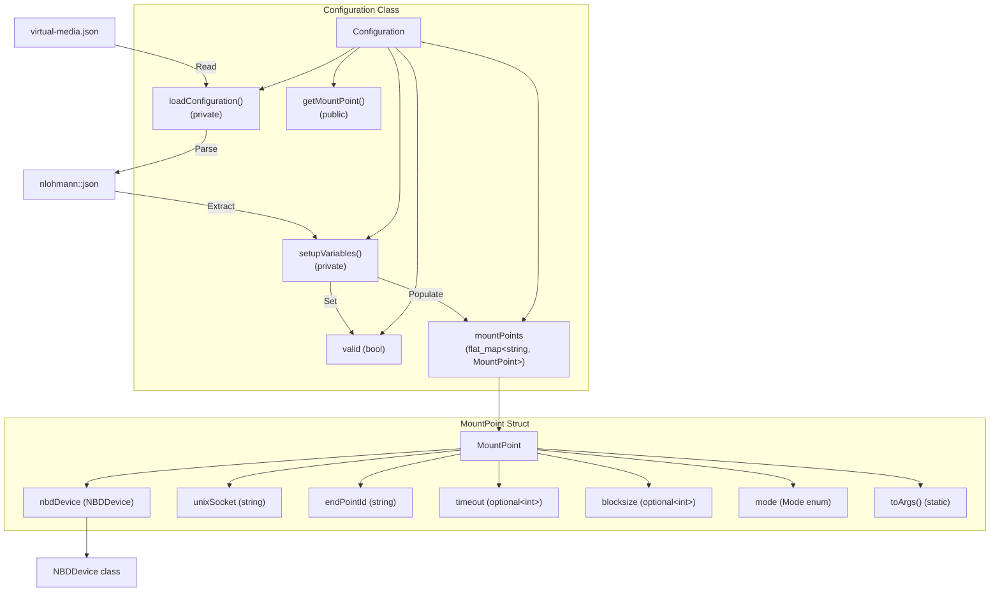
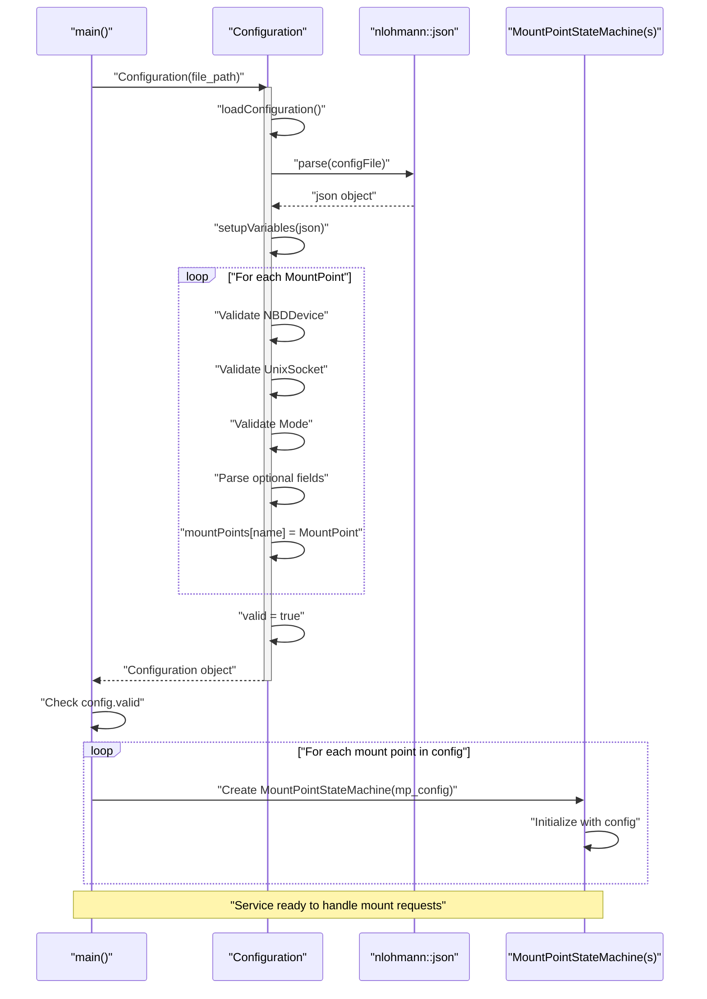

<!-- source: DeepWiki mcp.deepwiki.com · repo NVIDIA/remote-media · page 2.2 Configuration · fetched 2026-10-26 -->

# Configuration

<details>
<summary>Relevant source files</summary>

The following files were used as context for generating this wiki page:

- [src/configuration.hpp](src/configuration.hpp)
- [virtual-media.json](virtual-media.json)

</details>


This document describes the configuration system for the virtual media service, including the JSON configuration file structure, field definitions, validation rules, and how configuration is loaded at runtime. Configuration defines mount points, operational modes, NBD device assignments, and timeout parameters.

For information about operational modes themselves (proxy vs legacy), see [Operational Modes](#4). For build-time configuration options, see [Building and Installation](#2.1).

---

## Configuration File Location and Format

The virtual media service is configured through a JSON file named `virtual-media.json`, typically located in `/usr/share/virtual-media/` or the directory specified at build time. The configuration file is loaded once at service startup by the `Configuration` class.

The configuration uses a structured JSON format with two main sections:
- **Top-level settings**: Global parameters affecting all mount points
- **MountPoints**: Named virtual media devices with individual settings

**Sources:** [virtual-media.json:1-29](), [src/configuration.hpp:63-66]()

---

## Configuration Schema

### JSON Structure Overview



**Diagram: Configuration JSON hierarchy showing top-level fields and nested mount point structure**

**Sources:** [virtual-media.json:1-29](), [src/configuration.hpp:95-233]()

---

## Top-Level Configuration Fields

### InactivityTimeout

| Field | Type | Required | Description |
|-------|------|----------|-------------|
| `InactivityTimeout` | integer | No | Global timeout in seconds for mount point inactivity (currently not enforced in code) |

**Example:**
```json
{
    "InactivityTimeout": 1800
}
```

The `InactivityTimeout` field appears in the configuration file but is not currently used by the `Configuration` class parsing logic. It may be reserved for future functionality.

**Sources:** [virtual-media.json:2]()

---

## MountPoints Configuration

The `MountPoints` object contains named mount point definitions. Each key is the mount point name (e.g., `"Slot_0"`, `"USB1"`), and the value is an object containing that mount point's configuration.

### Mount Point Names

Mount point names are arbitrary strings used to:
- Identify the mount point in D-Bus object paths (`/xyz/openbmc_project/VirtualMedia/<name>`)
- Reference specific mount points through the `Configuration::getMountPoint()` method
- Organize virtual media devices logically (e.g., by physical slot or USB port)

**Sources:** [src/configuration.hpp:47-58](), [src/configuration.hpp:228]()

---

## Mount Point Field Definitions

Each mount point must specify the following fields:

### Required Fields

| Field | Type | Valid Values | Description |
|-------|------|--------------|-------------|
| `NBDDevice` | string | `"nbd0"` through `"nbd10"` | Network Block Device to use for this mount point |
| `UnixSocket` | string | Valid file path | Unix domain socket path for NBD communication |
| `Mode` | integer | `0` (proxy), `1` (legacy) | Operational mode determining mount behavior |

### Optional Fields

| Field | Type | Default | Description |
|-------|------|---------|-------------|
| `EndpointId` | string | `""` | Identifier for the endpoint (used in D-Bus properties) |
| `Timeout` | integer | (none) | Timeout in seconds for NBD operations |
| `BlockSize` | integer | (none) | Block size in bytes for NBD device |

**Sources:** [src/configuration.hpp:30-45](), [src/configuration.hpp:105-227]()

---

## Field Details

### NBDDevice

The `NBDDevice` field specifies which Network Block Device (`/dev/nbdX`) to use for this mount point. Valid values are `"nbd0"` through `"nbd10"`.

The configuration parser creates an `NBDDevice` object from the string and validates it:

```cpp
mp.nbdDevice = NBDDevice(value->c_str());
if (!mp.nbdDevice) {
    LogMsg(Logger::Error, "NBDDevice unrecognized.");
    continue;
}
```

If the NBDDevice is invalid, the entire mount point is skipped.

**Sources:** [src/configuration.hpp:105-126](), [virtual-media.json:7,15,23]()

---

### UnixSocket

The `UnixSocket` field specifies the path to a Unix domain socket used for communication between the virtual media service and NBD processes (`nbdkit` or `nbd-client`).

Typical values follow the pattern `/tmp/nbdX.sock` where `X` matches the NBD device number. This socket is used for:
- Inter-process communication with `nbdkit` (legacy mode)
- Inter-process communication with `nbd-client` (proxy mode)

**Sources:** [src/configuration.hpp:128-144](), [virtual-media.json:8,16,24]()

---

### Mode

The `Mode` field determines the operational mode for this mount point:

| Value | Mode | Description |
|-------|------|-------------|
| `0` | Proxy | Browser-initiated, uses `nbd-client` to connect to external NBD server via WebSocket |
| `1` | Legacy | Redfish-initiated, uses `nbdkit` to serve CIFS/HTTPS images |

The mode is parsed and stored as a `Configuration::Mode` enum:

```cpp
if (*value == 0) {
    mp.mode = Configuration::Mode::proxy;
} else if (*value == 1) {
    mp.mode = Configuration::Mode::legacy;
} else {
    LogMsg(Logger::Error, "Incorrect Mode, skip this mount point");
    continue;
}
```

**Sources:** [src/configuration.hpp:17-28](), [src/configuration.hpp:193-227](), [virtual-media.json:6,14,22]()

---

### EndpointId

The `EndpointId` field is an optional identifier string that can be used to associate the mount point with a specific endpoint or physical location. It is exposed via D-Bus properties but not currently used by the internal logic.

If not set or invalid, the mount point configuration is skipped.

**Sources:** [src/configuration.hpp:145-161](), [virtual-media.json:5,13,21]()

---

### Timeout

The `Timeout` field specifies a timeout value in seconds for NBD operations. This value is stored as `std::optional<int>` and may be used by NBD-related processes.

If not specified, the field remains unset (empty optional).

**Sources:** [src/configuration.hpp:162-176](), [virtual-media.json:9,17,25]()

---

### BlockSize

The `BlockSize` field specifies the block size in bytes for the NBD device. Common values are `512` or `4096`.

This value is stored as `std::optional<int>` and may be passed to NBD processes during configuration.

**Sources:** [src/configuration.hpp:177-192](), [virtual-media.json:10,18,26]()

---

## Configuration Loading and Validation

### Configuration Class Architecture



**Diagram: Configuration class structure showing loading process and MountPoint data structure**

**Sources:** [src/configuration.hpp:14-234]()

---

### Loading Process

The configuration loading process follows these steps:

1. **File Reading**: The `Configuration` constructor calls `loadConfiguration()` with the file path
2. **JSON Parsing**: Uses `nlohmann::json::parse()` to parse the JSON file
3. **Variable Setup**: Calls `setupVariables()` to extract and validate fields
4. **Mount Point Creation**: Iterates through the `MountPoints` object, creating `MountPoint` structs
5. **Validation**: Each field is validated; invalid mount points are skipped with error logs
6. **Storage**: Valid mount points are stored in the `mountPoints` flat_map

The `valid` flag is set to `true` if configuration loads successfully, `false` otherwise.

**Sources:** [src/configuration.hpp:63-93]()

---

### Validation Rules

Mount point validation enforces the following rules:

| Rule | Validation Logic | Action on Failure |
|------|------------------|-------------------|
| NBDDevice must exist | Checks JSON contains `"NBDDevice"` field | Skip mount point |
| NBDDevice must be valid | Creates `NBDDevice` object and checks validity | Skip mount point |
| UnixSocket must exist | Checks JSON contains `"UnixSocket"` field | Skip mount point |
| UnixSocket must be string | Uses `get_ptr<const std::string*>()` | Skip mount point |
| EndpointId must be string if present | Uses `get_ptr<const std::string*>()` | Skip mount point |
| Mode must exist | Checks JSON contains `"Mode"` field | Skip mount point |
| Mode must be 0 or 1 | Checks value is exactly 0 or 1 | Skip mount point |
| Timeout must be integer if present | Uses `get_ptr<const uint64_t*>()` | Log info, use default |
| BlockSize must be integer if present | Uses `get_ptr<const uint64_t*>()` | Log info, use default |

**Sources:** [src/configuration.hpp:95-233]()

---

### Error Handling

The configuration parser logs errors and warnings using the `LogMsg` utility:

| Severity | Condition | Message |
|----------|-----------|---------|
| Critical | Cannot open config file | `"Could not open configuration file"` |
| Critical | JSON parse error | `"Error parsing JSON file"` |
| Error | Invalid NBDDevice | `"NBDDevice unrecognized."` |
| Error | Missing NBDDevice | `"NBDDevice required, not set"` |
| Error | Missing UnixSocket | `"UnixSocket required, not set"` |
| Error | Invalid Mode value | `"Incorrect Mode, skip this mount point"` |
| Error | Missing Mode | `"Mode not set, skip this mount point"` |
| Info | Missing EndpointId | `"EndpointId required, not set"` |
| Info | Missing Timeout | `"Timeout not set, use default"` |
| Info | Missing BlockSize | `"BlockSize not set, use default"` |

**Sources:** [src/configuration.hpp:74-90](), [src/configuration.hpp:116-226]()

---

## Example Configurations

### Example 1: Mixed Mode Configuration

This is the default configuration with one proxy mode mount point and two legacy mode mount points:

```json
{
    "InactivityTimeout": 1800,
    "MountPoints": {
        "Slot_0": {
            "EndpointId": "",
            "Mode": 0,
            "NBDDevice": "nbd0",
            "UnixSocket": "/tmp/nbd0.sock",
            "Timeout": 30,
            "BlockSize": 512
        },
        "USB1": {
            "EndpointId": "",
            "Mode": 1,
            "NBDDevice": "nbd2",
            "UnixSocket": "/tmp/nbd2.sock",
            "Timeout": 30,
            "BlockSize": 512
        },
        "USB2": {
            "EndpointId": "",
            "Mode": 1,
            "NBDDevice": "nbd3",
            "UnixSocket": "/tmp/nbd3.sock",
            "Timeout": 30,
            "BlockSize": 512
        }
    }
}
```

**Sources:** [virtual-media.json:1-29]()

---

### Example 2: Proxy-Only Configuration

Configuration with only proxy mode mount points for browser-based virtual media:

```json
{
    "InactivityTimeout": 3600,
    "MountPoints": {
        "CD1": {
            "EndpointId": "cd1_endpoint",
            "Mode": 0,
            "NBDDevice": "nbd0",
            "UnixSocket": "/tmp/nbd0.sock",
            "Timeout": 60,
            "BlockSize": 2048
        },
        "CD2": {
            "EndpointId": "cd2_endpoint",
            "Mode": 0,
            "NBDDevice": "nbd1",
            "UnixSocket": "/tmp/nbd1.sock",
            "Timeout": 60,
            "BlockSize": 2048
        }
    }
}
```

---

### Example 3: Legacy-Only Configuration

Configuration with only legacy mode mount points for Redfish-based virtual media:

```json
{
    "InactivityTimeout": 1800,
    "MountPoints": {
        "VirtualCD": {
            "EndpointId": "cd_device",
            "Mode": 1,
            "NBDDevice": "nbd5",
            "UnixSocket": "/tmp/nbd5.sock",
            "Timeout": 45,
            "BlockSize": 512
        },
        "VirtualUSB": {
            "EndpointId": "usb_device",
            "Mode": 1,
            "NBDDevice": "nbd6",
            "UnixSocket": "/tmp/nbd6.sock",
            "Timeout": 45,
            "BlockSize": 512
        }
    }
}
```

---

## Configuration Access at Runtime

### Retrieving Mount Point Configuration

The `Configuration` class provides the `getMountPoint()` method to retrieve mount point configuration by name:

```cpp
const MountPoint* getMountPoint(const std::string& name) const
```

This method:
- Returns a pointer to the `MountPoint` struct if found
- Returns `nullptr` if the mount point name doesn't exist
- Provides read-only access to configuration data

**Usage Example:**
```cpp
Configuration config("/path/to/virtual-media.json");
const Configuration::MountPoint* mp = config.getMountPoint("USB1");
if (mp) {
    // Use mp->nbdDevice, mp->mode, etc.
}
```

**Sources:** [src/configuration.hpp:47-58]()

---

### MountPoint::toArgs() Method

The `MountPoint` struct provides a static helper method to generate command-line arguments for `nbd-client`:

```cpp
static std::vector<std::string> toArgs(const MountPoint& mp)
```

This method constructs argument vectors used when spawning NBD client processes in proxy mode. The generated arguments include:
- `-t 30`: Timeout of 30 seconds
- `-u <unix_socket>`: Unix socket path
- `<nbd_device_path>`: Path to NBD device (e.g., `/dev/nbd0`)
- `-n`: No fork (stay in foreground)
- `-L`: Enable logging

**Sources:** [src/configuration.hpp:39-44]()

---

## Configuration and System Initialization



**Diagram: Configuration loading and initialization sequence during service startup**

**Sources:** [src/configuration.hpp:63-93](), [src/configuration.hpp:95-233]()

---

## Configuration Best Practices

### NBD Device Assignment

- Use unique NBD device numbers for each mount point
- Start from `nbd0` and increment sequentially
- Avoid gaps in numbering for clarity
- Reserve `nbd0-nbd3` for commonly-used mount points

### Unix Socket Paths

- Use `/tmp/` directory for socket files
- Follow naming pattern `/tmp/nbdX.sock` matching NBD device
- Ensure socket paths don't conflict with other services
- Clean up socket files on service restart

### Mode Selection

- Use **proxy mode (0)** for:
  - Browser-based virtual media workflows
  - WebSocket-connected NBD servers
  - Direct user interaction scenarios

- Use **legacy mode (1)** for:
  - Redfish API-based management
  - CIFS/SMB share mounting
  - HTTPS image URLs
  - Enterprise management tool integration

### Timeout and BlockSize Values

- **Timeout**: Set to 30-60 seconds for most scenarios
  - Increase for slow network connections
  - Decrease for local/fast connections

- **BlockSize**: Common values are 512 or 2048 bytes
  - 512: Compatible with most ISO images
  - 2048: Standard for CD/DVD images
  - 4096: May improve performance for large files

**Sources:** [virtual-media.json:1-29]()

---

## Configuration Validation on Startup

When the service starts, configuration validation occurs in the constructor. A failed configuration load results in `valid = false`, which should be checked by the application:

```cpp
Configuration config(configPath);
if (!config.valid) {
    // Handle configuration error - service cannot start
    return EXIT_FAILURE;
}
```

Invalid mount points are skipped individually, allowing the service to start with partial configuration if some mount points are valid.

**Sources:** [src/configuration.hpp:60](), [src/configuration.hpp:65]()

---

