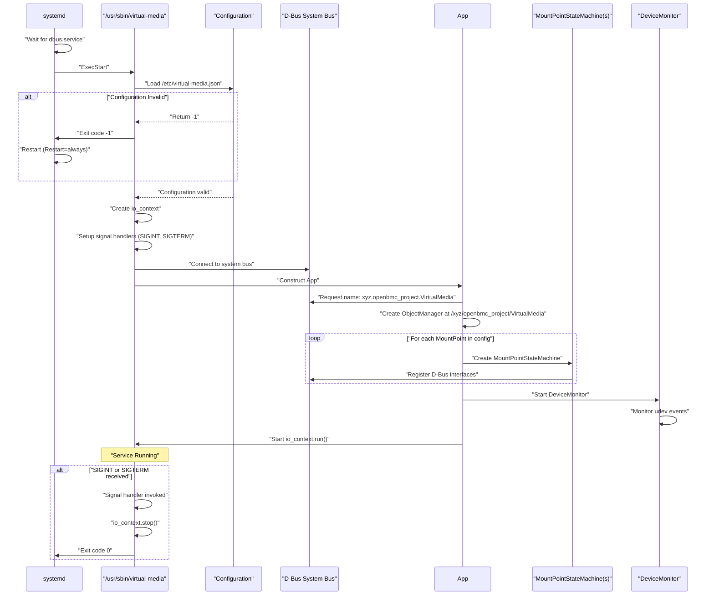
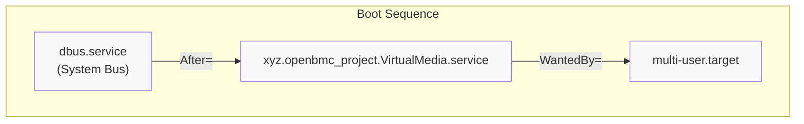
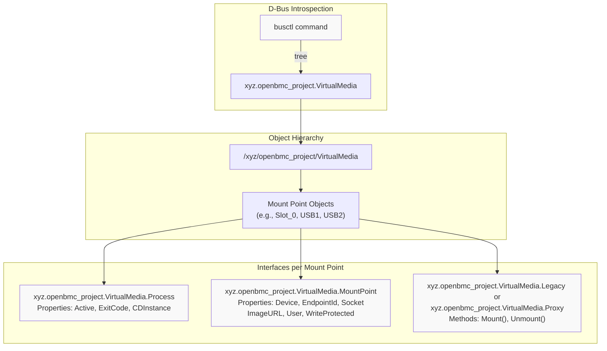
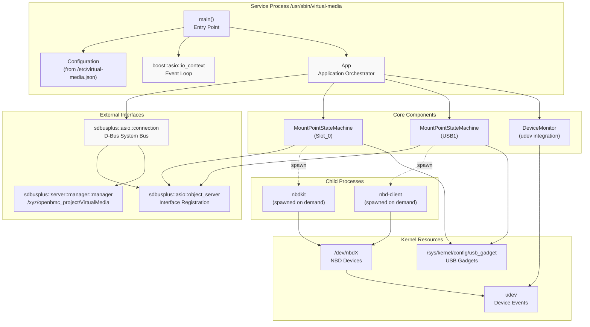

<!-- source: DeepWiki mcp.deepwiki.com · repo NVIDIA/remote-media · page 2.3 Running the Service · fetched 2026-10-26 -->

# Running the Service

<details>
<summary>Relevant source files</summary>

The following files were used as context for generating this wiki page:

- [src/configuration.hpp](src/configuration.hpp)
- [src/main.cpp](src/main.cpp)
- [xyz.openbmc_project.VirtualMedia.service](xyz.openbmc_project.VirtualMedia.service)

</details>


## Purpose and Scope

This document explains how to run the virtual-media service on an OpenBMC system. It covers systemd service management, service dependencies, startup/shutdown procedures, runtime monitoring, and basic troubleshooting steps. For configuration details, see [Configuration](#2.2). For build and installation instructions, see [Building and Installation](#2.1).

## Service Overview

The virtual-media service is managed by systemd through the `xyz.openbmc_project.VirtualMedia.service` unit file. The service binary is installed at `/usr/sbin/virtual-media` and loads its configuration from `/etc/virtual-media.json` at startup.

### Service Definition

| Property | Value | Description |
|----------|-------|-------------|
| **Unit Name** | `xyz.openbmc_project.VirtualMedia.service` | Systemd service unit |
| **Binary Path** | `/usr/sbin/virtual-media` | Service executable location |
| **Configuration** | `/etc/virtual-media.json` | JSON configuration file |
| **D-Bus Name** | `xyz.openbmc_project.VirtualMedia` | Well-known bus name |
| **Restart Policy** | `always` | Automatic restart on failure |
| **Service Type** | `simple` | No forking daemon |

Sources: [xyz.openbmc_project.VirtualMedia.service:1-12]()

### Service Lifecycle



**Figure 1: Service Startup and Initialization Sequence**

This diagram shows the complete startup sequence from systemd invocation through D-Bus registration and event loop initialization.

Sources: [src/main.cpp:70-95](), [xyz.openbmc_project.VirtualMedia.service:1-12]()

## Service Dependencies

### Required Services

The virtual-media service declares a dependency on `dbus.service` through the `After=` directive. This ensures the D-Bus system bus is available before the service starts.



**Figure 2: Systemd Service Dependencies**

Sources: [xyz.openbmc_project.VirtualMedia.service:3]()

### Runtime Dependencies

| Dependency | Purpose | Failure Mode |
|------------|---------|--------------|
| **D-Bus System Bus** | All D-Bus communication | Service cannot start; exits with error |
| **Configuration File** | `/etc/virtual-media.json` | Service exits with code -1 if missing or invalid |
| **nbdkit** | Legacy mode image serving | Mount operations fail at runtime |
| **nbd-client** | Proxy mode NBD client | Mount operations fail at runtime |
| **Kernel NBD Module** | Block device abstraction | Device operations fail |
| **USB Gadget ConfigFS** | USB mass storage presentation | Gadget configuration fails |

Sources: [src/main.cpp:72-74](), [src/configuration.hpp:69-93]()

## Starting the Service

### Manual Start

To start the service manually:

```bash
systemctl start xyz.openbmc_project.VirtualMedia.service
```

The service will:
1. Load configuration from `/etc/virtual-media.json`
2. Connect to the D-Bus system bus
3. Request the well-known name `xyz.openbmc_project.VirtualMedia`
4. Create `MountPointStateMachine` instances for each configured mount point
5. Start monitoring udev events via `DeviceMonitor`
6. Enter the `boost::asio::io_context` event loop

Sources: [src/main.cpp:70-95]()

### Enable at Boot

To enable the service to start automatically at boot:

```bash
systemctl enable xyz.openbmc_project.VirtualMedia.service
```

This creates a symlink in `multi-user.target.wants/` directory, ensuring the service starts during multi-user system initialization.

Sources: [xyz.openbmc_project.VirtualMedia.service:10-11]()

### Verification

Verify the service started successfully:

```bash
# Check service status
systemctl status xyz.openbmc_project.VirtualMedia.service

# Check D-Bus name ownership
busctl list | grep xyz.openbmc_project.VirtualMedia

# Check object paths
busctl tree xyz.openbmc_project.VirtualMedia
```

Expected output includes the service showing as `active (running)` and the D-Bus tree showing mount point objects under `/xyz/openbmc_project/VirtualMedia/`.

## Stopping the Service

### Graceful Shutdown

To stop the service gracefully:

```bash
systemctl stop xyz.openbmc_project.VirtualMedia.service
```

The service handles termination through signal handlers registered for `SIGINT` and `SIGTERM`. When a signal is received:

1. The signal handler invokes `io_context.stop()` [src/main.cpp:79]()
2. The event loop exits cleanly
3. All `MountPointStateMachine` instances are destroyed, triggering unmount operations
4. D-Bus connections are closed
5. The process exits with code 0

Sources: [src/main.cpp:77-79]()

### Restart Policy

The service is configured with `Restart=always`, meaning systemd will automatically restart it if it exits for any reason (except when explicitly stopped via `systemctl stop`). This ensures high availability for the virtual media functionality.

Sources: [xyz.openbmc_project.VirtualMedia.service:7]()

## Monitoring the Service

### Service Status

Check the overall service health:

```bash
systemctl status xyz.openbmc_project.VirtualMedia.service
```

Key status indicators:

| Indicator | Meaning |
|-----------|---------|
| `active (running)` | Service is operational |
| `activating (start)` | Service is starting up |
| `inactive (dead)` | Service is stopped |
| `failed` | Service exited with error |

### D-Bus Interface Inspection



**Figure 3: D-Bus Interface Monitoring Structure**

Sources: [src/main.cpp:39-47]()

Monitor D-Bus interfaces:

```bash
# List all interfaces for a mount point
busctl introspect xyz.openbmc_project.VirtualMedia \
  /xyz/openbmc_project/VirtualMedia/Slot_0

# Monitor D-Bus signals
dbus-monitor --system \
  "type='signal',sender='xyz.openbmc_project.VirtualMedia'"

# Check mount point active status
busctl get-property xyz.openbmc_project.VirtualMedia \
  /xyz/openbmc_project/VirtualMedia/Slot_0 \
  xyz.openbmc_project.VirtualMedia.Process Active
```

### System Logs

View service logs using journalctl:

```bash
# Follow service logs in real-time
journalctl -u xyz.openbmc_project.VirtualMedia.service -f

# View recent logs with timestamps
journalctl -u xyz.openbmc_project.VirtualMedia.service -n 100 --no-pager

# Filter by log priority
journalctl -u xyz.openbmc_project.VirtualMedia.service -p err
```

The service uses the `Logger` class with phosphor_logging integration for structured logging. Log messages include component identifiers and error details.

### Runtime Process Monitoring

Monitor spawned child processes:

```bash
# Find the main process PID
systemctl show -p MainPID xyz.openbmc_project.VirtualMedia.service

# List child processes (nbdkit, nbd-client)
pstree -p $(systemctl show -p MainPID \
  xyz.openbmc_project.VirtualMedia.service | cut -d= -f2)

# Check for nbdkit processes
ps aux | grep nbdkit

# Check for nbd-client processes
ps aux | grep nbd-client
```

### Device Status

Monitor NBD devices and USB gadgets:

```bash
# List NBD devices
ls -l /dev/nbd*

# Check NBD device usage
lsblk | grep nbd

# Check USB gadget configuration
ls -l /sys/kernel/config/usb_gadget/

# Monitor udev events
udevadm monitor --subsystem-match=block
```

## Basic Troubleshooting

### Service Fails to Start

**Symptom**: Service exits immediately after start

**Diagnostic Steps**:

1. **Check configuration validity**:
   ```bash
   cat /etc/virtual-media.json
   python3 -m json.tool /etc/virtual-media.json
   ```
   The service exits with code -1 if configuration is invalid or missing [src/main.cpp:73-74]().

2. **Verify D-Bus connectivity**:
   ```bash
   busctl list | grep dbus
   ```
   The service requires D-Bus system bus access [src/main.cpp:89]().

3. **Check service logs**:
   ```bash
   journalctl -u xyz.openbmc_project.VirtualMedia.service -n 50
   ```
   Look for `Logger::Critical` messages about configuration or D-Bus errors.

Sources: [src/configuration.hpp:69-93](), [src/main.cpp:70-74]()

### Configuration Load Failures

| Error Message | Cause | Resolution |
|---------------|-------|------------|
| "Could not open configuration file" | File missing or no read permission | Create `/etc/virtual-media.json` with proper permissions |
| "Error parsing JSON file" | Invalid JSON syntax | Validate JSON using `json.tool` or `jq` |
| "NBDDevice unrecognized" | Invalid device path | Use valid NBD device (nbd0-nbd10) |
| "Mode not set" | Missing Mode field | Add Mode: 0 (proxy) or 1 (legacy) |

Sources: [src/configuration.hpp:74-93]()

### D-Bus Name Conflicts

**Symptom**: Service starts but D-Bus operations fail

**Diagnostic**:
```bash
# Check if name is already claimed
busctl list | grep xyz.openbmc_project.VirtualMedia

# Kill any conflicting process
systemctl stop xyz.openbmc_project.VirtualMedia.service
```

The service attempts to claim the well-known D-Bus name `xyz.openbmc_project.VirtualMedia` [src/main.cpp:39](). If another process owns this name, operations will fail.

Sources: [src/main.cpp:39]()

### Mount Operations Fail

**Symptom**: Mount requests return errors or timeout

**Diagnostic Steps**:

1. **Check external process availability**:
   ```bash
   which nbdkit
   which nbd-client
   ```

2. **Verify NBD kernel module**:
   ```bash
   lsmod | grep nbd
   modprobe nbd max_part=8
   ```

3. **Check USB gadget support**:
   ```bash
   ls /sys/kernel/config/usb_gadget
   mount | grep configfs
   ```

4. **Review process exit codes**:
   ```bash
   busctl get-property xyz.openbmc_project.VirtualMedia \
     /xyz/openbmc_project/VirtualMedia/Slot_0 \
     xyz.openbmc_project.VirtualMedia.Process ExitCode
   ```

### Resource Exhaustion

**Symptom**: Service runs but new mounts fail

**Diagnostic**:

```bash
# Check available NBD devices
cat /sys/module/nbd/parameters/nbds_max

# List in-use NBD devices
ls -l /sys/block/nbd*/pid

# Check file descriptor limits
cat /proc/$(pgrep virtual-media)/limits | grep "open files"

# Monitor memory usage
systemctl status xyz.openbmc_project.VirtualMedia.service | grep Memory
```

The service creates one `MountPointStateMachine` per configured mount point [src/main.cpp:43-48](). Each active mount consumes an NBD device, file descriptors for Unix sockets, and spawns at least one child process.

Sources: [src/main.cpp:43-56]()

### Restart Loop

**Symptom**: Service continuously restarts

**Diagnostic**:
```bash
# Check restart count
systemctl show xyz.openbmc_project.VirtualMedia.service | grep NRestarts

# View restart timestamps
journalctl -u xyz.openbmc_project.VirtualMedia.service | grep "Started\|Stopped"

# Disable auto-restart temporarily
systemctl stop xyz.openbmc_project.VirtualMedia.service
```

Common causes:
- Invalid configuration causing immediate exit [src/configuration.hpp:69-93]()
- Missing runtime dependencies (nbdkit, nbd-client)
- Permissions issues with `/sys/kernel/config/usb_gadget`
- D-Bus connection failures

The `Restart=always` policy ensures the service attempts recovery, but repeated failures indicate a persistent configuration or environment issue [xyz.openbmc_project.VirtualMedia.service:7]().

Sources: [xyz.openbmc_project.VirtualMedia.service:7](), [src/main.cpp:70-95]()

## Service Runtime Architecture



**Figure 4: Runtime Architecture and Component Relationships**

This diagram shows the complete runtime architecture including the main service process, core components instantiated at startup, D-Bus integration, on-demand child processes, and kernel resource usage.

Sources: [src/main.cpp:21-95]()

---

