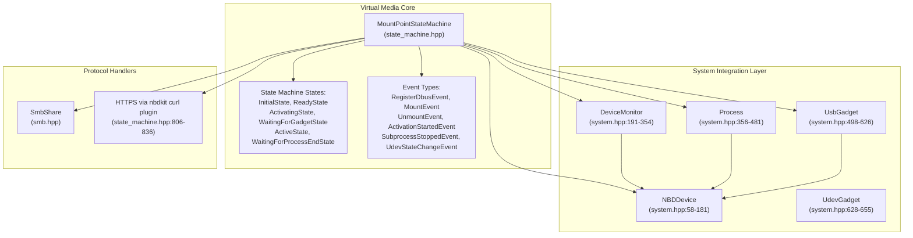
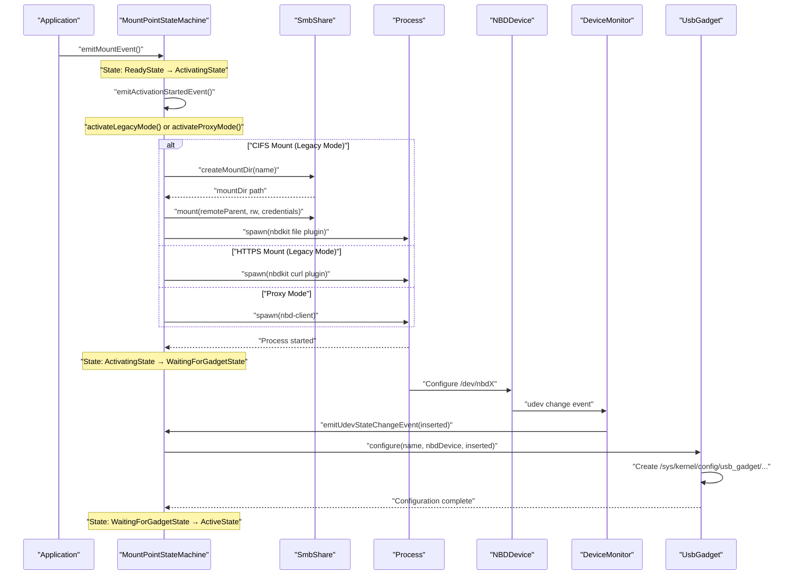
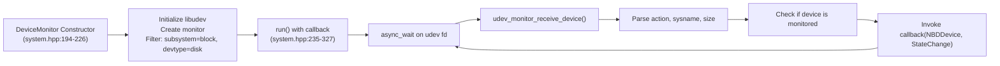
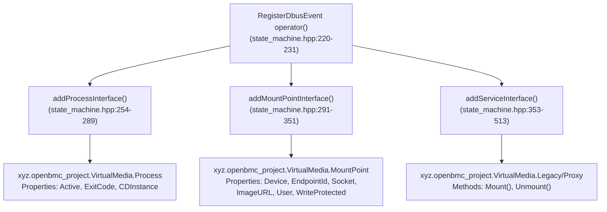
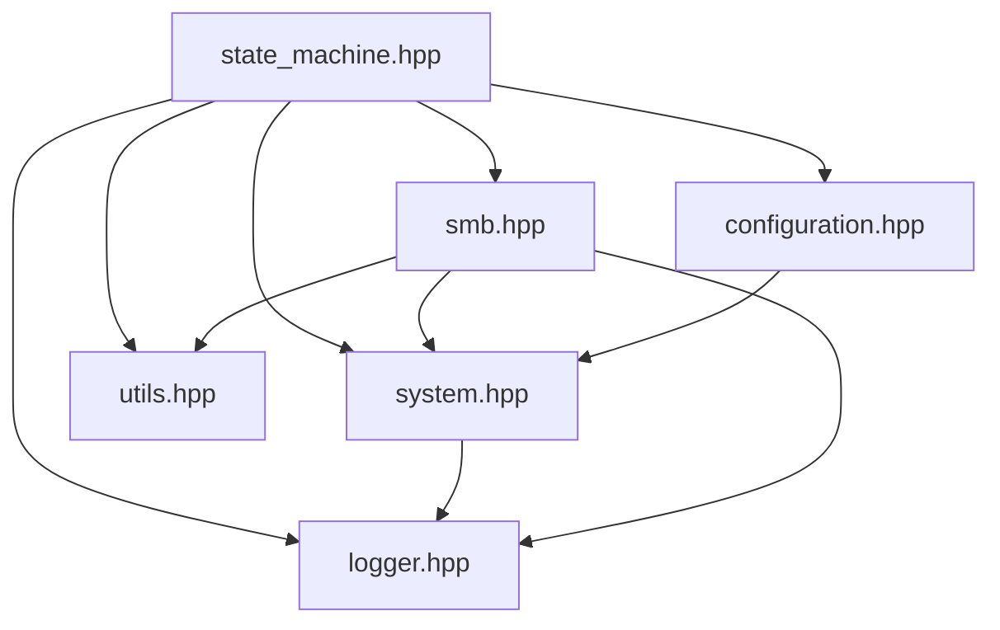

<!-- source: DeepWiki mcp.deepwiki.com · repo NVIDIA/remote-media · page 3 Core Components · fetched 2026-10-26 -->

# Core Components

<details>
<summary>Relevant source files</summary>

The following files were used as context for generating this wiki page:

- [src/state_machine.hpp](src/state_machine.hpp)
- [src/system.hpp](src/system.hpp)

</details>


This page provides an architectural overview of the core components that implement the virtual media functionality in the remote-media service. It describes the major classes and subsystems responsible for managing the lifecycle of virtual media devices, integrating with Linux kernel subsystems, and handling different image source protocols.

For configuration details, see [Configuration](#2.2). For operational mode specifics, see [Operational Modes](#4). For detailed API documentation, see [D-Bus Service Interface](#6.1).

## Component Architecture

The remote-media service is organized into three primary layers of core components:

1. **Virtual Media Core** - The `MountPointStateMachine` class that orchestrates the entire virtual media lifecycle
2. **System Integration Layer** - Classes that interface with Linux kernel subsystems (NBD, USB Gadget, udev)
3. **Protocol Handlers** - Components that handle CIFS/SMB and HTTPS image sources

The following diagram shows how these components are organized and their relationships:



**Sources:** [src/state_machine.hpp:1-1090](), [src/system.hpp:1-656]()

## Core Component Responsibilities

The following table summarizes the primary responsibilities of each core component:

| Component | Primary Responsibility | Key Operations | File Location |
|-----------|----------------------|----------------|---------------|
| `MountPointStateMachine` | Orchestrate virtual media lifecycle through state machine pattern | State transitions, event handling, D-Bus interface registration | [src/state_machine.hpp:23-1089]() |
| `NBDDevice` | Represent and manage NBD device instances | Device enumeration (nbd0-nbd10), readiness checking, disconnect operations | [src/system.hpp:58-181]() |
| `DeviceMonitor` | Monitor udev events for NBD device state changes | Initialize udev monitoring, filter block/disk devices, invoke callbacks on state changes | [src/system.hpp:191-354]() |
| `Process` | Spawn and manage child processes | Launch nbdkit/nbd-client, capture output asynchronously, graceful termination | [src/system.hpp:356-481]() |
| `UsbGadget` | Configure USB mass storage gadget | Create gadget directories, set vendor/product IDs, bind NBD devices to LUNs | [src/system.hpp:498-626]() |
| `UdevGadget` | Apply udev workarounds and tuning | Force udev change events, set max_sectors_kb | [src/system.hpp:628-655]() |
| `SmbShare` | Handle CIFS/SMB mounting | Create mount directories, mount shares with NTLM authentication, unmount | [src/smb.hpp]() |

**Sources:** [src/state_machine.hpp:23-1089](), [src/system.hpp:58-656]()

## Component Interaction Flow

The following sequence diagram illustrates how core components collaborate during a typical mount operation:



**Sources:** [src/state_machine.hpp:520-908](), [src/system.hpp:191-481]()

## State Machine Core

The `MountPointStateMachine` class [src/state_machine.hpp:23-1089]() is the architectural centerpiece that coordinates all other components. It implements a variant-based state machine pattern with the following characteristics:

### State Representation

States are represented using `std::variant`:

```cpp
using State = std::variant<InitialState, ReadyState, ActivatingState,
                           WaitingForGadgetState, ActiveState,
                           WaitingForProcessEndState>;
```

Each state inherits from `BasicState` [src/state_machine.hpp:37-73]() and can override the `onEnter()` method for entry actions.

**Sources:** [src/state_machine.hpp:162-164](), [src/state_machine.hpp:37-73]()

### Event Processing

Events inherit from `BasicEvent` [src/state_machine.hpp:166-208]() and implement the visitor pattern to handle state-specific transitions:

```cpp
struct MountEvent : public BasicEvent
State operator()(const ReadyState& state)
State operator()(const AnyState& state)
```

The `emitEvent()` method [src/state_machine.hpp:1010-1020]() dispatches events using `std::visit`, ensuring type-safe state transitions.

**Sources:** [src/state_machine.hpp:166-208](), [src/state_machine.hpp:520-961]()

For detailed documentation of states and events, see [State Transitions](#3.1.1) and [Event Handling](#3.1.2).

## System Integration Layer Components

### NBDDevice Class

The `NBDDevice` class [src/system.hpp:58-181]() provides a type-safe abstraction for Network Block Device instances:

- **Enumeration**: Supports nbd0 through nbd10 [src/system.hpp:61-76]()
- **Path Conversion**: `to_path()` returns `/dev/nbdX` filesystem path [src/system.hpp:165-173]()
- **Readiness Check**: `isReady()` attempts exclusive open to verify device availability [src/system.hpp:116-129]()
- **Disconnect**: `disconnect()` issues `NBD_DISCONNECT` and `NBD_CLEAR_SOCK` ioctl commands [src/system.hpp:131-154]()

**Sources:** [src/system.hpp:58-181]()

### DeviceMonitor Class

The `DeviceMonitor` class [src/system.hpp:191-354]() provides asynchronous udev-based device monitoring:



Key methods:
- `addDevice(NBDDevice)` - Register a device for monitoring [src/system.hpp:329-334]()
- `run(callback)` - Start async monitoring loop using `boost::asio::spawn` [src/system.hpp:235-327]()
- `getState(NBDDevice)` - Query current device state [src/system.hpp:336-344]()

**Sources:** [src/system.hpp:191-354]()

For more details, see [DeviceMonitor](#3.2.2).

### Process Class

The `Process` class [src/system.hpp:356-481]() manages child process lifecycle using `boost::process`:

**Key Features:**
- **Async Output Capture**: Reads stdout/stderr using `boost::asio::async_pipe` [src/system.hpp:362]()
- **Spawn with Coroutines**: `spawn(args, onExit)` launches process and reads output in coroutine [src/system.hpp:365-441]()
- **Graceful Termination**: `stop()` disconnects NBD device, waits 2 seconds, then terminates [src/system.hpp:443-467]()
- **Exit Code Handling**: Captures and reports exit codes to caller [src/system.hpp:435-438]()

**Sources:** [src/system.hpp:356-481]()

See [Process Management](#3.2.3) for implementation details.

### UsbGadget and UdevGadget

The `UsbGadget` class [src/system.hpp:498-626]() configures USB mass storage gadgets via ConfigFS:

**Configuration Steps:**
1. Create `/sys/kernel/config/usb_gadget/mass-storage-{name}` directory structure
2. Set USB descriptors: vendor ID (0x1d6b), product ID (0x0104) [src/system.hpp:536-537]()
3. Configure LUN parameters: removable, read-only/read-write, backing file [src/system.hpp:547-550]()
4. Bind to available USB device controller port [src/system.hpp:552-571]()

**Cleanup**: Removes gadget directory structure in reverse order [src/system.hpp:589-618]()

The `UdevGadget` class [src/system.hpp:628-655]() applies workarounds for kernel compatibility issues and performance tuning.

**Sources:** [src/system.hpp:498-655]()

For complete documentation, see [UsbGadget Configuration](#3.2.4).

## Protocol Handler Components

### CIFS/SMB Support

The `SmbShare` class handles mounting CIFS/SMB shares. The mount operation is initiated in `mountSmbShare()` [src/state_machine.hpp:665-704]():

**Mount Process:**
1. Create temporary mount directory via `SmbShare::createMountDir()` [src/state_machine.hpp:667]()
2. Parse remote path from image URL [src/state_machine.hpp:675-681]()
3. Mount share with NTLM authentication [src/state_machine.hpp:683-689]()
4. Spawn nbdkit with file plugin pointing to mounted image [src/state_machine.hpp:691-697]()

**Authentication**: Credentials are passed via `CredentialsProvider` and securely stored in temporary files.

**Sources:** [src/state_machine.hpp:665-704]()

See [SMB/CIFS Share Mounting](#3.3.1) for complete details.

### HTTPS Support

HTTPS image sources are handled via nbdkit's curl plugin in `mountHttpsShare()` [src/state_machine.hpp:706-720]() and `spawnNbdKit()` [src/state_machine.hpp:806-836]():

**Key Parameters:**
- Plugin: `curl` [src/state_machine.hpp:812]()
- SSL verification: disabled (`sslverify=false`) [src/state_machine.hpp:812]()
- URL: `url={imageUrl}` [src/state_machine.hpp:814]()
- Authentication: Optional `user` and `password` parameters [src/state_machine.hpp:817-833]()

**Sources:** [src/state_machine.hpp:706-836]()

See [HTTPS Image Support](#3.3.2) for more information.

## D-Bus Interface Registration

Each `MountPointStateMachine` instance registers three D-Bus interfaces during initialization via `RegisterDbusEvent` [src/state_machine.hpp:210-518]():



**Interface Paths:**
- Proxy mode: `/xyz/openbmc_project/VirtualMedia/Proxy/{name}` [src/state_machine.hpp:1075-1082]()
- Legacy mode: `/xyz/openbmc_project/VirtualMedia/Legacy/{name}` [src/state_machine.hpp:1076-1086]()

**Sources:** [src/state_machine.hpp:210-518](), [src/state_machine.hpp:1075-1088]()

For complete API documentation, see [D-Bus Interfaces Exposed](#3.1.3).

## Component Dependencies

The following diagram shows the compile-time dependencies between core components:



**Key Dependencies:**
- `MountPointStateMachine` requires all other core components
- `System` components are self-contained with minimal dependencies
- `SmbShare` depends on `Utils` for credential handling

**Sources:** [src/state_machine.hpp:1-7](), [src/system.hpp:1-21]()

---

The subsequent pages provide detailed documentation for each component category:
- [MountPointStateMachine](#3.1) - Complete state machine documentation
- [System Integration Layer](#3.2) - NBD, udev, process, and USB gadget details
- [Protocol Handlers](#3.3) - CIFS/SMB and HTTPS implementation

---

