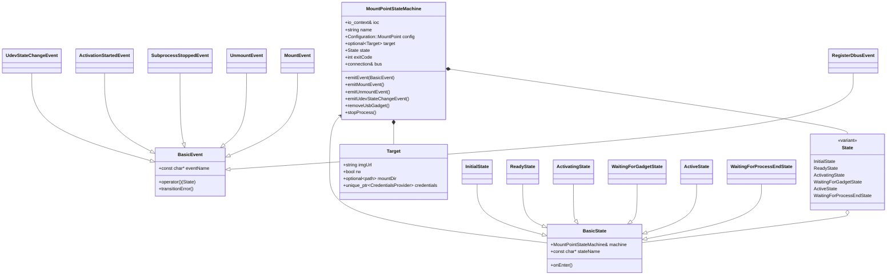
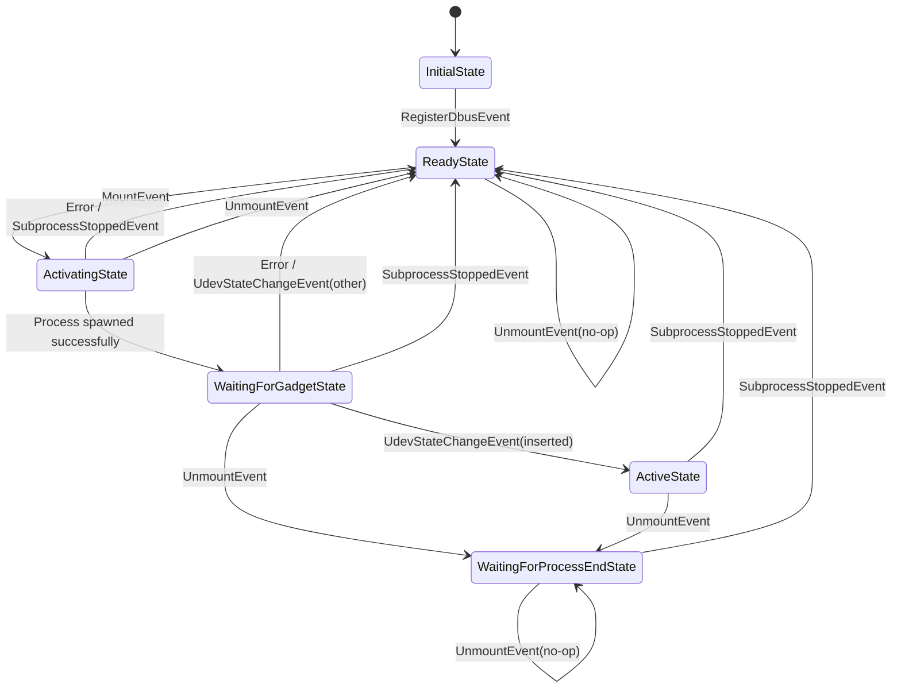
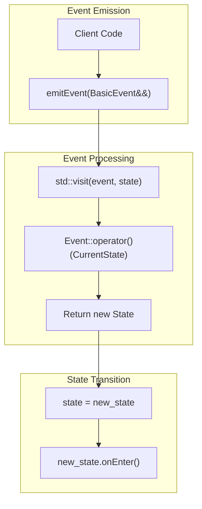
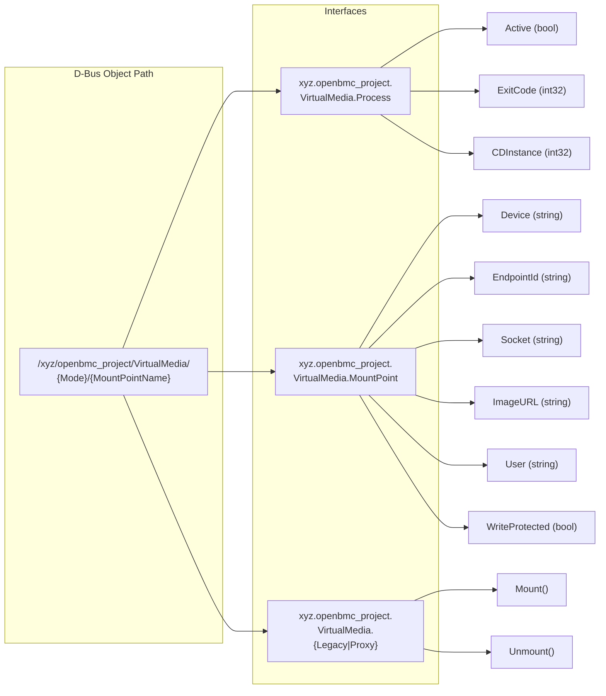
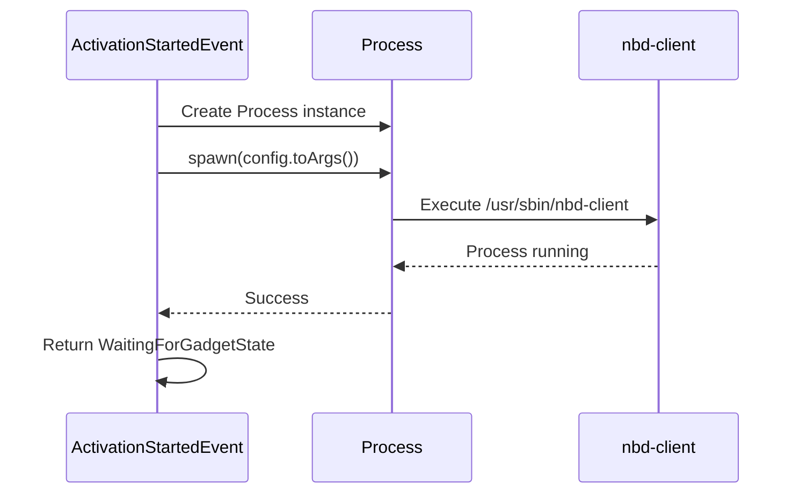
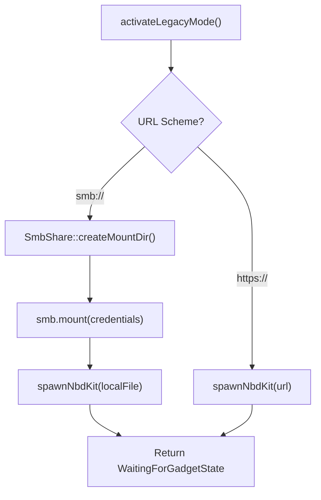
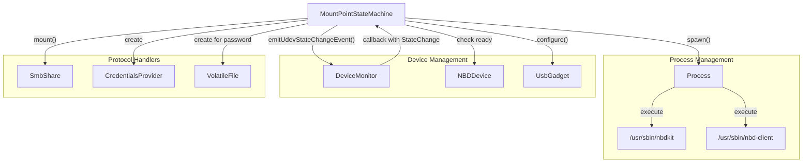

<!-- source: DeepWiki mcp.deepwiki.com · repo NVIDIA/remote-media · page 3.1 MountPointStateMachine · fetched 2026-10-26 -->

# MountPointStateMachine

<details>
<summary>Relevant source files</summary>

The following files were used as context for generating this wiki page:

- [src/main.cpp](src/main.cpp)
- [src/state_machine.hpp](src/state_machine.hpp)

</details>


## Purpose and Scope

The `MountPointStateMachine` is the central orchestration component of the virtual media service. It manages the complete lifecycle of a single virtual media mount point, from initial configuration through mounting, activation, and unmounting. This page documents the state machine's internal architecture, state transitions, event processing, and D-Bus interface registration.

For information about the specific state transitions and their conditions, see [State Transitions](#3.1.1). For details on event types and processing logic, see [Event Handling](#3.1.2). For D-Bus interface specifications, see [D-Bus Interfaces Exposed](#3.1.3).

**Sources:** [src/state_machine.hpp:23-1089]()

## Overview

The `MountPointStateMachine` struct is defined at [src/state_machine.hpp:23-1089]() and implements a hierarchical state machine pattern using `std::variant` to manage virtual media mount point states. Each mount point configured in the system has its own independent `MountPointStateMachine` instance, created and managed by the `App` class in [src/main.cpp:43-48]().

### Core Responsibilities

| Responsibility | Description |
|----------------|-------------|
| **State Management** | Maintains current state and transitions between states based on events |
| **Process Lifecycle** | Spawns and monitors nbdkit/nbd-client processes |
| **D-Bus Integration** | Registers and maintains three D-Bus interfaces per mount point |
| **Device Coordination** | Coordinates NBD device configuration with USB gadget setup |
| **Error Handling** | Manages error conditions and transitions to appropriate error states |
| **Resource Cleanup** | Ensures proper cleanup of mounts, processes, and USB gadgets |

**Sources:** [src/state_machine.hpp:987-995](), [src/main.cpp:43-48]()

## Class Structure



**Diagram: MountPointStateMachine Class Hierarchy**

The state machine uses a variant-based design where `State` is a `std::variant` [src/state_machine.hpp:162-164]() containing all possible state types. All states inherit from `BasicState` [src/state_machine.hpp:37-73](), which provides a reference back to the parent machine and basic logging functionality. Events are implemented as visitor functors inheriting from `BasicEvent` [src/state_machine.hpp:166-208]() that operate on the current state and return the next state.

**Sources:** [src/state_machine.hpp:23-73](), [src/state_machine.hpp:162-164](), [src/state_machine.hpp:1060-1066]()

## State Machine Architecture

### State Definitions

The state machine uses six distinct states to represent the lifecycle of a mount point:

| State | Definition | Purpose |
|-------|-----------|---------|
| `InitialState` | [src/state_machine.hpp:75-81]() | Startup state before D-Bus registration |
| `ReadyState` | [src/state_machine.hpp:83-111]() | Idle state, ready to accept mount requests; may contain error information |
| `ActivatingState` | [src/state_machine.hpp:113-126]() | Processing a mount request, spawning processes |
| `WaitingForGadgetState` | [src/state_machine.hpp:128-135]() | Process running, waiting for NBD device and USB gadget configuration |
| `ActiveState` | [src/state_machine.hpp:137-145]() | Fully operational, USB gadget configured and presented to host |
| `WaitingForProcessEndState` | [src/state_machine.hpp:147-160]() | Unmounting in progress, waiting for process termination |



**Diagram: State Machine State Transitions**

Each state class stores different information:
- `WaitingForGadgetState` and `ActiveState` maintain a `std::weak_ptr<Process>` to the running nbdkit/nbd-client process [src/state_machine.hpp:134](), [src/state_machine.hpp:144]()
- `ReadyState` may contain an `std::optional<Error>` with error information from failed operations [src/state_machine.hpp:110]()
- `WaitingForProcessEndState` carries forward the process pointer from its predecessor state [src/state_machine.hpp:159]()

**Sources:** [src/state_machine.hpp:75-160](), [src/state_machine.hpp:162-164]()

### State Entry Actions

States implement the `onEnter()` virtual method to perform actions when entering that state:

**ReadyState::onEnter()** [src/state_machine.hpp:96-108]()
- Cleans up SMB mounts from previous operations
- Resets the `target` member to clear mount configuration

**ActivatingState::onEnter()** [src/state_machine.hpp:119-125]()
- Resets `exitCode` to -1
- Emits `ActivationStartedEvent` to begin the activation process

**Sources:** [src/state_machine.hpp:69](), [src/state_machine.hpp:96-125]()

## Event Processing System

### Event Architecture

Events are implemented as visitor structs that inherit from `BasicEvent` [src/state_machine.hpp:166-208]() and override the `operator()` for specific states. The base class provides default implementations that log critical errors for unexpected state/event combinations [src/state_machine.hpp:177-206]().



**Diagram: Event Processing Flow**

The core event processing logic is in `emitEvent()` [src/state_machine.hpp:1010-1020]():
1. Logs the current state and incoming event
2. Uses `std::visit` to dispatch the event to the current state
3. Assigns the returned state to `this->state`
4. Calls `onEnter()` on the new state

**Sources:** [src/state_machine.hpp:1010-1020](), [src/state_machine.hpp:166-208]()

### Event Types and Behavior

| Event | Purpose | Primary States Handled |
|-------|---------|----------------------|
| `RegisterDbusEvent` | Initial D-Bus interface registration | `InitialState` → `ReadyState` |
| `MountEvent` | Initiate mount operation | `ReadyState` → `ActivatingState` |
| `UnmountEvent` | Initiate unmount operation | Multiple states → cleanup path |
| `SubprocessStoppedEvent` | Handle process termination | Multiple states → `ReadyState` |
| `ActivationStartedEvent` | Begin activation after mount request | `ActivatingState` → spawn processes |
| `UdevStateChangeEvent` | Handle NBD device insertion/removal | `WaitingForGadgetState` → `ActiveState` |

**RegisterDbusEvent** [src/state_machine.hpp:210-518]()
- Registers three D-Bus interfaces: `Process`, `MountPoint`, and `Legacy`/`Proxy`
- Determines interface type based on `config.mode` [src/state_machine.hpp:222-223]()
- Applies udev workaround and sets max sectors [src/state_machine.hpp:227-229]()

**MountEvent** [src/state_machine.hpp:520-534]()
- Only valid from `ReadyState`
- Throws `InvalidStateError` if called from other states [src/state_machine.hpp:532]()
- Transitions to `ActivatingState`

**UnmountEvent** [src/state_machine.hpp:536-575]()
- Handles multiple states with different cleanup paths:
  - From `ActivatingState`: immediate return to `ReadyState` [src/state_machine.hpp:540-543]()
  - From `WaitingForGadgetState`: stops process, transitions to `WaitingForProcessEndState` [src/state_machine.hpp:544-548]()
  - From `ActiveState`: removes USB gadget, stops process, sends `RESOURCE_DELETED` event [src/state_machine.hpp:549-562]()
  - From `ReadyState` or `WaitingForProcessEndState`: no-op, returns current state [src/state_machine.hpp:563-574]()

**SubprocessStoppedEvent** [src/state_machine.hpp:577-604]()
- Handles process termination from any state where a process might be running
- Removes USB gadget if in `ActiveState` [src/state_machine.hpp:591-598]()
- Always transitions to `ReadyState` with appropriate error information

**ActivationStartedEvent** [src/state_machine.hpp:606-908]()
- The most complex event, containing the core mounting logic
- Dispatches to proxy or legacy mode based on configuration [src/state_machine.hpp:612-617]()
- For proxy mode: spawns `nbd-client` process [src/state_machine.hpp:619-643]()
- For legacy mode: determines CIFS vs HTTPS and calls appropriate mount handler [src/state_machine.hpp:645-663]()

**UdevStateChangeEvent** [src/state_machine.hpp:910-961]()
- Receives `StateChange` (inserted/removed) from `DeviceMonitor`
- Only processes events for the configured NBD device [src/state_machine.hpp:1050-1052]()
- On device insertion from `WaitingForGadgetState`: configures USB gadget and sends `RESOURCE_CREATED` [src/state_machine.hpp:917-932]()

**Sources:** [src/state_machine.hpp:210-961](), [src/state_machine.hpp:1010-1058]()

## D-Bus Interface Registration

The `RegisterDbusEvent` creates three D-Bus interfaces per mount point during initialization [src/state_machine.hpp:224-226]():

### Interface Structure



**Diagram: D-Bus Interface Hierarchy**

### Process Interface

Registered in `addProcessInterface()` [src/state_machine.hpp:254-289]():

| Property | Type | Description | Implementation |
|----------|------|-------------|----------------|
| `Active` | `bool` | Whether mount point is active | Returns true if in `ActiveState` [src/state_machine.hpp:263-274]() |
| `ExitCode` | `int32_t` | Exit code of last process | Returns `machine.exitCode` [src/state_machine.hpp:275-280]() |
| `CDInstance` | `int32_t` | CD-ROM instance number | Read/write property [src/state_machine.hpp:281-287]() |

**Sources:** [src/state_machine.hpp:254-289]()

### MountPoint Interface

Registered in `addMountPointInterface()` [src/state_machine.hpp:291-351]():

| Property | Type | Description | Implementation |
|----------|------|-------------|----------------|
| `Device` | `string` | NBD device path (read-only) | `config.nbdDevice.to_string()` [src/state_machine.hpp:298-299]() |
| `EndpointId` | `string` | Endpoint identifier (read-only) | `config.endPointId` [src/state_machine.hpp:300-301]() |
| `Socket` | `string` | Unix socket path (read-only) | `config.unixSocket` [src/state_machine.hpp:302]() |
| `ImageURL` | `string` | Current image URL | Returns `target->imgUrl` if active, else empty [src/state_machine.hpp:304-319]() |
| `User` | `string` | Username for mount | Returns `USER` if active, else empty [src/state_machine.hpp:320-335]() |
| `WriteProtected` | `bool` | Write protection status | Returns `!target->rw` [src/state_machine.hpp:336-348]() |

**Sources:** [src/state_machine.hpp:291-351]()

### Service Interface (Legacy/Proxy)

Registered in `addServiceInterface()` [src/state_machine.hpp:353-513](). The interface name depends on operational mode:
- Legacy mode: `xyz.openbmc_project.VirtualMedia.Legacy`
- Proxy mode: `xyz.openbmc_project.VirtualMedia.Proxy`

**Mount Method**

Legacy mode signature [src/state_machine.hpp:439-498]():
```cpp
bool Mount(string imgUrl, bool rw, variant<int, unix_fd> fd)
```
- Accepts image URL, read/write flag, and optional credentials via Unix file descriptor
- Reads credentials from the file descriptor [src/state_machine.hpp:453-484]()
- Stores credentials in `CredentialsProvider` for secure handling [src/state_machine.hpp:478-480]()
- Waits for mount completion or error [src/state_machine.hpp:486-497]()

Proxy mode signature [src/state_machine.hpp:502-510]():
```cpp
bool Mount()
```
- Parameterless, relies on pre-configured endpoint from configuration
- Uses same internal `handleMount` logic [src/state_machine.hpp:508]()

**Unmount Method** [src/state_machine.hpp:363-392]()
```cpp
bool Unmount()
```
- Emits `UnmountEvent` and waits up to 12 seconds for completion [src/state_machine.hpp:378-390]()
- Returns true when state reaches `ReadyState`

**Sources:** [src/state_machine.hpp:353-513]()

## Operational Mode Handling

The state machine supports two operational modes determined by `config.mode`:

### Proxy Mode Activation

Handled in `activateProxyMode()` [src/state_machine.hpp:619-643]():



**Diagram: Proxy Mode Activation Sequence**

Steps:
1. Creates `Process` for `/usr/sbin/nbd-client` [src/state_machine.hpp:621-623]()
2. Converts configuration to arguments using `Configuration::MountPoint::toArgs()` [src/state_machine.hpp:630]()
3. Spawns process with callback that emits `SubprocessStoppedEvent` on termination [src/state_machine.hpp:629-635]()
4. Returns `WaitingForGadgetState` with process pointer [src/state_machine.hpp:640-642]()

**Sources:** [src/state_machine.hpp:619-643]()

### Legacy Mode Activation

Handled in `activateLegacyMode()` [src/state_machine.hpp:645-663](), which dispatches based on URL scheme:

**CIFS URL Handling** [src/state_machine.hpp:665-704]()



**Diagram: Legacy Mode URL Dispatch**

CIFS mounting steps:
1. Creates temporary mount directory [src/state_machine.hpp:667-672]()
2. Parses remote path and local filename [src/state_machine.hpp:675-681]()
3. Mounts SMB share with credentials [src/state_machine.hpp:683-689]()
4. Spawns nbdkit with `file` plugin pointing to mounted file [src/state_machine.hpp:691-697]()
5. Stores mount directory in `target->mountDir` for cleanup [src/state_machine.hpp:701]()

**HTTPS URL Handling** [src/state_machine.hpp:706-720]()
- Directly spawns nbdkit with `curl` plugin [src/state_machine.hpp:710]()
- Passes URL and optional credentials [src/state_machine.hpp:806-836]()

**Sources:** [src/state_machine.hpp:645-720](), [src/state_machine.hpp:722-836]()

### NBDKit Process Spawning

Three overloaded `spawnNbdKit()` functions handle different scenarios:

**Base Implementation** [src/state_machine.hpp:722-794]()
- Creates Unix socket path for nbdkit [src/state_machine.hpp:759-761]()
- Removes pre-existing socket if present [src/state_machine.hpp:739-751]()
- Constructs `--run` argument to execute nbd-client after nbdkit starts [src/state_machine.hpp:753-765]()
- Adds `--readonly` flag if needed [src/state_machine.hpp:772-775]()
- Spawns process with callback [src/state_machine.hpp:780-786]()

**File Plugin Variant** [src/state_machine.hpp:796-804]()
- Used for CIFS-mounted files
- Passes `file` plugin with `file=` parameter [src/state_machine.hpp:799-803]()

**CURL Plugin Variant** [src/state_machine.hpp:806-836]()
- Used for HTTPS URLs
- Creates `VolatileFile` for password if credentials exist [src/state_machine.hpp:817-832]()
- Passes `curl` plugin with `url=`, `user=`, and `password=+` parameters [src/state_machine.hpp:810-833]()

**Sources:** [src/state_machine.hpp:722-836]()

## Component Integration

### Target Structure

The `Target` struct [src/state_machine.hpp:1060-1066]() encapsulates mount operation parameters:

| Member | Type | Purpose |
|--------|------|---------|
| `imgUrl` | `std::string` | Image URL (smb:// or https://) |
| `rw` | `bool` | Read-write flag (true = writable, false = read-only) |
| `mountDir` | `std::optional<fs::path>` | Temporary mount directory for CIFS shares |
| `credentials` | `std::unique_ptr<CredentialsProvider>` | Secure credential storage |

The `target` member is set during mount requests [src/state_machine.hpp:446]() and reset on transition to `ReadyState` [src/state_machine.hpp:106]().

**Sources:** [src/state_machine.hpp:1060-1066](), [src/state_machine.hpp:1072]()

### Integration with System Components



**Diagram: MountPointStateMachine Component Dependencies**

**DeviceMonitor Integration** [src/state_machine.hpp:994](), [src/state_machine.hpp:1048-1058]()
- NBD device is registered with `DeviceMonitor` during construction
- Receives udev events via `emitUdevStateChangeEvent()` callback
- Only processes events matching its configured NBD device [src/state_machine.hpp:1050-1052]()

**Process Management** [src/state_machine.hpp:621-636](), [src/state_machine.hpp:728-791]()
- Creates `Process` instances for nbdkit and nbd-client
- Stores weak pointer in state for cleanup [src/state_machine.hpp:134](), [src/state_machine.hpp:144]()
- Stops process via `stopProcess()` helper [src/state_machine.hpp:977-985]()

**USB Gadget Configuration** [src/state_machine.hpp:919-922](), [src/state_machine.hpp:964-976]()
- Calls `UsbGadget::configure()` on device insertion event
- Removes gadget via `removeUsbGadget()` during unmount [src/state_machine.hpp:551](), [src/state_machine.hpp:593]()

**SMB Share Handling** [src/state_machine.hpp:667-689]()
- Uses `SmbShare::createMountDir()` to create temporary directories
- Mounts shares with credentials via `SmbShare::mount()`
- Unmounts in `ReadyState::onEnter()` [src/state_machine.hpp:101-104]()

**Sources:** [src/state_machine.hpp:987-995](), [src/state_machine.hpp:1048-1058](), [src/state_machine.hpp:964-985]()

## Error Handling

Errors are propagated through the `ReadyState` with embedded error information [src/state_machine.hpp:87-94]():

```cpp
ReadyState(const BasicState& state, const std::errc& ec,
           const std::string& message)
```

This constructor creates a `ReadyState` containing an `Error` struct [src/state_machine.hpp:31-35]() with:
- `std::errc code`: Standard error code
- `std::string message`: Human-readable error description

Error conditions that transition to error `ReadyState`:
- Failed mount directory creation [src/state_machine.hpp:669-672]()
- Failed CIFS mount [src/state_machine.hpp:685-689]()
- Failed nbdkit spawn [src/state_machine.hpp:692-697]()
- Failed nbd-client spawn [src/state_machine.hpp:626-628]()
- Premature process termination [src/state_machine.hpp:586-590]()
- Failed USB gadget configuration [src/state_machine.hpp:931-932]()
- Failed USB gadget removal [src/state_machine.hpp:553-555](), [src/state_machine.hpp:593-597]()

The D-Bus Mount method checks for errors and throws `SdBusError` with the error code [src/state_machine.hpp:413-418]().

**Sources:** [src/state_machine.hpp:31-35](), [src/state_machine.hpp:83-111](), [src/state_machine.hpp:411-418]()

## Construction and Initialization

The `MountPointStateMachine` constructor [src/state_machine.hpp:987-995]() requires:
- `boost::asio::io_context&`: For async operations and timers
- `DeviceMonitor&`: To register NBD device for monitoring
- `const std::string& name`: Mount point name (e.g., "Slot_0", "USB1")
- `const Configuration::MountPoint& config`: Configuration parameters
- `std::shared_ptr<sdbusplus::asio::connection>& bus`: D-Bus connection

Initialization sequence in `App::App()` [src/main.cpp:43-48]():
1. Create `MountPointStateMachine` for each configured mount point
2. Call `emitRegisterDBusEvent()` to transition from `InitialState` to `ReadyState`
3. Register with `DeviceMonitor` callback [src/main.cpp:50-55]()

The machine starts in `InitialState` [src/state_machine.hpp:992]() and transitions to `ReadyState` after successful D-Bus registration [src/state_machine.hpp:230]().

**Sources:** [src/state_machine.hpp:987-995](), [src/main.cpp:43-55]()

---

