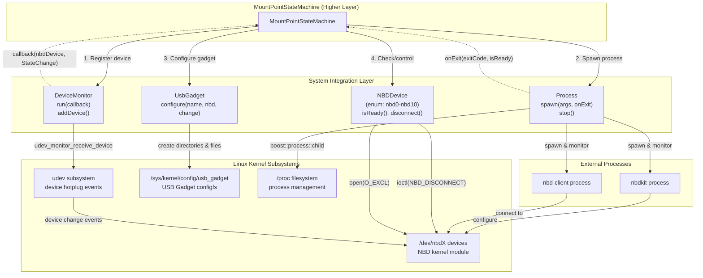
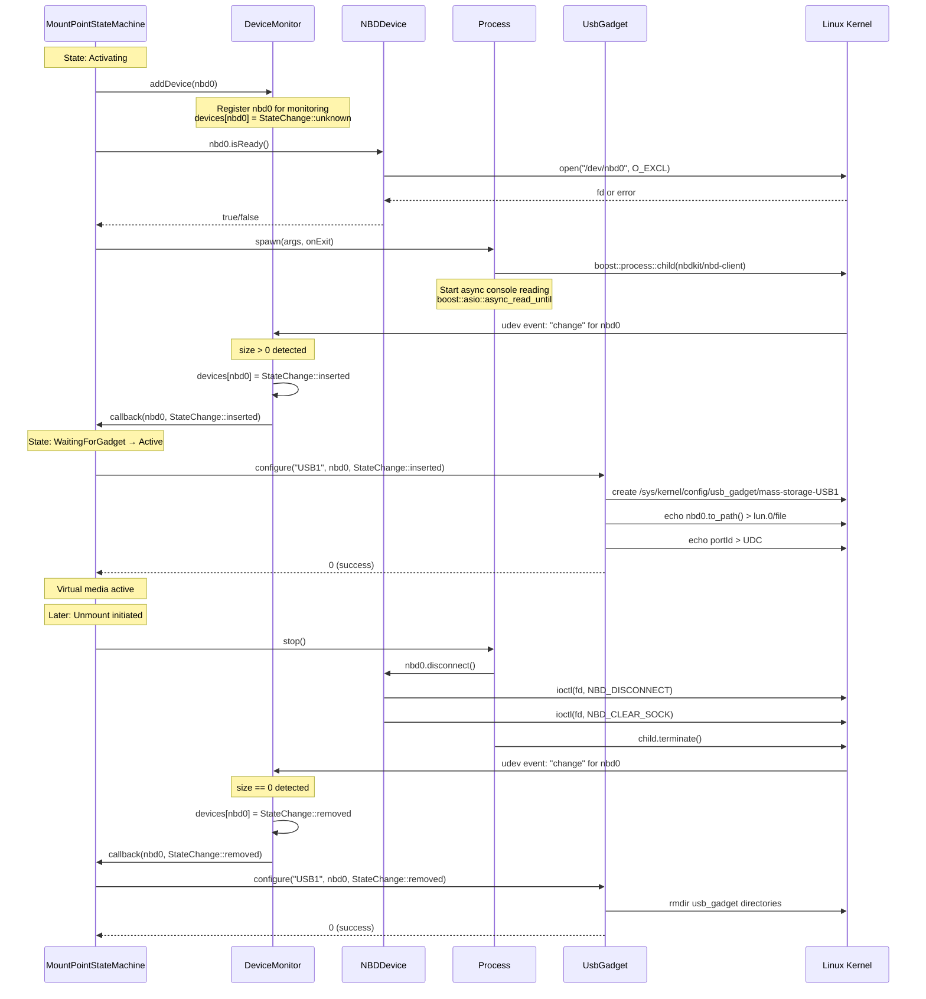

<!-- source: DeepWiki mcp.deepwiki.com · repo NVIDIA/remote-media · page 3.2 System Integration Layer · fetched 2026-10-26 -->

# System Integration Layer

Relevant source files

The following files were used as context for generating this wiki page:

- [src/system.hpp](src/system.hpp)

## Purpose and Scope

The System Integration Layer provides the low-level abstractions and interfaces between the virtual media application and Linux kernel subsystems. These components handle the direct interactions with NBD (Network Block Device) kernel modules, udev device events, USB Gadget framework, and child process management. This layer encapsulates platform-specific operations and exposes clean interfaces to higher-level components like the MountPointStateMachine (see [3.1](#3.1)).

This page provides an architectural overview of the system integration components. For detailed documentation of individual components, see:
- [NBDDevice Management](#3.2.1) - NBD device enumeration and control
- [DeviceMonitor](#3.2.2) - Udev-based device event monitoring
- [Process Management](#3.2.3) - Child process lifecycle management
- [UsbGadget Configuration](#3.2.4) - USB mass storage gadget setup

For protocol-level handlers (SMB, HTTPS), see [Protocol Handlers](#3.3). For credential and file security mechanisms, see [Security](#5).

## Component Architecture

The System Integration Layer consists of four primary classes defined in [src/system.hpp]():

| Class | Lines | Purpose | Key Dependencies |
|-------|-------|---------|------------------|
| `NBDDevice` | [src/system.hpp:58-181]() | Enum-like class representing /dev/nbdX devices with control operations | Linux ioctl syscalls, NBD kernel module |
| `DeviceMonitor` | [src/system.hpp:191-354]() | Monitors udev events for NBD device state changes (inserted/removed) | libudev, boost::asio::posix::stream_descriptor |
| `Process` | [src/system.hpp:356-481]() | Spawns and manages nbdkit/nbd-client child processes with async I/O | boost::process, boost::asio coroutines |
| `UsbGadget` | [src/system.hpp:498-626]() | Configures USB mass storage gadgets via configfs | Linux USB Gadget configfs interface |

### System Integration Architecture

**Sources:** [src/system.hpp:1-656]()

### Component Interaction Flow

The following diagram illustrates a typical activation sequence showing how these components coordinate during a mount operation:

**Sources:** [src/system.hpp:116-154]() (NBDDevice::isReady and disconnect), [src/system.hpp:234-327]() (DeviceMonitor::run), [src/system.hpp:365-441]() (Process::spawn), [src/system.hpp:501-625]() (UsbGadget::configure)

## Class Responsibilities

### NBDDevice Class

The `NBDDevice` class [src/system.hpp:58-181]() provides a type-safe enumeration of NBD devices (nbd0-nbd10) with associated control operations:

**Key Members:**
- `enum Value` - Device identifiers (nbd0=0 through nbd10=10, unknown=0xFF)
- `bool isReady()` - Tests if device is available by attempting exclusive open [src/system.hpp:116-129]()
- `void disconnect()` - Issues NBD_DISCONNECT and NBD_CLEAR_SOCK ioctl commands [src/system.hpp:131-154]()
- `std::string to_string()` - Returns device name (e.g., "nbd0") [src/system.hpp:156-163]()
- `fs::path to_path()` - Returns full device path (e.g., "/dev/nbd0") [src/system.hpp:165-173]()

**Design Note:** This is an enum-style class rather than `enum class` to avoid cumbersome naming like `NBDDevice::Device::nbd0`. The constructor accepts device names for parsing from udev events [src/system.hpp:80-92]().

**Sources:** [src/system.hpp:58-181]()

### DeviceMonitor Class

The `DeviceMonitor` class [src/system.hpp:191-354]() implements an asynchronous udev event loop that monitors NBD device state changes:

**Initialization Sequence:**
1. Creates udev context with `udev_new()` [src/system.hpp:196]()
2. Creates udev monitor for kernel events [src/system.hpp:203-204]()
3. Filters for "block"/"disk" subsystem devices [src/system.hpp:211-212]()
4. Wraps monitor fd in `boost::asio::posix::stream_descriptor` [src/system.hpp:225]()

**Event Processing:**
- Runs in boost::asio coroutine spawned by `run()` method [src/system.hpp:237-238]()
- Waits for readable events on monitor descriptor [src/system.hpp:242-244]()
- Filters for "change" actions and NBD devices [src/system.hpp:259-276]()
- Determines state by reading "size" sysattr: size > 0 = inserted, size == 0 = removed [src/system.hpp:284-323]()
- Invokes callback for registered devices only [src/system.hpp:278-282]()

**State Tracking:** Maintains `boost::container::flat_map<NBDDevice, StateChange>` to track current state and avoid duplicate events [src/system.hpp:353]().

**Sources:** [src/system.hpp:191-354]()

### Process Class

The `Process` class [src/system.hpp:356-481]() manages child process lifecycle with asynchronous output capture:

**Construction:** Requires `boost::asio::io_context`, process name, application path, and associated NBDDevice [src/system.hpp:359-363]().

**spawn() Method** [src/system.hpp:366-441]():
- Creates `boost::process::v1::child` with redirected stdout/stderr to async pipe [src/system.hpp:370-373]()
- Spawns coroutine for continuous console output reading [src/system.hpp:382-439]()
- Uses `boost::asio::async_read_until` with line buffering [src/system.hpp:392-393]()
- Logs all output with process name prefix [src/system.hpp:398-399]()
- On process exit, waits up to 2 seconds for graceful termination before calling `terminate()` [src/system.hpp:419-431]()
- Invokes exit callback with exit code and device ready status [src/system.hpp:438]()

**stop() Method** [src/system.hpp:443-467]():
- Disconnects NBD device via ioctl [src/system.hpp:448]()
- Waits up to 2 seconds for process to exit naturally [src/system.hpp:452-459]()
- Forces termination if still running [src/system.hpp:460-465]()

**Sources:** [src/system.hpp:356-481]()

### UsbGadget Struct

The `UsbGadget` struct [src/system.hpp:498-626]() provides static methods for USB mass storage gadget configuration via Linux configfs:

**configure() Method** [src/system.hpp:501-625]() handles both insertion and removal:

**Insertion Flow (StateChange::inserted):**
1. Creates `/sys/kernel/config/usb_gadget/mass-storage-{name}` directory [src/system.hpp:535]()
2. Sets USB descriptors: idVendor=0x1d6b, idProduct=0x0104 [src/system.hpp:536-537]()
3. Creates strings directory with manufacturer and product strings [src/system.hpp:538-540]()
4. Creates configuration strings [src/system.hpp:541-542]()
5. Creates mass storage function with LUN 0 [src/system.hpp:543-544]()
6. Creates symbolic link to function [src/system.hpp:545-546]()
7. Configures LUN as removable, read-only/read-write, non-CDROM [src/system.hpp:547-549]()
8. Sets backing file to NBD device path [src/system.hpp:550]()
9. Searches for available USB port in `/sys/bus/platform/devices/1e6a0000.usb-vhub` [src/system.hpp:552-571]()
10. Binds gadget to UDC (USB Device Controller) by writing port ID [src/system.hpp:566]()

**Removal Flow (StateChange::removed):**
- Removes symlink, directories in reverse order using system() calls [src/system.hpp:589-618]()

**Platform-Specific:** The USB vhub path indicates this is targeting AST2600 BMC hardware [src/system.hpp:553]().

**Sources:** [src/system.hpp:498-626]()

## Helper Components

### FsHelper Base Class

The `FsHelper` class [src/system.hpp:483-496]() provides a protected utility method for writing to sysfs/configfs files:

- `echoToFile()` - Opens file in append mode, writes content with newline, flushes [src/system.hpp:486-494]()
- Used by `UsbGadget` and `UdevGadget` for kernel interface manipulation

**Sources:** [src/system.hpp:483-496]()

### UdevGadget Workarounds

The `UdevGadget` class [src/system.hpp:628-655]() contains platform-specific workarounds:

- `forceUdevChange()` - Writes "change" to `/sys/block/nbdX/uevent` to trigger udev events [src/system.hpp:638-645]()
- `setMaxSectorsKb()` - Sets max_sectors_kb=128 for nbd0-3 [src/system.hpp:647-654]()

These address kernel compatibility issues between versions 5.10.67 and 5.14.11 (see comment at [src/system.hpp:631-637]()).

**Sources:** [src/system.hpp:628-655]()

## Kernel Integration Points

### Ioctl Commands

NBD device control uses ioctl commands defined at [src/system.hpp:55-56]():

| Constant | Value | Purpose |
|----------|-------|---------|
| `NBD_DISCONNECT` | `_IO(0xab, 8)` | Disconnect NBD device from server |
| `NBD_CLEAR_SOCK` | `_IO(0xab, 4)` | Clear socket association |

These are standard Linux NBD kernel module ioctls used by `NBDDevice::disconnect()`.

**Sources:** [src/system.hpp:55-56](), [src/system.hpp:145-152]()

### Udev RAII Wrappers

The `udev` namespace [src/system.hpp:23-53]() defines custom deleters for libudev resource management:

- `udevDeleter` - Calls `udev_unref()` [src/system.hpp:30-36]()
- `monitorDeleter` - Calls `udev_monitor_unref()` [src/system.hpp:38-44]()
- `deviceDeleter` - Calls `udev_device_unref()` [src/system.hpp:46-52]()

These enable RAII with `std::unique_ptr` for automatic cleanup, ensuring no resource leaks.

**Sources:** [src/system.hpp:23-53]()

### StateChange Enumeration

Device state transitions are represented by the `StateChange` enum [src/system.hpp:183-189]():

| Value | Meaning |
|-------|---------|
| `notMonitored` | Device not registered with DeviceMonitor |
| `unknown` | Device registered but state not yet determined |
| `removed` | Device size == 0, not connected |
| `inserted` | Device size > 0, connected to server |

**Sources:** [src/system.hpp:183-189]()

## Integration with MountPointStateMachine

The System Integration Layer components are instantiated and used by the `MountPointStateMachine` (see [3.1](#3.1)) in the following pattern:

1. **Initialization Phase:** State machine registers its NBDDevice with shared DeviceMonitor instance
2. **Activation Phase:** State machine spawns Process with nbdkit/nbd-client, transitions to WaitingForGadgetState
3. **Device Detection:** DeviceMonitor detects inserted state via udev, invokes callback to state machine
4. **Gadget Configuration:** State machine calls UsbGadget::configure() to present device to host
5. **Deactivation Phase:** State machine calls Process::stop(), which disconnects NBD and terminates child process
6. **Cleanup Detection:** DeviceMonitor detects removed state, state machine removes USB gadget

This layered architecture separates concerns: the state machine handles business logic and lifecycle, while the system integration layer encapsulates platform-specific kernel interactions.

**Sources:** [src/system.hpp]() (all components)

---

