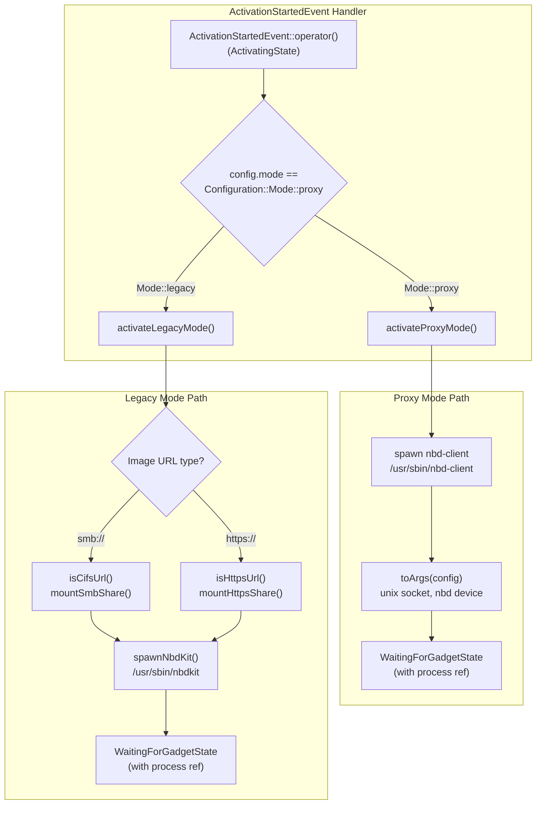
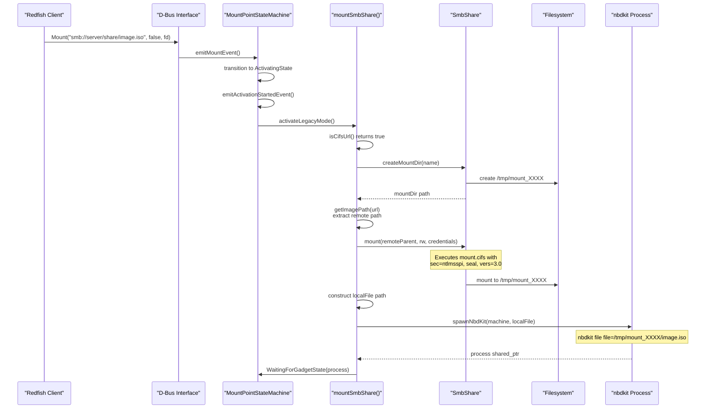
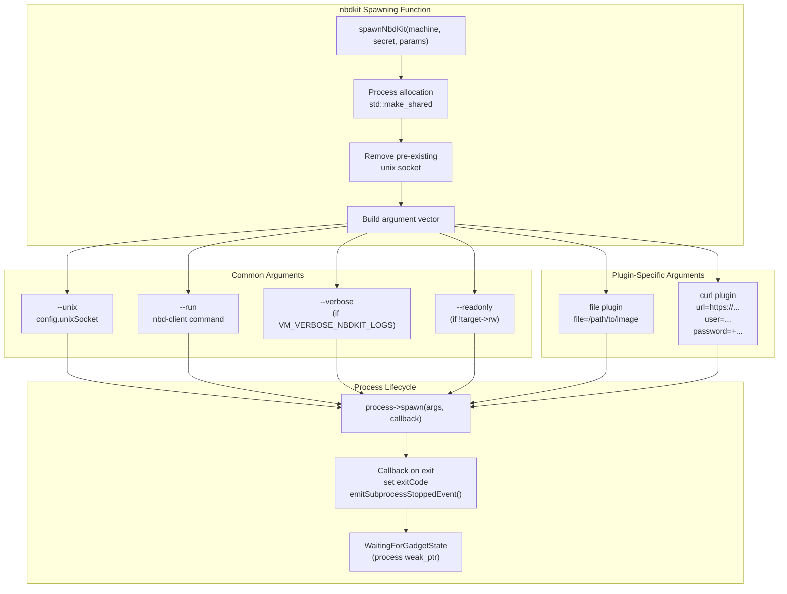
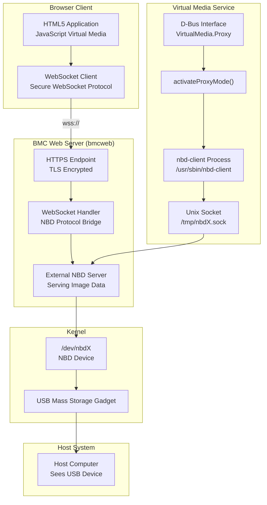
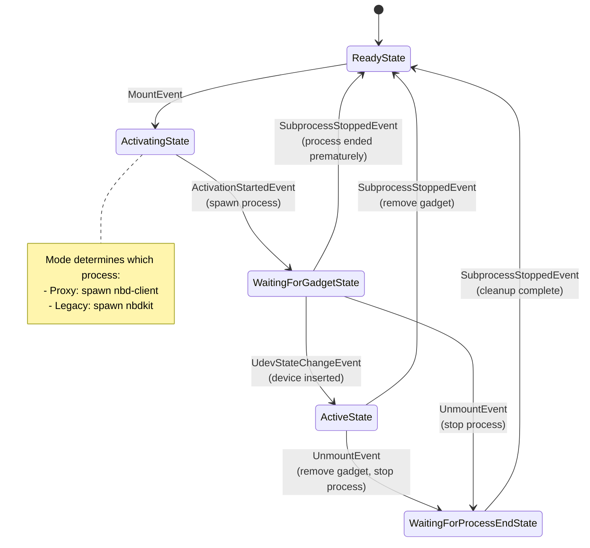

<!-- source: DeepWiki mcp.deepwiki.com · repo NVIDIA/remote-media · page 4 Operational Modes · fetched 2026-10-26 -->

# Operational Modes

<details>
<summary>Relevant source files</summary>

The following files were used as context for generating this wiki page:

- [src/configuration.hpp](src/configuration.hpp)
- [src/state_machine.hpp](src/state_machine.hpp)

</details>


## Purpose and Scope

This document describes the two operational modes supported by the remote-media virtual media service: **Legacy Mode** and **Proxy Mode**. Each mode defines how virtual media images are sourced, how mount operations are initiated, and which underlying tools (nbdkit vs nbd-client) are used to serve block devices.

For information about the state machine that manages lifecycle transitions in both modes, see [MountPointStateMachine](#3.1). For details on D-Bus API interfaces exposed in each mode, see [D-Bus Interfaces Exposed](#3.1.3). For configuration of mount points in different modes, see [Configuration](#2.2).

## Mode Overview

The virtual media service supports two distinct operational modes, each designed for different use cases and client environments. The mode is configured per mount point in the `virtual-media.json` configuration file and determines the D-Bus interface exposed, the process spawned, and the image source capabilities.

| Aspect | Legacy Mode (Mode 1) | Proxy Mode (Mode 0) |
|--------|---------------------|---------------------|
| **Configuration Value** | `"Mode": 1` | `"Mode": 0` |
| **D-Bus Interface** | `xyz.openbmc_project.VirtualMedia.Legacy` | `xyz.openbmc_project.VirtualMedia.Proxy` |
| **Initiation Method** | Redfish API calls from management tools | JavaScript/HTML5 from web browser |
| **Mount Method Signature** | `Mount(string imgUrl, bool rw, variant<int,unix_fd> fd)` | `Mount()` (no parameters) |
| **Image Sources** | CIFS shares (`smb://`), HTTPS URLs (`https://`) | External NBD server via WebSocket |
| **Process Spawned** | `/usr/sbin/nbdkit` | `/usr/sbin/nbd-client` |
| **Credential Handling** | Unix file descriptor with username/password | Pre-configured via WebSocket connection |
| **Plugin Architecture** | nbdkit file plugin (CIFS), curl plugin (HTTPS) | Direct nbd-client connection |
| **Typical Use Case** | Enterprise management, scripted automation | Browser-based virtual media, HTML5 console |

**Sources:** [src/configuration.hpp:17-28](), [src/state_machine.hpp:222-227](), [src/state_machine.hpp:353-513]()

---

### Mode Selection in State Machine



**Diagram: Mode Selection Flow in ActivationStartedEvent**

The `ActivationStartedEvent` handler in the state machine checks the configured mode and routes to the appropriate activation path. This decision point determines which process is spawned and how the image source is accessed.

**Sources:** [src/state_machine.hpp:606-720](), [src/state_machine.hpp:612-617]()

---

## 4.1 Legacy Mode

Legacy Mode (Mode 1) provides traditional virtual media mounting capabilities compatible with standard Redfish VirtualMedia schemas. This mode is designed for integration with enterprise management tools and supports two image source protocols: CIFS/SMB shares and HTTPS URLs.

### Configuration

A mount point configured for Legacy Mode in `virtual-media.json`:

```json
{
  "MountPoints": {
    "Slot_0": {
      "EndpointId": "Slot_0",
      "Mode": 1,
      "NBDDevice": "nbd0",
      "UnixSocket": "/tmp/nbd0.sock",
      "Timeout": 30,
      "BlockSize": 512
    }
  }
}
```

**Sources:** [src/configuration.hpp:193-227]()

### D-Bus Interface: VirtualMedia.Legacy

The Legacy mode exposes the `xyz.openbmc_project.VirtualMedia.Legacy` interface with the following method:

```
Mount(string imageUrl, bool readWrite, variant<int,unix_fd> credentials) -> bool
```

**Parameters:**
- `imageUrl`: Full URL to the image (`smb://server/share/path/image.iso` or `https://server/path/image.iso`)
- `readWrite`: `false` for read-only mount (default), `true` for read-write access
- `credentials`: Optional Unix file descriptor containing username and password separated by NULL bytes

**Sources:** [src/state_machine.hpp:434-498]()

---

### CIFS/SMB Share Mounting

When a CIFS URL is provided (prefix `smb://`), the Legacy Mode performs the following sequence:



**Diagram: CIFS Mount Sequence in Legacy Mode**

**Key Operations:**

1. **URL Validation**: The URL is checked with `isCifsUrl()` which verifies the `smb://` prefix ([src/state_machine.hpp:879-881]())

2. **Mount Directory Creation**: `SmbShare::createMountDir()` creates a temporary directory `/tmp/mount_<name>` with restrictive permissions ([src/state_machine.hpp:667]())

3. **Path Extraction**: `getImagePath()` parses the URL to extract the remote parent directory and image filename ([src/state_machine.hpp:675-681]())

4. **CIFS Mounting**: `SmbShare::mount()` executes the mount operation with NTLM authentication (`sec=ntlmsspi`), encryption (`seal`), and SMB protocol version 3.0 ([src/state_machine.hpp:683-689]())

5. **nbdkit Spawning**: The `spawnNbdKit()` function starts nbdkit with the file plugin, pointing to the locally mounted image file ([src/state_machine.hpp:691-703]())

**Sources:** [src/state_machine.hpp:665-704](), [src/state_machine.hpp:796-804]()

---

### HTTPS URL Mounting

When an HTTPS URL is provided (prefix `https://`), the Legacy Mode uses nbdkit's curl plugin to stream the remote image:

```mermaid
graph LR
    subgraph "mountHttpsShare Flow"
        Entry["mountHttpsShare()<br/>ActivatingState"]
        Check["isHttpsUrl()<br/>validate URL"]
        Spawn["spawnNbdKit(machine, url)"]
        Plugin["nbdkit curl plugin<br/>configuration"]
    end
    
    subgraph "nbdkit Arguments"
        PluginName["plugin: curl"]
        SSLVerify["sslverify=false"]
        URLParam["url=https://..."]
        CredCheck{"credentials<br/>present?"}
        UserParam["user=username"]
        PassParam["password=+/tmp/secret"]
        SecretFile["VolatileFile<br/>password storage"]
    end
    
    subgraph "Process Spawning"
        NBDKit["nbdkit Process<br/>--unix socket<br/>--run nbd-client"]
        State["WaitingForGadgetState"]
    end
    
    Entry --> Check
    Check --> Spawn
    Spawn --> Plugin
    Plugin --> PluginName
    PluginName --> SSLVerify
    SSLVerify --> URLParam
    URLParam --> CredCheck
    CredCheck -->|Yes| UserParam
    UserParam --> PassParam
    PassParam --> SecretFile
    CredCheck -->|No| NBDKit
    SecretFile --> NBDKit
    NBDKit --> State
```



**Diagram: HTTPS Mount Flow with Credential Handling**

**Key Operations:**

1. **URL Validation**: `isHttpsUrl()` verifies the `https://` prefix ([src/state_machine.hpp:868-871]())

2. **nbdkit curl Plugin**: The curl plugin is configured with `sslverify=false` to allow self-signed certificates and the image URL ([src/state_machine.hpp:810-814]())

3. **Credential Handling**: If credentials are provided, they are packed into a `VolatileFile` using `CredentialsProvider::pack()` and passed to nbdkit via the `password=+` syntax ([src/state_machine.hpp:817-832]())

4. **nbdkit Configuration**: The spawned process includes the `--unix` socket path and `--run` directive to execute nbd-client once the NBD server is ready ([src/state_machine.hpp:758-765]())

**Sources:** [src/state_machine.hpp:706-720](), [src/state_machine.hpp:806-836]()

---

### nbdkit Process Architecture

In Legacy Mode, `nbdkit` serves as the NBD server that translates block device requests into filesystem or HTTP operations:



**Diagram: nbdkit Process Spawning and Configuration**

The `spawnNbdKit()` function has three overloaded variants:
1. `spawnNbdKit(machine, secret, params)` - Generic version with custom parameters ([src/state_machine.hpp:722-794]())
2. `spawnNbdKit(machine, file)` - File plugin variant for CIFS ([src/state_machine.hpp:796-804]())
3. `spawnNbdKit(machine, url)` - Curl plugin variant for HTTPS ([src/state_machine.hpp:806-836]())

**Common Configuration:**
- **Unix Socket**: `--unix /tmp/nbdX.sock` for inter-process communication
- **Run Directive**: `--run /usr/sbin/nbd-client -t 30 -u /tmp/nbdX.sock /dev/nbdX -n -L`
- **Read-Only**: `--readonly` flag if `target->rw` is false
- **Verbose Logging**: Optional `--verbose` flag controlled by `VM_VERBOSE_NBDKIT_LOGS` build option

**Sources:** [src/state_machine.hpp:722-836]()

---

## 4.2 Proxy Mode

Proxy Mode (Mode 0) enables browser-based virtual media operations using JavaScript/HTML5 and WebSocket communication. This mode is designed for modern web consoles where the browser directly initiates the mount operation and streams data through bmcweb's HTTPS endpoint.

### Configuration

A mount point configured for Proxy Mode in `virtual-media.json`:

```json
{
  "MountPoints": {
    "USB1": {
      "EndpointId": "USB1",
      "Mode": 0,
      "NBDDevice": "nbd1",
      "UnixSocket": "/tmp/nbd1.sock",
      "Timeout": 30,
      "BlockSize": 512
    }
  }
}
```

**Sources:** [src/configuration.hpp:193-227]()

### D-Bus Interface: VirtualMedia.Proxy

The Proxy mode exposes the `xyz.openbmc_project.VirtualMedia.Proxy` interface with the following method:

```
Mount() -> bool
```

**Parameters:** None. All connection parameters (NBD server endpoint, credentials) are pre-configured through the WebSocket connection established by bmcweb.

The parameterless `Mount()` method signals the state machine to activate the pre-configured proxy connection. The actual NBD server endpoint and authentication are managed externally by bmcweb's WebSocket handler.

**Sources:** [src/state_machine.hpp:500-510]()

---

### Proxy Mode Architecture



**Diagram: Proxy Mode Communication Architecture**

In Proxy Mode, the data flow is:
1. Browser establishes WebSocket connection to bmcweb
2. bmcweb acts as an NBD server, translating WebSocket messages to NBD protocol
3. Virtual media service calls `Mount()` on D-Bus, which is parameterless
4. `nbd-client` process is spawned, connecting to the Unix socket
5. nbd-client communicates with the external NBD server (bmcweb) via the Unix socket
6. The NBD device is configured and presented as USB gadget to the host

**Sources:** [src/state_machine.hpp:619-643](), [src/configuration.hpp:17-22]()

---

### nbd-client Process Spawning

```mermaid
sequenceDiagram
    participant SM as "MountPointStateMachine"
    participant Activate as "activateProxyMode()"
    participant ProcessClass as "Process Class"
    participant NBDClient as "nbd-client Binary"
    participant Socket as "Unix Socket<br/>/tmp/nbdX.sock"
    
    SM->>Activate: ActivationStartedEvent
    Activate->>ProcessClass: std::make_shared<Process>(ioc, name, "/usr/sbin/nbd-client", nbdDevice)
    Note over Activate: Process allocation
    Activate->>Activate: Configuration::MountPoint::toArgs(config)
    Note over Activate: Build arguments:<br/>-t 30 -u /tmp/nbdX.sock /dev/nbdX -n -L
    Activate->>ProcessClass: spawn(args, callback)
    ProcessClass->>NBDClient: execvp("/usr/sbin/nbd-client", argv)
    NBDClient->>Socket: Connect to Unix socket
    Note over NBDClient: Waits for NBD server<br/>(bmcweb WebSocket handler)
    Socket-->>NBDClient: Connection established
    NBDClient->>NBDClient: Configure /dev/nbdX
    Note over Activate: Process running
    Activate-->>SM: WaitingForGadgetState<br/>(process weak_ptr)
```

**Diagram: nbd-client Process Spawning Sequence**

**Key Operations:**

1. **Process Allocation**: A `Process` object is created with the executable path `/usr/sbin/nbd-client` and the associated NBD device ([src/state_machine.hpp:621-623]())

2. **Argument Construction**: `Configuration::MountPoint::toArgs()` builds the command-line arguments for nbd-client ([src/state_machine.hpp:630](), [src/configuration.hpp:39-44]())
   - `-t 30`: 30-second timeout
   - `-u /tmp/nbdX.sock`: Unix socket path for connection
   - `/dev/nbdX`: Target NBD device
   - `-n`: No fork (run in foreground)
   - `-L`: Log to syslog

3. **Process Spawning**: The `Process::spawn()` method executes the nbd-client with a callback that handles process termination ([src/state_machine.hpp:629-639]())

4. **State Transition**: The state machine transitions to `WaitingForGadgetState` with a weak reference to the process ([src/state_machine.hpp:640-642]())

**Sources:** [src/state_machine.hpp:619-643](), [src/configuration.hpp:39-44]()

---

### Proxy Mode vs Legacy Mode Process Comparison

| Aspect | Proxy Mode (nbd-client) | Legacy Mode (nbdkit) |
|--------|-------------------------|----------------------|
| **Executable** | `/usr/sbin/nbd-client` | `/usr/sbin/nbdkit` |
| **Role** | NBD client (consumes NBD protocol) | NBD server (provides NBD protocol) |
| **Connection** | Connects to external NBD server via Unix socket | Creates NBD server on Unix socket, runs nbd-client via `--run` |
| **Arguments** | `-t 30 -u /tmp/nbdX.sock /dev/nbdX -n -L` | `--unix /tmp/nbdX.sock --run "nbd-client ..." [plugin] [params]` |
| **Plugin Support** | No plugins (simple client) | File plugin (CIFS), curl plugin (HTTPS) |
| **Image Source** | External (bmcweb WebSocket) | Local filesystem or HTTP streaming |
| **Credential Handling** | Pre-configured in WebSocket connection | Unix file descriptor to virtual media service |
| **Process Lifetime** | Runs until unmount or failure | Runs until unmount or failure |

**Sources:** [src/state_machine.hpp:619-643](), [src/state_machine.hpp:722-836]()

---

### Mode-Specific Event Handling

Both modes share the same state machine states but differ in their activation paths. After process spawning, the event handling is identical:



**Diagram: Unified State Transitions for Both Modes**

After the mode-specific process is spawned, both modes follow the same state transition logic:
- **WaitingForGadgetState**: Waiting for the NBD device to appear and be configured as USB gadget
- **ActiveState**: Virtual media is active and presented to host
- **WaitingForProcessEndState**: Process is being terminated, waiting for cleanup
- **ReadyState**: Idle state, ready for next mount operation

**Sources:** [src/state_machine.hpp:162-164](), [src/state_machine.hpp:520-604](), [src/state_machine.hpp:910-961]()

---

