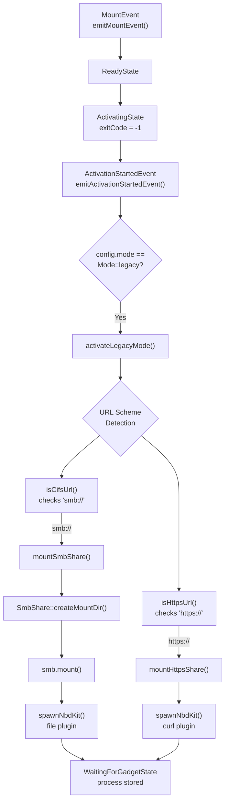
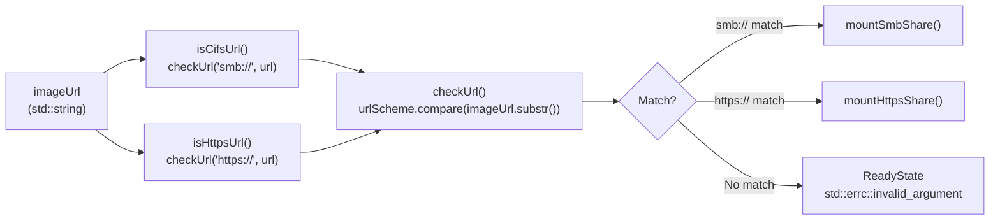
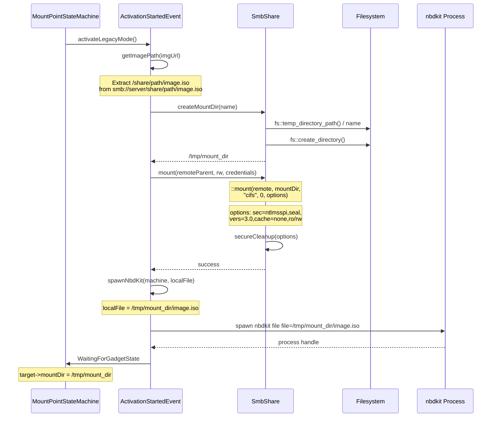
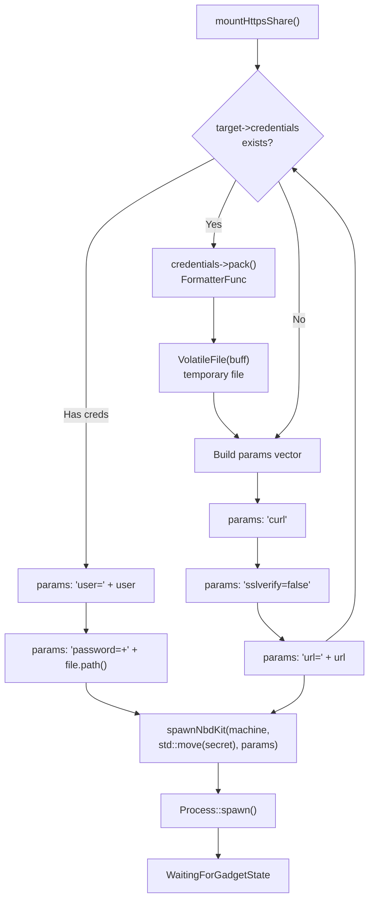
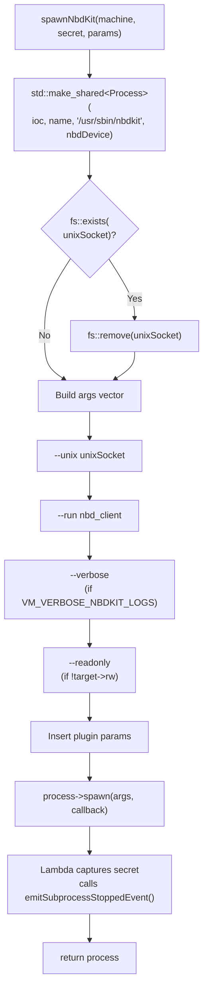
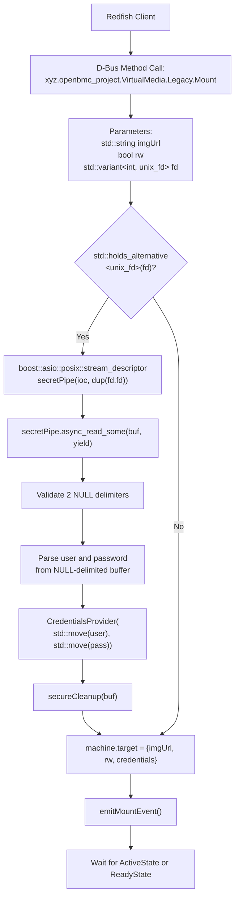
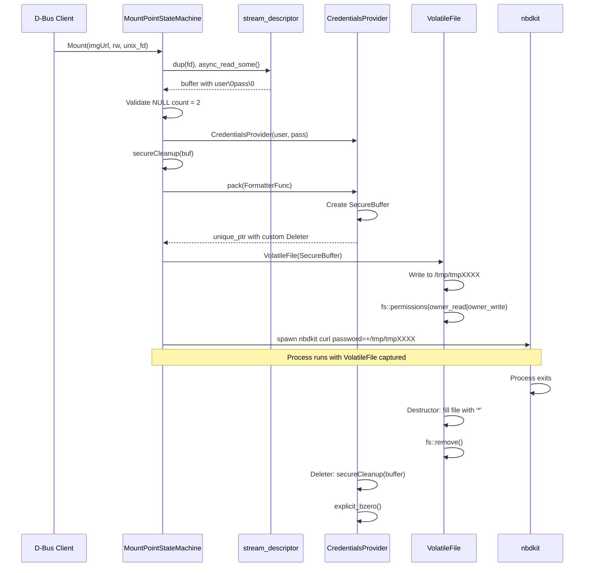

<!-- source: DeepWiki mcp.deepwiki.com · repo NVIDIA/remote-media · page 4.1 Legacy Mode · fetched 2026-10-26 -->

# Legacy Mode

<details>
<summary>Relevant source files</summary>

The following files were used as context for generating this wiki page:

- [src/configuration.hpp](src/configuration.hpp)
- [src/smb.hpp](src/smb.hpp)
- [src/state_machine.hpp](src/state_machine.hpp)
- [src/utils.hpp](src/utils.hpp)

</details>


Legacy Mode is an operational mode of the virtual media service that enables traditional enterprise management tools to mount remote storage images via Redfish VirtualMedia APIs. It supports CIFS/SMB shares and HTTPS URLs as image sources, using nbdkit to serve the remote image as a local NBD device that is then presented to the host system as a USB mass storage gadget.

For information about the alternative browser-based approach, see [Proxy Mode](#4.2). For details on the state machine that orchestrates both modes, see [MountPointStateMachine](#3.1). For credential security mechanisms, see [Security](#5).

## Overview

Legacy Mode (Mode 1) is configured per mount point in the `virtual-media.json` configuration file and provides backward compatibility with traditional out-of-band management workflows. Unlike Proxy Mode, which uses nbd-client to connect to an external NBD server, Legacy Mode uses nbdkit as a server to expose remote images through either the file plugin (for CIFS mounts) or the curl plugin (for HTTPS URLs).

**Sources:** [src/configuration.hpp:17-28](), [src/state_machine.hpp:645-663]()

## Configuration

A mount point is configured for Legacy Mode by setting `"Mode": 1` in the configuration:

```json
{
  "MountPoints": {
    "Slot_0": {
      "EndpointId": "Slot_0",
      "Mode": 1,
      "NBDDevice": "/dev/nbd0",
      "UnixSocket": "/tmp/nbd0.sock",
      "Timeout": 30,
      "BlockSize": 512
    }
  }
}
```

The `Configuration::Mode::legacy` enum value (1) distinguishes it from `Configuration::Mode::proxy` (0).

**Sources:** [src/configuration.hpp:17-28](), [src/configuration.hpp:193-221]()

## Activation Flow

The following diagram illustrates the complete activation flow when a mount request is received:



**Sources:** [src/state_machine.hpp:606-663](), [src/state_machine.hpp:520-527]()

## Protocol Handling

### URL Detection

Legacy Mode supports two URL schemes, detected using string prefix matching:

| Protocol | URL Prefix | Detection Function | Handler Function |
|----------|-----------|-------------------|------------------|
| CIFS/SMB | `smb://` | `isCifsUrl()` | `mountSmbShare()` |
| HTTPS | `https://` | `isHttpsUrl()` | `mountHttpsShare()` |

The detection logic uses a common `checkUrl()` helper function:



**Sources:** [src/state_machine.hpp:838-907]()

### CIFS/SMB Share Mounting

CIFS mounting is a multi-step process handled by the `mountSmbShare()` function and `SmbShare` class:



The `SmbShare::mount()` function constructs mount options with security parameters:

| Parameter | Value | Purpose |
|-----------|-------|---------|
| `sec` | `ntlmsspi` | NTLM authentication with signing and sealing |
| `seal` | enabled | Encrypt all SMB traffic |
| `vers` | `3.0` | Force SMBv3 protocol |
| `cache` | `none` | Disable client-side caching |
| `rw`/`ro` | based on `rw` flag | Read-write or read-only access |

If credentials are provided, they are added as `username=USER,password=PASS`. Without credentials, the mount uses `guest,username=OpenBmc`.

**Sources:** [src/state_machine.hpp:665-704](), [src/smb.hpp:19-58](), [src/smb.hpp:60-78]()

### HTTPS Image Support

HTTPS URLs bypass filesystem mounting and directly spawn nbdkit with the curl plugin:



The curl plugin is configured with `sslverify=false` to accept self-signed certificates. When credentials are present, the password is written to a `VolatileFile` and passed to nbdkit using the `password=+file` syntax, where the `+` prefix instructs nbdkit to read the password from the file.

**Sources:** [src/state_machine.hpp:706-720](), [src/state_machine.hpp:806-836]()

## nbdkit Process Management

### Process Spawning

The `spawnNbdKit()` function creates and configures an nbdkit server process:



Key command-line arguments:

- `--unix /tmp/nbdX.sock`: Listen on Unix domain socket
- `--run "/usr/sbin/nbd-client ..."`: Execute nbd-client after starting server
- `--readonly`: Prevent writes if requested
- Plugin-specific args:
  - `file file=/path/to/image.iso` for CIFS
  - `curl sslverify=false url=https://...` for HTTPS

**Sources:** [src/state_machine.hpp:722-794](), [src/state_machine.hpp:796-804](), [src/state_machine.hpp:806-836]()

### Process Lifecycle

The nbdkit process is managed through the `Process` class and monitored via callbacks:

```mermaid
stateDiagram-v2
    [*] --> Created: std::make_shared&lt;Process&gt;()
    Created --> Spawned: spawn(args, callback)
    Spawned --> Running: NBD socket created
    Running --> Stopping: stop() called
    Running --> Terminated: Process exits
    Stopping --> Terminated: SIGTERM/SIGKILL
    Terminated --> [*]: exitCode captured
    
    note right of Spawned
        Callback: [&machine, secret]
        - Captures VolatileFile lifetime
        - Calls emitSubprocessStoppedEvent()
    end note
```

The callback lambda captures the `secret` (VolatileFile) by value, ensuring it remains alive for the process lifetime but is automatically destroyed when the process ends.

**Sources:** [src/state_machine.hpp:781-791](), [src/state_machine.hpp:577-604]()

## D-Bus Interface

Legacy Mode mount points expose the `xyz.openbmc_project.VirtualMedia.Legacy` interface with a `Mount()` method that accepts credentials via Unix file descriptor:



The credential passing mechanism uses a Unix file descriptor to securely transfer sensitive data between processes without exposing it via command-line arguments or environment variables.

**Sources:** [src/state_machine.hpp:434-498](), [src/state_machine.hpp:353-393]()

## Credential Security

Legacy Mode implements defense-in-depth for credential handling:

| Security Layer | Implementation | Purpose |
|----------------|---------------|---------|
| File Descriptor Transfer | `sdbusplus::message::unix_fd` | Avoid command-line exposure |
| Secure Buffer | `CredentialsProvider::SecureBuffer` | Custom deleter with explicit_bzero |
| Volatile Files | `VolatileFile` class | Restricted permissions, purged on destruction |
| Memory Cleanup | `secureCleanup()` | explicit_bzero after use |
| RAII Pattern | Unique pointers with custom deleters | Automatic cleanup on exception |

### Credential Flow



**Sources:** [src/state_machine.hpp:448-484](), [src/utils.hpp:26-57](), [src/utils.hpp:59-110](), [src/utils.hpp:172-226]()

## Error Handling

The state machine transitions to `ReadyState` with error information when operations fail:

| Failure Point | Error Code | Message |
|--------------|-----------|---------|
| URL not recognized | `std::errc::invalid_argument` | "URL not recognized" |
| Mount directory creation failed | `std::errc::io_error` | "Failed to create mount directory" |
| CIFS mount failed | `std::errc::invalid_argument` | "Failed to mount CIFS share" |
| nbdkit spawn failed | `std::errc::operation_canceled` | "Unable to setup NbdKit" / "Failed to mount HTTPS share" |
| Process allocation failed | `std::errc::operation_canceled` | "Failed to allocate process" |

Errors are logged and exposed via the D-Bus `VirtualMedia.MountPoint` interface properties, allowing clients to retrieve detailed failure information.

**Sources:** [src/state_machine.hpp:661-663](), [src/state_machine.hpp:670-672](), [src/state_machine.hpp:686-689](), [src/state_machine.hpp:691-697](), [src/state_machine.hpp:711-715]()

## Cleanup Procedure

Unmounting in Legacy Mode follows this sequence:

1. **USB Gadget Removal**: `UsbGadget::configure(name, device, StateChange::removed)`
2. **Process Termination**: `stopProcess(process)` sends SIGTERM, waits, then SIGKILL if needed
3. **Event Emission**: D-Bus signal `RESOURCE_DELETED` emitted
4. **SMB Unmount** (if applicable): `SmbShare::unmount(mountDir)` calls `::umount()` and `fs::remove_all()`
5. **State Transition**: Move to `ReadyState`

The `ReadyState::onEnter()` method ensures cleanup of any remaining mounted shares:

```cpp
if (machine.target->mountDir)
{
    SmbShare::unmount(*machine.target->mountDir);
}
machine.target.reset();
```

**Sources:** [src/state_machine.hpp:549-562](), [src/state_machine.hpp:96-108](), [src/smb.hpp:80-97]()

## Integration with State Machine

Legacy Mode integrates into the state machine at these key points:

| Event | Handler | State Transition |
|-------|---------|------------------|
| `RegisterDbusEvent` | `addServiceInterface(state, true)` | `InitialState` → `ReadyState` |
| `MountEvent` | From `ReadyState` only | `ReadyState` → `ActivatingState` |
| `ActivationStartedEvent` | `activateLegacyMode()` | `ActivatingState` → `WaitingForGadgetState` |
| `UdevStateChangeEvent` (inserted) | `UsbGadget::configure()` | `WaitingForGadgetState` → `ActiveState` |
| `UnmountEvent` | `removeUsbGadget()`, `stopProcess()` | `ActiveState` → `WaitingForProcessEndState` |
| `SubprocessStoppedEvent` | Cleanup | `WaitingForProcessEndState` → `ReadyState` |

**Sources:** [src/state_machine.hpp:210-241](), [src/state_machine.hpp:520-534](), [src/state_machine.hpp:606-617](), [src/state_machine.hpp:910-937](), [src/state_machine.hpp:536-575](), [src/state_machine.hpp:577-604]()

---

