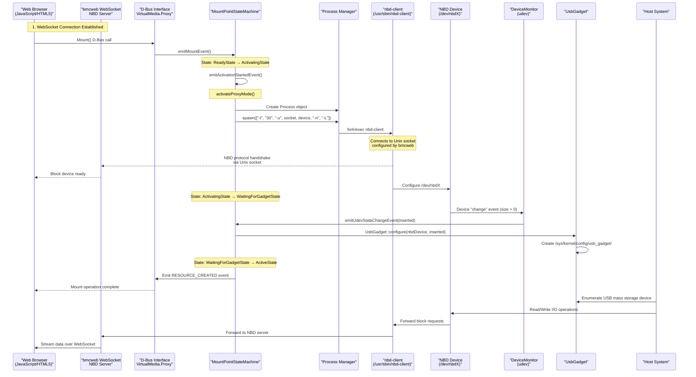
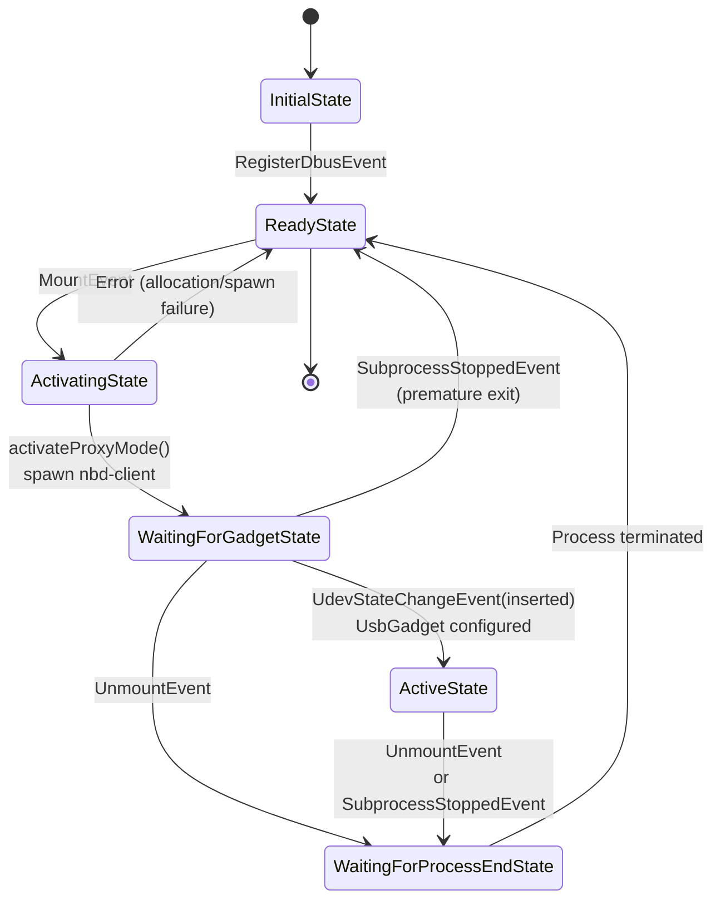
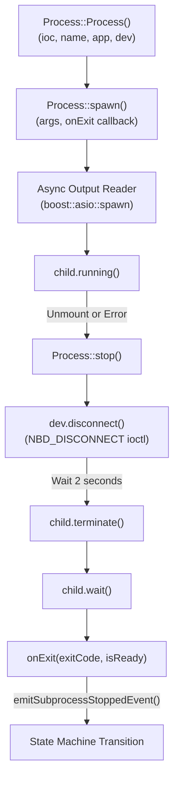

<!-- source: DeepWiki mcp.deepwiki.com · repo NVIDIA/remote-media · page 4.2 Proxy Mode · fetched 2026-10-26 -->

# Proxy Mode

<details>
<summary>Relevant source files</summary>

The following files were used as context for generating this wiki page:

- [src/configuration.hpp](src/configuration.hpp)
- [src/state_machine.hpp](src/state_machine.hpp)
- [src/system.hpp](src/system.hpp)

</details>


## Purpose and Scope

This document describes the **Proxy Mode** (Mode 0) operational mode of the virtual media service. Proxy Mode enables browser-initiated virtual media mounting through JavaScript/HTML5 applications that communicate via Secure WebSockets to an HTTPS endpoint hosted by bmcweb on the BMC. This mode uses the `nbd-client` process to connect to an external NBD server rather than serving images directly from CIFS shares or HTTPS URLs.

For information about the alternative operational mode that serves images from CIFS/HTTPS sources, see [Legacy Mode](#4.1). For general information about the state machine that orchestrates both modes, see [MountPointStateMachine](#3.1).

---

## Overview

Proxy Mode is designed for modern web-based virtual media workflows where a browser-based application (typically running in bmcweb) establishes a WebSocket connection to stream block device data. Unlike Legacy Mode, which retrieves images from remote storage locations, Proxy Mode acts as a client that connects to an NBD server endpoint that is already serving the image data.

**Key Characteristics:**
- **Mode identifier:** `0` in configuration
- **Process used:** `/usr/sbin/nbd-client`
- **Initiation:** Browser-based, through JavaScript/HTML5
- **D-Bus interface:** `xyz.openbmc_project.VirtualMedia.Proxy`
- **Mount method signature:** Parameterless `Mount()` - configuration is pre-defined
- **Communication:** Secure WebSockets to bmcweb HTTPS endpoint

**Sources:** [src/configuration.hpp:17-28](), [src/state_machine.hpp:612-643]()

---

## Configuration

Proxy Mode mount points are defined in the `virtual-media.json` configuration file with `"Mode": 0`.

### Configuration Schema

| Field | Type | Required | Description |
|-------|------|----------|-------------|
| `Mode` | integer | Yes | Must be `0` for proxy mode |
| `NBDDevice` | string | Yes | NBD device to use (e.g., `"nbd0"`) |
| `UnixSocket` | string | Yes | Unix domain socket path for IPC (e.g., `"/tmp/nbd0.sock"`) |
| `EndpointId` | string | Yes | Identifier for the endpoint (e.g., `"USB1"`) |
| `Timeout` | integer | Optional | Connection timeout in seconds |
| `BlockSize` | integer | Optional | Block size for NBD operations |

### Example Configuration

```json
{
  "MountPoints": {
    "USB1": {
      "Mode": 0,
      "NBDDevice": "nbd1",
      "UnixSocket": "/tmp/nbd1.sock",
      "EndpointId": "USB1",
      "Timeout": 30,
      "BlockSize": 512
    }
  }
}
```

The configuration is loaded and validated during application startup by the `Configuration` class.

**Sources:** [src/configuration.hpp:17-28](), [src/configuration.hpp:193-221]()

---

## D-Bus Interface

Each proxy mode mount point exposes three D-Bus interfaces under the path `/xyz/openbmc_project/VirtualMedia/Proxy/{EndpointId}`.

### Interface: xyz.openbmc_project.VirtualMedia.Proxy

This interface provides the mount/unmount operations specific to proxy mode.

#### Methods

| Method | Parameters | Returns | Description |
|--------|------------|---------|-------------|
| `Mount` | None | `boolean` | Initiates proxy mode activation. Returns `true` on success, `false` on failure. Configuration (socket path, NBD device) is read from pre-defined settings. |
| `Unmount` | None | `boolean` | Stops the nbd-client process and removes the USB gadget. Returns `true` on success. |

The key difference from Legacy Mode is that `Mount()` takes **no parameters**. All configuration (Unix socket path, NBD device, timeouts) is pre-configured in the mount point configuration.

**Sources:** [src/state_machine.hpp:500-513](), [src/state_machine.hpp:353-393]()

### Interface: xyz.openbmc_project.VirtualMedia.MountPoint

Provides runtime status and configuration information.

#### Properties

| Property | Type | Access | Description |
|----------|------|--------|-------------|
| `Device` | string | Read-only | NBD device path (e.g., `"/dev/nbd1"`) |
| `EndpointId` | string | Read-only | Endpoint identifier from configuration |
| `Socket` | string | Read-only | Unix socket path for NBD communication |
| `ImageURL` | string | Read-only | Always empty in proxy mode (not applicable) |
| `User` | string | Read-only | Always empty in proxy mode (no authentication) |
| `WriteProtected` | boolean | Read-only | Write protection status |

**Sources:** [src/state_machine.hpp:291-351]()

### Interface: xyz.openbmc_project.VirtualMedia.Process

Provides process lifecycle information.

#### Properties

| Property | Type | Access | Description |
|----------|------|--------|-------------|
| `Active` | boolean | Read-only | `true` if in `ActiveState`, `false` otherwise |
| `ExitCode` | integer | Read-only | Exit code of the nbd-client process (or `-1` if not yet terminated) |
| `CDInstance` | integer | Read/Write | CD instance number (unused in proxy mode) |

**Sources:** [src/state_machine.hpp:254-289]()

---

## Activation Flow

### Title: Proxy Mode Mount Operation Sequence



**Sources:** [src/state_machine.hpp:619-643](), [src/state_machine.hpp:910-937]()

---

## State Machine Integration

### Proxy Mode State Transitions

Proxy mode follows the standard state machine flow with specific behavior in the `ActivatingState`:



**Sources:** [src/state_machine.hpp:619-643](), [src/state_machine.hpp:75-160]()

### activateProxyMode Function

The `activateProxyMode` function is called when the state machine receives an `ActivationStartedEvent` in the `ActivatingState` with mode set to `proxy`.

**Function:** `ActivationStartedEvent::activateProxyMode`

**Location:** [src/state_machine.hpp:619-643]()

**Process:**
1. Creates a `Process` object for `/usr/sbin/nbd-client`
2. Converts mount point configuration to command-line arguments via `Configuration::MountPoint::toArgs()`
3. Spawns the nbd-client process with arguments: `-t 30 -u {unixSocket} {nbdDevice} -n -L`
4. Registers exit callback that calls `emitSubprocessStoppedEvent()`
5. Transitions to `WaitingForGadgetState` with process reference
6. Returns `ReadyState` with error on any failure

**Argument Breakdown:**
- `-t 30`: Timeout of 30 seconds
- `-u {unixSocket}`: Connect to Unix domain socket (e.g., `/tmp/nbd1.sock`)
- `{nbdDevice}`: NBD device path (e.g., `/dev/nbd1`)
- `-n`: No fork (run in foreground)
- `-L`: Enable LFS (large file support)

**Sources:** [src/state_machine.hpp:619-643](), [src/configuration.hpp:39-44]()

---

## Process Management

### nbd-client Process

The `nbd-client` process is the core component in proxy mode, acting as an NBD protocol client that connects to the NBD server endpoint.

**Executable:** `/usr/sbin/nbd-client`

**Spawning:** [src/state_machine.hpp:621-639]()

The `Process` class manages the nbd-client subprocess lifecycle:



**Sources:** [src/system.hpp:356-481](), [src/state_machine.hpp:621-639]()

### Process Lifecycle Details

#### Spawning
[src/system.hpp:365-441]()

The `Process::spawn()` method:
1. Spawns the nbd-client process using Boost.Process
2. Redirects stdout and stderr to an async pipe for logging
3. Creates an async coroutine to read output line-by-line
4. Waits for process termination and invokes the exit callback

#### Output Monitoring
[src/system.hpp:382-439]()

A Boost.Asio coroutine continuously reads from the process output pipe:
- Reads until newline character
- Logs each line at Debug level with mount point name prefix
- Continues until pipe closes (process exits)
- Waits up to 2 seconds for graceful termination

#### Termination
[src/system.hpp:443-467]()

The `Process::stop()` method:
1. Calls `dev.disconnect()` to send `NBD_DISCONNECT` ioctl to the NBD device
2. Waits up to 2 seconds for process to exit naturally
3. Calls `child.terminate()` if still running
4. Executes asynchronously using `boost::asio::spawn` with `boost::asio::detached`

**Sources:** [src/system.hpp:356-481]()

---

## NBD Device Management

### Device Monitoring

The `DeviceMonitor` class tracks NBD device state changes through udev events.

**Title: NBD Device State Detection Flow**

```mermaid
graph LR
    udev["udev Kernel Events"]
    monitor["udev_monitor<br/>(block/disk subsystem)"]
    async["Async Event Loop<br/>(boost::asio::spawn)"]
    filter["Filter 'change' events"]
    checkSize["Check size attribute"]
    stateTrack["Update device state<br/>(StateChange enum)"]
    callback["DeviceMonitor callback"]
    stateMachine["MountPointStateMachine<br/>emitUdevStateChangeEvent()"]

    udev --> monitor
    monitor --> async
    async --> filter
    filter --> checkSize
    checkSize --> |"size > 0"| stateTrack
    checkSize --> |"size == 0"| stateTrack
    stateTrack --> callback
    callback --> stateMachine
```



**Key Logic:** [src/system.hpp:306-323]()
- `size > 0` and current state != `inserted` → transition to `StateChange::inserted`
- `size == 0` and current state != `removed` → transition to `StateChange::removed`

The state machine only acts on `inserted` events in `WaitingForGadgetState`, configuring the USB gadget to expose the NBD device to the host.

**Sources:** [src/system.hpp:191-354](), [src/state_machine.hpp:910-937]()

---

## USB Gadget Configuration

When the NBD device becomes available (size > 0), the state machine configures the USB mass storage gadget.

**Function:** `UsbGadget::configure()`

**Location:** [src/system.hpp:501-625]()

**Configuration Steps:**
1. Create gadget directory: `/sys/kernel/config/usb_gadget/mass-storage-{name}`
2. Set USB vendor/product IDs (0x1d6b/0x0104)
3. Create strings directory and set manufacturer/product strings
4. Create mass storage function: `functions/mass_storage.usb0`
5. Configure LUN properties:
   - `lun.0/removable = 1`
   - `lun.0/ro = 0 or 1` (based on write protection)
   - `lun.0/cdrom = 0`
   - `lun.0/file = {nbdDevice.to_path()}`
6. Bind to available USB port in `/sys/bus/platform/devices/1e6a0000.usb-vhub`

After successful configuration, the state machine transitions from `WaitingForGadgetState` to `ActiveState`.

**Sources:** [src/system.hpp:498-626](), [src/state_machine.hpp:915-932]()

---

## Comparison with Legacy Mode

| Aspect | Proxy Mode | Legacy Mode |
|--------|-----------|-------------|
| **Mode ID** | `0` | `1` |
| **Process** | `nbd-client` | `nbdkit` |
| **Initiation** | Browser (JavaScript/HTML5) | Redfish API |
| **Image Source** | External NBD server (via WebSocket) | CIFS share or HTTPS URL |
| **D-Bus Interface** | `VirtualMedia.Proxy` | `VirtualMedia.Legacy` |
| **Mount() Parameters** | None (pre-configured) | `imgUrl`, `rw`, `credentials` |
| **Credentials** | Not used | Supported via Unix file descriptor |
| **Communication** | Unix socket to bmcweb NBD server | Direct network access (SMB/HTTPS) |
| **Configuration** | Socket path, NBD device | SMB mount options, HTTP headers |
| **Primary Use Case** | Browser-initiated VM media | Enterprise management tools |

**Sources:** [src/state_machine.hpp:619-643](), [src/state_machine.hpp:645-720](), [src/configuration.hpp:17-28]()

---

## Error Handling

### Common Failure Scenarios

**Process Allocation Failure**
- **State transition:** `ActivatingState` → `ReadyState(operation_canceled, "Failed to allocate process")`
- **Location:** [src/state_machine.hpp:625-628]()

**Process Spawn Failure**
- **State transition:** `ActivatingState` → `ReadyState(operation_canceled, "Failed to spawn process")`
- **Location:** [src/state_machine.hpp:636-639]()

**Premature Process Exit**
- **Trigger:** `SubprocessStoppedEvent` in `WaitingForGadgetState`
- **State transition:** `WaitingForGadgetState` → `ReadyState(io_error, "Process ended prematurely")`
- **Location:** [src/state_machine.hpp:585-590]()

**USB Gadget Configuration Failure**
- **Trigger:** `UdevStateChangeEvent(inserted)` with configure failure
- **State transition:** `WaitingForGadgetState` → `ReadyState(device_or_resource_busy, "Unable to configure gadget")`
- **Location:** [src/state_machine.hpp:930-932]()

**Sources:** [src/state_machine.hpp:577-603](), [src/state_machine.hpp:910-937]()

---

## Code Integration Points

### Key Classes and Functions

**Configuration Loading:**
- `Configuration::Mode::proxy` enumeration: [src/configuration.hpp:22]()
- Mode validation: [src/configuration.hpp:193-227]()

**State Machine:**
- Mode check: [src/state_machine.hpp:612]()
- `activateProxyMode()` function: [src/state_machine.hpp:619-643]()
- D-Bus interface registration (proxy): [src/state_machine.hpp:353-513]()

**Process Management:**
- `Process` class: [src/system.hpp:356-481]()
- Process spawning: [src/system.hpp:365-441]()
- Process termination: [src/system.hpp:443-467]()

**Device Management:**
- `NBDDevice` class: [src/system.hpp:58-181]()
- `DeviceMonitor` class: [src/system.hpp:191-354]()
- `UsbGadget::configure()`: [src/system.hpp:498-626]()

**Command-Line Arguments:**
- `Configuration::MountPoint::toArgs()`: [src/configuration.hpp:39-44]()

**Sources:** Referenced inline above

---

