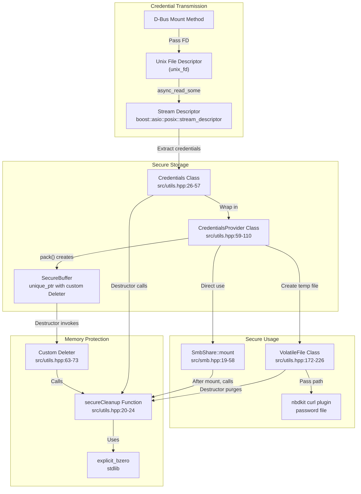
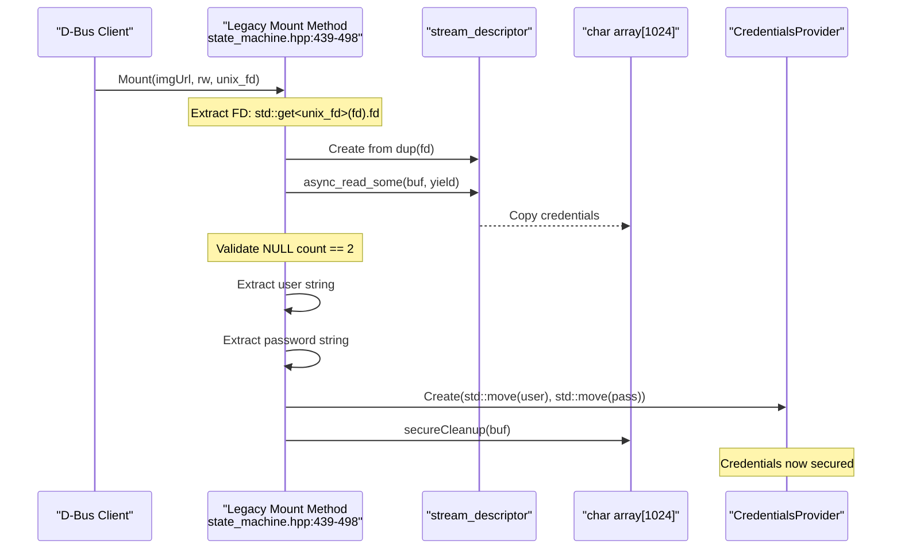
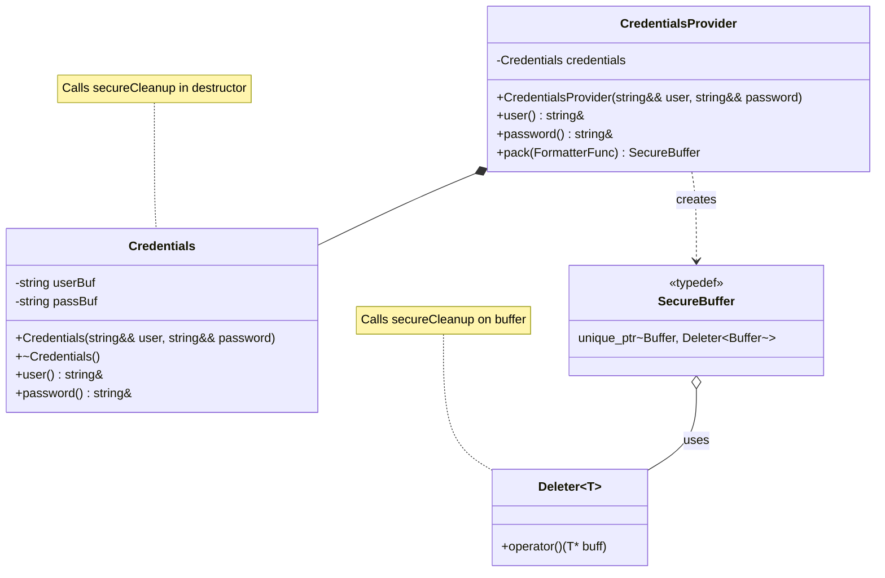
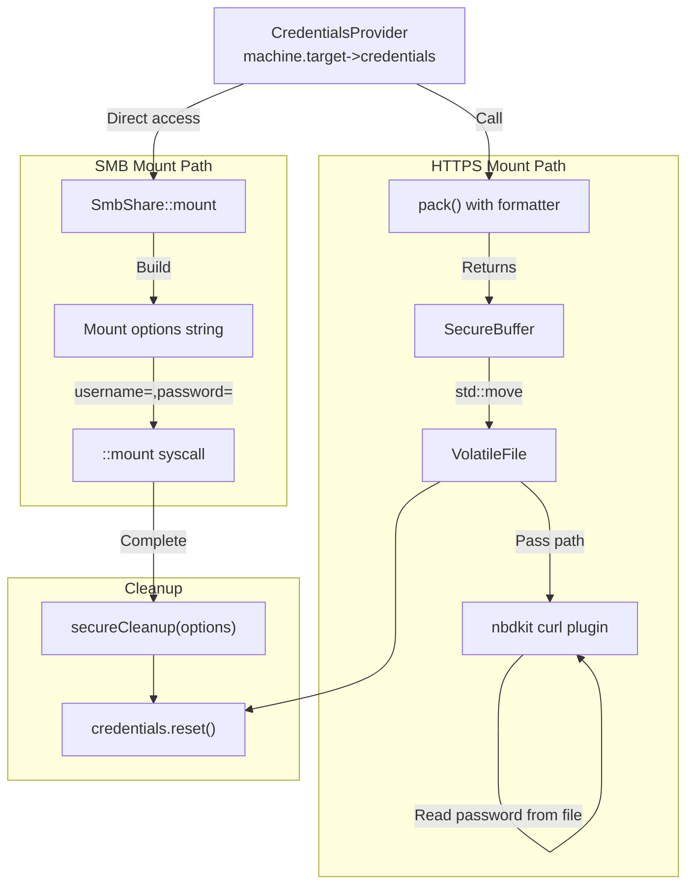
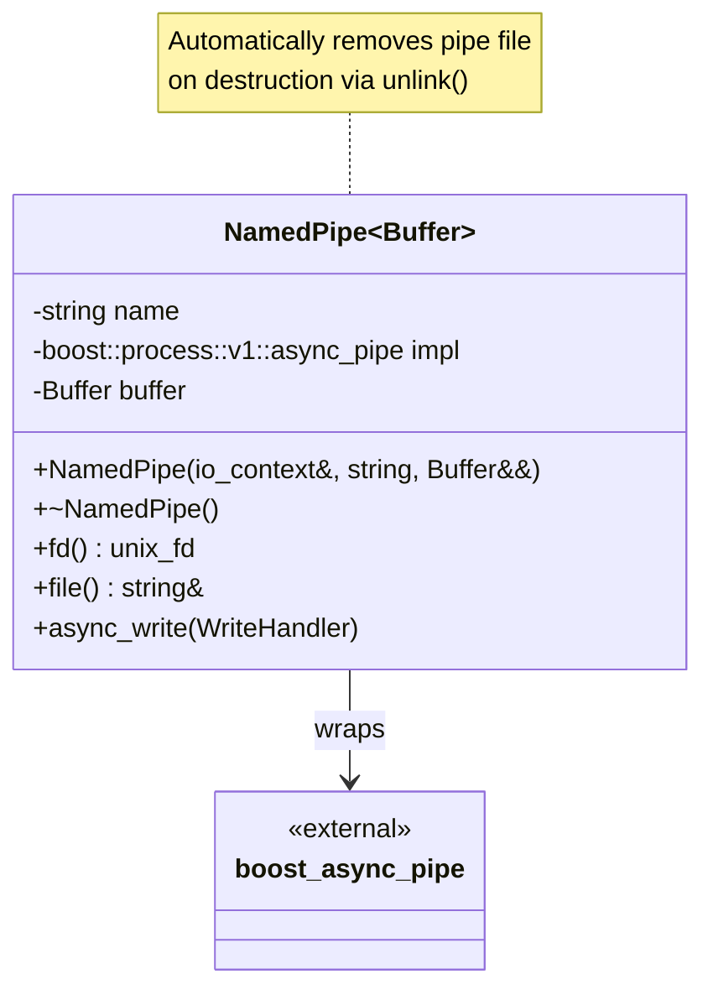
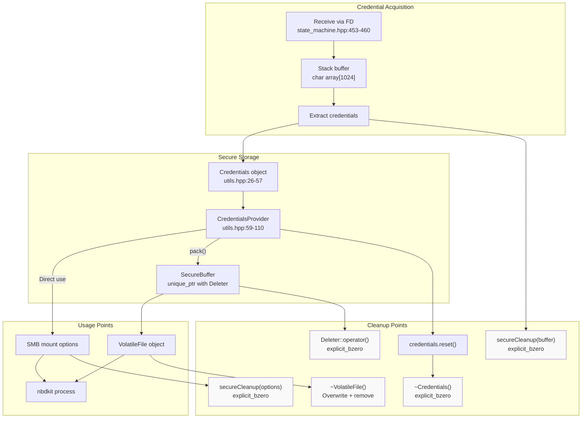

<!-- source: DeepWiki mcp.deepwiki.com · repo NVIDIA/remote-media · page 5 Security · fetched 2026-10-26 -->

# Security

<details>
<summary>Relevant source files</summary>

The following files were used as context for generating this wiki page:

- [src/smb.hpp](src/smb.hpp)
- [src/state_machine.hpp](src/state_machine.hpp)
- [src/utils.hpp](src/utils.hpp)

</details>


## Purpose and Scope

This document describes the comprehensive security architecture implemented in the remote-media service for handling sensitive data, particularly authentication credentials. The security model employs defense-in-depth strategies across credential transmission, memory management, and file system operations to prevent credential leakage through memory dumps, swap files, or file system artifacts.

For information about the mount point lifecycle and state management, see [Core Components](#3). For details about operational modes and how credentials are used during mounting, see [Operational Modes](#4).

## Security Architecture Overview

The virtual media service implements multiple layers of security controls to protect sensitive credentials throughout their lifecycle:



**Sources:** [src/utils.hpp:1-227](), [src/smb.hpp:1-102](), [src/state_machine.hpp:436-498]()

The security architecture operates on the following principles:

| Security Layer | Implementation | Purpose |
|---------------|----------------|---------|
| **Input Validation** | Credential buffer size limits, NULL delimiter counting | Prevent buffer overflows and malformed data |
| **Secure Transmission** | Unix file descriptors via D-Bus | Avoid credential exposure in D-Bus message logs |
| **Memory Protection** | `explicit_bzero`, custom deleters, RAII | Prevent recovery from memory dumps or swap |
| **Filesystem Security** | Restrictive permissions (0600), content purging | Prevent unauthorized file access and forensic recovery |
| **Process Isolation** | Unix domain sockets for IPC | Avoid network-based attacks on local services |

## Credential Management

### Credential Reception via Unix File Descriptors

Credentials are transmitted from D-Bus clients using Unix file descriptors rather than embedding them in D-Bus method call parameters. This prevents credentials from appearing in D-Bus message logs or introspection tools.

The credential reception flow is implemented in the `RegisterDbusEvent::addServiceInterface` method:



**Sources:** [src/state_machine.hpp:436-498]()

The implementation performs the following security operations:

1. **File Descriptor Duplication** ([state_machine.hpp:453-455]()):
   ```cpp
   boost::asio::posix::stream_descriptor secretPipe(
       machine.ioc.get(),
       dup(std::get<unix_fd>(fd).fd));
   ```
   The FD is duplicated to ensure proper ownership and lifecycle management.

2. **Fixed-Size Buffer** ([state_machine.hpp:456]()):
   ```cpp
   std::array<char, utils::secretLimit> buf;
   ```
   The buffer size is limited to `utils::secretLimit` (1024 bytes) defined in [src/utils.hpp:17]().

3. **Delimiter Validation** ([state_machine.hpp:464-470]()):
   ```cpp
   auto nullCount = std::count(buf.begin(), buf.begin() + size, '\0');
   if (nullCount != 2)
   {
       throw sdbusplus::exception::SdBusError(EINVAL, "Malformed extra data");
   }
   ```
   Ensures exactly two NULL delimiters separate username, password, and buffer end.

4. **Immediate Cleanup** ([state_machine.hpp:483]()):
   ```cpp
   utils::secureCleanup(buf);
   ```
   The buffer is zeroed immediately after credential extraction.

### Credentials and CredentialsProvider Classes

The credential storage is implemented through two related classes:



**Sources:** [src/utils.hpp:26-110]()

#### Credentials Class

The `Credentials` class ([utils.hpp:26-57]()) provides basic credential storage with automatic cleanup:

| Member | Type | Purpose |
|--------|------|---------|
| `userBuf` | `std::string` | Stores username |
| `passBuf` | `std::string` | Stores password |
| Destructor | - | Calls `secureCleanup()` on both buffers |

The destructor ([utils.hpp:34-38]()) ensures credentials are zeroed:
```cpp
~Credentials()
{
    secureCleanup(userBuf);
    secureCleanup(passBuf);
}
```

Copy and assignment operations are explicitly deleted ([utils.hpp:51-53]()) to prevent accidental duplication.

#### CredentialsProvider Class

The `CredentialsProvider` class ([utils.hpp:59-110]()) wraps `Credentials` and provides additional functionality for packing credentials into secure buffers.

**Key Methods:**

- `user()` ([utils.hpp:87-91]()): Returns username reference and updates global `USER` variable
- `password()` ([utils.hpp:93-96]()): Returns password reference
- `pack(FormatterFunc)` ([utils.hpp:98-106]()): Creates a `SecureBuffer` with custom formatting

The `pack` method enables flexible credential formatting for different use cases (e.g., nbdkit password files):

```cpp
SecureBuffer pack(const FormatterFunc formatter)
{
    SecureBuffer packed{new Buffer{}};
    if (formatter)
    {
        formatter(credentials.user(), credentials.password(), *packed);
    }
    return packed;
}
```

**Usage Example in HTTPS Mounting** ([state_machine.hpp:817-833]()):
```cpp
utils::CredentialsProvider::SecureBuffer buff =
    machine.target->credentials->pack(
        [](const std::string& user, const std::string& pass,
           std::vector<char>& buff) {
            std::copy(pass.begin(), pass.end(),
                      std::back_inserter(buff));
        });

secret = std::make_unique<utils::VolatileFile>(std::move(buff));
params.push_back("user=" + machine.target->credentials->user());
params.push_back("password=+" + secret->path());
```

#### Custom Deleter

The `Deleter` template ([utils.hpp:63-73]()) ensures automatic memory cleanup:

```cpp
template <typename T>
struct Deleter
{
    void operator()(T* buff) const
    {
        if (buff)
        {
            secureCleanup(*buff);
            delete buff;
        }
    }
};
```

This deleter is used in the `SecureBuffer` typedef ([utils.hpp:76]()):
```cpp
using SecureBuffer = std::unique_ptr<Buffer, Deleter<Buffer>>;
```

When the `unique_ptr` is destroyed, the deleter automatically zeros the buffer contents before freeing memory.

**Sources:** [src/utils.hpp:26-110]()

### Credential Usage in Mount Operations

Credentials flow through different paths depending on the mount type:



**Sources:** [src/smb.hpp:19-58](), [src/state_machine.hpp:665-720](), [src/state_machine.hpp:806-836]()

#### SMB Mount Credential Handling

The `SmbShare::mount` method ([smb.hpp:19-58]()) uses credentials directly in mount options:

1. **Build Credential Options** ([smb.hpp:29-40]()):
   ```cpp
   std::string credentialsOpt;
   if (!credentials)
   {
       credentialsOpt = "guest,username=OpenBmc";
   }
   else
   {
       credentialsOpt = "username=" + credentials->user() +
                        ",password=" + credentials->password();
   }
   ```

2. **Combine with Mount Options** ([smb.hpp:42]()):
   ```cpp
   options += "," + credentialsOpt;
   ```

3. **Perform Mount** ([smb.hpp:44-45]()):
   ```cpp
   auto ec = ::mount(remote.c_str(), mountDir.c_str(), "cifs", 0,
                     options.c_str());
   ```

4. **Immediate Cleanup** ([smb.hpp:47-48]()):
   ```cpp
   utils::secureCleanup(options);
   utils::secureCleanup(credentialsOpt);
   ```

Both the full options string and the credentials portion are zeroed immediately after the mount syscall completes.

#### HTTPS Mount Credential Handling

For HTTPS mounts, credentials are passed to nbdkit via a temporary file ([state_machine.hpp:806-836]()):

1. **Pack Password into Buffer**:
   ```cpp
   utils::CredentialsProvider::SecureBuffer buff =
       machine.target->credentials->pack(
           [](const std::string& user, const std::string& pass,
              std::vector<char>& buff) {
               std::copy(pass.begin(), pass.end(),
                         std::back_inserter(buff));
           });
   ```

2. **Create Volatile File**:
   ```cpp
   secret = std::make_unique<utils::VolatileFile>(std::move(buff));
   ```

3. **Pass to nbdkit**:
   ```cpp
   params.push_back("user=" + machine.target->credentials->user());
   params.push_back("password=+" + secret->path());
   ```

The `VolatileFile` is held as a lambda capture in the process callback ([state_machine.hpp:781-786]()), ensuring it remains alive until the process completes.

**Sources:** [src/smb.hpp:19-58](), [src/state_machine.hpp:665-720](), [src/state_machine.hpp:806-836]()

## Secure File Handling

### VolatileFile Class

The `VolatileFile` class ([utils.hpp:172-226]()) creates temporary files with secure content handling and guaranteed cleanup:

```mermaid
stateDiagram-v2
    [*] --> Construction
    Construction --> FileCreation : VolatileFile(Buffer&&)
    FileCreation --> PermissionSet : create()
    PermissionSet --> ContentWrite : fs::permissions(owner_read|owner_write)
    ContentWrite --> InUse : Write buffer contents
    
    InUse --> Destruction : Object destroyed
    Destruction --> ContentPurge : Overwrite with '*'
    ContentPurge --> FileRemoval : fs::remove()
    FileRemoval --> [*]
    
    note right of PermissionSet
        Restrict to 0600
        Owner read/write only
    end note
    
    note right of ContentPurge
        Write '*' characters
        to overwrite sensitive data
    end note
```

**Sources:** [src/utils.hpp:172-226]()

#### File Creation and Permissions

The constructor ([utils.hpp:177-183]()) performs secure file initialization:

```cpp
VolatileFile(Buffer&& contents) :
    filePath(fs::temp_directory_path() / std::tmpnam(nullptr)),
    size(contents->size())
{
    auto data = std::move(contents);
    create(filePath, data);
}
```

The `create` method ([utils.hpp:210-222]()) sets restrictive permissions:

```cpp
static void create(const std::string& filePath, const Buffer& data)
{
    // Create file
    std::ofstream file(filePath);

    // Limit permissions to owner only
    fs::permissions(filePath,
                    fs::perms::owner_read | fs::perms::owner_write,
                    fs::perm_options::replace);

    // Write contents
    file.write(data->data(), data->size());
}
```

The permissions are set to `0600` (owner read/write only) before any content is written, preventing other users from accessing the file.

#### Content Purging on Destruction

The destructor ([utils.hpp:185-202]()) implements secure file deletion by overwriting contents:

```cpp
~VolatileFile()
{
    // Purge file contents
    std::array<char, secretLimit> buf;
    buf.fill('*');
    std::ofstream file(filePath);
    std::size_t bytesWritten = 0, bytesToWrite = 0;

    while (bytesWritten < size)
    {
        bytesToWrite = std::min(secretLimit, (size - bytesWritten));
        file.write(buf.data(), bytesToWrite);
        bytesWritten += bytesToWrite;
    }

    // Remove leftover file
    fs::remove(filePath);
}
```

This prevents forensic recovery of file contents from the filesystem. The file is overwritten with asterisks before deletion.

**Sources:** [src/utils.hpp:172-226]()

### NamedPipe Class

The `NamedPipe` class ([utils.hpp:113-170]()) provides secure inter-process communication via Unix domain sockets:



**Sources:** [src/utils.hpp:113-170]()

#### Lifecycle Management

The constructor ([utils.hpp:119-124]()) creates the named pipe:
```cpp
NamedPipe(boost::asio::io_context& io, const std::string name,
          Buffer&& buffer) :
    name(name),
    impl(io, name), buffer{std::move(buffer)}
{
}
```

The destructor ([utils.hpp:126-131]()) ensures cleanup:
```cpp
~NamedPipe()
{
    // Named pipe needs to be explicitly removed
    impl.close();
    ::unlink(name.c_str());
}
```

This RAII pattern guarantees that the named pipe file is removed from the filesystem even if exceptions occur.

#### Asynchronous Write Operations

The `async_write` method ([utils.hpp:143-147]()) supports asynchronous operations:
```cpp
template <typename WriteHandler>
void async_write(WriteHandler&& handler)
{
    impl.async_write_some(data(), std::forward<WriteHandler>(handler));
}
```

The `data()` method is specialized for pointer and non-pointer buffer types ([utils.hpp:149-165]()).

**Sources:** [src/utils.hpp:113-170]()

### Temporary Mount Directories

The `SmbShare::createMountDir` method ([smb.hpp:60-78]()) creates temporary mount directories with automatic cleanup:

```cpp
static std::optional<fs::path> createMountDir(const fs::path& name)
{
    auto destPath = fs::temp_directory_path() / name;
    std::error_code ec;

    if (fs::exists(destPath))
    {
        unmount(destPath);
    }

    if (fs::create_directory(destPath, ec))
    {
        return destPath;
    }

    LogMsg(Logger::Error, ec,
           " : Unable to create mount directory: ", destPath);
    return {};
}
```

The directory inherits the system's default temporary directory permissions. The directory path uses the mount point name to enable identification and cleanup.

The `unmount` method ([smb.hpp:80-97]()) ensures complete cleanup:
```cpp
static void unmount(const fs::path& mountDir)
{
    int result;
    std::error_code ec;

    result = ::umount(mountDir.string().c_str());
    if (result)
    {
        LogMsg(Logger::Error, result, " : Unable to unmout directory ",
               mountDir);
    }

    if (!fs::remove_all(mountDir, ec))
    {
        LogMsg(Logger::Error, ec, " : Unable to remove mount directory ",
               mountDir);
    }
}
```

**Sources:** [src/smb.hpp:60-97]()

## Memory Protection

### secureCleanup Function

The `secureCleanup` function template ([utils.hpp:20-24]()) provides cryptographic-grade memory zeroing:

```cpp
template <typename T>
static void secureCleanup(T& value)
{
    auto raw = const_cast<typename T::value_type*>(&value[0]);
    explicit_bzero(raw, value.size() * sizeof(*raw));
}
```

This function uses `explicit_bzero` from the C standard library, which guarantees that the compiler will not optimize away the memory clearing operation. This is critical for security because standard `memset` calls can be removed by optimizing compilers if the memory is never read again.

### Memory Protection Flow

The complete memory protection strategy is illustrated below:



**Sources:** [src/utils.hpp:20-24](), [src/utils.hpp:26-110](), [src/state_machine.hpp:436-498](), [src/smb.hpp:19-58]()

### Cleanup Invocation Points

Memory cleanup occurs at multiple strategic points:

| Location | Trigger | Method | Data Cleaned |
|----------|---------|--------|--------------|
| [state_machine.hpp:483]() | After credential extraction | `secureCleanup(buf)` | Stack buffer containing credentials |
| [smb.hpp:47-48]() | After mount syscall | `secureCleanup(options)` | Mount options string with password |
| [smb.hpp:48]() | After mount syscall | `secureCleanup(credentialsOpt)` | Credential options substring |
| [utils.hpp:36-37]() | Credentials destructor | `secureCleanup(userBuf/passBuf)` | Username and password strings |
| [utils.hpp:69]() | SecureBuffer deletion | `secureCleanup(*buff)` | Packed credential buffer |
| [state_machine.hpp:489]() | After mount completion | `credentials.reset()` | Entire CredentialsProvider |
| [state_machine.hpp:494]() | On mount error | `credentials.reset()` | Entire CredentialsProvider |

### RAII Pattern for Automatic Cleanup

The system employs RAII (Resource Acquisition Is Initialization) throughout to ensure cleanup occurs even when exceptions are thrown:

1. **Credentials Class** ([utils.hpp:26-57]()): Destructor automatically zeroes buffers
2. **CredentialsProvider** ([utils.hpp:59-110]()): Wraps Credentials, cleanup propagates
3. **SecureBuffer** ([utils.hpp:76]()): Custom deleter invoked on `unique_ptr` destruction
4. **VolatileFile** ([utils.hpp:172-226]()): Destructor purges file contents then removes file
5. **NamedPipe** ([utils.hpp:113-170]()): Destructor removes pipe file from filesystem

### Defense Against Recovery Attacks

The multi-layered cleanup strategy defends against several attack vectors:

| Attack Vector | Defense | Implementation |
|--------------|---------|----------------|
| **Memory dump** | `explicit_bzero` zeroing | [utils.hpp:23]() |
| **Swap file** | Immediate cleanup after use | [state_machine.hpp:483](), [smb.hpp:47-48]() |
| **Core dump** | RAII ensures cleanup even on crashes | All destructors |
| **Filesystem forensics** | Overwrite before deletion | [utils.hpp:188-198]() |
| **Process memory** | Multiple cleanup points | Various locations |
| **String temporaries** | Move semantics, immediate cleanup | [utils.hpp:29-32](), [smb.hpp:38-39]() |

The combination of `explicit_bzero`, RAII, file content purging, and restrictive permissions provides comprehensive protection against both active attacks and forensic recovery attempts.

**Sources:** [src/utils.hpp:20-24](), [src/utils.hpp:26-227](), [src/smb.hpp:19-58](), [src/state_machine.hpp:436-498]()

---

