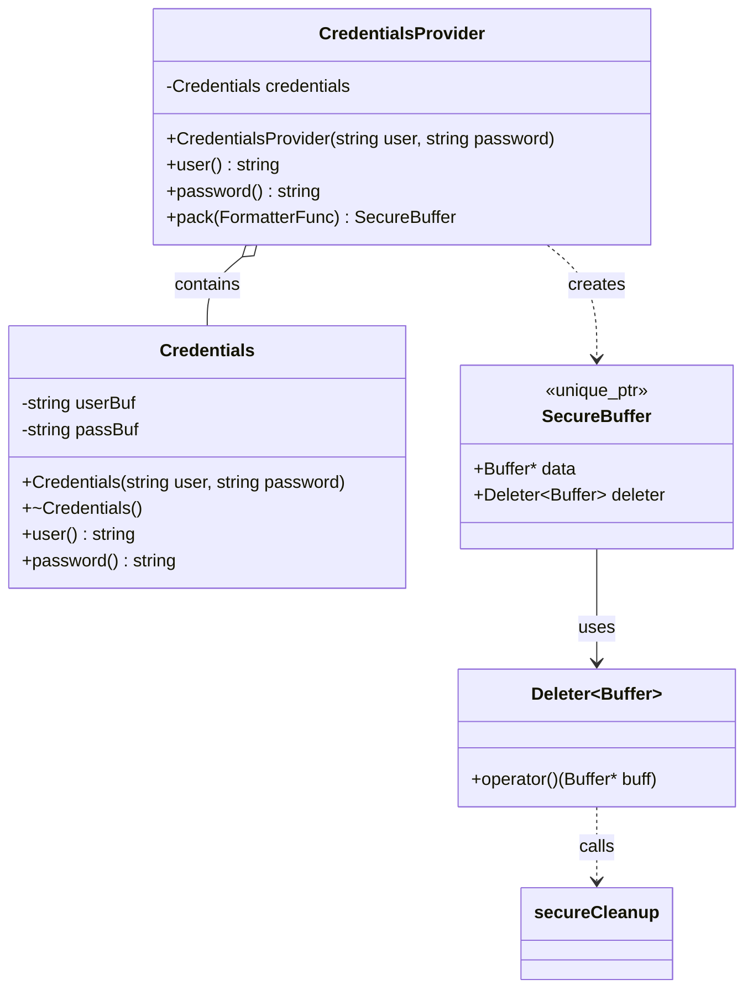
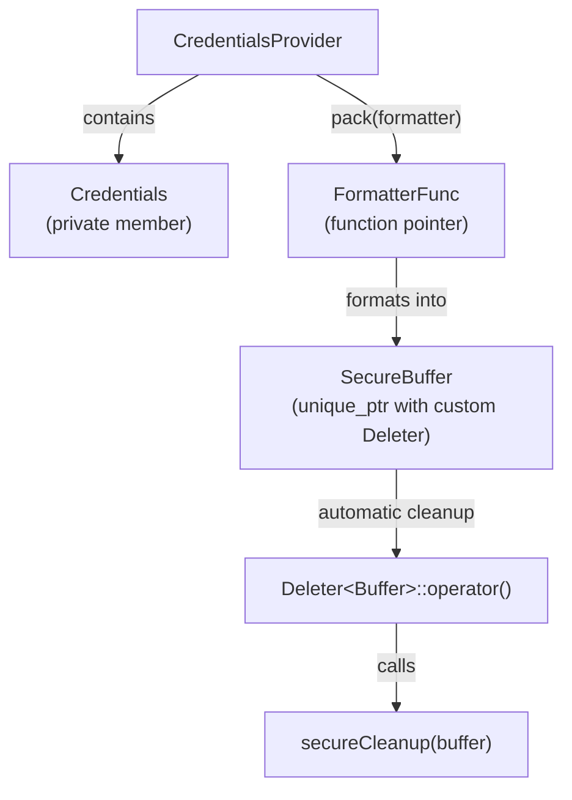
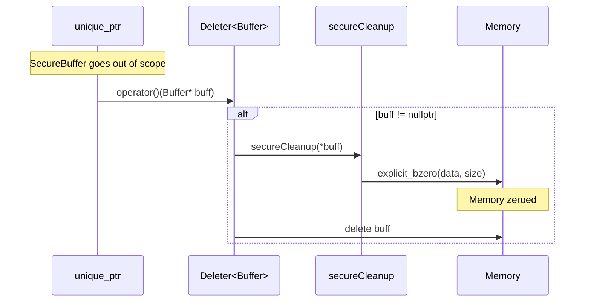
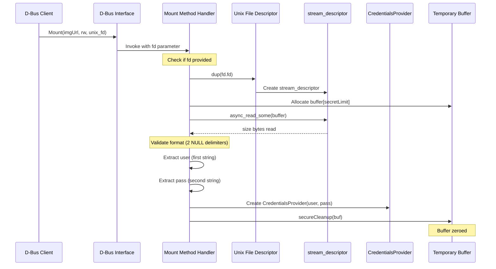
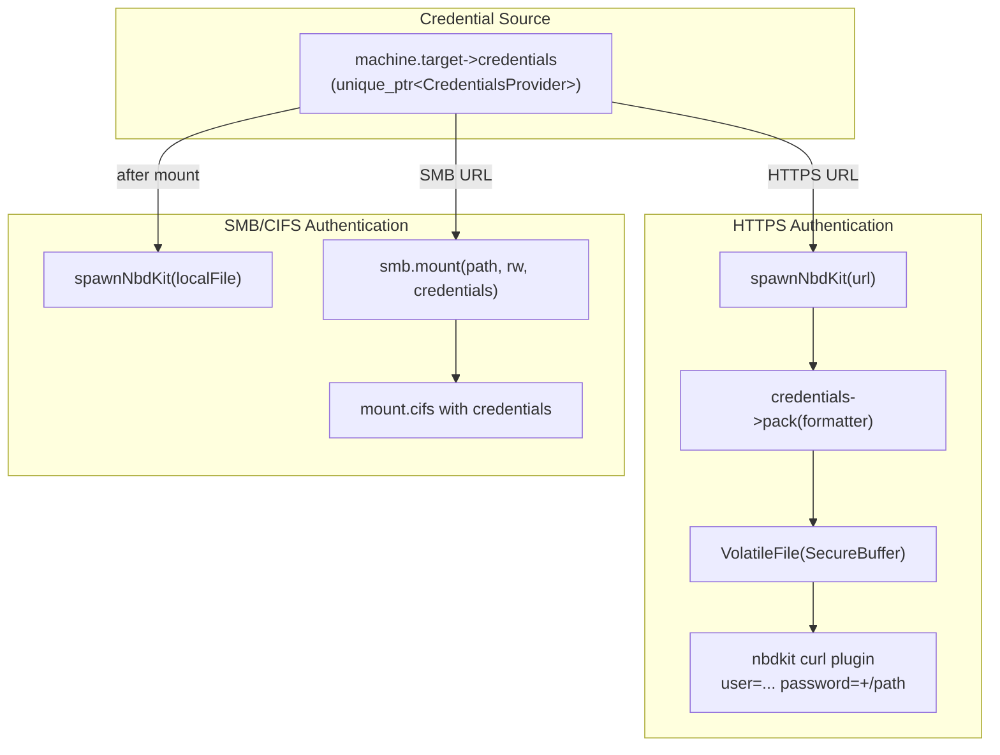
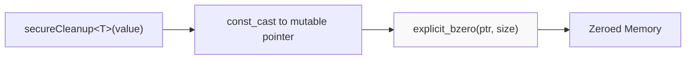
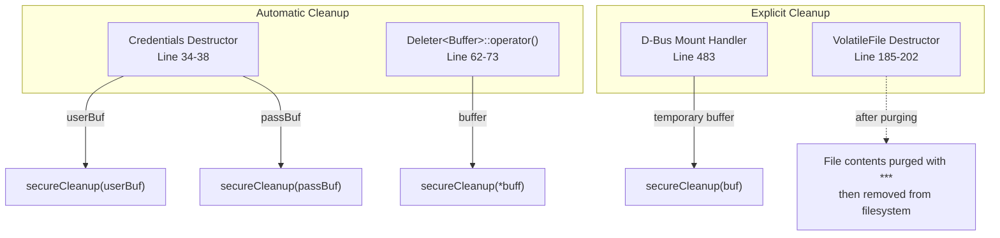
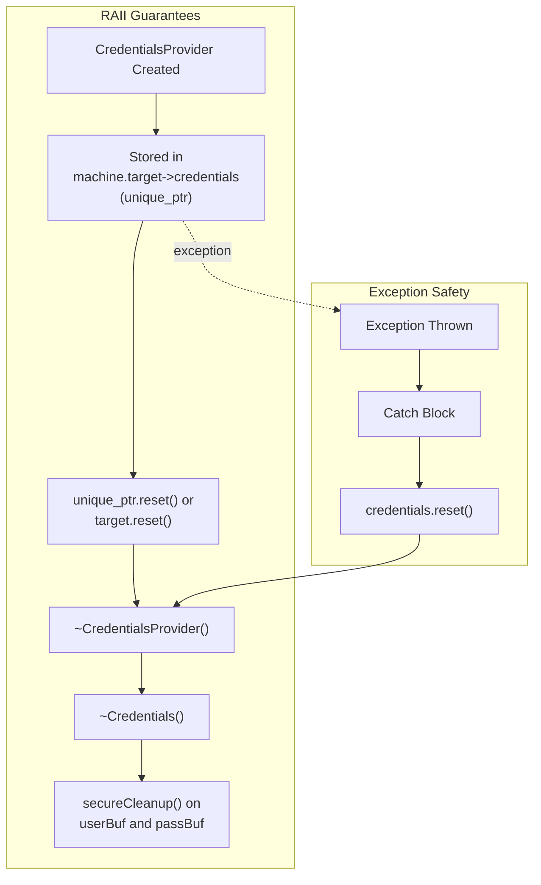
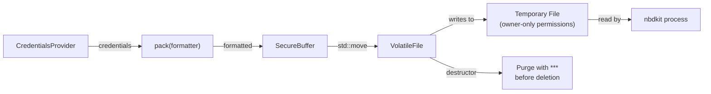

<!-- source: DeepWiki mcp.deepwiki.com · repo NVIDIA/remote-media · page 5.1 Credential Management · fetched 2026-10-26 -->

# Credential Management

<details>
<summary>Relevant source files</summary>

The following files were used as context for generating this wiki page:

- [src/state_machine.hpp](src/state_machine.hpp)
- [src/utils.hpp](src/utils.hpp)

</details>


## Purpose and Scope

This page documents the secure credential handling mechanisms used throughout the virtual media service. The system provides defense-in-depth protection for sensitive authentication data (usernames and passwords) through secure storage, automatic memory cleanup, and temporary file management with restricted permissions.

This page covers the core credential classes (`Credentials`, `CredentialsProvider`) and secure file handling (`VolatileFile`). For broader memory protection strategies and secure cleanup functions, see [Memory Protection](#5.3). For complete secure file handling including Unix domain sockets, see [Secure File Handling](#5.2).

## Credential Classes

### Class Hierarchy

The credential management system consists of two main classes that work together to provide secure credential storage and flexible formatting:



**Sources:** [src/utils.hpp:26-110]()

### Credentials Class

The `Credentials` class provides basic secure storage for username and password pairs. It ensures that credential strings are automatically zeroed when the object is destroyed.

| Feature | Implementation |
|---------|----------------|
| Storage | Two private `std::string` members: `userBuf` and `passBuf` |
| Construction | Move semantics only - prevents accidental copies |
| Destruction | Automatic cleanup via `secureCleanup()` on both buffers |
| Access | Read-only via `user()` and `password()` methods |
| Copy Prevention | Deleted copy constructor and assignment operator |

**Key Implementation Details:**

- **Constructor:** [src/utils.hpp:29-32]() accepts credentials via move semantics, taking ownership of the strings
- **Destructor:** [src/utils.hpp:34-38]() calls `secureCleanup()` on both `userBuf` and `passBuf` to zero memory
- **Copy Prevention:** [src/utils.hpp:51-53]() explicitly deletes copy operations to prevent credential duplication

**Sources:** [src/utils.hpp:26-57]()

### CredentialsProvider Class

The `CredentialsProvider` class extends credential handling with a flexible packing mechanism that allows credentials to be formatted for different external tools (e.g., nbdkit, mount.cifs).



**Sources:** [src/utils.hpp:59-110]()

#### SecureBuffer Type

The `SecureBuffer` type ensures automatic secure cleanup of credential data:

```cpp
using Buffer = std::vector<char>;
using SecureBuffer = std::unique_ptr<Buffer, Deleter<Buffer>>;
```

**Type Definition:** [src/utils.hpp:75-76]()

**Custom Deleter Implementation:**

The `Deleter` template [src/utils.hpp:62-73]() provides automatic secure cleanup:



**Sources:** [src/utils.hpp:62-76]()

#### FormatterFunc Mechanism

The `FormatterFunc` type [src/utils.hpp:79-80]() enables flexible credential formatting:

```cpp
using FormatterFunc = void(const std::string& username,
                           const std::string& password, Buffer& dest);
```

This allows callers to specify how credentials should be packed for different use cases:

| Use Case | Formatter Behavior | Implementation |
|----------|-------------------|----------------|
| nbdkit password file | Copy only password to buffer | [src/state_machine.hpp:822-826]() |
| SMB mount credentials | Custom formatting (username:password format) | Used via `CredentialsProvider` |

**Example Usage Pattern:**

[src/state_machine.hpp:820-826]() demonstrates packing credentials for nbdkit:

```cpp
utils::CredentialsProvider::SecureBuffer buff =
    machine.target->credentials->pack(
        [](const std::string& user, const std::string& pass,
           std::vector<char>& buff) {
            std::copy(pass.begin(), pass.end(),
                      std::back_inserter(buff));
        });
```

**Sources:** [src/utils.hpp:79-80](), [src/utils.hpp:98-106](), [src/state_machine.hpp:820-826]()

## Credential Flow

### Receiving Credentials from D-Bus

Credentials are received through the D-Bus `Mount()` method using Unix file descriptors for secure inter-process transfer:



**Sources:** [src/state_machine.hpp:436-498]()

#### Credential Reception Details

The credential reception process [src/state_machine.hpp:448-484]() follows this secure pattern:

1. **File Descriptor Handling** [src/state_machine.hpp:448-455]():
   - Check if `unix_fd` variant holds a file descriptor
   - Duplicate the file descriptor using `dup()` for safe handling
   - Create a `boost::asio::posix::stream_descriptor` for async reading

2. **Buffer Allocation** [src/state_machine.hpp:456]():
   - Allocate a fixed-size buffer of `utils::secretLimit` (1024 bytes)
   - Defined at [src/utils.hpp:17]()

3. **Data Reading** [src/state_machine.hpp:459-460]():
   - Perform asynchronous read into buffer
   - Capture exact number of bytes read

4. **Format Validation** [src/state_machine.hpp:462-470]():
   - Count NULL delimiters to ensure correct format
   - Must have exactly 2 NULL characters (username\0password\0)
   - Throw `SdBusError` with `EINVAL` if validation fails

5. **String Extraction** [src/state_machine.hpp:473-475]():
   - Extract username from buffer start
   - Extract password after first NULL delimiter

6. **Secure Storage** [src/state_machine.hpp:478-480]():
   - Create `CredentialsProvider` with moved strings
   - Store in `machine.target->credentials`

7. **Cleanup** [src/state_machine.hpp:483]():
   - Call `secureCleanup()` on temporary buffer
   - Ensures credentials cannot be recovered from memory

**Sources:** [src/state_machine.hpp:448-484]()

### Using Credentials in Authentication

Credentials flow through the state machine to be used in two primary scenarios:



**Sources:** [src/state_machine.hpp:645-720]()

#### HTTPS Authentication with nbdkit

For HTTPS image sources, credentials are formatted into a temporary file and passed to nbdkit's curl plugin:

**Implementation:** [src/state_machine.hpp:806-836]()

| Step | Action | Code Reference |
|------|--------|----------------|
| 1. Check credentials | Verify `machine.target->credentials` is set | [src/state_machine.hpp:817]() |
| 2. Pack password | Call `pack()` with lambda extracting password only | [src/state_machine.hpp:820-826]() |
| 3. Create temp file | Construct `VolatileFile` with packed buffer | [src/state_machine.hpp:829]() |
| 4. Build parameters | Add `user=` and `password=+/path` arguments | [src/state_machine.hpp:831-832]() |
| 5. Spawn nbdkit | Pass parameters to nbdkit curl plugin | [src/state_machine.hpp:835]() |

**Password File Format:**

The nbdkit curl plugin expects passwords in a file specified with the `+` prefix [src/state_machine.hpp:832](). The formatter lambda [src/state_machine.hpp:822-826]() copies only the password (not username) into the buffer:

```cpp
[](const std::string& user, const std::string& pass,
   std::vector<char>& buff) {
    std::copy(pass.begin(), pass.end(),
              std::back_inserter(buff));
}
```

**Sources:** [src/state_machine.hpp:806-836]()

#### SMB/CIFS Authentication

For SMB/CIFS shares, credentials are passed directly to the `SmbShare::mount()` method:

**Implementation:** [src/state_machine.hpp:665-704]()

The credentials flow from the state machine to the SMB mounting:

```mermaid
sequenceDiagram
    participant SM as MountPointStateMachine
    participant Smb as SmbShare
    participant Mount as mount.cifs
    participant FS as Filesystem
    
    SM->>Smb: mount(remoteParent, rw, credentials)
    Note over Smb: credentials is unique_ptr&lt;CredentialsProvider&gt;
    
    Smb->>Smb: Extract user() and password()
    Smb->>Mount: Execute with sec=ntlmsspi
    Mount->>FS: Mount remote share
    FS-->>Mount: Success/Failure
    Mount-->>Smb: Return status
    Smb-->>SM: Mount result
    
    Note over SM: Credentials remain in<br/>machine.target->credentials<br/>until mount completes
```

**Credential Lifecycle:**

- **Created:** [src/state_machine.hpp:478-480]() when received from D-Bus
- **Used:** [src/state_machine.hpp:684]() passed to `smb.mount()`
- **Cleared:** [src/state_machine.hpp:489, 494]() after mount operation completes (success or failure)

**Sources:** [src/state_machine.hpp:665-704](), [src/state_machine.hpp:684]()

## Memory Protection Mechanisms

### secureCleanup Function

The `secureCleanup()` template function [src/utils.hpp:19-24]() is the foundation of memory protection:



**Implementation Details:**

```cpp
template <typename T>
static void secureCleanup(T& value)
{
    auto raw = const_cast<typename T::value_type*>(&value[0]);
    explicit_bzero(raw, value.size() * sizeof(*raw));
}
```

| Aspect | Implementation | Purpose |
|--------|----------------|---------|
| Template parameter | `T` must be a container type | Works with `std::string`, `std::vector<char>`, etc. |
| const_cast | Obtain mutable pointer to data | Required for `explicit_bzero` |
| explicit_bzero | POSIX function that zeros memory | Cannot be optimized away by compiler |
| Size calculation | `value.size() * sizeof(*raw)` | Zeros entire memory region |

**Why explicit_bzero?**

Unlike `memset()` or manual zeroing, `explicit_bzero()` guarantees the memory is cleared even if the compiler determines the zeroing is "dead code" during optimization. This is critical for security-sensitive data.

**Sources:** [src/utils.hpp:19-24]()

### Usage Points for secureCleanup

The function is called at multiple strategic points throughout the credential lifecycle:



**Call Sites:**

1. **Credentials Destructor** [src/utils.hpp:36-37](): Automatic cleanup when `Credentials` object is destroyed
2. **SecureBuffer Deleter** [src/utils.hpp:69](): Automatic cleanup when `unique_ptr` is destroyed
3. **D-Bus Mount Handler** [src/state_machine.hpp:483](): Explicit cleanup of temporary read buffer
4. **VolatileFile** [src/utils.hpp:172-227](): Complement to file purging (though not directly called, the secure pattern is similar)

**Sources:** [src/utils.hpp:36-37](), [src/utils.hpp:69](), [src/state_machine.hpp:483]()

## RAII Pattern for Automatic Cleanup

The credential management system employs Resource Acquisition Is Initialization (RAII) throughout to ensure credentials are always cleaned up:



**Sources:** [src/utils.hpp:29-38](), [src/state_machine.hpp:486-497]()

### Exception Safety

The credential cleanup is exception-safe at multiple levels:

**D-Bus Mount Handler** [src/state_machine.hpp:486-497]():

```cpp
try
{
    auto ret = handleMount(yield, machine);
    machine.target->credentials.reset();  // Normal path
    return ret;
}
catch (...)
{
    machine.target->credentials.reset();  // Exception path
    throw;
    return false;
}
```

This ensures credentials are always cleared whether the mount succeeds or fails.

**Automatic RAII Cleanup:**

Even if the explicit `reset()` is somehow missed, the credentials will be cleaned when:

1. `machine.target` is reset (e.g., [src/state_machine.hpp:106]())
2. The `MountPointStateMachine` is destroyed
3. The program terminates

**Sources:** [src/state_machine.hpp:486-497](), [src/state_machine.hpp:96-107]()

## Integration with VolatileFile

While `VolatileFile` is covered in detail in [Secure File Handling](#5.2), its relationship to credential management warrants brief mention here:



**Key Integration Points:**

1. **Creation** [src/state_machine.hpp:829](): `VolatileFile` is constructed with the `SecureBuffer` returned by `pack()`
2. **Ownership Transfer**: The `SecureBuffer` is moved into `VolatileFile`, which takes ownership
3. **File Lifetime**: The `VolatileFile` keeps the credential file alive while nbdkit runs
4. **Automatic Cleanup**: When `VolatileFile` is destroyed, the file is purged and deleted

**Sources:** [src/state_machine.hpp:829](), [src/utils.hpp:172-227]()

## Security Properties Summary

The credential management system provides multiple layers of defense:

| Security Property | Implementation | Coverage |
|-------------------|----------------|----------|
| **No Plain-text Storage** | Credentials only in `Credentials` class members | [src/utils.hpp:29-57]() |
| **Move-only Semantics** | Deleted copy constructors | [src/utils.hpp:51-53]() |
| **Memory Zeroing** | `explicit_bzero` via `secureCleanup()` | [src/utils.hpp:19-24]() |
| **RAII Cleanup** | Automatic destructors + `unique_ptr` | Throughout |
| **Exception Safety** | try-catch with cleanup in both paths | [src/state_machine.hpp:486-497]() |
| **Temporary File Purging** | `VolatileFile` overwrites with `***` | [src/utils.hpp:186-199]() |
| **Restricted Permissions** | Owner-only read/write on temp files | [src/utils.hpp:216-218]() |
| **IPC Security** | Unix file descriptors (not network) | [src/state_machine.hpp:448-455]() |

**Defense-in-Depth Rationale:**

This multi-layered approach ensures that even if one protection mechanism fails (e.g., optimizer removing a manual memset, or an exception interrupting cleanup), other mechanisms provide backup protection. The result is that credentials cannot be recovered from:

- Memory dumps (zeroed by `explicit_bzero`)
- Swap files (zeroed before page-out)
- Filesystem artifacts (purged before deletion)
- Process listings (passed via file descriptors, not command-line arguments)

**Sources:** [src/utils.hpp:1-227](), [src/state_machine.hpp:436-836]()

---

