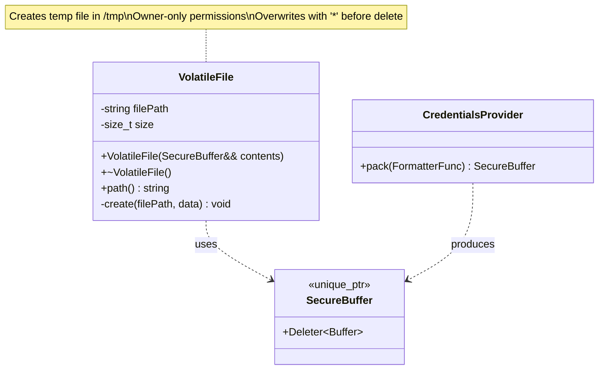
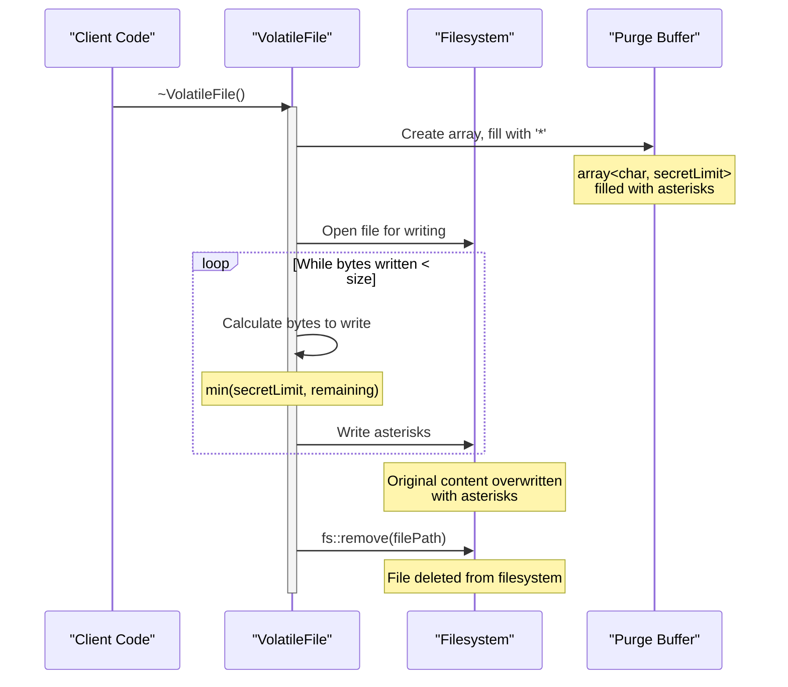
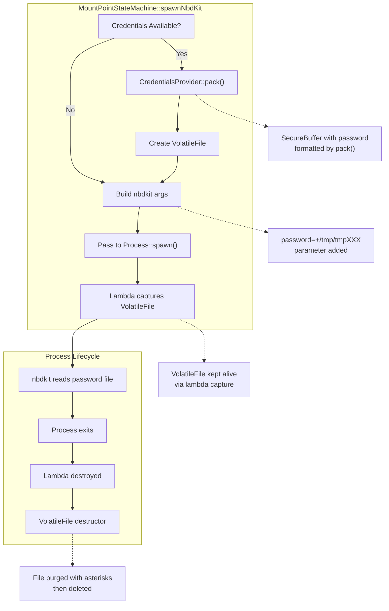
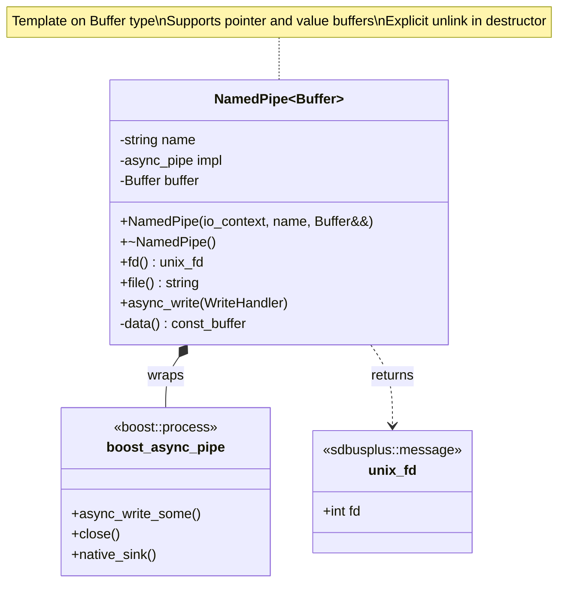
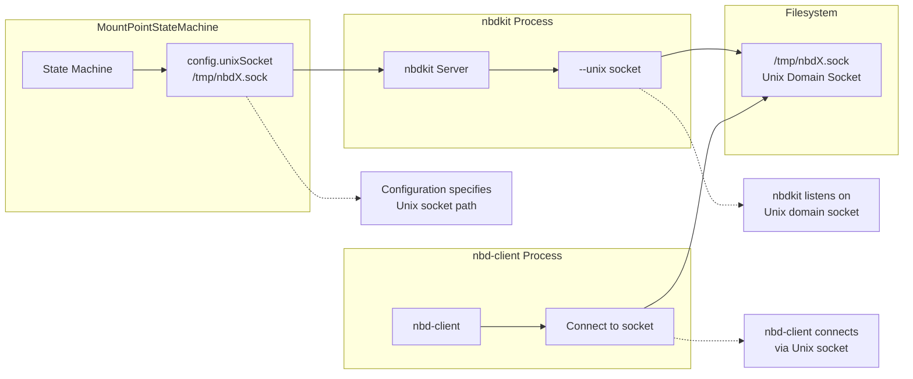
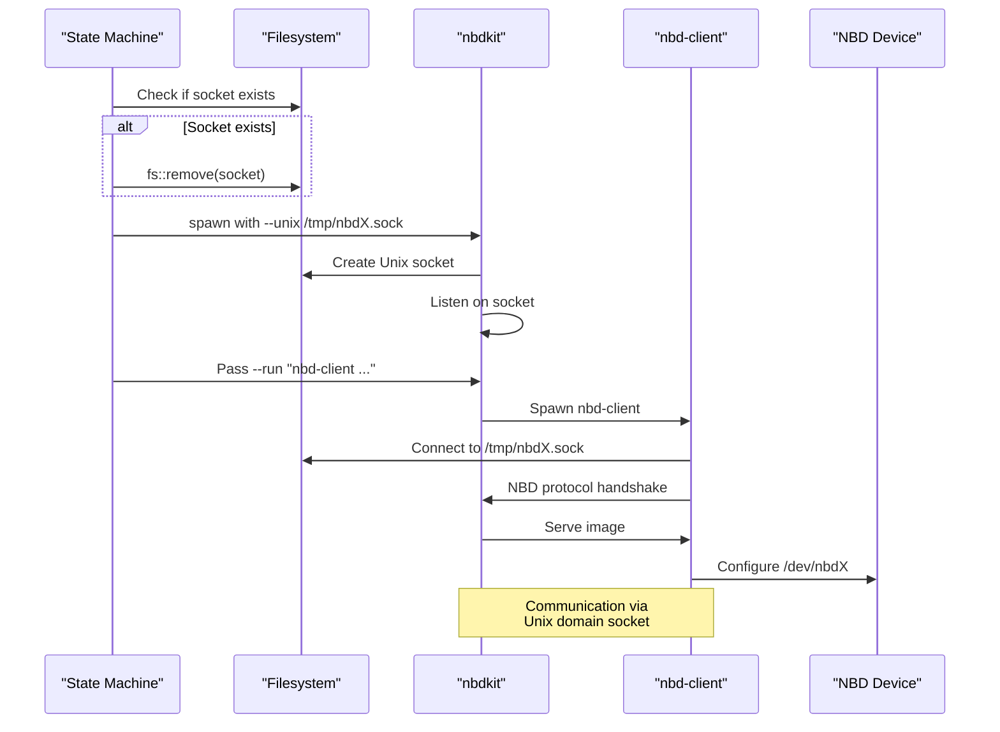

<!-- source: DeepWiki mcp.deepwiki.com · repo NVIDIA/remote-media · page 5.2 Secure File Handling · fetched 2026-10-26 -->

# Secure File Handling

<details>
<summary>Relevant source files</summary>

The following files were used as context for generating this wiki page:

- [src/state_machine.hpp](src/state_machine.hpp)
- [src/utils.hpp](src/utils.hpp)

</details>


## Purpose and Scope

This document describes the secure file handling mechanisms implemented in the remote-media service to protect sensitive data written to the filesystem. The system uses specialized classes to manage temporary files, named pipes, and Unix domain sockets with automatic cleanup and content purging capabilities.

For credential management and secure in-memory storage, see [5.1](#5.1). For memory protection mechanisms like `explicit_bzero`, see [5.3](#5.3).

## Overview

The secure file handling subsystem provides two primary classes:

| Class | Purpose | Key Security Features |
|-------|---------|---------------------|
| `VolatileFile` | Temporary file for sensitive data | Restricted permissions (owner-only), content overwritten with asterisks before deletion |
| `NamedPipe` | Unix pipe wrapper for IPC | Automatic cleanup, explicit unlink on destruction |

Additionally, the system uses Unix domain sockets (rather than network sockets) for inter-process communication to limit exposure.

**Sources:** [src/utils.hpp:172-226](), [src/utils.hpp:113-170]()

## VolatileFile Class

### Design and Implementation

The `VolatileFile` class creates temporary files with automatic content purging upon destruction. This ensures that sensitive data (such as passwords passed to nbdkit) cannot be recovered from the filesystem after the file is deleted.



**Diagram: VolatileFile Class Structure and Relationships**

**Sources:** [src/utils.hpp:172-226]()

### File Creation Process

When a `VolatileFile` is constructed, it performs the following steps:

1. **Generate temporary path**: Uses `fs::temp_directory_path() / std::tmpnam(nullptr)` to create a unique file path [src/utils.hpp:178]()
2. **Create file**: Opens file with `std::ofstream` [src/utils.hpp:213]()
3. **Restrict permissions**: Sets permissions to `owner_read | owner_write` using `fs::perm_options::replace` [src/utils.hpp:216-218]()
4. **Write contents**: Writes the `SecureBuffer` data to the file [src/utils.hpp:221]()

This ensures the file is never world-readable or accessible to other users.

**Sources:** [src/utils.hpp:177-182](), [src/utils.hpp:210-222]()

### Content Purging on Destruction



**Diagram: VolatileFile Destruction and Content Purging Sequence**

The destructor performs multi-pass overwriting:

1. **Create asterisk buffer**: Fills a `secretLimit`-sized array (1024 bytes) with `'*'` characters [src/utils.hpp:188-189]()
2. **Open file for overwrite**: Reopens the file in write mode [src/utils.hpp:190]()
3. **Write asterisks in chunks**: Writes `secretLimit` bytes at a time until the entire original file size is overwritten [src/utils.hpp:193-198]()
4. **Remove file**: Calls `fs::remove()` to delete the file [src/utils.hpp:201]()

This prevents recovery of sensitive data through filesystem forensics or undelete utilities.

**Sources:** [src/utils.hpp:185-202]()

### Usage in State Machine

The `VolatileFile` is used when passing passwords to nbdkit's curl plugin for HTTPS authentication:



**Diagram: VolatileFile Integration with nbdkit Spawning**

The `spawnNbdKit` function uses `VolatileFile` to securely pass passwords:

1. **Pack credentials**: `credentials->pack()` creates a `SecureBuffer` containing just the password [src/state_machine.hpp:820-826]()
2. **Create VolatileFile**: Wraps the buffer in a `VolatileFile` instance [src/state_machine.hpp:829]()
3. **Add parameter**: Passes file path to nbdkit as `password=+/path/to/file` [src/state_machine.hpp:832]()
4. **Capture in lambda**: The `VolatileFile` is moved into the process completion callback [src/state_machine.hpp:781]()
5. **Automatic cleanup**: When the process ends and the lambda is destroyed, the `VolatileFile` destructor runs [src/state_machine.hpp:785]()

This ensures the password file exists only while nbdkit needs it, and is securely purged immediately after.

**Sources:** [src/state_machine.hpp:809-836](), [src/state_machine.hpp:780-794]()

## NamedPipe Class

### Purpose and Design

The `NamedPipe` class wraps `boost::process::v1::async_pipe` to ensure proper cleanup of Unix named pipes. It supports asynchronous write operations and guarantees that the named pipe is removed from the filesystem upon destruction.



**Diagram: NamedPipe Class Structure**

**Sources:** [src/utils.hpp:113-170]()

### Lifecycle Management

The `NamedPipe` class manages three critical aspects:

| Aspect | Implementation | Line Reference |
|--------|----------------|----------------|
| **Creation** | Constructs `boost::process::v1::async_pipe` with named path | [src/utils.hpp:119-123]() |
| **File Descriptor** | Exposes `native_sink()` wrapped in `unix_fd` | [src/utils.hpp:133-136]() |
| **Cleanup** | Closes pipe and explicitly unlinks the named pipe file | [src/utils.hpp:126-131]() |

The destructor ensures the named pipe is removed from the filesystem:

```cpp
~NamedPipe()
{
    impl.close();           // Close the pipe
    ::unlink(name.c_str()); // Remove from filesystem
}
```

This prevents leftover named pipe files from accumulating in the filesystem.

**Sources:** [src/utils.hpp:126-131]()

### Template Specialization for Buffer Types

The `NamedPipe` class is templated on the buffer type and provides specialized `data()` methods for both pointer and value types:

1. **Pointer types** (e.g., `std::unique_ptr<Buffer>`): Dereferences the buffer before creating `boost::asio::const_buffer` [src/utils.hpp:151-157]()
2. **Value types** (e.g., `std::vector<char>`): Uses the buffer directly [src/utils.hpp:159-165]()

This allows `NamedPipe` to work with both `SecureBuffer` (which is a `unique_ptr`) and raw buffer types.

**Sources:** [src/utils.hpp:150-165]()

## Unix Socket Usage for IPC

### Socket-Based Communication

The system uses Unix domain sockets (rather than network sockets) for inter-process communication between the virtual-media service and nbdkit. This approach limits exposure and prevents network-based attacks.



**Diagram: Unix Socket IPC Between Components**

### Socket Cleanup and Configuration

Before spawning nbdkit, the state machine checks for and removes any pre-existing socket file:

1. **Check existence**: Uses `fs::exists(config.unixSocket)` to detect stale sockets [src/state_machine.hpp:739]()
2. **Remove if exists**: Calls `fs::remove()` to clean up [src/state_machine.hpp:744]()
3. **Log errors**: Reports if removal fails [src/state_machine.hpp:746-749]()

The socket path is specified in the configuration file (e.g., `/tmp/nbd0.sock`) and passed to nbdkit via the `--unix` argument [src/state_machine.hpp:760-761]().

**Sources:** [src/state_machine.hpp:739-751](), [src/state_machine.hpp:758-761]()

### nbdkit Invocation with Unix Socket



**Diagram: nbdkit Unix Socket Setup and Connection Sequence**

The `--unix` parameter tells nbdkit to create a Unix domain socket at the specified path. The `--run` parameter then invokes nbd-client, which connects to that socket to configure the NBD device.

**Sources:** [src/state_machine.hpp:758-765]()

## Security Properties Summary

The secure file handling subsystem provides the following security guarantees:

| Property | Implementation | Files |
|----------|----------------|-------|
| **Restricted Permissions** | Files created with `owner_read \| owner_write` only | [src/utils.hpp:216-218]() |
| **Content Purging** | Overwrites with asterisks before deletion | [src/utils.hpp:188-198]() |
| **Automatic Cleanup** | RAII pattern ensures cleanup on destruction | [src/utils.hpp:126-131](), [src/utils.hpp:185-202]() |
| **IPC Isolation** | Unix sockets instead of network sockets | [src/state_machine.hpp:760-761]() |
| **No Credential Files** | Credentials purged from memory and disk | [src/state_machine.hpp:809-836]() |
| **Socket Cleanup** | Removes stale sockets before spawning processes | [src/state_machine.hpp:739-751]() |

### Defense-in-Depth Strategy

The implementation follows a defense-in-depth approach:

1. **Memory**: Credentials use `secureCleanup()` with `explicit_bzero` (see [5.3](#5.3))
2. **Filesystem**: Temporary files use restricted permissions and content purging
3. **IPC**: Unix sockets limit attack surface to local system
4. **Lifecycle**: RAII ensures cleanup even if exceptions occur

This layered approach ensures that sensitive data cannot be recovered through memory dumps, filesystem forensics, or network sniffing.

**Sources:** [src/utils.hpp:172-226](), [src/state_machine.hpp:809-836]()

## Integration Example

The following table shows how the secure file handling components work together in a typical HTTPS mount operation:

| Step | Component | Action | Security Benefit |
|------|-----------|--------|------------------|
| 1 | `CredentialsProvider` | Packs password into `SecureBuffer` | In-memory protection |
| 2 | `VolatileFile` | Creates temp file with restricted permissions | Filesystem isolation |
| 3 | `VolatileFile` | Writes password to file | Owner-only access |
| 4 | State Machine | Passes file path to nbdkit as `password=+/path` | Avoids command-line exposure |
| 5 | nbdkit | Reads password, connects to HTTPS server | Process isolation |
| 6 | Lambda capture | Keeps `VolatileFile` alive during operation | Guaranteed cleanup |
| 7 | Process exit | Lambda destroyed, triggers `VolatileFile` destructor | Automatic cleanup |
| 8 | `VolatileFile::~VolatileFile()` | Overwrites file with asterisks | Prevents forensic recovery |
| 9 | `VolatileFile::~VolatileFile()` | Removes file from filesystem | Complete cleanup |

**Sources:** [src/state_machine.hpp:809-836]()

---

