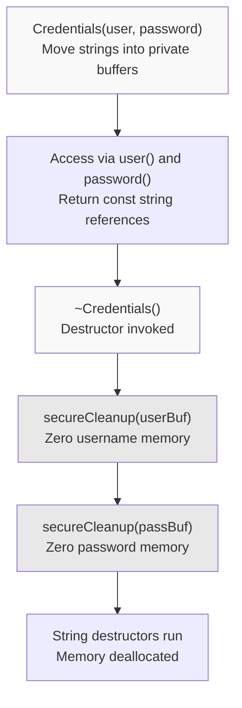
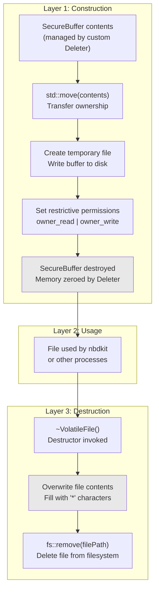
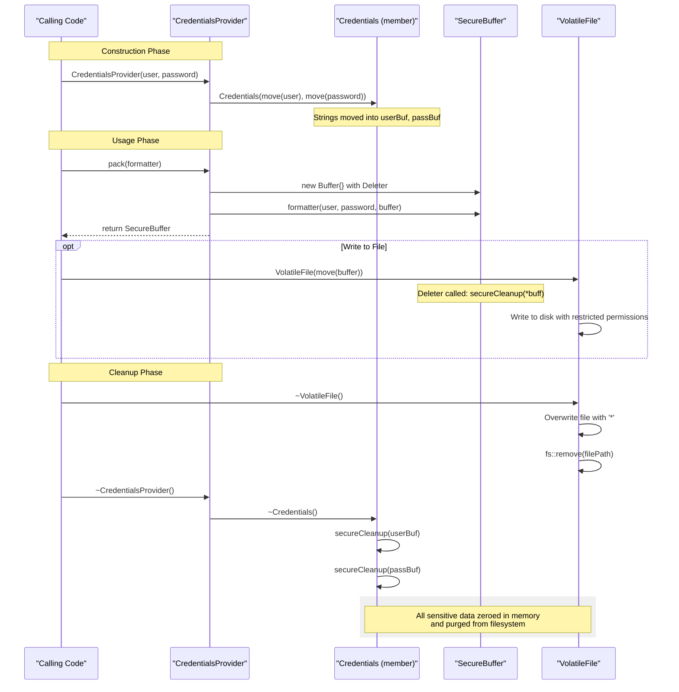

<!-- source: DeepWiki mcp.deepwiki.com · repo NVIDIA/remote-media · page 5.3 Memory Protection · fetched 2026-10-26 -->

# Memory Protection

<details>
<summary>Relevant source files</summary>

The following files were used as context for generating this wiki page:

- [src/smb.hpp](src/smb.hpp)
- [src/utils.hpp](src/utils.hpp)

</details>


This page documents the memory protection mechanisms implemented in the remote-media service to securely handle sensitive data such as passwords, authentication tokens, and credential strings. The implementation uses multiple defensive layers to ensure that sensitive information cannot be recovered from memory dumps, swap files, or filesystem artifacts after use.

For information about credential handling and secure file operations, see [Credential Management](#5.1) and [Secure File Handling](#5.2).

## Purpose and Scope

The memory protection system provides:
- Explicit memory zeroing using `explicit_bzero` to prevent compiler optimizations from removing cleanup code
- RAII-based automatic cleanup ensuring sensitive data is destroyed when objects go out of scope
- Custom deleters for smart pointers that zero memory before deallocation
- Multi-layered defense ensuring credentials cannot be recovered even if some cleanup mechanisms fail

These mechanisms work together to implement a defense-in-depth strategy for protecting sensitive data throughout its lifecycle in the application.

## Core Memory Security Function

### secureCleanup()

The `secureCleanup()` template function is the foundation of all memory protection operations. It provides a reliable way to zero sensitive data from memory.

```cpp
template <typename T>
static void secureCleanup(T& value)
{
    auto raw = const_cast<typename T::value_type*>(&value[0]);
    explicit_bzero(raw, value.size() * sizeof(*raw));
}
```

**Key characteristics:**
- Uses `explicit_bzero` from POSIX, which is guaranteed not to be optimized away by the compiler
- Template-based, works with any container providing `size()` and indexing operators
- Modifies the underlying storage directly through a `const_cast`
- Zeros memory at the byte level, ensuring complete erasure

**Sources:** [src/utils.hpp:19-24]()

## RAII-Based Credential Protection

### Credentials Class

The `Credentials` class demonstrates the RAII pattern for automatic secure cleanup. It stores username and password strings and ensures they are securely erased when the object is destroyed.

**Memory protection lifecycle:**



**Implementation details:**
- Constructor uses move semantics to avoid unnecessary copies: [src/utils.hpp:29-32]()
- Destructor calls `secureCleanup()` on both string buffers: [src/utils.hpp:34-38]()
- Copy and default constructors are deleted to prevent accidental copies: [src/utils.hpp:51-53]()

**Sources:** [src/utils.hpp:26-57]()

## Smart Pointer Custom Deleters

### SecureBuffer Type

The `CredentialsProvider` class defines a custom deleter for `std::unique_ptr` that ensures secure cleanup of dynamically allocated buffers.

**Type definitions:**

| Type | Definition | Purpose |
|------|------------|---------|
| `Buffer` | `std::vector<char>` | Dynamic buffer for credential data |
| `Deleter<T>` | Custom deleter template | Calls secureCleanup before delete |
| `SecureBuffer` | `std::unique_ptr<Buffer, Deleter<Buffer>>` | Smart pointer with secure deletion |

**Custom Deleter implementation:**

```cpp
template <typename T>
struct Deleter
{
    void operator()(T* buff) const
    {
        if (buff)
        {
            secureCleanup(*buff);
            delete buff;
        }
    }
};
```

**Ownership and cleanup flow:**

```mermaid
graph LR
    Alloc["new Buffer{}<br/>Allocate on heap"]
    Create["SecureBuffer ptr<br/>std::unique_ptr with Deleter"]
    Use["Use buffer<br/>Read/write operations"]
    Reset["ptr.reset() or<br/>ptr goes out of scope"]
    DeleterCall["Deleter::operator()<br/>Called automatically"]
    Clean["secureCleanup(*buff)<br/>Zero buffer contents"]
    Delete["delete buff<br/>Deallocate memory"]
    
    Alloc --> Create
    Create --> Use
    Use --> Reset
    Reset --> DeleterCall
    DeleterCall --> Clean
    Clean --> Delete
    
    style DeleterCall fill:#f9f9f9
    style Clean fill:#e8e8e8
```



**Key features:**
- Null pointer check before cleanup [src/utils.hpp:67]()
- `secureCleanup()` called before `delete` [src/utils.hpp:69-70]()
- Works with `std::unique_ptr` for automatic exception-safe cleanup
- Used by `CredentialsProvider::pack()` to return securely managed buffers [src/utils.hpp:98-106]()

**Sources:** [src/utils.hpp:62-76](), [src/utils.hpp:98-106]()

## Multi-Layered Cleanup: VolatileFile

The `VolatileFile` class implements a defense-in-depth approach by combining memory protection, file system cleanup, and content purging.

### Protection Layers



### Destructor Implementation

The destructor provides two levels of file cleanup:

1. **Content purging** - Overwrites the entire file with asterisks [src/utils.hpp:187-198]():
   - Uses a 1024-byte buffer filled with '*' characters
   - Writes in chunks until entire file is overwritten
   - Ensures sensitive data cannot be recovered from disk blocks

2. **File deletion** - Removes the file from the filesystem [src/utils.hpp:200-201]():
   - Uses `fs::remove()` to unlink the file
   - Ensures no metadata or directory entries remain

**Sources:** [src/utils.hpp:172-226]()

## Usage Patterns

### Stack Variable Cleanup

After constructing strings containing sensitive data for system calls, the memory must be explicitly cleaned:

```cpp
// From SmbShare::mount()
std::string credentialsOpt = "username=" + credentials->user() +
                             ",password=" + credentials->password();
options += "," + credentialsOpt;

auto ec = ::mount(remote.c_str(), mountDir.c_str(), "cifs", 0,
                  options.c_str());

// Immediately clean sensitive data from stack
utils::secureCleanup(options);
utils::secureCleanup(credentialsOpt);
```

This pattern ensures that even temporary stack-allocated strings containing passwords are zeroed after use, preventing their recovery from core dumps or stack snapshots.

**Sources:** [src/smb.hpp:29-48]()

### Credential Provider Workflow

The complete credential lifecycle with memory protection:



**Sources:** [src/utils.hpp:59-110](), [src/utils.hpp:172-226]()

## Memory Protection Guarantees

### What is Protected

The implementation provides the following security guarantees:

| Asset | Protection Mechanism | Location |
|-------|---------------------|----------|
| Username strings | `secureCleanup()` in `~Credentials()` | [src/utils.hpp:36]() |
| Password strings | `secureCleanup()` in `~Credentials()` | [src/utils.hpp:37]() |
| Formatted credential buffers | Custom `Deleter` in `SecureBuffer` | [src/utils.hpp:69]() |
| Temporary credential files | Content purging in `~VolatileFile()` | [src/utils.hpp:188-198]() |
| Stack-allocated options | Explicit `secureCleanup()` calls | [src/smb.hpp:47-48]() |

### Defense in Depth

Multiple layers ensure that even if one mechanism fails, others provide protection:

1. **RAII destructors** - Automatic cleanup when objects go out of scope
2. **Custom deleters** - Secure cleanup for dynamically allocated memory
3. **Explicit cleanup calls** - Additional zeroing for stack variables
4. **File purging** - Overwrite disk contents before deletion
5. **Restrictive permissions** - Prevent unauthorized read access to temporary files

### Compiler Optimization Safety

The use of `explicit_bzero` is critical because:
- Standard `memset` may be optimized away by the compiler (dead store elimination)
- `explicit_bzero` is guaranteed by POSIX to never be removed
- Even with link-time optimization (`-flto`), the memory will be zeroed

**Sources:** [src/utils.hpp:23]()

## Code Entity Reference

### Functions

- **`secureCleanup<T>(T& value)`** - Template function for zeroing memory [src/utils.hpp:19-24]()
- **`Credentials::~Credentials()`** - Destructor with secure cleanup [src/utils.hpp:34-38]()
- **`Deleter<T>::operator()(T* buff)`** - Custom deleter implementation [src/utils.hpp:65-72]()
- **`VolatileFile::~VolatileFile()`** - Multi-layer file cleanup [src/utils.hpp:185-202]()

### Types

- **`utils::Credentials`** - RAII credential storage [src/utils.hpp:26-57]()
- **`utils::CredentialsProvider`** - Credential management with packing support [src/utils.hpp:59-110]()
- **`CredentialsProvider::Buffer`** - `std::vector<char>` for credential data [src/utils.hpp:75]()
- **`CredentialsProvider::Deleter<T>`** - Custom deleter template [src/utils.hpp:62-73]()
- **`CredentialsProvider::SecureBuffer`** - `std::unique_ptr` with secure deletion [src/utils.hpp:76]()
- **`utils::VolatileFile`** - Temporary file with secure cleanup [src/utils.hpp:172-226]()

### Constants

- **`utils::secretLimit`** - 1024-byte buffer size for file purging [src/utils.hpp:17]()

**Sources:** [src/utils.hpp]()

---

