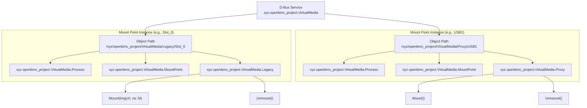
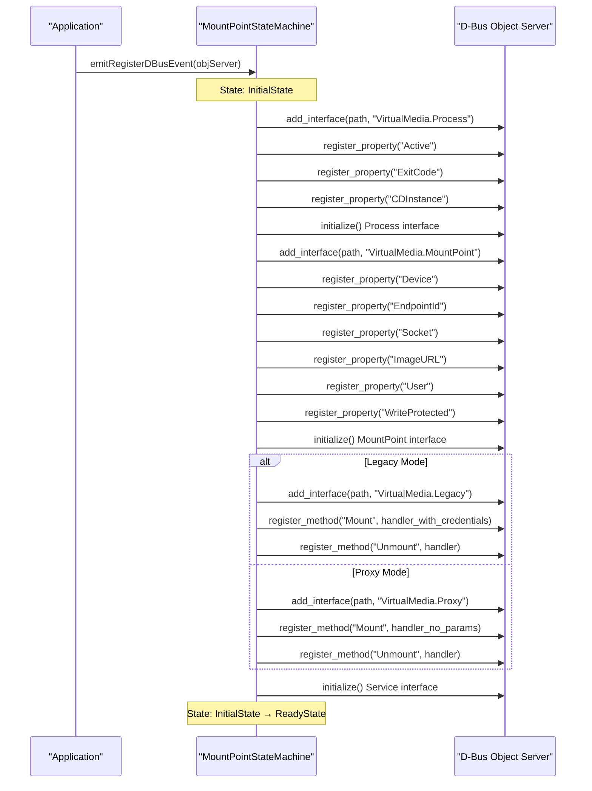
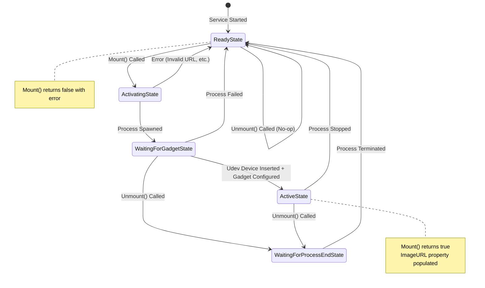

<!-- source: DeepWiki mcp.deepwiki.com · repo NVIDIA/remote-media · page 6 API Reference · fetched 2026-10-26 -->

# API Reference

<details>
<summary>Relevant source files</summary>

The following files were used as context for generating this wiki page:

- [src/configuration.hpp](src/configuration.hpp)
- [src/state_machine.hpp](src/state_machine.hpp)

</details>


This document provides an overview of the external interfaces exposed by the remote-media Virtual Media service. These interfaces enable client applications (such as Redfish implementations) and system administrators to control and monitor virtual media devices.

The service exposes two primary API surfaces:

1. **D-Bus Service Interface** - Runtime API for mounting, unmounting, and monitoring virtual media devices. For complete details, see [D-Bus Service Interface](#6.1).

2. **Configuration Schema** - JSON configuration file format for defining mount points and service parameters. For complete details, see [Configuration Schema](#6.2).

For information about the operational modes (Legacy vs Proxy), see [Operational Modes](#4). For security considerations when handling credentials, see [Security](#5).

---

## Overview of API Architecture

The virtual media service follows a multi-instance architecture where each mount point configured in the system exposes a complete set of D-Bus interfaces. This allows independent control of multiple virtual media devices simultaneously.

### D-Bus Interface Hierarchy



**Sources:** [src/state_machine.hpp:210-518]()

---

## D-Bus Interfaces Summary

Each mount point instance exposes three D-Bus interfaces that work together to provide complete control and monitoring:

| Interface | Purpose | Key Members | Read/Write |
|-----------|---------|-------------|------------|
| `VirtualMedia.Process` | Runtime process status | `Active`, `ExitCode`, `CDInstance` | Read-only (except CDInstance) |
| `VirtualMedia.MountPoint` | Mount configuration and state | `Device`, `EndpointId`, `Socket`, `ImageURL`, `User`, `WriteProtected` | Mixed |
| `VirtualMedia.Legacy` | Legacy mode operations | `Mount(imgUrl, rw, fd)`, `Unmount()` | Methods only |
| `VirtualMedia.Proxy` | Proxy mode operations | `Mount()`, `Unmount()` | Methods only |

The service interface (`Legacy` or `Proxy`) is mutually exclusive per mount point, determined by the `Mode` configuration setting.

**Sources:** [src/state_machine.hpp:254-512]()

---

## Interface Registration and Object Paths

### Object Path Structure

The service uses hierarchical object paths that encode the operational mode:

```
/xyz/openbmc_project/VirtualMedia/{Mode}/{MountPointName}
```

Where:
- `{Mode}` is either `Legacy` or `Proxy` based on the mount point's configuration mode
- `{MountPointName}` is the identifier from the configuration file (e.g., `Slot_0`, `USB1`)

**Examples:**
- Legacy mode: `/xyz/openbmc_project/VirtualMedia/Legacy/Slot_0`
- Proxy mode: `/xyz/openbmc_project/VirtualMedia/Proxy/USB1`

**Sources:** [src/state_machine.hpp:1075-1088]()

### Registration Flow



**Sources:** [src/state_machine.hpp:210-231](), [src/state_machine.hpp:254-512]()

---

## Process Interface

### Interface: `xyz.openbmc_project.VirtualMedia.Process`

Provides runtime status information about the underlying NBD process (nbdkit or nbd-client).

#### Properties

| Property | Type | Access | Description |
|----------|------|--------|-------------|
| `Active` | `bool` | Read | `true` when state is `ActiveState`, `false` otherwise |
| `ExitCode` | `int32` | Read | Process exit code after termination (-1 if not yet terminated) |
| `CDInstance` | `int32` | Read/Write | CD/DVD instance identifier (configurable, default: 2) |

#### Property Getters

The property values are dynamically computed based on the state machine's current state:

- **Active**: Returns `true` only when `std::get_if<ActiveState>(&machine.state)` succeeds
- **ExitCode**: Returns `machine.exitCode`, set when subprocess stops
- **CDInstance**: Configurable property stored in interface

**Sources:** [src/state_machine.hpp:254-289]()

---

## MountPoint Interface

### Interface: `xyz.openbmc_project.VirtualMedia.MountPoint`

Exposes configuration and runtime state for the mount point.

#### Properties

| Property | Type | Access | Description |
|----------|------|--------|-------------|
| `Device` | `string` | Read | NBD device path (e.g., `/dev/nbd0`) |
| `EndpointId` | `string` | Read | Unique endpoint identifier from configuration |
| `Socket` | `string` | Read | Unix domain socket path for NBD communication |
| `ImageURL` | `string` | Read | Currently mounted image URL (empty if not active) |
| `User` | `string` | Read | Username for authenticated mounts (constant: `USER`) |
| `WriteProtected` | `bool` | Read | `true` if mounted read-only, `false` if read-write |

#### Property Getters

State-dependent properties that return different values based on the state machine state:

- **ImageURL**: Returns `machine.target->imgUrl` when in `ActiveState`, empty string otherwise
- **User**: Returns `USER` constant when in `ActiveState`, empty string otherwise
- **WriteProtected**: Returns `!machine.target->rw` (inverted read-write flag)

**Sources:** [src/state_machine.hpp:291-351]()

---

## Service Interfaces (Legacy and Proxy)

### Common Method: Unmount

Available in both `VirtualMedia.Legacy` and `VirtualMedia.Proxy` interfaces.

#### Signature
```
Unmount() -> bool
```

#### Behavior

1. Emits `UnmountEvent` to state machine
2. Waits asynchronously for state to transition to `ReadyState` (up to 12 seconds)
3. Returns `true` on successful unmount, `false` on timeout

**Error Conditions:**
- Throws `SdBusError` with `EPERM` if called from invalid state (e.g., `InitialState`)

**Sources:** [src/state_machine.hpp:363-392]()

---

### Legacy Mode: Mount with Credentials

#### Interface: `xyz.openbmc_project.VirtualMedia.Legacy`

#### Signature
```
Mount(imgUrl: string, rw: bool, fd: variant<int, unix_fd>) -> bool
```

#### Parameters

| Parameter | Type | Description |
|-----------|------|-------------|
| `imgUrl` | `string` | Image URL with scheme `smb://` or `https://` |
| `rw` | `bool` | `true` for read-write mount, `false` for read-only |
| `fd` | `variant<int, unix_fd>` | Optional Unix file descriptor containing credentials |

#### Credential Format (when fd is unix_fd)

Credentials are passed as NULL-delimited strings in the file descriptor:
```
<username>\0<password>\0
```

The implementation validates that exactly 2 NULL delimiters are present before parsing.

#### Return Value

- `true`: Mount operation succeeded, state is now `ActiveState`
- `false`: Mount operation failed or timed out
- **Throws**: `SdBusError` with appropriate error code on failure

#### Example Error Codes

| Error Code | Condition |
|------------|-----------|
| `EPERM` | Called from invalid state (already mounted) |
| `EINVAL` | Malformed credential data |
| Error from `ReadyState` | Mount operation failed (includes specific error code and message) |

**Sources:** [src/state_machine.hpp:439-498]()

---

### Proxy Mode: Mount without Parameters

#### Interface: `xyz.openbmc_project.VirtualMedia.Proxy`

#### Signature
```
Mount() -> bool
```

#### Parameters

None. All configuration (endpoint, socket path) is pre-configured via the configuration file.

#### Return Value

- `true`: Mount operation succeeded, state is now `ActiveState`
- `false`: Mount operation failed or timed out
- **Throws**: `SdBusError` with `EPERM` if called from invalid state

#### Behavior

Proxy mode connects to a pre-configured NBD server endpoint (typically bmcweb) via WebSocket. The actual image data is provided by the remote endpoint.

**Sources:** [src/state_machine.hpp:502-509]()

---

## Mount Operation State Flow



**Sources:** [src/state_machine.hpp:75-164](), [src/state_machine.hpp:520-604]()

---

## Configuration File API

The service reads its configuration from a JSON file (typically `/usr/share/virtual-media/virtual-media.json`). The configuration defines mount points and their operational parameters.

### Mount Point Configuration Structure

Each mount point requires these fields:

| Field | Type | Required | Description |
|-------|------|----------|-------------|
| `NBDDevice` | `string` | Yes | NBD device identifier (e.g., `"nbd0"`) |
| `UnixSocket` | `string` | Yes | Path to Unix domain socket |
| `EndpointId` | `string` | Yes | Unique identifier for this mount point |
| `Mode` | `integer` | Yes | Operational mode: `0` (proxy) or `1` (legacy) |
| `Timeout` | `integer` | No | Timeout in seconds (optional) |
| `BlockSize` | `integer` | No | Block size in bytes (optional) |

### Example Configuration Excerpt

```json
{
  "MountPoints": {
    "Slot_0": {
      "NBDDevice": "nbd0",
      "UnixSocket": "/tmp/nbd0.sock",
      "EndpointId": "slot0",
      "Mode": 1,
      "Timeout": 30,
      "BlockSize": 512
    },
    "USB1": {
      "NBDDevice": "nbd1",
      "UnixSocket": "/tmp/nbd1.sock",
      "EndpointId": "usb1",
      "Mode": 0
    }
  }
}
```

For complete schema documentation including validation rules and advanced options, see [Configuration Schema](#6.2).

**Sources:** [src/configuration.hpp:14-234]()

---

## D-Bus Command Examples

### Using busctl to Interact with the Service

#### List All Mount Point Objects

```bash
busctl tree xyz.openbmc_project.VirtualMedia
```

#### Get Process Status

```bash
busctl get-property xyz.openbmc_project.VirtualMedia \
    /xyz/openbmc_project/VirtualMedia/Legacy/Slot_0 \
    xyz.openbmc_project.VirtualMedia.Process \
    Active
```

#### Mount an Image (Legacy Mode with Credentials)

```bash
# Create credential file with username and password
printf 'myuser\0mypassword\0' > /tmp/creds

# Call Mount method with file descriptor
busctl call xyz.openbmc_project.VirtualMedia \
    /xyz/openbmc_project/VirtualMedia/Legacy/Slot_0 \
    xyz.openbmc_project.VirtualMedia.Legacy \
    Mount ssh b 'smb://server/share/image.iso' true < /tmp/creds

# Clean up
rm /tmp/creds
```

#### Mount an Image (Proxy Mode)

```bash
busctl call xyz.openbmc_project.VirtualMedia \
    /xyz/openbmc_project/VirtualMedia/Proxy/USB1 \
    xyz.openbmc_project.VirtualMedia.Proxy \
    Mount
```

#### Unmount an Image

```bash
busctl call xyz.openbmc_project.VirtualMedia \
    /xyz/openbmc_project/VirtualMedia/Legacy/Slot_0 \
    xyz.openbmc_project.VirtualMedia.Legacy \
    Unmount
```

#### Monitor Property Changes

```bash
busctl monitor xyz.openbmc_project.VirtualMedia
```

---

## Code Entity to API Mapping

The following table maps code entities to their corresponding D-Bus API elements:

| Code Entity | File | API Element |
|-------------|------|-------------|
| `MountPointStateMachine` | state_machine.hpp:23 | Instance per D-Bus object |
| `RegisterDbusEvent` | state_machine.hpp:210 | Interface registration handler |
| `addProcessInterface()` | state_machine.hpp:254 | Creates Process interface |
| `addMountPointInterface()` | state_machine.hpp:291 | Creates MountPoint interface |
| `addServiceInterface()` | state_machine.hpp:353 | Creates Legacy/Proxy interface |
| `MountEvent` | state_machine.hpp:520 | Triggered by Mount() D-Bus method |
| `UnmountEvent` | state_machine.hpp:536 | Triggered by Unmount() D-Bus method |
| `Configuration::MountPoint` | configuration.hpp:30 | JSON mount point structure |
| `Configuration::Mode::proxy` | configuration.hpp:22 | Mode value `0` |
| `Configuration::Mode::legacy` | configuration.hpp:27 | Mode value `1` |

**Sources:** [src/state_machine.hpp:23-1089](), [src/configuration.hpp:14-234]()

---

## API Versioning and Compatibility

The D-Bus interface names use the OpenBMC project namespace (`xyz.openbmc_project`), following OpenBMC D-Bus interface conventions. The service maintains backward compatibility within the same major version by:

1. Preserving existing interface names and method signatures
2. Adding new properties or methods as optional extensions
3. Maintaining consistent object path hierarchy

Breaking changes (interface renames, method signature changes) would require a new major version and are not anticipated in the current design.

---

## Summary

The remote-media service exposes a comprehensive D-Bus API organized around mount point instances. Each instance provides:

- **Process monitoring** via the `Process` interface
- **Configuration inspection** via the `MountPoint` interface  
- **Mount/unmount control** via mode-specific service interfaces (`Legacy` or `Proxy`)

The dual-mode architecture (Legacy and Proxy) allows the same service to support both traditional enterprise workflows (CIFS/HTTPS mounting with credentials) and modern browser-based workflows (WebSocket proxy to bmcweb).

For detailed interface specifications, see [D-Bus Service Interface](#6.1). For configuration file format details, see [Configuration Schema](#6.2).

---

