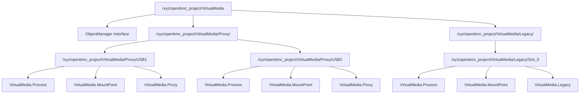
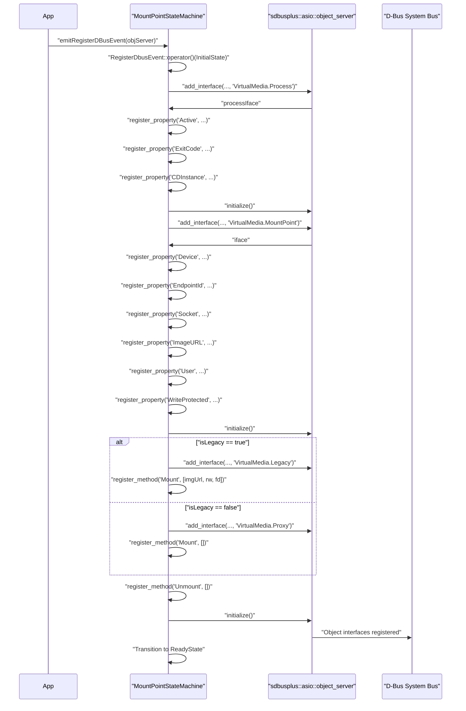
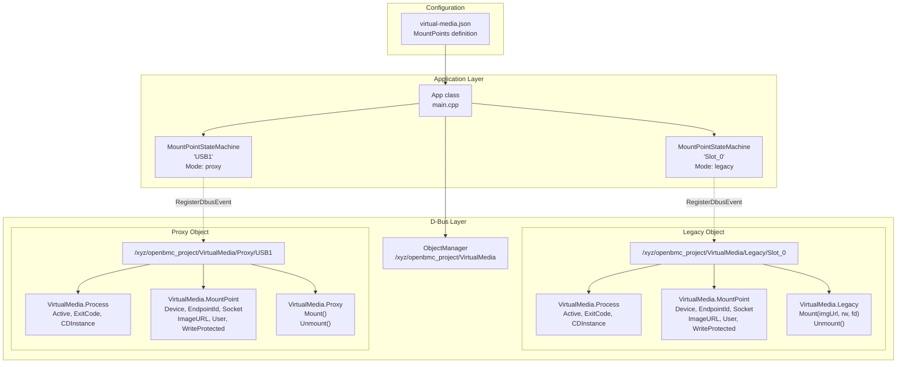

<!-- source: DeepWiki mcp.deepwiki.com · repo NVIDIA/remote-media · page 6.1 D-Bus Service Interface · fetched 2026-10-26 -->

# D-Bus Service Interface

<details>
<summary>Relevant source files</summary>

The following files were used as context for generating this wiki page:

- [src/main.cpp](src/main.cpp)
- [src/state_machine.hpp](src/state_machine.hpp)

</details>


This page provides a complete reference for the D-Bus service interface exposed by the remote-media virtual media service. It documents all D-Bus object paths, interfaces, properties, methods, and signals that external clients use to interact with the service. 

For information about the internal state machine that implements these interfaces, see [MountPointStateMachine](#3.1). For configuration of mount points, see [Configuration](#2.2). For operational workflow examples, see [Operational Modes](#4).

## Service Overview

The virtual media service registers on the D-Bus system bus under the well-known name `xyz.openbmc_project.VirtualMedia` and exposes a hierarchical object structure for managing virtual media mount points.

### Object Hierarchy



**Sources:** [src/main.cpp:39-47](), [src/state_machine.hpp:1075-1088]()

### Object Paths

Each configured mount point creates a D-Bus object at one of two base paths depending on its operational mode:

| Mode | Base Path | Example Full Path |
|------|-----------|-------------------|
| Proxy (Mode 0) | `/xyz/openbmc_project/VirtualMedia/Proxy/` | `/xyz/openbmc_project/VirtualMedia/Proxy/USB1` |
| Legacy (Mode 1) | `/xyz/openbmc_project/VirtualMedia/Legacy/` | `/xyz/openbmc_project/VirtualMedia/Legacy/Slot_0` |

The full object path is constructed as: `<base_path><mount_point_name>`, where `mount_point_name` comes from the configuration file keys.

**Sources:** [src/state_machine.hpp:1075-1088](), [src/main.cpp:43-48]()

## D-Bus Interfaces

Each mount point object exposes exactly three D-Bus interfaces that provide process status, mount point configuration, and mount/unmount operations.

### Interface Registration Flow



**Sources:** [src/state_machine.hpp:210-231](), [src/state_machine.hpp:254-513]()

### xyz.openbmc_project.VirtualMedia.Process

This interface exposes the runtime status of the NBD process (nbdkit or nbd-client) associated with the mount point.

#### Properties

| Property Name | Type | Access | Description |
|---------------|------|--------|-------------|
| `Active` | `b` (boolean) | Read | Returns `true` when the state machine is in `ActiveState`, `false` otherwise. Indicates whether a virtual media device is currently mounted and presented to the host. |
| `ExitCode` | `i` (int32) | Read | The exit code of the most recently terminated NBD process. Initially `-1`, updated when the process terminates. Used for diagnostics. |
| `CDInstance` | `i` (int32) | Read/Write | A writable property that can be set by clients. Default value is `2`. Purpose appears to be for client-side tracking or metadata. |

#### Implementation Details

The `Active` property is implemented with a getter lambda that checks if the state machine is currently in `ActiveState`:

```cpp
// Returns true only when in ActiveState
[&machine = state.machine](const bool& property) {
    if (std::get_if<ActiveState>(&machine.state))
        return true;
    else
        return false;
}
```

The `ExitCode` property directly returns `machine.exitCode`, which is set when the NBD process terminates in the process stop callback.

**Sources:** [src/state_machine.hpp:254-289](), [src/state_machine.hpp:262-288]()

### xyz.openbmc_project.VirtualMedia.MountPoint

This interface exposes configuration and state information about the mount point, including the NBD device assignment, endpoint identification, and current mount details.

#### Properties

| Property Name | Type | Access | Description |
|---------------|------|--------|-------------|
| `Device` | `s` (string) | Read | The NBD device path (e.g., `/dev/nbd0`) assigned to this mount point. Configured statically from `virtual-media.json`. |
| `EndpointId` | `s` (string) | Read | The endpoint identifier for this mount point (e.g., `USB1`, `Slot_0`). Used for Redfish VirtualMedia resource mapping. |
| `Socket` | `s` (string) | Read | The Unix domain socket path (e.g., `/tmp/nbd0.sock`) used for nbdkit/nbd-client communication. |
| `ImageURL` | `s` (string) | Read | The URL of the currently mounted image. Returns empty string when not in `ActiveState`. In legacy mode, this is the CIFS or HTTPS URL provided to `Mount()`. In proxy mode, this is empty. |
| `User` | `s` (string) | Read | The username used for CIFS authentication when mounting. Returns the `USER` constant when active, empty string otherwise. |
| `WriteProtected` | `b` (boolean) | Read | Indicates whether the mounted image is read-only. Returns `true` if `!machine.target->rw`, meaning the device is write-protected. |

#### Property Behavior

Several properties return dynamic values based on the state machine's current state:

```cpp
// ImageURL returns empty string unless in ActiveState
[&machine = state.machine](const std::string& property) {
    if (std::get_if<ActiveState>(&machine.state))
        return std::string(machine.target->imgUrl);
    else
        return std::string("");
}
```

**Sources:** [src/state_machine.hpp:291-351](), [src/state_machine.hpp:298-350]()

### xyz.openbmc_project.VirtualMedia.Legacy

This interface provides mount and unmount operations for legacy mode (Mode 1), which supports CIFS/SMB shares and HTTPS URLs. It is only registered when the mount point is configured with `Mode = 1`.

#### Methods

##### Mount

```
Method: Mount
Parameters:
  - imgUrl: s (string)     - The image URL (smb://... or https://...)
  - rw: b (boolean)        - True for read-write, false for read-only
  - fd: v (variant)        - Optional Unix file descriptor containing credentials
Returns: b (boolean)       - True on success, false on failure
```

The `Mount` method initiates a mount operation in legacy mode. The method signature is:

```
Mount(imgUrl: string, rw: bool, fd: variant<int, unix_fd>) -> bool
```

**Parameters:**

- `imgUrl`: The URL of the image to mount. Must be either:
  - SMB/CIFS: `smb://server/share/path/to/image.iso`
  - HTTPS: `https://server/path/to/image.iso`
- `rw`: Mount mode - `true` for read-write access, `false` for read-only
- `fd`: Optional credentials passed as a Unix file descriptor. The file descriptor should contain null-delimited username and password: `username\0password\0`

**Return Value:**

Returns `true` if the mount operation succeeds (state machine reaches `ActiveState`), `false` otherwise. Throws `SdBusError` on errors.

**Operation Flow:**

1. Validates that state machine is in `ReadyState` (throws `EPERM` if not)
2. Stores mount target information (`imgUrl`, `rw`) in `machine.target`
3. If `fd` is provided, reads credentials from the Unix file descriptor using `boost::asio::posix::stream_descriptor`
4. Validates credential format (expects exactly 2 NULL delimiters)
5. Creates `CredentialsProvider` with username and password
6. Triggers `MountEvent` to begin state machine activation
7. Polls state machine asynchronously for up to 12 seconds (120 iterations × 100ms)
8. Returns `true` if `ActiveState` reached, `false` if `ReadyState` with error

**Sources:** [src/state_machine.hpp:439-498](), [src/state_machine.hpp:436-498]()

##### Unmount

```
Method: Unmount
Parameters: (none)
Returns: b (boolean)       - True on success, false on failure
```

The `Unmount` method initiates an unmount operation, removing the virtual media device from the host system.

**Operation Flow:**

1. Validates current state allows unmounting (throws `EPERM` if not)
2. Triggers `UnmountEvent` to begin teardown
3. Polls state machine for up to 12 seconds
4. Returns `true` when `ReadyState` is reached

**Sources:** [src/state_machine.hpp:363-392]()

### xyz.openbmc_project.VirtualMedia.Proxy

This interface provides mount and unmount operations for proxy mode (Mode 0), which uses WebSocket connections to an external NBD server. It is only registered when the mount point is configured with `Mode = 0`.

#### Methods

##### Mount (Parameterless)

```
Method: Mount
Parameters: (none)
Returns: b (boolean)       - True on success, false on failure
```

The proxy mode `Mount` method is parameterless because all configuration (endpoint, socket path, NBD device) is pre-configured in `virtual-media.json`. The mount is initiated by a browser client through a WebSocket connection managed by bmcweb.

**Operation Flow:**

1. Triggers `MountEvent` on the state machine
2. State machine spawns `nbd-client` process with pre-configured parameters
3. Polls state machine for up to 12 seconds
4. Returns `true` if `ActiveState` reached

**Sources:** [src/state_machine.hpp:502-510]()

##### Unmount

The `Unmount` method is identical to the Legacy interface version - same implementation is shared between both interfaces.

**Sources:** [src/state_machine.hpp:363-392]()

## Method Behavior and Error Handling

### Asynchronous Polling Pattern

Both `Mount` and `Unmount` methods use an asynchronous polling pattern implemented with `boost::asio::yield_context`. After triggering a state machine event, the method polls the state machine's state every 100 milliseconds for up to 12 seconds (120 iterations):

```cpp
boost::asio::steady_timer timer(machine.ioc.get());
int waitCnt = 120;
while (waitCnt > 0)
{
    if (std::get_if<ActiveState>(&machine.state))
        return true;  // Success
    
    boost::system::error_code ignored_ec;
    timer.expires_after(std::chrono::milliseconds(100));
    timer.async_wait(yield[ignored_ec]);
    waitCnt--;
}
return false;  // Timeout
```

This ensures the D-Bus method call blocks until the operation completes or times out.

**Sources:** [src/state_machine.hpp:407-430](), [src/state_machine.hpp:378-391]()

### Error Reporting

Methods throw `sdbusplus::exception::SdBusError` with appropriate errno values:

| Error Code | Condition | Example |
|------------|-----------|---------|
| `EPERM` | Invalid state transition | Calling `Mount` when already mounted |
| `EINVAL` | Invalid parameters | Malformed credential data in fd parameter |
| Custom errno | State machine errors | Converted from `std::errc` in `ReadyState.error` |

Example error handling in Mount:

```cpp
if (auto s = std::get_if<ReadyState>(&machine.state))
{
    if (s->error)
    {
        throw sdbusplus::exception::SdBusError(
            static_cast<int>(s->error->code),
            s->error->message.c_str());
    }
    return false;
}
```

**Sources:** [src/state_machine.hpp:410-419](), [src/state_machine.hpp:372-376]()

## ObjectManager Integration

The service implements the `org.freedesktop.DBus.ObjectManager` interface at the root path `/xyz/openbmc_project/VirtualMedia`. This allows D-Bus clients to discover all mount point objects and their interfaces using the standard ObjectManager methods:

- `GetManagedObjects()`: Returns all mount point objects, their interfaces, and current property values

This is particularly useful for Redfish services (like bmcweb) that need to enumerate all virtual media endpoints.

**Sources:** [src/main.cpp:40-41]()

## Complete Interface Mapping



**Sources:** [src/main.cpp:21-68](), [src/state_machine.hpp:210-513](), [src/state_machine.hpp:1075-1088]()

## Usage Examples

### Discovering Mount Points

Using `busctl` to introspect the service:

```bash
# List all objects managed by the service
busctl tree xyz.openbmc_project.VirtualMedia

# Get all managed objects with properties
busctl call xyz.openbmc_project.VirtualMedia \
    /xyz/openbmc_project/VirtualMedia \
    org.freedesktop.DBus.ObjectManager \
    GetManagedObjects
```

### Checking Mount Point Status

```bash
# Check if a mount point is active
busctl get-property xyz.openbmc_project.VirtualMedia \
    /xyz/openbmc_project/VirtualMedia/Legacy/Slot_0 \
    xyz.openbmc_project.VirtualMedia.Process \
    Active

# Get the currently mounted image URL
busctl get-property xyz.openbmc_project.VirtualMedia \
    /xyz/openbmc_project/VirtualMedia/Legacy/Slot_0 \
    xyz.openbmc_project.VirtualMedia.MountPoint \
    ImageURL

# Check write protection status
busctl get-property xyz.openbmc_project.VirtualMedia \
    /xyz/openbmc_project/VirtualMedia/Legacy/Slot_0 \
    xyz.openbmc_project.VirtualMedia.MountPoint \
    WriteProtected
```

### Mounting in Legacy Mode

```bash
# Mount a CIFS share (without credentials)
busctl call xyz.openbmc_project.VirtualMedia \
    /xyz/openbmc_project/VirtualMedia/Legacy/Slot_0 \
    xyz.openbmc_project.VirtualMedia.Legacy \
    Mount sbi \
    "smb://server/share/ubuntu-22.04.iso" \
    false \
    0

# Mount an HTTPS URL
busctl call xyz.openbmc_project.VirtualMedia \
    /xyz/openbmc_project/VirtualMedia/Legacy/Slot_0 \
    xyz.openbmc_project.VirtualMedia.Legacy \
    Mount sbi \
    "https://releases.ubuntu.com/22.04/ubuntu-22.04-desktop-amd64.iso" \
    true \
    0
```

For mounting with credentials, the file descriptor parameter must contain null-delimited username and password data. This is typically handled by higher-level clients (like Redfish services) that have proper fd passing infrastructure.

### Mounting in Proxy Mode

```bash
# Mount in proxy mode (parameterless)
busctl call xyz.openbmc_project.VirtualMedia \
    /xyz/openbmc_project/VirtualMedia/Proxy/USB1 \
    xyz.openbmc_project.VirtualMedia.Proxy \
    Mount
```

### Unmounting

```bash
# Unmount (works for both Legacy and Proxy modes)
busctl call xyz.openbmc_project.VirtualMedia \
    /xyz/openbmc_project/VirtualMedia/Legacy/Slot_0 \
    xyz.openbmc_project.VirtualMedia.Legacy \
    Unmount
```

## Signal Emissions

The service emits Redfish event log signals through the phosphor-logging infrastructure when mount state changes occur:

| Event Type | Trigger Condition | Object Path |
|------------|-------------------|-------------|
| `RESOURCE_CREATED` | Virtual media device becomes active | Mount point D-Bus path |
| `RESOURCE_DELETED` | Virtual media device is unmounted | Mount point D-Bus path |

These signals are emitted via the `sendEvent()` helper function and can be consumed by bmcweb for Redfish event subscriptions.

**Sources:** [src/state_machine.hpp:558-560](), [src/state_machine.hpp:926-928]()

## Interface Registration Implementation

The D-Bus interface registration occurs in the `RegisterDbusEvent` handler, which processes the `InitialState`:

```
RegisterDbusEvent::operator()(InitialState) {
    1. addProcessInterface() -> register VirtualMedia.Process
    2. addMountPointInterface() -> register VirtualMedia.MountPoint
    3. addServiceInterface(isLegacy) -> register Legacy or Proxy
    4. Transition to ReadyState
}
```

Each `add*Interface()` method:
1. Calls `objServer->add_interface(objectPath, interfaceName)`
2. Registers all properties with getter/setter lambdas
3. Registers methods with handler lambdas
4. Calls `iface->initialize()` to publish the interface

The use of lambdas with `[&machine = state.machine]` captures allows the D-Bus method handlers to directly interact with the state machine, triggering events and polling state transitions.

**Sources:** [src/state_machine.hpp:220-231](), [src/state_machine.hpp:242-513]()

---

