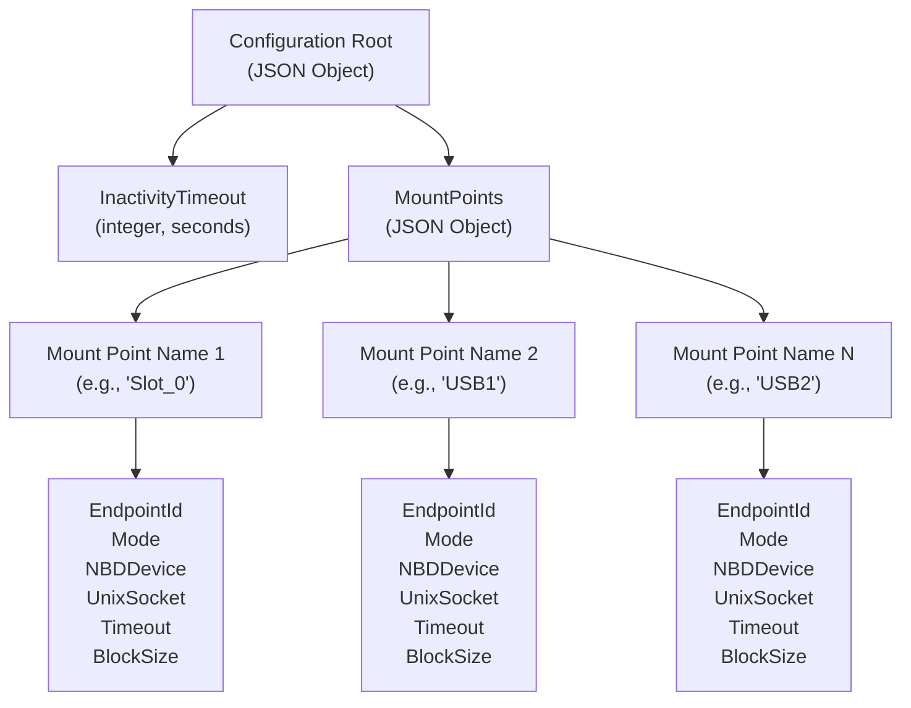
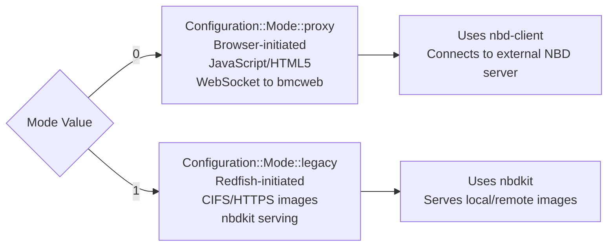
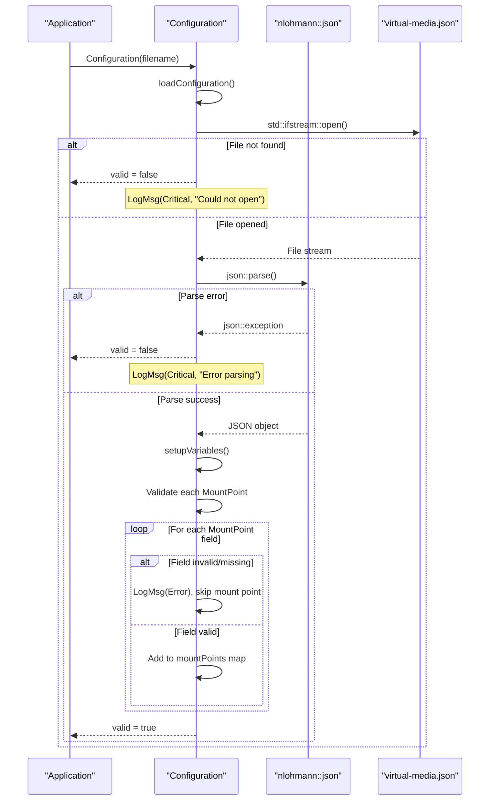
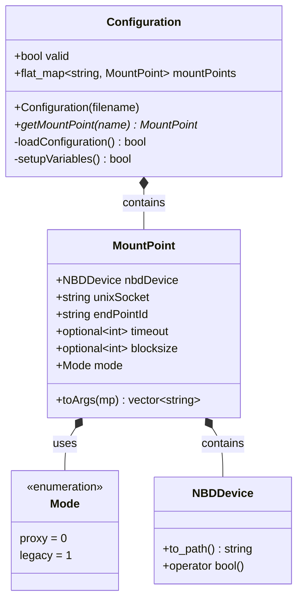
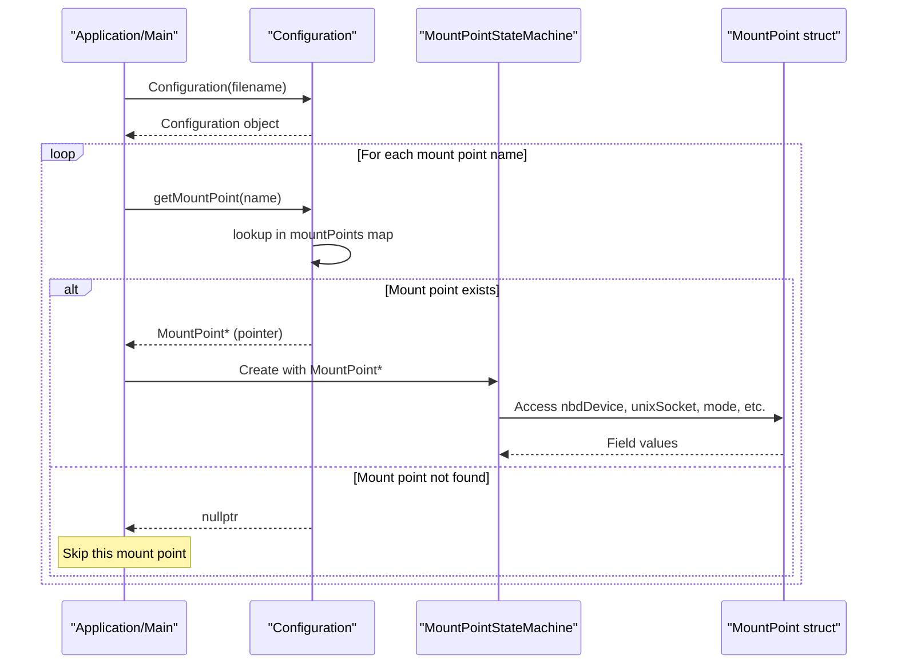

<!-- source: DeepWiki mcp.deepwiki.com · repo NVIDIA/remote-media · page 6.2 Configuration Schema · fetched 2026-10-26 -->

# Configuration Schema

<details>
<summary>Relevant source files</summary>

The following files were used as context for generating this wiki page:

- [src/configuration.hpp](src/configuration.hpp)
- [virtual-media.json](virtual-media.json)

</details>


This document specifies the JSON configuration schema for the virtual-media service. The configuration file (`virtual-media.json`) defines global settings and mount point configurations that control how the service operates. For information about how to use this configuration when running the service, see [Running the Service](#2.3). For details on the operational differences between modes, see [Operational Modes](#4).

## Overview

The virtual-media service reads its configuration from a JSON file at startup. The configuration defines one or more mount points, each representing a potential virtual media device that can be presented to the host system. Each mount point is independently configurable with its own NBD device, operational mode, and parameters.

The configuration file structure is parsed and validated by the `Configuration` class [src/configuration.hpp:14-234](), which loads the JSON, validates all required fields, and creates `MountPoint` structures for use by the application.

**Sources:** [virtual-media.json:1-29](), [src/configuration.hpp:14-234]()

## Configuration File Structure

### Top-Level Schema



The configuration consists of two top-level elements:
- **InactivityTimeout**: Global timeout setting (currently not actively used in the codebase)
- **MountPoints**: Object containing one or more named mount point configurations

**Sources:** [virtual-media.json:1-29](), [src/configuration.hpp:95-233]()

### Configuration Fields Reference

| Field | Type | Required | Default | Constraints | Description |
|-------|------|----------|---------|-------------|-------------|
| `InactivityTimeout` | integer | No | None | Positive integer | Global inactivity timeout in seconds |
| `MountPoints` | object | Yes | None | Non-empty object | Collection of mount point configurations |

**Sources:** [virtual-media.json:2](), [src/configuration.hpp:98-231]()

## MountPoint Configuration

### Field Specifications

Each entry in the `MountPoints` object has a key (the mount point name) and a value (the mount point configuration). The mount point name becomes the D-Bus object path component and must be a valid identifier.

| Field | Type | Required | Constraints | Purpose |
|-------|------|----------|-------------|---------|
| `EndpointId` | string | Yes* | Can be empty string | Identifies the endpoint; used in D-Bus interface properties |
| `Mode` | integer | Yes | Must be `0` or `1` | Operational mode: `0` = proxy, `1` = legacy |
| `NBDDevice` | string | Yes | Must match `nbd[0-9]+` | NBD device name (e.g., "nbd0", "nbd2") |
| `UnixSocket` | string | Yes | Valid file path | Unix socket path for NBD communication |
| `Timeout` | integer | No | Uses default if not set | Timeout in seconds for operations |
| `BlockSize` | integer | No | Uses default if not set | Block size in bytes for NBD device |

\* While `EndpointId` is marked as required in validation logic [src/configuration.hpp:145-161](), it can be an empty string as shown in the example configuration [virtual-media.json:5,13,21]().

**Sources:** [src/configuration.hpp:30-45](), [virtual-media.json:3-28]()

### Mode Values

The `Mode` field determines the operational behavior of the mount point:



The mode enumeration is defined in [src/configuration.hpp:17-28]():
- **Mode 0 (proxy)**: Works directly from browser, uses JavaScript/HTML5 to communicate over Secure WebSockets to HTTPS endpoint hosted by bmcweb
- **Mode 1 (legacy)**: Initiated from browser using Redfish VirtualMedia schemas, BMC connects to external CIFS/HTTPS images

**Sources:** [src/configuration.hpp:17-28](), [virtual-media.json:6,14,22]()

### NBDDevice Naming

The `NBDDevice` field must specify a valid NBD device identifier. The service supports `nbd0` through `nbd10` [src/configuration.hpp:113-119](). Each mount point must use a unique NBD device.

Valid examples:
- `"nbd0"`
- `"nbd2"`
- `"nbd3"`
- `"nbd10"`

The device name is converted to a system path (e.g., `/dev/nbd0`) by the `NBDDevice` class for kernel interaction.

**Sources:** [src/configuration.hpp:105-127](), [virtual-media.json:7,15,23]()

### UnixSocket Paths

The `UnixSocket` field specifies the path to a Unix domain socket used for communication between the virtual-media service and NBD processes (nbdkit or nbd-client). These sockets provide secure inter-process communication.

Typical paths follow the pattern `/tmp/nbdX.sock` where X matches the NBD device number [virtual-media.json:8,16,24](). The socket files are automatically created and cleaned up by the service.

**Sources:** [src/configuration.hpp:128-144](), [virtual-media.json:8,16,24]()

## Configuration Loading and Validation

### Loading Process



The configuration loading process occurs during `Configuration` object construction [src/configuration.hpp:63-66]():

1. **File Opening**: Opens the specified JSON file [src/configuration.hpp:72-76]()
2. **JSON Parsing**: Uses `nlohmann::json::parse()` to parse the file [src/configuration.hpp:79-80]()
3. **Variable Setup**: Calls `setupVariables()` to extract and validate fields [src/configuration.hpp:80]()
4. **Mount Point Validation**: Iterates through each mount point, validating all fields [src/configuration.hpp:98-231]()
5. **Error Handling**: Logs errors and skips invalid mount points; sets `valid` flag [src/configuration.hpp:60,65]()

**Sources:** [src/configuration.hpp:63-93](), [src/configuration.hpp:95-233]()

### Validation Rules

The validation process enforces the following rules for each mount point:

| Field | Validation Logic | Error Handling |
|-------|------------------|----------------|
| `NBDDevice` | Must exist as JSON string; must be recognized by `NBDDevice` constructor | Log error, skip mount point |
| `UnixSocket` | Must exist as JSON string; non-empty | Log error, skip mount point |
| `EndpointId` | Must exist as JSON string (can be empty) | Log info, skip mount point |
| `Mode` | Must exist; must be integer 0 or 1 | Log error, skip mount point |
| `Timeout` | Optional; if present, must be integer | Log info, use default |
| `BlockSize` | Optional; if present, must be integer | Log info, use default |

If any required field is missing or invalid, the mount point is skipped entirely and not added to the `mountPoints` map [src/configuration.hpp:228](). The service can still start with remaining valid mount points.

**Sources:** [src/configuration.hpp:105-228]()

## C++ Type Mapping

### Configuration Class Structure



The `Configuration` class [src/configuration.hpp:14-234]() provides:
- **mountPoints**: `boost::container::flat_map` storing validated mount points by name [src/configuration.hpp:61]()
- **valid**: Boolean flag indicating successful configuration loading [src/configuration.hpp:60]()
- **getMountPoint()**: Method to retrieve a mount point configuration by name [src/configuration.hpp:47-58]()

The `MountPoint` struct [src/configuration.hpp:30-45]() represents a single mount point configuration with:
- **nbdDevice**: `NBDDevice` object for kernel device interaction
- **unixSocket**: String path to Unix socket
- **endPointId**: String identifier for the endpoint
- **timeout**: Optional integer for operation timeout
- **blocksize**: Optional integer for NBD block size
- **mode**: Enum value indicating proxy or legacy mode

**Sources:** [src/configuration.hpp:14-45]()

### JSON to C++ Field Mapping

| JSON Field | JSON Type | C++ Type | C++ Member | Notes |
|------------|-----------|----------|------------|-------|
| `EndpointId` | string | `std::string` | `endPointId` | Direct assignment |
| `Mode` | integer | `Configuration::Mode` | `mode` | Enum conversion: 0→proxy, 1→legacy |
| `NBDDevice` | string | `NBDDevice` | `nbdDevice` | Constructor called with string |
| `UnixSocket` | string | `std::string` | `unixSocket` | Direct assignment |
| `Timeout` | integer | `std::optional<int>` | `timeout` | Optional field |
| `BlockSize` | integer | `std::optional<int>` | `blocksize` | Optional field |

**Sources:** [src/configuration.hpp:30-37](), [src/configuration.hpp:102-228]()

## Configuration Examples

### Example 1: Mixed Mode Configuration

This is the default configuration structure provided in the repository [virtual-media.json:1-29]():

```json
{
    "InactivityTimeout": 1800,
    "MountPoints": {
        "Slot_0": {
            "EndpointId": "",
            "Mode": 0,
            "NBDDevice": "nbd0",
            "UnixSocket": "/tmp/nbd0.sock",
            "Timeout": 30,
            "BlockSize": 512
        },
        "USB1": {
            "EndpointId": "",
            "Mode": 1,
            "NBDDevice": "nbd2",
            "UnixSocket": "/tmp/nbd2.sock",
            "Timeout": 30,
            "BlockSize": 512
        },
        "USB2": {
            "EndpointId": "",
            "Mode": 1,
            "NBDDevice": "nbd3",
            "UnixSocket": "/tmp/nbd3.sock",
            "Timeout": 30,
            "BlockSize": 512
        }
    }
}
```

This configuration creates:
- One proxy mode mount point (`Slot_0`) using `nbd0`
- Two legacy mode mount points (`USB1`, `USB2`) using `nbd2` and `nbd3`

**Sources:** [virtual-media.json:1-29]()

### Example 2: All Proxy Mode

Configuration for a system using only proxy mode (browser-initiated virtual media):

```json
{
    "InactivityTimeout": 1800,
    "MountPoints": {
        "USB1": {
            "EndpointId": "usb1_endpoint",
            "Mode": 0,
            "NBDDevice": "nbd0",
            "UnixSocket": "/tmp/nbd0.sock",
            "Timeout": 60,
            "BlockSize": 4096
        },
        "USB2": {
            "EndpointId": "usb2_endpoint",
            "Mode": 0,
            "NBDDevice": "nbd1",
            "UnixSocket": "/tmp/nbd1.sock",
            "Timeout": 60,
            "BlockSize": 4096
        }
    }
}
```

### Example 3: All Legacy Mode

Configuration for traditional Redfish-based virtual media with CIFS/HTTPS support:

```json
{
    "InactivityTimeout": 3600,
    "MountPoints": {
        "CD_Slot": {
            "EndpointId": "cd_drive",
            "Mode": 1,
            "NBDDevice": "nbd5",
            "UnixSocket": "/tmp/nbd5.sock",
            "Timeout": 120,
            "BlockSize": 2048
        },
        "USB_Drive": {
            "EndpointId": "usb_storage",
            "Mode": 1,
            "NBDDevice": "nbd6",
            "UnixSocket": "/tmp/nbd6.sock",
            "Timeout": 90,
            "BlockSize": 512
        }
    }
}
```

### Example 4: Minimal Configuration

Minimal valid configuration with only required fields:

```json
{
    "MountPoints": {
        "Virtual_Device": {
            "EndpointId": "",
            "Mode": 1,
            "NBDDevice": "nbd0",
            "UnixSocket": "/tmp/nbd0.sock"
        }
    }
}
```

Note that `InactivityTimeout`, `Timeout`, and `BlockSize` are omitted, and the system will use default values.

**Sources:** [src/configuration.hpp:162-192]() (optional field handling)

## Configuration Access Patterns

### Runtime Configuration Access



The application accesses configuration using the `getMountPoint()` method [src/configuration.hpp:47-58]():

1. **Lookup**: Searches the `mountPoints` flat_map by name
2. **Return**: Returns pointer to `MountPoint` struct or `nullptr` if not found
3. **Usage**: `MountPointStateMachine` instances use the pointer to access configuration fields

The `MountPoint` struct provides a static `toArgs()` method [src/configuration.hpp:39-44]() that converts mount point configuration into command-line arguments for nbd-client processes, demonstrating how configuration drives process spawning.

**Sources:** [src/configuration.hpp:47-58](), [src/configuration.hpp:39-44]()

## Best Practices

### Mount Point Naming

- Use descriptive names that indicate the device purpose (e.g., `CD_Drive`, `USB_Storage`, `Slot_0`)
- Names become part of D-Bus object paths: `/xyz/openbmc_project/VirtualMedia/{name}`
- Avoid spaces and special characters that could cause D-Bus path issues

### NBD Device Assignment

- Each mount point must use a unique NBD device
- System supports `nbd0` through `nbd10`
- Match NBD device number with Unix socket path for clarity (e.g., `nbd2` → `/tmp/nbd2.sock`)
- Ensure NBD kernel module is loaded before starting the service

### Timeout and BlockSize Selection

- **Timeout**: Adjust based on network latency and image size
  - Local CIFS shares: 30-60 seconds
  - Remote HTTPS: 90-120 seconds
- **BlockSize**: Affects I/O performance
  - CD/DVD images: 2048 bytes (standard CD block size)
  - Disk images: 512 or 4096 bytes
  - Larger blocks may improve throughput but increase latency

### Mode Selection

- Use **proxy mode (0)** for:
  - Browser-based workflows
  - HTML5 virtual media capabilities
  - Direct user interaction
- Use **legacy mode (1)** for:
  - Automated Redfish API operations
  - CIFS share mounting
  - HTTPS URL-based images
  - Enterprise management tools

**Sources:** [src/configuration.hpp:17-28]() (mode definitions), [virtual-media.json:1-29]() (example configurations)

---

