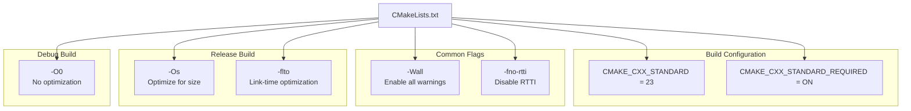
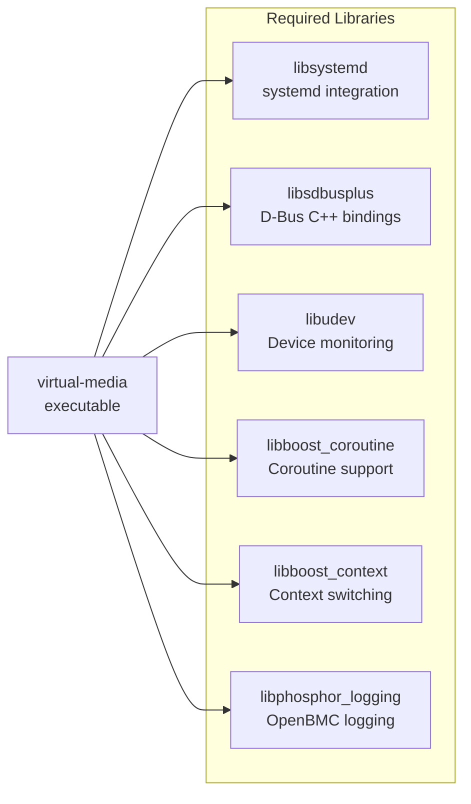
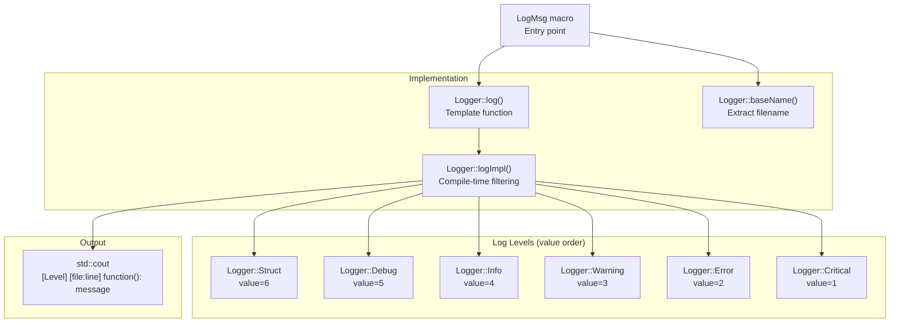
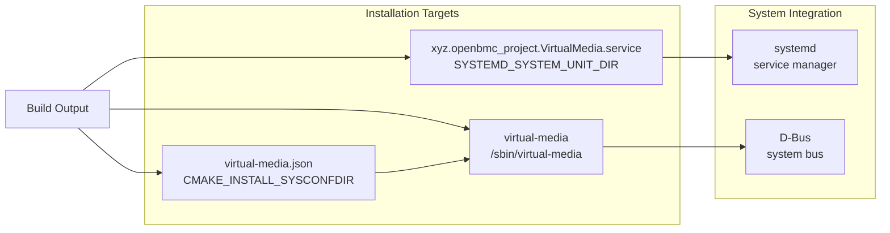
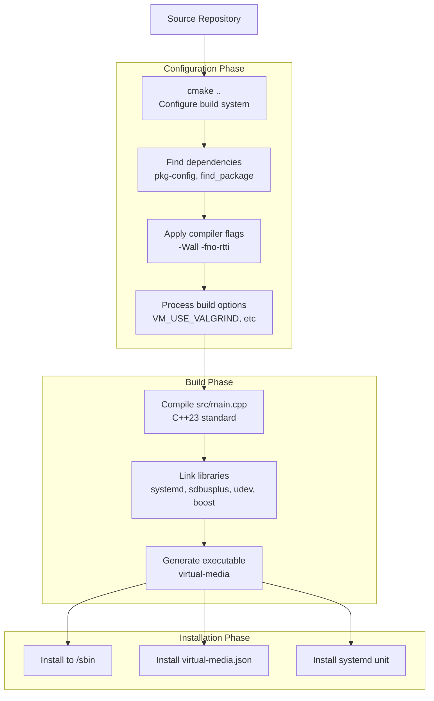

<!-- source: DeepWiki mcp.deepwiki.com · repo NVIDIA/remote-media · page 7 Development · fetched 2026-10-26 -->

# Development

<details>
<summary>Relevant source files</summary>

The following files were used as context for generating this wiki page:

- [CMakeLists.txt](CMakeLists.txt)
- [src/logger.hpp](src/logger.hpp)

</details>


This page provides resources for developers working on the virtual media service codebase. It covers build system configuration, logging infrastructure, debugging techniques, and code quality tooling.

For information about the overall architecture and component relationships, see [Architecture Overview](#1.2). For API usage and D-Bus integration details, see [API Reference](#6).

---

## Build System Overview

The virtual media service uses CMake as its build system. The build configuration is defined in [CMakeLists.txt:1-87]() and produces a single executable named `virtual-media`.

### Build Requirements

| Requirement | Details |
|------------|---------|
| **CMake Version** | 3.5 or higher |
| **C++ Standard** | C++23 (required) |
| **Compiler Flags** | `-Wall -fno-rtti` (all builds), `-Os -flto` (release), `-O0` (debug) |
| **RTTI** | Disabled (`-fno-rtti`) |

**Sources:** [CMakeLists.txt:1-14]()

---

## Compiler Configuration

### Build Types and Optimization

The build system defines distinct optimization strategies for different build types:



**Configuration in CMakeLists.txt:**
- [CMakeLists.txt:8-9]() - Sets C++23 standard as required
- [CMakeLists.txt:12]() - Applies `-Wall -fno-rtti` to all builds
- [CMakeLists.txt:13]() - Release builds use `-Os -flto` for size optimization and link-time optimization
- [CMakeLists.txt:14]() - Debug builds use `-O0` for debugging clarity

**Sources:** [CMakeLists.txt:8-14]()

---

## Build Options

### Compile-Time Feature Flags

Three optional build features can be enabled via CMake options:

| Option | CMake Variable | Effect |
|--------|----------------|--------|
| **Valgrind Support** | `VM_USE_VALGRIND` | Adds `-DBOOST_USE_VALGRIND` definition for Boost compatibility with valgrind |
| **Verbose NBD Logs** | `VM_VERBOSE_NBDKIT_LOGS` | Adds `-DVM_VERBOSE_NBDKIT_LOGS` to include detailed nbdkit process output |
| **Yocto Dependencies** | `YOCTO_DEPENDENCIES` | Switches to Yocto-based dependency resolution |

**Usage example:**
```bash
cmake -DVM_VERBOSE_NBDKIT_LOGS=ON -DVM_USE_VALGRIND=ON ..
```

**Sources:** [CMakeLists.txt:16-20](), [CMakeLists.txt:69-76]()

---

## Dependency Management

### System Libraries



**Library linkage configuration:**
- [CMakeLists.txt:60]() - `systemd` for D-Bus and service management
- [CMakeLists.txt:61]() - `sdbusplus` for D-Bus C++ API
- [CMakeLists.txt:62]() - `udev` for device monitoring via libudev
- [CMakeLists.txt:63-64]() - `boost_coroutine` and `boost_context` for asynchronous operations
- [CMakeLists.txt:65]() - `phosphor_logging` for OpenBMC logging infrastructure

**Sources:** [CMakeLists.txt:22-42](), [CMakeLists.txt:60-65]()

### Boost Configuration

The build system applies multiple compile-time definitions to configure Boost behavior:

| Definition | Purpose |
|------------|---------|
| `BOOST_COROUTINES_NO_DEPRECATION_WARNING` | Suppress deprecation warnings for coroutines |
| `BOOST_ERROR_CODE_HEADER_ONLY` | Use header-only error code implementation |
| `BOOST_SYSTEM_NO_DEPRECATED` | Exclude deprecated Boost.System APIs |
| `BOOST_ALL_NO_LIB` | Disable auto-linking (use explicit linkage) |
| `BOOST_NO_RTTI` | Disable RTTI in Boost (matches `-fno-rtti` compiler flag) |
| `BOOST_NO_TYPEID` | Disable `typeid` operator in Boost |
| `BOOST_ASIO_DISABLE_THREADS` | Single-threaded ASIO mode |

These definitions ensure Boost integrates properly with the embedded environment and matches the RTTI-disabled build configuration.

**Sources:** [CMakeLists.txt:44-51]()

---

## Logging System

### Logger Architecture

The logging system is implemented in [src/logger.hpp:1-96]() and provides compile-time log level filtering with zero runtime overhead for disabled levels.



**Sources:** [src/logger.hpp:1-96]()

### Log Level Configuration

The global log level is defined at [src/logger.hpp:6]():
```cpp
#define LOG_LEVEL Debug
```

This compile-time constant determines which log messages are included in the binary. Messages with a level value greater than `LOG_LEVEL::value` are completely eliminated by the optimizer.

**Log Level Hierarchy:**

| Level | Value | Constant Name | Usage |
|-------|-------|---------------|-------|
| Struct | 6 | `Logger::Struct` | Data structure dumps |
| Debug | 5 | `Logger::Debug` | Debug information |
| Info | 4 | `Logger::Info` | Informational messages |
| Warning | 3 | `Logger::Warning` | Warning conditions |
| Error | 2 | `Logger::Error` | Error conditions |
| Critical | 1 | `Logger::Critical` | Critical failures |

**Sources:** [src/logger.hpp:6-45]()

### Using the Logger

The `LogMsg` macro provides the logging interface:

```cpp
LogMsg(Logger::Info, "Starting mount operation for ", devicePath);
LogMsg(Logger::Error, "Failed to connect NBD device: ", errorCode);
LogMsg(Logger::Debug, "State transition: ", oldState, " -> ", newState);
```

**Macro definition:** [src/logger.hpp:91-93]()

The macro automatically captures:
- **File name** - Extracted using `baseName()` constexpr function ([src/logger.hpp:47-60]())
- **Line number** - Via `__LINE__` preprocessor macro
- **Function name** - Via `__FUNCTION__` macro

**Output format:**
```
[Level   ] [file.cpp:123] functionName(): message text
```

**Implementation details:**
- [src/logger.hpp:72-82]() - `logImpl()` performs compile-time level filtering using `if constexpr`
- [src/logger.hpp:84-89]() - `log()` wrapper calls `logImpl()` with the global `LOG_LEVEL`
- [src/logger.hpp:62-70]() - Overloaded `operator<<` for `std::vector<T>` printing

**Sources:** [src/logger.hpp:47-94]()

---

## Debugging Features

### NBD Process Logging

When troubleshooting issues with nbdkit or nbd-client processes, enable verbose logging at build time:

```bash
cmake -DVM_VERBOSE_NBDKIT_LOGS=ON ..
make
```

This adds the `VM_VERBOSE_NBDKIT_LOGS` preprocessor definition ([CMakeLists.txt:73-74]()), which the codebase checks to include detailed stdout/stderr output from spawned NBD processes.

**Trade-offs:**
- **Enabled:** Complete visibility into nbdkit plugin behavior and errors
- **Disabled:** Cleaner logs, reduced I/O overhead

**Sources:** [CMakeLists.txt:20](), [CMakeLists.txt:73-74]()

### Valgrind Compatibility

For memory debugging with valgrind, build with:

```bash
cmake -DVM_USE_VALGRIND=ON -DBOOST_VERSION=1.69 ..
make
```

**Configuration changes:**
- [CMakeLists.txt:71-72]() - Adds `BOOST_USE_VALGRIND` definition
- [CMakeLists.txt:34-38]() - Allows specifying exact Boost version compiled with valgrind support

This ensures Boost coroutines properly integrate with valgrind's memory tracking.

**Sources:** [CMakeLists.txt:18](), [CMakeLists.txt:34-38](), [CMakeLists.txt:71-72]()

---

## Installation Paths

### Build Artifacts



**Installation rules:**
- [CMakeLists.txt:66]() - Executable installed to `/sbin/virtual-media`
- [CMakeLists.txt:78-81]() - Configuration file installed to `${CMAKE_INSTALL_SYSCONFDIR}/virtual-media.json`
- [CMakeLists.txt:82-86]() - Systemd service unit installed to systemd unit directory

**Sources:** [CMakeLists.txt:66](), [CMakeLists.txt:78-86]()

---

## Build Workflow

### Complete Build Process



**Source file:** [CMakeLists.txt:54]() defines `SRC_FILES` as `src/main.cpp`

**Build commands:**
```bash
# Configure
cmake -DCMAKE_BUILD_TYPE=Release ..

# Build
make -j$(nproc)

# Install
sudo make install
```

**Sources:** [CMakeLists.txt:1-87]()

---

## Code Quality Tools

The repository includes ignore files for multiple code quality and formatting tools:

| Tool | Configuration File | Purpose |
|------|-------------------|---------|
| **clang-format** | `.clang-format-ignore` | C++ code formatting |
| **beautysh** | `.beautysh-ignore` | Shell script formatting |
| **black** | `.black-ignore` | Python code formatting |
| **eslint** | `.eslint-ignore` | JavaScript linting |
| **flake8** | `.flake8-ignore` | Python linting |
| **isort** | `.isort-ignore` | Python import sorting |
| **markdownlint** | `.markdownlint-ignore` | Markdown linting |
| **prettier** | `.prettier-ignore` | General code formatting |
| **shellcheck** | `.shellcheck-ignore` | Shell script static analysis |

These configuration files allow maintainers to exclude specific files or patterns from automated quality checks, ensuring that generated code, third-party code, or intentionally non-standard code is not flagged by CI/CD pipelines.

---

## Custom CMake Modules

The build system extends CMake's built-in package finding with a custom module:

**Module:** [CMakeLists.txt:10]() adds `${CMAKE_CURRENT_SOURCE_DIR}/cmake` to the module path

This directory is expected to contain `Findudev.cmake` (referenced in [CMakeLists.txt:27]()), which provides the `find_package(udev REQUIRED)` functionality for locating libudev.

**Sources:** [CMakeLists.txt:10](), [CMakeLists.txt:27-29]()

---

## Development Workflow Summary

For developers working on the virtual media service:

1. **Initial Setup:**
   - Ensure C++23-capable compiler is available
   - Install required dependencies (see [System Dependencies](#8.1))
   - Clone repository

2. **Development Build:**
   ```bash
   mkdir build && cd build
   cmake -DCMAKE_BUILD_TYPE=Debug -DVM_VERBOSE_NBDKIT_LOGS=ON ..
   make -j$(nproc)
   ```

3. **Testing with Valgrind:**
   ```bash
   cmake -DVM_USE_VALGRIND=ON -DBOOST_VERSION=1.69 ..
   make
   valgrind --leak-check=full ./virtual-media
   ```

4. **Release Build:**
   ```bash
   cmake -DCMAKE_BUILD_TYPE=Release ..
   make -j$(nproc)
   sudo make install
   ```

5. **Logging:**
   - Adjust `LOG_LEVEL` in [src/logger.hpp:6]() for different verbosity
   - Use `LogMsg(Logger::Level, ...)` throughout code
   - Review output format: `[Level] [file:line] function(): message`

**Sources:** [CMakeLists.txt:1-87](), [src/logger.hpp:1-96]()

---

