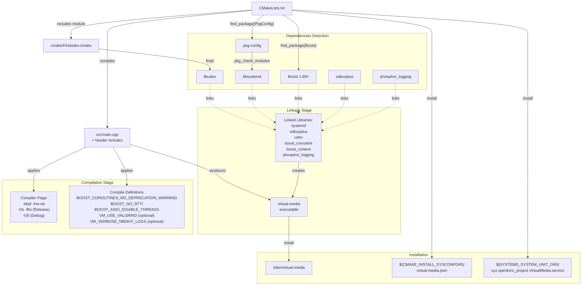
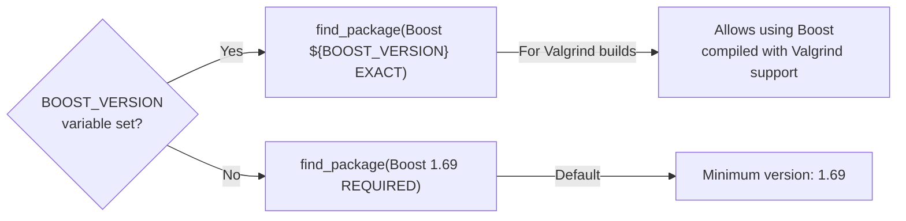
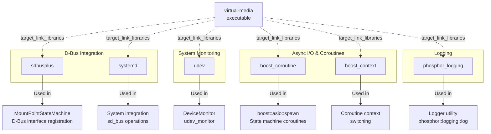
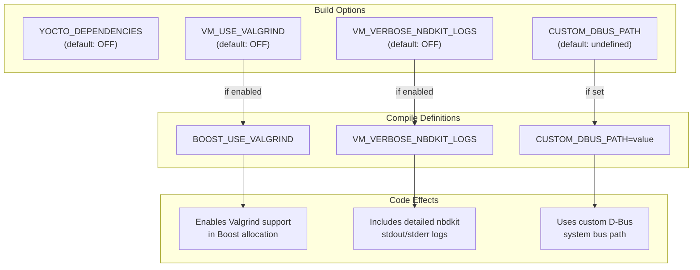
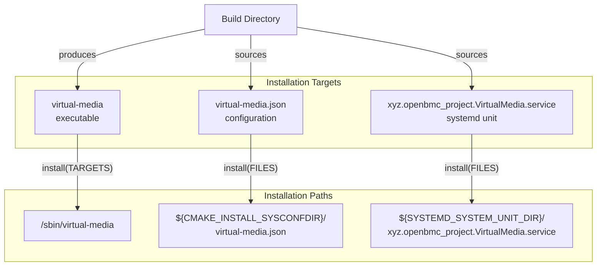
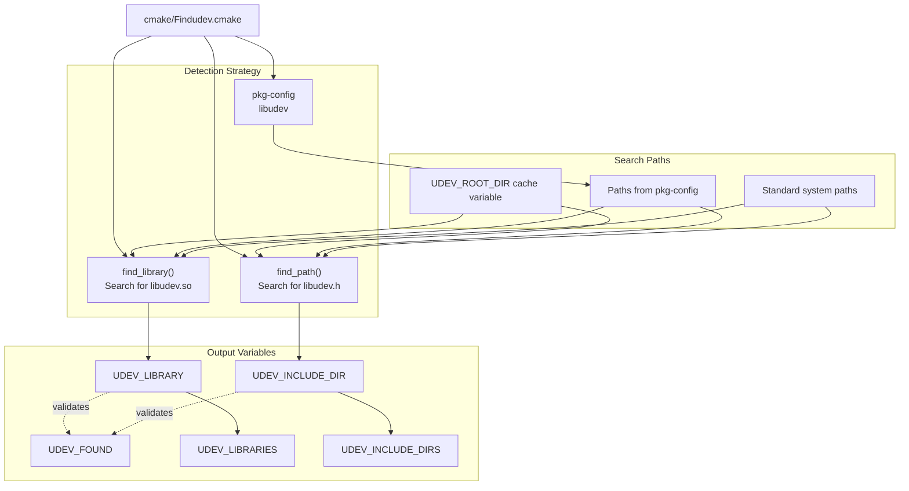

<!-- source: DeepWiki mcp.deepwiki.com · repo NVIDIA/remote-media · page 7.1 Build System Details · fetched 2026-10-26 -->

# Build System Details

<details>
<summary>Relevant source files</summary>

The following files were used as context for generating this wiki page:

- [CMakeLists.txt](CMakeLists.txt)
- [cmake/Findudev.cmake](cmake/Findudev.cmake)

</details>


This page provides comprehensive documentation of the CMake-based build system for the virtual-media service. It covers target definitions, compiler configuration, dependency management, build options, and installation rules. For runtime configuration of the service itself, see [Configuration](#2.2). For information about dependencies and their versions, see [System Dependencies](#8.1).

## Build System Overview

The virtual-media project uses CMake 3.5+ as its build system, producing a single executable target named `virtual-media`. The build system is designed for OpenBMC environments and includes special handling for Boost coroutines, D-Bus integration via sdbusplus, and Linux-specific system libraries.

**Build System Structure**



Sources: [CMakeLists.txt:1-87](), [cmake/Findudev.cmake:1-78]()

## CMake Configuration

### Basic Project Setup

The project is configured with the following fundamental settings:

| Setting | Value | Location |
|---------|-------|----------|
| Minimum CMake Version | 3.5 | [CMakeLists.txt:1]() |
| Project Name | VirtualMedia | [CMakeLists.txt:3]() |
| Language | CXX (C++) | [CMakeLists.txt:3]() |
| C++ Standard | C++23 | [CMakeLists.txt:8]() |
| Standard Required | ON | [CMakeLists.txt:9]() |
| Export Compile Commands | ON | [CMakeLists.txt:7]() |

The C++23 requirement is necessary for modern coroutine and async features used throughout the codebase. The `CMAKE_EXPORT_COMPILE_COMMANDS` setting generates a `compile_commands.json` file useful for IDE integration and static analysis tools.

A custom module path is set at [CMakeLists.txt:10]() to include the `cmake/` directory, allowing the build system to find custom CMake modules like `Findudev.cmake`.

Sources: [CMakeLists.txt:1-10]()

## Compiler Settings

### Compiler Flags

The build system configures compiler flags to balance code size, performance, and debugging capabilities:

**Common Flags (All Build Types)**

| Flag | Purpose | Location |
|------|---------|----------|
| `-Wall` | Enable all standard warnings | [CMakeLists.txt:12]() |
| `-fno-rtti` | Disable Run-Time Type Information to reduce binary size | [CMakeLists.txt:12]() |

**Release Build Flags**

| Flag | Purpose | Location |
|------|---------|----------|
| `-Os` | Optimize for size (critical for embedded systems) | [CMakeLists.txt:13]() |
| `-flto` | Enable Link-Time Optimization for better optimization across compilation units | [CMakeLists.txt:13]() |

**Debug Build Flags**

| Flag | Purpose | Location |
|------|---------|----------|
| `-O0` | Disable optimization for easier debugging | [CMakeLists.txt:14]() |

The `-fno-rtti` flag is particularly important as it aligns with the Boost configuration (see `BOOST_NO_RTTI` below) and reduces executable size significantly, which is valuable for BMC firmware images with limited storage.

Sources: [CMakeLists.txt:12-14]()

## Dependency Management

### System Dependencies

The build system uses multiple mechanisms to locate required dependencies:

**pkg-config Based Dependencies**

```cmake
pkg_check_modules(SYSTEMD libsystemd REQUIRED)
```

The systemd library is found using pkg-config at [CMakeLists.txt:24](). This is the primary mechanism for locating system libraries in Linux environments.

**Custom Find Modules**

```cmake
find_package(udev REQUIRED)
```

The udev library is located using a custom CMake module `Findudev.cmake` at [CMakeLists.txt:27](). This module searches for `libudev.h` and the udev library in standard system paths and pkg-config locations.

Sources: [CMakeLists.txt:22-29](), [cmake/Findudev.cmake:1-78]()

### Boost Configuration

Boost is a critical dependency for the virtual-media service, providing asynchronous I/O, coroutines, and process management capabilities. The build system includes extensive Boost configuration:

**Boost Version Handling**



The build system allows specifying an exact Boost version via the `BOOST_VERSION` variable [CMakeLists.txt:34-38](). This is particularly useful for Valgrind debugging, where a specially-compiled Boost version may be required.

**Boost Compile Definitions**

The following preprocessor definitions configure Boost behavior:

| Definition | Purpose | Location |
|-----------|---------|----------|
| `BOOST_COROUTINES_NO_DEPRECATION_WARNING` | Suppress deprecation warnings for coroutines API | [CMakeLists.txt:45]() |
| `BOOST_ERROR_CODE_HEADER_ONLY` | Use header-only error code implementation | [CMakeLists.txt:46]() |
| `BOOST_SYSTEM_NO_DEPRECATED` | Exclude deprecated system library features | [CMakeLists.txt:47]() |
| `BOOST_ALL_NO_LIB` | Disable auto-linking (use explicit linkage) | [CMakeLists.txt:48]() |
| `BOOST_NO_RTTI` | Disable RTTI in Boost (matches `-fno-rtti` flag) | [CMakeLists.txt:49]() |
| `BOOST_NO_TYPEID` | Disable `typeid` operator usage in Boost | [CMakeLists.txt:50]() |
| `BOOST_ASIO_DISABLE_THREADS` | Disable threading support in Boost.Asio (single-threaded design) | [CMakeLists.txt:51]() |

The `BOOST_ASIO_DISABLE_THREADS` definition is particularly important—the virtual-media service uses a single-threaded async design with coroutines, eliminating the overhead and complexity of multi-threading.

**Boost Libraries Linked**

| Library | Component | Purpose in virtual-media | Location |
|---------|-----------|-------------------------|----------|
| `boost_coroutine` | Coroutines | Async/await patterns for state machine and I/O | [CMakeLists.txt:63]() |
| `boost_context` | Context switching | Low-level support for coroutines | [CMakeLists.txt:64]() |

Sources: [CMakeLists.txt:31-51](), [CMakeLists.txt:63-64]()

### Complete Library Linkage

**Linkage Mapping to Code Components**



Sources: [CMakeLists.txt:60-65]()

## Target Definition

The build produces a single executable target:

| Property | Value | Location |
|----------|-------|----------|
| Target Name | `virtual-media` | [CMakeLists.txt:57]() |
| Source Files | `src/main.cpp` (plus headers via includes) | [CMakeLists.txt:54,57]() |
| Target Type | Executable | [CMakeLists.txt:57]() |

The `${SRC_FILES}` variable is set at [CMakeLists.txt:54]() to contain only `src/main.cpp`. All other implementation is in header files that are included transitively, following a header-only approach for much of the codebase.

Sources: [CMakeLists.txt:54-57]()

## Build Options

The build system provides several optional features controlled by CMake options:

**Build Option Reference**



### Option Details

**YOCTO_DEPENDENCIES**
- **Location**: [CMakeLists.txt:16]()
- **Default**: OFF
- **Purpose**: Indicates use of Yocto dependency system
- **Effect**: Currently no direct effect in CMake; serves as documentation

**VM_USE_VALGRIND**
- **Location**: [CMakeLists.txt:18]()
- **Default**: OFF
- **Compile Definition**: `BOOST_USE_VALGRIND` [CMakeLists.txt:71-72]()
- **Purpose**: Enable Valgrind support in Boost libraries
- **Effect**: Modifies Boost allocation strategies to be Valgrind-compatible, allowing memory leak detection

**VM_VERBOSE_NBDKIT_LOGS**
- **Location**: [CMakeLists.txt:20]()
- **Default**: OFF
- **Compile Definition**: `VM_VERBOSE_NBDKIT_LOGS` [CMakeLists.txt:73-74]()
- **Purpose**: Include detailed logging from nbdkit subprocesses
- **Effect**: When enabled, the `Process` class captures and logs nbdkit stdout/stderr output for debugging

**CUSTOM_DBUS_PATH**
- **Location**: [CMakeLists.txt:75-76]()
- **Default**: Undefined
- **Compile Definition**: `CUSTOM_DBUS_PATH="${CUSTOM_DBUS_PATH}"`
- **Purpose**: Override default D-Bus system bus path
- **Effect**: Allows testing or deployment with non-standard D-Bus socket locations

### Conditional Compilation

The conditional compile definitions are applied using generator expressions at [CMakeLists.txt:69-76]():

```cmake
target_compile_definitions(virtual-media
                           PRIVATE
                           $<$<BOOL:${VM_USE_VALGRIND}>:
                           -DBOOST_USE_VALGRIND>
                           $<$<BOOL:${VM_VERBOSE_NBDKIT_LOGS}>:
                           -DVM_VERBOSE_NBDKIT_LOGS>
                           $<$<BOOL:${CUSTOM_DBUS_PATH}>:
                           -DCUSTOM_DBUS_PATH="${CUSTOM_DBUS_PATH}">)
```

This approach ensures definitions are only added when the corresponding option is enabled or variable is set.

Sources: [CMakeLists.txt:16-20](), [CMakeLists.txt:69-76]()

## Installation Rules

The build system defines installation rules for three components:

**Installation Layout**



### Installation Destinations

**Executable Installation**
- **CMake Command**: `install(TARGETS virtual-media DESTINATION sbin)`
- **Location**: [CMakeLists.txt:66]()
- **Installed Path**: `/sbin/virtual-media` (or prefixed by `CMAKE_INSTALL_PREFIX`)
- **Purpose**: System-level executable accessible to systemd

**Configuration File Installation**
- **CMake Command**: `install(FILES ... DESTINATION ${CMAKE_INSTALL_SYSCONFDIR})`
- **Location**: [CMakeLists.txt:78-81]()
- **Condition**: Only if `CMAKE_INSTALL_SYSCONFDIR` is defined
- **Source File**: `virtual-media.json` in project root
- **Installed Path**: Typically `/etc/virtual-media.json`
- **Purpose**: Runtime configuration (see [Configuration](#2.2))

**Systemd Unit Installation**
- **CMake Command**: `install(FILES ... DESTINATION "${SYSTEMD_SYSTEM_UNIT_DIR}")`
- **Location**: [CMakeLists.txt:82-86]()
- **Path Detection**: Via `pkg_get_variable(SYSTEMD_SYSTEM_UNIT_DIR systemd systemdsystemunitdir)`
- **Source File**: `xyz.openbmc_project.VirtualMedia.service` in project root
- **Installed Path**: Typically `/lib/systemd/system/xyz.openbmc_project.VirtualMedia.service`
- **Purpose**: Systemd service integration (see [Systemd Service Configuration](#8.2))

Sources: [CMakeLists.txt:66](), [CMakeLists.txt:78-86]()

## Custom CMake Modules

### Findudev.cmake Module

The `Findudev.cmake` module provides robust detection of the udev library, which is not always found correctly by standard CMake mechanisms.

**Module Structure**



**Cache Variables (Advanced)**

| Variable | Type | Purpose | Location |
|----------|------|---------|----------|
| `UDEV_ROOT_DIR` | PATH | Custom search root for udev | [cmake/Findudev.cmake:23-27]() |
| `UDEV_INCLUDE_DIR` | PATH | Path to libudev.h | [cmake/Findudev.cmake:48-60]() |
| `UDEV_LIBRARY` | FILEPATH | Path to libudev.so | [cmake/Findudev.cmake:34-44]() |

**Output Variables (Public)**

| Variable | Type | Purpose | Location |
|----------|------|---------|----------|
| `UDEV_FOUND` | BOOL | Whether udev was found | [cmake/Findudev.cmake:63-67]() |
| `UDEV_LIBRARIES` | LIST | Libraries to link | [cmake/Findudev.cmake:70]() |
| `UDEV_INCLUDE_DIRS` | LIST | Include directories | [cmake/Findudev.cmake:71]() |

The module uses `find_package_handle_standard_args` to set `UDEV_FOUND` based on the successful discovery of both the library and header files [cmake/Findudev.cmake:62-67]().

### Module Usage in Main CMakeLists.txt

The module is invoked via:
```cmake
find_package(udev REQUIRED)
include_directories(${UDEV_INCLUDE_DIRS})
link_directories(${UDEV_LIBRARIES})
```

Located at [CMakeLists.txt:27-29](). The `REQUIRED` keyword causes CMake to fail if udev is not found, as it is a mandatory dependency for the `DeviceMonitor` component.

Sources: [cmake/Findudev.cmake:1-78]()

## Build Example

A typical build workflow:

```bash
# Configure with default options
cmake -B build -S .

# Configure with Valgrind support
cmake -B build -S . -DVM_USE_VALGRIND=ON

# Configure with verbose nbdkit logging
cmake -B build -S . -DVM_VERBOSE_NBDKIT_LOGS=ON

# Configure with custom Boost version
cmake -B build -S . -DBOOST_VERSION=1.76.0

# Build
cmake --build build

# Install (requires appropriate permissions)
cmake --install build
```

The resulting executable will be installed to `/sbin/virtual-media` (or under the configured prefix), with configuration and systemd unit files placed in their respective system directories.

Sources: [CMakeLists.txt:1-87]()

---

