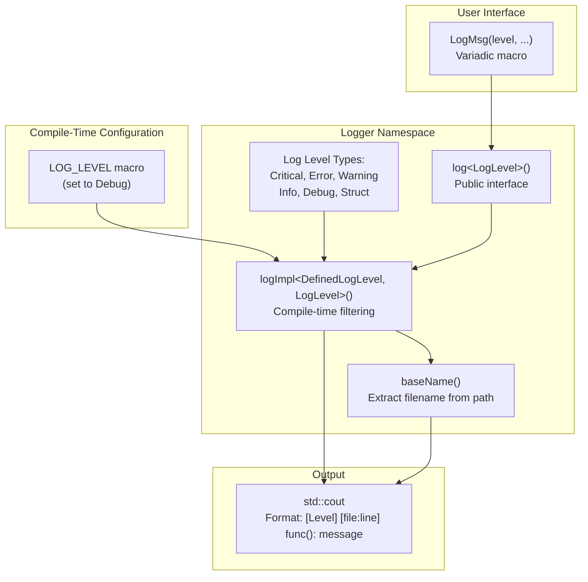
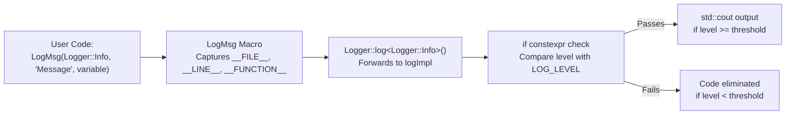
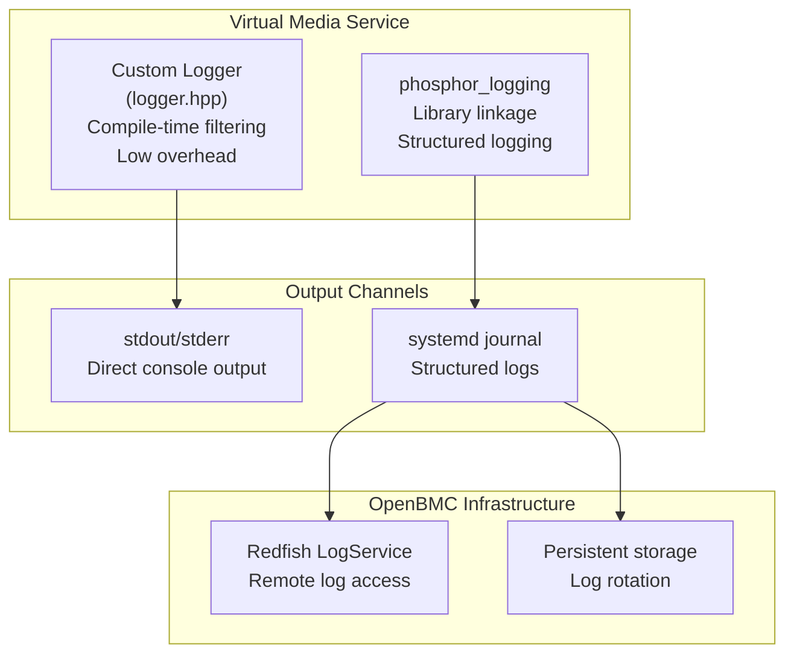
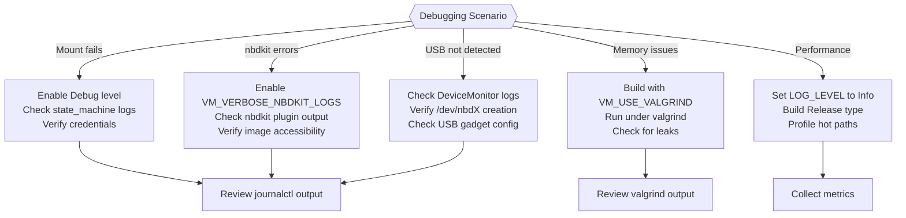

<!-- source: DeepWiki mcp.deepwiki.com · repo NVIDIA/remote-media · page 7.2 Logging and Debugging · fetched 2026-10-26 -->

# Logging and Debugging

<details>
<summary>Relevant source files</summary>

The following files were used as context for generating this wiki page:

- [CMakeLists.txt](CMakeLists.txt)
- [src/logger.hpp](src/logger.hpp)
- [src/main.cpp](src/main.cpp)

</details>


This page documents the logging infrastructure and debugging capabilities of the virtual media service. It covers the `Logger` utility for compile-time filtered logging, build options for verbose output and debugging tools, and integration with the OpenBMC phosphor_logging framework.

For information about the build system configuration and compiler flags, see [7.1](#7.1).

## Logging Infrastructure

The virtual media service implements a custom lightweight logging framework defined in [src/logger.hpp:1-96](). This framework provides compile-time log level filtering to minimize runtime overhead and binary size while maintaining debugging capabilities during development.

The logging system is built around the `Logger` namespace and provides five severity levels, each represented as a type with a numeric value and display name:

| Log Level | Numeric Value | Purpose |
|-----------|---------------|---------|
| `Critical` | 1 | System-critical failures requiring immediate attention |
| `Error` | 2 | Error conditions that prevent normal operation |
| `Warning` | 3 | Warning conditions that may lead to errors |
| `Info` | 4 | Informational messages about normal operation |
| `Debug` | 5 | Detailed debugging information |
| `Struct` | 6 | Structure/data dump logging |

**Sources:** [src/logger.hpp:8-45]()

### Logger Architecture



**Sources:** [src/logger.hpp:8-94]()

### Compile-Time Log Filtering

The logging system uses template metaprogramming to filter log messages at compile time. The `LOG_LEVEL` macro at [src/logger.hpp:6]() defines the minimum severity level that will be included in the compiled binary. Messages below this threshold are completely eliminated from the binary, reducing code size and runtime overhead.

The filtering logic is implemented in the `logImpl` function template at [src/logger.hpp:72-82]():

```cpp
template <typename DefinedLogLevel, typename LogLevel, typename... Args>
constexpr void logImpl(const char* file, int32_t line, const char* fname,
                       Args&&... args)
{
    if constexpr (LogLevel::value <= DefinedLogLevel::value)
    {
        // Only compiled if LogLevel meets threshold
        std::cout << "[" << LogLevel::name << "] [" << file << ":" << line
                  << "] " << fname << "(): ";
        (std::cout << ... << args) << std::endl;
    }
}
```

The `if constexpr` statement is evaluated at compile time, allowing the compiler to completely eliminate branches for log levels that don't meet the threshold.

**Sources:** [src/logger.hpp:6](), [src/logger.hpp:72-82]()

## Log Message Format

Log messages output by the `LogMsg` macro follow a standardized format that includes:

- **Log Level**: The severity level name in brackets
- **Source Location**: Filename (basename only) and line number
- **Function Name**: The function where the log statement appears
- **Message**: Variadic arguments formatted to the output stream

Example output:
```
[Debug   ] [main.cpp:45] initializeSystem(): Starting device monitor
[Info    ] [state_machine.cpp:123] handleMountEvent(): Mounting image from smb://server/share
[Error   ] [process.cpp:89] spawn(): Failed to start nbdkit: exit code 1
```

The `baseName` function at [src/logger.hpp:48-60]() ensures only the filename (not the full path) appears in log output, improving readability.

**Sources:** [src/logger.hpp:48-82](), [src/logger.hpp:91-93]()

## Using the LogMsg Macro

The primary interface for logging is the `LogMsg` macro defined at [src/logger.hpp:91-93](). This macro automatically captures the current file, line number, and function name, passing them to the logging infrastructure.

### Usage Pattern



**Sources:** [src/logger.hpp:72-93]()

### Variadic Arguments

The `LogMsg` macro accepts variadic arguments that are forwarded using C++17 fold expressions at [src/logger.hpp:80](). Any type that implements `operator<<` for `std::ostream` can be logged. The logger provides a custom `operator<<` overload for `std::vector<T>` at [src/logger.hpp:62-70]().

**Sources:** [src/logger.hpp:62-70](), [src/logger.hpp:80]()

## Build Options for Debugging

The CMake build system provides two debugging-related options that affect logging behavior and debugging capabilities.

### VM_VERBOSE_NBDKIT_LOGS

This build option controls whether detailed logs from nbdkit child processes are included in the output. When disabled (default), nbdkit's stdout and stderr are discarded to reduce noise. When enabled, all nbdkit output is captured and logged by the virtual media service.

Configuration at [CMakeLists.txt:20]():
```cmake
option(VM_VERBOSE_NBDKIT_LOGS "Include detailed logs from nbdkit" OFF)
```

The option is applied as a compile definition at [CMakeLists.txt:69-74]():
```cmake
target_compile_definitions(virtual-media
                           PRIVATE
                           $<$<BOOL:${VM_VERBOSE_NBDKIT_LOGS}>:
                           -DVM_VERBOSE_NBDKIT_LOGS>)
```

When `VM_VERBOSE_NBDKIT_LOGS` is defined, the Process class includes nbdkit output in its logging, allowing developers to see detailed information about plugin loading, image access, and NBD protocol operations.

**Build command:**
```bash
cmake -DVM_VERBOSE_NBDKIT_LOGS=ON ..
make
```

**Sources:** [CMakeLists.txt:20](), [CMakeLists.txt:69-74]()

### VM_USE_VALGRIND

This build option configures the application to work correctly under Valgrind memory debugging. It defines `BOOST_USE_VALGRIND` to enable Valgrind annotations in Boost libraries, particularly for coroutines and context switching.

Configuration at [CMakeLists.txt:18]():
```cmake
option(VM_USE_VALGRIND "Build VirtualMedia to work with valgrind" OFF)
```

Applied at [CMakeLists.txt:69-72]():
```cmake
target_compile_definitions(virtual-media
                           PRIVATE
                           $<$<BOOL:${VM_USE_VALGRIND}>:
                           -DBOOST_USE_VALGRIND>)
```

When building for Valgrind analysis, also ensure the Boost version used is compiled with Valgrind support. The build system allows specifying an exact Boost version at [CMakeLists.txt:34-38]():

```bash
cmake -DVM_USE_VALGRIND=ON -DBOOST_VERSION=1.69 ..
make
```

**Sources:** [CMakeLists.txt:18](), [CMakeLists.txt:34-38](), [CMakeLists.txt:69-72]()

## Debugging Configuration Matrix

The following table summarizes the recommended configurations for different debugging scenarios:

| Scenario | LOG_LEVEL | VM_VERBOSE_NBDKIT_LOGS | VM_USE_VALGRIND | Build Type |
|----------|-----------|------------------------|-----------------|------------|
| Production | `Info` | OFF | OFF | Release |
| Development | `Debug` | OFF | OFF | Debug |
| nbdkit Issues | `Debug` | ON | OFF | Debug |
| Memory Leaks | `Debug` | OFF | ON | Debug |
| Full Debugging | `Debug` | ON | ON | Debug |

**Sources:** [CMakeLists.txt:14](), [CMakeLists.txt:18](), [CMakeLists.txt:20](), [src/logger.hpp:6]()

## Integration with phosphor_logging

The virtual media service links against the OpenBMC `phosphor_logging` library at [CMakeLists.txt:65](). While the custom `Logger` utility handles most application logging, `phosphor_logging` provides:

- Structured logging to the systemd journal
- Integration with OpenBMC logging infrastructure
- Redfish LogService compatibility
- Persistent log storage

The integration allows the virtual media service to participate in the broader OpenBMC logging ecosystem while maintaining its lightweight custom logger for performance-critical paths.



**Sources:** [CMakeLists.txt:65]()

## Debugging Workflow

### Enabling Debug Logging

1. **Modify the LOG_LEVEL**: Edit [src/logger.hpp:6]() to set the desired log level:
   ```cpp
   #define LOG_LEVEL Debug  // or Info, Warning, Error, Critical
   ```

2. **Rebuild the service**: The compile-time filtering requires recompilation:
   ```bash
   cd build
   make
   ```

3. **Restart the service**:
   ```bash
   systemctl restart xyz.openbmc_project.VirtualMedia.service
   ```

4. **View logs**:
   ```bash
   journalctl -u xyz.openbmc_project.VirtualMedia.service -f
   ```

**Sources:** [src/logger.hpp:6](), [CMakeLists.txt:57]()

### Common Debugging Scenarios



**Sources:** [src/logger.hpp:6](), [CMakeLists.txt:14](), [CMakeLists.txt:18](), [CMakeLists.txt:20]()

### Valgrind Memory Analysis

To perform memory leak detection and analysis:

1. **Build with Valgrind support**:
   ```bash
   cmake -DVM_USE_VALGRIND=ON -DCMAKE_BUILD_TYPE=Debug ..
   make
   ```

2. **Stop the systemd service** to avoid conflicts:
   ```bash
   systemctl stop xyz.openbmc_project.VirtualMedia.service
   ```

3. **Run under Valgrind**:
   ```bash
   valgrind --leak-check=full --show-leak-kinds=all \
            --track-origins=yes --verbose \
            --log-file=valgrind-out.txt \
            /usr/sbin/virtual-media
   ```

4. **Review the output** at `valgrind-out.txt` for memory leaks, invalid accesses, and other issues.

**Sources:** [CMakeLists.txt:18](), [CMakeLists.txt:71-72]()

## Log Level Best Practices

| Use Case | Recommended Level | Rationale |
|----------|------------------|-----------|
| State transitions | `Logger::Info` | Important operational events |
| Function entry/exit | `Logger::Debug` | Detailed flow tracing |
| Configuration values | `Logger::Debug` | Setup and initialization |
| Error conditions | `Logger::Error` | Failed operations |
| Recoverable issues | `Logger::Warning` | Potential problems |
| System failures | `Logger::Critical` | Service-stopping errors |
| Data structures | `Logger::Struct` | Debugging complex data |

The default `LOG_LEVEL Debug` at [src/logger.hpp:6]() is appropriate for development builds. Production builds should consider `LOG_LEVEL Info` to reduce binary size and runtime overhead while maintaining operational visibility.

**Sources:** [src/logger.hpp:6](), [src/logger.hpp:17-45]()

---

