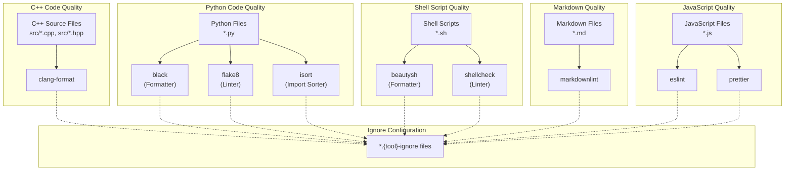
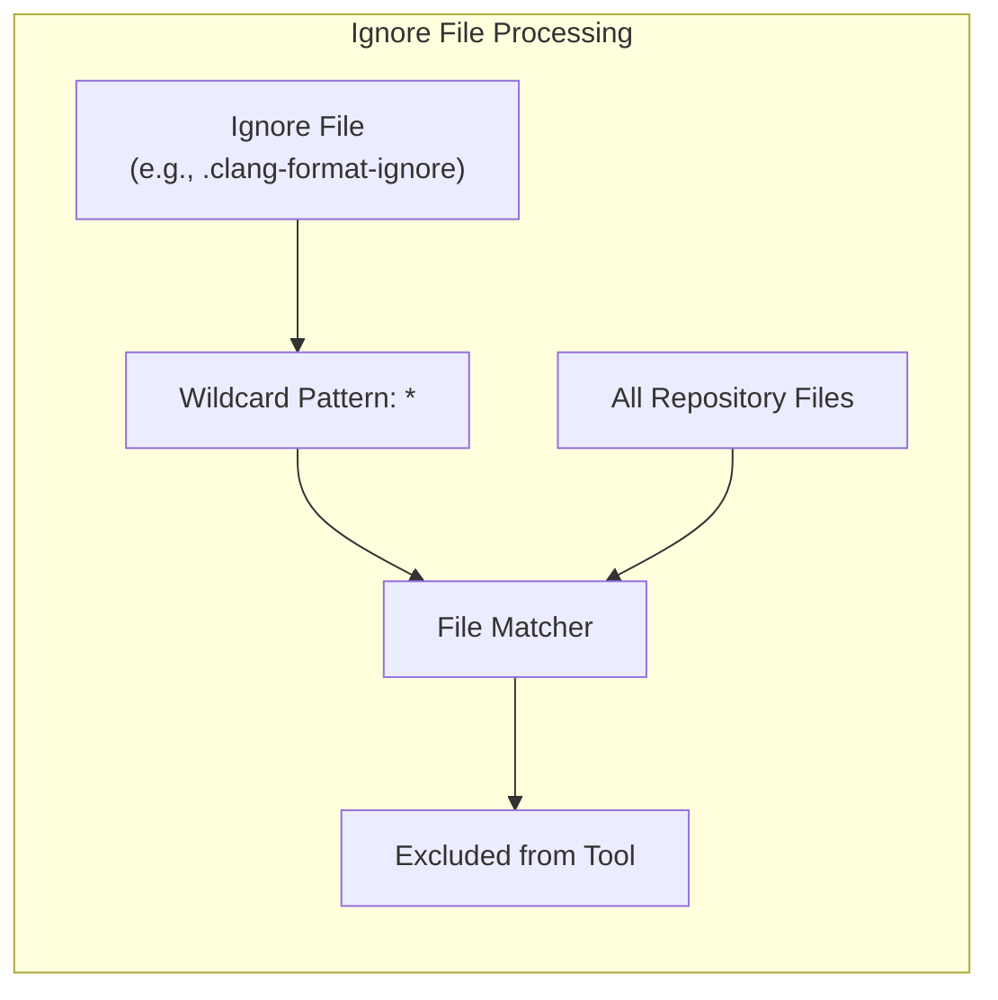
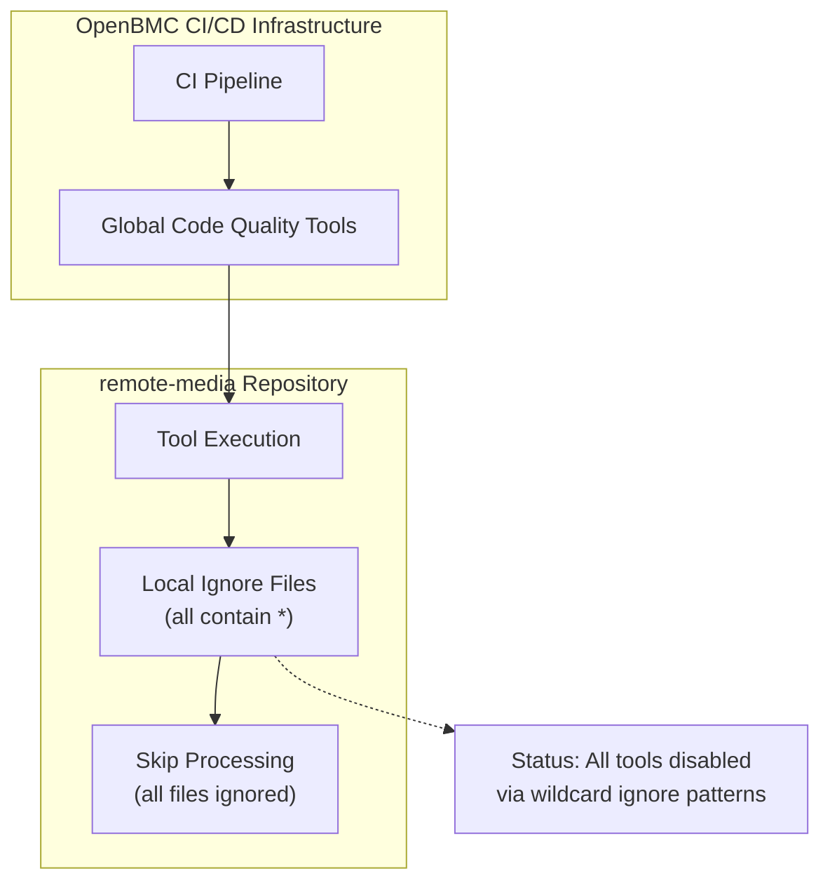

<!-- source: DeepWiki mcp.deepwiki.com · repo NVIDIA/remote-media · page 7.3 Code Quality Tools · fetched 2026-10-26 -->

# Code Quality Tools

<details>
<summary>Relevant source files</summary>

The following files were used as context for generating this wiki page:

- [.beautysh-ignore](.beautysh-ignore)
- [.black-ignore](.black-ignore)
- [.clang-format-ignore](.clang-format-ignore)
- [.eslintignore](.eslintignore)
- [.flake8-ignore](.flake8-ignore)
- [.isort-ignore](.isort-ignore)
- [.markdownlint-ignore](.markdownlint-ignore)
- [.prettierignore](.prettierignore)
- [.shellcheck-ignore](.shellcheck-ignore)

</details>


## Purpose and Scope

This document describes the code quality tooling infrastructure configured for the remote-media project. It covers the nine linting and formatting tools that are integrated into the development workflow, their ignore file configurations, and their current operational status. For build system configuration and compiler flags, see [Build System Details](#7.1). For logging and debugging capabilities, see [Logging and Debugging](#7.2).

## Overview

The remote-media project is configured with a comprehensive suite of code quality tools covering multiple languages and file types. These tools are part of the OpenBMC project's standardized development infrastructure and are designed to maintain consistent code style, catch common errors, and enforce best practices across C++, Python, shell scripts, JavaScript, and Markdown files.



**Sources:** [.clang-format-ignore:1-2](), [.beautysh-ignore:1-2](), [.black-ignore:1-2](), [.eslintignore:1-2](), [.flake8-ignore:1-2](), [.isort-ignore:1-2](), [.markdownlint-ignore:1-2](), [.prettierignore:1-2](), [.shellcheck-ignore:1-2]()

## Tool Configuration

The following table lists all configured code quality tools, their target file types, and their ignore file paths:

| Tool | Purpose | Target Files | Ignore File | Current Status |
|------|---------|--------------|-------------|----------------|
| `clang-format` | C++ code formatting | `*.cpp`, `*.hpp`, `*.c`, `*.h` | `.clang-format-ignore` | Disabled (all files ignored) |
| `black` | Python code formatting | `*.py` | `.black-ignore` | Disabled (all files ignored) |
| `flake8` | Python linting (PEP8, errors) | `*.py` | `.flake8-ignore` | Disabled (all files ignored) |
| `isort` | Python import sorting | `*.py` | `.isort-ignore` | Disabled (all files ignored) |
| `beautysh` | Shell script beautifier | `*.sh` | `.beautysh-ignore` | Disabled (all files ignored) |
| `shellcheck` | Shell script static analysis | `*.sh` | `.shellcheck-ignore` | Disabled (all files ignored) |
| `eslint` | JavaScript linting | `*.js` | `.eslintignore` | Disabled (all files ignored) |
| `prettier` | Multi-language formatting | `*.js`, `*.json`, `*.yaml`, `*.md` | `.prettierignore` | Disabled (all files ignored) |
| `markdownlint` | Markdown linting and style | `*.md` | `.markdownlint-ignore` | Disabled (all files ignored) |

**Sources:** [.clang-format-ignore:1-2](), [.beautysh-ignore:1-2](), [.black-ignore:1-2](), [.eslintignore:1-2](), [.flake8-ignore:1-2](), [.isort-ignore:1-2](), [.markdownlint-ignore:1-2](), [.prettierignore:1-2](), [.shellcheck-ignore:1-2]()

## C++ Code Quality

### clang-format

`clang-format` is the standard C++ code formatter that enforces consistent code style across all C++ source and header files. It automatically formats code according to a configured style guide, handling indentation, spacing, braces, and line breaks.

**Ignore File:** `.clang-format-ignore`

**Current Configuration:**
```
*
```

The wildcard pattern `*` in [.clang-format-ignore:1]() indicates that all files are currently excluded from `clang-format` processing. This means the tool is effectively disabled for this repository.

**Sources:** [.clang-format-ignore:1-2]()

## Python Code Quality

The remote-media project configures three Python code quality tools, though the repository is primarily C++-based. These tools would apply to any Python scripts used for build automation, testing, or utilities.

### black

`black` is an opinionated Python code formatter that enforces consistent style with minimal configuration. It automatically reformats Python code to comply with its style rules.

**Ignore File:** `.black-ignore`

**Current Configuration:** All files ignored via [.black-ignore:1]().

**Sources:** [.black-ignore:1-2]()

### flake8

`flake8` is a Python linting tool that checks for PEP8 style violations, programming errors, and code complexity issues. It combines multiple checkers including pyflakes and pycodestyle.

**Ignore File:** `.flake8-ignore`

**Current Configuration:** All files ignored via [.flake8-ignore:1]().

**Sources:** [.flake8-ignore:1-2]()

### isort

`isort` is a Python utility that automatically sorts and organizes import statements according to PEP8 guidelines, grouping standard library imports, third-party imports, and local imports.

**Ignore File:** `.isort-ignore`

**Current Configuration:** All files ignored via [.isort-ignore:1]().

**Sources:** [.isort-ignore:1-2]()

## Shell Script Quality

### beautysh

`beautysh` is a shell script beautifier that formats shell scripts with consistent indentation and spacing. It handles bash, sh, and other shell script variants.

**Ignore File:** `.beautysh-ignore`

**Current Configuration:** All files ignored via [.beautysh-ignore:1]().

**Sources:** [.beautysh-ignore:1-2]()

### shellcheck

`shellcheck` is a static analysis tool for shell scripts that detects common errors, portability issues, and style problems. It provides warnings about syntax errors, quoting issues, variable usage, and best practices violations.

**Ignore File:** `.shellcheck-ignore`

**Current Configuration:** All files ignored via [.shellcheck-ignore:1]().

**Sources:** [.shellcheck-ignore:1-2]()

## JavaScript Code Quality

### eslint

`eslint` is a JavaScript linting tool that identifies and reports patterns in JavaScript code. It catches syntax errors, style violations, and potential bugs.

**Ignore File:** `.eslintignore`

**Current Configuration:** All files ignored via [.eslintignore:1]().

**Sources:** [.eslintignore:1-2]()

### prettier

`prettier` is an opinionated code formatter supporting multiple languages including JavaScript, JSON, YAML, and Markdown. It enforces consistent formatting across different file types.

**Ignore File:** `.prettierignore`

**Current Configuration:** All files ignored via [.prettierignore:1]().

**Sources:** [.prettierignore:1-2]()

## Markdown Quality

### markdownlint

`markdownlint` is a linting tool for Markdown files that enforces consistent style, proper heading hierarchies, and best practices for Markdown documents.

**Ignore File:** `.markdownlint-ignore`

**Current Configuration:** All files ignored via [.markdownlint-ignore:1]().

**Sources:** [.markdownlint-ignore:1-2]()

## Ignore File Pattern Explanation



All nine ignore files follow the same pattern: a single line containing the wildcard `*` character. This pattern has specific implications:

1. **Wildcard Semantics:** The `*` pattern matches all files in the repository
2. **Tool Disabling:** When all files are ignored, the corresponding tool is effectively disabled
3. **OpenBMC Infrastructure:** These ignore files are part of the OpenBMC project's standardized CI/CD infrastructure
4. **Repository-Specific Configuration:** Individual repositories can override the global OpenBMC tool configuration by using ignore files

**Sources:** [.clang-format-ignore:1-2](), [.beautysh-ignore:1-2](), [.black-ignore:1-2](), [.eslintignore:1-2](), [.flake8-ignore:1-2](), [.isort-ignore:1-2](), [.markdownlint-ignore:1-2](), [.prettierignore:1-2](), [.shellcheck-ignore:1-2]()

## Current Configuration Status



**Current State:** All code quality tools are currently disabled for the remote-media repository. Each of the nine ignore files contains only the wildcard pattern `*`, which instructs the respective tool to skip all files in the repository.

**Rationale:** This configuration suggests that:
- The remote-media project has opted out of the OpenBMC automated code quality enforcement
- Code style and quality are managed through manual review or alternative mechanisms
- The ignore files preserve integration with OpenBMC CI/CD infrastructure while disabling automatic enforcement

**Sources:** [.clang-format-ignore:1-2](), [.beautysh-ignore:1-2](), [.black-ignore:1-2](), [.eslintignore:1-2](), [.flake8-ignore:1-2](), [.isort-ignore:1-2](), [.markdownlint-ignore:1-2](), [.prettierignore:1-2](), [.shellcheck-ignore:1-2]()

## Integration with Development Workflow

While the tools are currently disabled, the ignore files provide the necessary hooks for integration with:

1. **OpenBMC CI/CD Pipelines:** The presence of ignore files ensures the repository is compatible with OpenBMC's automated testing infrastructure
2. **Local Development:** Developers can enable specific tools locally by modifying ignore files to exclude only certain paths rather than all files
3. **Future Enablement:** The ignore file infrastructure allows for gradual tool adoption by removing the wildcard and adding specific exclusion patterns

To enable any tool, replace the `*` wildcard in the corresponding ignore file with specific path patterns for files that should remain excluded, or remove the ignore file entirely to enable the tool for all files.

**Sources:** [.clang-format-ignore:1-2](), [.beautysh-ignore:1-2](), [.black-ignore:1-2](), [.eslintignore:1-2](), [.flake8-ignore:1-2](), [.isort-ignore:1-2](), [.markdownlint-ignore:1-2](), [.prettierignore:1-2](), [.shellcheck-ignore:1-2]()

## Summary

The remote-media project maintains ignore file configurations for nine code quality tools as part of OpenBMC's standardized development infrastructure. All tools are currently disabled through wildcard ignore patterns, indicating that code quality enforcement is managed outside the automated tooling framework. The ignore files preserve compatibility with OpenBMC CI/CD systems while allowing repository-specific quality assurance policies.

---

