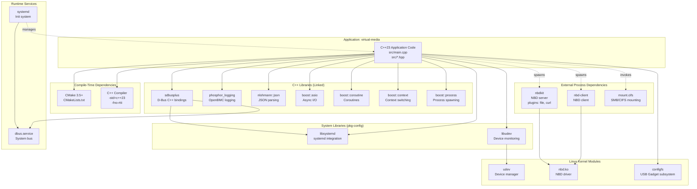
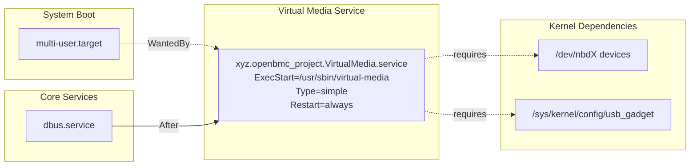

<!-- source: DeepWiki mcp.deepwiki.com · repo NVIDIA/remote-media · page 8 Reference · fetched 2026-10-26 -->

# Reference

<details>
<summary>Relevant source files</summary>

The following files were used as context for generating this wiki page:

- [CMakeLists.txt](CMakeLists.txt)
- [LICENSE](LICENSE)
- [xyz.openbmc_project.VirtualMedia.service](xyz.openbmc_project.VirtualMedia.service)

</details>


This section provides reference materials for the Virtual Media service, including comprehensive dependency information, systemd service configuration details, and licensing terms. These materials are essential for understanding system requirements, deployment configuration, and legal terms of use.

For API documentation including D-Bus interfaces and configuration schema, see [API Reference](#6). For build system details and development tools, see [Build System Details](#7.1) and [Code Quality Tools](#7.3).

## Overview

The Virtual Media service has three categories of reference information:

1. **System Dependencies** ([8.1](#8.1)): External libraries and tools required for building and running the service
2. **Systemd Service Configuration** ([8.2](#8.2)): Service unit file configuration and integration with OpenBMC
3. **License** ([8.3](#8.3)): Apache License 2.0 terms governing the software

## Dependency Architecture

The following diagram maps the complete dependency stack, from application code down to kernel modules and external processes:



**Sources:** [CMakeLists.txt:1-87](), [xyz.openbmc_project.VirtualMedia.service:1-12]()

## Build and Runtime Requirements Summary

The following table summarizes key requirements for building and running the Virtual Media service:

| Category | Component | Version/Details | Configuration |
|----------|-----------|-----------------|---------------|
| **Compiler** | C++ Compiler | C++23 standard | `-std=c++23`, `-fno-rtti` |
| **Build System** | CMake | 3.5 or higher | Policy CMP0054=NEW |
| **C++ Libraries** | Boost | 1.69 minimum | asio, coroutine, context, process |
| | sdbusplus | Required | D-Bus C++ bindings |
| | phosphor_logging | Required | OpenBMC logging framework |
| | nlohmann::json | Required | JSON configuration parsing |
| **System Libraries** | libsystemd | Required | Via pkg-config |
| | libudev | Required | Via custom CMake module |
| **External Tools** | nbdkit | Runtime | file and curl plugins required |
| | nbd-client | Runtime | NBD client tool |
| | mount.cifs | Runtime | CIFS mounting utility |
| **Kernel Modules** | nbd | Runtime | NBD block device driver |
| | configfs | Runtime | USB Gadget configuration |
| **Services** | systemd | Runtime | Service manager |
| | dbus | Runtime | System bus dependency |

**Sources:** [CMakeLists.txt:8-66]()

## Compiler Flags and Definitions

The service is built with specific compiler flags and preprocessor definitions:

### Compilation Flags

| Flag | Release | Debug | Purpose |
|------|---------|-------|---------|
| `-Wall` | ✓ | ✓ | Enable all warnings |
| `-fno-rtti` | ✓ | ✓ | Disable runtime type information |
| `-Os` | ✓ | ✗ | Optimize for size |
| `-flto` | ✓ | ✗ | Link-time optimization |
| `-O0` | ✗ | ✓ | No optimization (debug) |

### Preprocessor Definitions

The following compile-time definitions configure Boost and application behavior:

```
BOOST_COROUTINES_NO_DEPRECATION_WARNING
BOOST_ERROR_CODE_HEADER_ONLY
BOOST_SYSTEM_NO_DEPRECATED
BOOST_ALL_NO_LIB
BOOST_NO_RTTI
BOOST_NO_TYPEID
BOOST_ASIO_DISABLE_THREADS
```

### Optional Build Flags

| CMake Option | Definition | Purpose |
|--------------|------------|---------|
| `VM_USE_VALGRIND` | `BOOST_USE_VALGRIND` | Enable valgrind support |
| `VM_VERBOSE_NBDKIT_LOGS` | `VM_VERBOSE_NBDKIT_LOGS` | Enable detailed nbdkit logging |
| `CUSTOM_DBUS_PATH` | `CUSTOM_DBUS_PATH="..."` | Override D-Bus service path |

**Sources:** [CMakeLists.txt:12-76]()

## Installation Paths

The build system installs components to standard locations:

| Component | Install Path | CMake Variable |
|-----------|--------------|----------------|
| Executable | `/usr/sbin/virtual-media` | `install(TARGETS ... DESTINATION sbin)` |
| Configuration | `${CMAKE_INSTALL_SYSCONFDIR}/virtual-media.json` | `CMAKE_INSTALL_SYSCONFDIR` |
| Service Unit | `${SYSTEMD_SYSTEM_UNIT_DIR}/xyz.openbmc_project.VirtualMedia.service` | `SYSTEMD_SYSTEM_UNIT_DIR` |

The systemd unit directory is automatically detected via `pkg-config`:
```
pkg_get_variable(SYSTEMD_SYSTEM_UNIT_DIR systemd systemdsystemunitdir)
```

**Sources:** [CMakeLists.txt:66-86]()

## CMake Module Path

The build system uses custom CMake modules located in the `cmake/` directory. Notable modules include:

- `Findudev.cmake`: Custom find module for libudev library detection

The module path is configured in [CMakeLists.txt:10]():
```
set(CMAKE_MODULE_PATH ${CMAKE_CURRENT_SOURCE_DIR}/cmake ${CMAKE_MODULE_PATH})
```

**Sources:** [CMakeLists.txt:10](), [CMakeLists.txt:27-29]()

## Service Dependencies Diagram

The following diagram shows runtime service dependencies and startup ordering:



**Sources:** [xyz.openbmc_project.VirtualMedia.service:1-12]()

## Detailed Reference Sections

For comprehensive information on specific reference topics, see:

- **[System Dependencies](#8.1)**: Complete list of external dependencies with version requirements and integration details
- **[Systemd Service Configuration](#8.2)**: Detailed service unit file documentation including restart policies and target configuration
- **[License](#8.3)**: Full Apache License 2.0 terms and conditions

**Sources:** [CMakeLists.txt:1-87](), [xyz.openbmc_project.VirtualMedia.service:1-12](), [LICENSE:1-202]()

---

