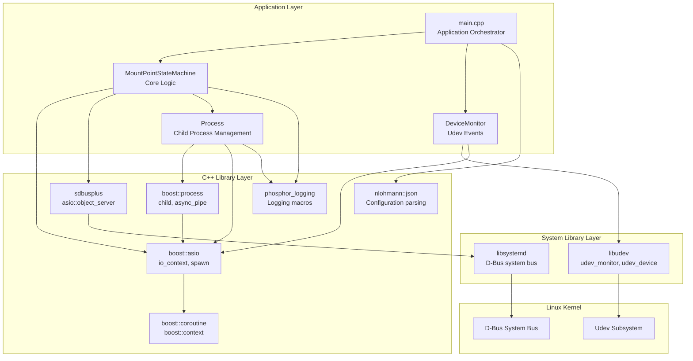
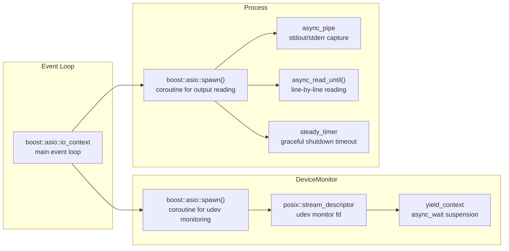
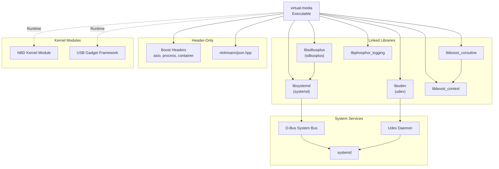

<!-- source: DeepWiki mcp.deepwiki.com · repo NVIDIA/remote-media · page 8.1 System Dependencies · fetched 2026-10-26 -->

# System Dependencies

<details>
<summary>Relevant source files</summary>

The following files were used as context for generating this wiki page:

- [CMakeLists.txt](CMakeLists.txt)
- [cmake/Findudev.cmake](cmake/Findudev.cmake)
- [src/system.hpp](src/system.hpp)

</details>


This document provides a comprehensive list and detailed description of all external libraries, system services, and build tools required by the virtual-media service. It covers library versions, purposes, configuration flags, and how each dependency is integrated into the build system.

For information about the build process and compilation, see [Building and Installation](#2.1). For systemd service configuration details, see [Systemd Service Configuration](#8.2).

---

## Overview

The virtual-media service has dependencies spanning multiple layers: system libraries for kernel integration, C++ libraries for application logic, and build-time tools. All dependencies are managed through CMake's `pkg-config` and `find_package` mechanisms.

### Dependency Categories

| Category | Dependencies | Purpose |
|----------|-------------|---------|
| **System Libraries** | libsystemd, libudev | D-Bus communication, device monitoring |
| **C++ Libraries** | Boost, sdbusplus, phosphor_logging, nlohmann::json | Async I/O, D-Bus bindings, logging, JSON parsing |
| **Build Tools** | CMake 3.5+, C++23 compiler | Build system, language features |
| **External Processes** | nbdkit, nbd-client | NBD block device serving (runtime dependencies) |

---

## Dependency Architecture

The following diagram shows how dependencies are layered and used by different components of the virtual-media service:



**Sources:** [CMakeLists.txt:1-87](), [src/system.hpp:1-656]()

---

## System Libraries

### libsystemd

**Package:** `libsystemd`  
**Detection:** `pkg_check_modules(SYSTEMD libsystemd REQUIRED)` [CMakeLists.txt:24]()  
**Linkage:** `target_link_libraries(virtual-media systemd)` [CMakeLists.txt:60]()

**Purpose:** Provides D-Bus integration for the virtual-media service. The service registers on the system bus under `xyz.openbmc_project.VirtualMedia` and exposes multiple D-Bus interfaces for external control.

**Used By:**
- `sdbusplus::asio::object_server` - D-Bus object registration and property management
- D-Bus interface exposure: `VirtualMedia.Process`, `VirtualMedia.MountPoint`, `VirtualMedia.Legacy`, `VirtualMedia.Proxy`

**Key Features Used:**
- D-Bus system bus connection
- Method call handling
- Property get/set operations  
- Signal emissions for state changes

**Sources:** [CMakeLists.txt:24](), [CMakeLists.txt:60](), [src/system.hpp:13]()

---

### libudev

**Package:** `libudev`  
**Detection:** Custom CMake module `find_package(udev REQUIRED)` [CMakeLists.txt:27]()  
**Linkage:** `target_link_libraries(virtual-media -ludev)` [CMakeLists.txt:62]()

**Purpose:** Enables kernel device event monitoring for NBD block devices. The service uses udev to detect when NBD devices are inserted or removed, which triggers state machine transitions.

**Used By:**
- `DeviceMonitor` class [src/system.hpp:191-354]() - Monitors `/dev/nbdX` device state changes

**Key Functions Used:**
- `udev_new()` - Initialize udev context [src/system.hpp:196]()
- `udev_monitor_new_from_netlink()` - Create netlink monitor [src/system.hpp:203-204]()
- `udev_monitor_filter_add_match_subsystem_devtype()` - Filter for "block"/"disk" devices [src/system.hpp:211-212]()
- `udev_monitor_get_fd()` - Get file descriptor for async monitoring [src/system.hpp:225]()
- `udev_device_get_sysattr_value()` - Read device size attribute [src/system.hpp:285]()

**Custom Deleters:**
The code implements RAII wrappers for udev resources:
- `udevDeleter` for `udev*` [src/system.hpp:30-36]()
- `monitorDeleter` for `udev_monitor*` [src/system.hpp:38-44]()
- `deviceDeleter` for `udev_device*` [src/system.hpp:46-52]()

**Sources:** [CMakeLists.txt:27-29](), [CMakeLists.txt:62](), [src/system.hpp:23-53](), [src/system.hpp:191-354](), [cmake/Findudev.cmake:1-78]()

---

## C++ Libraries

### Boost (Version 1.69+)

**Package:** `Boost 1.69` (minimum)  
**Detection:** `find_package(Boost 1.69 REQUIRED)` or `find_package(Boost ${BOOST_VERSION} EXACT)` [CMakeLists.txt:34-38]()  
**Linkage:** 
- `target_link_libraries(virtual-media -lboost_coroutine)` [CMakeLists.txt:63]()
- `target_link_libraries(virtual-media -lboost_context)` [CMakeLists.txt:64]()

**Purpose:** Provides asynchronous I/O framework, coroutine-based concurrency, and child process management. Boost is the foundational library for the entire virtual-media event loop.

#### Boost Submodules Used

| Submodule | Headers | Purpose | Usage Location |
|-----------|---------|---------|----------------|
| **Boost.Asio** | `boost/asio.hpp`<br/>`boost/asio/spawn.hpp` | Async I/O, event loop, coroutines | `DeviceMonitor::run()`, `Process::spawn()` |
| **Boost.Process** | `boost/process/v1/child.hpp`<br/>`boost/process/v1/args.hpp`<br/>`boost/process/v1/io.hpp`<br/>`boost/process/v1/async_pipe.hpp` | Child process spawning and management | `Process` class for nbdkit/nbd-client |
| **Boost.Container** | `boost/container/flat_map.hpp` | Flat map data structure | `DeviceMonitor::devices` state tracking |

**Sources:** [CMakeLists.txt:34-42](), [src/system.hpp:5-12]()

#### Boost Configuration Flags

The build system defines multiple Boost-specific preprocessor flags:

```cmake
add_definitions(-DBOOST_COROUTINES_NO_DEPRECATION_WARNING)
add_definitions(-DBOOST_ERROR_CODE_HEADER_ONLY)
add_definitions(-DBOOST_SYSTEM_NO_DEPRECATED)
add_definitions(-DBOOST_ALL_NO_LIB)
add_definitions(-DBOOST_NO_RTTI)
add_definitions(-DBOOST_NO_TYPEID)
add_definitions(-DBOOST_ASIO_DISABLE_THREADS)
```

| Flag | Purpose |
|------|---------|
| `BOOST_COROUTINES_NO_DEPRECATION_WARNING` | Suppress warnings about deprecated coroutine APIs |
| `BOOST_ERROR_CODE_HEADER_ONLY` | Use header-only error code implementation |
| `BOOST_SYSTEM_NO_DEPRECATED` | Exclude deprecated Boost.System features |
| `BOOST_ALL_NO_LIB` | Disable auto-linking (manual linkage control) |
| `BOOST_NO_RTTI` | Compile Boost without RTTI (matches `-fno-rtti` flag) |
| `BOOST_NO_TYPEID` | Disable `typeid` operator usage |
| `BOOST_ASIO_DISABLE_THREADS` | Single-threaded Boost.Asio configuration |

**Sources:** [CMakeLists.txt:45-51]()

#### Boost.Asio Usage Patterns

The following diagram shows how different components use Boost.Asio primitives:



**Code Examples:**

**DeviceMonitor async loop** [src/system.hpp:237-326]():
```cpp
boost::asio::spawn(ioc, [this, callback](boost::asio::yield_context yield) {
    while (1) {
        monitorSd.async_wait(
            boost::asio::posix::stream_descriptor::wait_read, yield[ec]);
        // Process udev events...
    }
});
```

**Process output reading** [src/system.hpp:382-439]():
```cpp
boost::asio::spawn(ioc, [this, self, onExit](boost::asio::yield_context yield) {
    while (1) {
        auto x = boost::asio::async_read_until(
            self->pipe, std::move(buffer), '\n', yield[bec]);
        // Process output lines...
    }
});
```

**Sources:** [src/system.hpp:5-12](), [src/system.hpp:194-354](), [src/system.hpp:356-481]()

---

### sdbusplus

**Package:** `sdbusplus` (OpenBMC D-Bus C++ bindings)  
**Detection:** Not explicitly detected via CMake (assumed available in OpenBMC environment)  
**Linkage:** `target_link_libraries(virtual-media -lsdbusplus)` [CMakeLists.txt:61]()

**Purpose:** Provides C++ bindings for D-Bus operations. The virtual-media service uses sdbusplus to register D-Bus objects, expose interfaces, and handle method calls.

**Key Classes Used:**
- `sdbusplus::asio::object_server` - D-Bus object registration and management [src/system.hpp:13]()
- Interface definitions for `VirtualMedia.Process`, `VirtualMedia.MountPoint`, `VirtualMedia.Legacy`, `VirtualMedia.Proxy`

**Integration Pattern:**
The service creates an `object_server` instance bound to the `boost::asio::io_context`, allowing D-Bus operations to integrate seamlessly with the async event loop.

**Sources:** [CMakeLists.txt:61](), [src/system.hpp:13]()

---

### phosphor_logging

**Package:** `phosphor_logging` (OpenBMC logging framework)  
**Detection:** Not explicitly detected via CMake (assumed available in OpenBMC environment)  
**Linkage:** `target_link_libraries(virtual-media -lphosphor_logging)` [CMakeLists.txt:65]()

**Purpose:** Provides OpenBMC-standard logging macros and integration with the system journal. Used throughout the codebase via the `Logger` utility wrapper.

**Usage Pattern:**
The `LogMsg()` macro (defined in `logger.hpp`) wraps phosphor_logging to provide compile-time log level filtering and formatted output.

**Log Levels:**
- Debug
- Info
- Warning
- Error
- Critical

**Sources:** [CMakeLists.txt:65](), [src/system.hpp:3]()

---

### nlohmann::json

**Package:** `nlohmann::json` (JSON for Modern C++)  
**Detection:** Implicit (header-only library)  
**Linkage:** Header-only, no explicit linkage required

**Purpose:** Parses the `virtual-media.json` configuration file to load mount point definitions, timeouts, and operational parameters.

**Configuration File Structure:**
```json
{
  "InactivityTimeout": 1800,
  "MountPoints": {
    "Slot_0": {
      "EndpointId": "Slot_0",
      "Mode": 1,
      "NBDDevice": 0,
      "UnixSocket": "/tmp/nbd0.sock",
      "Timeout": 30,
      "BlockSize": 512
    }
  }
}
```

For complete configuration schema documentation, see [Configuration Schema](#6.2).

**Sources:** [CMakeLists.txt:54]() (implicit via main.cpp)

---

## Build Requirements

### Compiler Requirements

**Standard:** C++23  
**Configuration:** `set(CMAKE_CXX_STANDARD 23)` and `set(CMAKE_CXX_STANDARD_REQUIRED ON)` [CMakeLists.txt:8-9]()

**Compiler Flags:**

| Flag | Purpose |
|------|---------|
| `-Wall` | Enable all warnings |
| `-fno-rtti` | Disable Run-Time Type Information (reduces binary size) |
| `-Os` (Release) | Optimize for size |
| `-flto` (Release) | Link-Time Optimization |
| `-O0` (Debug) | Disable optimization for debugging |

**Sources:** [CMakeLists.txt:8-14]()

**C++23 Features Used:**
- Modern standard library features
- Enhanced constexpr support
- Improved type deduction

---

### CMake Version

**Minimum Version:** 3.5  
**Configuration:** `cmake_minimum_required(VERSION 3.5 FATAL_ERROR)` [CMakeLists.txt:1]()

**CMake Modules:**
- Standard `FindPackageHandleStandardArgs`
- Custom `Findudev.cmake` for libudev detection [cmake/Findudev.cmake:1-78]()

**CMake Policies:**
- `CMP0054`: Only interpret `if()` arguments as variables or keywords when unquoted [CMakeLists.txt:5]()

**Sources:** [CMakeLists.txt:1-10](), [cmake/Findudev.cmake:1-78]()

---

## Build Options

The build system provides optional flags to customize compilation:

### VM_USE_VALGRIND

**Type:** CMake Option (OFF by default)  
**Definition:** `option(VM_USE_VALGRIND "Build VirtualMedia to work with valgrind" OFF)` [CMakeLists.txt:18]()

**Effect:** When enabled, adds `-DBOOST_USE_VALGRIND` to compile definitions [CMakeLists.txt:71-72]()

**Purpose:** Configures Boost to work with Valgrind memory debugging. Requires a Boost version compiled with Valgrind support.

---

### VM_VERBOSE_NBDKIT_LOGS

**Type:** CMake Option (OFF by default)  
**Definition:** `option(VM_VERBOSE_NBDKIT_LOGS "Include detailed logs from nbdkit" OFF)` [CMakeLists.txt:20]()

**Effect:** When enabled, adds `-DVM_VERBOSE_NBDKIT_LOGS` to compile definitions [CMakeLists.txt:73-74]()

**Purpose:** Enables verbose logging of nbdkit process output for debugging mount operations.

**Sources:** [CMakeLists.txt:18-20](), [CMakeLists.txt:69-74]()

---

## Runtime Dependencies

While not library dependencies, the following external executables must be available at runtime:

### nbdkit

**Package:** `nbdkit` (NBD server with plugin support)  
**Path:** Typically `/usr/sbin/nbdkit` or `/usr/bin/nbdkit`

**Purpose:** Serves block devices over NBD protocol in legacy mode. Used with:
- `file` plugin for CIFS-mounted images
- `curl` plugin for HTTPS images

**Invocation:** Spawned via `Process::spawn()` [src/system.hpp:366-441]()

---

### nbd-client

**Package:** `nbd-client` (NBD client)  
**Path:** Typically `/usr/sbin/nbd-client` or `/sbin/nbd-client`

**Purpose:** Connects to external NBD servers in proxy mode. Establishes client connections to WebSocket-based NBD endpoints.

**Invocation:** Spawned via `Process::spawn()` [src/system.hpp:366-441]()

**Sources:** [src/system.hpp:356-481]()

---

## Dependency Graph

The following diagram shows the complete dependency tree and linkage relationships:



**Sources:** [CMakeLists.txt:60-65]()

---

## Dependency Version Summary

| Dependency | Minimum Version | Detection Method | Required |
|------------|----------------|------------------|----------|
| **CMake** | 3.5 | `cmake_minimum_required` | Yes |
| **C++ Compiler** | C++23 support | Compiler flags | Yes |
| **libsystemd** | (pkg-config) | `pkg_check_modules` | Yes |
| **libudev** | (any) | `find_package(udev)` | Yes |
| **Boost** | 1.69 | `find_package(Boost)` | Yes |
| **sdbusplus** | (OpenBMC) | Implicit | Yes |
| **phosphor_logging** | (OpenBMC) | Implicit | Yes |
| **nlohmann::json** | (any) | Header-only | Yes |
| **nbdkit** | (runtime) | Process spawn | Runtime |
| **nbd-client** | (runtime) | Process spawn | Runtime |

**Sources:** [CMakeLists.txt:1-87]()

---

## Installation Paths

The build system installs files to standard OpenBMC locations:

| File | Destination | CMake Variable |
|------|-------------|----------------|
| `virtual-media` binary | `/usr/sbin/` | `install(TARGETS ... DESTINATION sbin)` |
| `virtual-media.json` | `${CMAKE_INSTALL_SYSCONFDIR}` | Typically `/etc/` |
| Service unit | `${SYSTEMD_SYSTEM_UNIT_DIR}` | From `pkg-config systemd` |

**Sources:** [CMakeLists.txt:66](), [CMakeLists.txt:78-86]()

---

