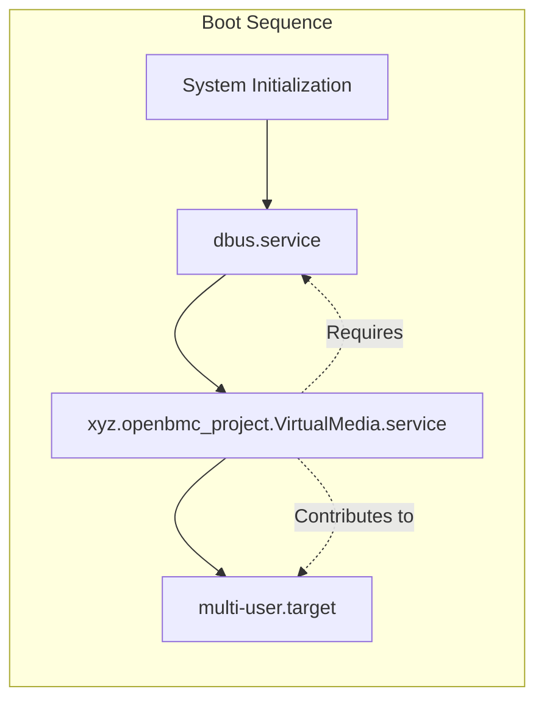
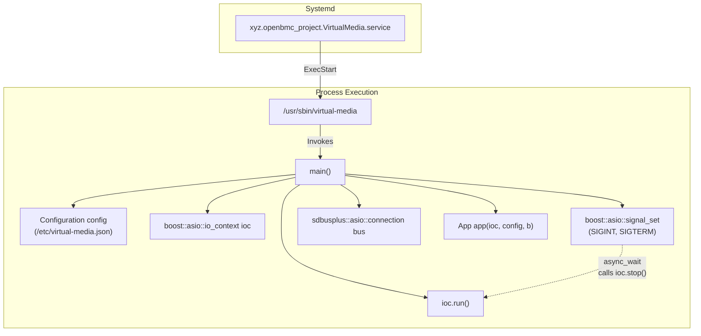
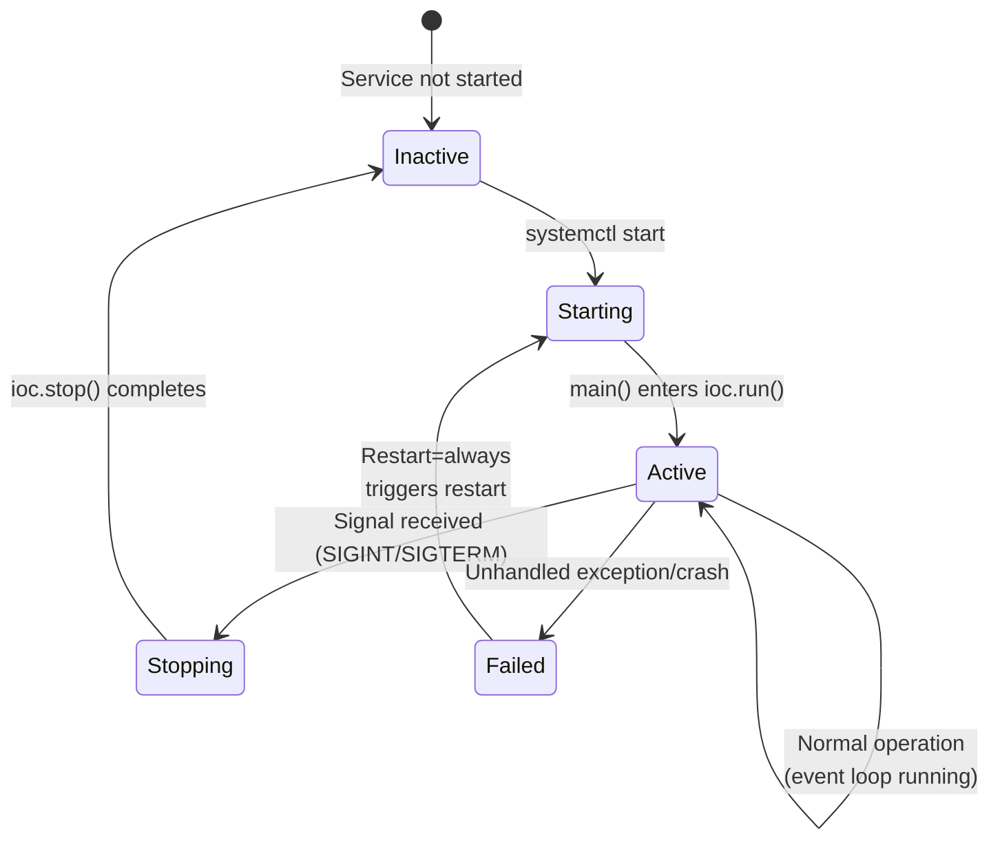
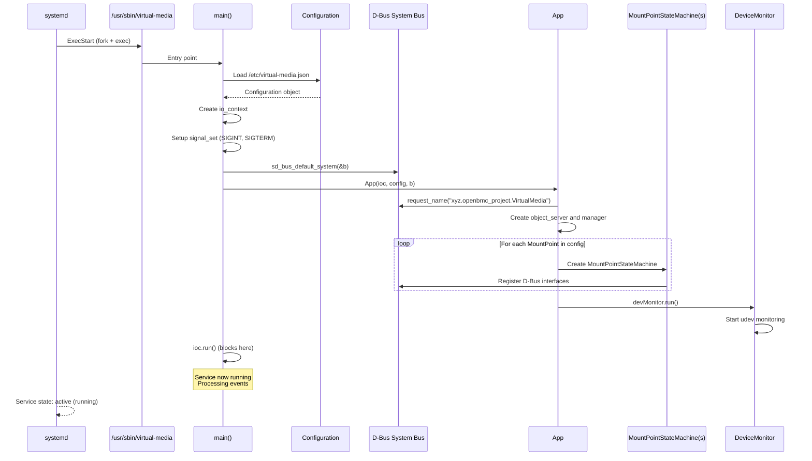
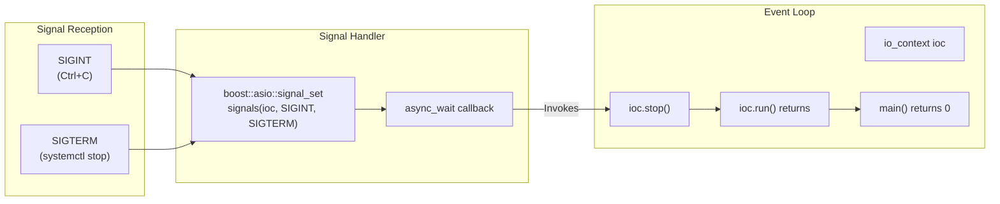

<!-- source: DeepWiki mcp.deepwiki.com · repo NVIDIA/remote-media · page 8.2 Systemd Service Configuration · fetched 2026-10-26 -->

# Systemd Service Configuration

<details>
<summary>Relevant source files</summary>

The following files were used as context for generating this wiki page:

- [src/main.cpp](src/main.cpp)
- [xyz.openbmc_project.VirtualMedia.service](xyz.openbmc_project.VirtualMedia.service)

</details>


## Purpose and Scope

This document describes the systemd service unit configuration for the virtual media service. It covers the service unit file structure, dependencies, restart policies, and integration with the OpenBMC systemd infrastructure. For information about building and installing the service binary, see [Building and Installation](#2.1). For details about the service's runtime behavior and D-Bus integration, see [Running the Service](#2.3).

---

## Service Unit File Overview

The virtual media service is managed by systemd through the service unit file `xyz.openbmc_project.VirtualMedia.service`. This unit file defines how systemd should start, monitor, and restart the service.

### Service Unit Structure

```
[Unit]
Description=Virtual Media Service
After=dbus.service

[Service]
ExecStart=/usr/sbin/virtual-media
Restart=always
Type=simple

[Install]
WantedBy=multi-user.target
```

**Sources:** [xyz.openbmc_project.VirtualMedia.service:1-12]()

---

## Unit Section Configuration

The `[Unit]` section provides metadata and ordering directives for the service.

| Directive | Value | Purpose |
|-----------|-------|---------|
| `Description` | Virtual Media Service | Human-readable service description displayed in systemd status output |
| `After` | dbus.service | Ensures the service starts only after D-Bus system bus is available |

The `After=dbus.service` dependency is critical because the virtual media service immediately attempts to connect to the D-Bus system bus and register the service name `xyz.openbmc_project.VirtualMedia` during initialization [src/main.cpp:31-39]().

### Dependency Flow Diagram



**Sources:** [xyz.openbmc_project.VirtualMedia.service:2-3]()

---

## Service Section Configuration

The `[Service]` section defines the service's runtime behavior and systemd management policies.

| Directive | Value | Description |
|-----------|-------|-------------|
| `ExecStart` | /usr/sbin/virtual-media | Absolute path to the service executable |
| `Restart` | always | Restart policy: always restart on any exit (clean or unclean) |
| `Type` | simple | Service type: process forked by ExecStart is the main service process |

### Service Type: Simple

The `Type=simple` configuration indicates that systemd considers the service started as soon as the process specified in `ExecStart` is forked. The service does not call `sd_notify()` or fork a daemon process. Instead, it runs a single-threaded event loop using `boost::asio::io_context` [src/main.cpp:76-92]().

### Restart Policy

The `Restart=always` directive ensures high availability. The service will automatically restart under all circumstances:

- Normal exit (return code 0)
- Abnormal exit (non-zero return code)
- Unclean signal termination
- Start-limit hit
- Watchdog timeout (if configured)

This restart policy is appropriate for a critical infrastructure service that manages virtual media devices for BMC functionality.

### Code Integration: Service Entry Point



**Sources:** [xyz.openbmc_project.VirtualMedia.service:5-8](), [src/main.cpp:70-95]()

---

## Install Section Configuration

The `[Install]` section determines when and how the service is enabled.

| Directive | Value | Purpose |
|-----------|-------|---------|
| `WantedBy` | multi-user.target | Service is started as part of multi-user system initialization |

The `multi-user.target` is the standard target for a multi-user system that doesn't require a graphical interface, which is typical for BMC environments. When the service is enabled via `systemctl enable`, a symbolic link is created in `/etc/systemd/system/multi-user.target.wants/` pointing to the service unit file.

**Sources:** [xyz.openbmc_project.VirtualMedia.service:10-11]()

---

## Runtime Behavior

### Process Lifecycle

The virtual media service follows this lifecycle when managed by systemd:



### Event Loop Operation

Once started, the service enters an event-driven state where it processes:

1. **D-Bus method calls** - Mount/Unmount requests via `VirtualMedia.Legacy` or `VirtualMedia.Proxy` interfaces
2. **Udev events** - Block device insertion/removal notifications
3. **Process events** - Child process (nbdkit/nbd-client) termination
4. **Timer events** - Timeout monitoring for mount operations
5. **Signal events** - SIGINT/SIGTERM for graceful shutdown

The event loop continues until `ioc.stop()` is called, which occurs when a termination signal is received [src/main.cpp:78-79]().

**Sources:** [src/main.cpp:76-92]()

---

## Service Startup Sequence

The following sequence diagram illustrates what happens when systemd starts the service:



**Sources:** [src/main.cpp:70-95](), [xyz.openbmc_project.VirtualMedia.service:6]()

---

## D-Bus Service Name Registration

The service registers the D-Bus service name during initialization, which is a critical step that must occur after the D-Bus system bus is available:

| Component | Value | Code Location |
|-----------|-------|---------------|
| Service Name | `xyz.openbmc_project.VirtualMedia` | [src/main.cpp:39]() |
| Object Path Root | `/xyz/openbmc_project/VirtualMedia` | [src/main.cpp:41]() |
| Bus Type | System Bus | [src/main.cpp:89]() |

If the D-Bus service name is already registered by another process, the service will fail to start. The `After=dbus.service` directive ensures the bus is available, but it does not prevent name conflicts.

**Sources:** [src/main.cpp:31-41]()

---

## Graceful Shutdown Handling

The service implements graceful shutdown through signal handling:



When `systemctl stop` is issued, systemd sends `SIGTERM` to the process. The signal handler invokes `ioc.stop()`, which causes the event loop to exit cleanly. The service then returns from `main()` with exit code 0.

**Sources:** [src/main.cpp:77-79]()

---

## Service Management Commands

Standard systemd commands for managing the virtual media service:

| Command | Purpose |
|---------|---------|
| `systemctl start xyz.openbmc_project.VirtualMedia.service` | Start the service immediately |
| `systemctl stop xyz.openbmc_project.VirtualMedia.service` | Stop the service (sends SIGTERM) |
| `systemctl restart xyz.openbmc_project.VirtualMedia.service` | Stop and start the service |
| `systemctl enable xyz.openbmc_project.VirtualMedia.service` | Enable automatic start at boot |
| `systemctl disable xyz.openbmc_project.VirtualMedia.service` | Disable automatic start at boot |
| `systemctl status xyz.openbmc_project.VirtualMedia.service` | Show service status and recent logs |
| `journalctl -u xyz.openbmc_project.VirtualMedia.service` | View service logs |
| `journalctl -u xyz.openbmc_project.VirtualMedia.service -f` | Follow service logs in real-time |

**Sources:** [xyz.openbmc_project.VirtualMedia.service:1-12]()

---

## Integration with OpenBMC

The service unit file follows OpenBMC systemd conventions:

1. **Service Naming**: Uses the D-Bus service name as the unit file name
2. **Installation Path**: Installed to `/lib/systemd/system/` or `/usr/lib/systemd/system/`
3. **Target Integration**: Uses `multi-user.target` for standard BMC initialization
4. **Binary Location**: Installs to `/usr/sbin/` for system administration utilities

The service integrates with the broader OpenBMC ecosystem by depending on `dbus.service` and registering under the `xyz.openbmc_project.*` namespace, which is the standard namespace for OpenBMC services.

**Sources:** [xyz.openbmc_project.VirtualMedia.service:1-12](), [src/main.cpp:39-41]()

---

## Configuration File Location

While not specified in the systemd unit file, the service hard-codes its configuration file path in the `main()` function:

```
Configuration file: /etc/virtual-media.json
```

This configuration file must exist and be valid JSON for the service to start successfully [src/main.cpp:72-74](). If the configuration is invalid, `main()` returns `-1` and the service exits. With `Restart=always`, systemd will continuously attempt to restart the service, which will fail repeatedly if the configuration file is malformed.

**Sources:** [src/main.cpp:72-74]()

---

## Service Failure and Recovery

The `Restart=always` policy ensures automatic recovery from failures:

| Failure Scenario | Systemd Behavior |
|------------------|------------------|
| Configuration file missing/invalid | Service exits with code -1, systemd restarts, failure loop until config fixed |
| D-Bus name already registered | Service fails to start, systemd restarts, may succeed if conflicting service stops |
| Unhandled exception in event loop | Service crashes, systemd restarts service |
| SIGKILL sent to process | Service terminated, systemd restarts service |
| Resource exhaustion (OOM) | System may kill service, systemd restarts if OOM didn't disable restarts |

Systemd includes built-in rate limiting to prevent restart storms. If the service fails repeatedly within a short time window, systemd may stop attempting restarts until a manual intervention occurs.

**Sources:** [xyz.openbmc_project.VirtualMedia.service:7]()

---

## Custom D-Bus Path Support

The service supports an optional compile-time configuration for custom D-Bus paths via the `CUSTOM_DBUS_PATH` preprocessor definition [src/main.cpp:82-88](). When defined, the service connects to a custom D-Bus daemon instead of the system bus. This is primarily used for testing and development scenarios. The systemd unit file does not need to be modified for this feature as it's controlled at compile time.

**Sources:** [src/main.cpp:82-88]()

---

