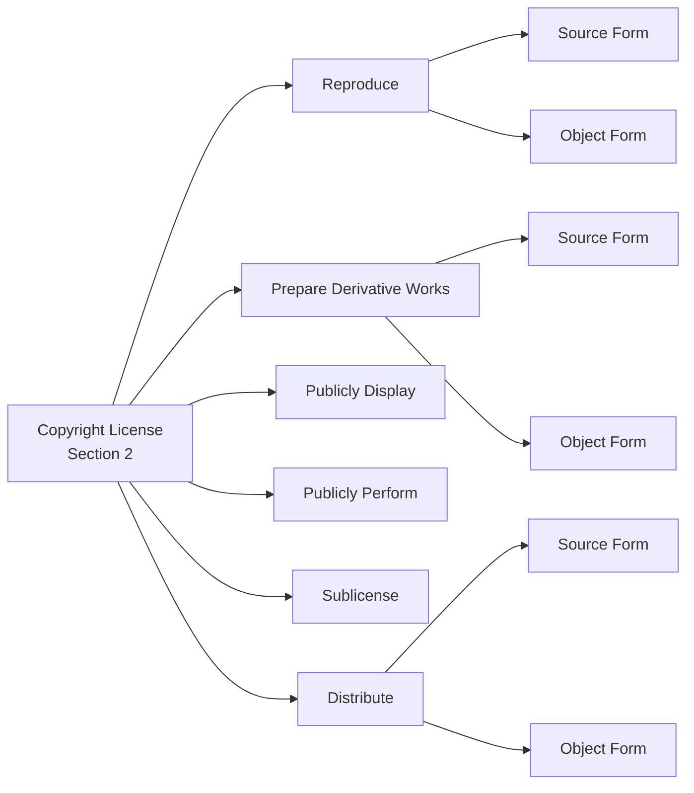
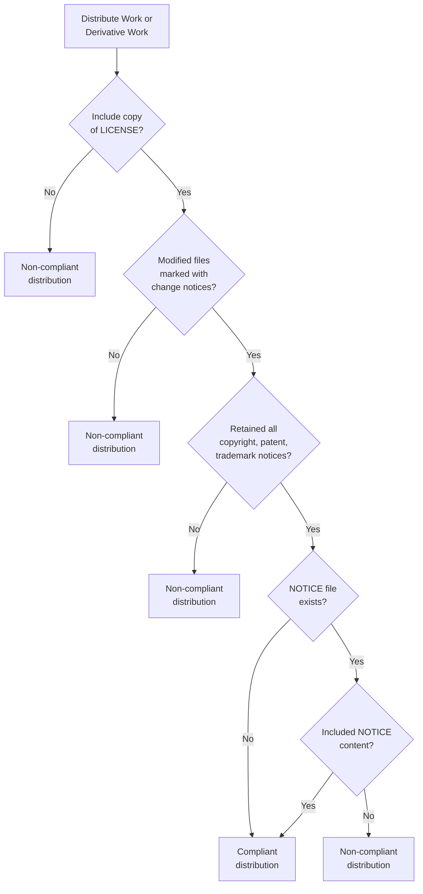
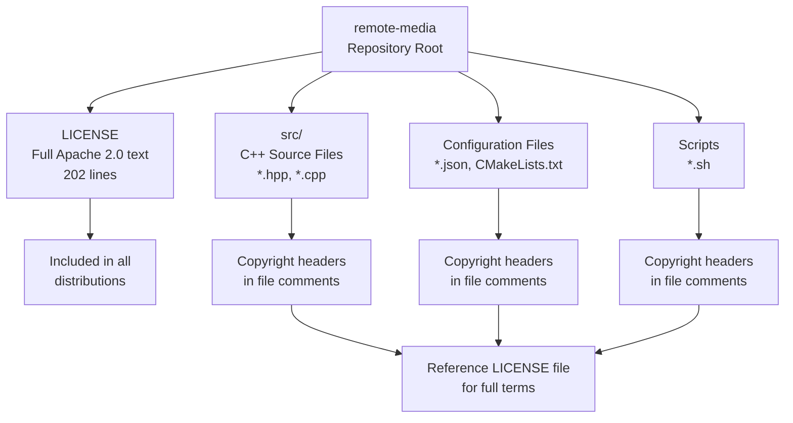

<!-- source: DeepWiki mcp.deepwiki.com · repo NVIDIA/remote-media · page 8.3 License · fetched 2026-10-26 -->

# License

<details>
<summary>Relevant source files</summary>

The following files were used as context for generating this wiki page:

- [LICENSE](LICENSE)

</details>


This document describes the licensing terms under which the remote-media software is distributed. It covers the Apache License 2.0 terms, key permissions and restrictions, distribution requirements, and how the license is applied throughout the codebase.

For information about system dependencies and third-party libraries (which may have their own licenses), see [System Dependencies](#8.1).

## License Overview

The remote-media virtual media service is distributed under the **Apache License, Version 2.0**, dated January 2004. The full license text is contained in [LICENSE:1-202]().

| Property | Value |
|----------|-------|
| License | Apache License 2.0 |
| License URL | http://www.apache.org/licenses/ |
| SPDX Identifier | Apache-2.0 |
| OSI Approved | Yes |
| Free/Open Source | Yes |

The Apache License 2.0 is a permissive free software license that allows users to use, modify, and distribute the software with minimal restrictions, while providing patent grants and requiring attribution.

**Sources:** [LICENSE:1-4]()

## License Structure

The Apache License 2.0 is organized into nine numbered sections plus an appendix. The following diagram shows the hierarchical structure of the license terms:

```mermaid
graph TD
    License["Apache License 2.0"]
    
    License --> Definitions["1. Definitions<br/>Terms: License, Licensor, Legal Entity,<br/>Source, Object, Work, Derivative Works,<br/>Contribution, Contributor"]
    License --> Copyright["2. Grant of Copyright License<br/>Perpetual, worldwide, non-exclusive,<br/>royalty-free, irrevocable"]
    License --> Patent["3. Grant of Patent License<br/>Perpetual, royalty-free, with<br/>termination on patent litigation"]
    License --> Redistribution["4. Redistribution<br/>Requirements for distributing<br/>Work or Derivative Works"]
    License --> Submission["5. Submission of Contributions<br/>Default terms for contributions"]
    License --> Trademarks["6. Trademarks<br/>No trademark rights granted"]
    License --> Warranty["7. Disclaimer of Warranty<br/>AS IS basis, no warranties"]
    License --> Liability["8. Limitation of Liability<br/>No liability for damages"]
    License --> Additional["9. Accepting Warranty or Additional Liability<br/>Optional support/warranty terms"]
    License --> Appendix["APPENDIX: Application Instructions<br/>Copyright boilerplate notice"]
    
    Redistribution --> RedistReq1["(a) Include copy of License"]
    Redistribution --> RedistReq2["(b) Mark modified files"]
    Redistribution --> RedistReq3["(c) Retain notices"]
    Redistribution --> RedistReq4["(d) Include NOTICE file content"]
```



**Sources:** [LICENSE:1-176]()

## Key Permissions and Restrictions

The Apache License 2.0 grants broad permissions while imposing specific requirements. The following table summarizes what users may and must do:

### Permissions Granted

| Permission | Description | License Section |
|------------|-------------|-----------------|
| **Use** | Use the software for any purpose, commercial or non-commercial | Section 2 |
| **Modify** | Prepare derivative works | Section 2 |
| **Distribute** | Distribute copies in Source or Object form | Sections 2, 4 |
| **Sublicense** | Grant sublicenses to others | Section 2 |
| **Patent Use** | Use any patent claims in the Work | Section 3 |
| **Private Use** | Use privately without distribution | Sections 2, 4 |

### Requirements (Conditions)

| Requirement | Description | License Section |
|-------------|-------------|-----------------|
| **Include License** | Provide copy of Apache License 2.0 with distributions | Section 4(a) |
| **State Changes** | Mark modified files with prominent notices | Section 4(b) |
| **Preserve Notices** | Retain copyright, patent, trademark, and attribution notices | Section 4(c) |
| **Include NOTICE** | Include NOTICE file content if present | Section 4(d) |

### Limitations

| Limitation | Description | License Section |
|------------|-------------|-----------------|
| **No Warranty** | Software provided "AS IS" without warranties | Section 7 |
| **No Liability** | No liability for damages | Section 8 |
| **No Trademark Grant** | No permission to use trademarks | Section 6 |
| **Patent Termination** | Patent license terminates if you sue for patent infringement | Section 3 |

**Sources:** [LICENSE:66-129]()

## Copyright and Patent Grants

### Copyright License Grant

The license provides a perpetual, worldwide, non-exclusive, no-charge, royalty-free, irrevocable copyright license with the following rights:



**Sources:** [LICENSE:66-71]()

### Patent License Grant

The license includes a patent license grant that covers patent claims necessarily infringed by contributions. However, the patent license terminates if the licensee initiates patent litigation.

**Patent License Terms:**
- Perpetual, worldwide, non-exclusive, no-charge, royalty-free, irrevocable (except as stated)
- Applies to patent claims licensable by Contributor
- Covers claims necessarily infringed by Contribution(s)
- **Terminates** if licensee files patent litigation alleging the Work infringes

**Sources:** [LICENSE:73-87]()

## Distribution Requirements

When distributing the Work or Derivative Works, licensees must comply with four specific requirements as defined in Section 4 of the license:

### Distribution Workflow



### Detailed Requirements

**Requirement 4(a): Include License Copy**
- Must provide recipients with a copy of the Apache License 2.0
- Typically satisfied by including the [LICENSE:1-202]() file in the distribution

**Requirement 4(b): Mark Modified Files**
- Must add prominent notices to modified files stating changes were made
- Notices must clearly identify that files were changed

**Requirement 4(c): Retain Source Form Notices**
- Must retain all copyright, patent, trademark, and attribution notices from the Source form
- Exclude notices that don't pertain to the Derivative Work
- Applies only to Source form distributions of Derivative Works

**Requirement 4(d): Include NOTICE File Attribution**
- If the Work includes a NOTICE file, must include its readable copy
- Can be placed in: NOTICE file in Derivative Work, Source form documentation, or display generated by Derivative Work
- Contents are informational only and don't modify the License

**Sources:** [LICENSE:89-121]()

## Copyright Notice Application

The Apache License includes an appendix with boilerplate text for applying the license to works. The standard copyright notice format is:

```
Copyright {yyyy} {name of copyright owner}

Licensed under the Apache License, Version 2.0 (the "License");
you may not use this file except in compliance with the License.
You may obtain a copy of the License at

    http://www.apache.org/licenses/LICENSE-2.0

Unless required by applicable law or agreed to in writing, software
distributed under the License is distributed on an "AS IS" BASIS,
WITHOUT WARRANTIES OR CONDITIONS OF ANY KIND, either express or implied.
See the License for the specific language governing permissions and
limitations under the License.
```

This notice should be included in the appropriate comment syntax for each file format (e.g., C++ header comments for `.hpp` files, shell comments for scripts).

**Sources:** [LICENSE:178-201]()

## Contribution Terms

The license specifies default terms for contributions submitted to the project:

**Section 5: Submission of Contributions**
- Unless explicitly stated otherwise, all contributions are under the Apache License 2.0 terms
- No additional terms or conditions apply by default
- Does not supersede separate license agreements with Licensor

When contributing to the remote-media repository, contributors implicitly agree that their contributions will be licensed under the same Apache License 2.0 terms.

**Sources:** [LICENSE:130-136]()

## Warranty and Liability Disclaimers

The Apache License 2.0 includes important disclaimers that users and distributors must understand:

### Warranty Disclaimer (Section 7)

The software is provided on an **"AS IS" BASIS**, with no warranties of any kind:

| Warranty Type | Status |
|---------------|--------|
| Express Warranties | None |
| Implied Warranties | None |
| Title | Not warranted |
| Non-Infringement | Not warranted |
| Merchantability | Not warranted |
| Fitness for Particular Purpose | Not warranted |

Users assume all risks associated with using or redistributing the Work.

**Sources:** [LICENSE:143-151]()

### Limitation of Liability (Section 8)

Contributors have **no liability** for damages under any legal theory:

- No liability for direct, indirect, special, incidental, or consequential damages
- Includes damages for loss of goodwill, work stoppage, computer failure, or commercial losses
- Applies even if the Contributor was advised of the possibility of damages
- Exceptions: deliberate and grossly negligent acts (if required by law)

**Sources:** [LICENSE:153-163]()

## Trademark Restrictions

**Section 6: Trademarks**

The license explicitly does not grant permission to use:
- Trade names
- Trademarks
- Service marks
- Product names of the Licensor

Exception: Reasonable and customary use for describing the origin of the Work and reproducing NOTICE file content.

This means users cannot imply endorsement by NVIDIA or the OpenBMC project without permission, even though the software itself may be freely used and distributed.

**Sources:** [LICENSE:138-141]()

## License Files in the Repository

The following diagram shows how license information is distributed across the remote-media repository:



**Sources:** [LICENSE:1-202]()

## Practical Implications

The following table summarizes practical implications of the Apache License 2.0 for different use cases:

| Use Case | Permitted | Requirements | Notes |
|----------|-----------|--------------|-------|
| **Deploy on BMC** | Yes | Include LICENSE file | Standard deployment scenario |
| **Modify and Deploy** | Yes | Mark changes, include LICENSE | Internal use; no distribution obligation |
| **Distribute Binary** | Yes | Include LICENSE, NOTICE (if exists), state changes | Must provide license even for compiled binaries |
| **Create Derivative Work** | Yes | Include LICENSE, retain notices, mark changes | Can apply different license to additions |
| **Commercial Use** | Yes | Include LICENSE, comply with all terms | No royalties required |
| **Patent Use** | Yes | Don't sue for patent infringement | Patent license terminates if you litigate |
| **Use Trademarks** | No | Obtain separate permission | "NVIDIA", "OpenBMC" marks not licensed |
| **Provide Warranty** | Optional | Accept liability yourself | You may offer warranty at your own risk |

## Summary

The remote-media virtual media service is licensed under the **Apache License 2.0**, providing:

1. **Broad permissions** for use, modification, and distribution
2. **Patent grant** for patent claims in contributions
3. **Clear requirements** for attribution and change marking
4. **No warranty or liability** from contributors
5. **Compatibility** with commercial and open source projects

Users and distributors must include the [LICENSE:1-202]() file, mark modified files, retain existing copyright notices, and include NOTICE file content (if present) when distributing the software.

**Sources:** [LICENSE:1-202]()