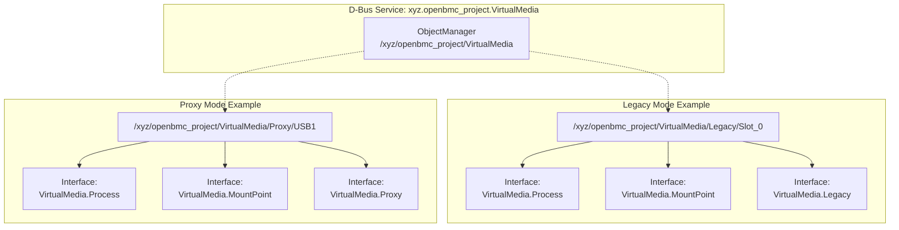
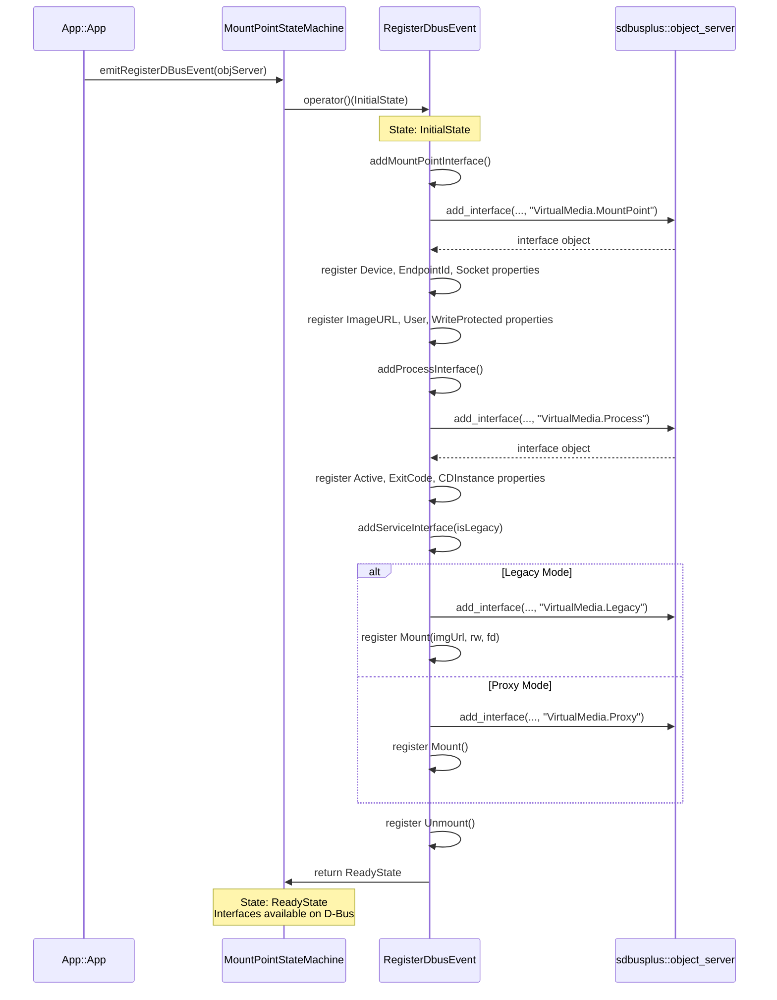
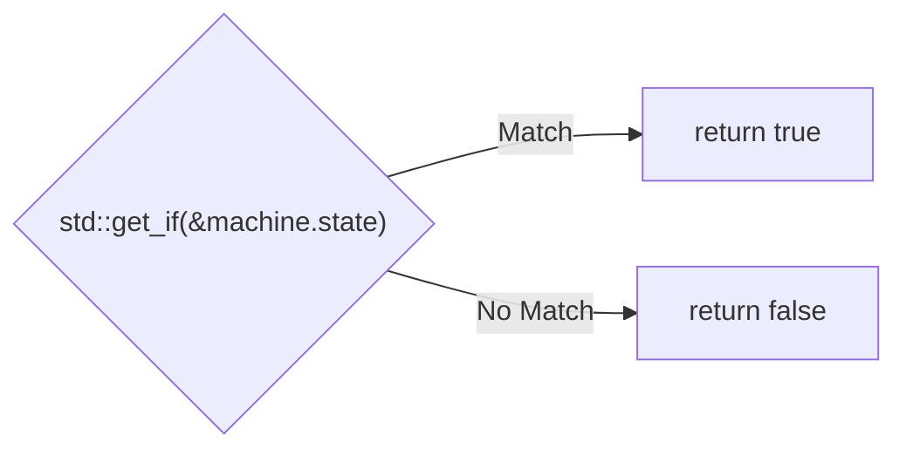
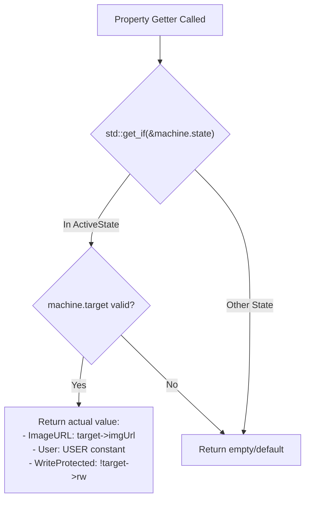
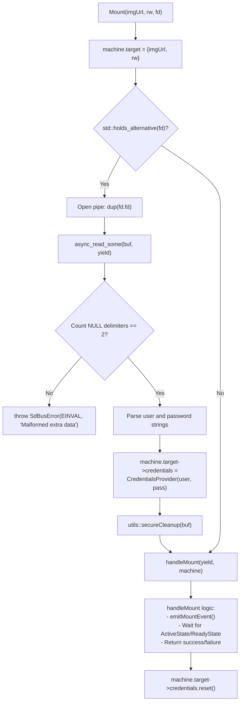
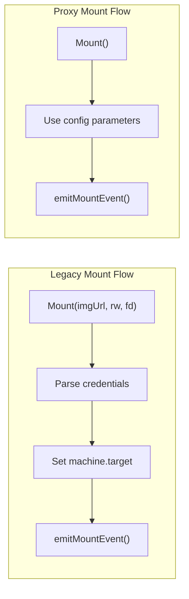
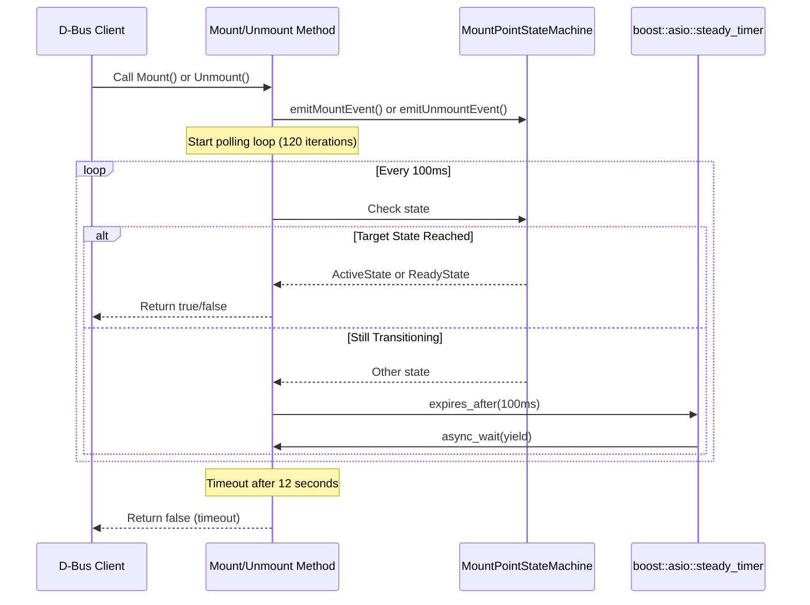

<!-- source: DeepWiki mcp.deepwiki.com · repo NVIDIA/remote-media · extra page D-Bus Interfaces Exposed · fetched 2026-10-26 -->

# D-Bus Interfaces Exposed

<details>
<summary>Relevant source files</summary>

The following files were used as context for generating this wiki page:

- [src/main.cpp](src/main.cpp)
- [src/state_machine.hpp](src/state_machine.hpp)

</details>


## Purpose and Scope

This page documents the three D-Bus interfaces exposed by each `MountPointStateMachine` instance to enable external control and monitoring of virtual media devices. Each configured mount point publishes three interfaces on the system D-Bus: `VirtualMedia.Process` (runtime status), `VirtualMedia.MountPoint` (configuration and state), and either `VirtualMedia.Legacy` or `VirtualMedia.Proxy` (mount/unmount operations).

For information about the state machine lifecycle and event handling, see [State Transitions](#3.1.1) and [Event Handling](#3.1.2). For details about the overall state machine architecture, see [MountPointStateMachine](#3.1). For complete D-Bus API usage examples, see [D-Bus Service Interface](#6.1).

---

## D-Bus Service Architecture

The virtual media service registers with D-Bus under the service name `xyz.openbmc_project.VirtualMedia` and creates a separate object path for each configured mount point. The object path varies based on the operational mode:

- **Legacy Mode**: `/xyz/openbmc_project/VirtualMedia/Legacy/{MountPointName}`
- **Proxy Mode**: `/xyz/openbmc_project/VirtualMedia/Proxy/{MountPointName}`

Each object exposes three interfaces, with the service interface (`Legacy` or `Proxy`) determined by the configuration mode.



**Sources**: [src/main.cpp:39-48](), [src/state_machine.hpp:1075-1088]()

---

## Interface Registration Flow

All three D-Bus interfaces are registered during the `RegisterDbusEvent`, which transitions the state machine from `InitialState` to `ReadyState`. The registration process follows this sequence:



**Sources**: [src/state_machine.hpp:210-231](), [src/state_machine.hpp:254-513]()

---

## VirtualMedia.Process Interface

The `Process` interface provides runtime status information about the subprocess (nbdkit or nbd-client) associated with the mount point.

### Interface Name
`xyz.openbmc_project.VirtualMedia.Process`

### Properties

| Property | Type | Access | Description |
|----------|------|--------|-------------|
| `Active` | `bool` | Read-only | `true` when the state machine is in `ActiveState`, `false` otherwise. Indicates whether the virtual media is currently mounted and operational. |
| `ExitCode` | `int32_t` | Read-only | Exit code of the last subprocess execution. Returns `machine.exitCode` which is initialized to `-1` and updated when the subprocess terminates. |
| `CDInstance` | `int32_t` | Read-write | Reserved for future use. Currently allows reading and writing but has no functional impact on the system. |

### Property Behavior

The `Active` property is dynamically computed based on the current state:



The `ExitCode` property reflects the last recorded exit code from the subprocess, which is set in the process completion callback and reset to `-1` when entering `ActivatingState`.

### Implementation Details

- **Registration**: [src/state_machine.hpp:254-289]()
- **Active getter**: [src/state_machine.hpp:265-274]()
- **ExitCode getter**: [src/state_machine.hpp:275-280]()
- **ExitCode reset**: [src/state_machine.hpp:119-125]()
- **ExitCode update**: [src/state_machine.hpp:632-635](), [src/state_machine.hpp:783-785]()

**Sources**: [src/state_machine.hpp:254-289]()

---

## VirtualMedia.MountPoint Interface

The `MountPoint` interface exposes configuration and state information about the virtual media device.

### Interface Name
`xyz.openbmc_project.VirtualMedia.MountPoint`

### Properties

| Property | Type | Access | Description |
|----------|------|--------|-------------|
| `Device` | `string` | Read-only | NBD device path (e.g., `/dev/nbd0`). Set from `config.nbdDevice.to_string()` during initialization. |
| `EndpointId` | `string` | Read-only | Mount point identifier from configuration. Used for correlation with Redfish resources. |
| `Socket` | `string` | Read-only | Unix domain socket path for nbdkit (e.g., `/tmp/nbd0.sock`). Set from `config.unixSocket`. |
| `ImageURL` | `string` | Read-only (dynamic) | URL of the currently mounted image. Returns `machine.target->imgUrl` when in `ActiveState`, empty string otherwise. |
| `User` | `string` | Read-only (dynamic) | Username used for authentication. Returns constant `USER` when in `ActiveState`, empty string otherwise. |
| `WriteProtected` | `bool` | Read-only (dynamic) | Write protection status. Returns `true` if `!machine.target->rw`, `false` if writable. Only valid when `target` is set. |

### Dynamic Property Behavior

Three properties (`ImageURL`, `User`, `WriteProtected`) are state-dependent and return meaningful values only when virtual media is active:



### Implementation Details

- **Registration**: [src/state_machine.hpp:291-351]()
- **Static properties**: [src/state_machine.hpp:298-302]()
- **ImageURL getter**: [src/state_machine.hpp:310-319]()
- **User getter**: [src/state_machine.hpp:326-335]()
- **WriteProtected getter**: [src/state_machine.hpp:339-348]()

**Sources**: [src/state_machine.hpp:291-351]()

---

## VirtualMedia.Legacy Interface

The `Legacy` interface is exposed when the mount point is configured with `mode = 1` (legacy mode). It supports traditional virtual media operations with CIFS shares and HTTPS URLs, accepting credentials via Unix file descriptors.

### Interface Name
`xyz.openbmc_project.VirtualMedia.Legacy`

### Methods

#### Mount

Mounts a virtual media image from a CIFS share or HTTPS URL.

**Signature**:
```
Mount(s imgUrl, b rw, v fd) → b
```

**Parameters**:
- `imgUrl` (`string`): Image URL. Must start with `smb://` for CIFS or `https://` for HTTPS.
- `rw` (`bool`): Mount mode. `true` for read-write, `false` for read-only.
- `fd` (`variant<int, unix_fd>`): Optional credentials. If `unix_fd`, reads credentials from the file descriptor.

**Return Value**:
- `bool`: `true` if mount succeeded, `false` otherwise. Throws `SdBusError` on failure.

**Credential Format**:

When credentials are provided via `unix_fd`, they must be formatted as two NULL-terminated strings:
1. Username (NULL-terminated)
2. Password (NULL-terminated)

The implementation validates exactly 2 NULL delimiters before parsing.

**Error Handling**:
- Throws `SdBusError(EPERM)` if called when not in `ReadyState`
- Throws `SdBusError(EINVAL)` if credential format is invalid
- Throws `SdBusError` with appropriate error code on mount failure

#### Unmount

Unmounts the currently mounted virtual media.

**Signature**:
```
Unmount() → b
```

**Return Value**:
- `bool`: `true` when unmount completes successfully.

**Error Handling**:
- Throws `SdBusError(EPERM)` if called in an invalid state

### Implementation Details

The `Mount` method implementation includes sophisticated credential handling:



- **Mount registration**: [src/state_machine.hpp:439-498]()
- **Unmount registration**: [src/state_machine.hpp:363-392]()
- **Credential reading**: [src/state_machine.hpp:448-484]()
- **Credential cleanup**: [src/state_machine.hpp:489-497]()

**Sources**: [src/state_machine.hpp:353-513](), [src/state_machine.hpp:434-499]()

---

## VirtualMedia.Proxy Interface

The `Proxy` interface is exposed when the mount point is configured with `mode = 0` (proxy mode). It supports browser-initiated virtual media via WebSocket connections to an external NBD server.

### Interface Name
`xyz.openbmc_project.VirtualMedia.Proxy`

### Methods

#### Mount

Mounts a virtual media device using pre-configured connection parameters.

**Signature**:
```
Mount() → b
```

**Parameters**: None. All connection parameters (Unix socket path, NBD device) are read from the mount point configuration.

**Return Value**:
- `bool`: `true` if mount succeeded, `false` otherwise. Throws `SdBusError` on failure.

**Behavior**:

Unlike the Legacy interface, the Proxy `Mount` method is parameterless because the nbd-client connects to a Unix socket that is managed externally (typically by bmcweb). The connection parameters are pre-configured in the `virtual-media.json` configuration file.

#### Unmount

Unmounts the currently mounted virtual media.

**Signature**:
```
Unmount() → b
```

**Return Value**:
- `bool`: `true` when unmount completes successfully.

**Error Handling**:
- Throws `SdBusError(EPERM)` if called in an invalid state

### Proxy Mode Differences



Key differences:
- No parameters required for Proxy `Mount`
- No credential handling (managed by external server)
- Connection details from configuration, not runtime parameters
- `machine.target` is not set (no URL or credentials)

### Implementation Details

- **Mount registration**: [src/state_machine.hpp:502-510]()
- **Unmount registration**: [src/state_machine.hpp:363-392]() (shared with Legacy)
- **handleMount common logic**: [src/state_machine.hpp:395-431]()

**Sources**: [src/state_machine.hpp:500-513](), [src/state_machine.hpp:395-431]()

---

## Common Method Behavior

Both `Legacy` and `Proxy` interfaces share the same `Unmount` implementation and use a common `handleMount` function that manages the asynchronous mount operation.

### Asynchronous Operation Pattern

All mount and unmount operations use a polling pattern with `boost::asio::yield_context` to wait for state transitions:



### Timeout Configuration

- **Polling interval**: 100 milliseconds
- **Maximum iterations**: 120
- **Total timeout**: 12 seconds (120 × 100ms)

If the state machine does not reach the target state within 12 seconds, the method returns `false` without throwing an exception.

**Sources**: [src/state_machine.hpp:363-392](), [src/state_machine.hpp:395-431]()

---

## Object Path Construction

The object path for each mount point is constructed using the mode and mount point name:

```cpp
// From state_machine.hpp:1078-1088
std::string getObjectPath() const
{
    if (config.mode == Configuration::Mode::proxy)
    {
        return proxyObjectPath;  // "/xyz/openbmc_project/VirtualMedia/Proxy/"
    }
    else
    {
        return legacyObjectPath; // "/xyz/openbmc_project/VirtualMedia/Legacy/"
    }
}
```

Full object path: `getObjectPath() + machine.name`

Examples:
- Legacy mode, mount point "Slot_0": `/xyz/openbmc_project/VirtualMedia/Legacy/Slot_0`
- Proxy mode, mount point "USB1": `/xyz/openbmc_project/VirtualMedia/Proxy/USB1`

**Sources**: [src/state_machine.hpp:1075-1088](), [src/state_machine.hpp:243-252]()

---

## Interface Lifecycle

All three interfaces remain registered on D-Bus for the entire lifetime of the `MountPointStateMachine`. They are registered once during the `InitialState` → `ReadyState` transition and never unregistered, even when the mount point cycles through mount/unmount operations.

The interfaces are created and initialized in this order:

1. **MountPoint interface**: Configuration properties set immediately
2. **Process interface**: Initial values (Active=false, ExitCode=0)
3. **Service interface**: Legacy or Proxy based on configuration mode

**Sources**: [src/state_machine.hpp:220-230](), [src/main.cpp:43-48]()

---

