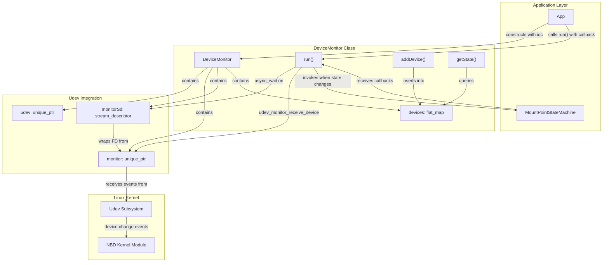
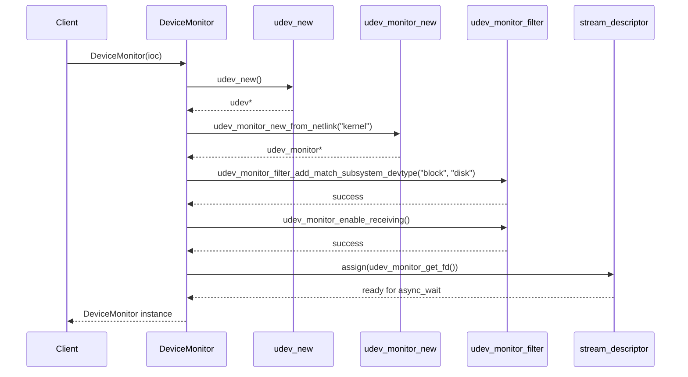
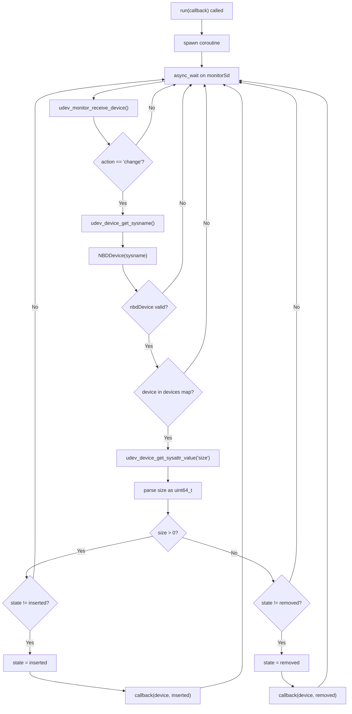
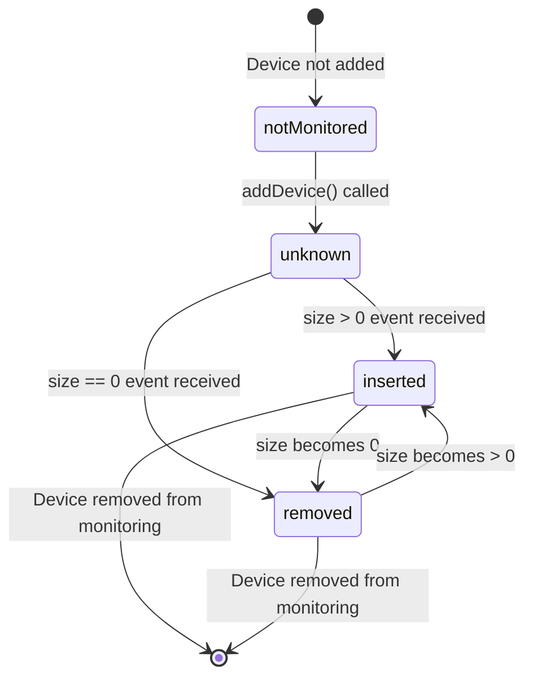
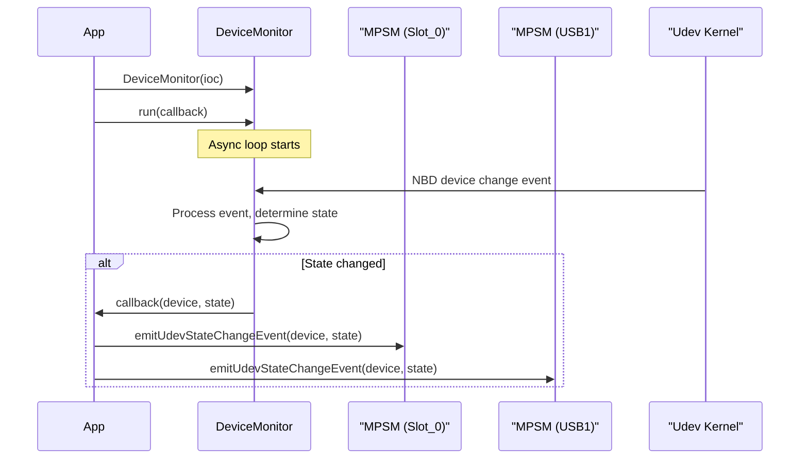

<!-- source: DeepWiki mcp.deepwiki.com · repo NVIDIA/remote-media · extra page DeviceMonitor · fetched 2026-10-26 -->

# DeviceMonitor

<details>
<summary>Relevant source files</summary>

The following files were used as context for generating this wiki page:

- [src/main.cpp](src/main.cpp)
- [src/system.hpp](src/system.hpp)

</details>


## Purpose and Scope

The `DeviceMonitor` class provides asynchronous monitoring of NBD (Network Block Device) state changes by integrating Linux's udev event system with Boost.Asio. It detects when NBD devices are inserted (become active with non-zero size) or removed (size becomes zero), enabling the virtual media service to respond to device lifecycle events.

For information about how `DeviceMonitor` integrates with the overall mount lifecycle, see [MountPointStateMachine](#3.1). For NBD device abstraction and management, see [NBDDevice Management](#3.2.1).

**Sources:** [src/system.hpp:191-354]()

---

## Class Overview

The `DeviceMonitor` class (defined in [src/system.hpp:191-354]()) is responsible for:

- Initializing and configuring libudev to monitor kernel device events
- Filtering events for block devices (specifically NBD devices)
- Tracking the state of registered NBD devices
- Executing a callback when monitored devices change state between inserted and removed
- Integrating with the Boost.Asio event loop for asynchronous operation

**Key Dependencies:**
- `libudev` for kernel device event monitoring
- `boost::asio::io_context` for asynchronous I/O
- `boost::asio::posix::stream_descriptor` for integrating udev file descriptor with Asio
- `boost::container::flat_map` for efficient device state storage

**Sources:** [src/system.hpp:191-354]()

---

## Architecture

### Component Relationships



**Diagram: DeviceMonitor Architecture**

This diagram shows how `DeviceMonitor` bridges the kernel udev subsystem with the application's asynchronous event loop. The class encapsulates udev resources using RAII wrappers and provides a callback-based interface to notify state machines of device changes.

**Sources:** [src/system.hpp:191-354](), [src/main.cpp:26-56]()

---

## Initialization and Setup

### Constructor

The `DeviceMonitor` constructor ([src/system.hpp:194-226]()) performs the following initialization sequence:



**Diagram: DeviceMonitor Initialization Sequence**

**Sources:** [src/system.hpp:194-226]()

### RAII Resource Management

The class uses custom deleters defined in the `udev` namespace ([src/system.hpp:30-53]()) to ensure proper cleanup:

| Resource Type | Custom Deleter | Cleanup Function |
|--------------|----------------|------------------|
| `udev*` | `udevDeleter` | `udev_unref()` |
| `udev_monitor*` | `monitorDeleter` | `udev_monitor_unref()` |
| `udev_device*` | `deviceDeleter` | `udev_device_unref()` |

These deleters are used with `std::unique_ptr` to provide automatic resource management:

```
std::unique_ptr<udev::udev, udev::udevDeleter> udev;
std::unique_ptr<udev::udev_monitor, udev::monitorDeleter> monitor;
```

**Sources:** [src/system.hpp:30-53](), [src/system.hpp:350-351]()

---

## Monitoring Loop

### Asynchronous Event Processing

The `run()` method ([src/system.hpp:234-327]()) implements the core monitoring functionality using Boost.Asio coroutines:



**Diagram: DeviceMonitor Event Loop Logic**

**Sources:** [src/system.hpp:234-327]()

### Event Filtering and Processing

The monitoring loop applies multiple filters:

1. **Subsystem Filter** ([src/system.hpp:211-212]()): Only "block" subsystem, "disk" device type
2. **Action Filter** ([src/system.hpp:259-262]()): Only "change" actions are processed
3. **Device Name Filter** ([src/system.hpp:272-276]()): Only valid NBD devices (nbd0-nbd10)
4. **Monitoring Filter** ([src/system.hpp:278-282]()): Only devices added via `addDevice()`

**Event Processing Steps:**

| Step | Code Reference | Purpose |
|------|----------------|---------|
| Get action | [src/system.hpp:251-258]() | Retrieve action type (add/remove/change) |
| Get sysname | [src/system.hpp:264-270]() | Extract device name (e.g., "nbd0") |
| Convert to NBDDevice | [src/system.hpp:272]() | Create NBDDevice wrapper |
| Check monitoring | [src/system.hpp:278-282]() | Verify device is in monitoring map |
| Get size attribute | [src/system.hpp:284-291]() | Read device size from sysfs |
| Parse size | [src/system.hpp:293-305]() | Convert string to uint64_t |
| Determine state | [src/system.hpp:306-323]() | size > 0 = inserted, size == 0 = removed |

**Sources:** [src/system.hpp:234-327]()

---

## State Management

### StateChange Enumeration

The `StateChange` enum ([src/system.hpp:183-189]()) defines four possible states:

```cpp
enum class StateChange
{
    notMonitored,  // Device not added to monitoring
    unknown,       // Initial state, no event received yet
    removed,       // Device size is 0
    inserted       // Device size > 0
};
```

**Sources:** [src/system.hpp:183-189]()

### State Transitions



**Diagram: StateChange State Machine**

**Sources:** [src/system.hpp:183-189](), [src/system.hpp:306-323]()

### Device State Tracking

The `devices` member ([src/system.hpp:353]()) maintains device state:

```
boost::container::flat_map<NBDDevice, StateChange> devices;
```

**Key Methods:**

| Method | Signature | Purpose |
|--------|-----------|---------|
| `addDevice()` | `void addDevice(const NBDDevice&)` | Register device for monitoring, initialize to `unknown` state |
| `getState()` | `StateChange getState(const NBDDevice&)` | Query current state, returns `notMonitored` if not registered |

**Sources:** [src/system.hpp:329-344](), [src/system.hpp:353]()

---

## Integration with Application

### Usage Pattern in App Class

The `App` class ([src/main.cpp:21-68]()) demonstrates the standard usage pattern:

1. **Construct DeviceMonitor** with io_context ([src/main.cpp:27]())
2. **Start monitoring** with callback ([src/main.cpp:50-55]())
3. **Callback dispatches** to all MountPointStateMachine instances



**Diagram: DeviceMonitor Integration Flow**

**Sources:** [src/main.cpp:21-68]()

### Callback Function Signature

The `run()` method accepts a templated callback ([src/system.hpp:234-235]()):

```cpp
template <typename DeviceChangeStateCb>
void run(DeviceChangeStateCb callback)
```

The callback must accept:
- `const NBDDevice& device` - The device that changed state
- `StateChange change` - The new state (inserted or removed)

**Example callback implementation** ([src/main.cpp:50-55]()):

```cpp
devMonitor.run([this](const NBDDevice& device, StateChange change) {
    for (auto& [name, entry] : mpsm)
    {
        entry->emitUdevStateChangeEvent(device, change);
    }
});
```

**Sources:** [src/system.hpp:234-235](), [src/main.cpp:50-55]()

---

## Error Handling

### Constructor Exceptions

The constructor throws `std::system_error` in the following cases:

| Failure Point | Error Code | Message |
|--------------|------------|---------|
| `udev_new()` fails | `EFAULT` | "Unable to create uDev handler." |
| `udev_monitor_new_from_netlink()` fails | `EFAULT` | "Unable to create uDev Monitor handler." |
| `udev_monitor_filter_add_match_subsystem_devtype()` fails | `EFAULT` | "Could not apply filters." |
| `udev_monitor_enable_receiving()` fails | `EFAULT` | "Enable receiving failed." |

**Sources:** [src/system.hpp:196-224]()

### Runtime Error Handling

The monitoring loop handles errors gracefully:

| Error Condition | Handling | Code Reference |
|----------------|----------|----------------|
| NULL action | Log error, continue | [src/system.hpp:253-258]() |
| NULL sysname | Log error, continue | [src/system.hpp:265-270]() |
| NULL size attribute | Log error, continue | [src/system.hpp:287-291]() |
| Size parse exception | Log error, continue | [src/system.hpp:298-305]() |
| Invalid NBD device | Silently skip | [src/system.hpp:273-276]() |
| Non-monitored device | Silently skip | [src/system.hpp:279-282]() |

**Sources:** [src/system.hpp:234-327]()

---

## Implementation Details

### Boost.Asio Integration

The `monitorSd` member ([src/system.hpp:348]()) bridges udev's file descriptor with Boost.Asio:

```cpp
boost::asio::posix::stream_descriptor monitorSd;
```

**Initialization** ([src/system.hpp:225]()):
```cpp
monitorSd.assign(udev_monitor_get_fd(monitor.get()));
```

**Async waiting** ([src/system.hpp:242-244]()):
```cpp
monitorSd.async_wait(
    boost::asio::posix::stream_descriptor::wait_read,
    yield[ec]);
```

This integration enables the udev monitoring to participate in the application's async event loop without blocking.

**Sources:** [src/system.hpp:225](), [src/system.hpp:242-244](), [src/system.hpp:348]()

### Size Attribute Interpretation

The monitoring logic determines device state by reading the `size` sysfs attribute ([src/system.hpp:284-323]()):

| Size Value | Interpretation | State |
|-----------|----------------|-------|
| > 0 | NBD device has active connection | `StateChange::inserted` |
| == 0 | NBD device is disconnected | `StateChange::removed` |
| NULL/unparseable | Error, skip event | No state change |

The size represents the number of 512-byte sectors in the block device. When an NBD device is connected (by nbdkit or nbd-client), the kernel populates this attribute. When disconnected (via `NBD_DISCONNECT` ioctl), it becomes zero.

**Sources:** [src/system.hpp:284-323]()

### Thread Safety Considerations

The `DeviceMonitor` class is **not thread-safe** by design:
- All operations must occur within the same `io_context` strand
- The coroutine spawned by `run()` executes on the io_context thread
- Device state map is only accessed from the coroutine
- No explicit locking is needed due to single-threaded execution model

The callback is invoked synchronously from within the coroutine, so callback implementations must not perform blocking operations.

**Sources:** [src/system.hpp:191-354]()

---

## Relationship to Other Components

### NBDDevice Class

`DeviceMonitor` works closely with `NBDDevice` ([src/system.hpp:58-181]()):

- Uses `NBDDevice(const char*)` constructor to convert sysname strings
- Relies on `NBDDevice::operator bool()` to validate device names
- Uses `NBDDevice` as key in the devices map via `operator<`
- Passes `NBDDevice` instances to callbacks

**Sources:** [src/system.hpp:58-181](), [src/system.hpp:272-276]()

### MountPointStateMachine

`MountPointStateMachine` ([src/state_machine.hpp]()) receives device state changes:

- Each state machine calls `devMonitor.addDevice()` to register its NBD device
- State machines receive `UdevStateChangeEvent` via the callback
- Events trigger state transitions (e.g., `WaitingForGadgetState` → `ActiveState`)

For detailed state machine interactions, see [MountPointStateMachine](#3.1) and [Event Handling](#3.1.2).

**Sources:** [src/main.cpp:50-55]()

---

## Summary

The `DeviceMonitor` class provides a clean, asynchronous interface for monitoring NBD device lifecycle events by:

- Encapsulating libudev configuration and resource management
- Integrating with Boost.Asio's event loop via `stream_descriptor`
- Filtering events to only NBD devices registered for monitoring
- Tracking device state based on sysfs size attribute
- Providing a callback mechanism for state change notifications

This design enables the virtual media service to respond to kernel-level device changes without polling, supporting efficient and responsive mount/unmount operations.

**Sources:** [src/system.hpp:191-354](), [src/main.cpp:21-68]()

---

