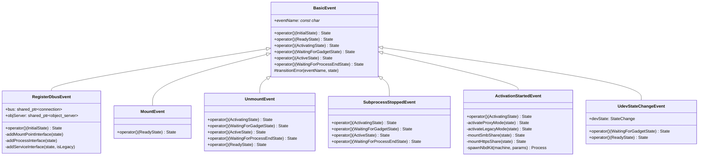
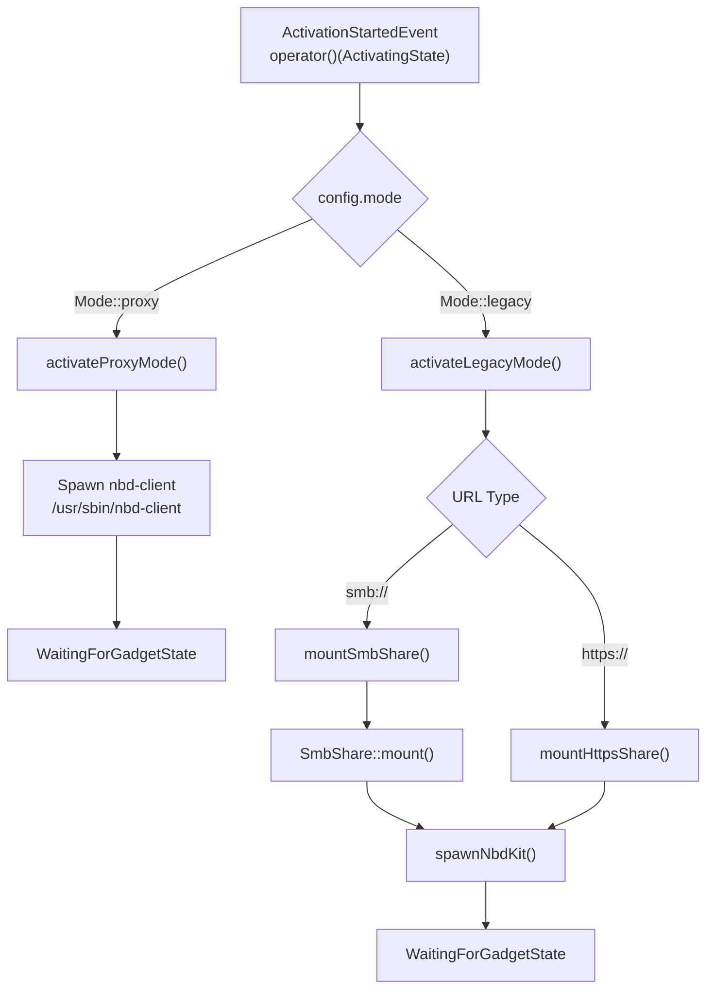
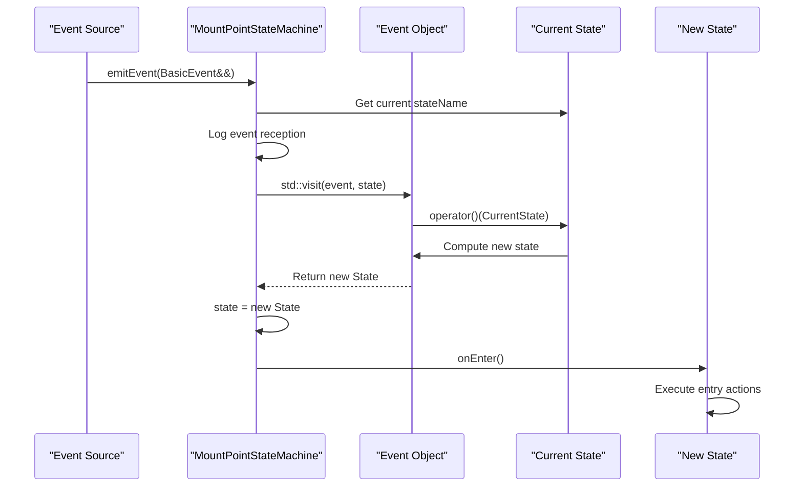
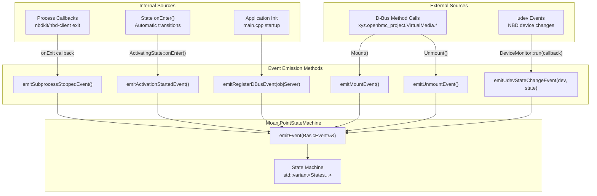
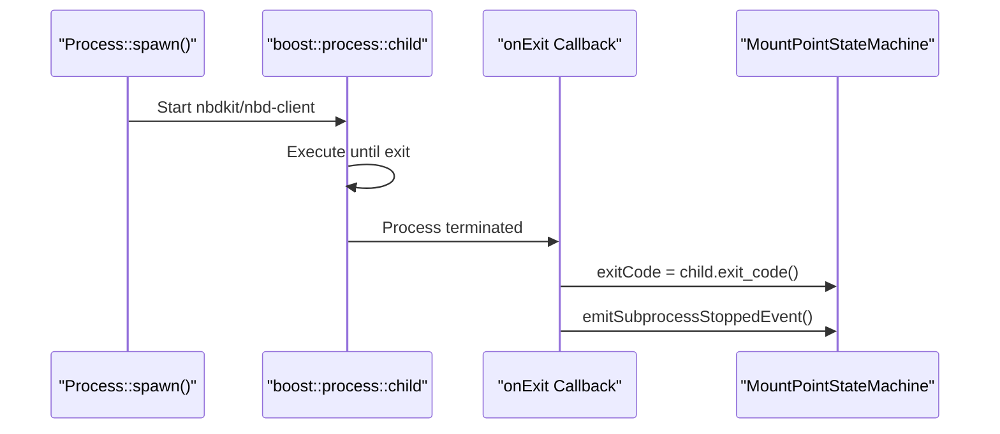
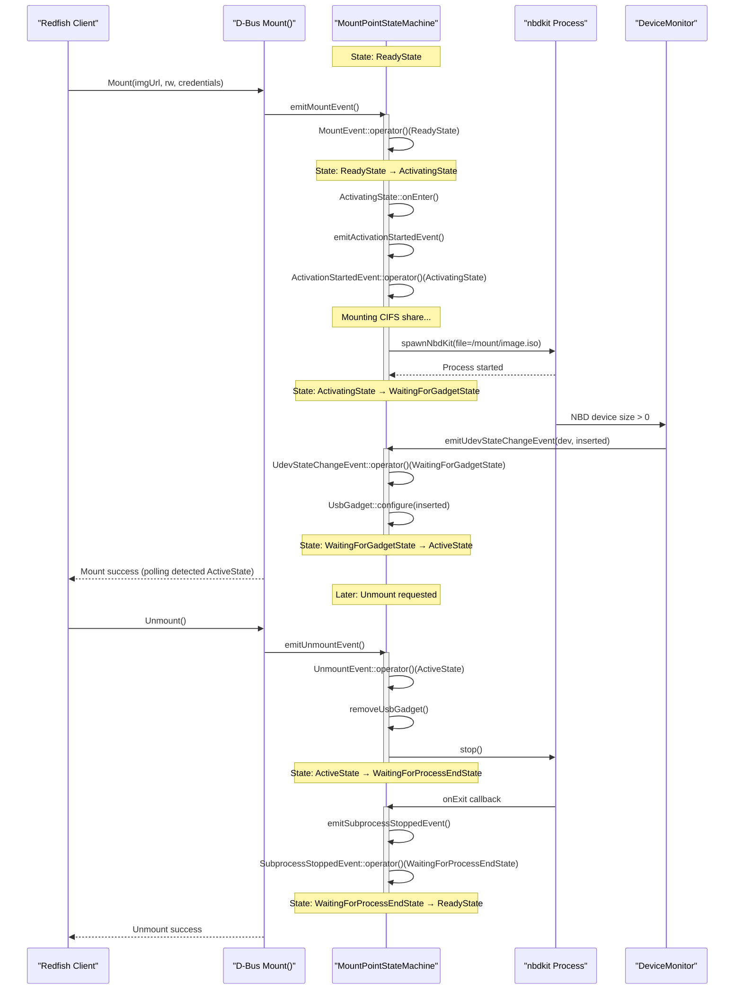

<!-- source: DeepWiki mcp.deepwiki.com · repo NVIDIA/remote-media · extra page Event Handling · fetched 2026-10-26 -->

# Event Handling

<details>
<summary>Relevant source files</summary>

The following files were used as context for generating this wiki page:

- [src/state_machine.hpp](src/state_machine.hpp)
- [src/system.hpp](src/system.hpp)

</details>


This page documents the event-driven architecture of the `MountPointStateMachine`, which processes external triggers and internal callbacks to manage virtual media lifecycle. Events represent discrete actions or notifications (mount requests, device changes, process exits) that cause state transitions.

For information about the states themselves and transition logic, see [State Transitions](#3.1.1). For the D-Bus interfaces that generate some of these events, see [D-Bus Interfaces Exposed](#3.1.3).

## Overview

The `MountPointStateMachine` operates as an event-driven finite state machine. All state changes are triggered by events, which are implemented as visitor pattern objects that operate on the current state. Each event type defines behavior for each possible state, either transitioning to a new state or remaining in the current state.

The event handling system provides:
- **Type-safe event processing** using `std::variant` and visitor pattern
- **State-specific behavior** where each event implements actions per state
- **Asynchronous event emission** from multiple sources (D-Bus, processes, udev)
- **Invalid transition detection** with logging for debugging

**Sources:** [src/state_machine.hpp:23-1089]()

## Event Type Hierarchy

All events inherit from `BasicEvent`, which provides default handlers for each state that log critical errors when unexpected transitions occur. Concrete event types override these handlers to implement state-specific logic.



**Sources:** [src/state_machine.hpp:166-961]()

## Event Types and Purposes

### RegisterDbusEvent

Initializes D-Bus interfaces for the mount point during startup. This is the first event processed by the state machine and transitions from `InitialState` to `ReadyState`.

| Property | Value |
|----------|-------|
| Trigger | Application startup via `emitRegisterDBusEvent()` |
| Valid From States | `InitialState` only |
| Transitions To | `ReadyState` |
| Key Actions | Register Process, MountPoint, and Legacy/Proxy D-Bus interfaces |

**Sources:** [src/state_machine.hpp:210-518]()

### MountEvent

Initiates virtual media mounting. Generated when D-Bus `Mount()` method is called by external clients (Redfish).

| Property | Value |
|----------|-------|
| Trigger | D-Bus `Mount()` method invocation |
| Valid From States | `ReadyState` |
| Transitions To | `ActivatingState` |
| Key Actions | Validates slot is empty, sets target configuration |
| Error Handling | Throws `InvalidStateError` if not in `ReadyState` |

**Sources:** [src/state_machine.hpp:520-534]()

### UnmountEvent

Initiates virtual media unmounting. Can be called from multiple states and handles cleanup appropriately for each.

| Property | Value |
|----------|-------|
| Trigger | D-Bus `Unmount()` method invocation |
| Valid From States | `ActivatingState`, `WaitingForGadgetState`, `ActiveState`, `WaitingForProcessEndState`, `ReadyState` |
| Transitions To | `ReadyState` or `WaitingForProcessEndState` |
| Key Actions | Stop process, remove USB gadget, emit RESOURCE_DELETED event |

**Valid Unmount Transitions:**

| From State | Action Taken | Next State |
|------------|--------------|------------|
| `ActivatingState` | Cancel activation | `ReadyState` |
| `WaitingForGadgetState` | Stop process, wait for exit | `WaitingForProcessEndState` |
| `ActiveState` | Remove USB gadget, stop process | `WaitingForProcessEndState` |
| `WaitingForProcessEndState` | No-op (already waiting) | `WaitingForProcessEndState` |
| `ReadyState` | No-op (nothing to unmount) | `ReadyState` |

**Sources:** [src/state_machine.hpp:536-575]()

### SubprocessStoppedEvent

Handles termination of nbdkit or nbd-client processes, either due to unmount or unexpected failure.

| Property | Value |
|----------|-------|
| Trigger | Process exit callback in `Process::spawn()` |
| Valid From States | `ActivatingState`, `WaitingForGadgetState`, `ActiveState`, `WaitingForProcessEndState` |
| Transitions To | `ReadyState` |
| Key Actions | Remove USB gadget if needed, store exit code, perform cleanup |

**Sources:** [src/state_machine.hpp:577-604]()

### ActivationStartedEvent

Performs actual mounting operations after `MountEvent` transitions to `ActivatingState`. This event handles the operational mode branching (proxy vs. legacy) and protocol-specific logic (CIFS vs. HTTPS).

| Property | Value |
|----------|-------|
| Trigger | `onEnter()` callback from `ActivatingState` |
| Valid From States | `ActivatingState` |
| Transitions To | `WaitingForGadgetState` or `ReadyState` (on error) |
| Key Actions | Spawn nbdkit/nbd-client, mount CIFS shares, configure credentials |

**Mode-Specific Behavior:**



**Sources:** [src/state_machine.hpp:606-908]()

### UdevStateChangeEvent

Processes device insertion and removal notifications from the `DeviceMonitor`. This event completes the activation sequence when the NBD device becomes available.

| Property | Value |
|----------|-------|
| Trigger | `DeviceMonitor` callback via `emitUdevStateChangeEvent()` |
| Valid From States | `WaitingForGadgetState`, `ReadyState` |
| Transitions To | `ActiveState` (on insertion) or `ReadyState` (on error) |
| Key Actions | Configure USB gadget, emit RESOURCE_CREATED event |

**Sources:** [src/state_machine.hpp:910-961]()

## Event Processing Mechanism

Events are processed through the `emitEvent()` method, which applies the visitor pattern to execute state-specific logic:



**Core Implementation:**

The `emitEvent()` method ([src/state_machine.hpp:1010-1020]()):

1. **Logs the event**: Records event name and current state name
2. **Applies visitor pattern**: `std::visit(event, state)` calls the appropriate `operator()` on the event
3. **Updates state**: Assigns returned state to `state` member
4. **Triggers entry action**: Calls `onEnter()` on the new state

**Sources:** [src/state_machine.hpp:1010-1020]()

## Event Sources and Emission

Events originate from multiple asynchronous sources throughout the system:



### D-Bus Event Sources

D-Bus method invocations generate `MountEvent` and `UnmountEvent`:

- **Mount Method** ([src/state_machine.hpp:439-498]()): Parses image URL, credentials, read-write flag, then calls `machine.emitMountEvent()`
- **Unmount Method** ([src/state_machine.hpp:363-392]()): Directly calls `machine.emitUnmountEvent()`

Both methods use asynchronous waiting loops to poll for state transitions to complete before returning to the caller.

### Process Event Sources

The `Process` class generates `SubprocessStoppedEvent` when nbdkit or nbd-client terminates:



**Sources:** [src/state_machine.hpp:629-639, 780-786](), [src/system.hpp:356-441]()

### Udev Event Sources

The `DeviceMonitor` watches for NBD device state changes and generates `UdevStateChangeEvent`:

| Udev Action | Size Value | State Change | Event Generated |
|-------------|------------|--------------|-----------------|
| "change" | > 0 | `inserted` | `UdevStateChangeEvent(inserted)` |
| "change" | == 0 | `removed` | `UdevStateChangeEvent(removed)` |

The monitor runs in a coroutine that continuously polls udev and invokes callbacks:

```cpp
// DeviceMonitor::run() at src/system.hpp:236-327
callback(nbdDevice, StateChange::inserted);  // Calls emitUdevStateChangeEvent()
```

**Sources:** [src/system.hpp:191-354]()

### State Entry Event Sources

Some states automatically emit events upon entry:

- **ActivatingState::onEnter()** ([src/state_machine.hpp:119-125]()): Calls `machine.emitActivationStartedEvent()`
- This pattern enables automatic progression through the state machine without external triggers

## State-Specific Event Handling

Each event defines behavior for every state. The table below shows which transitions are valid:

| Event | InitialState | ReadyState | ActivatingState | WaitingForGadgetState | ActiveState | WaitingForProcessEndState |
|-------|--------------|------------|-----------------|------------------------|-------------|---------------------------|
| **RegisterDbusEvent** | → ReadyState | ❌ Error | ❌ Error | ❌ Error | ❌ Error | ❌ Error |
| **MountEvent** | ❌ Error | → ActivatingState | ❌ Error | ❌ Error | ❌ Error | ❌ Error |
| **UnmountEvent** | ❌ Error | → ReadyState (noop) | → ReadyState | → WaitingForProcessEndState | → WaitingForProcessEndState | → WaitingForProcessEndState (noop) |
| **SubprocessStoppedEvent** | ❌ Error | ❌ Error | → ReadyState | → ReadyState (error) | → ReadyState | → ReadyState |
| **ActivationStartedEvent** | ❌ Error | ❌ Error | → WaitingForGadgetState or ReadyState (error) | ❌ Error | ❌ Error | ❌ Error |
| **UdevStateChangeEvent** | ❌ Error | → ReadyState (noop if removed) | ❌ Error | → ActiveState (if inserted) or ReadyState (error) | ❌ Error | ❌ Error |

**Legend:**
- → Indicates valid transition
- ❌ Logs critical error via `transitionError()`
- (noop) Event is valid but performs no state change
- (error) Transition occurs but with error information stored

### Error Handling in Events

Invalid transitions are detected by the `BasicEvent::transitionError()` method:

```cpp
// src/state_machine.hpp:171-176
inline void transitionError(const char* en, const BasicState& state)
{
    LogMsg(Logger::Critical, state.machine.name, " Unexpected event ",
           eventName, " received in ", state.stateName,
           "state. Review and correct state transisions.");
}
```

When an event is received in an unexpected state, this logs a critical error but does not crash. The state machine remains in its current state, making the system resilient to programming errors or race conditions.

**Sources:** [src/state_machine.hpp:166-961]()

## Event Emission Helper Methods

The `MountPointStateMachine` provides convenience methods for emitting each event type:

| Method | Event Type | Parameters | Typical Caller |
|--------|------------|------------|----------------|
| `emitRegisterDBusEvent()` | `RegisterDbusEvent` | `objServer` | `main.cpp` during startup |
| `emitMountEvent()` | `MountEvent` | None | D-Bus Mount() method |
| `emitUnmountEvent()` | `UnmountEvent` | None | D-Bus Unmount() method |
| `emitActivationStartedEvent()` | `ActivationStartedEvent` | None | `ActivatingState::onEnter()` |
| `emitSubprocessStoppedEvent()` | `SubprocessStoppedEvent` | None | Process exit callback |
| `emitUdevStateChangeEvent()` | `UdevStateChangeEvent` | `dev`, `devState` | `DeviceMonitor` callback |

**Device-Specific Filtering:**

The `emitUdevStateChangeEvent()` method filters events by NBD device:

```cpp
// src/state_machine.hpp:1048-1058
void emitUdevStateChangeEvent(const NBDDevice& dev, StateChange devState)
{
    if (config.nbdDevice == dev)
    {
        emitEvent(UdevStateChangeEvent(devState));
    }
    else
    {
        LogMsg(Logger::Debug, name, " Ignoring request.");
    }
}
```

This ensures each `MountPointStateMachine` only reacts to events for its configured NBD device.

**Sources:** [src/state_machine.hpp:1022-1058]()

## Event Flow Example: Complete Mount Operation

The following diagram shows event flow for a typical legacy mode mount operation:



**Sources:** [src/state_machine.hpp:520-961]()

## Exception Handling

Events can throw `InvalidStateError` to signal invalid operations to D-Bus callers:

```cpp
// src/state_machine.hpp:25-29
struct InvalidStateError : std::runtime_error
{
    InvalidStateError(const char* what) : std::runtime_error(what)
    {}
};
```

This exception is caught by D-Bus method handlers and converted to D-Bus error responses:

```cpp
// src/state_machine.hpp:372-375
catch (InvalidStateError& e)
{
    throw sdbusplus::exception::SdBusError(EPERM, e.what());
    return false;
}
```

This provides clear error feedback to clients attempting invalid operations (e.g., mounting when already active).

**Sources:** [src/state_machine.hpp:25-29, 368-376, 397-405]()

---

